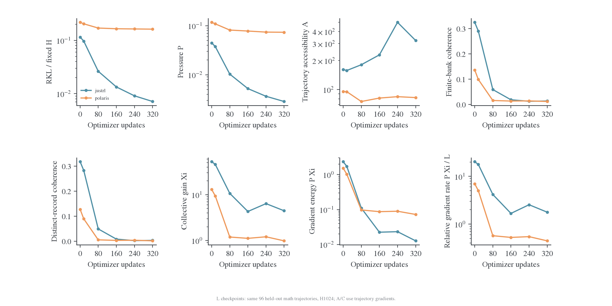
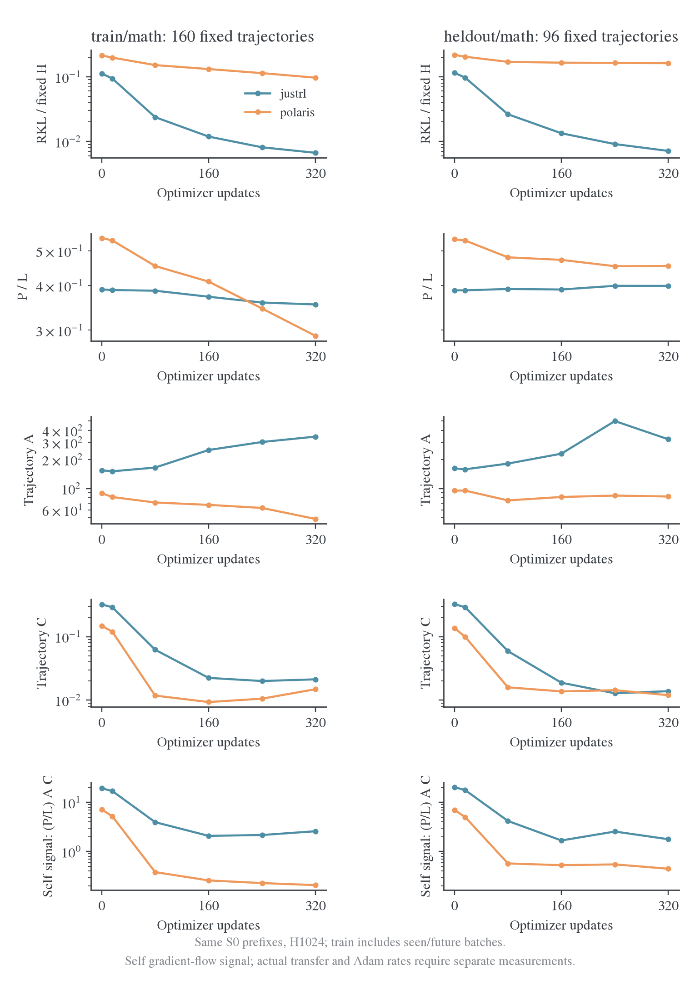
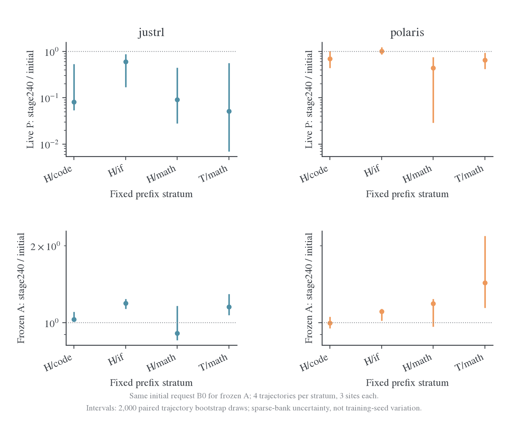
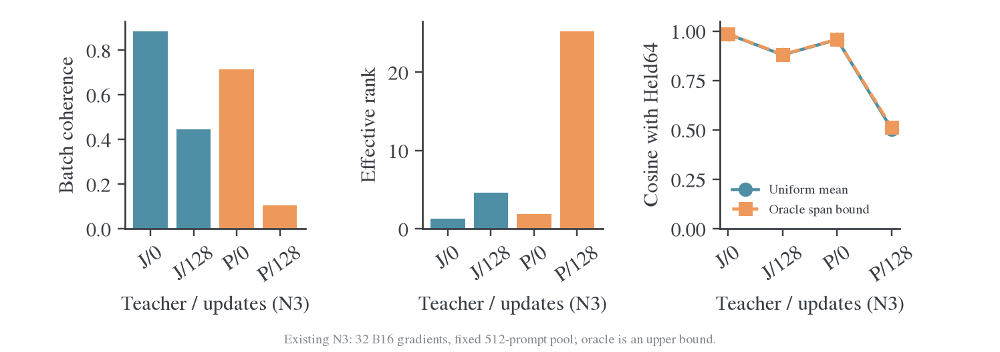
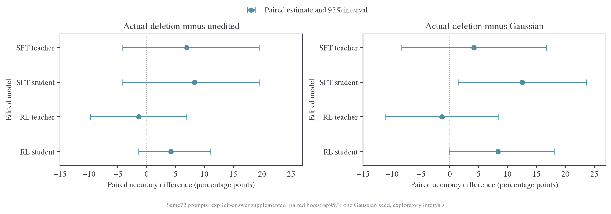
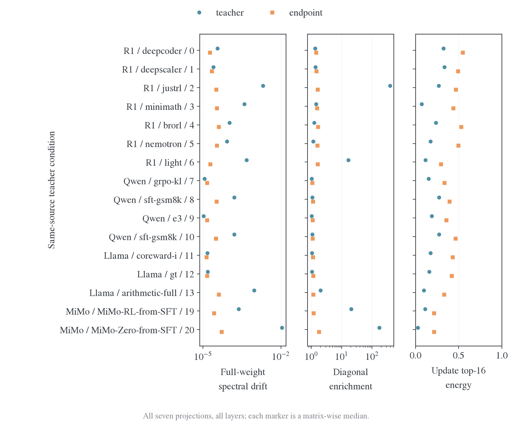
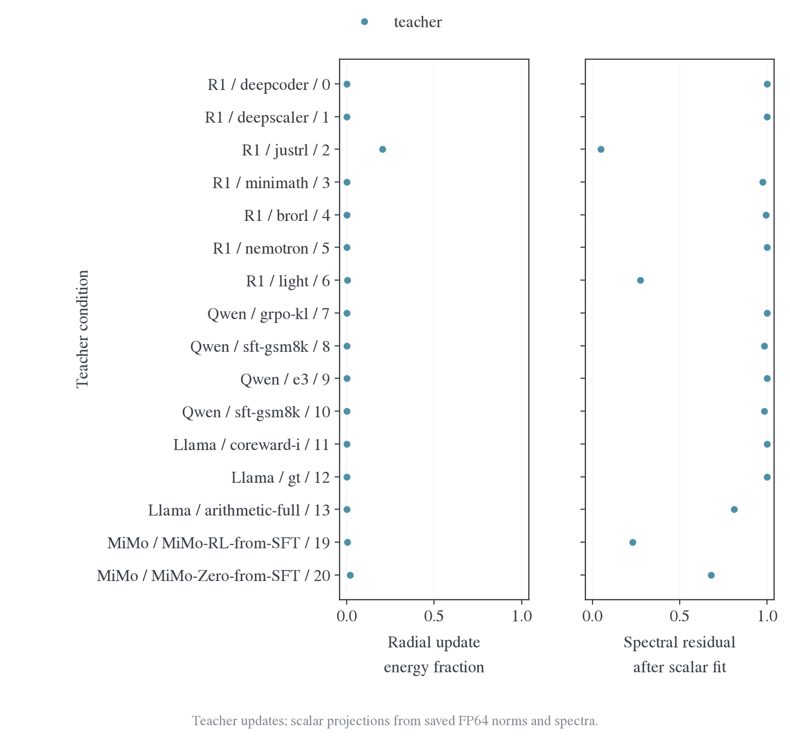
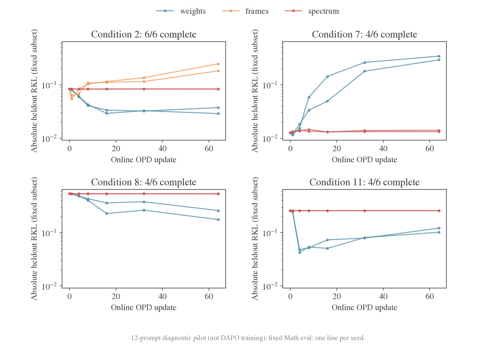
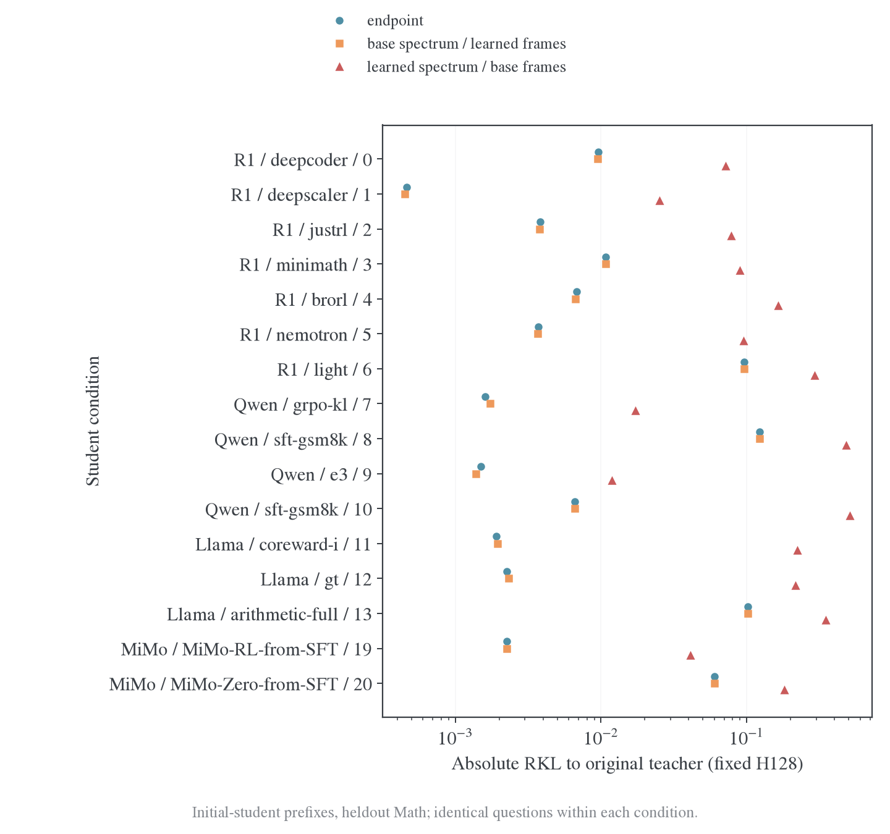
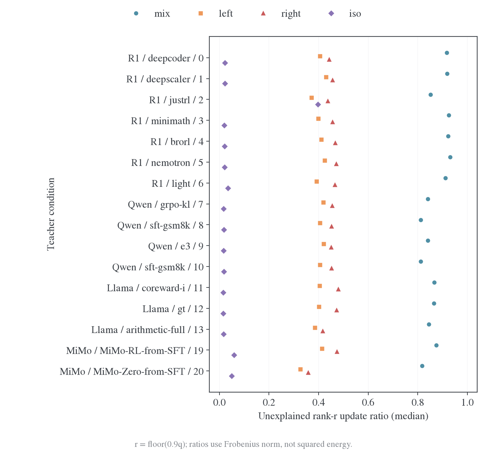

# 附录：定义、协议、实现与证据

[总览](README.md) · [设置](设置与指标.md) · [跨模型结果](跨模型结果.md) · [机制分析](机制分析.md)

本页按数学定义、历史协议、实现与计算成本组织；小面板、旧版 replay 和诊断 pilot 保留各自口径。

## 查询导航

| 阅读目的                                | 章节                                                                         |
| --------------------------------------- | ---------------------------------------------------------------------------- |
| 复画正文图、定位数据与校验来源          | [附件组织](#附件组织与离线复画)、[证据入口](#证据与复算入口)                 |
| 核对输出谱、参数谱、head 与局部线性模型 | [数学定义](#数学定义与数值验收)                                              |
| 核对 PAC、跨 batch 传播与历史小面板     | [传播协议](#传播测量的实际来源与归约)、[历史复核](#历史-pac-与小面板复核)    |
| 对照 ISO 原论文与本地完成范围           | [ISO 方法](#iso-原论文范围与本地操作)、[扩展结果](#全层与功能扩展的执行结果) |
| 查训练数据纠正、算子实现与耗时          | [训练审计](#训练审计与共享算子实现)、[计算成本](#计算预算与实测耗时)         |
| 查生成评分与原始错误例子                | [任务评分](#任务生成与评分补充)                                              |

## 附件组织与离线复画

| 位置                                       | 保存内容                                                     | 阅读与使用方式                                 |
| ------------------------------------------ | ------------------------------------------------------------ | ---------------------------------------------- |
| `data/synthesis/`                          | 三张正文新图的逐行 CSV、绘图源与来源哈希、计时重放脚本       | 从本文相邻文件复画，不读原始运行目录           |
| `figures/synthesis/`                       | 新图 PNG/PDF/SVG 与机器审计                                  | PNG 阅读，PDF/SVG 用于排版                     |
| `data/iso-20261111/`                       | ISO 全层、功能、合并与 pilot 的结构化汇总                    | 数学条件与任务身份保留在 JSON 内               |
| `data/teacher-spectrum-20261110/`          | 历史风险、逐题评分、精确谱与源码；原始逐矩阵记录按数据包维护 | 原始来源路径保留用于溯源；重绘入口读取本地附件 |
| `data/teacher-difference/`                 | PAC、跨批传播与真实更新附件                                  | 按实验与原协议查阅                             |
| `data/training-audit/`                     | 训练设置纠正、DAPO 输入预检与测试回执                        | 解释 pilot 与正式训练的区别                    |
| `figures/teacher-spectrum-clean/`          | 清洁 16 条件评分归档及旧版可复画图                           | 历史生成目录保留原布局，JSON/CSV 与其图源绑定  |
| `figures/teacher-difference/` 等历史图目录 | 各原始实验的图、CSV、审计与来源清单                          | 文件内容冻结；正文只引用与论断对应的图         |

[附件清单](data/assets-manifest.json)记录静态附件的相对路径、字节数和 SHA256；持续更新的 ISO 汇总与图单独列明。附件不含模型权重、方向 tensor 或推理缓存。历史 JSON 中的原始路径是来源字段，不是阅读或重画正文总览图的依赖。

在仓库根目录执行：

```bash
python -m examples.mirroropd.research.studies.spectral.absorption.report_figures \
  --docs examples/mirroropd/docs/experiments/teacher-transfer/absorption
```

绘图需要 matplotlib、numpy 与 figure-viz 的 `fvstyle`；通过 `FIGURE_VIZ_MPL` 指定该样式模块目录。ISO 图使用相邻冻结 48 行输入，避免持续更新的任务汇总改变图表来源。三张图的精确输入与 SHA256 保存在[provenance.json](data/synthesis/provenance.json)，绘图源副本保存在[data/synthesis/report_figures.py](data/synthesis/report_figures.py)。

## 数学定义与数值验收

### A. Native 风险与输出谱

固定 prefix $s$，native 评分为全词表 reverse KL，沿真实可用回答位置求和后除以固定 $H=1024$：

$$
L_H=\frac1N\sum_{q=1}^N\frac1H\sum_{t\in q}D_{\rm KL}(p_t\|q_{T,t}).
$$

谱诊断另取每题 16 个位置，定义 teacher 与 student 相对 base 的 log-probability 变化：

$$
d_T(s)=\log q_T(\cdot|s)-\log p_0(\cdot|s),\qquad
d_O(s,t)=\log p_t(\cdot|s)-\log p_0(\cdot|s).
$$

用共同参照 $p_0$ 消除常数方向并加权：

$$
\mathcal W_s(d)=\sqrt{p_0(s)}\odot\left(d-\mathbb E_{p_0(s)}d\right).
$$

按相同题目/位置权重堆叠为 $R_T,R_O$，有 $R_{miss}=R_T-R_O$。在 calibration 拟合 $R_T=U\Sigma V^\top$，固定 band 投影 $P_b=V_bV_b^\top$，在 heldout 计算：

$$
E_b^T=\|R_TP_b\|_F^2,\qquad
a_b=\frac{\langle R_OP_b,R_TP_b\rangle_F}{E_b^T},\qquad
m_b=\frac{\|(R_T-R_O)P_b\|_F^2}{E_b^T}.
$$

$a_b$ 是有符号吸收系数，$m_b$ 是剩余能量比，保留负值或大于 1 的原值。域内聚合使用 $\sum E_b^Ta_b/\sum E_b^T$ 和 $\sum E_b^Tm_b/\sum E_b^T$，小分母标缺失。框架外 complement 包含 rank 截断与状态覆盖差异。大位移时 Fisher 范数是诊断量，真实分布拟合由 native KL 给出；centered-logit 与概率差用于度量敏感性复核。

共同支持按实际 token-ID 语义核验；teacher 额外支持质量由 native 评分单列。分块词表投影与随机 SVD 控制内存，三 seed 及 rank16/64/128 检查近似稳定性。所有阶段共享位置协议，原生题内风险覆盖全部可用位置。

### B. 权重、表示与形状基线

对可比参数坐标定义 $D_T=W_T-W_0$、$D_O=W_O-W_0$、$E=W_T-W_O$，分别分析完整权重、更新和残差。共享 base thin-SVD $W_0=U_0\Sigma_0V_0^\top$，任意矩阵 $X$ 的坐标为 $C=U_0^\top XV_0$，分解为：

$$
X_{diag}=U_0\operatorname{Diag}(\operatorname{diag}C)V_0^\top,\quad
X_{off}=U_0[C-\operatorname{Diag}(\operatorname{diag}C)]V_0^\top,\quad
X_{null}=X-U_0CV_0^\top.
$$

三部分正交且重构 $X$。对 $m\times n$ 矩阵，$q=\min(m,n)$，三个空间维数为 $q,q^2-q,mn-q^2$，各向同性能量基线为各维数除以 $mn$。diag 是一阶奇异值变化的坐标描述；有限位移的精确谱由直接 SVD 测量。

精确权重轨迹将已保存 BF16 权重提升到 FP64 后分解，报告其原始精度与 SHA256；它描述保存的 checkpoint。全层结果覆盖 28 层七类 attention/MLP 矩阵，embedding、norm、head 单列。谱径向变化可用：

$$
\delta_\Sigma(W)=\frac{\|\sigma(W)-\sigma(W_0)\|_2}{\|W_0\|_F},\qquad
\rho_\Sigma(W)=\frac{\|\sigma(W)-\sigma(W_0)\|_2}{\|W-W_0\|_F}.
$$

冻结实现的 $\kappa_{spec}$ 是按形状归一化的 base 框架对角能量比例：

$$
\kappa_{spec}=\frac{mn}{q}\frac{\|X_{diag}\|_F^2}{\|X\|_F^2}.
$$

各向同性基线为 1；它与精确奇异值位移 $\rho_\Sigma$、参数距离分别测量不同对象。子空间使用 projector 消除奇异向量符号，近简并谱需要整块比较。表示残差使用同 prefix、同宽度的 $H_T-H_0$、$H_O-H_0$、$H_T-H_O$，final-norm 之后的 head 输入与 pre-norm 流分开；CKA 作为整体相似度辅助量。

### C. Head 与 hidden 的精确记账

普通 centered-head SVD 给出强/弱隐方向，prefix Fisher 加权 head 为另一个依赖状态的算子。head 允许随 teacher 变化，忽略 bias 时有精确恒等式：

$$
z_T-z_0=W_0(h_T-h_0)+(W_T-W_0)h_T.
$$

有 bias 时增加 bias 差。两项范数、内积及组合分布共同决定输出；弱 head 方向中的 hidden 残差首先是表征未匹配，其任务意义由功能干预判定。

### D. 干预、实现与数值验收

谱干预实现于`spectral/decomposition.py`、`weights.py`、`extract.py`、`residuals.py`、`representations.py`和`scoring.py`；实际源码以运行目录冻结 source 为准。

JVP 复用[LogitJacobian](../../../../research/studies/teacher_difference/logit_geometry.py)，原生风险复用[full-vocabulary reverse KL](../../../../../../verl/trainer/distillation/reverse_vocab.py)，生成复用[collector 与 grader](../../../../research/studies/fixed_transfer/evaluation.py)。

随机对照包括同 shape 同 Frobenius Gaussian 与保留奇异值的随机左右框架，均在相同矩阵内匹配范数。重构模型在干预前完成无编辑重载 gate（atol=$10^{-5}$、rtol=$10^{-4}$）；精确 SVD 重构与能量恒等式误差不超过 $10^{-8}$；精确 KL 导数的 FP64 中心差分误差约 $2.12\times10^{-11}$。tied 权重只编辑一次，实际位移符号由导出权重复核。

后续 activation oracle 可写为 $h'_O=h_O+\beta P_b(h_T-h_O)$，保持 student head；输出 band 合成监督可在共同正支持上定义 $q_A\propto p_0\exp(r_A/\sqrt{p_0})$，以 log-space 实现并检查弱概率放大。完整 band 连同 complement 应重构 teacher。二者为后续机制工具，该实验未执行对应训练。

### 局部线性模型与函数像空间

令 $J$ 为相同状态、相同度量下的 student Jacobian，$d_T$ 为 teacher 请求，局部目标为：

$$
\mathcal L(\Delta\theta)=\tfrac12\|J\Delta\theta-d_T\|^2.
$$

对非零奇异值 $s_i>0$ 分解 $J=\sum_i s_i u_i v_i^\top$，$d_T=\sum_i\alpha_i u_i+d_\perp$。固定 $J$、从零更新开始的无预条件梯度流满足：

$$
\dot{\Delta\theta}=J^\top(d_T-J\Delta\theta),\qquad
\dot c_i=s_i(\alpha_i-s_ic_i),\qquad c_i=v_i^\top\Delta\theta.
$$

解得：

$$
c_i(t)=\frac{\alpha_i}{s_i}(1-e^{-s_i^2t}),\qquad
\|d_T-J\Delta\theta(t)\|^2=\|d_\perp\|^2+\sum_i\alpha_i^2e^{-2s_i^2t}.
$$

该模型把响应强度 $s_i$、请求投影 $\alpha_i$ 与不可达残差分开。局部可达方向不必立即学完，训练状态改变和 optimizer 预条件还会改变速度与方向。

若只允许参数子空间 $B$ 更新，令 $P_{JB}$ 为到 JB 列空间的正交投影，则：

$$
\min_a\|JBa-d_T\|^2=\|(I-P_{JB})d_T\|^2.
$$

因此真正要预测的是请求在**函数像空间**$JB$ 中的可解释部分，单看权重更新 rank 不够。已有 JVP 只采样了若干参数方向，下一步用真实训练状态连接这项预测与实际更新。

## 传播测量的实际来源与归约

### 共同设置与数据来源

该实验最大训练阶段为 **320 updates**，R1、MiMo 与 Qwen 均遵守该上限。**不测 Qwen RAW、CCS-rho0、CCS-rho1 的 OPD**。主分析统一比较 $P,A,C,\Xi,P\Xi,P\Xi/L$ 及对应 loss；distinct-record 相干性、span 和 Fisher 探针作为解释这些量的辅助证据。

| 模型组       | Student 参数点                                      | Teacher target                             |
| ------------ | --------------------------------------------------- | ------------------------------------------ |
| R1-1.5B      | DeepSeek-R1-Distill-Qwen-1.5B 初始及 L 两条训练路径 | JustRL-DeepSeek-1.5B、Polaris-7B-Preview   |
| MiMo-7B 主轮 | MiMo-7B-Base 初始；E72/E73 末期不可测               | MiMo-7B-RL-Zero、MiMo-7B-SFT               |
| MiMo E91     | MiMo-7B-SFT 初始及其 E91 终点                       | 同上两个 target                            |
| Qwen3 扩展   | Qwen3-1.7B 初始及 37 个训练后保存点                 | 沿用各原始 run 的 target，详见下方 catalog |

诊断数据来自已有固定 token bank，每条记录包含 prompt、response token 和域、划分、来源、teacher、checkpoint 等标识。各参数点使用相同 token 前缀，保证阶段差异来自模型变化；fresh 生成评估单列。

#### R1-1.5B 的来源

R1 的原始 prompt、三套初始学生轨迹和 JustRL/Polaris 参考轨迹来自 [`state-transfer-20261027`](../transfer-mechanism/data/state-transfer-20261027)：

- `prompts.json` 是 2026-10-27 按固定 seed 从 DAPO-Math、TACO 和英文 MultiIF 选择并去重后的 prompt 表；
- `rollouts-student.json`、`rollouts-justrl.json`、`rollouts-polaris.json` 是温度 1、`H=768` 的初始轨迹；训练和固定评分使用其中完整前缀；
- `justrl-*-split*/`、`polaris-*-split*/` 下的 `protocol.json`、`training.json`、`evaluation.json` 是已有短程 OPD 结果；`geometry*.log` 和 `within-trace-gradient-geometry.json` 是已有梯度几何审计；
- 长跨批 B/N/L 的题目划分、随机种子和 A--T/永久留出关系记录在 [`cross-batch-transfer.md`](../cross-batch-transfer.md)；该实验复算直接读取其冻结 bank 和对应结果，不重新抽题。

固定 bank 用于 PAC 和 batch Gram；已有 `training.json`、`evaluation.json` 用于核对训练池与 Held64 的真实下降。只有标量 loss 的历史运行提供结果对照。

#### MiMo-7B 的来源

MiMo 的 E72/E73 固定状态实验已冻结，可审计副本在 [`data/mimo-stage-20261104-final/`](../data/mimo-stage-20261104-final) 和 [`data/mimo-stage-20261103/`](../data/mimo-stage-20261103)：

- E72 使用 `MiMo-7B-Base` student 和 `MiMo-7B-RL-Zero` teacher；E73 使用同一 Base 和 `MiMo-7B-SFT` teacher；两者都是 `batch=128`、`rollout n=1`、`reuse=16`、`20 outer=320 updates`、LR $10^{-6}$、weight decay $0.01$、训练 response cap `7168`；
- 每个 E72/E73 目录的 `manifest.json` 给出正式 run 路径、metrics SHA256、outer cutoff 和派生文件哈希；`fixed-bank-rkl.csv`、`outers.csv`、`updates.csv`、`summary.json` 保存评分与训练结果；
- 四域训练/评估协议在 [`online-four-domain.md`](../protocols/online-four-domain.md)：Math 来自本地清洗的 DAPO-Math-17K，Code 来自 DeepCoder Preview，Science 来自 MegaScience/TextbookReasoning，IF 来自 Nemotron-Cascade-2-RL-data 的 IF-RL 子集；训练 cap 为 7168，公共 bank 按 Math/Code/Science/IF 分域保存；
- `public_initial` 使用 Base 生成的 prefix，`public_teacher` 使用对应 teacher 生成的 prefix；两套 bank 分别比较。

MiMo 的位置级和连续 batch 对照已经落在 [`mimo-position-kl-20261106`](../data/mimo-position-kl-20261106) 与 [`mimo-batch-transfer-20261107`](../data/mimo-batch-transfer-20261107)；其中 64 题 A/B/C/D 诊断使用同一题集、正序和反序结果，正式 E72/E73 的 320-update 结果使用四域固定 bank。两者的题数和 loss 归约不同，分析时分开标记。

#### 跨训练阶段重测的实际 setting

重测输入、选择规则和模型绝对路径冻结在 [`manifest.json`](data/teacher-difference/teacher-difference-stages-20261109/manifest.json)。所有测量使用生产 native full-vocabulary reverse KL，student 为 FP32 master/head、BF16 backbone autocast；teacher 为 BF16 backbone、FP32 head，保留 teacher 额外词表行的归一化。梯度涵盖全部 next-token 可训练参数；MiMo 的未使用 MTP 参数不贡献梯度。

| 条件               | R1-1.5B                                                                                         | MiMo-7B                                                                                                                              |
| ------------------ | ----------------------------------------------------------------------------------------------- | ------------------------------------------------------------------------------------------------------------------------------------ |
| 原始固定 bank      | L 系列 `twenty-batch-pass-20261027/bank.json`，640 题                                           | E72/E73 bootstrap 下 initial/teacher 的 `generations/part-*.parquet`                                                                 |
| 原始面板           | train/math 320、heldout/math 192、heldout/code 64、heldout/IF 64                                | 每个角色的原始产物 6703 答 / 1648 题；按 evaluation manifest 的 `(dataset, source_id)` 面板和 `sample_index=0` 选出 512 题，每域 128 |
| 主轮题目           | 全部 40 个原始 B16 组，各无放回抽 8 题；train/math 160、heldout/math 96、code 32、IF 32，共 320 | 从公共 initial 面板每域抽 32 题，共 128；同样题目用于两个 teacher 及各自 teacher-prefix bank                                         |
| 抽样               | seed=20261109；保留 A–T、M01–M12、Code01–04、IF01–04 组标签                                     | seed=20261109；先固定题目，再按域及题目排序分 B8                                                                                     |
| Student checkpoint | 初始与 batch01/05/10/15/20，对应 updates 0/16/80/160/240/320；J/P 各自连续训练路径              | Base 初始可测；E72/E73 的 320-update 权重分片已删除，后期 PAC 无法复测                                                               |
| Teacher            | JustRL、Polaris；终点另交换 target，固定参数与 token 输入                                       | RL-Zero、SFT；E72/E73 终点 target-swap 缺权重，另设 E91 独立对照                                                                     |
| 前缀窗口           | response 前 1024 token，原 prompt 保持完整                                                      | response 前 1024 token，原 prompt 保持完整；不等同于 8192/24576 的完整公开面板                                                       |
| 统计单位           | 每题 mean/fixed-H 梯度；B8 平均梯度的精确 Gram；分 train/heldout/domain 汇总                    | 同左，initial 与 teacher 两类前缀分开报告                                                                                            |

R1 权重位于 `model/checkpoints/twenty-batch-pass-20261027/checkpoints/{justrl,polaris}/batch-{01,05,10,15,20}`。该 L 系列从共同初始 student 开始，A–T 每批 16 题、每批 16 次更新、不回访，连续 AdamW，LR $10^{-6}$、betas=(0.9,0.999)、weight decay=0.01、clip=1；冻结 prefix 来自 S0，response cap=1024。该实验是对这些参数点的只读诊断，不将它们称为正式在线 E48 的保存点。

MiMo 的 public panel 是独立固定状态评分集，`heldout` 在诊断记录中只是面板角色标签；现有 manifest 不足以证明 prompt 与正式训练无重叠，不能直接当作严格 prompt-heldout 泛化实验。R1 L 的永久留出组则与其固定训练池分开。MiMo 的原始 token 保存在上述 Parquet 中。公共 initial 两个运行的 artifact 相同：`e05b82843a754d14a9d0161000b6b70f`；完整 512 题面板含 1,250,716 个 response token。E72 RL-Zero teacher artifact 为 `7aac43e1e56f4c7d9a65915dec9a3516`，完整面板 3,649,017 token；E73 SFT teacher artifact 为 `c5d9726d21ff49438592172848df8876`，完整面板 3,569,218 token。原生成协议 T=1、top-p=0.95、seed=42，Math/Code/Science cap=24576、IF cap=8192。面板按 evaluation manifest 选择。重测的 initial 128 题在 cap1024 后共 60,195 token；两个 teacher bank 的实际截断长度见下表。

| MiMo 固定输入    | 题数 | H1024 后 response token 数 |
| ---------------- | ---: | -------------------------: |
| rlzero / initial |  128 |                     60,195 |
| rlzero / teacher |  128 |                    100,140 |
| sft / teacher    |  128 |                    125,252 |

公共 initial 的两个 target 使用同一份 token 输入，上表只计一次。

#### MiMo 后期权重缺口与独立补充对照

E72/E73 的 final-model 目录只剩配置、tokenizer 和权重索引。全部六片权重已于 2026-11-04 删除。公开 Base/teacher 权重和固定 token bank 均保留；已有后期 RKL 评分仍可引用，但无法从这些标量恢复后期参数梯度。该缺口不影响 R1 L 的十个已保存训练 checkpoint。

补充对照使用仍有完整六片权重的 E91：初始 student 为 MiMo-7B-SFT，teacher 为 MiMo-7B-RL-Zero，batch128、reuse16、20 outer，共 320 updates，题目配置与 E72 一致。分别在 SFT 初始参数和 E91 终点参数上，对 RL-Zero 与 SFT 两个 target 评分，公共输入仍为上述 Base-prefix 128 题、H1024。四个条件用于比较同一参数点的 teacher-conditioned 梯度及 SFT→RL-Zero 路径上的残差变化；它们不代表 Base→RL-Zero 或 Base→SFT 的后期结果。

#### Qwen3 保存点扩展的实际设置

共享 checkpoint 目录中 58 个 Qwen3 保存点的索引及全部分片已逐项核验。通过每个保存点的 complete receipt，核对 student/teacher 身份，再关联原 fixed-transfer plan 与 prepared receipt 中的 S0 bank。完整对应见 [`qwen-catalog.json`](data/teacher-difference/teacher-difference-stages-20261109/qwen-catalog.json)，批量条件见 [`Qwen manifest`](data/teacher-difference/teacher-difference-qwen-20261109/manifest.json)。其中包含 GRPO-KL/e3、GSM8K/DeepMath SFT、Base-OPD、跨尺寸及 thinking/non-thinking 控制；这些历史训练配对并非统一 teacher 血缘实验，结论按原设置解释。

扩展面板保留原始 640 题 S0 bank 的全部 40 个组，每组无放回选 4 题，共 160；选择使用固定 seed 字符串 `20261109:bank_key:group`，H1024、完整原 prompt、B4 gradient Gram。三个原始 bank 分别为 thinking `a97da68a…`、non-thinking `6768788c…`、thinking `ccdb427c…`，截断后 response token 总数分别为 159,987、125,904、160,331。不同 bank 独立输出，不把三者合并成一个状态分布；同一 bank、同一 teacher 的初始基线只测一次。

该实验仅测 updates≤320：从已核验的 58 个历史训练保存点中选出 37 个 64/320-update 保存点，加 28 个去重初始基线，共 65 个条件；640/1280-update 权重保留在库存中，不加入测量。每个保存点使用其原实验 target，不在不同 branch 间伪造连续训练曲线。输入选择和原始来源见 [`Qwen sources`](data/teacher-difference/teacher-difference-qwen-20261109/sources.json)。完成记录保留在本地附件的来源清单中。

### 指标与比较口径

令 $b_{it}=\nabla_{z_{it}}\ell_{it}$ 为题目 $i$、位置 $t$ 的正 loss 请求，$J_{it}=\partial z_{it}/\partial\theta$，$u_{it}=J_{it}^{\top}b_{it}$。完整轨迹统一使用固定分母 $H=1024$，EOS 后的位置补零：

$$
L=\mathbb E_i\frac1H\sum_t\ell_{it},\qquad
g_i=\frac1H\sum_tu_{it},\qquad
P=\mathbb E_i\frac1H\sum_t\Vert b_{it}\Vert^2.
$$

单位置实验将一个 prefix 作为记录；以下 A、C 的期望单位随实验明确标记。论文用负请求 $B=-b$，同时翻转全部梯度不改变能量和 Gram。完整轨迹上的定义为：

$$
A=\frac{\mathbb E\Vert g_i\Vert^2}{P},\qquad
C=\frac{\Vert\mathbb E_i g_i\Vert^2}{\mathbb E\Vert g_i\Vert^2},\qquad
\Xi=AC.
$$

| 指标             | 含义                       | 对应的诊断问题                       |
| ---------------- | -------------------------- | ------------------------------------ |
| $P$              | logit 请求的平均能量       | 剩余差异是否仍形成明显压力           |
| $A$              | 单位请求的参数梯度能量     | student 对这些请求的参数响应是否变弱 |
| $C$（Coherence） | 聚合后保留的梯度能量比例   | 不同题目的修正方向是否一致           |
| $\Xi=AC$         | 单位压力的共同响应         | 参数响应与相干性合起来剩下多少信号   |
| $P\Xi$           | 面板平均梯度的平方范数     | 面板自身的绝对局部下降信号           |
| $P\Xi/L$         | 相对于剩余 loss 的梯度能量 | 面板自身的相对局部下降信号           |

对于固定目标 $L$，欧氏梯度流满足：

$$
P\Xi=\Vert\nabla_\theta L\Vert^2,\qquad
-\frac{d\log L}{dt}=\frac{P\Xi}{L}=\frac{P}{L}AC,
\qquad \dot\theta=-\nabla_\theta L.
$$

这六个量来自同一分解，联合比较 $(P/L)AC$ 才能定位信号在哪一环衰减。大面板的 $A,C$ 按每题梯度聚合，包含题内 token 的抵消；每题按固定 H1024 归约，EOS 后为零，再按题数平均。逐 prefix 探针直接平均选中的位置，单独报告。不同模型的参数尺度不同，梯度能量主要用于同一参数化、bank 和归约下的阶段比较。

#### 跨 batch 传播的测量

面板自身的 PAC 描述其残差结构。训练 batch $i$ 对另一 batch $j$ 的一阶影响，还取决于两个梯度的内积。记 $v_i=\nabla L_i$，普通小步 SGD 有：

$$
-\Delta L_j\approx\eta v_j^\top v_i,\qquad
\frac{-\Delta L_j}{-\Delta L_i}\approx
\frac{v_j^\top v_i}{\Vert v_i\Vert^2}.
$$

因此从已有 batch Gram 分开报告平均对角自能量 $E_{\rm self}$、平均非对角共同能量 $E_{\rm cross}$，以及 $C_{\rm cross}=E_{\rm cross}/E_{\rm self}$。去掉自内积并保留负值，可减少有限样本把自身能量计为共享信号的影响。训练源到永久留出使用交叉块；实际 AdamW 使用保存的参数位移，比较预测收益 $-\nabla L_j^\top\Delta\theta$ 与真实 loss 下降。

代码保存正 loss 梯度；同时翻转全部梯度不改变 PAC 与 Gram，实际位移则按下降方向对齐。完整公式、有限样本校正，以及 softmax Fisher、参数 Fisher 和 Gram 的区别见[理论推导](../../../theory/2026-11-09-PAC与跨batch传播诊断.md)。

#### 与论文测量的关系

论文[^opd-dynamics]在初始 student 的 11 条 rollout 上构造固定 bank；每个 teacher、每个 control/technical 类抽 80 个位置，比较初始与终点，并冻结初始请求 $B_0$ 检查响应变化。该 PAC 实验没有声明 prompt 严格训练留出；held-out MATH continuation 属于另一组实验。

该实验大面板按题聚合，使用完整词表的精确 reverse-KL 请求，分别测 train 与 heldout；逐 prefix 探针作为补充。因此 heldout PAC 有明确含义，但训练到 heldout 的泛化仍由交叉内积、实际位移和真实 loss 验证。

#### 参考文献

## 历史 PAC 与小面板复核

### 补充证据与历史协议

#### 六阶段 PAC 与因子曲线

原六阶段复算与后续完整轨迹 replay 使用同一题池和参数路径，生产后端下少数梯度几何数值略有差异。下表保留原协议数值；正文因子比值使用实验 2 的同一次 replay，不混算两套结果。

下表使用同一组 96 条永久留出的 math 轨迹、H1024、B8，两个 branch 各沿自己的连续训练路径测量。$A,C$ 是轨迹量，表中 $P\Xi$ 为该固定留出面板的平均梯度能量，$P\Xi/L$ 为同一目标在欧氏梯度流下的瞬时相对下降率；二者不表示实际 Adam 每步收益。

| Teacher | Updates |    Loss |       P |      A |       C |     Xi |     PXi |  PXi/L |
| ------- | ------: | ------: | ------: | -----: | ------: | -----: | ------: | -----: |
| JustRL  |       0 | 0.11519 | 0.04465 | 161.43 | 0.32513 | 52.487 | 2.34359 | 20.345 |
| JustRL  |      16 | 0.09681 | 0.03754 | 157.72 | 0.29040 | 45.801 | 1.71947 | 17.762 |
| JustRL  |      80 | 0.02633 | 0.01030 | 180.94 | 0.05908 | 10.690 | 0.11012 |  4.182 |
| JustRL  |     160 | 0.01339 | 0.00522 | 229.17 | 0.01877 |  4.302 | 0.02246 |  1.677 |
| JustRL  |     240 | 0.00912 | 0.00364 | 499.01 | 0.01280 |  6.386 | 0.02324 |  2.549 |
| JustRL  |     320 | 0.00714 | 0.00285 | 323.06 | 0.01381 |  4.461 | 0.01271 |  1.779 |
| Polaris |       0 | 0.21776 | 0.11724 |  95.19 | 0.13675 | 13.018 | 1.52616 |  7.008 |
| Polaris |      16 | 0.20412 | 0.10903 |  94.96 | 0.09898 |  9.399 | 1.02476 |  5.020 |
| Polaris |      80 | 0.17006 | 0.08154 |  75.13 | 0.01587 |  1.193 | 0.09725 |  0.572 |
| Polaris |     160 | 0.16505 | 0.07786 |  81.55 | 0.01369 |  1.117 | 0.08695 |  0.527 |
| Polaris |     240 | 0.16355 | 0.07407 |  84.32 | 0.01432 |  1.207 | 0.08942 |  0.547 |
| Polaris |     320 | 0.16215 | 0.07350 |  82.50 | 0.01194 |  0.985 | 0.07239 |  0.446 |

Polaris 从 updates0 到 80，$P/L$ 由 0.538 降至 0.479，$A$ 由 95.19 降至 75.13，$C$ 由 0.13675 降至 0.01587，$P\Xi/L$ 由 7.008 降至 0.572。三个因子中 C 的相对衰减最大，压力仍然较大。JustRL 的 C 后期也很低，但 updates320 的 loss 已降至 0.00714，Polaris 仍为 0.16215。低 C 应结合剩余 loss 与压力解释。





图由已有六阶段结果复算，每列自上而下为 $L,P/L,A,C,P\Xi/L$，原始值见 [CSV](data/teacher-difference/teacher-difference-stages-20261109/analysis/r1_pac_factors.csv)。Train 是固定的 160 题面板，包含随 checkpoint 改变身份的已见批与未来批；heldout 是永久留出的 96 道 Math 题。

#### 四域小型 prefix 对照

对已保存的相同 48 个 R1 prefix，按 train/math、heldout/math、heldout/code、heldout/IF 分层，每层 4 条轨迹、每条 3 个位置。下表比较各自 native teacher 在 updates240 相对 updates0 的压力与 accessibility；区间使用 2000 次配对轨迹 bootstrap，重复抽题时保留该题全部位置，属于小型固定 bank 的抽样稳定性诊断，不覆盖训练 seed 变异。



| Branch  | 面板         | Live P 比值 | Frozen A 比值及 95% percentile 区间 |
| ------- | ------------ | ----------: | ----------------------------------- |
| JustRL  | train/math   |       0.052 | 1.154 [1.070, 1.296]                |
| JustRL  | heldout/math |       0.092 | 0.911 [0.856, 1.163]                |
| Polaris | train/math   |       0.649 | 1.432 [1.143, 2.182]                |
| Polaris | heldout/math |       0.441 | 1.190 [0.965, 1.239]                |

Polaris 对相同初始请求的参数响应没有呈现普遍衰减，训练 Math 的 frozen A 反而上升；这组探针不支持将后期平台统一解释为 Jacobian 对原始请求的整体响应塌缩。JustRL 逐题 A 的增长也不能直接解释成所有单 prefix 的响应都增强：留出 Math 的 frozen A 区间包含 1，轨迹 A 还包含 token 聚合。

分层后，Polaris 留出 Math 的 live P 保留约 44.1%，与混合四层的约 78.8% 明显不同，说明跨域全池均值不能直接代表数学残差。该层 4 道题中有 1 道占 updates240 live pressure 的 86.8%，压力比值区间为 [0.0288, 0.7556]；JustRL 留出 Math 的最大单题占比也达到 76.8%。所以小探针适合检验“是否普遍响应衰减”，不能稳定估计完整数学总体的残差占比。删除任意一题后 Polaris 留出 Math 的 frozen A 比值在 [1.036, 1.206]，但仅 4 题的区间仍需保留，不据此宣称总体 A 增长已证实。完整结果见 [分层表](data/teacher-difference/teacher-difference-stages-20261109/analysis/prefix-stratified.csv) 与 [单题敏感性](data/teacher-difference/teacher-difference-stages-20261109/analysis/prefix-sensitivity.csv)。

逐 prefix 产物没有保存位置间 Gram，只保存位置梯度范数和全池平均梯度能量。因此现有数据不能恢复分域 C，不能按题去除同题位置内积，也不能为分域共同能量计算有效误差条。全池 live/frozen C 同时混合域间和题内效应，跨题共同残差的变化还需按题 Gram 验证。可用的池级统计见 [pooled CSV](data/teacher-difference/teacher-difference-stages-20261109/analysis/prefix-pooled.csv)。

#### MiMo：初始 teacher 对照

##### Setting 与测量

沿用共同设置中的 MiMo Base 初始公共面板，PAC 公式同实验 2，统计单位为完整轨迹。以下是相同 32 道 math 题在 Base 初始参数上的结果。Initial bank 使用公共 Base 轨迹；teacher bank 分别使用 RL-Zero 或 SFT 的轨迹，因此只有 initial bank 的两行是完全相同 token 输入上的 teacher 对照。

##### 结果与结论

| Target  | Bank    | RKL / H |     $P$ |    $A$ |     $C$ | 跨 batch 归一化内积 |
| ------- | ------- | ------: | ------: | -----: | ------: | ------------------: |
| RL-Zero | initial | 0.01389 | 0.00653 | 950.20 | 0.08831 |             0.37514 |
| SFT     | initial | 0.14565 | 0.07954 | 567.65 | 0.13933 |             0.50525 |
| RL-Zero | teacher | 0.04164 | 0.02025 | 844.35 | 0.16456 |             0.52489 |
| SFT     | teacher | 0.23975 | 0.17481 | 709.43 | 0.19294 |             0.62154 |

在公共 initial bank 上，SFT 的初始 $C$ 和跨 batch 指标都高于 RL-Zero。R1 Polaris 后期的低相干性不能直接作为 MiMo SFT 难吸收的统一原因。MiMo 需要结合剩余压力的演化、参数响应与固定 prefix 的 Fisher 衰减分析；E72/E73 的末期权重缺口使该训练路径上的后期 PAC 对照暂时无法完成。

MiMo 的初始逐 prefix 探针在公共 initial bank 中每域选 4 条轨迹、各取首/中/末位置，去重后共 44 个位置。RL-Zero / SFT 的 prefix RKL 均值为 0.3913 / 10.7828，Fisher request gain $R_F$ 的位置均值为 0.07191 / 0.07071。相同 student、相同 prefix 的 Fisher trace 均为 0.5440；两种 request 在这组位置上的平均 Fisher 衰减接近，初始 SFT 的大差异不能用更小的平均 $R_F$ 单独解释。

同一 Base checkpoint 的 BF16 teacher 副本与 FP32-master/BF16-autocast student 之间，prefix RKL 均值为 $4.02\times10^{-4}$，明显小于上述两个 target 的初始差异。该对照只测当前精度协议的偏差，后期残差仍需在相应 checkpoint 上重新比较。这里的数值为 44 个 prefix 的均值，不能与固定 H 归约的轨迹 RKL 直接相比。原始结果见 [`mimo-rlzero/s000.json`](data/teacher-difference/teacher-difference-stages-20261109/point-probe/mimo-rlzero/s000.json)；另一 branch 的初始探针使用相同参数与位置，其结果用于复核。

#### 历史复算与初始小面板

##### N3 既有 Gram 的独立复算

N3 在固定 512 题池上保存了 32 个 B16 完整梯度及 Held64 梯度。该实验从原始 Gram 重新计算下表，证据及哈希见 [`historical-span.json`](data/teacher-difference/teacher-difference-stages-20261109/analysis/historical-span.json)。

| 条件            | C_batch | 有效秩 | Uniform–Held cosine | 任意权重 oracle bound | Held 梯度空间外能量 |
| --------------- | ------: | -----: | ------------------: | --------------------: | ------------------: |
| JustRL initial  |  0.8858 |  1.253 |              0.9846 |                0.9861 |               2.77% |
| JustRL own128   |  0.4461 |  4.651 |              0.8793 |                0.8815 |              22.30% |
| Polaris initial |  0.7131 |  1.888 |              0.9568 |                0.9580 |               8.23% |
| Polaris own128  |  0.1045 | 25.245 |              0.5033 |                0.5116 |              73.82% |



Polaris own128 的相对噪声升高，同时有限梯度空间的有效秩从 1.89 升至 25.25；尽管方向变多，最佳线性组合与 Held64 的 cosine 仍只有 0.512，接近 uniform 的 0.503。该结果支持进一步检验“剩余训练差异缺少能传播到留出的方向”，单纯改变这些 batch 的标量权重提升空间很小。该上限针对已测的有限梯度空间，受样本覆盖影响。

##### 初始小面板结果及其适用范围

最初的 R1 诊断在初始参数上使用 24 题、H768，结果来自 [`r1/full`](data/teacher-difference/teacher-difference-pac-20261109/r1/full/README.md)。下表 $A,C$ 为初始参数上的轨迹聚合量；该小面板不与后续 H1024 大面板拼接。

| Target  | 前缀来源        |       P | A（trajectory） | C（trajectory） |  rho |    Xi | RKL / fixed H |
| ------- | --------------- | ------: | --------------: | --------------: | ---: | ----: | ------------: |
| JustRL  | initial student | 0.04096 |           233.4 |          0.2403 | 3.16 | 56.08 |        0.1139 |
| JustRL  | JustRL          | 0.03832 |           186.4 |          0.2895 | 2.45 | 53.96 |        0.0969 |
| Polaris | initial student | 0.15652 |           141.6 |          0.1133 | 7.83 | 16.04 |        0.3802 |
| Polaris | Polaris         | 0.47190 |           120.3 |          0.1583 | 5.32 | 19.04 |        0.5650 |

公共 student prefix 下，P 的 Polaris/JustRL 比为 3.82，Xi 比为 0.286。该初始对照用于观察 teacher 差异，后期平台由上文阶段测量分析。Teacher-prefix 两行各使用对应 teacher 的轨迹。

## ISO 原论文范围与本地操作

本专题记录 ISO 原论文的谱测量、功能干预与参数化在本地 OPD 配对上的检验。OPD 的总体证据见[谱吸收报告](README.md)。

### 原论文的矩阵范围与配对

主文奇异值示例展示第 14 层 v_proj；同 base 的 14B 案例示例展示第 24 层 v_proj。示例曲线与跨层汇总的范围不同。

同 base 的 14B 对照明确测共享 Qwen2.5-14B 骨干中名称与形状匹配的七类投影：attention 的 q/k/v/o，以及 MLP 的 gate/up/down，跨层汇总；不是全模型只抽七个矩阵。两个终点为 R1-Distill-Qwen-14B 与 Qwen-2.5-14B-SimpleRL-Zoo。主文的顺序案例为 Qwen2.5-Math-1.5B→R1-Distill-Qwen-1.5B→Nemotron，SFT 与 RL 的实际起点不同。

官方实现[^source-1]中的 ISO-Merger 另有参数范围：逐层二维投影、embedding、unembedding 使用矩阵构造，一维 norm/bias 使用 task-vector 平均。这是合并算法的设置，不等于每张谱诊断图的采样范围。

### 本地结果与实验覆盖

已完成跨家族六矩阵精确筛查，以及原三组 early/endpoint 的全层精确测量。原三组全层参数更新集中度下降，三层局部集中度与子空间移动并存。Samsung SFT 与 GRPO 的相对谱几何接近但吸收差异明显；JustRL 的 teacher 谱变化强，OPD 仍能持续下降。具体数值与图见[完整权重与阶段结果](跨模型结果.md#42-精确轨迹显示方向持续移动)。

16 个可执行配对条件（15 个连续条件与 1 个分支）的全层七类投影已完成扫描，保存 initial、teacher、OPD 的完整谱、更新谱和遗漏谱，覆盖 endpoint 与已有真实阶段。扫描不包含 embedding/head；合并实验另包含这两类矩阵。四类 rank-r 几何以固定维度比例逐矩阵计算，并测 top16/top64 子空间。原三组更密的早晚阶段测量继续保留。

[工程加速调研](../../../infra/performance/spectral/2026-11-11-全层谱计算加速调研.md)核查 GPU、缓存、调度及公开实现。[耗时复算](附录-定义与复算.md)给出历史逐矩阵计时和可计算范围；完整扫描已取得端到端实测。谱交换、固定谱训练、四类几何与合并分别设 smoke gate，按各自数值门槛放行完整任务。

### 已完成测量与功能复现的区别

ISO: An RLVR-Native Optimization Stack[^source-15] 的主张分三层：RLVR 权重接近 base 的固定奇异值族；保留奇异向量、恢复 base 奇异值可以保留行为；基于此设计固定谱训练与专家合并。本文已完成第一层相关诊断和独立 OPD 扩展，完整权重谱交换和几何任务已完成，合并与原论文案例继续运行；训练 pilot 的数据设置更正单列记录。逐节核查使用[论文 TeX 原文快照](data/teacher-spectrum-20261110/iso-2607.19331/source.tex)及[来源摘要](data/teacher-spectrum-20261110/iso-2607.19331/provenance.json)。

| 论文实验／分析                  | 论文实际操作                                                                         | 本地完成情况                           | 对应证据／缺项                                                           |
| ------------------------------- | ------------------------------------------------------------------------------------ | -------------------------------------- | ------------------------------------------------------------------------ |
| Spectra stay：固定谱族距离      | 测完整权重奇异值漂移，报告 δΣ、ρΣ、pooled ρΣ、κ                                      | **已做同定义指标**，非原配方逐项复现   | 16 个配对全层七投影与现有阶段精确 SVD，见下文完整结果附件                |
| 无约束训练的谱动态              | AdamW 每 10 更新读取 checkpoint；长 RL endpoint                                      | **已做相关 OPD 动态**                  | Early／late 精确轨迹与 JustRL 多阶段；未复现论文自身 RLVR 训练序列       |
| 恢复 base 奇异值                | $U_1\Sigma_0V_1^\top$，并扫描 α 插值                                                 | **16 配对均完成**                      | 完整权重恢复入口已实现；现有 top-1%/5% 属于不同操作                      |
| 反向控制：base frames＋新谱     | $U_0\Sigma_1V_0^\top$，读出任务表现                                                  | **16 配对均完成**                      | 完整权重有限位移对照已实现                                               |
| 固定谱训练与 spectrum-only 训练 | 分别优化正交 U/V 或仅优化 Σ；比较任务收益                                            | **诊断 pilot；设置已更正**             | 误用 12 个 calibration prompt，不能解释原 DAPO 训练；见训练审计          |
| Frames move：四类重构           | 比较 incoming 双侧 span 内混合、固定左／右 span、双侧可动固定谱；主设置 r=floor(.9q) | **全层与现有阶段已完成**               | 全层与阶段；f=0.5/0.75/0.9/0.95/0.99                                     |
| 同 base 14B SFT／RLVR           | Qwen2.5-14B→R1-Distill-14B／SimpleRL-Zoo，七类投影                                   | **未做原模型对**；同起点多家族类比已做 | 本地覆盖 Qwen、R1、Llama、MiMo，不能声称复现 14B 表格                    |
| ISO-Merger                      | 固定谱几何上的专家位移、输运与 retraction，评测多专家合并                            | **运行中：三组共享 base 专家**         | ISO、uniform、keep-all、task arithmetic、平均权重                        |
| ISO optimizer 效果与效率        | RLVR 学习曲线、wall-clock、显存与数值消融                                            | **未做**                               | 当前 infra benchmark 是本研究评分／梯度吞吐，不是其 optimizer 的效率复现 |

#### 已有谱测量与论文的关系

对每个权重矩阵 $W_0\to W_1$，论文与本地都测：

$$
\delta_\Sigma=\frac{\|\sigma(W_1)-\sigma(W_0)\|_2}{\|W_0\|_F},\qquad
\rho_\Sigma=\frac{\|\sigma(W_1)-\sigma(W_0)\|_2}{\|W_1-W_0\|_F}.
$$

分子是到 base 固定谱族的精确 Frobenius 距离，最近的一个点是 $U_1\Sigma_0V_1^\top$。每矩阵比例的中位数、均值与 pooled 比例有不同权重：pooled 先对分子／分母平方求和再开方，本文原表沿用各表声明的聚合方式。

κ 测量 base SVD 坐标中的一阶对角更新能量相对各向同性参考的富集程度，随机参考为 1。论文主例 RLVR 的矩阵类型均值约 1.02–1.35，前序 SFT 为 89–1364；同起点 14B 案例的总体均值约为 RLVR 1.9、SFT 873。它们支持那些案例中的谱差异。本地 Samsung SFT 的 κ 接近 1，而 JustRL 明显较高；这些反例说明 **κ 不能单独充当 SFT/RL 标签或 OPD 可学习性的通用判别器**。应同时固定起点、测更新绝对幅度，并检验方向的函数作用。

#### 三种常被混淆的谱实验

| 操作                          | 被分解对象                           | 固定内容                         | 改变内容                       | 回答的问题                            |
| ----------------------------- | ------------------------------------ | -------------------------------- | ------------------------------ | ------------------------------------- |
| 本地 top-1%/5%                | $\Delta_S=W_S-W_0$                   | Initial 权重、保留的更新奇异向量 | 删除更新尾部，可另恢复更新范数 | 已学函数有多可压缩？                  |
| 本地 missing off/null         | $M=W_T-W_S$，投到 base thin-SVD 坐标 | Endpoint 及指定分解规则          | 添加真实遗漏分量或随机对照     | 未学变化在 student 上是否仍可起作用？ |
| ISO base spectrum restoration | 完整 $W_0,W_1$                       | Endpoint 左右奇异向量            | 把完整权重的奇异值换成 base 值 | 获得的行为是否依赖奇异值变化？        |

#### 谱交换的设置与判别意义

已完成的完整权重谱交换分别检验 teacher 与 OPD：每个已验收配对分别重构 $U_1\Sigma_0V_1^\top$ 与 $U_0\Sigma_1V_0^\top$，分别在 teacher endpoint 和 OPD endpoint 上测量；完整保留 embedding/head/norm 的策略，先做 α=1 无编辑 gate。复用两 bank 的全词表风险；每个配对按同一预定义 16 题 panel 对 α=0、1 与反向交换增加生成读出，cap4096。

若 OPD 恢复 base 谱后 KL 基本不变，只支持已学行为依赖 frames 多于谱漂移；若 teacher 的恢复显著影响 student 拟合，才出现与可学习性相关的线索。进一步要检验该影响能否在控制初始 KL、更新范数与模型家族后预测后期下降。四类 span 重构同时检验区分“相同 span 内重排”与“左右子空间共同移动”。固定谱训练 pilot 的数据设置已更正；ISO-Merger 的三组任务仍在运行。训练目标、专家来源及性能计量与论文原 RLVR 配方分别报告。

#### 参考文献

完整观测与图表见 [ISO 结果](跨模型结果.md)，训练数据、算子复用和待验收优化见[训练审计与实现](附录-定义与复算.md)。

## 训练审计与共享算子实现

[设置纠正回执](data/training-audit/training-setting-correction.json)、[DAPO 输入预检](data/training-audit/dapo-data-preflight.json)和[实现测试记录](data/training-audit/test-training-correction.log)在本目录保存。

### 数据设置与证据归属

| 实验                  | 优化使用的数据                                                                             | 诊断与评估                                                | 对应解释                                   |
| --------------------- | ------------------------------------------------------------------------------------------ | --------------------------------------------------------- | ------------------------------------------ |
| 原 Math OPD 路径      | DAPO Math 训练题，按原 run 的 batch、rollout、reuse 运行                                   | 固定 initial-student / teacher prefix 上的 Math、Code、IF | 跨训练阶段的吸收与跨域传播                 |
| 原 R1 固定状态 bank   | 不承担训练；640 题 bank 包含 train/math320 与 heldout/math192、code64、IF64                | 按 split 报告，不合并为纯 heldout                         | 同状态下比较不同 checkpoint                |
| MiMo E72/E73          | 四域 online：DAPO Math、DeepCoder、MegaScience、Nemotron IF；原训练 cap7168                | 公共四域固定 bank                                         | 与单域 DAPO 训练分开解释                   |
| ISO 离线谱交换        | 无训练；直接编辑指定完整权重                                                               | 两种 prefix bank、三域、H128；固定 16 题生成              | 已有行为依赖谱值还是奇异框架               |
| ISO-online 历史 pilot | **诊断 bank 的 calibration 三域共 12 个 prompt**；每步一题，online sampling，cap128，64 步 | 固定 heldout 子集读出；终点全 bank                        | 小样本参数化试验，不能解释原 DAPO 学习曲线 |
| 修正后的训练入口      | 必须显式输入 DAPO prompt manifest                                                          | heldout token prompt 与训练输入重叠时拒绝运行             | 新接口已 CPU 验证；正式训练尚未重跑        |

Math/Code/IF 是任务域，是否 heldout 取决于 bank 的 `split`。旧公共 bank 中含 train/math；ISO bank 的 calibration 只供诊断条件校准。原 Math launcher 的默认训练文件是 `data/math/DAPO/train.parquet`，本地文件已核验为 17,917 行，含 prompt、data_source、ability、reward_model、extra_info 字段；正式 setting 仍以对应历史 run 的 resolved config 为准，不能把当前 launcher 默认值写回所有历史实验。

ISO pilot 的误用没有直接训练 heldout 行，但改变了优化分布、样本量和训练预算。已完成的 18 个完整任务保留为 pilot；六个未完成 frame 任务因设置错误取消，原输出、日志和退出证据保留。谱扫描、几何、离线功能干预与合并不依赖这批训练，结果继续有效。

### Full-vocabulary KL 的复用

训练复用生产代码 `verl.trainer.distillation.reverse_vocab.full_reverse_kl_result`，默认 `precompute` backend、token chunk128。它对每个实际访问的位置计算全词表 reverse KL：

$$
L = \frac{1}{128}\sum_{j=1}^{T\le128} D_{KL}\bigl(p_S(\cdot\mid x,y_{<j})\Vert p_T(\cdot\mid x,y_{<j})\bigr).
$$

分母固定为 128，提前 EOS 时不改为实际长度均值。这保留 pilot 的归约定义，正式训练需再与目标历史 run 的 loss reduction 对齐。该接口支持现有 dense、precompute、fused、streaming、cached、recompute 执行方式；更快的 backend 必须在实际模型形状上比较 loss、hidden gradient、耗时与显存后选择。

| 可复用对象                             | 条件                                             | 当前实现                                                         |
| -------------------------------------- | ------------------------------------------------ | ---------------------------------------------------------------- |
| KL 算子、数值稳定策略、分块和 VJP      | 相同目标定义                                     | 已接入生产 API，删除独立 full-logit autograd 实现                |
| 固定 bank 的 teacher hidden / 参考风险 | checkpoint、prompt、response、执行协议与哈希一致 | 离线分析沿用原有缓存与身份校验                                   |
| Online rollout 的 teacher hidden       | 只有完全相同 prefix 才能命中                     | 每步新轨迹重新前向；hidden 留在设备，省去原 CPU 往返             |
| Student hidden                         | 参数或 prefix 改变就失效                         | 每次更新重新计算                                                 |
| SVD 分解                               | 原矩阵内容相同                                   | 全层扫描按共享 base 复用；训练初始化一次，更新后框架需要重新回缩 |

训练接口的 loss 与 hidden gradient 已通过 CPU FP64 dense reference 对照。接入共享算子减少维护分叉；尚无该实验 GPU 端到端加速比。生产 precompute 当前仍准备 head VJP，即便本诊断冻结 head，不能把这部分宣称为已省掉。

### 参数化与真正的性能瓶颈

三种优化方式都选全层七类 attention/MLP 投影，head、embedding、norm 保持冻结。权重 AdamW 直接优化矩阵；frame AdamW 分别优化 U/V 后做 polar 回缩、保持初始奇异值；spectrum-only 固定 U/V，仅优化非负奇异值。相同学习率不等价于相同输出步长。

JustRL seed42 完整 64 步实测：权重优化循环 221.332 秒，optimizer 0.355 秒；frame 优化循环 16175.349 秒，optimizer 15949.119 秒，占 **98.60%**。固定谱路径的主要成本是每步对全部 U/V 做 FP64 SVD polar；Qwen 已完成步约 456–464 秒/步，Llama 因子 CPU offload 约 1100 秒/步。训练数据错误任务已停止，不继续消耗这些计算。

下一项工程验收先用同形状真实因子比较 exact SVD polar 与近正交迭代回缩，记录完整正交误差、谱误差、链式梯度、显存和同步 GPU 耗时。只有数值通过才用于新冻结训练；不能直接用 QR 替换 polar 后声称算法等价。生产 KL 的 chunk/backend benchmark 与 optimizer benchmark 分开计量，最后再测端到端。

### 正式训练重跑的验收条件

1. 从 DAPO 训练文件构建带来源、哈希和题目身份的输入，校验与 heldout 不重叠。不同 tokenizer/template 的语义重复仍需按源题号检查，当前 token 去重不能替代它。
2. 对齐原 run 的 batch、rollout temperature、长度、reuse、学习率、weight decay、更新次数和归约。当前单题 HF loop 是参数化诊断，尚未等价接入生产 trainer。
3. 无编辑加载、teacher-self、loss 与梯度等价通过，再检查一个完整 batch 的显存和吞吐。随机 seed 与更新方式共用训练题目顺序。
4. 在独立 calibration 上匹配初始函数位移，再固定配置；heldout 只读预定义 checkpoint。保留绝对 RKL、相对剩余量、长度与分域结果。
5. 经现有 broker/guard 运行新 attempt；不修改旧冻结源码，结束自动恢复 gpu-occupy。

当前继续运行的是离线几何、论文案例、专家合并和有独立依据的尺度/谱形状控制；没有把已取消任务悄悄换数据重跑。

### 实现入口

- [ISO 包与运行契约](../../../../research/studies/spectral/iso/README.md)：训练、离线交换、几何、合并及队列接口。
- [生产 full-vocab KL 加速调研](../../../infra/performance/spectral/2026-11-11-全层谱计算加速调研.md)：分解性能与已有实现核查。
- [计算预算](附录-定义与复算.md)：逐阶段实际耗时，预算与完成值分开。

## 计算预算与实测耗时

以下区分真实矩阵计时、执行前预算与完成耗时。科学问题与 ISO 原文范围见[专题入口](附录-定义与复算.md)，实现参数见 [scan 使用说明](../../../../research/studies/spectral/scan.md)，算子与外部实现比较见[加速调研](../../../infra/performance/spectral/2026-11-11-全层谱计算加速调研.md)。

### 当前范围与输入可用性

2026-11-11 的 manifest 中有 19 个报告有效条件；其中 16 个具备完整 base、teacher、endpoint 导出，可直接执行。覆盖 R1 1.5B、Light R1 7B、Qwen3 1.7B、Llama 3B、MiMo 7B。其余三个 MiMo 条件（job 17、18、21）缺失 endpoint safetensors，保留在缺项清单，恢复模型后再追加。污染条件始终不进入计算面板。

16 个可执行条件共有 3248 个矩阵三元组，按共享 base 归组后是 **1036 个不同 base 矩阵**；teacher 与 endpoint 合计 6300 个目标矩阵。已有 `gradient_stages` 共 39 个配对阶段条目，其中包含 initial 和 endpoint；按 checkpoint 路径去重后为 28 个 student 状态。追加这些阶段后是 8708 个目标矩阵、7868 个 teacher−student 配对谱。

默认范围是全层 q/k/v/o 和 gate/up/down 七类二维投影，排除 embedding/head/norm、MTP。MiMo 的额外 MTP 坐标不同，旧完整入口因此无法作为整 checkpoint 对照；新入口逐一校验本次选中的 backbone 坐标。这个失败 attempt 与新版本复核分别保留。

### 全层扫描的实际完成耗时

16 个配对、全层七投影和已有阶段的完整扫描已完成，共 1036 个 base 矩阵任务。八个 worker 的最大计算墙钟为 **2032.164 秒，即 33 分 52.164 秒**；worker 墙钟累计 **15532.085 秒，即 4.314 单卡小时**。它包含读取与哈希、H2D、完整权重分解、更新谱、missing 谱、缓存及结果发布；不包含整个后续干预、训练或合并队列。

这组耗时是八卡真实运行结果，分阶段同步计时和各分片耗时保存在[结果附件](data/iso-20261111/summary.json.gz)的 `scan_performance`。几何重构、生成、完整训练与合并是不同负载，各自记录端到端墙钟、逐步耗时及显存，待完整任务完成后按实测汇总。两步、单矩阵 smoke 用于验收数值和反向，不按选中参数数量直接外推全模型耗时。

### 干预与训练的实际耗时

全层几何八分片已完成，分片计算墙钟范围为 **5721.058–6658.146 秒（95.35–110.97 分钟）**，包括五个 rank 比例的四类重构、top16/top64 主角度和全部可用阶段。16 个功能干预任务也已完成，单任务耗时为 **2840.306–10382.343 秒（47.34–173.04 分钟）**，包含两角色的六条件评分和每角色三条件生成。

训练的总耗时必须区分优化坐标与 CPU offload；下列为完整 64 步 seed42 任务的实测，从初始化因子之后开始计时，模型加载与因子初始化另在 task 总墙钟中记录：

| 条件与更新方式            |              训练循环墙钟 | 累计 optimizer.step | CUDA 峰值 allocated |
| ------------------------- | ------------------------: | ------------------: | ------------------: |
| JustRL 权重 AdamW         |                221.332 秒 |            0.355 秒 |           33.92 GiB |
| JustRL 固定谱 frame AdamW | 16175.349 秒（4.49 小时） |        15949.119 秒 |           40.44 GiB |
| Qwen GRPO 权重 AdamW      |                249.861 秒 |            0.392 秒 |           35.20 GiB |
| Llama 仅谱 AdamW          |                466.553 秒 |          224.301 秒 |           42.07 GiB |

固定谱训练每步对所有选中矩阵的 U/V 做 FP64 SVD polar 回缩，当前实现的主要瓶颈在 optimizer。Qwen 在运行任务约 456–464 秒/步，Llama CPU 因子状态 offload 约 1100 秒/步；这是已完成步骤的测量，尚未把未完成任务写成终点耗时。下一版加速应独立 benchmark 近正交 polar 算法的谱误差、正交误差与耗时，在通过数值门槛后再用于新任务；运行中的精确 SVD 源码保持冻结。

### 五组真实矩阵计时

每组取第 0 层 q、k、up、down 四个矩阵，覆盖该组所有七投影的有序形状。使用单卡 H800、FP64、`gesvd`，宽矩阵转置为瘦高矩阵。表中单位为秒；冷、暖表示结果缓存是否命中，文件系统页缓存未清空。

| 配对代表         | 仅完整权重谱冷扫描 | 加更新与 missing 谱冷扫描 | 相同更新任务暖缓存 |
| ---------------- | -----------------: | ------------------------: | -----------------: |
| deepscaler       |              6.645 |                     8.708 |              4.791 |
| light            |             29.366 |                    40.445 |             23.235 |
| grpo-kl          |              9.853 |                    13.316 |              7.638 |
| coreward-i       |             18.897 |                    25.473 |             15.405 |
| MiMo-RL-from-SFT |             32.362 |                    43.956 |             26.217 |

五组 k 矩阵的 δΣ、ρΣ、κ 与 CPU FP64 原实现相比，最大相对误差为 **4.68×10⁻¹¹**；四种形状的转置前后指标均通过 10⁻⁶ 相对误差检查。计时任务依次执行，首次 CUDA 初始化和页缓存预热会影响总墙钟，因此不把首次冷任务与后续任务的墙钟比全部归因于转置优化。

### 执行前预算与实测对照

下表由每个矩阵的有序形状匹配实测读取、传输、分解、投影、发布和其他墙钟成本，再按实现中的 `index % 8` 分片累加。每个 worker 处理同一 base 矩阵的全部阶段，base SVD 只做一次。表中为冷结果缓存预算；每种范围独立计算。

| 范围                        | 单卡累计工作量 |        当前八卡矩阵分片 | 只按五个 base 组分配 |
| --------------------------- | -------------: | ----------------------: | -------------------: |
| A：16 条件完整权重谱        |    115.89 分钟 |  918.9 秒（15.31 分钟） |           41.96 分钟 |
| B：A + 更新谱与 missing 谱  |    180.94 分钟 | 1435.0 秒（23.92 分钟） |           64.35 分钟 |
| C：B + 所有可取得的中间阶段 |    244.17 分钟 | 1940.1 秒（32.34 分钟） |           78.08 分钟 |

执行时选择 **C，一次扫描收齐 endpoint 和现有阶段**，执行前模型预算为 **32 分 20 秒**。A、B 已包含在 C 中，逐项重跑会重复计算。八卡分片相比五个 base 整组分配，C 的计算长尾由 78.08 分钟降为 32.34 分钟；这是同一计时模型的调度重放结果，八卡全量端到端已实测 33 分 52.164 秒。

#### 各计算阶段的成本

C 的阶段累计是所有 GPU 工作量之和，不是顺序墙钟；八卡执行时各卡并行进行这些步骤。

| 计算阶段                                     | 全任务累计秒 | 全任务累计单卡分钟 |
| -------------------------------------------- | -----------: | -----------------: |
| 读取与内容哈希                               |        500.9 |               8.35 |
| CPU→GPU 传输                                 |        447.7 |               7.46 |
| 共享 base 的完整 thin SVD                    |       2743.2 |              45.72 |
| teacher/student 完整权重 svdvals             |       2780.7 |              46.35 |
| teacher/student 相对 base 更新谱             |       3299.8 |              55.00 |
| teacher−student missing 谱（含该差分的传输） |       3468.2 |              57.80 |
| ISO 对角投影与标量                           |        668.8 |              11.15 |
| 缓存与结果发布                               |        513.4 |               8.56 |
| 其他墙钟、初始化与调度摊销                   |        227.4 |               3.79 |

按单层实测向同形状外推，每种形状只有一个样本，没有统计置信区间。预算不包含资源等待，未测八卡共享存储竞争与完整阶段组的 CPU 峰值；当前版本还补存了已计算的更新与 missing 全部奇异值，其额外 JSON 序列化未单独计时；目标耗时按 teacher/endpoint 的平均值外推。原始张量先在 CPU 核验存储 dtype 与内容，再在 GPU 提升为 FP64，缓存命中也必须读入并校验，因此暖任务不是零开销。

### 原计划与完成范围

| 实验                        | 问题与记录                                                                                                                         | 当前执行量及时间                                                   |
| --------------------------- | ---------------------------------------------------------------------------------------------------------------------------------- | ------------------------------------------------------------------ |
| 全层精确谱与动态            | 每层、每投影、每阶段记录 δΣ/ρΣ/κ、绝对更新能量、完整权重奇异值、更新集中度和 missing 谱；与已有 absolute RKL 轨迹按 pair/step 对齐 | C 已完成：16 条件、1036 个 base 矩阵组，八卡预算 32.34 分钟        |
| 阶段子空间分析              | 将谱集中与左右奇异子空间移动分开；先在上述阶段中选有不同 absolute RKL 动态的同源配对，再测主角度与阶段交集                         | 当前 scan 不持久化 U/V；该算子尚无端到端计时，另列预算             |
| ISO／谱截断与恢复的功能对照 | 无编辑重载、截断不恢复范数、恢复范数、真实 missing 与随机方向，用同一固定 bank 比较绝对 RKL/FKL，再对明确条件做生成读出            | 重构、导出和 forward 不属于纯谱预算，不能用 32.34 分钟声称全部完成 |

完整 C、16 条件功能与八分片几何均已完成。下表保留执行前预算；当前观测见本页前半部和[ISO 结果](跨模型结果.md)。训练 pilot 的数据设置已更正，未完成任务取消，不能把其耗时或结果当作正式 DAPO 训练。已有随机对照结果可在身份一致时复用，新增方向只为后续功能实验生成。

### 预算复算与实现

[该实验计时、逐矩阵任务、来源 SHA256 和调度数据](data/scan-benchmark-20261111.json.gz)保存在文档附近，包含缺失模型、可执行 manifest、原始分项计时及每个分片的负载。复算入口为 `scan_costs.py`：

计时附件保存逐矩阵预测秒数与分片编号，下面的自包含 CPU 脚本可重放八卡负载；不需要原始 checkpoint。

```bash
python examples/mirroropd/docs/experiments/teacher-transfer/absorption/data/synthesis/replay_costs.py
```

`scan.py` 负责分组、缓存和确定性分片；`decomposition.py` 提供共用数学；`weights.py::TensorCheckpoint` 负责张量读取；`CheckpointStore` 负责锁、恢复与原子发布。`scan_benchmark.py` 执行真实矩阵验收，`scan_costs.py` 负责只读预算。GPU 预约／归还继续复用 `runtime.broker.run_leased`，不增加调度服务。原 `weights` 和历史冻结 source 保持独立协议。

### 历史工作负载对照

以下保留旧完整诊断和方向准备的计时。它们包含更多随机框架与参数方向计算，和新扫描的输出范围不同，不能用总时间之比宣称等价功能加速。

#### 历史精确权重分析

原 `spectral weights` 任务保存 1239 条逐矩阵 `wall_seconds`，包括张量读取与哈希、base SVD、teacher/OPD 完整权重和更新谱、遗漏谱，以及随机控制；缓存命中与否分别记录。三组总计为：

| 配对      | 矩阵／阶段记录 | 累计单卡秒 | 累计单卡分钟 |
| --------- | -------------: | ---------: | -----------: |
| Qwen GRPO |            392 |   1450.788 |       24.180 |
| Qwen SFT  |            392 |   1465.157 |       24.419 |
| R1 JustRL |            455 |   1089.181 |       18.153 |
| 合计      |           1239 |   4005.127 |       66.752 |

前两组各含两个全层阶段；JustRL 另外含稀疏阶段，记录数不能当作独立模型数。按完全可拆分的矩阵任务、八个相同 worker 做最长任务优先调度，历史重放的 makespan 为 500.677 秒，即 8.345 分钟。该数不含进程启动、共享存储并发竞争和资源预约时间。

按实际矩阵形状匹配历史均值，现有有效面板中 10 个条件可完整匹配。相同旧工作负载的冷参考预算合计 7238.456 秒（120.641 单卡分钟），暖参考合计 4413.683 秒（73.561 单卡分钟）。其余 6 个条件有 1288 个矩阵缺同形状计时，完整总时间保留为空值，不按参数量比例补造。

#### 跨家族完整方向分解

另有覆盖 16 条件、3248 矩阵的实测方向准备：base/learned 精确 FP64 SVD、missing off/null、三个 seed 的随机奇异框架等。逐矩阵 `elapsed_seconds` 在最终方向 tensor 写盘前结束，因此累计数不包含完整方向文件的最终写盘。

| 条件组               | 条件数 | 单条件实测计算分钟 |
| -------------------- | -----: | -----------------: |
| R1 1.5B 六个 teacher |      6 |        20.70–21.05 |
| Light 7B             |      1 |             128.51 |
| Qwen 1.7B            |      4 |        36.41–36.62 |
| Llama 3B             |      3 |        85.00–85.03 |
| MiMo 7B              |      2 |      193.74–193.84 |

总工作量是 62555.651 秒，即 17.377 单卡小时。用实测任务长度重放八卡：

| 调度单位     |                    计算 makespan | 推算方式                        |
| ------------ | -------------------------------: | ------------------------------- |
| 整个模型条件 | 11630.471 秒，3 小时 13 分 50 秒 | 16 个条件按耗时降序分给最空闲卡 |
| 单个矩阵     |  7819.480 秒，2 小时 10 分 19 秒 | 3248 个矩阵按同一规则分配       |

矩阵拆分重放减少约 32.8% 的计算尾部，但可能增加模型分片读取和进程启动次数。适合评估的实现是分层或按若干矩阵成块调度，worker 保持存活；最终收益应由端到端测量确定。

这些时间对应已有完整方向准备，既不是新谱诊断任务的实测时间，也不是它的严格上界。新任务需要更多完整权重谱，方向任务则多做随机框架；两个工作负载没有包含关系。

#### 历史预算复算

[完整计时、来源 SHA256 与调度数据](data/costs.json.gz)保存原始逐矩阵记录和派生结果。CPU 复算入口为 [costs.py](../../../../research/studies/spectral/costs.py)：

历史累计与矩阵调度使用同一个相邻 `replay_costs.py` 重算；原始逐矩阵计时保存在该压缩附件内。

源码读取一份明确的扩展 manifest，按有效身份筛选；不叠加 v1/v2/v3 目录中的复用方向记录。形状匹配以有序的行列维度为键，冷暖参考分开；不把转置形状自动合并。污染条件不进入预算面板。

## 证据与复算入口

[固定状态协议](../protocols/fixed-state.md)保留公共定义；本节给出该运行实际实现。原冻结队列 390/390 完成，含 18 个 native 风险、90 个输出谱、177 个逐层任务、12 个表示、6 个 head、6 个阶段提取、81 个重构评分；追加任务包含阶段/base JVP、新生成状态风险和 Math/AMC 生成。GPU 窗口于 2026-11-10 10:00 结束，结果已审阅，broker 占用恢复和 hook 结束见[完成记录](data/teacher-spectrum-20261110/REVIEW_DONE.json)。后续 CPU 参数测量与重分析记录在相应小节。其后另一次授权的八卡扩展完成了 16 条件功能面板；两轮运行与 bank 独立，最新完成状态为 2026-11-11。

| 结果                        | 可复算入口或产物                                                                                                                                                                                                               |
| --------------------------- | ------------------------------------------------------------------------------------------------------------------------------------------------------------------------------------------------------------------------------ |
| 逐题/域/band/阶段、来源摘要 | [final-scientific-data-010.json](data/teacher-spectrum-20261110/final-scientific-data-010.json)                                                                                                                                |
| 全层权重与三层精确轨迹      | [spectral-analysis-006.json](data/teacher-spectrum-20261110/spectral-analysis-006.json)、[temporal-svd](data/teacher-spectrum-20261110/temporal-svd/index.json)                                                                |
| 参数干预与 calibration 选择 | [analyze_interventions.py](data/teacher-spectrum-20261110/analyze_interventions.py)、[intervention-analysis-010.json](data/teacher-spectrum-20261110/intervention-analysis-010.json)                                           |
| Base/early/endpoint方向响应 | [analyze_response_stages.py](data/teacher-spectrum-20261110/analyze_response_stages.py)、[analyze_response.py](data/teacher-spectrum-20261110/analyze_response.py)                                                             |
| 扩大任务、阶段与格式        | [supplemented-generation-analysis-008.json](data/teacher-spectrum-20261110/supplemented-generation-analysis-008.json)、[stage-and-format-analysis-009.json](data/teacher-spectrum-20261110/stage-and-format-analysis-009.json) |
| 删除随机对照                | [analyze_delete_noise.py](data/teacher-spectrum-20261110/analyze_delete_noise.py)、[delete-gaussian-paired-009.json](data/teacher-spectrum-20261110/delete-gaussian-paired-009.json)                                           |
| 本文新增四图                | [plot_research_synthesis.py](data/teacher-spectrum-20261110/plot_research_synthesis.py)、[数据与审计](data/teacher-spectrum-20261110/figures-research-synthesis/index.json)                                                    |

跨家族完整扩展的[逐题风险](data/function-controls/question-risks.json.gz)、[题目配对区间](data/function-controls/paired.json.gz)、[梯度聚合](data/function-controls/gradients.json.gz)与重绘图表相邻保存；[来源 SHA256](figures/teacher-spectrum-clean/provenance.json)追踪冻结输入。绘图与聚合入口为 [synthesize.py](../../../../research/studies/spectral/absorption/synthesize.py)，使用 `--run-root` 指定原始结果、`--output-dir` 指定图表目录；也可用 `--archive-dir figures/teacher-spectrum-clean` 从本文相邻 JSON 重画，无需原运行目录。gzip 解压后为 JSON。

### 归档与复算入口

| 内容                                | 保存形式                           | Git 维护方式                       |
| ----------------------------------- | ---------------------------------- | ---------------------------------- |
| 正文图片、关键 CSV、汇总 JSON、图源 | 本文相邻 figures / data 目录       | 直接版本管理                       |
| 5691 个逐矩阵与原始记录             | 同一 data 目录的三个 tar.xz 数据包 | 数据包及逐成员 SHA256 清单版本管理 |
| 本地展开副本                        | 同一 data 目录原路径               | 由数据包重建；定向忽略，文件保留   |

[数据包清单](data/teacher-spectrum-20261110/raw-evidence-bundles.json)与[校验/解包脚本](data/teacher-spectrum-20261110/bundle_evidence.py)保留所有原始记录。以下命令在 `data/teacher-spectrum-20261110/` 内执行：

```bash
python bundle_evidence.py verify --root .
python bundle_evidence.py unpack --root .

# 在仓库根目录执行以下分析命令；先按有效模型身份筛选，再聚合。
python -m examples.mirroropd.research.studies.spectral.absorption.clean_report \
  --source-root examples/mirroropd/docs/experiments/teacher-transfer/absorption/data/teacher-spectrum-20261110 \
  --output-dir <输出目录> --scratch-root /tmp
```

[报告重算入口](../../../../research/studies/spectral/absorption/clean_report.py)统一调用历史聚合和关联分析，并在输入端应用[模型身份筛选](../../../../research/studies/spectral/absorption/cohort.py)。筛选同样应用于干预风险、梯度、覆盖统计与来源清单；原始数据包保持历史记录。完整权重谱距离与阶段曲线直接从保存的逐矩阵数据重算。图表审计及有效条件核对见[交付验收](data/teacher-spectrum-20261110/report-clean-v1/delivery-checks.json)。

数值验收包括无编辑导出重载、thin-SVD 重构/正交、范数身份、重复 prefix 一致性和 KL 导数差分。原 source1086 个文件与 manifest 摘要一致。

JVP 首版 live/cache 最大 logprob 误差.288 触发 gate，之后统一 prefix 与实时执行；base 零更新生成的随机框架已用最终非零更新重做；新轨迹 teacher-self 数值 floor 由 matched 执行消除；错误裸解释器的 CPU 评分由保留 venv 身份的新 attempt 修复。

原失败与替代关系保存在[分类记录](data/teacher-spectrum-20261110/failure-classification-010.json)，最终结论使用修复后的有效版本。

## 相关文献与方法对照

| 论文                                                  | 与设计直接相关的 setting 或证据                                                                                                                                                                  | 代码核查与使用边界                                                                        |
| ----------------------------------------------------- | ------------------------------------------------------------------------------------------------------------------------------------------------------------------------------------------------ | ----------------------------------------------------------------------------------------- |
| 2611.08453[^source-12]，Unpacking Compute Efficiency  | Qwen3 1.7B/4B/8B，external 与 self-GRPO teachers，matched FLOPs；附录 H 比较谱指标                                                                                                               | 未确认官方实现；附录 H 提供κ比较，本地另测参数距离与函数响应。                            |
| 2606.13657[^source-13]，Dense Supervision             | 13 个 checkpoint pairs，其中 7 个 OPD-style；R1/DeepScaleR 的 196 个 attention/MLP 矩阵精确 SVD；每矩阵 top-1% 重构后恢复该矩阵更新范数；embedding/head/norm/bias 回到 source；AIME24/25 mean@16 | 训练来源为 thunlp/OPD、OPSD 和 verl；分析独立实现。范数恢复与非编辑参数策略按原设置单列。 |
| 2606.07082[^source-14]，Geometry of OPD               | 主 OPD 为 Qwen3-8B SFT anchor→32B teacher，299 步，学生 rollout；约 20% 进度提取每矩阵右 rank16 更新子空间，随后做 GVVᵀ 投影；SFT 的起点是 pretrain，OPD/RL 起点是 SFT anchor                    | 未确认独立官方代码；本地对应检验为 early 右子空间、方向轨迹和函数响应。                   |
| 2607.19331[^source-15]，ISO                           | base spectrum restoration、base-frame spectrum-only 控制，固定谱训练；精确固定谱族距离                                                                                                           | [^source-1]提供 iso_merger.py 及 FP64 框架操作；optimizer 在来源 README 中标为未发布。    |
| 2511.08567[^source-16]，Path Not Taken                | KL leash、矩阵几何和 BF16 可见性；主要方向是权重 proxy，不等于完整 Fisher eigenspace                                                                                                             | 原文识别到 verl 依赖；本地以 FP32 方向和 BF16 执行分别记录位移与数值可见性。              |
| 2604.13016[^source-17]，Rethinking OPD I              | R1-1.5B→JustRL/R1-7B 的对照、模式兼容与 top-k token overlap；主训练 LR1e-6、batch64，在线 rollout                                                                                                | [^source-2]提供训练入口与 vendored verl；本地增加全词表固定状态比较。                     |
| 2609.36484[^source-18]，RIDE                          | student 从 teacher pre-RL checkpoint 初始化；四组模型分别共享各自 origin/hidden space；500 步，所有层、末 2000 response 位置、λ=1.25；centered LM head 的弱方向承载大量 RL residual              | [^source-3]发布 README 与示意图，训练/评估代码待发布；head 分解由本地实现。               |
| 2610.11247[^source-19]，Vanishing Signals             | 主七组 top16，batch64、n=1、200 步、AdamW LR1e-6；full-vocab 是另外的 ablation；CKA 高并未验证表示适应就是平台原因                                                                               | [^source-4]提供训练 recipes、表示采集、CKA 和权重指标；full-vocab 为独立 ablation。       |
| 2604.08527[^source-20]，StableOPD                     | 在线长度膨胀、重复和截断崩塌；reference 约束与 rollout mixture                                                                                                                                   | 未确认官方实现；其长度与重复机制由 fresh 生成单独诊断。                                   |
| 2610.26525[^source-21]，Fisher Geometry               | homologous specialists、shared basin 的二阶 Fisher merge；Open-MOPD/SmolLM3 与 G-OPD/Qwen3-4B                                                                                                    | 未确认官方实现；用作 Fisher 函数几何背景，权重与域残差分别分析。                          |
| 2611.05609[^source-22]，Generalization Limitation     | IND 匹配不保证 OOD；OPD 更集中、更新更小；Procrustes-attention patching α=.4 的干预                                                                                                              | 有项目页[^source-5]；本地采用跨 benchmark 生成检验拟合之外的行为。                        |
| 2606.30406[^source-23]，MOPD                          | Qwen3-30B-A3B，分域 RL specialists 再蒸馏；不是该实验单 teacher 主实验                                                                                                                           | 未确认官方实现；作为多 teacher 能力整合背景。                                             |
| 2605.11182[^source-24]，Many Faces                    | teacher mismatch、TopK 梯度偏差、privileged information；OPSD 的条件不等于外部 teacher OPD                                                                                                       | 未确认官方实现；本地 native 全词表风险控制 TopK 诊断偏差。                                |
| 2603.24472[^source-25]，Self-distillation Degradation | uncertainty verbalization、条件信息和 OOD；不是“低秩即推理机制”的证据                                                                                                                            | [^source-6]包含实际训练代码；不确定性表达需要直接行为读出。                               |
| 2609.04172[^source-26]，One Example                   | 单题/16 题与全数据对照，state coverage 与吸收速度分开                                                                                                                                            | [^source-7]有 recipe/opd.sh、mopd.sh 及 vendored verl；提供状态覆盖对照思路。             |
| 2605.10973[^source-27]，RPSFT                         | 数学 SFT、多个 Llama/Qwen；top-k block 与 Fisher 能量重叠作为 proxy，非严格相同 eigenspace                                                                                                       | [^source-8]包含 SFT、评估与 verl 实现；本地按模型形状选择 rank。                          |
| 2610.18634[^source-28]，SPACE                         | 对 base top input singular subspace 回退 SFT update                                                                                                                                              | [^source-9]的 core.py 实现右投影ΔWVVᵀ，rho=.5 按 base 平方奇异值能量选 rank，alpha=1。    |
| 2609.22146[^source-29]，GRRR                          | 12 条链；共享 base thin SVD 的 diag/off/null；25 个正收益 transition 中 24 个去掉 diag 后接近 full；多数 SFT 也如此                                                                              | [^source-10]当前为通用 research-agent 框架；GRRR 分解由本地按原文实现。                   |
| 2605.19282[^source-30]，Muon/Pion                     | 谱白化放大 tail、RL head heterogeneity；高通 NS                                                                                                                                                  | [^source-11]有 RL/VLA 代码；optimizer 留作机制定位后的干预变量。                          |
| 2610.22438[^source-31]，Rank Noise Baseline           | 同形 Gaussian、随机奇异框架与非 alignment 内容控制；低 stable rank 非 alignment 特异标记                                                                                                         | 未确认官方实现；本地同时实现同范数 Gaussian 与同谱随机框架控制。                          |

代码状态来自原文与当时核验的公开链接。本地运行的是冻结实现；第三方实现用于方法核查与对照设计。

### ISO 专题

完整权重谱距离、原论文矩阵选择、谱交换与功能复现计划已独立维护于 [ISO 专题](附录-定义与复算.md)。全层扩展的历史耗时复算见[计算预算](附录-定义与复算.md)。

### 参考文献

## 任务生成与评分补充

### 格式、算术错误与路径变化

原 grader 偏向 boxed 答案，会漏掉末行`#### 答案`。保留 canonical 评分后，统一补充规则为：无 boxed、最后非空行明确为`#### 候选答案`时，仅对该答案调用原数学 grader。该规则在看到扩展结果后引入，所以原评分与补充评分并列保留。

| SFT 条件    | 原评分 /72 | 显式答案补充 /72 | 追加 boxed 指令 /72 |
| ----------- | ---------: | ---------------: | ------------------: |
| Endpoint    |         39 |               39 |                  39 |
| Missing off |         16 |               23 |                  24 |
| Teacher     |         14 |               17 |                  14 |
| Top1%       |         36 |               36 |                  36 |

追加指令只改变 user turn 末尾，要求 boxed 最终答案并立即结束。teacher 含 boxed 输出仅从 0/72 升至 2/72，off 从 8 升至 12；teacher 与 off 各仍有 50 条显式 hash 末行，简单提醒未成功改变多数格式。该实验说明简单提示不足以恢复表现，未完全隔离格式与推理效应。

三个逐题例子保留了不同含义：MATH215 的 off 正确推到 2、以`#### 2`结束，属于格式漏判；MATH293 的 teacher/off 都把 $144/54$ 算成 2，endpoint 给出正确 $8/3$；MATH375 的 off 给 975、teacher 给 1225，两者均错但错误不同。二元正确性重合支持行为趋近，不等于逐句复制相同错误。

长度也不是充分解释。对同一 16K 轨迹截为 8K 再评分，SFT off 没有因后 8K 新增 token 救回题目；两次独立 8K/16K 执行前缀有分叉，长度结论取同轨迹比较。新生成的 endpoint/off 轨迹 first/tail128 位置上，真实补回仍降低 SFT KL 约 92%/69%、RL 约 49%/70%，包括原评分错误与截断轨迹。teacher-self 在 matched 执行中为零，说明拟合改善确实延续到新状态，而任务损失并未被它修复。

数据：[补充任务评分与 teacher 重合](data/teacher-spectrum-20261110/supplemented-generation-analysis-008.json)、[阶段与格式干预](data/teacher-spectrum-20261110/stage-and-format-analysis-009.json)、[同轨迹长度](data/teacher-spectrum-20261110/generation-analysis-007.json)、[新轨迹配对风险](data/teacher-spectrum-20261110/top-and-rollout-matched-008.json)。

SFT off tail 仅 22 题，其余 bank32 题，模型排序均在相同 bank、相同题内配对；正确/截断分组沿用原评分标签。

### 删除已学 off 的完整对照

对各自 target−base 的 off 做删除，四组任务结果如下。Gaussian 逐编辑矩阵匹配实际删除的 Frobenius 范数，196 个矩阵最大相对误差约 $2.4\times10^{-14}$，未编辑参数保留 target。

| 条件        | 未编辑 /72 | 实际 off 删除 /72 | 等范数 Gaussian /72 |
| ----------- | ---------: | ----------------: | ------------------: |
| SFT teacher |         17 |                22 |                  19 |
| SFT student |         39 |                45 |                  36 |
| RL teacher  |         60 |                59 |                  60 |
| RL student  |         60 |                63 |                  57 |



**“student 已学 off 一定有益，删除必然损害任务”的原预测被推翻。** SFT student 实际删除比 Gaussian 多 9 题，配对区间为 +1.39 至 +23.61 个百分点；但相对未编辑的 +6 题区间为−4.17 至 +19.44，仍跨零。前者支持相对这个随机方向的特异性，后者尚未确立总体提升。四个目标、单 Gaussian seed、探索性区间未校正多重比较，需独立重复。

SFT Gaussian 截断 8/72、平均 2333token，实际删除截断 1/72、平均 1048token；两者既改变正确率也改变生成路径。SFT teacher 的 Gaussian 也从 17 增至 19，实际删除为 22，二者区间跨零。RL student 实际删除 63、Gaussian57，区间下界为零；RL teacher 无同向优势。删除收益不是跨目标一致现象。

数据：[逐题删除与 Gaussian 配对](data/teacher-spectrum-20261110/delete-gaussian-paired-009.json)、[显式答案复核](data/teacher-spectrum-20261110/answer-format-noise-audit-009.json)。

#### 参考文献

[^opd-dynamics]: Guan Zhe Hong et al. _Learning Dynamics of On-Policy Distillation_. arXiv:2611.08016, 2026. [论文](https://arxiv.org/abs/2611.08016)。

[^source-1]: [https://github.com/zhuhanqing/ISO](https://github.com/zhuhanqing/ISO)

[^source-10]: [https://github.com/user074/delta-research](https://github.com/user074/delta-research)

[^source-11]: [https://github.com/OPTML-Group/Pion](https://github.com/OPTML-Group/Pion)

[^source-12]: [https://arxiv.org/abs/2611.08453](https://arxiv.org/abs/2611.08453)

[^source-13]: [https://arxiv.org/abs/2606.13657](https://arxiv.org/abs/2606.13657)

[^source-14]: [https://arxiv.org/abs/2606.07082](https://arxiv.org/abs/2606.07082)

[^source-15]: [https://arxiv.org/abs/2607.19331](https://arxiv.org/abs/2607.19331)

[^source-16]: [https://arxiv.org/abs/2511.08567](https://arxiv.org/abs/2511.08567)

[^source-17]: [https://arxiv.org/abs/2604.13016](https://arxiv.org/abs/2604.13016)

[^source-18]: [https://arxiv.org/abs/2609.36484](https://arxiv.org/abs/2609.36484)

[^source-19]: [https://arxiv.org/abs/2610.11247](https://arxiv.org/abs/2610.11247)

[^source-2]: [https://github.com/thunlp/OPD](https://github.com/thunlp/OPD)

[^source-20]: [https://arxiv.org/abs/2604.08527](https://arxiv.org/abs/2604.08527)

[^source-21]: [https://arxiv.org/abs/2610.26525](https://arxiv.org/abs/2610.26525)

[^source-22]: [https://arxiv.org/abs/2611.05609](https://arxiv.org/abs/2611.05609)

[^source-23]: [https://arxiv.org/abs/2606.30406](https://arxiv.org/abs/2606.30406)

[^source-24]: [https://arxiv.org/abs/2605.11182](https://arxiv.org/abs/2605.11182)

[^source-25]: [https://arxiv.org/abs/2603.24472](https://arxiv.org/abs/2603.24472)

[^source-26]: [https://arxiv.org/abs/2609.04172](https://arxiv.org/abs/2609.04172)

[^source-27]: [https://arxiv.org/abs/2605.10973](https://arxiv.org/abs/2605.10973)

[^source-28]: [https://arxiv.org/abs/2610.18634](https://arxiv.org/abs/2610.18634)

[^source-29]: [https://arxiv.org/abs/2609.22146](https://arxiv.org/abs/2609.22146)

[^source-3]: [https://github.com/xixixixixxxx/RIDE](https://github.com/xixixixixxxx/RIDE)

[^source-30]: [https://arxiv.org/abs/2605.19282](https://arxiv.org/abs/2605.19282)

[^source-31]: [https://arxiv.org/abs/2610.22438](https://arxiv.org/abs/2610.22438)

[^source-4]: [https://github.com/leizhao7/opd-learning-signals](https://github.com/leizhao7/opd-learning-signals)

[^source-5]: [https://yichenzw.com/opd-generalization.github.io/](https://yichenzw.com/opd-generalization.github.io/)

[^source-6]: [https://github.com/beanie00/self-distillation-analysis](https://github.com/beanie00/self-distillation-analysis)

[^source-7]: [https://github.com/Thinking-Space/One-Shot-OPD](https://github.com/Thinking-Space/One-Shot-OPD)

[^source-8]: [https://github.com/jinhangzhan/RPSFT](https://github.com/jinhangzhan/RPSFT)

[^source-9]: [https://github.com/jianzhubao/SPACE](https://github.com/jianzhubao/SPACE)

<!-- Stable anchors for references to consolidated sections. -->

<a id="11-数据实现与复算"></a>
<a id="12-数学定义与测量细节"></a>
<a id="13-文献与实现来源"></a>
<a id="iso完整权重谱奇异框架与-opd-可学习性"></a>
<a id="全层谱扩展的计算预算与实现安排"></a>
<a id="实际设置数据来源与指标"></a>
<a id="训练数据目标与实现审计"></a>

<!-- iso-live-start -->

## 全层与功能扩展的执行结果

本轮范围是 16 个可执行配对条件（15 个连续条件与 1 个分支对照）、全部七类投影与现有阶段，另加原论文可取得的 1.5B 顺序案例和 14B SFT 过渡。训练 pilot 使用 12 个诊断 calibration prompt，已更正其证据归属；合并使用本地共享 base 的专家。

当前任务状态：complete 73，failed 6，pending 17，running 4。全层扫描已完成。已完成结果才进入统计和图，缺项及失败保留在[完整结果附件](data/iso-20261111/summary.json.gz)。实验设置与入口见[实现说明](../../../../research/studies/spectral/iso/README.md)。

谱交换以同一模型 α=1 为基线，按题报告 RKL/FKL 配对差和 bootstrap 区间；谱几何分别汇总逐矩阵分布与 pooled 范数。训练记录每步采样轨迹、优化器耗时、显存和固定 heldout 读出，64 步终点预先指定。











### 全层扫描的观察

16/16 个配对的 student 更新 top-16 能量中位数高于 teacher。这是逐矩阵 ΔW 的能量集中度，与完整权重的谱漂移分别测量。JustRL、Light、MiMo 的 teacher 对角富集明显高于多数其他条件，对应 OPD endpoint 的 κ 则接近 1–2；RL 标签本身没有统一的完整权重谱特征。

下表的更新均相对该配对自己的 initial student。绝对范数汇总全部选中矩阵的平方范数后开根号；ρΣ 和 κ 为矩阵中位数，pooled ρΣ 另存结果附件。不同家族不做参数相减。

| 条件                           | 更新绝对范数 teacher / student | ρΣ 中位数 teacher / student | κ 中位数 teacher / student |
| ------------------------------ | -----------------------------: | --------------------------: | -------------------------: |
| 0 · R1 · deepcoder             |                  2.498 / 1.337 |             0.0256 / 0.0261 |                1.31 / 1.41 |
| 1 · R1 · deepscaler            |                  1.784 / 1.513 |             0.0257 / 0.0259 |                1.36 / 1.46 |
| 2 · R1 · justrl                |                  6.599 / 2.189 |             0.4517 / 0.0263 |              386.12 / 1.59 |
| 3 · R1 · minimath              |                 39.489 / 2.346 |             0.0222 / 0.0262 |                1.44 / 1.52 |
| 4 · R1 · brorl                 |                  7.877 / 2.707 |             0.0253 / 0.0265 |                1.22 / 1.66 |
| 5 · R1 · nemotron              |                  6.541 / 2.355 |             0.0249 / 0.0262 |                1.16 / 1.58 |
| 6 · R1 · light                 |                 23.744 / 2.389 |             0.0427 / 0.0175 |               16.40 / 1.61 |
| 7 · Qwen · grpo-kl             |                  0.703 / 0.880 |             0.0216 / 0.0223 |                1.01 / 1.07 |
| 8 · Qwen · sft-gsm8k           |                  9.698 / 2.076 |             0.0214 / 0.0219 |                1.06 / 1.11 |
| 9 · Qwen · e3                  |                  0.666 / 0.920 |             0.0215 / 0.0222 |                1.01 / 1.09 |
| 10 · Qwen · sft-gsm8k          |                  9.698 / 2.023 |             0.0214 / 0.0218 |                1.06 / 1.10 |
| 11 · Llama · coreward-i        |                  1.155 / 0.948 |             0.0178 / 0.0181 |                1.03 / 1.13 |
| 12 · Llama · gt                |                  1.212 / 0.964 |             0.0177 / 0.0182 |                1.03 / 1.14 |
| 13 · Llama · arithmetic-full   |                 49.687 / 2.861 |             0.0210 / 0.0179 |                2.00 / 1.14 |
| 19 · MiMo · MiMo-RL-from-SFT   |                  4.145 / 2.274 |             0.0675 / 0.0156 |               20.47 / 1.19 |
| 20 · MiMo · MiMo-Zero-from-SFT |                236.325 / 3.688 |             0.0589 / 0.0166 |              173.46 / 1.76 |

完整谱漂移还包含整体尺度变化。JustRL teacher 的径向更新能量中位数为 20.53%；对奇异值向量拟合最佳统一缩放后，残余谱距离中位数只剩原始距离的 4.70%。前者是 ΔW 在 W0 方向上的能量占比，后者是谱距离的比值，两个分母不同。这些量由已保存 FP64 范数和奇异值复算；统一缩放的训练来源尚未确定。新增全配对对照分别恢复每矩阵 Frobenius 尺度、或恢复归一化谱形状，保持目标模型的另一项属性，以区分两种变化对输出的影响。

### 原论文 checkpoint 过渡

| 过渡           | 矩阵数 |  δΣ 中位数 | ρΣ 中位数 | κ 中位数 | 更新 top-16 中位数 |
| -------------- | -----: | ---------: | --------: | -------: | -----------------: |
| paper-sft-1.5b |    196 |   0.029612 |    0.1842 |   522.92 |              0.085 |
| paper-rl-1.5b  |    196 | 8.3501e-05 |    0.0249 |     1.16 |              0.175 |
| paper-sft-14b  |    336 |   0.011158 |    0.1034 |   236.45 |              0.061 |

这里的 outgoing 是 SFT/RL teacher checkpoint，没有对应的 OPD 训练终点。

### 完整权重谱恢复的功能结果

同一 student endpoint 分别恢复 base 谱、或恢复 base frames；其余参数保留 endpoint 值。下表为 initial-student prefix、heldout Math、H128 的绝对全词表 RKL，按 12 题均值报告。两 bank、三域、calibration/heldout 的逐题配对与区间保存在附件。

| 配对 | 原始 endpoint | base 谱＋endpoint frames | endpoint 谱＋base frames |
| ---- | ------------: | -----------------------: | -----------------------: |
| 0    |      0.009574 |                 0.009494 |                 0.071888 |
| 1    |      0.000465 |                 0.000451 |                 0.025048 |
| 2    |      0.003804 |                 0.003785 |                 0.078141 |
| 3    |      0.010719 |                 0.010712 |                 0.089252 |
| 4    |      0.006799 |                 0.006695 |                 0.164862 |
| 5    |      0.003714 |                 0.003675 |                 0.094918 |
| 6    |      0.095888 |                 0.096330 |                 0.291440 |
| 7    |      0.001602 |                 0.001735 |                 0.017147 |
| 8    |      0.122876 |                 0.122926 |                 0.481885 |
| 9    |      0.001490 |                 0.001380 |                 0.011914 |
| 10   |      0.006606 |                 0.006598 |                 0.510399 |
| 11   |      0.001907 |                 0.001950 |                 0.221394 |
| 12   |      0.002255 |                 0.002319 |                 0.216186 |
| 13   |      0.101556 |                 0.101568 |                 0.347403 |
| 19   |      0.002253 |                 0.002257 |                 0.040841 |
| 20   |      0.059880 |                 0.059830 |                 0.181128 |

这些有限位移干预直接支持：已学输出主要随奇异框架保留，完整权重的奇异值变化贡献较小。它没有把 Qwen SFT 的残余平台解释成奇异值学不动；该条件保留 endpoint frames、恢复 base 谱后，残余 RKL 几乎不变。

### 12 题诊断 pilot 的结果与适用范围

曲线只纳入完整 64 步任务，各面板标记完成数；训练中方法尚未进入图。在当前统一学习率 10⁻⁵、calibration 三域共 12 个 prompt 的 online OPD 配方下，仅谱优化变化很小，权重 AdamW 和固定谱 frame AdamW 均出现依条件而异的下降或反弹。JustRL 的固定谱训练从 0.0831 先下降，终点两 seed 为 0.1823、0.2480；权重训练终点为 0.0289、0.0373（同图固定 heldout Math 子集）。该 pilot 误用诊断 calibration prompts，不能代表原 DAPO 训练或 ISO optimizer 的正式比较；六个剩余任务已取消，原 attempt 和取消回执保留。相同名义学习率并不匹配权重与 U/V 坐标中的函数步长；下一项训练应在 calibration 上匹配初始更新的 logit/KL 位移，再固定配置比较 heldout 动态。

<!-- iso-live-end -->
