# 附录：探索性谱筛查与传播实验

[总览](README.md) · [设置](设置与指标.md) · [跨模型结果](跨模型结果.md) · [机制分析](机制分析.md)

正文保留跨模型可复核结论与主要功能实验。本附录保留先导筛查、共同祖先分析、有限梯度空间、单位置对照和真实小步干预的完整条件，便于比较旧测量与后续扩展。

## 按问题查实验

| 要核对的问题                          | 对应实验       | 主要对照                              |
| ------------------------------------- | -------------- | ------------------------------------- |
| Teacher 能否按参数几何分类            | 前三节谱筛查   | 幅度、谱形状、共同祖先与 heldout 动态 |
| 当前 batch 学得动，为何新题不改善     | 实验 1–3       | 真实风险矩阵、PAC、未来批→heldout     |
| 请求变了，还是 Jacobian 的响应变了    | 实验 4、7、9   | 冻结初始请求、逐位置缩放、题内聚合    |
| 批间干扰能否通过有限梯度空间消除      | 实验 5、8、10  | 重加权、分量传播、等位移真实更新      |
| 结果是否受位置抽样或 teacher 身份影响 | 实验 6、11、12 | 独立位置重复、交叉 target、Qwen 扩展  |

每项实验保留实际题数、状态来源和归约；正文的主要判断见[机制分析](机制分析.md)。

## 多 teacher 谱筛查：更新幅度、谱形状和方向分别测量

teacher 的训练方法作为元数据保留，候选分类依据是它相对 initial student 的实际变化。同一种 SFT 方法可以因为数据、目标和训练深度产生不同的参数几何。OPD 可学习性还取决于 student、状态分布与 optimizer，因此要预测的是给定设置下的吸收动态。

三层先导筛查覆盖 Thinking-Space SFT、Qwen GRPO、Samsung SFT、R1 JustRL 的 k_proj 0/13/27 层；Thinking-Space student 为 step64/320，其余沿用已有点。对 $B,T,S_t,T-B,S_t-B,T-S_t$ 做 FP64 精确 SVD，保存张量哈希；下表为三矩阵中位数。

| Teacher            | 更新范数 / base 范数 | 更新 stable rank | 更新 top16 能量 | $\kappa_{\rm spec}$ | $\rho_\sigma$ |
| ------------------ | -------------------: | ---------------: | --------------: | ------------------: | ------------: |
| Qwen GRPO          |              0.0582% |            16.87 |          22.40% |                1.04 |         .0225 |
| Samsung SFT        |              0.7795% |            11.38 |          32.42% |                1.07 |         .0233 |
| Thinking-Space SFT |             10.3863% |            58.03 |          14.13% |               17.27 |         .1292 |
| R1 JustRL          |              0.4151% |            13.66 |          31.92% |              345.50 |         .4727 |

表中指标定义见 [参数谱定义](设置与指标.md#参数谱分解什么矩阵)；R1 相对自身 initial 测量，跨家族只比较指标值。

两个 SFT teacher 已表现出明显不同的几何：Thinking-Space 更新幅度约为 Samsung 的 13.3 倍，谱更分散，并有更强的 base 配对方向富集。三个 Qwen teacher 的完整权重 top16 能量却都在 13.508%–13.515% 附近。完整权重主要由共同 base 决定，更新谱更能显露 teacher 之间的差异。

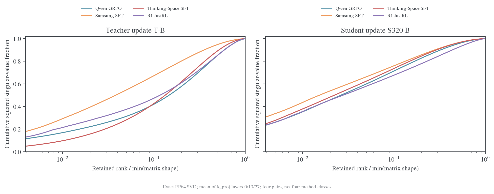

图中横轴为保留秩占矩阵最小维度的比例，纵轴为累计平方能量，每条线是三个矩阵在相同秩比例处的均值。Thinking-Space teacher 的谱较分散，student 学出的更新仍集中：top16 中位数从 step64 的 59.02% 降至 step320 的 48.95%；同期 student 更新范数 / base 范数从 .1116% 增至 .2037%。在这三个矩阵上，student 参数更新仍远小于 teacher 更新。该参数距离与 [分布结果](跨模型结果.md) 的函数风险分别报告。

共同 Qwen base 允许直接比较 teacher 更新方向。将奇异值向量除以自身二范数后，Thinking-Space 与 GRPO 的谱距离中位数为 .191，Samsung 与 GRPO 为 .322；但相应参数更新余弦分别仅为 .00133 与 −.00082。Thinking-Space 的谱形状更接近 GRPO，实际更新方向仍几乎正交，而且其历史 heldout 吸收更差。单一谱形状距离不能解释这组吸收排序；它可作为候选特征，与幅度、方向和函数读出共同检验。已有同谱随机框架干预也显示，保留奇异值并不保留 KL 改善。

指标的预测使用时间按 [参数谱定义](设置与指标.md#参数谱分解什么矩阵) 区分：teacher/base 几何可在 OPD 前获得；early 梯度和子空间需少量训练；终点残差与补回用于解释。Thinking-Space 的全层与长阶段参数轨迹仍待补齐。

数据：[逐矩阵特征 CSV](data/teacher-spectrum-20261110/spectrum-screen-v1/fingerprints.csv)、[汇总与共同 base 的更新相似性](data/teacher-spectrum-20261110/spectrum-screen-v1/screen-summary.json)、[补测协议](data/teacher-spectrum-20261110/spectrum-screen-v1/protocol.json)。[图源快照](data/teacher-spectrum-20261110/summarize_spectrum_screen.py)与精确执行版本一并归档。

## 历史模型扩展筛查：完整权重谱与 heldout 动态

### 覆盖范围与统一测量

原 fixed-state explorer 中 47 条完整 single-pass 曲线全部接入，涉及 37 个不同 teacher 权重、39 个 initial-student/teacher 配对。其中 22 条曲线、19 个 teacher 配对通过完整张量名称与形状兼容检查，可以计算参数差；其余条件只比较各自完整权重谱。另补齐原 explorer 未纳入的三条 Polaris 曲线，独立保存，不混入主预测比较。

历史主面板按实际 initial、teacher 与可取得的 OPD checkpoint 测量完整权重及其差矩阵。有效同坐标条件的精确逐矩阵记录与汇总已重新导出：[逐矩阵距离](data/teacher-spectrum-20261110/report-clean-v1/exact-spectral-matrices.csv)、[逐配对与阶段中位数](data/teacher-spectrum-20261110/report-clean-v1/exact-spectral-summary.csv)。

六矩阵 FP64 精确谱的层位置、聚合与指标定义见 [参数谱定义](设置与指标.md#参数谱分解什么矩阵)。

“同源”在数据中分成直接父模型与共同祖先分支。R1 的六个同尺寸 teacher、Qwen 的 Samsung/e3/GRPO 和 R7 Light 等按可核验父模型元数据登记。Thinking-Space 从 Qwen3-Base 训练，而此处 initial student 是后训练的 Qwen3-1.7B，因此两者属于共同祖先分支；$T-B$ 是实验 teacher 与实际 initial student 的差，并非该 teacher 自身的训练更新。MiMo 则显式保留 Base→SFT、Base→RL、Base→RL-Zero、SFT→RL、SFT→RL-Zero 五种配对。架构兼容只保证差矩阵有定义，训练血缘单独进入筛选。

参数—heldout 交互浏览器（本地文件 `data/teacher-spectrum-20261110/spectrum-expanded-v4/explorer.html`）支持选择指标、64/320 更新、Math/Code/IF、绝对 KL、剩余比例和末 64 步下降，并下载筛选后的 CSV。它与原 explorer 的曲线一一关联；[覆盖清单](data/teacher-spectrum-20261110/report-clean-v1/spectral-coverage.json)、[逐阶段关联表](data/teacher-spectrum-20261110/spectrum-expanded-v4/heldout-feature-join.csv)及[模型指纹](data/teacher-spectrum-20261110/spectrum-expanded-v4/model-profiles.json)提供可复算数据。

### 小幅、集中的更新与较低残差相关

R1 同尺寸组的六矩阵结果如下。所有风险使用原 fixed-H1024 全词表 RKL；64 步剩余比例在相同预算比较，终点同时标出实际预算。

| Teacher      | 更新范数 / initial 范数 | 更新 top-1% 能量 | κ_spec | 64 步 KL 剩余 | 最后绝对 KL | 最后更新数 |
| ------------ | ----------------------: | ---------------: | -----: | ------------: | ----------: | ---------: |
| DeepScaleR   |                  0.149% |            28.4% |   2.68 |         12.8% |     .000716 |        320 |
| DeepCoder    |                  0.204% |            26.7% |   2.13 |         35.6% |     .031569 |         64 |
| JustRL       |                  0.506% |            21.2% | 284.94 |         38.0% |     .017768 |        320 |
| Nemotron     |                  0.466% |            16.8% |   1.43 |         47.6% |     .045246 |        320 |
| BroRL        |                  0.568% |            21.3% |   1.89 |         57.2% |     .072881 |        320 |
| MiniMath SFT |                  2.525% |             8.1% |   1.35 |         58.8% |     .028692 |        320 |

R1 六个 teacher 中，更新幅度与 64 步剩余比例的 Spearman 相关为 +.943，top-1% 能量与剩余比例为 −.829。Qwen thinking 组相应为 +.886/−.657，non-thinking 为 +.257/−.600。集中度的方向较一致，幅度关系受输入模式影响。JustRL 的 κ≈285 是该组的突出个例；其余 RL teacher 的 κ≈1.4–2.7，不能用 JustRL 的几何代表 RL 总体。

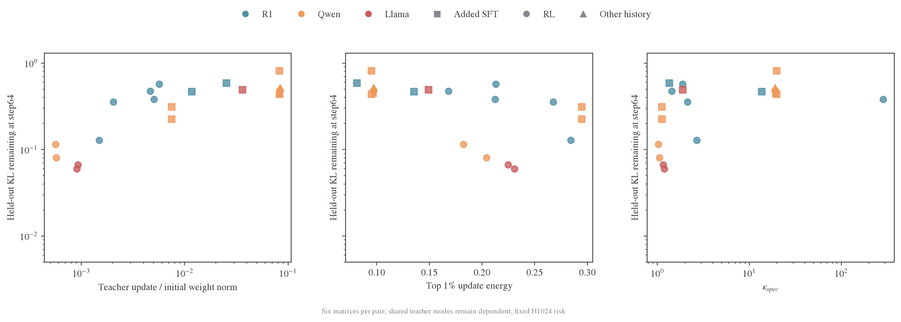

合并兼容条件，64 步的幅度—剩余比例相关为 +.691，集中度—剩余比例为 −.676；对特征秩与结果秩分别回归 log 初始 KL 和 student/输入模式哑变量，再计算残差相关，得到 +.521/−.651。这里的 22 条曲线共享 19 个 teacher，属于描述性关联。Math/Code/IF 的幅度相关为 +.670/+.879/+.810，集中度相关为 −.650/−.662/−.700，方向均一致。

绝对量保留了相同趋势：64 步更新幅度与绝对 KL 相关为 +.819，top-1% 与绝对 KL 为 −.578。320 步相应为 +.857/−.657；末 256→320 窗口的对数下降与幅度相关为 −.737、与集中度相关为 +.723。幅度大、谱分散的条件往往既有较高终点残差，也有较慢后期下降。不同域与相同 teacher 的输入模式仍有差异，全部数值保存在[分域关联表](data/teacher-spectrum-20261110/spectrum-expanded-v4/associations.csv)。

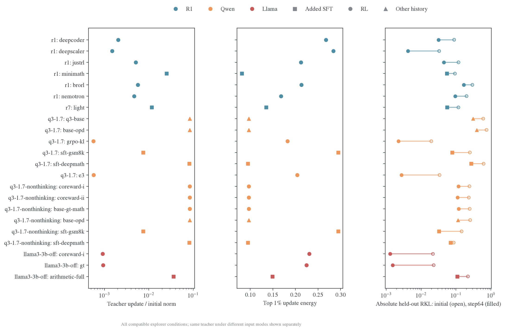

图中空心点是初始绝对 KL，实心点是 64 步风险；两点距离同时呈现起点大小与下降量。下面保留原有中间节点，展示完整 single-pass 动态。重复训练池的 continuation 不纳入当前分析，首遍汇总见[跨模型结果](跨模型结果.md)。

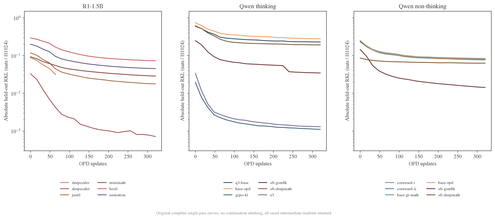

### 关联尚未成为可靠的新 teacher 预测器

以 log 初始 KL 和 student/输入模式为基础预测量，预测 log10 终点绝对 KL。固定 ridge α=1，每轮留出整个 teacher 权重，所有输入模式一起留出；特征标准化只使用训练折。误差先在同 teacher 的模式内平均，再对 teacher 等权平均。

64 步有 19 个 teacher，320 步有 17 个。

| 预测特征               | 64 步 MAE，dex | 320 步 MAE，dex |
| ---------------------- | -------------: | --------------: |
| 初始 KL + student/模式 |           .153 |            .220 |
| 再加更新幅度           |           .143 |            .193 |
| 再加 top-1% 能量       |           .154 |            .211 |
| 再加七个几何特征       |           .179 |            .261 |

更新幅度提供了最大的单项平均增益，但固定预测误差的 teacher 配对 bootstrap 中，改进量 95% 区间分别为 [−.054,+.032]、[−.109,+.052] dex，均跨零。

该 bootstrap 重采样已生成的 teacher 误差，不重拟合模型，也不估计训练 seed 不确定性。

仅保留有直接父模型元数据的配对后，幅度在 64 步改善 MAE，320 步反而从 .272 增至 .287。把所有几何特征加入小样本模型还会增加误差。

当前优先保留“更新幅度 + 谱集中度”作为候选组合。κ 与奇异值位移比例的相关方向跨组改变，预测误差也未改善；它们适合描述几何类型，尚无证据支持作为通用吸收评分。

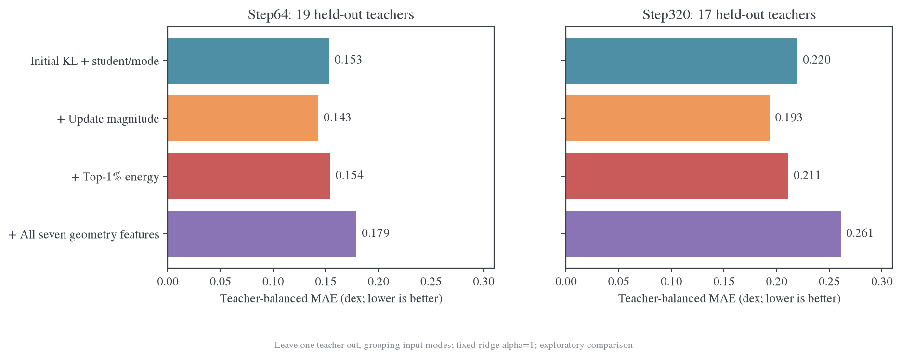

[预测明细](data/teacher-spectrum-20261110/spectrum-expanded-v4/teacher-heldout-prediction.csv)、[误差比较区间](data/teacher-spectrum-20261110/spectrum-expanded-v4/prediction-error-bootstrap.json)和[分析协议](data/teacher-spectrum-20261110/spectrum-expanded-v4/analysis-protocol.json)记录固定预算、特征变换与分组方式。原历史 heldout 继续作为诊断数据；这些比较属于探索性筛查。

### MiMo：连续增量与跨阶段分支

MiMo 则显示 initial student 身份的重要性。表中所有差矩阵均相对实际 initial student，风险为各自 teacher-bank 原有 macro RKL。

| Initial student → teacher | 更新范数 / initial 范数 | top-1% 能量 | 初始→终点绝对 RKL | 终点更新数 |
| ------------------------- | ----------------------: | ----------: | ----------------: | ---------: |
| Base → SFT                |                 16.516% |      5.247% |   .463225→.337572 |        320 |
| Base → SFT+RL             |                 16.517% |      5.248% |   .406126→.288201 |        800 |
| Base → RL-Zero            |                   .175% |     19.371% |   .064745→.002795 |        320 |
| SFT → SFT+RL              |                   .336% |     18.459% |   .042049→.004198 |        320 |
| SFT → RL-Zero             |                 16.438% |      5.248% |   .381016→.261616 |        320 |

Base→SFT 与 Base→SFT+RL 的幅度及归一化谱几乎一致，SFT 更新主导了这两个差矩阵；从 SFT 出发看后续 RL，幅度降至 .336%，集中度上升，吸收残差也更小。RL-Zero 对 Base 很近、对 SFT 很远，吸收表现随配对改变。**应预测 initial-student/teacher 配对的可吸收性；teacher 的 SFT/RL 标签无法独立确定结果。** 这些分支的 bank 独立生成，E71 预算也不同，具体差异仍按原协议解释。

[有效 MiMo 配对的谱与全阶段曲线](data/teacher-spectrum-20261110/report-clean-v1/ancillary.json)保留各节点及来源摘要。连续配对与跨阶段分支分别解释。

## 从绝对风险曲线分组，到共同祖先差与方向恢复

### 曲线确实能分组，但绝对水平和学习形状对应不同分组

对原 explorer 中具有完整 320 步节点的 41 条曲线，取 0:16:320 公共网格，在 log10 绝对 RKL 上插值，以欧氏距离、average linkage 做四组描述性划分。四组是便于比较的切分，并未估计天然类别数。没有 320 步数据的条件保留在 [历史筛查](附录-实验细节.md#历史模型扩展筛查完整权重谱与-heldout-动态)，未外推。

| 绝对曲线组         | 条件数 | 代表条件                                                       | 观察                                       |
| ------------------ | -----: | -------------------------------------------------------------- | ------------------------------------------ |
| 低残差、快速下降   |      5 | DeepScaleR、Qwen GRPO/e3、Llama CoReward-I/GT                  | 从较小差异降至约 10⁻³ 或更低               |
| 中等残差、持续下降 |      3 | JustRL、MiniMath-SFT、Samsung non-thinking                     | 最终约 .014–.029，训练标签跨 SFT/RL        |
| 中高残差、后期变慢 |     17 | BroRL、Nemotron、Samsung thinking、Qwen 多个 non-thinking 分支 | 残差水平接近，内部仍有不同下降速度         |
| 高残差、改善有限   |     16 | Qwen Base/Thinking-Space thinking、若干跨尺寸条件              | 起点与终点均较高，组内机制需按模型配对区分 |

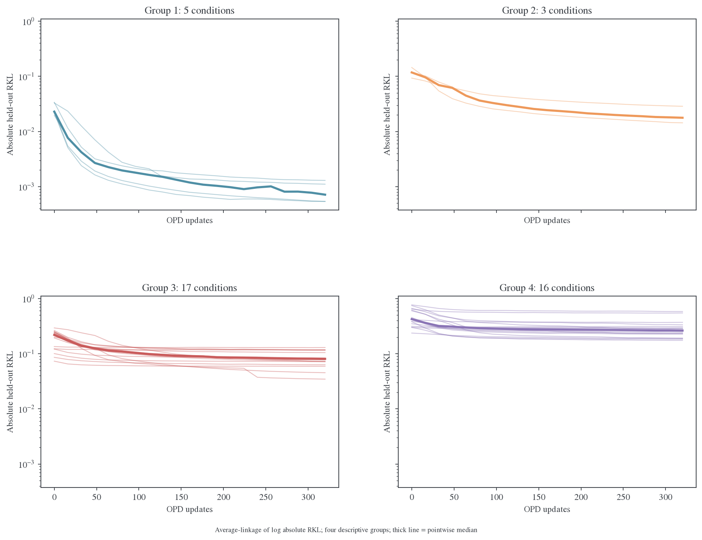

同样保留绝对水平，改用 complete/ward linkage，分组与上述划分的 adjusted Rand index 为 .898/1.000；先减去各曲线初始 log KL、只比较相对下降形状，分组一致性降至约 .20–.22。绝对风险的分组具有可复现结构，但很大程度反映功能距离和残差水平。曲线相近可以作为选择机制对照的依据，不能直接视为同一优化机制。

[完整组成员与距离敏感性](data/teacher-spectrum-20261110/curve-spectrum-v1/curve-clusters.json)保存插值网格、全部曲线及分组。相同权重在 thinking/non-thinking 下可以进入不同组；后续几何比较均在 initial student 和输入模式内进行。

### 指标扩展与谱形状的不同部分

[178 列阶段特征表](data/teacher-spectrum-20261110/curve-spectrum-v1/curve-feature-table.csv)含身份、动态和参数描述，逐矩阵数据见[矩阵特征表](data/teacher-spectrum-20261110/curve-spectrum-v1/matrix-feature-table.csv)。指标族及公式统一见 [指标定义](设置与指标.md#指标分别测量距离几何响应和效用)；输出分布沿用原始 JS/TV/熵和共享支持 FKL，没有新增全词表 FKL 推理。

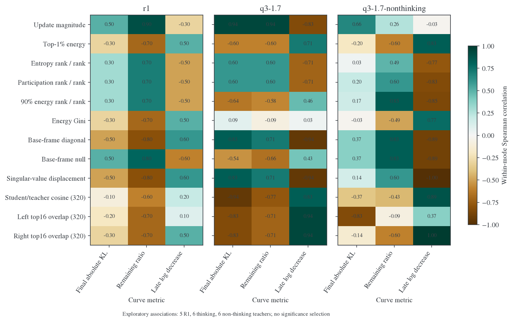

Qwen GRPO 更新的 top-1% 能量为 18.24%，Samsung 为 29.46%；Samsung 的熵有效秩比例为 .232，GRPO 为 .467，但 Samsung 的绝对风险仍更高。GRPO 的 90% 能量秩比例 .585 甚至高于 Base 分支约 .554，同时其头部能量也更集中。强头部与长尾可以共存，“低秩”需要说明是头部、熵秩还是高累计能量秩。

在 teacher 两两距离上，先比较归一化奇异值距离，再比较相同模式下曲线距离。R1、Qwen thinking、Qwen non-thinking 的谱距离—绝对曲线距离相关分别为 .127、.229、.854；与相对形状距离相关为 .442、.314、.932。谱邻近关系在 non-thinking 分支明显，在另外两组较弱。原始 10/15/15 个距离条目共享 teacher；[整 teacher 标签置换](data/teacher-spectrum-20261110/curve-spectrum-v1/neighbor-associations.json)保留这一依赖关系，全部比较属于探索性分析。

### 强线索：多个 teacher 共享同一条 Base 差方向

设实验 initial student 为 $B$，共同祖先 Qwen3-Base 为 $A$，teacher 为 $T$。差矩阵精确分解为：

$$
T-B=(A-B)+(T-A)=G+E_T.
$$

$G$ 是共同 Base 差，$E_T$ 是 teacher 相对共同祖先的增量。这里 $G$ 在生成 teacher 自身训练更新之外，还包含 initial student 已完成的后训练差异。对每个模块，使用同一参数坐标计算投影能量：

$$
P_G=\frac{\langle T-B,G\rangle_F^2}{\Vert T-B\Vert_F^2\Vert G\Vert_F^2}.
$$

全层祖先差核查：九个 Qwen teacher×28 层×七模块，共 1764 个矩阵。下表先加能量与内积再求比例；embedding、head、norm 不计入。

| Teacher            | 全层更新范数 / initial 范数 | 共同 Base 差投影能量 P_G | teacher 相对祖先增量范数 / initial 范数 |
| ------------------ | --------------------------: | -----------------------: | --------------------------------------: |
| Qwen3-Base         |                      9.673% |                     100% |                                       0 |
| Base-OPD           |                      9.671% |                  99.992% |                                  .0857% |
| CoReward-I         |                      9.673% |                  99.997% |                                  .0565% |
| CoReward-II        |                      9.673% |                  99.997% |                                  .0562% |
| Base-GT-Math       |                      9.673% |                  99.996% |                                  .0610% |
| Thinking-Space SFT |                      9.565% |                  97.537% |                                  1.518% |
| Samsung SFT        |                       .740% |                  .00334% |                                  9.697% |
| Qwen GRPO-KL       |                      .0537% |               约 8×10⁻⁷% |                                  9.673% |
| e3                 |                      .0508% |               约 5×10⁻⁶% |                                  9.673% |

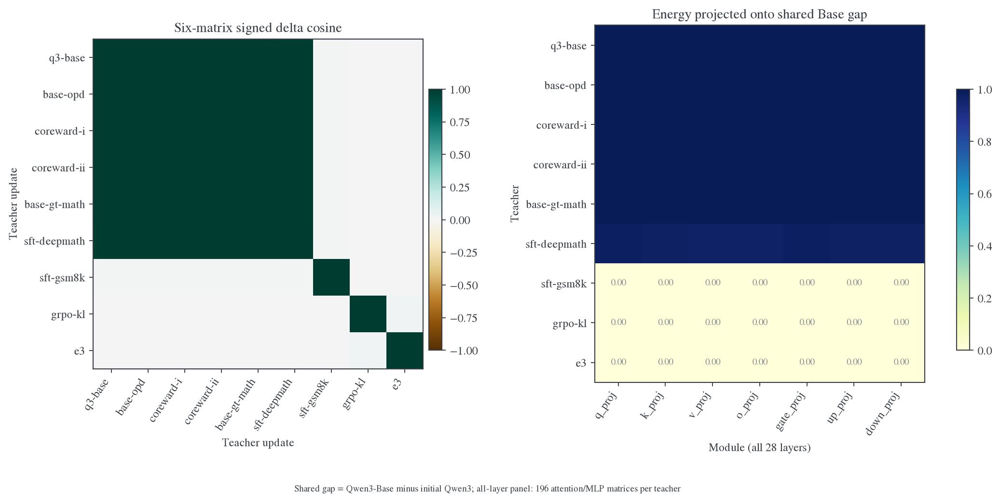

几个 Base 分支的更新余弦约 .9999，Thinking-Space 与共同方向的余弦约 .986；不同后训练路径相对实验 initial student 的几何，可以由共同 $G$ 主导。这样形成的组包含不同训练方法。Qwen GRPO/e3 与 Samsung 则主要沿其他方向变化。

数据来源影响 $E_T$，而 initial student 与共同祖先的距离决定 $G$ 的大小；二者需要分别进入吸收分析。

全层结论与六矩阵观察一致，支持将“共同 Base 差主导”作为一个有参数依据的配对类别。原[全层逐矩阵数据](data/teacher-spectrum-20261110/curve-spectrum-v1/common-ancestor-matrices.csv)、[模块与全体汇总](data/teacher-spectrum-20261110/curve-spectrum-v1/common-ancestor-summary.csv)保留交叉项与距离恒等式。这里增加的是全层范数与方向投影，精确谱分解仍为六矩阵范围。

### Student 实际学到了哪些 teacher 奇异方向

新增 teacher 更新自身的 SVD 方向实验。对 $\Delta_T=T-B=\sum_i\sigma_i u_i v_i^\top$，计算 student 更新 $\Delta_S=S_t-B$ 在每个配对方向上的系数 $a_i=u_i^\top\Delta_Sv_i$。一个 band 的有符号幅度恢复定义为：

$$
g_{\mathcal B}=\frac{\sum_{i\in\mathcal B}\sigma_i a_i}{\sum_{i\in\mathcal B}\sigma_i^2}.
$$

$g=1$ 表示恢复该 band 的投影幅度，$g=0$ 表示在这些方向上没有净投影。另保存逐 band 残差、student 在 teacher 配对方向外的能量，以及等范数各向同性更新的精确期望投影。teacher 参数方向与 [参数谱分解](设置与指标.md#参数谱分解什么矩阵) 的 base thin-SVD diag/off/null 使用不同框架。

该测量按有效 initial/teacher 配对及各自输入条件导出，保留逐矩阵和逐 band 身份。该六矩阵历史筛查当时未接入 MiMo student；[模型覆盖](设置与指标.md#家族谱系与实际覆盖) 已补测新找到的 E93/E91 主干导出，其余分支只提供 teacher 分解。重复输入模式的 student checkpoint 分别测量，没有把同一 teacher 的 thinking student 用作 non-thinking student。下表均为 320 步、六矩阵中位数。

| 配对                    | top-1% teacher 能量 | top-1% 幅度恢复 g | 配对方向内剩余能量 / 原能量 |
| ----------------------- | ------------------: | ----------------: | --------------------------: |
| Qwen GRPO               |              18.24% |              .785 |                        .185 |
| Qwen e3                 |              20.42% |              .591 |                        .243 |
| Samsung SFT thinking    |              29.46% |             .0607 |                        .885 |
| Thinking-Space thinking |               9.49% |            .00111 |                       .9978 |
| Qwen Base thinking      |               9.71% |            .00180 |                       .9964 |
| DeepScaleR              |              28.41% |              .488 |                        .293 |
| JustRL                  |              21.22% |              .128 |                        .763 |
| MiniMath-SFT            |               8.12% |             .0244 |                        .952 |

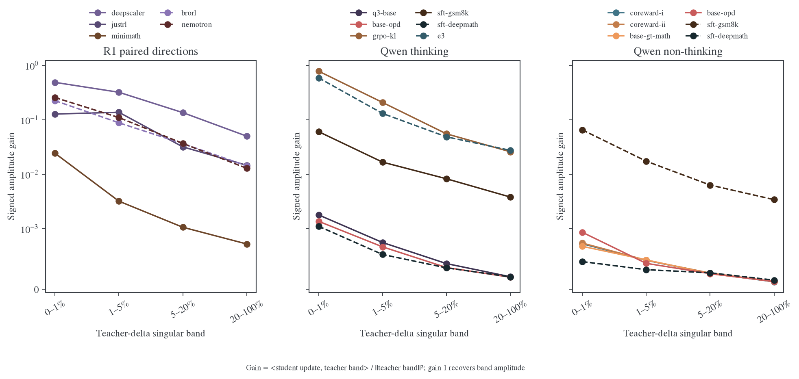

多数条件优先恢复头部，但恢复程度相差数个数量级。Samsung 比 GRPO 更集中，却没有更充分地学到其头部方向。JustRL 的参数头部恢复也低于 BroRL，功能风险仍更低；参数恢复量与函数吸收量需要共同解释。当前主假设因此细化为：**teacher 差异是否位于 initial student 上易响应、与训练梯度同向且跨状态一致的方向，决定集中谱能否转化为持续吸收。** 已有 JVP 证明强方向响应先于 OPD，但实际训练梯度与这些方向的关系仍缺测量。

[逐 band 数据](data/teacher-spectrum-20261110/report-clean-v1/teacher-band-summary.csv)和[teacher 框架内外的能量](data/teacher-spectrum-20261110/report-clean-v1/teacher-frame-summary.csv)可复算曲线；每个矩阵通过完整参数距离的能量重构检查。

### 后期变化与输出分布提供两条额外线索

256→320 的逐题配对核查中，R1 的 JustRL/MiniMath/BroRL/Nemotron 均有 128/128 道留出题的 KL 改善；Thinking-Space thinking 为 100/128，non-thinking 为 84/128。

Thinking-Space 的绝对下降分别为 .002010/.000660，题目配对 95% 区间仍为正。因而 320 步附近更准确的描述是后期变慢；当前仅由首遍窗口判断速度下降，不据此认定最终平台。BroRL 该窗口绝对下降 .004473，大于 JustRL 的 .001652，但终点残差也更高。

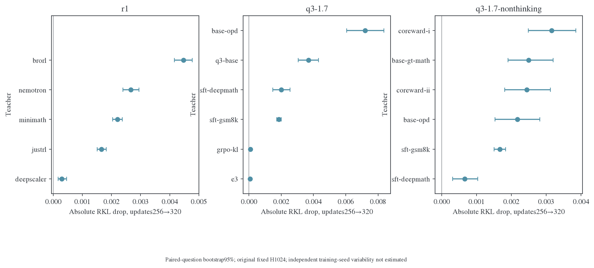

[逐题配对结果](data/teacher-spectrum-20261110/curve-spectrum-v1/band-analysis-v3/late-question-paired.csv)同时记录改善题比例和净下降 / 逐题绝对变化总量。区间为 2,000 次题目 bootstrap，表示固定一次训练内的题目差异。

输出侧，Qwen thinking 的 GRPO/e3 终点 JS 约 .000306/.000366，Thinking-Space 与 Qwen Base 仍为 .0485/.0569，TV 也保留明显差距。高残差同时体现在概率分布距离中，并非 RKL 单个读出独有。

终点 teacher 熵减 student 熵：GRPO 约 −.00065，e3 约 .00829，Samsung .0774，Thinking-Space .1831，Base .2905 nats/token。残余的熵差是值得控制的新候选因素；e3 的 teacher 熵也高于初始 student，却能较充分恢复，熵差本身仍不足以决定吸收。

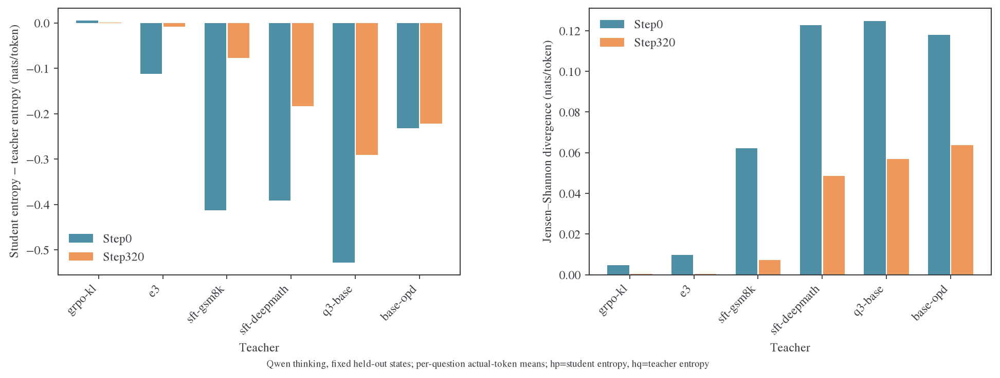

这张输出诊断图按题内实际有效 token 平均，再按题平均，与主风险曲线的固定 H1024 分母分开。完整[输出指标表](data/teacher-spectrum-20261110/curve-spectrum-v1/band-analysis-v3/output-diagnostics.csv)保留 domain/window/step/metric 身份。

### 共同祖先分支的专门判别

共同祖先分支另做三项控制：Thinking-Space 分别从 Qwen3-Base 与后训练 initial 开始；calibration 温度校准后比较 RKL/JS；真实 rollout 上分开测共同差 G 与 teacher 增量 E_T 的响应及梯度。三项分别检验祖先距离、输出熵差和优化对齐。主分析的连续配对及跨家族优先级见 [模型覆盖](设置与指标.md#家族谱系与实际覆盖)、[后续实验](机制分析.md#已排除仍支持和下一步)。

## 深入三组的精确几何与局部轨迹

### 全层更新比 teacher 集中，后期却向更多方向扩展

下表比较三组同源配对的相同 196 个矩阵，早期为 Qwen step64、JustRL step80，终点为 step320，共 1176 个矩阵观测。top16 为逐矩阵前 16 个奇异分量的平方能量比例中位数。

| 配对      | Teacher top16 | Student top16：早期→终点 | Teacher / student 终点 κ_spec | 参数残差：早期→终点 |
| --------- | ------------: | -----------------------: | ----------------------------: | ------------------: |
| Qwen GRPO |        15.14% |            37.11%→33.38% |                   1.01 / 1.07 |         1.928→2.244 |
| Qwen SFT  |        27.17% |            48.68%→39.32% |                   1.06 / 1.11 |         1.009→1.011 |
| R1 JustRL |        26.94% |            51.22%→46.66% |                 386.12 / 1.61 |         1.021→1.026 |

参数残差为拼接后的 $\|\Delta W_T-\Delta W_S\|_F^2/\|\Delta W_T\|_F^2$。三组 student 更新都比各自 teacher 集中，但全层 top16 中位数随训练下降。早期三层 k_proj 曾给出集中度上升的局部结果，全层扫描将它修正为：**不同矩阵发生不同演化，整体后期能量向更多方向扩展。**

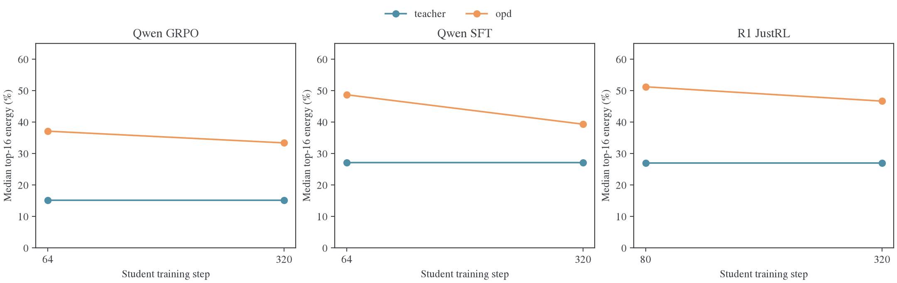

Teacher 保谱也不是 RL/SFT 的标签性质：Qwen SFT 的 κ_spec 接近 1，JustRL 却约为 386；三个 OPD student 均更接近保谱。

GRPO 参数残差上升而 KL 下降，直接表明 student 通过不同参数路径逼近函数行为。

### 精确轨迹显示方向持续移动

三层 k_proj 的完整权重精确 SVD 中，JustRL teacher 相对 base 的谱变化约为 student 终点的 29 倍，student 同时消除了约 88% 的 native KL。完整权重谱、更新谱与函数拟合无需同步恢复。

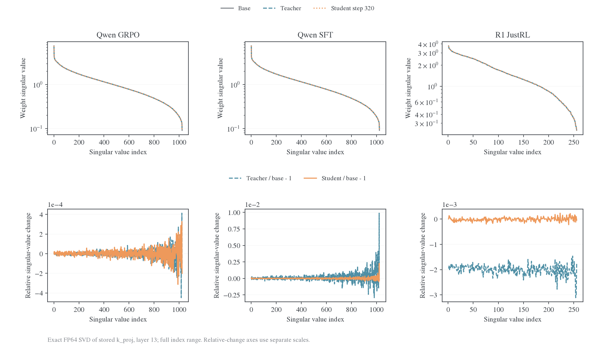

对更新右 top16 子空间 $V_{t,16}$，定义参考子空间 $V$ 的能量捕获与重叠：

$$
C_t(V)=\frac{\|\Delta W_tVV^\top\|_F^2}{\|\Delta W_t\|_F^2},\qquad
O_t(V)=\frac{\|V^\top V_{t,16}\|_F^2}{16}.
$$

JustRL 三层 k_proj 从 step16 到 320：当前 top16 捕获自身更新从 45.1% 升至 63.1%，最早 top16 捕获后续更新却从 45.1% 降到 29.1%，最早/当前子空间重叠降至 .368。teacher top16 捕获 student 更新从 8.2% 升到 31.4%，teacher/当前重叠从 .131 升到 .214。

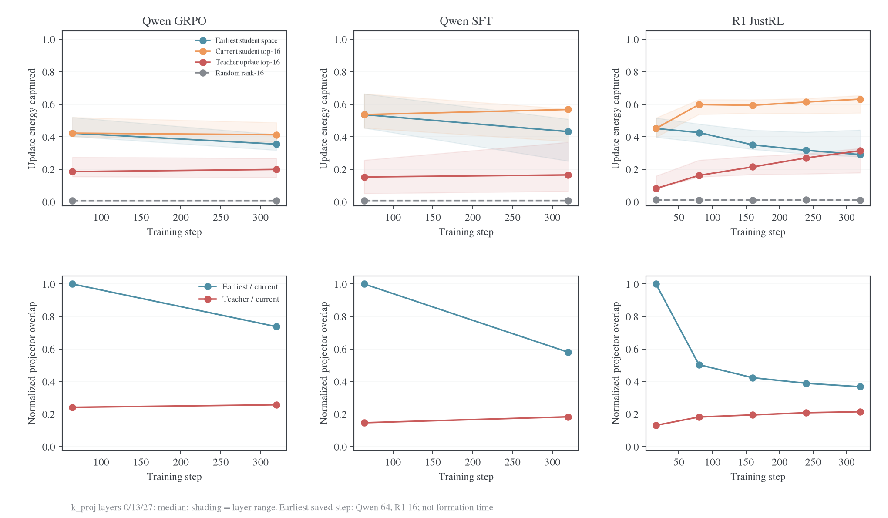

Qwen GRPO/SFT 的 step64→320 最早/当前重叠为 .738/.580；这段新增更新被最早 top16 捕获仅 22.54%/24.21%。JustRL step240→320 新增更新被最早、前阶段、teacher、当前 top16 捕获分别为 11.94%、26.31%、22.65%、30.82%，随机维度基线为 1.04%。早期结构持续发挥作用，后续方向也持续进入，完整早期锁定不符合轨迹。

#### 完整权重谱距离：三项指标给出不同信息

完整权重的谱距离以实际 initial 为参照。δΣ 是奇异值位移除以 initial 权重范数，衡量绝对谱变化在模型尺度上有多大；ρΣ 是同一位移除以完整参数位移范数，衡量固定谱族没有解释掉多少参数变化；κ 是 base SVD 坐标中一阶对角更新能量相对各向同性参考的富集，随机参考为 1。ρΣ 是范数比，不是平方能量比；κ 也不等于有限位移的 ρΣ 平方。

| Initial→teacher               |       δΣ |     ρΣ |  κ_spec |
| ----------------------------- | -------: | -----: | ------: |
| Qwen→GRPO                     | 1.277e−5 | .02240 |   1.029 |
| Qwen→Samsung SFT              | 1.775e−4 | .02339 |   1.116 |
| Qwen→Thinking-Space，祖先分支 |   .01257 | .13555 |  19.775 |
| R1→DeepScaleR                 | 4.971e−5 | .04176 |   2.685 |
| R1→JustRL                     |  .002083 | .42829 | 284.939 |
| R1→MiniMath SFT               | 7.044e−4 | .02976 |   1.350 |
| Llama→CoReward-I              | 1.697e−5 | .01961 |   1.189 |
| Llama→arithmetic SFT          |  .001274 | .03546 |   1.879 |

本表统一取首／中／末层 k/v 六个矩阵的精确测量中位数；逐矩阵 δΣ 由精确 ρΣ×更新相对范数重算后再取中位数，没有把两个中位数相乘。它与 [参数谱分解](设置与指标.md#参数谱分解什么矩阵) 的 196 矩阵结果范围不同，例如 JustRL 的六矩阵 κ≈285、全层 κ≈386。

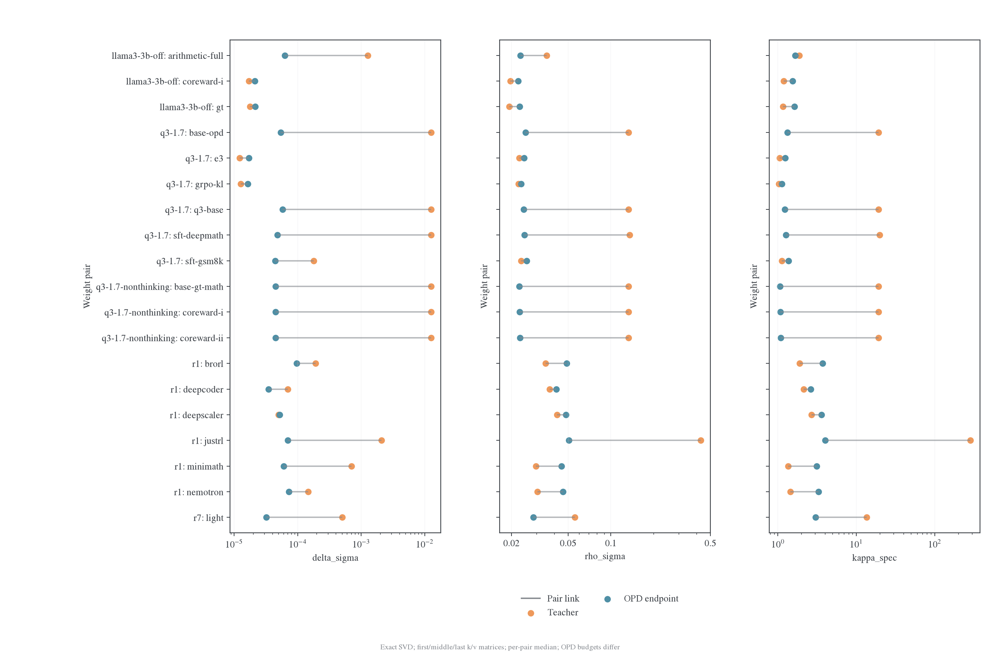

Samsung SFT 的 δΣ 约为 GRPO 的 14 倍，但 ρΣ、κ 接近：它的绝对变化更大，却没有相应更高的一阶谱改变富集。JustRL 同时有较高 ρΣ 与 κ，仍能持续降低功能风险。MiniMath SFT 的 κ 接近 1，也有明显残余。**这三项指标区分参数变化的幅度与几何类型，目前不能单独给 teacher 排可学习性次序。**

#### 阶段轨迹：谱变化、集中度与方向移动分别测量

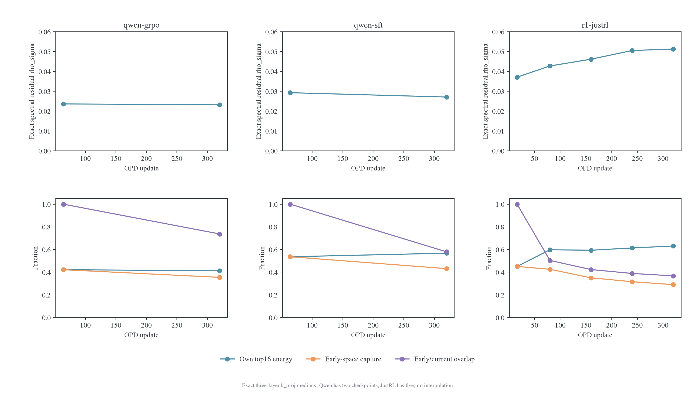

Qwen 两个配对只有 step64／320 两个精确轨迹点；JustRL 有 step16／80／160／240／320 五点。图中每点汇总 k_proj 第 0／13／27 层，保留真实测量节点。上排是完整权重的 ρΣ，下排分别是当前更新 top16 自身能量、最早更新右子空间捕获后续更新的能量、最早与当前右子空间重叠。

当前更新仍可集中，同时离开最早子空间。JustRL 的三层中位数最早／当前重叠到 step320 约为 .368；全层 top16 中位数则从早期 51.22% 降至 46.66%。三层局部集中度可以上升，而全层总体集中度下降：它们对应不同范围。**目前支持“训练后期仍有方向进入、子空间持续移动”，没有支持“早期完全锁死”。**

当前最完整的覆盖是三组 early／endpoint 的全层精确谱，另有三层稀疏多阶段轨迹。跨家族的 39 阶段是梯度面板，不是 39 阶段全层精确 SVD。下一步要在更多有效配对的平台前后补同层同模块的精确轨迹，才能判断方向移动与平台出现的先后关系。

### Head 弱方向不是当前主解释

普通 centered head 的 rank64 弱方向占 Qwen 隐空间维度的 96.875%，teacher hidden residual 约 95% 落在其中，未超过维度基线。仅凭“大部分残差在弱方向”无法解释遗漏。后续若重查 head，应使用 prefix Fisher 加权，并把 head 自身漂移与 hidden 变化分开记账。

数据：[全层分析](data/teacher-spectrum-20261110/spectral-analysis-006.json)、[精确轨迹](data/teacher-spectrum-20261110/temporal-svd/index.json)、[增量子空间](data/teacher-spectrum-20261110/incremental-svd-002.json)。

## 深入三组的 native H1024 干预

### 真实 missing off/null 有效，随机方向无效

三个无编辑导出重载 gate 均通过。真实补回的 heldout 结果按 calibration 选择的 β 报告：

| 配对      | off β | off 消除剩余 KL | null β | null 消除剩余 KL | diag 效果              |
| --------- | ----: | --------------: | -----: | ---------------: | ---------------------- |
| Qwen GRPO |     1 |          37.94% |      1 |           31.61% | β=.25，+.70%，区间跨零 |
| Qwen SFT  |     1 |          57.34% |      1 |           64.14% | β=.5，+.024%，区间跨零 |
| R1 JustRL |   .25 |          10.08% |    .25 |           17.25% | calibration 选择 β=0   |

SFT off/null 均为 80/80 题改善，off 的 Math/Code/IF 改善分别为 50.10%/58.49%/66.14%，null 为 61.03%/61.05%/69.94%。GRPO off 为 80/80、null 为 73/80 题改善，三域同样获益。

| 配对      | 真实 off，固定 β=1 |   三 seed Gaussian | 三 seed 同谱随机框架 |
| --------- | -----------------: | -----------------: | -------------------: |
| Qwen GRPO |            +37.94% |     −114% 至 −124% |       −118% 至 −120% |
| Qwen SFT  |            +57.34% | −23.70% 至 −25.68% |   −24.42% 至 −24.92% |
| R1 JustRL |            +40.83% | −49.19% 至 −49.32% |   −46.29% 至 −47.47% |

正值表示减少 endpoint 剩余误差，负值表示恶化。随机框架保留真实补回矩阵的奇异值与范数，改变奇异向量；补回效果依赖方向身份，幅度与谱能量分布不足以解释收益。

JustRL 的状态依赖尤其明显：β=1 off/null 在 heldout 改善 40.83%/49.40%，calibration 的 off 却恶化 40.78%，null 只改善 2.48%，所以 calibration 选择 .25。diag β=1 在 student 上大幅恶化，而从 teacher 删除 diag 后对原 teacher 的 KL 仅 .000334。相同分量作用依赖模型当前位置和其他参数，有限补回不能简化为独立分量相加。

### 大部分 KL 改善可压缩，但重缩放会破坏结果

| Student 更新        | GRPO：保留 KL 改善 | SFT：保留 KL 改善 | JustRL：保留 KL 改善 |
| ------------------- | -----------------: | ----------------: | -------------------: |
| Top1%，原幅度       |             94.95% |            94.99% |               88.53% |
| Top1%，恢复矩阵范数 |             20.65% |            77.70% |               62.08% |
| Top5%，原幅度       |             98.78% |            98.16% |               94.75% |
| Top5%，恢复矩阵范数 |             77.50% |            93.84% |               87.19% |

这里的 1% 是每矩阵保留奇异分量的数量比例。两类 Qwen OPD 同样可压缩，压缩性解释不了它们的吸收差异；恢复原范数会放大保留方向，并显著改变函数结果。GRPO full-scope 参数控制保留 99.74% KL 改善，SFT 的该控制也有约 7% endpoint 剩余风险差异，任务生成和历史风险的非编辑参数策略按各自冻结输入解释。

删除 OPD off/null 后，GRPO 保留原 KL 改善的 71.64%/70.17%，JustRL 为 75.67%/51.20%。这些分量参与了分布拟合，是否有利于任务由下一节直接测量。

数据：[全部干预、calibration 选择与逐题区间](data/teacher-spectrum-20261110/intervention-analysis-010.json)。

### 分层补回

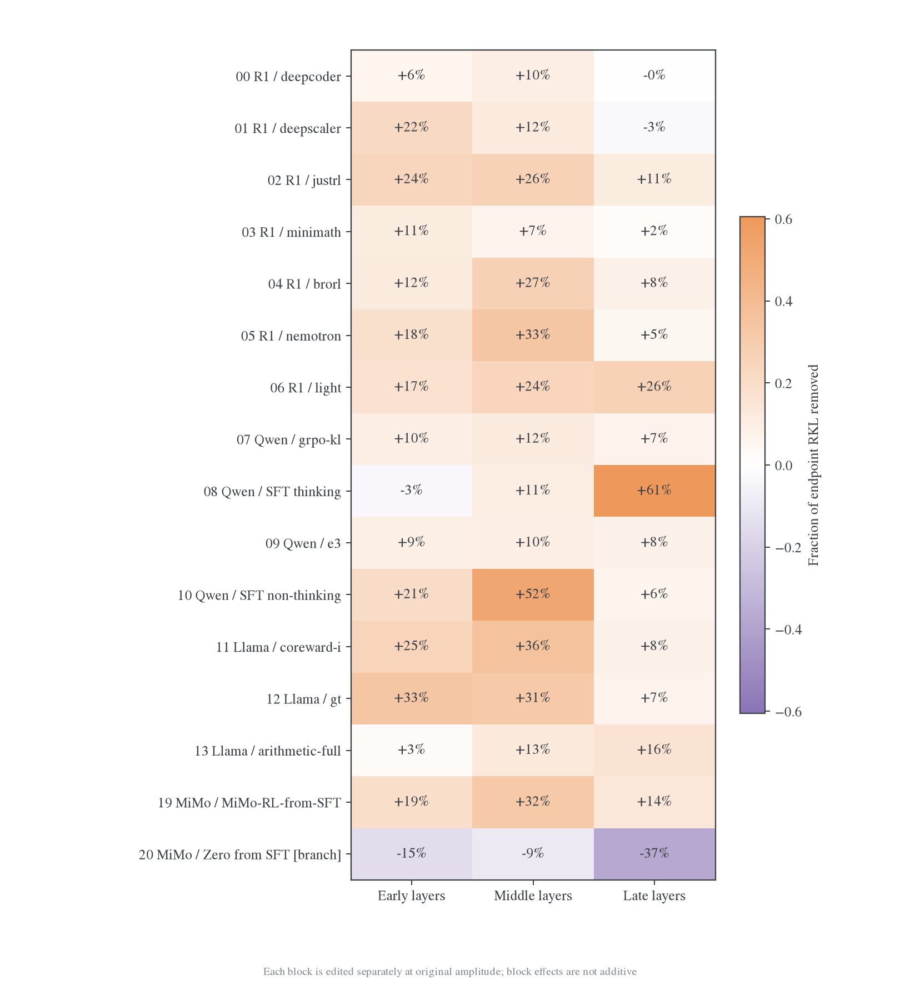

每格是单独编辑该层段后，相对 endpoint 去掉的 RKL 比例。Qwen SFT thinking 的前／中／后层段变化为 −.003757／+.014157／+.079864，末段贡献明显；non-thinking 则中段更强（+.044504）。Light 三段均有贡献，MiMo 分支三段均恶化。**不存在“固定后几层决定所有 teacher 吸收”的统一模式。** 分段作用不能相加成全层作用，模块交互须另测。

## 实验 1：批内拟合、新批风险与真实更新

### Setting

以下图表从已完成产物只读复算。完整 L 风险矩阵使用原 B16，每块 16 updates 后复评全部 40 组；梯度几何使用各组抽取的 B8，Math 永久留出为 12 组共 96 题。两者沿同一参数路径，但样本覆盖不同，不把图中相近数值当作精确的逐步预测检验。所有图表的输入文件 SHA256 与限制记录在[审计文件](data/teacher-difference/teacher-difference-stages-20261109/analysis/joint-analysis-audit.json)。

### 理论与测量

对每个原始 batch，比较首次训练前风险、16 步后的批内风险，以及同一时间段永久 heldout 的风险变化。新批首次训练前风险除以该批在初始化的风险，消除批间初始难度差异。

真实 AdamW 的一步位移记为 $\Delta\theta$，对 heldout 的一阶预测收益为：

$$
Q_H=-\nabla L_H^\top\Delta\theta,\qquad
L_H(\theta)-L_H(\theta+\Delta\theta)=Q_H+O(\Vert\Delta\theta\Vert^2).
$$

AdamW 的动量、二阶矩、裁剪和 weight decay 都包含在实际位移中；原始梯度内积只对应小步 SGD 的诊断。

### 结果与分析

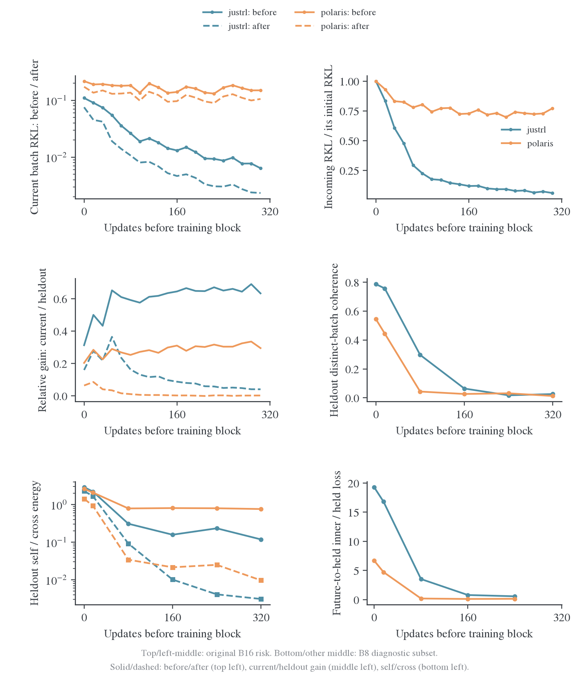

新批起点按该批原始 student 的风险归一化。Polaris 的最后 5 批首次训练前平均风险仍为各自初始的约 73.9%，JustRL 为约 7.15%；Polaris 最后 5 批仍各自平均下降 31.25%，同阶段固定数学留出仅下降 0.91%。跳到新批的高 loss 与固定留出平台同时存在，支持“当前批拟合收益没有持续转化成未见批收益”。

历史生产 E48 也有相同现象：前后各 32 个 outer 的新批首次 KL 均值为 0.19651/0.18742，3840 个相邻批内 loss 观测全部下降。E48 的 4096-update 运行仅作背景，机制诊断仍限定在 L 的 0–320 updates。新批起点的跳升包含题目与轨迹差异，结合固定留出平台判断传播，不直接解释为遗忘。

在 updates80，JustRL/Polaris 的留出 B8 自能量分别为 0.310/0.790，非对角共同能量为 0.0920/0.0343，跨批相干性为 0.297/0.0434。Polaris 的自能量更大，共同能量却更小。到 updates240，JustRL/Polaris 的非对角能量为 0.00410/0.0250，大小关系已经反转；此时 loss 为 0.00912/0.16355。因而“Polaris 后期所有梯度内积都比 JustRL 小”不成立，必须同时看剩余风险与相对收益。

图右下角在每个 checkpoint 只使用尚未训练的 source batch，对同一永久留出求平均内积并除以留出 loss；updates320 没有未来 A–T batch，因此不补点。updates80 的 JustRL/Polaris 分别为 3.54/0.199，updates240 为 0.580/0.150。该量是原始小步 SGD 的局部相对传播信号，不能直接替代实际 Adam 的块收益。原始表见 [risk](data/teacher-difference/teacher-difference-stages-20261109/analysis/joint-risk.csv) 与 [geometry](data/teacher-difference/teacher-difference-stages-20261109/analysis/joint-geometry.csv)。

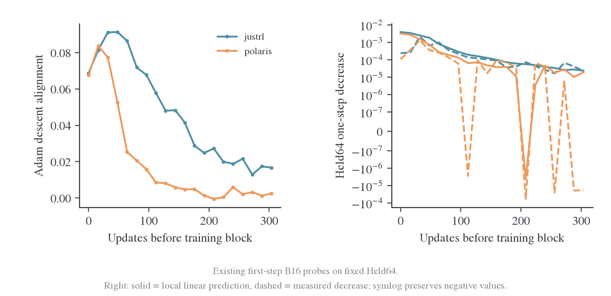

已有首步 Adam 探针在固定 Held64 上显示：后期 raw gradient cosine 的 JustRL/Polaris 均值为 0.1385/0.1196，实际更新与留出下降方向的 cosine 为 0.01746/0.00298。Polaris 的实际更新对齐更弱，局部线性预测与有限步收益也有差异。图保留负收益；首步探针与完整 16 步块收益分开报告。原始表见 [Adam CSV](data/teacher-difference/teacher-difference-stages-20261109/analysis/joint-adam.csv)。

### 结论

Polaris 的后期问题已经由真实风险矩阵确认：批内拟合持续发生，跨新批收益很弱。实际更新的 heldout 对齐也更弱。接下来需解释剩余误差为什么缺少有效响应，不能仅以绝对梯度大小排序。

## 实验 2：剩余 KL 与完整轨迹 PAC

### 目的与 Setting

弱绝对信号既可能来自已经学好，也可能来自高残差下响应不足。该实验以剩余 KL 为分母，比较同一归约下的 PAC。

完整轨迹对照沿用 L 的公共初始 student bank：原 20 个 train B16 与 12 个 Math 永久 heldout B16 各固定抽取 8 题，共 160/96 道不同题目。抽样 seed 为 20261109；题目和 response token 与上述阶段测量相同。每题使用全部有效 response 位置，统一除以 H1024，短轨迹的未使用位置贡献零。

两条路径分别测 updates0/80/240/320。各阶段使用同一 teacher、同一固定轨迹。Live 为当前原生 reverse-KL 请求，frozen 为初始 student 对该 teacher 的请求；两者都经过当前 checkpoint 的 Jacobian。初始 student 请求使用 FP32 master/head、BF16 backbone autocast，teacher 保持 BF16 backbone、FP32 head。完整词表和额外 teacher 支持沿用生产 RKL。每条件保存 32 个 B8 × 两种字段的联合梯度 Gram，同时保留逐题梯度二阶矩、P、KL 和 live/frozen 请求内积。

主比较为留出 $q=(P/L)AC$、训练到留出的 $D/L_H$、$\mathcal M=D/\sqrt{L_TL_H}$ 以及 $D/\sqrt{P_TP_H}$。未来 source 只取当前阶段之后尚未训练的原始组，updates320 没有剩余未来组，因此仅报告 all-train。跨面板区间使用 4000 次独立 source/heldout 的 B8 cluster bootstrap，跨 teacher、阶段和字段共用抽样；cosine 使用两侧 delete-one 标准误。区间反映固定题池内的组变异。

结果入口为[完整轨迹分析](data/teacher-difference/teacher-difference-logit-20261109/trajectory/analysis/README.md)。同目录保存 CSV、原始结果哈希、PNG/PDF 和图审计。

### 理论与测量

固定轨迹目标的欧氏梯度流满足：

$$
q=\frac{\Vert\nabla L\Vert^2}{L}=\frac{P}{L}AC,
\qquad -\frac{d\log L}{dt}=q.
$$

逐因子比较 $P/L$、A、C，才能区别“剩余差异已小”与“每单位剩余差异难以形成共同参数响应”。这里 q 使用总剩余 KL；尚未测定可学习 KL，不能将 q 称为单位可学习误差的效率。

### 结果与分析

八个完整轨迹条件均已完成。下表为固定 96 题留出面板，$A,C$ 使用轨迹梯度，$q=P\Xi/L$ 使用当前剩余 KL：

| Teacher | Updates | 剩余 KL |  $P/L$ |    $A$ |     $C$ |   $q$ |
| ------- | ------: | ------: | -----: | -----: | ------: | ----: |
| JustRL  |      80 | 0.02633 | 0.3912 | 180.95 | 0.05908 | 4.182 |
| Polaris |      80 | 0.17006 | 0.4795 |  75.13 | 0.01588 | 0.572 |
| JustRL  |     240 | 0.00912 | 0.3992 | 498.35 | 0.01280 | 2.545 |
| Polaris |     240 | 0.16355 | 0.4529 |  84.32 | 0.01432 | 0.547 |
| JustRL  |     320 | 0.00714 | 0.3989 | 322.72 | 0.01381 | 1.778 |
| Polaris |     320 | 0.16215 | 0.4533 |  82.51 | 0.01194 | 0.446 |

JustRL 的绝对压力变小与剩余 KL 同步，$P/L$ 在后期约为 0.40；Polaris 约为 0.45。Polaris 的劣势不表现为每单位剩余 KL 形成更少的 logit 压力。Updates240 的 $q$ 比可写为：

$$
\frac{q_J}{q_P}
=\frac{(P/L)_J}{(P/L)_P}\frac{A_J}{A_P}\frac{C_J}{C_P}
=0.881\times5.910\times0.894
=4.655.
$$

80 updates 时 A 与 C 都贡献差距；240 updates 时两条路径的 C 接近，JustRL 甚至略低，后期优势主要落在 A。320 updates 的对应比为 $0.880\times3.911\times1.157=3.983$。这里的 A 包含题内 token 请求通过 Jacobian 后的聚合，不能直接等同于单 prefix 的最大特征值或“模型容量”。

有限留出面板的 $q$ 包含自身内积。Updates240、96 题的复算为：

| Teacher | 面板 $q$ | 自能量占比 | Distinct-record 共同能量 / KL |
| ------- | -------: | ---------: | ----------------------------: |
| JustRL  |    2.545 |      81.4% |                         0.478 |
| Polaris |    0.547 |      72.8% |                         0.151 |

去自身内积的量为 $(n\Vert\bar v\Vert^2-\overline{\Vert v_i\Vert^2})/((n-1)L)$。两者比值由面板 $q$ 的 4.66 倍变为 3.18 倍；排序保留，但绝对值明显减小。它描述固定面板的不同题之间的共同响应，未来 source 到独立 heldout 的传播仍由实验 3 的交叉块验证。

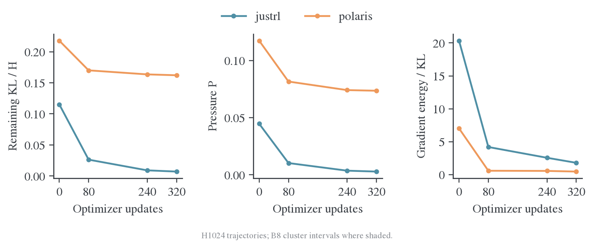

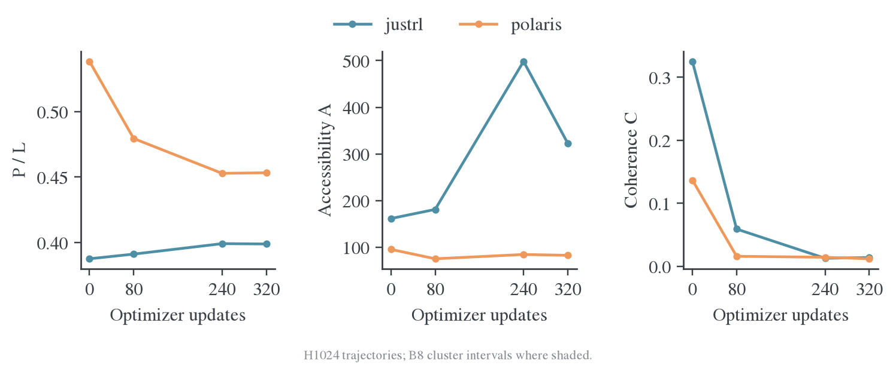

### 结论

JustRL 后期的绝对信号缩小与成功吸收相符。扣除剩余 KL 后，Polaris 仍明显更弱；240/320 阶段两者 C 接近，关键差距落在包含 token 聚合的 A。六阶段原始复算与 train/heldout 因子曲线保留在[历史 PAC](附录-定义与复算.md#六阶段-pac-与因子曲线)。

## 实验 3：未来 batch 到 heldout 的传播

### Setting

沿用实验 2 的完整轨迹与 checkpoint。Source 分为 all-train 与尚未训练的 future-train；updates80/240 各剩 15/5 个 future B8 组，updates320 不存在 future source。Receiver 始终为独立的 96 题永久 heldout。

### 理论与测量

记 $v_T=\nabla L_T$、$v_H=\nabla L_H$，$\gamma=\cos(v_T,v_H)$。训练源的一步 SGD 更新给出：

$$
L_H(\theta-\eta v_T)=L_H(\theta)-\eta D+O(\eta^2),
\qquad D=v_H^\top v_T.
$$

将实验 2 的 $q_T=\Vert v_T\Vert^2/L_T$、$q_H=\Vert v_H\Vert^2/L_H$ 代入：

$$
\mathcal M=\frac{D}{\sqrt{L_TL_H}}=\gamma\sqrt{q_Tq_H},
\qquad
\frac{D}{L_H}=\mathcal M\sqrt{\frac{L_T}{L_H}}.
$$

该等式将传播拆成两端单位风险能量与夹角。Heldout 自身 q 高，还需要 source 能形成相应方向。交叉块不包含 source 或 receiver 的自内积；置信区间沿用实验 2 的配对 B8 bootstrap。

### 结果与分析

Updates240 时，五个尚未训练的 source B8 到永久留出面板的 $D/L_H$ 为 JustRL 0.579（95% 区间 0.241–0.747）、Polaris 0.150（0.064–0.227）；$\mathcal M$ 分别为 0.590/0.155。配对差值为 0.429，95% 区间 0.086–0.645。两者的 cosine 为 0.227/0.207，均值接近；JustRL 的 source/heldout 单位风险能量分别为 2.647/2.545，Polaris 为 1.028/0.547。因此该阶段未来 batch 的归一化传播差距主要来自两端有效响应能量，而非更大的方向夹角。

All-train 包含已经拟合过的 source，其 240/320 阶段 teacher 差值区间仍跨零。未来组与 all-train 的结果分别保留；320 updates 没有尚未训练的 source，不能用 all-train 代替未来 batch 对照。具体区间和配对差值见 [transfer.csv](data/teacher-difference/teacher-difference-logit-20261109/trajectory/analysis/transfer.csv) 与 [paired-contrasts.csv](data/teacher-difference/teacher-difference-logit-20261109/trajectory/analysis/paired-contrasts.csv)。这些是原始梯度的一阶诊断，实际 Adam 收益仍使用前文保存的真实更新实验。

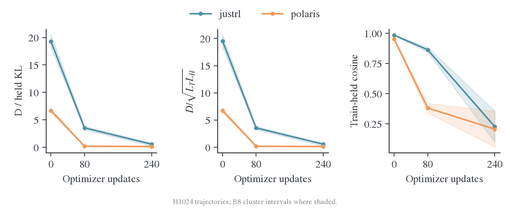

### 结论

在 updates240 的未来 source 上，JustRL 的单位风险传播显著更强，主要差别在两端能量。All-train 的后期 teacher 差值区间跨零，不能将未来 source 的结果推广到所有 source 口径。

## 实验 4：冻结初始请求与逐 token 幅度对照

### Setting

沿用实验 2 的同一 256 题、全部 response 位置和 0/80/240/320 参数点，已完成八个完整轨迹条件和八个逐 token 对照条件。Live 与 frozen 经过相同当前 Jacobian；frozen 固定初始 student 的 logit 请求。初始请求沿用 FP32 master/head、BF16 backbone autocast，避免将 BF16 teacher 副本的精度差异混入请求变化。

### 理论与测量

在当前参数 $\theta_s$，比较：

$$
g_i^{\mathrm{live}}=\frac1H\sum_tJ_{it}(\theta_s)^\top b_{it}(\theta_s),
\qquad
g_i^{\mathrm{frozen}}=\frac1H\sum_tJ_{it}(\theta_s)^\top b_{it}(\theta_0).
$$

Frozen 检查当前映射对原始请求是否保持响应。Live/frozen 原始能量差同时含幅度与方向变化，因此再逐位置拟合正幅度 $a_{it}^{+}$：

$$
a_{it}^{+}=\max\!\left(0,\frac{b_{it}^{\top}b_{it}^{0}}{\Vert b_{it}^{0}\Vert^2}\right),
\qquad
R_+=\frac{\mathbb E_i H^{-1}\sum_t\Vert b_{it}-a_{it}^{+}b_{it}^{0}\Vert^2}{P}.
$$

初始请求为零的位置将当前请求全部记入残差。另报整体 cosine、去掉逐位置幅度差后的加权 cosine 与垂直压力比例；定义见[逐位置对照](../../../theory/2026-11-09-PAC与跨batch传播诊断.md#逐位置幅度变化与方向变化)。

### 冻结请求的结果

固定初始请求时，Polaris 的留出 A 从 95.24 升至 291.57（240 updates），$\Xi$ 从 13.02 升至 61.97；JustRL 对应 A 为 161.43→345.53，$\Xi$ 为 52.49→98.58。当前映射对初始请求保持响应，live 残差的低效率不能解释为所有方向的参数响应都减弱。

240 updates 的 live/frozen 整体 logit 请求 cosine 为 JustRL 0.291、Polaris 0.820；当前 Jacobian 下的留出均值参数方向 cosine 为 0.121/−0.162。JustRL 已大幅减少初始差异，留下的残差更偏离初始请求；Polaris 则保留较多原始请求能量。单看请求与初始方向的接近程度，会把可学习性排序反过来。方向变化需结合剩余 loss、A 和交叉响应理解，逐 token 幅度对照进一步区分不同位置的收缩与旋转。

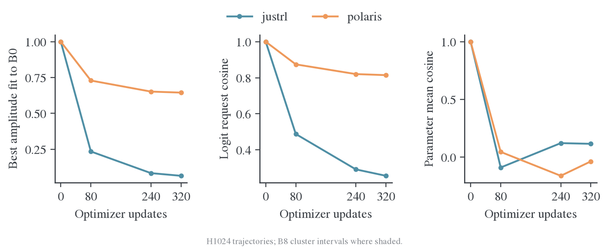

### 逐 token 对照的结果

逐 token 幅度对照在相同 256 题、相同位置上完成。Updates240 的留出结果如下：

| Teacher | 整体请求 cosine | 去掉逐位置幅度差后的加权 cosine | 垂直残差 / 当前 P | 正向缩放无法解释的压力比例 |
| ------- | --------------: | ------------------------------: | ----------------: | -------------------------: |
| JustRL  |           0.291 |                           0.469 |            33.58% |                     44.04% |
| Polaris |           0.820 |                           0.937 |             9.00% |                      9.22% |

Polaris 当前压力的约 90.78% 可由初始请求的逐位置正幅度缩放解释，320 updates 时仍为约 90.44%。因此其低效率不能归结为“剩余请求大幅旋转离开初始方向”。JustRL 的低 cosine 与更高的残差方向占比出现在剩余 KL 已降低约 92% 的条件下，符合原始共同差异已经被较充分吸收后，留下不同残差方向的情形。

这些是 logit 请求能量的分解。约 91% 的压力沿初始方向，不表示约 91% 的参数梯度或跨 batch 收益来自该分量：不同位置的缩放会改变题内聚合与抵消，而 Jacobian 对各位置的作用也不同。完整轨迹中，Polaris 的低 A 与弱传播发生在这些位置加权后的当前请求上。

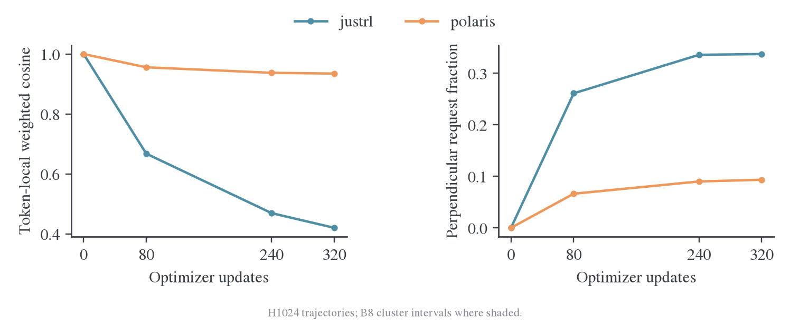

这些结果支持“Polaris 在高残差下，每单位剩余误差的有效共同参数响应较低”的解释。完整轨迹 A 和跨组 Gram 尚未分离小特征值方向、题内抵消与真正不可实现的局部残差；现有结果没有给出全模型的不可突破噪声底。

### 结论

当前映射对初始请求仍有响应，Polaris 的当前请求也大体保留初始方向。低 A 需要进一步解释位置权重与 Jacobian 的共同作用：logit 空间中沿初始方向的能量比例，不能决定映射后的参数梯度及跨批收益。

## 实验 5：有限梯度空间与 batch 重加权

### Setting

使用原六阶段 B8 梯度 Gram。训练侧最多 20 个 source 组，永久留出 12 个 receiver 组；另外匹配 source 数量，并分开校准与检验 receiver。

### 理论与测量

令 source 梯度为列矩阵 $U$，heldout 平均梯度为 $h$，$K=U^\top U$、$k=U^\top h$。允许任意 batch 标量权重时：

$$
\sup_w\cos(Uw,h)=\sqrt{\frac{k^\top K^+k}{\Vert h\Vert^2}}.
$$

同时对 receiver 的投影能量和原能量去掉自内积，报告共享能量覆盖比。该比值和 oracle cosine 分开解释；推导见[有限空间上限](../../../theory/2026-11-09-PAC与跨batch传播诊断.md#有限梯度空间的传播上限)。

### 结果与结论

在 updates80，用 20 个训练 B8 组形成有限梯度空间，对 12 个留出 B8 组去除 receiver 自内积后，估计可覆盖共享能量的比例为 JustRL $0.909\pm0.012$、Polaris $0.509\pm0.057$，误差为 delete-one-receiver jackknife 标准误。Polaris 的有限空间缺口在这项校正后仍存在，不能全部归于留出均值本身的有限样本噪声。

到 updates160，同一校正比例为 JustRL $0.531\pm0.056$、Polaris $0.383\pm0.073$。JustRL 的有限空间覆盖也下降了，此时它的 RKL 已比自身初始低约 88.4%，Polaris 仅低约 24.2%。因此这些量应解释残差在特定训练阶段的可传播性，不能把 teacher 固定分成“有共享方向”与“没有共享方向”两类。完整阶段统计见 [`r1-span.json`](data/teacher-difference/teacher-difference-stages-20261109/analysis/r1-span.json)。

将 source 数量匹配为 6 个 B8 组，并固定另外 6 个独立 receiver，100 次确定性面板划分的平均 oracle cosine 上限为：JustRL 训练 source / 独立 source 为 0.733 / 0.731；Polaris 为 0.230 / 0.220。独立 source 没有恢复传播能力，训练池被反复拟合并不足以单独解释这项差距。另用 6 个留出组拟合权重、在另外 6 个组检验，Polaris 的 uniform / 正权重 / 有符号权重 cosine 为 0.325 / 0.323 / 0.323；这些有限 batch 的标量重加权没有产生改善。

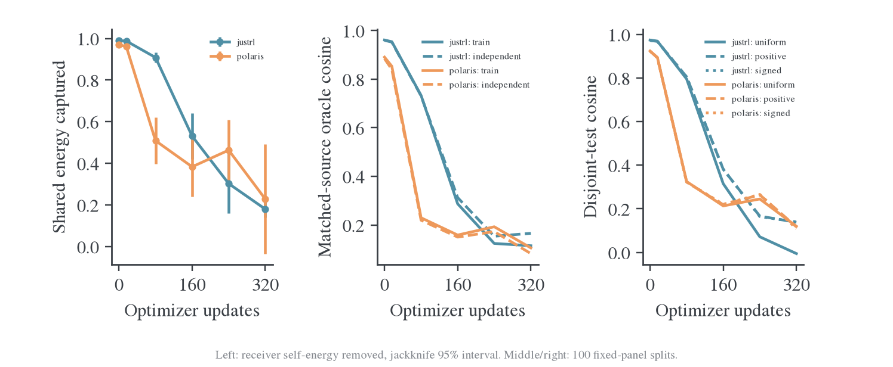

这些上限只约束所测 checkpoint 的有限梯度空间。它们支持“后期残差缺少可被这些 batch 联合表达的共享方向”，尚不证明所有数据、非线性训练路径或优化器都无法学习该差异。

## 实验 6：单位置采样、主要谱与独立重复

### Setting

小面板先用 4 道 train Math 与 4 道 heldout Math 的 response 中间位置验证算子，再在每题已有首、中、末位置中取两个 teacher 初始压力最大位置的并集，共 10 个位置。后者是高压力候选对照。中间位置上的 Polaris 留出 RKL 从 0.00146 降至 updates240 的 0.000037，远低于完整 H1024 留出面板的平台；因此小面板不能代表全轨迹残差，机制主分析扩大到下述独立题目面板。

| 项目     | 大面板设置                                                                                                                 |
| -------- | -------------------------------------------------------------------------------------------------------------------------- |
| 数据     | 原 L 系列同一冻结 S0 bank，全部 160 道 train Math、96 道永久 heldout Math，原 prompt、response cap1024                     |
| 位置     | 每题由固定 seed20261109 在有效 response 位置上均匀抽一个 token，所有阶段、两个 teacher 共用；逐题等权                      |
| 参数点   | 共同初始化；JustRL、Polaris 各自 updates80/240                                                                             |
| 请求     | 初始化测两个 target；后续各路径测 native target 的 live 与 frozen-$B_0$ 请求                                               |
| 跨题传播 | 沿用原 20 个 train B8 与 12 个 heldout B8，保存全部组间 Gram；分别报告对角自能量、非对角共同能量与 train→heldout 交叉块    |
| 谱       | 从上述题目确定性抽 train/heldout 各 40 题；24 次完全重正交 Krylov/Rayleigh–Ritz，保存前三特征方向、请求投影与残差          |
| 精度     | FP32 master/BF16 backbone、math SDPA；同一位置的 teacher cache 与原诊断共用                                                |
| 区间     | 2000 次按原 B8 组的 basic bootstrap，train/heldout 独立抽样，跨阶段与 live/frozen 配对；谱以题目为单位配对 percentile 抽样 |

该位置抽样使每题期望上代表其有效 response 的平均位置；单题一个位置仍有 token 抽样变异。256 题中 252 题截断为 1024 token，其余长度为 546/617/636/944；单位置目标按有效长度均值，原轨迹目标按固定 H1024。B8 区间描述固定 bank 的组间变异，训练随机种子变异不在该区间内。Prefix KL 与原固定 H 轨迹 loss 的归约不同，二者分开报告。大面板采样与最初的小面板独立，原小面板保留为预检与选择偏差对照。

记训练组与留出组平均梯度分别为 $\bar g_T,\bar g_H$，主迁移量为：

$$
S_{T\to H}=\bar g_H^\top\bar g_T,\qquad
R_{T\to H}=\frac{S_{T\to H}}{\Vert\bar g_T\Vert^2},\qquad
Q_{T\to H}=\frac{S_{T\to H}}{L_H}.
$$

$R$ 比较留出收益与训练面板自身的一阶收益，$Q$ 比较相对于留出 loss 的传播信号。另报两端平均梯度 cosine。训练源同时分成全部 train 和当时尚未训练的 future-train；updates80/240 分别剩余 15/5 个 future B8 组。Live 的 $S$ 是当前 RKL 的一阶传播信号；frozen 的 $S$ 是初始请求在当前参数上的反事实传播，不能当作当前 RKL 的下降预测。Live 与 frozen 使用相同参数和输入：Live 与 frozen 的原始内积差同时包含请求幅度和方向变化；仅凭差值不能判断残差方向退化。Frozen 的响应用于检查当前映射对初始请求的响应是否保持。判断以区间和实际 Adam 对照为依据。交叉内积及其 loss 归一化使用 basic bootstrap；cosine 和 source 自能量归一化对重复抽样的自内积偏差较敏感，改用两端独立 delete-one-group jackknife-t 区间。

小面板的 24/64 步配对检查中，前三特征值最大相对变化约 $6.3\times10^{-6}$，子空间重叠最低 0.999997；最大 Ritz 残差仍约 10.4%，增加迭代没有消除该残差。因此报告同时保留迭代稳定性和算子残差，主要特征方向的稳定不等于精确完整谱。设置和谱算子定义见本节；结果表与图保留在下方。

### 理论：单位置采样与有限面板的自能量

256 题已经消除 4 题小面板的覆盖不足，但每题只取一个 token 时，自身梯度能量仍远高于跨题共同能量。设独立组梯度为 $g_i$，有 $n$ 组，则：

$$
\Vert\bar g\Vert^2=\frac{1}{n^2}\sum_i\Vert g_i\Vert^2+
\frac{1}{n^2}\sum_{i\ne j}g_i^\top g_j.
$$

即使跨题内积均值为零，有限面板的 $C$ 仍可接近 $1/n$，$P\Xi$ 仍为正。对于 12 个 heldout B8 组，该基线为 $1/12\approx0.0833$。因此单位置的 $P\Xi/L$ 衡量拟合这个抽样面板的能量，不能替代 train→heldout 交叉块，也不能直接与完整 H1024 轨迹的数值比较。题内位置抽样会为平均梯度平方范数增加非负方差项，而 train→heldout 交叉内积没有这一对角正偏差；推导见[理论文档](../../../theory/2026-11-09-PAC与跨batch传播诊断.md#每题单位置带来的额外抽样能量)。

除独立题目数和 B8 区间外，再用 seed20261110 为相同 256 道题独立重抽一个位置，复测共同初始化和两个 updates240 终点；该重复跳过谱。不同 seed 的结果分别展示，用于检查位置抽样敏感性，不将两轮视作 512 道独立题。报告同时保留最大单题压力份额与压力有效题数，检查残差是否集中。

### 结果：单位置传播的区间与 frozen 对照

下表为全部 160 个 train 位置到 96 个 heldout 位置的 B8 交叉块，区间为按组抽样的 95% basic bootstrap 区间。Frozen 栏使用相同初始请求 $B_0$，描述当前参数映射的反事实响应。

| 路径    | Updates | Heldout prefix KL |        Live $S_{T\to H}$ |   Frozen $S_{T\to H}$ |
| ------- | ------: | ----------------: | -----------------------: | --------------------: |
| JustRL  |       0 |           0.13773 |     3.071 [1.490, 4.351] |  3.069 [1.476, 4.367] |
| JustRL  |      80 |           0.03823 |    0.226 [−0.021, 0.430] |  4.593 [2.432, 6.464] |
| JustRL  |     240 |           0.01453 | 0.0077 [−0.0655, 0.1171] |  5.645 [3.026, 7.825] |
| Polaris |       0 |           0.23867 |    2.149 [−0.749, 4.390] | 2.156 [−0.741, 4.413] |
| Polaris |      80 |           0.17742 |   −0.301 [−1.582, 1.228] |  5.024 [0.951, 8.122] |
| Polaris |     240 |           0.17031 |  −0.0197 [−1.331, 1.213] | 9.807 [3.264, 15.100] |

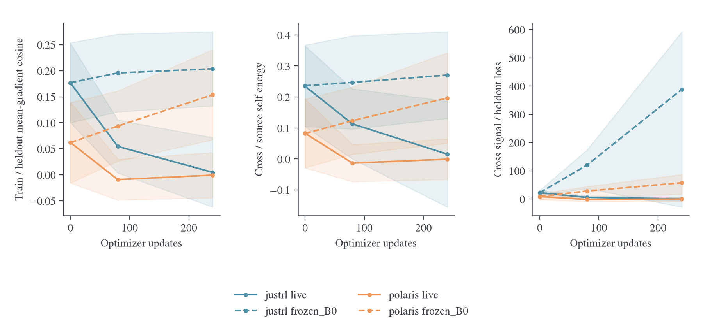

Polaris240 的 live−frozen 交叉内积为 −9.826，配对区间 [−15.138, −3.328]；JustRL240 同样为 −5.637 [−7.812, −3.022]。两条路径都出现“当前请求的共同信号弱于初始请求”，但 JustRL 已留下小得多的 KL。该差值可以由请求幅度缩小产生，尚不能证明残差方向退化；JustRL 已吸收大部分差异，绝对信号变弱是正常现象。

两种 teacher 的 live $S$ 差值在 updates80 为 0.527 [−0.991, 1.766]，updates240 为 0.027 [−1.198, 1.332]；$Q$ 差值区间也跨零。单位置大面板仍未可靠分辨两种 teacher 后期的 live 传播差距，不能用均值排序补足证据。完整轨迹的实际下降、原 B8 Gram 和 Adam 探针仍是区分 JustRL 与 Polaris 的主要证据。详细表见 [transfer](data/teacher-difference/teacher-difference-logit-20261109/large/analysis/transfer.csv) 和 [配对差值](data/teacher-difference/teacher-difference-logit-20261109/large/analysis/paired-contrasts.csv)。

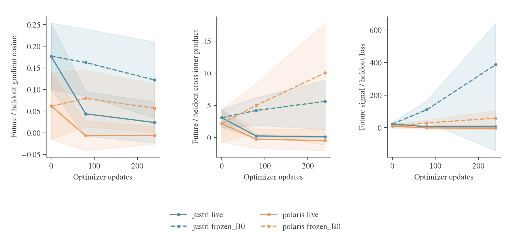

未来 source 单列后，updates240 仅剩 5 个 B8 组，区间更宽。该对照用于对应“下一新 batch”，不能用全部 train 的较窄区间替代。所有条件的题目 ID 已核验：256 个不同 DAPO 题目，train 与 heldout 无重叠。

### 结果：独立位置抽样重复

第二套位置抽样在相同 256 道题上使用 seed20261110，共同初始化和两条路径的 updates240 终点全部完成。下表为终点的跨留出内积，不把重复题计成新样本。

| 路径       | 位置抽样     |        Live $S_{T\to H}$ |    Frozen $S_{T\to H}$ |
| ---------- | ------------ | -----------------------: | ---------------------: |
| JustRL240  | seed20261109 | 0.0077 [−0.0655, 0.1171] |   5.645 [3.026, 7.825] |
| JustRL240  | seed20261110 | 0.0011 [−0.0704, 0.0792] |   5.866 [2.428, 8.613] |
| Polaris240 | seed20261109 |  −0.0197 [−1.331, 1.213] |  9.807 [3.264, 15.100] |
| Polaris240 | seed20261110 |  −0.0701 [−1.325, 1.202] | 12.970 [5.467, 18.964] |

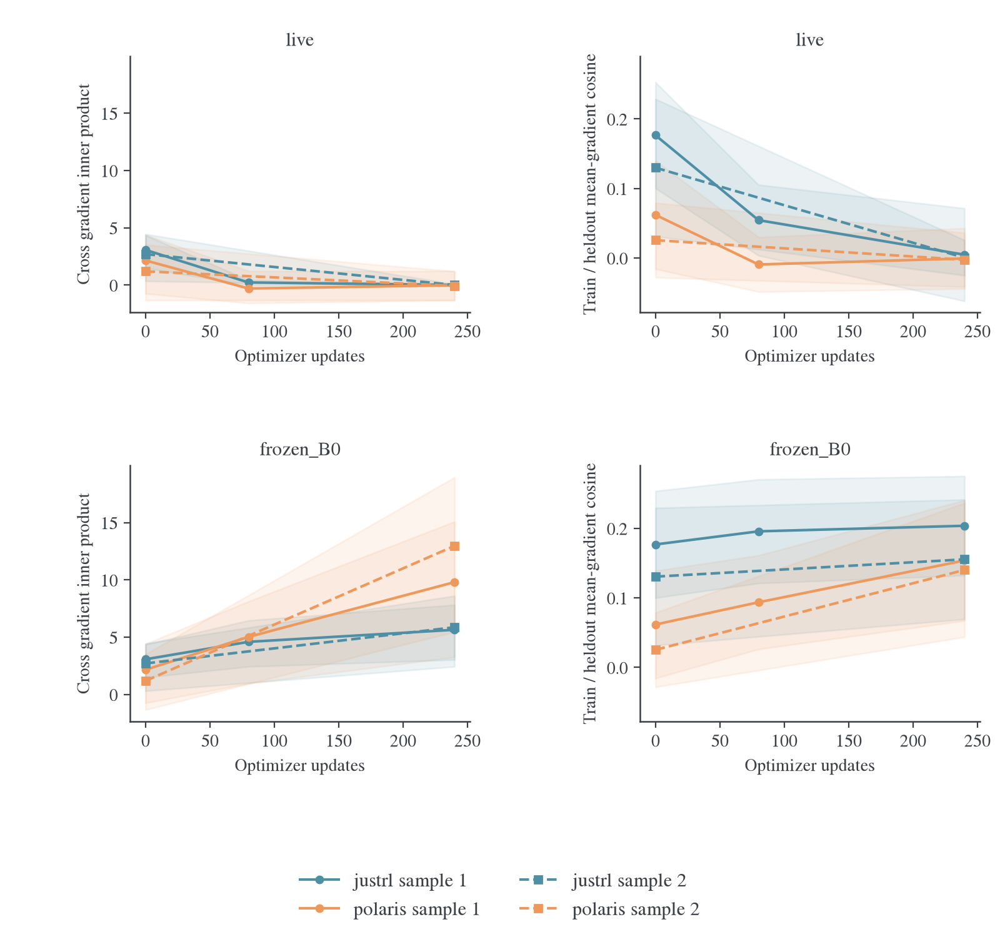

两套位置抽样都重现 frozen 的正传播与 live 的弱传播，且两条路径均存在这种分离。Polaris 留出 prefix KL 两轮为 0.1703/0.1758，JustRL 为 0.01453/0.01076。重复支持“绝对共同信号变弱发生在不同残差水平”的观察，但尚不能把两条路径都称为传播退化，也没有分辨出显著的后期单位剩余风险传播差值。第二轮 Polaris 的最大单题压力份额达到 38.6%，后续若要精确估计很小的 live 共同能量，应按完整轨迹聚合或增加每题独立位置，而不是继续增加同一位置的谱迭代。

[重复数值表](data/teacher-difference/teacher-difference-logit-20261109/large-replicate/analysis/transfer.csv) 与[未来 source 重复图](figures/teacher-difference/teacher-difference-logit-20261109/analysis/sampling_future-train.png)保留同样的区间和 source 口径。

### 结果：PAC 与主要特征方向

96 道 heldout、12 个 B8 组上的 live 因子如下。$A,C,\Xi$ 按 B8 聚合，$P$ 按题均匀选中的位置计算；这一归约与完整 H1024 轨迹 PAC 分开。

| 路径    | Updates |     $P$ |     $A$ |     $C$ |  $\Xi$ | $P\Xi$ | $P\Xi/L$ | Distinct-B8 相干性 |
| ------- | ------: | ------: | ------: | ------: | -----: | -----: | -------: | -----------------: |
| JustRL  |       0 | 0.06334 |  3863.8 | 0.09438 | 364.66 | 23.099 |   167.72 |            0.01205 |
| JustRL  |      80 | 0.01789 |  5696.7 | 0.08434 | 480.47 |  8.598 |   224.89 |            0.00110 |
| JustRL  |     240 | 0.00560 | 11212.8 | 0.08328 | 933.79 |  5.226 |   359.69 |           −0.00006 |
| Polaris |       0 | 0.12575 |  4319.1 | 0.08498 | 367.04 | 46.155 |   193.39 |            0.00180 |
| Polaris |      80 | 0.09296 |  6459.2 | 0.07973 | 514.98 | 47.870 |   269.82 |           −0.00393 |
| Polaris |     240 | 0.07741 |  7293.1 | 0.07930 | 578.34 | 44.770 |   262.88 |           −0.00440 |

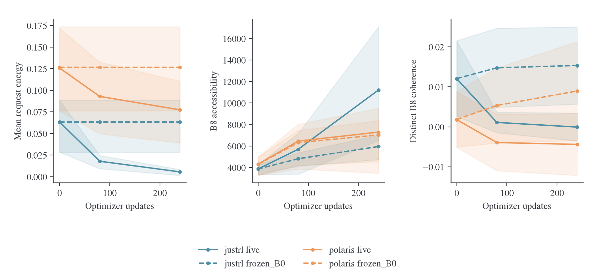

$C$ 大多接近 $1/12$，distinct-B8 相干性接近零；单位置的 $P\Xi/L$ 因而不能稳定代表跨题下降率。JustRL240 的 96 题中最大单题占压力 37.3%，压力有效题数约 6.0；Polaris240 最大份额为 18.8%，有效题数约 11.5。区间与第二套独立位置抽样用于检查这种集中，而非把 96 个位置都视作同等信息量。完整值与区间见 [panels](data/teacher-difference/teacher-difference-logit-20261109/large/analysis/panels.csv)。

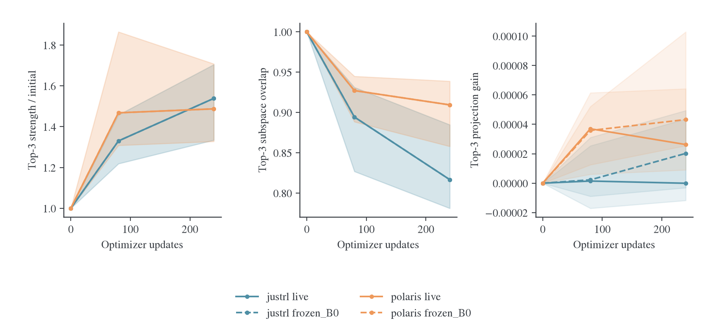

谱子面板为 40 道独立 heldout 题。到 updates240，JustRL/Polaris 的 $G_3$ 中位数分别为 1.539 [1.334, 1.705] / 1.487 [1.328, 1.708]，$O_3$ 为 0.817 / 0.909；两条路径的主要谱强度都上升，Polaris 的主子空间甚至更接近初始化。Frozen 单位置 accessibility 中位数从 JustRL 32824→44015、Polaris 31256→44613，同样不支持普遍响应塌缩。

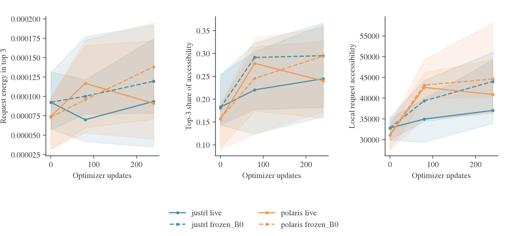

Frozen 请求投向前三方向的能量中位数只有约 $10^{-4}$，但这三个强方向在 updates240 分别贡献约 29.5% / 29.4% 的局部 accessibility；其余约 70% 位于未解析谱段。主要谱增长不能替代完整请求加权响应，更不能单独解释跨题传播。大面板最大 Ritz 相对残差约 12.2%，所以关于谱的结论限定为主要谱段和方向的稳定变化。

主要谱段没有显示普遍塌缩。单位置 live 传播区间仍宽；完整轨迹实验 2–4 提供后期 teacher 差异的主要判断依据。

### 理论与结论：谱测量的对象

谱与 Gram 对应三个不同对象：

| 对象                                                 | 能回答的问题                                               | 当前安排                                                    |
| ---------------------------------------------------- | ---------------------------------------------------------- | ----------------------------------------------------------- |
| 单 prefix 的 logit kernel $K(s,s)=\Phi_s\Phi_s^\top$ | 同一 student 如何响应不同 teacher 的请求，A 由哪些方向贡献 | 已完成 80 题目标加权主要谱                                  |
| 样本间梯度 Gram                                      | 不同 batch 的更新方向是否共享、能否覆盖留出方向            | 已有完整轨迹主轮与 256 题 live/frozen B8 对照               |
| 全参数 Fisher                                        | 局部 KL 几何中的慢方向、近零方向与目标分量                 | 暂缓完整谱；确需时用矩阵向量积和 Lanczos 等方法估计重点谱段 |

对于单 prefix，若 $K=U\Lambda U^\top$，则：

$$
A_s=\frac{B_s^\top K B_s}{\Vert B_s\Vert^2}
=\sum_k\lambda_k\frac{(u_k^\top B_s)^2}{\Vert B_s\Vert^2}.
$$

相同 student、相同 prefix 下，两个 teacher 面对相同 kernel；差别体现在请求投向哪些特征向量。只比较特征值分布无法解释 teacher 差异，需要同时报告请求的投影能量。探针按题报告变化与不确定性，区分已计算谱段和剩余能量。单 prefix 谱解释局部 A，跨 batch 传播还取决于交叉 kernel $\Phi_r\Phi_s^\top$，由跨题 Gram 和留出响应配合检验。

全参数 Fisher 维度大，完整谱暂缓。已完成的主要谱与交叉 Gram 可以检验普遍响应塌缩；剩余关键问题是完整轨迹残差的请求聚合与实际更新对齐。单 prefix 的完整词表 kernel 也有较高的 Jacobian 计算成本，当前只估计主要谱段及请求加权响应。有限 Gram 的空间外能量仅约束已测方向；当前尚未测出真实 OPD 的不可突破风险下界。

MiMo 与 Qwen 保留为外部对照，主线先解释 R1 的 JustRL/Polaris 差异。

## 实验 7：轨迹 A 的单 token 响应与题内聚合

### Setting

主面板沿用原 S0 bank 的 160 道 train、96 道 heldout Math 题，完整 H1024、原 B8 分组。测量 JustRL/Polaris 的 updates0/80/240，共六个条件。每题 16 个独立 Rademacher 随机符号 probe，按 row-ID 和固定 seed `20261109` 寻址，各条件配对；probe 重复不增加题目数。

独立补充面板使用原始 640 条四域 bank 中每个 B16 的另一半 B8。Math 仍为 160 train、96 heldout，与主面板 prompt 无交集，只测两条路径的 updates240。两组共 512 道不同 Math 题、192 道 heldout 题；各组独立形成 Gram，不把未测的跨面板内积补成零后合并。抽样来源与互斥核验见[补充题目选择](data/teacher-difference/teacher-difference-response-20261109/complement-selection.json)。

题组不确定性用 4,000 次 B8 bootstrap；同题 teacher 比较配对。正能量和正比值使用 percentile 区间，以保留重尾比值的正支持；有符号传播使用 basic 区间。随机 probe 的 Monte Carlo 标准误单独报告。上述区间描述固定训练路径上的题组变化。

### 理论与测量

将单 token 参数梯度记为 $u_{it}=J_{it}^{\top}b_{it}$，定义：

$$
U=\mathbb E_i\frac1H\sum_t\Vert u_{it}\Vert^2,\qquad
A_{\rm token}=\frac UP,\qquad
R_{\rm agg}=\frac{\mathbb E_i\Vert g_i\Vert^2}{U},\qquad
A=A_{\rm token}R_{\rm agg}.
$$

固定 H 下，$R_{\rm agg}\in[0,1]$。进一步展开：

$$
\mathbb E_i\Vert g_i\Vert^2
=\frac UH+\mathbb E_i\frac1{H^2}\sum_{t\ne t'}u_{it}^{\top}u_{it'}.
$$

右侧非对角项为正表示位置之间有净正向叠加，为负才是净抵消。随机符号消去交叉项，避免逐 token 保存全参数梯度：

$$
h_i=\frac1H\sum_t\epsilon_{it}u_{it},\qquad
\mathbb E_\epsilon\Vert h_i\Vert^2=\frac1{H^2}\sum_t\Vert u_{it}\Vert^2,
\qquad U=H\mathbb E_{i,\epsilon}\Vert h_i\Vert^2.
$$

完整推导见[轨迹 A 的拆分](../../../theory/2026-11-09-PAC与跨batch传播诊断.md#轨迹-a-的-token-响应与聚合分解)。

### 结果与分析

下表为 updates240 的 heldout 均值：

| 面板 / teacher |      A | $A_{\rm token}$ | $HR_{\rm agg}$ | 单题最大 U 占比 | U 有效题数 |
| -------------- | -----: | --------------: | -------------: | --------------: | ---------: |
| 主 / JustRL    | 498.35 |         361,049 |          1.413 |          62.54% |       2.43 |
| 主 / Polaris   |  84.32 |          64,923 |          1.330 |           6.57% |      50.97 |
| 补充 / JustRL  | 583.10 |         358,181 |          1.667 |          74.60% |       1.79 |
| 补充 / Polaris | 106.89 |          75,889 |          1.442 |           8.99% |      43.40 |

有效题数定义为 $(\sum_i U_i)^2/\sum_i U_i^2$，用于量化能量集中度。主面板的 A 比值为 $5.91=5.56\times1.063$，其中 token 响应比值的配对区间为 [1.17,12.25]，聚合比值为 [0.889,2.276]。两个面板的非对角项均为正，当前证据不支持把 Polaris 的低 A 归为整条轨迹存在净负向 token 抵消。

JustRL 的均值有显著重尾。主面板 heldout 的 row365 贡献 62.54% 的 U；去掉该题后，$A_{\rm token}$ 从 361,049 降到 138,328，A 从 498.35 降到 278.13。原始均值继续保留，逐题删除只作敏感性分析。补充面板也出现高度集中，因此“均值更高”不能改写成“每道题都更容易响应”。主面板 U 的 probe 相对标准误为 JustRL 0.67%、Polaris 0.24%；增加符号重复无法解决题目间的重尾。

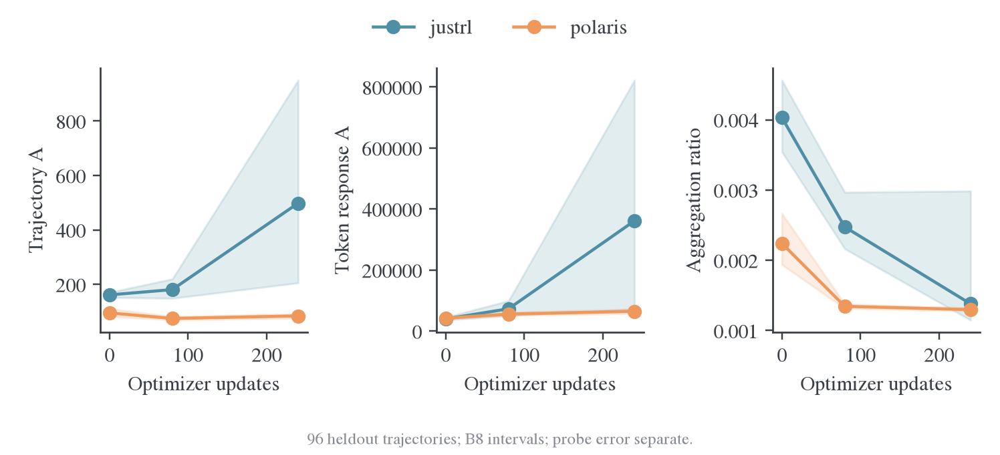

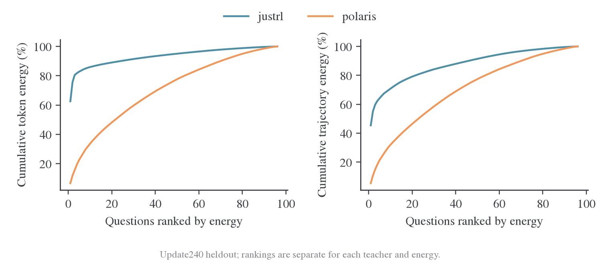

### 结论

两组固定面板的 A 均值差距主要落在 token 响应端，题内聚合比值接近；JustRL 的响应优势高度集中于少数题。后续解释必须同时考虑均值和能量分布。

## 实验 8：初始平行分量与垂直残差的参数传播

### Setting

使用实验 7 的全部八个条件。每题计算 native 与初始平行请求的参数梯度，保存 B8 均值的联合 Gram；垂直方向定义为两者之差。两个面板分别分析，未来 source 随 checkpoint 排除已经训练过的批。

### 理论与测量

初始平行/垂直分解是为解释本组结果新增的诊断；论文的固定初始请求探针提供参照，但没有直接给出这项分解。逐位置作带符号投影，初始请求为零的位置全部归入垂直残差：

$$
b_{it}^{\parallel}=\frac{b_{it}^{\top}b_{it}^{0}}{\Vert b_{it}^{0}\Vert^2}b_{it}^{0},\qquad
b_{it}^{\perp}=b_{it}-b_{it}^{\parallel},\qquad
g_i=g_i^{\parallel}+g_i^{\perp}.
$$

Logit 正交经过 Jacobian 后可以产生正负交叉项。传播两端同时拆分：

$$
D=\sum_{a,b\in\{\parallel,\perp\}}D_{ab},\qquad
D_{ab}=(v_H^a)^\top v_T^b.
$$

第一个下标为 receiver，第二个为 source；所有项除以原始 native $L_H$。保留平行 source 更新时，原始 loss 的下降系数是 $(D_{\parallel\parallel}+D_{\perp\parallel})/L_H$，不能只看平行—平行项。完整推导见[请求分量的参数响应与跨面板传播](../../../theory/2026-11-09-PAC与跨batch传播诊断.md#请求分量的参数响应与跨面板传播)。

### 结果与分析

updates240，未来五个 source B8 到 heldout 的归一化传播：

| 面板 / teacher | 平行—平行 | 平行—垂直 | 垂直—平行 | 垂直—垂直 | 净传播 | 净传播 / 各项绝对值之和 |
| -------------- | --------: | --------: | --------: | --------: | -----: | ----------------------: |
| 主 / JustRL    |     1.004 |    −0.615 |    −0.580 |     0.770 |  0.579 |                  19.50% |
| 主 / Polaris   |     3.713 |    −3.730 |    −3.990 |     4.157 |  0.150 |                   0.96% |
| 补充 / JustRL  |     0.896 |    −0.663 |    −0.550 |     0.727 |  0.410 |                  14.46% |
| 补充 / Polaris |     3.947 |    −3.991 |    −4.301 |     4.542 |  0.196 |                   1.17% |

Polaris 在两个面板都存在大幅分量抵消。主面板平行 source 的净系数为 −0.277，区间 [−0.471,−0.064]；补充面板为 −0.355，[−0.566,−0.115]。垂直 source 则为 +0.427 和 +0.551。因此初始平行压力占比高，并不意味着删掉垂直分量能改善 native loss。

自身能量也呈现一致结构。主面板 Polaris 的平均参数分量 cosine 为 −0.485，native 能量相对于两分量能量之和保留 59.2%；补充面板为 −0.468、61.5%。JustRL 对应 cosine 为 +0.118、+0.180，能量保留均为 111.3%。这些是平行/垂直分量之间的抵消；与实验 7 的整条轨迹 token 非对角项为正可以同时成立。

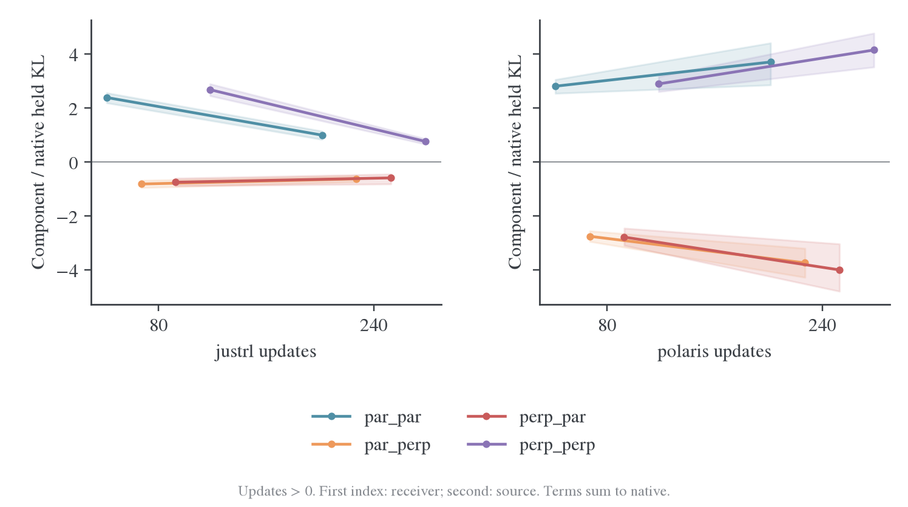

混合精度控制额外比较两个 teacher240 各一个 train B8 和 heldout B8：显式垂直 VJP 与 native−parallel 的相对 L2 差为 0.60%–1.20%，cosine 均大于 0.99992。净 native 梯度独立计算；小净差值的精确数值仍受混合精度影响。

### 结论

Polaris 的低净传播伴随稳定的分量间抵消，两个独立题目面板均复现。它的平行、垂直分量都能产生较大的跨批内积，但保留下来的净值很小。该分解定位了当前梯度的几何结构，尚未解释训练为何形成这种结构。

## 实验 9：固定初始请求的单 token 响应对照

### Setting 与理论

主面板两条路径的 updates240，各 256 题、每题 8 个随机符号，只测范数。把初始请求 $b^0$ 与当前请求 $b$ 分别送入同一个当前 Jacobian，比较各自单位压力响应：

$$
A_{\rm token}^{0\to\theta}
=\frac{\mathbb E_iH^{-1}\sum_t\Vert J_{it}(\theta)^\top b^0_{it}\Vert^2}
{\mathbb E_iH^{-1}\sum_t\Vert b^0_{it}\Vert^2}.
$$

这是同参数点的请求对照，可区分当前残差响应与对初始请求的响应；不同训练路径间的比较仍包含 Jacobian 差异。

### 结果与结论

| Teacher | 当前请求 $A_{\rm token}$ | 初始请求 $A_{\rm token}^{0\to\theta}$ | 当前 / 初始及题组区间 |
| ------- | -----------------------: | ------------------------------------: | --------------------- |
| JustRL  |                  361,049 |                                80,458 | 4.49 [0.890,9.63]     |
| Polaris |                   64,923 |                                71,051 | 0.914 [0.857,0.982]   |

初始请求的响应比值只有 1.13，远小于当前请求的 5.56。当前请求在何处留下残差影响响应；两条路径的映射整体强度并不足以解释均值差距。JustRL 的区间和能量集中度要求保留重尾解释。

## 实验 10：等位移真实更新与原始 test KL

### Setting

两条路径均固定在 updates240。预先固定三个尚未训练过的 source B8：P/R/T；分别用 native、平行、垂直方向做一次更新，位移范数网格为 0.003/0.01/0.03，共 54 次干预。每次从同一 FP32 参数副本恢复，不连续累积更新。

96 道 heldout 按原 B8 组分成 48 calibration、48 untouched test；每个 source/方向用 calibration 选择步长，零更新作为候选。另报告全部预定步长的 test 结果，使用相同 source 与 receiver 的配对 bootstrap。每次评原始 native RKL；方向试验采用欧氏梯度，不恢复训练 Adam 动量。三个 source 是题组重复，不是训练 seed 重复。

### 理论与测量

方向 $d$ 归一化为 $\hat d=d/\Vert d\Vert$，真实收益与一阶预测为：

$$
\Delta_H(\delta,d)=L_H(\theta)-L_H(\theta-\delta\hat d),\qquad
\Delta_H^{(1)}=\delta\,v_H^\top\hat d.
$$

二者的差包含有限步曲率和数值误差。各方向使用相同位移预算，原始 test loss 始终相同。

### 结果与分析

最小位移 0.003 的 untouched test 相对 KL 降幅，按三个 source 平均；正值为改善，括号为题组区间：

| Teacher | Native                  | 平行                     | 垂直                     | 垂直−Native 的配对差      |
| ------- | ----------------------- | ------------------------ | ------------------------ | ------------------------- |
| JustRL  | 0.320% [−0.047%,0.721%] | −0.027% [−0.316%,0.300%] | −0.155% [−0.448%,0.127%] | −0.475% [−0.856%,−0.080%] |
| Polaris | 0.075% [0.018%,0.138%]  | −0.048% [−0.140%,0.060%] | 0.110% [0.042%,0.193%]   | 0.034% [−0.057%,0.113%]   |

Polaris 的平行方向比 native 更差，配对差为 −0.123% [−0.187%,−0.044%]。垂直方向可以改善原始 test loss，但相对 native 的收益区间跨零，尚未建立稳定优势。

在 JustRL 上，一阶预测对最小位移 native 收益为 0.448%，实测为 0.320%；同位移垂直方向预测为 +0.302%，实测为 −0.155%。较大位移导致更明显的真实风险上升。只比较一阶系数不足以确定有限更新的好坏，也不能从分量分解直接推出新的训练目标。

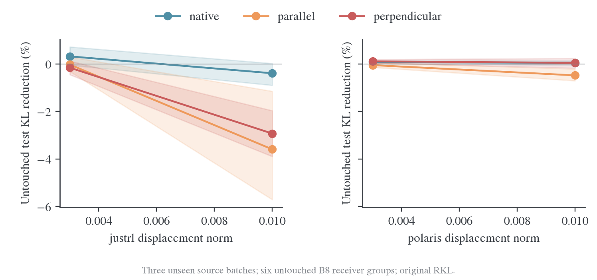

全部预定步长、按 calibration 选择的独立 test 结果和配对方向差值保存在[真实更新分析](data/teacher-difference/teacher-difference-response-20261109/updates/analysis/README.md)。

### 结论

Polaris 的后期残差仍有可改善部分；当前结果不支持“所有 state 上完全学不动”的判断。删除初始垂直残差没有获得支持，保留垂直方向也尚未稳定优于 native。有限步曲率是把局部几何转成实际更新时必须考虑的因素。

## 实验 11：Teacher × student 交叉与历史 AdamW

### Setting

固定 updates240 的 JustRL 和 Polaris student，交换两个 teacher，得到四个组合。所有组合使用相同 256 道 Math 题、160 train/96 heldout、H1024；P/R/T 三个 train B8 是该 checkpoint 尚未训练过的 source。对角组合复用前面的结果，非对角组合重新计算 live/frozen 请求、跨面板 Gram 和等位移更新。另从 `batch-15/optimizer.pt` 恢复 step240 的 AdamW 状态，保留动量、二阶矩、weight decay 和 clip，对每个组合做 P/R/T 三个 source 的 0.25/0.5/1 倍历史位移干预。

### 结果

在 displacement=0.003 的 native 更新上，48 道 untouched test 的相对 KL 降幅为：

| Student | JustRL teacher | Polaris teacher |
| ------- | -------------: | --------------: |
| JustRL  |          0.32% |           2.18% |
| Polaris |          2.67% |          0.075% |

恢复历史 AdamW、scale=1 的结果为：JustRL student 接收 JustRL/Polaris teacher 分别下降 0.375%/0.484%；Polaris student 接收 JustRL/Polaris teacher 分别下降 0.577%/0.061%。区间和全部预定尺度保存在 [`update-analysis`](data/teacher-difference/teacher-difference-crossed-20261109/update-analysis/README.md)；图中同时给出一阶预测和真实 test loss。

历史 AdamW scale=1 的 test 相对收益及 95% 题组区间为：JustRL student/JustRL teacher 0.375% [0.145%, 0.587%]；JustRL student/Polaris teacher 0.484% [0.395%, 0.560%]；Polaris student/JustRL teacher 0.577% [0.515%, 0.633%]；Polaris student/Polaris teacher 0.061% [0.006%, 0.116%]。

固定初始请求、交换当前 Jacobian 的对照也已完成。同一 JustRL teacher 请求经过 JustRL/Polaris student 的 frozen A 比为 1.345 [1.299, 1.393]；同一 Polaris teacher 请求的比为 0.651 [0.540, 0.768]。两组排序不同，支持请求与映射需联合比较。

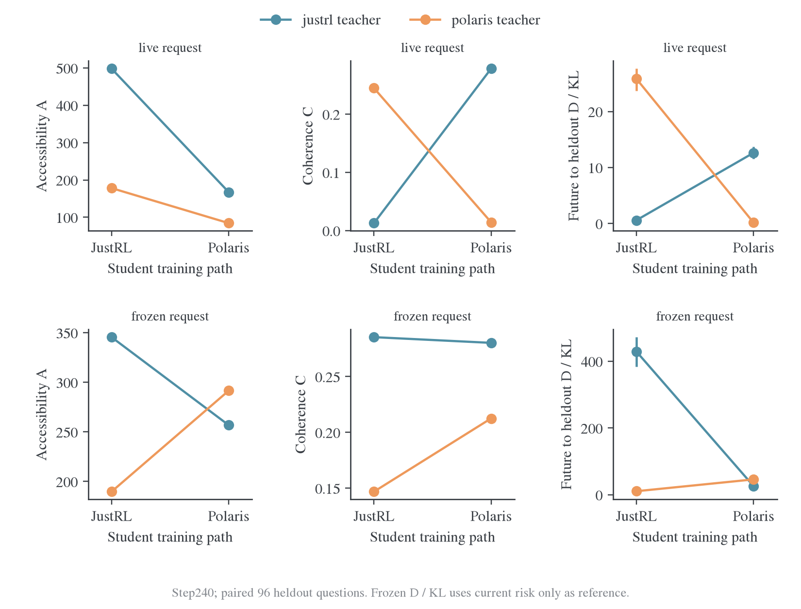

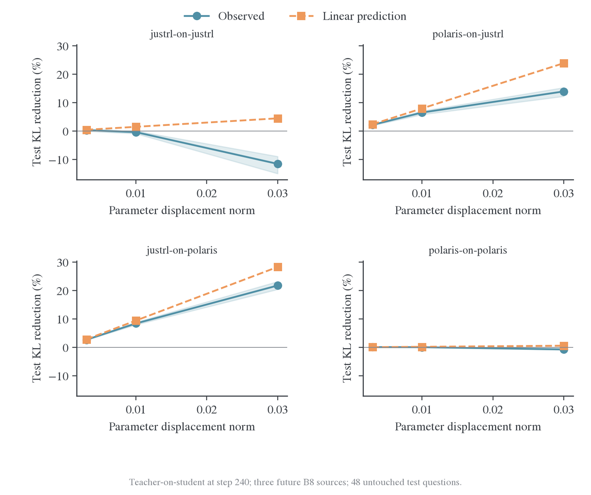

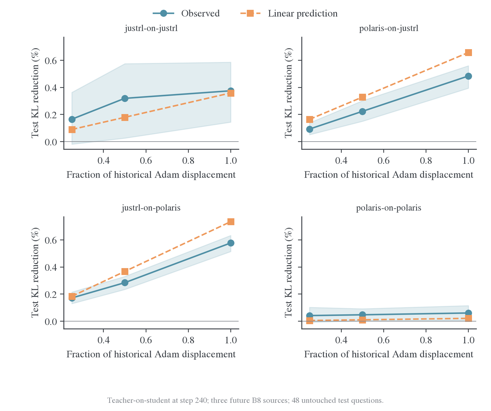

### 解释

四组合表明局部收益依赖 teacher–student 配对和训练历史。交换 teacher 同时改变目标与残差大小；非对角组合未经过对应 teacher 的持续训练，因此这些收益不能解释成恢复了原 Polaris 目标的下降。frozen 对照的 $P$ 在同一 teacher 下保持不变；两条 student 路径的 $A/C$ 和跨面板方向发生变化，说明当前参数映射仍是必要的解释变量。历史 AdamW 的一阶预测已经使用包含预条件的实际位移；预测与实测的差值反映有限步曲率及数值误差。

### 结论

交叉实验确认：Polaris student 对其他 teacher 目标仍有局部响应，Polaris teacher 在另一 student 上也有正收益。原 Polaris 配对的残余风险传播弱，需要结合请求与参数映射分析；交换目标的结果不等于改善原目标。

## 实验 12：Qwen3 跨模型对照

### Setting 与测量

沿用共同设置中的 65 个条件：37 个训练后保存点、28 个去重初始基线，最大 updates320；排除 RAW、CCS-rho0、CCS-rho1 的 OPD。每条件 160 条轨迹，Math train80/heldout48、Code16、IF16，B4、H1024。三个 bank 分别分析。固定 train-panel 的历史训练暴露未逐题核验，因此这里测 train-panel→heldout，不标为 future batch。

同时看剩余比例 $L/L_0$ 和独立面板 $D/L_H$。前者表示已吸收程度，后者表示当前 SGD 方向的一阶跨面板收益；高残差与正传播可以同时存在。

### 结果与分析

Thinking e3 终点约保留 2.08% 初始 KL，DeepMath SFT 约 14.52%，GSM8K SFT 约 10.22%。RLVR 约保留 93.35%，但初始绝对 KL 本身较小，不能仅按剩余比例判断失败。多个高残余条件的跨面板内积仍为正，R1 Polaris 的后期机制不能直接推广到这些条件。

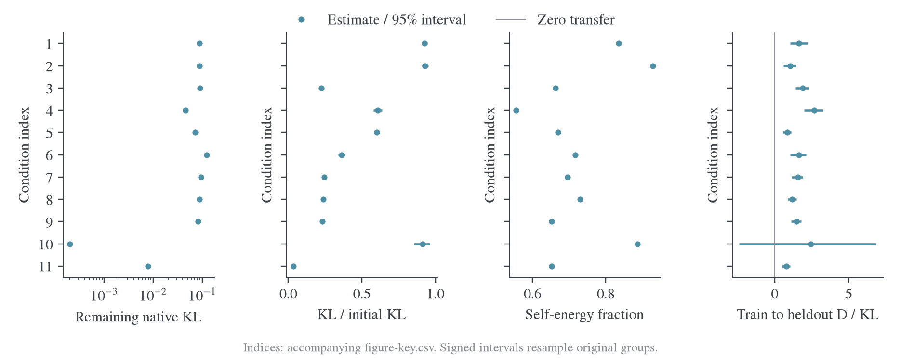

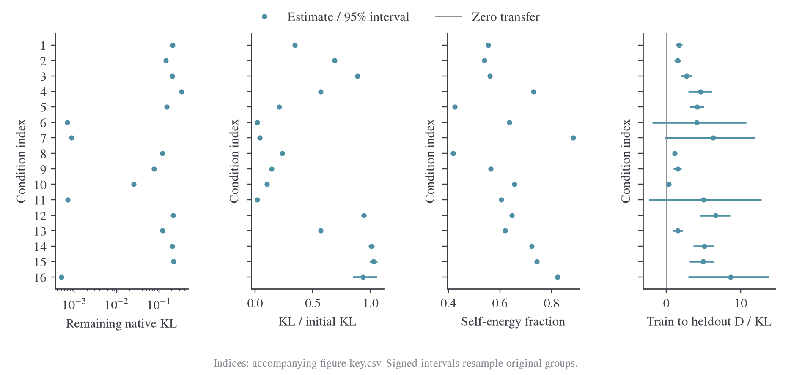

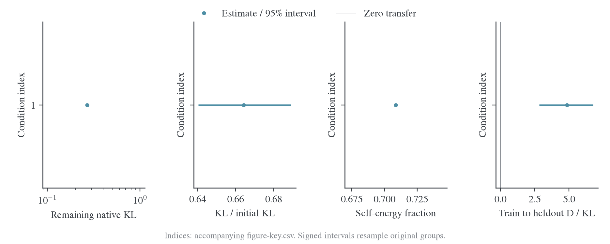

完整条件、区间与初始基线对应见[Qwen 结果表](data/teacher-difference/teacher-difference-qwen-20261109/cross-analysis/README.md)。

### 结论

吸收比例和当前跨面板响应需要联合解释。Qwen 对照扩展了观测范围，但这些历史配对、训练协议与 bank 并非统一控制实验。

### 参考文献

<!-- Stable anchors for references to consolidated sections. -->

## 640 更新的 checkpoint 几何测量

这一组使用 40 outer、每 outer 16 次更新的正式训练。九个保存点为 updates16/32/48/64/128/192/320/480/640；每个矩阵都用相同九个点，最后一点固定为 updates640。固定 bank 的完整响应 RKL 与这些 checkpoint 配对，训练和读出协议见[设置与指标](设置与指标.md#本轮-checkpoint-谱与右-frame-测量协议)。

| 测量对象                | 参考对象                       | 指标与解释                                                 |
| ----------------------- | ------------------------------ | ---------------------------------------------------------- |
| 累计更新的右 frame      | 最终累计更新                   | 主角度、随机校正 overlap；区分早期方向与最终方向           |
| 早期右 frame 的能量覆盖 | 最终累计更新的最优 rank-k 空间 | 捕获能量除以最优捕获能量；衡量早期空间是否覆盖后续主要变化 |
| 相邻 checkpoint 的增量  | 更早的累计更新 frame           | 增量捕获率及相对最优捕获率；检验新增变化是否留在旧空间     |
| 完整权重                | 初始 student 权重              | δΣ、ρΣ、κ_spec 和 top-k 主角度                             |
| OPD 累计更新            | 同坐标 teacher 累计更新        | 幅度比、余弦、残差能量比；分开解释幅度和方向               |

矩阵范围是每层 q/k/v/o/gate/up/down 七个投影，rank 为 16/32/64/128/256。E94–E102 的 student 都有 28 层，各 196 个矩阵，总计 1764 项。E102 的 teacher 尺寸不同，仅分析 student 自身动态；其余八组保留相对共同 initial 的 teacher 参数比较。

### E94 的阶段曲线与覆盖

下面的图逐步补全 E94（R1-Distill-Qwen-1.5B → DeepScaleR）的层覆盖。图注记录参与统计的矩阵和完整层数量，[覆盖清单](data/geometry-640/coverage.json)记录各 pair 的已测数量。只纳入七类矩阵全部完成的层；线为矩阵中位数，带为四分位范围。全层覆盖完成前，这些曲线只描述图注中的层，不参与好／差 pair 的跨模型排序。

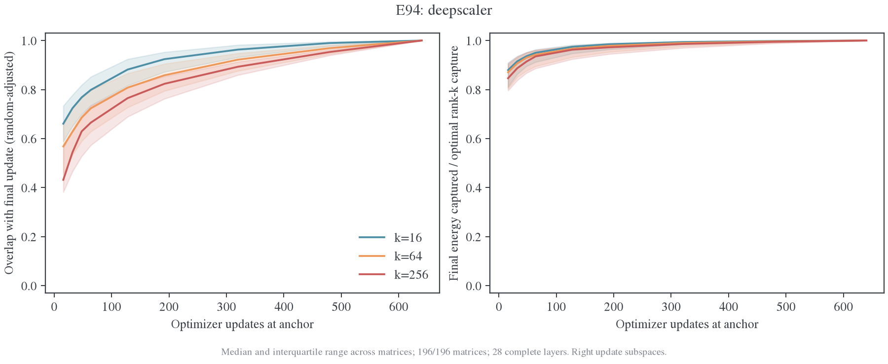

左图比较子空间方向，右图比较最终更新能量。早期 overlap 较低与早期空间已覆盖大部分可捕获能量可以同时发生：后续改变较多的方向可以主要落在较弱的奇异方向上。k 增大后，新增方向也会进入比较，overlap 不要求随 k 增大。updates640 的自比较等于 1 是定义上的检查点；早期保存点才提供动态证据。右图分母为同 k 的最优捕获能量，不能把接近 1 解读为覆盖了全部更新能量。

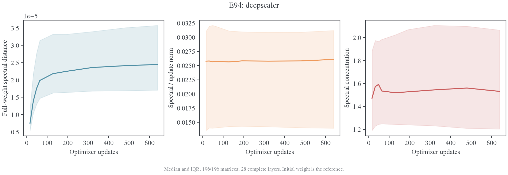

完整权重的谱距离与更新 frame 测的是不同对象。δΣ 按初始权重范数归一化；ρΣ 按更新范数归一化；κ_spec 衡量更新在初始奇异方向对角分量上的集中程度。因此“δΣ 很小”并不直接推出累计更新的 frame 固定。

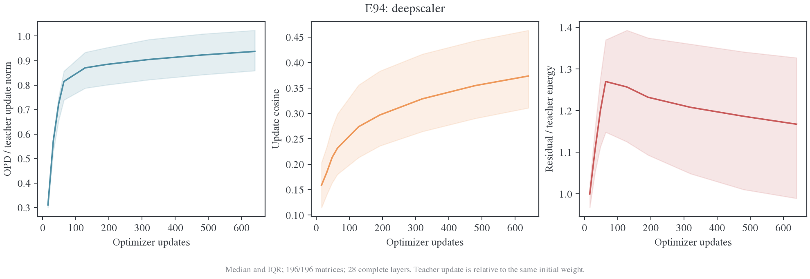

这三列应联合阅读。每个矩阵的残差比满足 $R=1+a^2-2ac$，其中 a 是 OPD/teacher 更新范数比，c 是更新余弦。图中各列分别取矩阵中位数，不对这些中位数再套恒等式。参数残差与 heldout RKL 分开报告：输出吸收好并不要求沿 teacher 的参数路径移动。

### 数据与复算

[压缩读出](data/geometry-640/readout.json.gz)保存每个已测矩阵的九阶段标量、主角度摘要、阶段对与增量捕获、谱能量 CDF、输入 tensor 哈希，以及双 bank 的完整 RKL 曲线。CDF 取 65 个等间隔秩位置；δΣ、ρΣ、κ_spec 均来自完整精确 SVD，没有用 CDF 采样近似。原始测量文件的 SHA256 一并记录，图可以完全从文档旁的读出重画。

汇总入口为 `examples.mirroropd.research.studies.absorption_dynamics.geometry_readouts`。`--source` 指向原始逐矩阵测量目录，`--data` 和 `--figures` 指定派生附件目录；`--watch` 每分钟检查新增完成记录，测量退出后做最后一次汇总。使用 `--readout data/geometry-640/readout.json.gz --figures <目标目录>` 可直接从本文附件重画，无需原始测量目录。汇总只用 CPU，不申请 GPU，不改 checkpoint。九组全部测完后，再按完整 pair、相同层与模块范围比较吸收差异。
