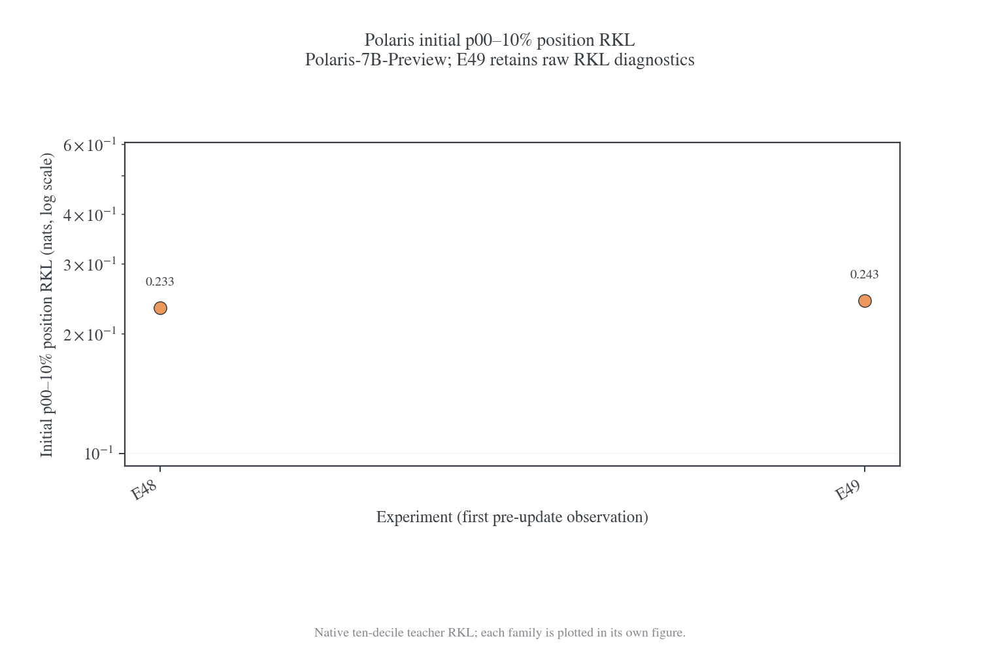
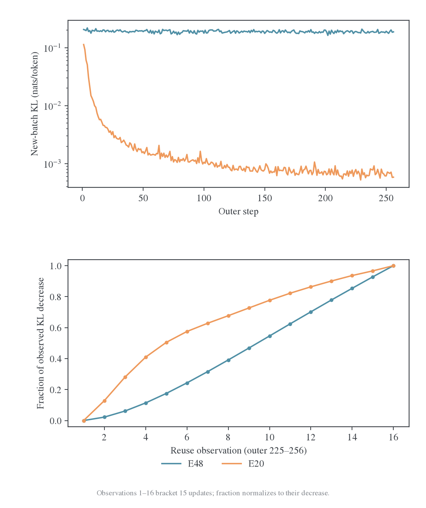
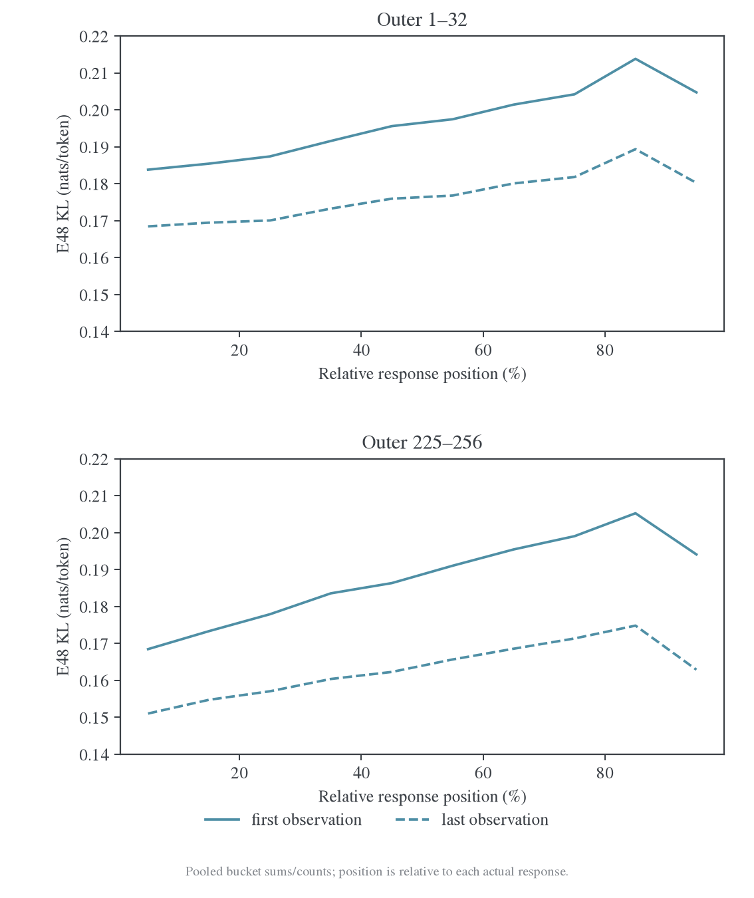
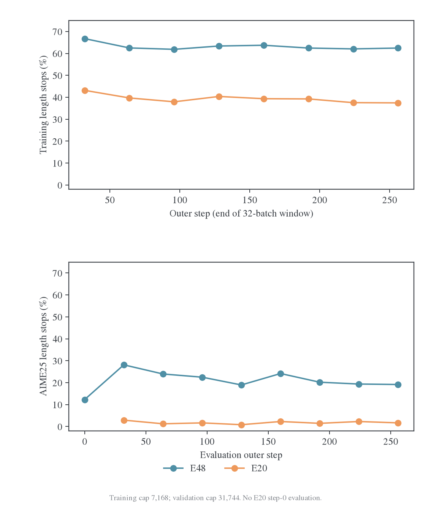
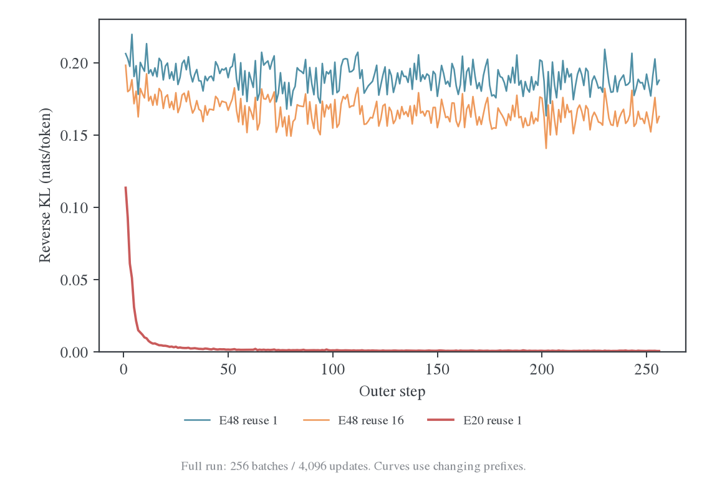
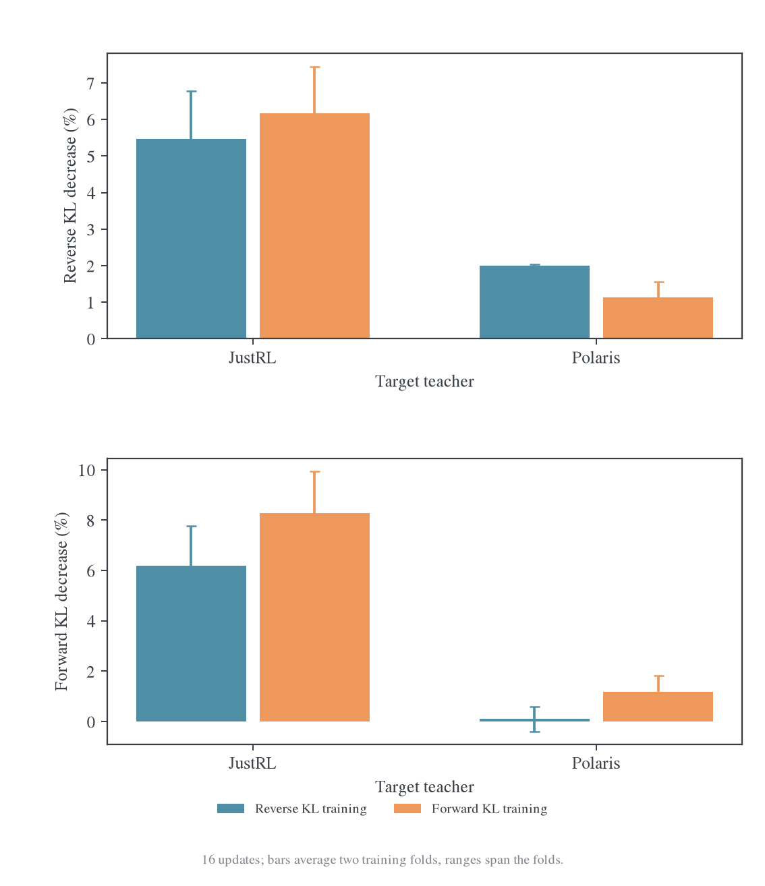
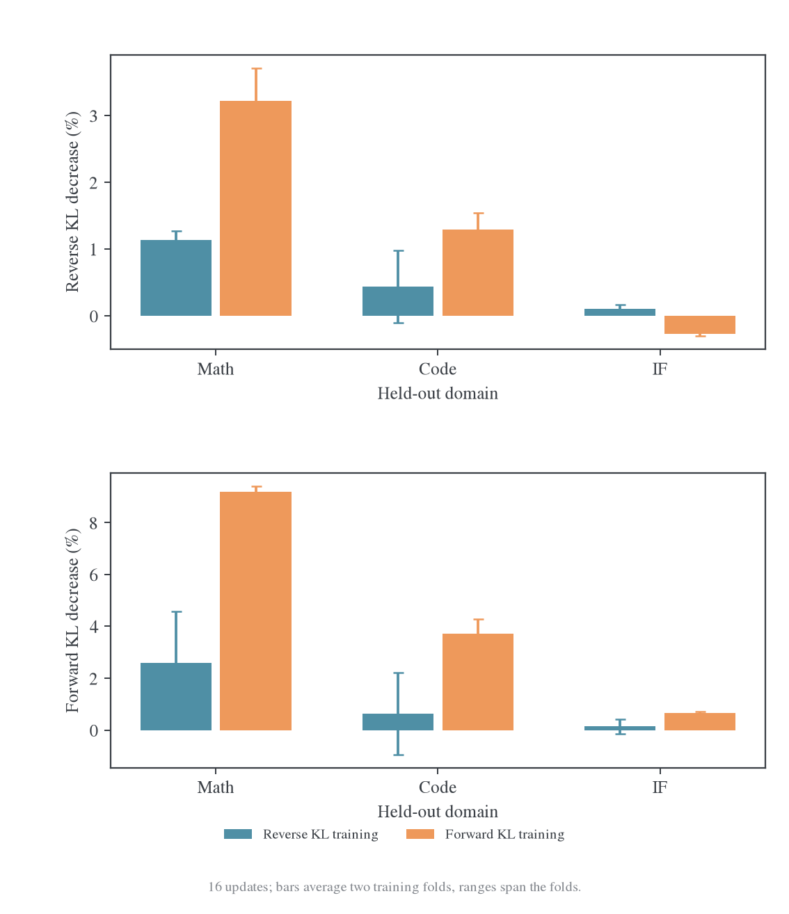
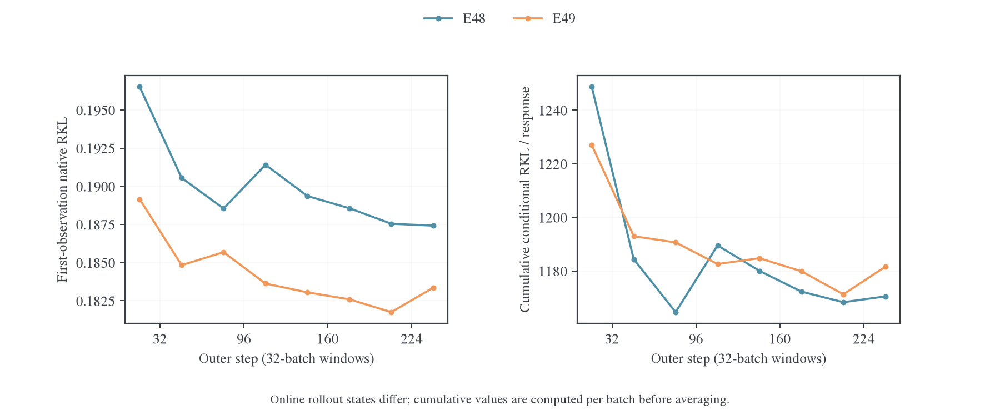

# Polaris：跨源拟合平台与 KL 方向

E48 的完整 256 轮训练中，每批目标持续下降，新批起点却在后期保持约 0.187。E49 改用学生支持上的条件 FKL 后，截断与答案缺失减少，新批分布拟合仍处于平台。两组都从初始 student 开始，反映不同目标下的完整在线训练。

本页保留 Polaris 的完整训练与方向对照证据；位置图和数值表统一见 [R1-1.5B position-KL](../cases/r1-1.5b-position-kl.md)。固定输入下的迁移证据见[跨 batch 研究](../cross-batch-transfer.md)，模型兼容与工程短测见[Polaris 接入](../../../infra/model-compatibility/polaris.md)。

## 本 case 的 position-KL 读法

E48 和 E49 的原始 `distill/full_kl_position/*` 都按 response 自身有效长度分成十个相对位置桶。E49 的优化目标是条件 FKL，但图和清单保留的是原始 teacher RKL，因此不能把 E49 的 position 曲线称为 FKL position loss。E48 的首个 `p00_10` 为 `0.2329`，E49 为 `0.2427`；E48 末期新 batch 的首桶仍高于后段，和批内末端下降、新批起点平台的形状一致。

E48/E49 的 first/last heatmap、位置曲线和首尾五个 outer 放大图见 [R1-1.5B position-KL](../cases/r1-1.5b-position-kl.md)；字段清单见 [position-KL 数据清单](position-kl-inventory.md)。

## 共同基线与 E48 配方

E48 配方沿用 [E20](../../reuse-budget/budget.md#equal-updates) 的训练目标和预算，将教师替换为 `POLARIS-Project/Polaris-7B-Preview`，并开启训练前验证。Student 是 `deepseek-ai/DeepSeek-R1-Distill-Qwen-1.5B`。这是一组跨源师生对，相关论文的配对和实验见[论文笔记](../../../literature/teacher-transfer/2026-10-26-策略蒸馏泛化的双重性实验与设置.md)；E48 使用 DAPO、full-vocab reverse KL 和 reuse16，不能当作论文 sampled-token 配方的等价复现。

| 参数                                        | 默认值                                                                 |
| ------------------------------------------- | ---------------------------------------------------------------------- |
| 方法                                        | Full-vocab reverse KL；统一接口为 MDPO/full_vocab，κ=0、η=1，无 anchor |
| 数据                                        | DAPO，全量；shuffle=True；不做 group filtering 或失败组 refill         |
| Prompt batch / mini-batch / rollout n       | 64 / 64 / 1                                                            |
| Outer / reuse / 计划更新数                  | 256 / 16 / 4096；每批全局 mini-batch 一次一轮                          |
| LR / optimizer                              | 1e-6；AdamW，betas=(0.9,0.999)，weight decay=0.01，grad clip=1         |
| Scheduler / warmup                          | constant / 0                                                           |
| Seed                                        | 数据、actor、rollout 均为 42                                           |
| Prompt / train response cap                 | 4096 / 7168                                                            |
| Train decoding                              | temperature=1，top-p=1，top-k=-1                                       |
| 验证                                        | MATH-500 / AMC23 / AIME25，500 / 40 / 30 题；各题 16 条回答            |
| Validation response cap / decoding          | 31744；temperature=0.7，top-p=0.9                                      |
| 验证／保存                                  | step0 验证；每 32 outer 验证；每 64 outer 保存；保留 4 个 checkpoint   |
| 默认共享池                                  | shared_sync，8 卡；teacher 没有额外独立资源池                          |
| Teacher FSDP token budget / dtype           | **32768 / BF16**，与 E20 一致                                          |
| Actor token budget                          | 32768                                                                  |
| Full-KL backend / token chunk / vocab chunk | precompute / 512 / 8192                                                |
| Hidden IO                                   | async write=True，prefetch=True                                        |
| 学生生成并发／显存比例／TP                  | 128 / 0.65 / 1                                                         |
| 教师独立评测并发                            | 32；不控制训练的 FSDP teacher 评分分批                                 |

轨迹在每个 outer 开始时由当时的学生生成，随后固定这些前缀做 16 次更新；它不是每次 optimizer update 都重新采样的严格 on-policy 流程。Full-KL 覆盖动作词表，不消除复用前缀的陈旧性。

## E48/E49实际差异

| 项目              | E48 对照                                               | E49 干预                                               |
| ----------------- | ------------------------------------------------------ | ------------------------------------------------------ |
| Student / teacher | DeepSeek-R1-Distill-Qwen-1.5B / Polaris-7B-Preview     | 相同                                                   |
| 目标              | Full-vocab RKL                                         | 学生支持条件化的 FKL；同时记录原生 RKL、JS/TV、entropy |
| 训练数据与预算    | DAPO，batch64，256 outer × reuse16，4096 更新          | 相同                                                   |
| 优化              | AdamW，LR1e-6，BF16 执行                               | 相同                                                   |
| Backend / chunk   | precompute / 512                                       | precompute_fused / 512                                 |
| 生成与验证        | 训练 cap7168；验证 cap31744，每题 16 答，T0.7/top-p0.9 | 相同                                                   |
| 起点与状态        | 初始 student；完整 256 轮                              | 初始 student；完整 256 轮，非 E48 checkpoint 续训      |
| Run               | `grcuotmi`                                             | `zyru8wdf`                                             |

本对照首先比较自己的批内目标能否下降，再看新批首次原生 RKL 与每回答累计条件差异，最后评价正确率、候选覆盖和完成行为。两项使用各自在线轨迹，不能当作同一固定 state 的因果重放。

### E48 输入与统计范围

#### 新证据边界与口径

从独立日志仓库拉取至提交 `b5cdd40f2ea42c92e2f3f25b0ca380c49e5c8f53`，原始 `.wandb` 从约 9.8 MiB 扩展到约 41.8 MiB。读取器完整解码得到 4353 条 history、4096 条逐更新观测、256 条 outer 摘要和 8018 条周期系统记录；读到正常退出记录。API 只读核对的最后 `_step` 为 4352，真实 optimizer 计数 4096，不能把 W&B 事件数当训练步数。

新快照的前 987 条 history 与上次 58-outer 快照逐项完全相同，config 也完全相同。这是同一 run 的完整后续记录，没有把另一次实验拼接到旧结果后。新增指标只有 `perf/timing/save_checkpoint_seconds`；总计 2271 个不同 history 字段，完整数值目录在 `E48-all-metrics.csv`。

主对照 E20 `lwgb5eex`同样完整到 256 outer / 4096 更新。两者的 student、DAPO、batch64、rollout n=1、reuse16、LR=1e-6、训练 cap=7168、验证 cap=31744 及 Full-KL backend/chunk设置一致；teacher分别为Polaris-7B和JustRL-1.5B。E48有初始验证，E20没有。接口和代码版本差异、相同seed不等于相同轨迹等边界沿用[早期诊断](../../../archive/experiments/polaris/2026-10-26-E48异源教师收敛诊断.md)。

所有 KL 均以自然对数计算。第 1、第 16 次观测来自相应 optimizer 操作之前，两条观测之间是 15 次更新；日志没有第 16 次操作完成后对同一批的额外前向。下文不把“第 16 次观测”称为 16 次操作后的严格终点。

## E48 的平台、批内进展与任务表现

更新日期：2026-10-27。Run：`grcuotmi`[^e48-run]，`math-opd-E48-20261026-180739-2571`。完整原始日志已更新至 **256 outer / 4096 optimizer updates，exit_code=0**；云端状态也为 finished。本文替代旧报告对“当前运行状态”的描述，但不覆盖旧报告冻结的 58-step 数据。[完整证据与复算入口](../cross-origin/polaris/data/polaris-complete-20261027/README.md)。

完整曲线确认了一个长期高残差平台：最后 32 批的新轨迹起点 KL 为 0.187417，批内第 16 次观测为 0.162859。当前批仍能下降约 13.11%，梯度仍明显非零，但后续新批没有积累相应的分布拟合收益。**这更符合不断刷新前缀、有限批内优化和当前 optimizer 共同形成的动态平衡，而不是固定目标已经达到不可降低的 0.16 下界。**

同时有三项需要修正或补充早期判断：验证长尾在 outer32 达到较差水平后有所恢复，没有持续膨胀；E20 进入低 KL 平台后也有接近 99% 的“批间抵消比”，所以该比值不是迁移失败的专属判据；最终 MATH-500 任务表现已接近 E20，不能把 teacher KL 高直接解释为任务能力没有改善。

### 高残差平台在 outer64 附近已经基本形成

以下每行按 32 个 outer 平均；首次与末次先分别平均。

| Outer 窗口 | E48 首次 KL | E48 第 16 次 KL | E48 第 16 次梯度范数 | E20 首次 KL | E20 第 16 次 KL |
| ---------- | ----------: | --------------: | -------------------: | ----------: | --------------: |
| 1–32       |    0.196509 |        0.176548 |              0.19845 |    0.016111 |        0.011740 |
| 33–64      |    0.190545 |        0.168073 |              0.14138 |    0.001775 |        0.001076 |
| 65–96      |    0.188542 |        0.165270 |              0.13889 |    0.001219 |        0.000693 |
| 97–128     |    0.191402 |        0.167082 |              0.14030 |    0.000956 |        0.000540 |
| 129–160    |    0.189355 |        0.164889 |              0.13917 |    0.000798 |        0.000444 |
| 161–192    |    0.188557 |        0.163834 |              0.13959 |    0.000765 |        0.000426 |
| 193–224    |    0.187542 |        0.162962 |              0.14026 |    0.000691 |        0.000379 |
| 225–256    |    0.187417 |        0.162859 |              0.13890 |    0.000687 |        0.000375 |

从 65–96 窗口到 225–256 窗口，E48 新批起点只下降 **0.60%**，批内末次只下降 **1.46%**；E20 分别下降 43.63% 和 45.84%。E48 后期不是完全没有变化，但继续相同配方的边际拟合收益已很小。

最后 32 批中，E48 的首次和末次 KL 分别约为 E20 的 273 倍和 434 倍。它们拟合不同 teacher，绝对 loss 不能用来直接比较任务能力；在相同 student 与预算下，这个差距仍明确说明 Polaris 条件分布难以按当前配方充分对齐。

4096 次更新全部执行，没有非有限 loss/梯度或跳步。全程只有前 8 次更新的梯度范数大于 1，后期不触发裁剪；LR 全程保持 1e-6。Loss 与完整 KL 的最大差值仅`3.80e-8`，位置桶重建总 KL 的误差仅`1.79e-8`。平台不是由记录归约误差、学习率降到零或大量跳过更新造成的。

#### 去掉 token 均值的长度归一化，平台仍然存在

每批首次 KL 与同批 response token 数可以还原“每条回答的累计条件 KL”：

$$
\widehat J_j=A_j\frac{N_{\mathrm{response\ tokens},j}}{B_j}
=\frac1{B_j}\sum_{i=1}^{B_j}\sum_t d_\theta(s_{it}).
$$

先逐批计算，再对 32 批平均；不能用窗口平均 KL 乘窗口平均长度替代它。

| Outer 窗口 | E48 累计条件 KL/回答 | E20 累计条件 KL/回答 |
| ---------- | -------------------: | -------------------: |
| 1–32       |              1248.67 |                95.01 |
| 65–96      |              1164.62 |                 6.91 |
| 225–256    |              1170.50 |                 3.90 |

E48 从 65–96 到最终窗口的累计量反而略升约 0.50%。因此平台不是单纯由 token-mean 的长度分母变化制造的假象。这个量只能用新批首次观测解释为 fresh 轨迹统计，不能把第 16 次 reuse 的 loss 代入后仍称作 fresh。

在生成策略与评分时的当前 student 一致、相同 EOS 停止规则和固定 H=7168 等条件下，完整条件 KL 沿 student 轨迹的和可估计有限长度序列 KL。配置的 temperature=1、top-p=1 与同步生成符合这一意图，但该 run 没有记录跨 backend 概率差来检验数值一致性，故这里保守称为“累计条件 KL/回答”，不宣称已独立验收严格的序列 KL 估计器。它也不代表训练反传了 state 访问分布的梯度。

### 新线索：批内前几步慢，停止复用时仍未充分拟合

E48 全部 256 批的 3840 个批内相邻 KL 观测都严格下降，未出现同批更新后的 KL 反弹。后期平均轨迹如下：

| Reuse 观测序号 |   E48 KL | E48 梯度范数 |     E20 KL |
| -------------- | -------: | -----------: | ---------: |
| 1              | 0.187417 |      0.23123 | 0.00068735 |
| 2              | 0.186876 |      0.23243 | 0.00064735 |
| 4              | 0.184626 |      0.20746 | 0.00055961 |
| 8              | 0.177813 |      0.17634 | 0.00047609 |
| 12             | 0.170178 |      0.15296 | 0.00041785 |
| 16             | 0.162859 |      0.13890 | 0.00037522 |

以观测 1→5 的四个操作和观测 12→16 的四个操作比较：

| Outer225–256 | 前 4 次平均 KL 降幅/操作 | 后 4 次平均 KL 降幅/操作 |    后/前 |
| ------------ | -----------------------: | -----------------------: | -------: |
| E48          |               0.00107446 |               0.00182974 | **1.70** |
| E20          |               0.00003939 |               0.00001066 | **0.27** |

E48 最后 32 批全部满足“后 4 次收益大于前 4 次”，E20 为 0/32。E48 每批开始的数次更新较慢，约第 9–11 次观测附近单步降幅较大，随后有所回落，但到第 16 次仍有明显下降。它没有呈现“当前固定批已经基本到最低点，所以接下来怎么更新都没用”的形状。

一个值得优先检验的机制是：每次换成新批前缀后，Adam 的历史方向需要重新适应。对于β1=0.9，旧一阶矩在更新 4、8、16 次后的线性系数分别为 0.656、0.430、0.185。这不是实际参数位移由旧动量贡献的百分比，因为还存在当前梯度、二阶矩、bias correction 和权重舍入；它只是说明 reuse16 并没有让旧历史瞬间消失。

同源 teacher 的修正方向可能跨批更一致，旧历史可以帮助新批；跨源监督更依赖具体前缀时，相同历史也可能拖慢新批开始的拟合。现有曲线与这个解释相容，**但尚没有测量 E48 的梯度—动量夹角或实际参数更新，不能认定动量已被证明是根因**。BF16 可见更新、局部曲率、参数步幅和 state-specific 梯度同样可能影响这种形状。

已有[Full-vocab 优化器计划](../../../archive/engineering/2026-10-27-优化器大规模候选计划.md)正好区分这些问题；其小实验和另一项 MDPO 历史对照都不能直接替代 E48 晚期 checkpoint 的因果重放。

### “99% 抵消”只能描述平台，不能单独解释它

令每批首次 KL 为 $A_j$，第 16 次观测为 $B_j$，则有恒等式：

$$
\sum_{j=l}^{h-1}(A_{j+1}-B_j)
=\sum_{j=l}^{h-1}(A_j-B_j)+(A_h-A_l).
$$

只要窗口起终点的 $A$ 接近，右侧第二项接近零，“下一批起点差值 / 批内下降量”的比值就自然接近 1，平台高低都可以如此。

| 窗口                 | E48 比值 | E20 比值 |
| -------------------- | -------: | -------: |
| 1–58（此前分析范围） |   99.01% |   29.01% |
| 1–256                |   99.69% |   51.79% |
| 65–256               |  100.19% |   98.70% |
| 193–256              |  100.38% |   99.77% |

E20 后期也接近 99%，但它的 loss 平台低了两个以上数量级。因此不能把“99%”解释为 99% 的学习被遗忘，更不能据此判定梯度完全不能迁移。批间还同时换题、换轨迹，夹着未单独观测的第 16 次更新。

跨 state 迁移较弱的证据应来自固定 input 对照，而不是这个比值。本机[受控短实验](../cross-batch-transfer.md#mechanism-series-s)以及后续[扩大前缀与 fresh 评估](../cross-batch-transfer.md#mechanism-series-i)确实观察到 Polaris 的迁移弱于 JustRL；扩大实验也显示 Polaris 有正向迁移，并非完全不能泛化。这些独立实验的 horizon、训练 budget 与 E48 不同，不能把它们的百分比直接代入 E48。

### 位置与长度：没有单独的尾段崩溃，仍存在长期覆盖不足

后期第一 10% 位置桶的 KL 为 0.16846→0.15104，最后 10% 为 0.19409→0.16290；残余最高的是 80–90% 桶，约 0.17483。十个桶都能批内下降，十个桶也都保留较高残差。最后一桶并不是残差最大的桶，不能把全部平台归为 EOS 附近的问题。

这些桶按每条实际回答的相对位置定义。约六成回答被截断时，最后一桶主要仍是推理中的 state，不等于最终答案段。当前 run 没有绝对位置、推理/答案阶段、正确/错误及 stop/length 条件下的 KL，无法从这些十分桶再作更细的语义归因。

E48 训练平均长度在各 32-batch 窗口约 6175–6353 token 之间，length finish 比例约 61.9%–66.7%。后期长度稳定，没有不断膨胀。最后 32 批的平均长度为 6244.5，触顶率 62.45%；E20 为 5669.2 和 37.45%。

按 7168 cap 和实际 length finish 计数估算，E48 后期约 **71.69% 的训练 response token 来自截断回答**，E20 约 47.35%。这使 token-mean loss 长期偏向未完成的长推理轨迹；完整答案和自然停止位置的覆盖仍是一个结构性问题。但由于训练长度没有持续增长，它不足以支持“后期越来越长，所以 KL 持续恶化”的叙述。

4096 次 optimizer 操作只对应 256 批新生成轨迹，即 16,384 个 prompt 槽位，而不是 4096 批新题。E48 共生成 102.127M response token，16 次复用对应约 1.634B response-token 训练访问；E20 新生成 93.368M。大量更新花在同一批固定前缀上，扩大新 state 覆盖和加深同批拟合是不同的预算选择。

### 完整验证曲线：MATH 接近同源，困难任务仍有差距

全部训练后验证均为相同的 MATH-500/AMC23/AIME25，500/40/30 题，各 16 答。下表为 mean accuracy 百分比：

| Outer / 更新数 |   E48 MATH |    E48 AMC |   E48 AIME |   E20 MATH |    E20 AMC |   E20 AIME |
| -------------- | ---------: | ---------: | ---------: | ---------: | ---------: | ---------: |
| 0 / 0          |     82.750 |     68.906 |     23.958 |          — |          — |          — |
| 32 / 512       |     86.575 |     75.625 |     27.708 |     87.488 |     86.719 |     35.000 |
| 64 / 1024      |     87.700 |     78.906 |     28.958 |     88.263 |     88.906 |     34.583 |
| 96 / 1536      |     87.338 |     77.969 |     31.458 |     87.737 |     87.188 |     35.625 |
| 128 / 2048     |     87.500 |     77.344 |     31.250 |     88.200 |     88.750 |     34.375 |
| 160 / 2560     |     87.575 |     74.531 |     28.750 |     87.963 |     89.219 |     35.625 |
| 192 / 3072     |     87.562 |     78.906 |     27.917 |     88.425 |     89.688 |     35.208 |
| 224 / 3584     |     87.838 |     79.062 |     30.833 |     87.800 |     88.906 |     37.292 |
| 256 / 4096     | **87.825** | **79.688** | **28.750** | **88.113** | **88.594** | **34.375** |

E48 最终相对自身初始分别提高 5.075、10.781、4.792 pp。相对 outer64，再增加 3072 次更新后，变化只有 +0.125、+0.781、−0.208 pp；中间仍有波动，没有各集合持续改善的趋势。

不能只看 mean：最终完整指标还揭示了不同的瓶颈。

| 数据集 / 指标       |    E48 |    E20 |
| ------------------- | -----: | -----: |
| MATH pass@16        |  96.4% |  95.8% |
| MATH majority@16    |  92.6% |  92.1% |
| MATH all-correct@16 |  69.8% |  69.8% |
| AMC pass@16         |  97.5% |  95.0% |
| AMC majority@16     |  95.0% |  95.0% |
| AMC all-correct@16  |  50.0% |  57.5% |
| AIME pass@16        |  50.0% |  60.0% |
| AIME majority@16    | 36.67% | 41.67% |
| AIME all-correct@16 |  6.67% | 16.67% |

MATH 的 mean 仅差 0.2875pp，其余几个指标甚至略高或相同。AMC 在 16 答覆盖和投票上不差，但 mean 低 8.906pp、全对题数更少；这更像平均回答的稳定性和完成行为不足，不能称为“完全学不会这些题”。AIME 则在平均正确率、覆盖和稳定性上都落后，说明更难任务上仍有未解决差距。

所有验证的 failed_count 为 0。单个 run、AIME30 题和 AMC40 题不足以给出跨 seed 能力排序；最终 AIME mean 的题目 bootstrap 区间为 E48 [13.41%,42.42%]、E20 [18.41%,49.09%]。不能挑 E48 的 outer96 最好点与 E20 最终点混比，也不能把区间重叠当作已证明等效。

### 验证长尾有所恢复，但仍远多于 E20

| 数据集   | E48 outer0 触顶率 | E48 outer32 | E48 outer256 | E20 outer256 |
| -------- | ----------------: | ----------: | -----------: | -----------: |
| MATH-500 |             2.21% |       4.39% |        2.40% |        1.00% |
| AMC23    |             5.31% |      12.97% |        8.59% |        1.41% |
| AIME25   |            12.29% |      28.13% |       19.17% |        1.67% |

E48 最终 AIME 平均长度 18364，低于 outer32 的 20244，但仍高于初始 16095 和 E20 最终 10307。AMC 为 10551，对照 6502；MATH 为 5846，对照 4368。它没有发生持续长度崩溃，但也没有恢复到同源对照的完成效率。

最终 MATH/AMC/AIME 的答案解析缺失数为 184/55/87，对照 77/7/7；各集合回答预算为 8000/640/480。这些是已完成评分但没有可解析答案的槽位，不是评测基础设施丢失回答。现有聚合日志不能证明哪些缺失同时触顶，也不能确定这些回答若完成会答对多少，因此不把全部准确率差归因于截断。

这一点也限制了 teacher KL 的解释：它包含局部措辞、概率置信度、推理和答案等多种差异，不是正确率的替代指标。最终 MATH 已接近 E20 而 KL 仍高很多，说明继续拟合 teacher 分布与继续获得任务收益不能混为一谈；也没有证据认定剩余 KL 全部是无关紧要的风格差异。

### 分窗口的 KL 与梯度读数

完整日志为 exit=0，含 4353 条 history、4096 条逐更新观测和 8018 条系统记录；2026-10-27 云端核对为 finished、lastHistoryStep4352。下表按 16 个 outer 的窗口统计。

| Outer 窗口 | 每批首次 KL 均值 | 每批第 16 次 KL 均值 | 首次 KL 跨批标准差 | 更新梯度范数均值 |
| ---------- | ---------------: | -------------------: | -----------------: | ---------------: |
| 1–16       |         0.197617 |             0.178764 |           0.009703 |         0.309853 |
| 49–64      |         0.190038 |             0.167113 |           0.009972 |         0.178293 |
| 113–128    |         0.187917 |             0.163984 |           0.006835 |         0.177160 |
| 177–192    |         0.187237 |             0.162604 |           0.007776 |         0.178497 |
| 241–256    |         0.187482 |             0.162752 |           0.007883 |         0.178799 |

全部 256 批的首末 KL 下降，批内 3840 对相邻观测也全部下降。没有非有限 loss/梯度，没有跳过更新；仅最初 8 次更新触发 grad clip。后期仍有梯度，也仍能在每批首次到第 16 次观测间降低约 13.20%。这两个观测之间是 15 次更新，不包含第 16 次操作后的额外测量。

新批起点从第 49–64 批到最后 16 批只下降约 1.34%。完整运行的批间差值总和约抵消 99.69% 的已观测批内下降；其定义与[前一报告](../../../archive/experiments/polaris/2026-10-26-E48异源教师收敛诊断.md)相同，包含换题、换轨迹和未单独观测的最后一次更新，不能解释为 99.69% 的参数学习被遗忘。

末段的跨批标准差约 0.0079，远小于 0.1875 的残余均值。我们看到的是“新数据上的残差不再继续减小”，不是已经测得“同一固定输入反复前向有 0.16 随机误差”。最后 16 批中，首个位置十分桶的首末 KL 为 0.166832→0.149342，末桶为 0.196645→0.165253，最高残余在 80–90% 桶，约 0.176123。差距仍遍及整段，不是只出在少数最后位置。

同预算 E20 的最后 16 批首次/末次 KL 约为 0.000670/0.000366。E48 的对应值约为 280 倍/445 倍。Teacher 不同，因此这个比例描述两个不同目标的拟合残差；它显示两个师生函数的拟合进度有数量级差异。

#### Full-vocab 只消除了一层估计噪声

在固定 state 上，Full-vocab 精确计算动作词表求和，消除了抽样一个动作来估计该 KL 的 Monte Carlo 噪声。它不会同时消除：

- prompt 与整条轨迹的抽样差异；同一回答中的 token 还高度相关。
- 策略改变后访问 state 分布的变化，以及同批 16 次复用的前缀陈旧性。
- 不同 state 对共享参数提出的冲突要求、student 容量约束与非凸优化。
- Adam 历史、有限学习率和 BF16 前向对实际参数更新的影响。

这些因素不意味着都已被证明是 E48 根因。当前日志支持的是稳定的批内优化与跨批平台；并没有逐 token forward KL、entropy、overlap、teacher 质量覆盖或实际参数位移指标，不能据此把平台唯一归因于“缺知识”或某个 KL 方向。

#### 平台并不等于没有任务收益

| 数据集   | E48 初始 mean | E48 最终 mean | E20 最终 mean | E48 最终 pass@16 |
| -------- | ------------: | ------------: | ------------: | ---------------: |
| MATH-500 |       82.750% |       87.825% |       88.113% |            96.4% |
| AMC23    |       68.906% |       79.688% |       88.594% |            97.5% |
| AIME25   |       23.958% |       28.750% |       34.375% |            50.0% |

E48 的 AIME mean 在 outer96 达到 31.458%，随后没有持续增加，最终 majority@16 为 36.667%。最终 AIME 平均长度 18364，92/480 条触及 31744 上限，87/480 条未解析答案。相比初始的 59 条触顶、53 条解析缺失仍较差；但比 outer32 的 135 条触顶有所恢复，不能继续描述为整个训练阶段单调恶化。

末 16 批训练平均长度 6210、length finish 占 62.60%，任务 score 均值 0.4229。该快照缺同协议的 Polaris 独立 teacher 评测，任务成绩与分布读出分别报告。

## RKL 与 FKL 的监督差异

固定 state，记 student 分布为 p，teacher 为 q，student logits 为 z：

$$
L_R=\sum_i p_i\log\frac{p_i}{q_i},
\qquad
\frac{\partial L_R}{\partial z_i}
=p_i\left(\log\frac{p_i}{q_i}-L_R\right),
$$

$$
L_F=\sum_i q_i\log\frac{q_i}{p_i},
\qquad
\frac{\partial L_F}{\partial z_i}=p_i-q_i.
$$

Full-vocab 计算了所有 i，却没有去掉 RKL 梯度前面的 $p_i$。如果 teacher 偏好的动作在 student 下极不可能，$p_i\log p_i\to0$，RKL 在这个 logit 上的直接信号变弱，FKL 则仍有约 $-q_i$ 的信号。反过来，student 给某动作较大概率、teacher 给它极小概率时，RKL 的 log-ratio 可以产生很强惩罚；FKL 每个 logit 坐标的导数限制在[-1,1]。

例如二元分布中，正确动作的 $p=10^{-6}$、$q=0.9$，其 RKL logit 导数约 $-1.60\times10^{-5}$，FKL 导数约 $-0.9$。这比较的是原始 logit 梯度，**不是 Adam 实际参数位移的倍数**；共享参数、其他 state、历史二阶矩都会改变实际作用。

这给出两个合理的 FKL 作用路径：增强 teacher 支持但 student 很弱的动作；减小 teacher 极低概率引起的异常强惩罚。两者都保留在精确 full-vocab 计算中，不是换掉 sampled estimator 就能消除的性质。

但在共同支持、容量足够的条件下，两种 KL 都有 $p=q$ 的零损失最优解。因而“某类能力不可能通过 OPD 获得”不是这些公式的结论。更准确的是：在给定 state 覆盖、参数化与有限预算下，一种目标可能难以高效学到某些差异。

### Student-state FKL 不等于整个序列的 Forward KL

有限长度序列的 forward KL 链式分解在 teacher 诱导的前缀上取期望：

$$
\mathrm{KL}(Q\Vert P_\theta)
=\mathbb E_{y\sim Q}\sum_t\mathrm{KL}\big(q(\cdot\mid s_t)\Vert p_\theta(\cdot\mid s_t)\big).
$$

继续使用 student rollout 而只改 token 损失，实际是 student-state 上的局部 FKL 目标。它可以帮助概率匹配，但不会自动补上没有访问到的 teacher 推理路径。因此 KL 方向与 rollout 来源仍应分开消融。

## 真实分布中的低概率动作与支持集

复用上一轮冻结的 72 条轨迹、3376 个 state，固定初始 student，分别计算完整 RKL/FKL 及精确 logit 梯度。以下数学 student-state 面板各有 768 个位置。

| 指标                                          |  JustRL | Polaris |
| --------------------------------------------- | ------: | ------: |
| RKL 均值                                      | 0.09314 | 0.18650 |
| FKL 均值                                      | 0.09696 | 0.14832 |
| Teacher 质量落在 student top-16 之外          | 0.5667% | 0.4896% |
| Teacher 质量满足 $p<10^{-4},q>0.01$           | 0.0056% | 0.0229% |
| 出现上述弱 student/强 teacher 动作的 state 数 |   3/768 |   5/768 |
| 拼接各 state logit 梯度后的 R/F cosine        |  0.8552 |  0.7468 |

Polaris 确有更大的概率差异与梯度方向差异，但这批初始数学前缀并不是“teacher 主要质量完全落在 student 不会考虑的动作上”。强 teacher/弱 student 的动作存在，平均质量却较小。这限制了将 E48 整体平台直接解释为“新增事实都在 student 支持集之外”的说法。稀有动作仍可能对完整任务重要，平均概率质量不能证明它们不重要。

另一项更明显的差异是梯度尾部：

| Polaris target；logit 梯度范数 | RKL p99 / max | FKL p99 / max |
| ------------------------------ | ------------: | ------------: |
| Student-state                  | 1.110 / 1.730 | 0.842 / 1.074 |
| Polaris-state                  | 2.839 / 7.908 | 0.856 / 1.146 |

RKL 在跨源 teacher 自己的 state 上出现更强的单位置梯度尾部。这里是**确定性梯度在不同 state 间的差异**，不是重复前向的测量噪声，也不是全参数梯度方差。它支持进一步检查状态间优化冲突与极端 log-ratio，而不能直接证明原 run 的 0.16 平台由这些位置造成。

这些观测来自初始模型及冻结小面板，不是 E48 第 4096 次更新的 logits。当前 E48 日志没有相应指标，也没有本机可重放的原 E48 后期 checkpoint；后期是否产生了更严重的 teacher 模式遗漏仍待验证。

### 一个不能省略的支持集细节

Student head 有 151936 行，Polaris 有 152064 行。若把 student 在额外 128 行的概率定义为 0、teacher 仍有正概率，则严格的 native full-vocab FKL 为无穷大。不能直接删掉这些项后仍称其为原始 FKL。

本机对照明确采用 $q_S=q(\cdot\mid S)$，将 teacher 在 student 输出支持上重新归一化。有效 token 映射已核对一致；这批数学 student-state 的 teacher 额外行最大质量约 $1.35\times10^{-8}$。RKL 也使用同一 $q_S$ 保证目标口径一致；去掉的 teacher 支持常数不改变 RKL 的 student 梯度。正式实现必须把这个支持选择写进配置与指标。

## 固定输入的方向对照

每组使用同样的四道数学题、前段 32 个位置/题、同一完整冻结前缀输入；held-out 为 8 道数学、4 道代码、4 道 IF，并保留三种固定 rollout 来源。初始模型对照为两 teacher×两方向×两训练 fold，共 8 组；另从本机 Polaris 蒸馏 64 步的同一 checkpoint 出发做两方向×两 fold，共 4 组。

全部使用 fresh AdamW、LR=1e-6、β=(0.9,0.999)、wd=0.01、clip=1，每组 16 步。所有 1777088000 个 student 参数参与更新；FP32 master、BF16 backbone、FP32 head 投影。优化器状态在 GPU，记录实际参数步幅。模型、原始数据及正式训练实现未改写。

每一对 R/F 实验的 step-0 全部 3376 个 state 记录逐项完全相同。训练和评估的前向输入长度也保持一致，避免改变 attention 分块混入前后差值。下面的相对降幅均使用同一评估指标作前后比较，不拿 FKL 的绝对数值与 RKL 直接比高低。

### 初始 student：改善部分指标，没有消除跨源迁移差距

16 步后的 held-out 数学前段，两个训练 fold 平均：

| Teacher / 训练目标 | RKL 下降 | FKL 下降 | JS 下降 | TV 下降 |
| ------------------ | -------: | -------: | ------: | ------: |
| JustRL / RKL       |    5.48% |    6.19% |   5.36% |   2.85% |
| JustRL / FKL       |    6.17% |    8.27% |   6.59% |   3.64% |
| Polaris / RKL      |    2.00% |    0.10% |   1.20% |   1.78% |
| Polaris / FKL      |    1.13% |    1.18% |   1.29% |   1.70% |

Polaris 的 FKL 训练改善了 held-out FKL 和部分 JS，却没有让 RKL 下降更多，也没有达到 JustRL 的迁移幅度。在训练过的前缀上，两种方向都能大幅拟合：Polaris 的 RKL 训练使训练 RKL 下降 69.87%；FKL 训练使训练 RKL/FKL 分别下降 72.69%/77.40%。问题仍主要体现在向未训练 state 推广。

### 已训练 64 步的本机 checkpoint：切换方向更有希望

该 checkpoint 来自[扩大前缀实验](../cross-batch-transfer.md#mechanism-series-i)的 Polaris/student 组，**不是原 E48 后期 checkpoint**。已核对原 128 道训练题与此次 24 道 probe 题没有标准化 prompt 交集。两种方向从同一参数、相同 fresh optimizer 重新开始。

| 固定 held-out 面板 / 后续目标 | RKL 下降 | FKL 下降 | JS 下降 | TV 下降 |
| ----------------------------- | -------: | -------: | ------: | ------: |
| Math / 继续 RKL               |    1.14% |    2.59% |   1.68% |   0.89% |
| Math / 切换 FKL               |    3.22% |    9.20% |   4.97% |   2.24% |
| Code / 继续 RKL               |    0.44% |    0.63% |   0.60% |   0.10% |
| Code / 切换 FKL               |    1.29% |    3.72% |   2.33% |   1.06% |
| IF / 继续 RKL                 |    0.10% |    0.14% |   0.05% |  −0.09% |
| IF / 切换 FKL                 |   −0.28% |    0.65% |   0.04% |  −0.09% |

Math 和 Code 上，FKL 的改善同时出现在 RKL、JS 和 TV，说明并非仅因换了一个更有利的 loss 纵轴。IF 则没有全面改善。这使“在已有 RKL checkpoint 处分叉比较 FKL”比单凭静态梯度提出猜想更有依据。

它仍不是任务能力或新知识吸收的证明：没有运行完整数学准确率或新增事实评测，也没有延续原 checkpoint 的 Adam 历史。相同 LR 不保证相同参数步幅；例如 fold0 的第 16 步，R/F 参数位移范数约 0.01495/0.01591，均已记录。两个 fold 是两组小训练题，不是完整训练 seed。

全部 12 组共 192 次更新完成，loss 与 gradient 有限。初始 student 组均触发 clip；已有 checkpoint 组后期部分更新不触发。这与 E48 真实 batch64 长回答不同，不能把表中的降幅当成生产学习速度。解析 logit 梯度与独立 FP64 autograd 的最大误差小于 $3\times10^{-16}$。

## E49 的完整训练结果

### 训练目标有效下降，但收益没有持续累积到新批

E49 的 256 批、3840 对相邻 FKL 观测全部下降，说明这个目标能够在已访问前缀上被正常优化。判断跨源迁移仍需看每批第一次观测随训练的变化。

| E49 的 32-batch 窗口 | 首次 FKL | 第 16 次 FKL | 首次原生 RKL | 第 16 次原生 RKL |
| -------------------- | -------: | -----------: | -----------: | ---------------: |
| outer1–32            | 0.140459 |     0.133161 |     0.189149 |         0.180414 |
| outer65–96           | 0.135118 |     0.125697 |     0.185678 |         0.174158 |
| outer225–256         | 0.132793 |     0.122873 |     0.183355 |         0.171395 |

从 outer65–96 到末段，首次 FKL 只下降 1.72%，首次原生 RKL 只下降 1.25%。末段同批 FKL 仍下降约 7.47%，但这些下降没有转化为持续的大幅新批改善。E48 的“已见批能继续拟合、新访问前缀保持高残差”形态仍在。

相同末段窗口，E48 原生 RKL 为 0.187417→0.162859，E49 为 0.183355→0.171395：E49 的新批起点略低，但同批末次更高。它没有在这个共同诊断指标上全面优于 RKL 训练。

### 去掉回答长度的均值效应，也没有明显突破

逐批将首次原生 RKL 乘以该批每条回答的平均有效 token 数，再跨批平均：

$$
\widehat J=\frac1{K}\sum_{j=1}^{K}
\left[A_j\frac{N_{\mathrm{response\ tokens},j}}{B_j}\right].
$$

$A_j$ 是该批首次 token-mean 原生 RKL，$B_j=64$。先逐批相乘，不能用两个窗口均值的乘积替代。它描述当前学生轨迹上的累计条件差异；没有把它当成独立固定测试分布的风险。

| 首次观测累计条件 RKL / 回答 |     E48 |     E49 |
| --------------------------- | ------: | ------: |
| outer1–32                   | 1248.67 | 1226.95 |
| outer65–96                  | 1164.62 | 1190.62 |
| outer225–256                | 1170.50 | 1181.55 |

E49 较低的末段 token-mean RKL 没有变成更低的每回答累计差异。末段训练长度停止率为 68.70%，E48 为 62.45%；E49 仍大量训练于被截断的推理前缀。方向改变没有自动补齐完整推理与答案阶段的访问覆盖。

### 多距离与 entropy 不支持已完成分布对齐

E49 末段首次→第 16 次的 JS 为 0.03046→0.02863，TV 为 0.11715→0.11317。它们在同批内也改善，FKL 的下降并非完全没有其他概率距离的响应；但残差仍明显。

同一窗口 student entropy 为 0.79959→0.80123，teacher entropy 固定为 0.67297。学生在这些前缀上仍更分散，不能用“student 已普遍过度尖锐化”解释这组残差。跨训练窗口 entropy 的变化也混入了 rollout state 变化，不能直接解释成同一输入的校准曲线。

Teacher 落在学生输出支持之外的概率质量约为 1e-8，排除了这部分质量作为大平台的主要量级来源；它与“共享词表中 teacher 高概率、student 低概率”的模式遗漏是两个问题。E49 未记录后者的概率分桶或固定 state probe，不能从额外行质量很小推断不存在模式遗漏。

这些结果与[跨源研究总览](../cross-batch-transfer.md#mechanism)及[能力筛选对照](../mechanisms/capability-filter.md)相容：目标方向会改变优化偏好，但共享参数的跨 state 迁移、输入覆盖与当前策略访问分布仍是独立问题。E49 不支持“只要把 RKL 换成 FKL，就能完整吸收 Polaris”，也不能推出“OPD 无法学习新知识”。

### 最明确的行为收益是更少截断与答案缺失

以下均为 outer256；每题生成 16 答，MATH-500 / AMC23 / AIME25 分别有 8000 / 640 / 480 条回答。

| 指标             | MATH-500：E48→E49 | AMC23：E48→E49 | AIME25：E48→E49 |
| ---------------- | ----------------: | -------------: | --------------: |
| 长度停止条数     |            192→76 |          55→17 |           92→25 |
| 答案解析缺失条数 |            184→61 |          55→12 |           87→23 |
| Mean accuracy    |     87.83%→89.03% |  79.69%→83.13% |   28.75%→28.96% |
| Pass@16          |       96.4%→96.4% |    97.5%→95.0% |     50.0%→43.3% |
| All-correct@16   |       69.8%→71.8% |    50.0%→57.5% |      6.7%→10.0% |

E49 明显减少长尾失败，MATH/AMC 的平均回答和全部 16 答均正确的比例也提高。然而候选覆盖没有同步扩大：MATH pass@16 不变，AMC 和 AIME 的末次点估计更低。AIME 的截断从 92 条降到 25 条，mean 却只提高 0.21 个百分点，说明改善完成行为并不自动解决难题正确性。

因此，这组结果更支持“完成行为与部分回答可靠性改善”，尚不支持“获得了更多此前缺失的困难解题能力”。这里比较的是各自抽样结果，缺少逐题配对答案，不能断言哪些题被新学会或遗忘。

全部 8 个训练后共同评测点中，E49 的 AMC/MATH 均高于 E48，但训练前 AMC 已相差 5.94 个百分点，且只有单 run。完整曲线见[共享评测图](../../../archive/experiments/shared-transfer-precision/figures/evaluation.png)；绝对分数改善与方向的因果效应仍须区分。

## 平台的解释与证据

| 判断                                                | 当前证据强度                                                    |
| --------------------------------------------------- | --------------------------------------------------------------- |
| 当前批的条件分布仍可优化，16 次复用未使该批完全拟合 | 强：所有批内相邻观测下降，末段仍有较大收益                      |
| 大量批内拟合收益没有转化为新轨迹上的持续 KL 下降    | 强：完整 256 批曲线；但比值本身不作因果解释                     |
| 跨源目标的跨 state 迁移弱于同源                     | 有独立固定 state 与扩大实验支持；未直接回放 E48 晚期 checkpoint |
| 长推理截断和不完整阶段覆盖限制学习                  | 明确存在的输入条件，机制合理；没有独立干预量化其贡献            |
| Adam 历史/预条件与刷新批次不匹配                    | 新的批内速度形状支持优先检验；尚非已确认根因                    |
| BF16 可见更新或参数步幅参与平台                     | 已有其他小实验提示；E48 缺实际更新诊断，不能从 norm 非零排除    |
| 0.16 是 1.5B 容量的不可约下界                       | 不支持：固定前缀仍可下降，也没有长期固定训练集拟合对照          |
| 数值归约、LR 归零、跳步、梯度裁剪导致后期停滞       | 当前日志不支持                                                  |
| Teacher 输出头额外行或 EOS 配置错配是主因           | 既有兼容性/固定前缀检查不支持；不是对所有晚期 state 的穷尽验证  |

梯度范数非零不等于存在可改善所有新 state 的统一方向。在随机训练或访问分布平衡附近，每个 batch 仍可能有较大梯度并能被单独拟合，而不同 batch 的更新无法积累成同等的总体改善。要辨别这种情况，需要梯度方向、实际参数位移和固定 held-out 风险，不能只增加 grad_norm 曲线。

E48 没有记录 overlap、student/teacher entropy、JS/TV、固定前缀 probe、参数更新范数、BF16 可见变化比例或 Adam 历史方向。新的完整日志并没有补出这些量。后续[交集与扩大前缀实验](../cross-batch-transfer.md#mechanism-series-i)还观察到 reverse KL 下降而 JS/TV 变差的情况，更说明不能从一条 KL 标量推断完整概率对齐。

### 初始化、教师增量与可学习性

#### 补测 7B 基座：E48 要求 student 同时拟合两种变化

Polaris 模型卡明确将 DeepSeek-R1-Distill-Qwen-7B 列为基础模型。[^direction-polaris] 我在同一组初始 student 轨迹上另加载该 7B 模型，比较 student、名义 RL 前基座和 Polaris。Tokenizer 映射与模板一致。各领域观测位置数分别为 768、192、171：

| 固定 student-state | Student→DS-7B RKL | Student→Polaris RKL | Polaris→DS-7B RKL |
| ------------------ | ----------------: | ------------------: | ----------------: |
| Math               |           0.11170 |             0.18650 |           0.02239 |
| Code               |           0.20888 |             0.27170 |           0.01795 |
| IF                 |           1.05287 |             1.23891 |           0.02061 |

**许多分布差异在 Polaris 的 RL 之前就已存在。** E20 从相同 1.5B 起点匹配其 RL 后的 JustRL；E48 却要同时吸收 7B 基座与 1.5B student 之间的差异，以及 7B 后续 RL 带来的变化。尤其 IF 上的大差距不能主要归为 Polaris 新增的 RL 行为。

这三个 KL 没有可相加的三角分解，不能用 0.02239/0.18650 计算“RL 知识占比”。为了做一个精确定义的局部分解，令 $q_B$ 为 7B 基础模型、$q_R$ 为 Polaris，$g_B,g_R$ 为初始 student 对应 RKL 的 logit 梯度，则：

$$
g_R-g_B=-p\odot\left[\delta-\mathbb E_p\delta\right],
\qquad \delta=\log q_R-\log q_B.
$$

在拼接的数学 logit 梯度空间中，$\langle g_B,g_R\rangle/\Vert g_R\Vert^2=0.6023$，剩余增量投影为 0.3977；Code/IF 的基座投影为 0.8002/0.8539。该量可为负或超过 1，且这里**不是参数梯度、训练成本或能力的因果百分比**。它表明目标的直接 logit 监督含有大量基座适配要求，而不只是 RL 增量。恒等式数值误差小于 $3.7\times10^{-7}$。

一个有区分力的后续诊断对照，是冻结初始 student $p_0$，只把 teacher 相对其基座的 log-prob 变化施加到 student 本来的分布：

$$
\widetilde q(\cdot\mid s)
\propto p_0(\cdot\mid s)\exp\!\left[\beta\big(\log q_R(\cdot\mid s)-\log q_B(\cdot\mid s)\big)\right].
$$

当同源且 $q_B=p_0,\beta=1$ 时，它退化为原 teacher 目标；跨源时，它移除“必须复制 7B 基座分布”的直接要求。在 $p=p_0$ 起点，匹配该目标的 RKL 梯度只含 teacher 增量；后续还含对 $p_0$ 的约束。这是**尚未训练的诊断对照**，不是本报告已证明有效的新算法。它也明确不打算转移 7B 基座本来就有而 student 缺少的能力，不能被称为完整 teacher 吸收。

#### 能力、监督暴露与可学习性需要共同判断

同源 RL teacher 经常是在 student 附近调整已有行为的概率，因而可能存在一组可共享的参数修正，在数学、代码等不同 state 上都有效。SFT 既可能引入远离 student 的事实和行为，也可能训练与 student 兼容的组合技能；RL 同样可能产生小 student 难以表示的新策略。因此训练方法标签只是分布变化的一种线索。

本组证据支持三个相互独立的瓶颈：

1. **监督暴露**：visited states 能否让 teacher 提供所需的新信息；换目标不会自动补出未访问的推理分支。
2. **目标和优化**：teacher 希望的变化是否被当前 KL 充分加权，极端 log-ratio 是否使少量 state 影响过大，更新能否推广到其他 state。
3. **可表示性与能力评估**：student 能否同时拟合这些条件分布，以及拟合改善是否转化为正确性、覆盖和完成行为。

Full-vocab 主要处理动作求和的估计问题。当前实验提示第 2 项值得干预，并给出部分积极结果；没有证明第 1、3 项已经消失，也没有把 E48 平台唯一定位成新增事实学习失败。

### 相关工作的对照

#### 最直接的新证据：2610.09639

*On-Policy Distillation Teaches New Skills but Not New Knowledge*构造同源教师，独立增加随机查表事实、组合树执行技能或两者。教师通过 completion cross-entropy 训练；蒸馏使用**full-vocab** reverse KL。新组合技能能明显迁移，新增事实迁移较弱；改变 KL 方向后，单步事实准确率如下。[^direction-skills]

| 模型；student prefixes | Reverse KL | Forward KL |
| ---------------------- | ---------: | ---------: |
| Qwen3-4B               |     10.95% |     54.10% |
| Gemma-2-2B             |     32.95% |     94.10% |

该实验不是 RL teacher 对 SFT teacher 的比较：两类能力都来自监督训练。它直接支持“full-vocab RKL 也可能对新增事实不敏感，FKL 可以改善”。限制是合成任务、单训练 seed、LoRA rank16 和 256-token 训练 rollout；结果不能直接等同于 E48。标题的绝对措辞也不是不可学习定理，RKL 的事实迁移本身就并非严格为零。[^direction-skills]

#### 同源 SFT 教师并非一定不能吸收

2608.16647v3 图 9 比较 DS-distill-7B 对应的 Polaris RL teacher 与 Light-R1-7B SFT teacher。两者均可使 student 达到接近 teacher 的任务表现，虽然 overlap 轨迹不同。此前图 3 又显示，同源的跨域影响也可能是负迁移。它反对“只有 RL 能力可迁移”的绝对判断，也提醒“接近 teacher accuracy”不等于完整分布或所有能力已恢复。[^direction-coin]

#### RL 增益也不保证完全传递

2610.05974 比较 GRPO 前后 teacher 与不同 student 大小。它报告 RL 后的 teacher 更有用，但迁移缺口和 mean/pass 收益仍依模型与问题类型变化；单纯 forward 或 reverse 均非普遍最优。其 TS-OPD 对需要新解法的问题使用 forward 方向，对巩固问题使用 reverse 方向，并加入 token gating。该论文的 forward 实现是 teacher top-k partition，reverse 分支含 sampled 目标，不能当成我们的 full-vocab 复现。[^direction-ts]

#### Forward KL 有更广的实证支持，也存在反例和适用边界

| 来源               | 与本问题相关的证据                                                                                                              | 不能推成的结论                                    |
| ------------------ | ------------------------------------------------------------------------------------------------------------------------------- | ------------------------------------------------- |
| GKD，ICLR 2024     | 独立选择 rollout 来源与 divergence，使用 student rollout + forward KL，并发现最优方向依任务而异                                 | OPD 的定义必然是 reverse KL                       |
| MiniLLM，ICLR 2024 | reverse KL 在其生成与指令任务上改善质量、校准等指标                                                                             | forward 在所有生成任务上更好                      |
| 2609.35259         | 主实验本来就是 full-vocab；forward 对 rollout 来源更稳健，KL 方向与 LR 影响很大；Numina-MATH 附录中 online reverse 又有较强结果 | Full-KL 以后 KL 方向不再重要，或 forward 普遍获胜 |
| 2609.28145v2       | Qwen3-VL 的 student-prefix 比较中，RKL/FKL 蒸馏后均分 60.66/60.17，继续 RL 后为 63.02/64.87                                     | 蒸馏结束时的 accuracy 足以预测后续学习价值        |
| 2610.11291         | 冻结初始 student 轨迹可以优于 online 更新，也优于纯 teacher 轨迹                                                                | 换 KL 方向就不必研究 state 来源和完整推理覆盖     |

上述来源分别见 GKD[^direction-gkd]、MiniLLM[^direction-mini]、受控动力学研究[^direction-dynamics]、RL 初始化研究[^direction-pre-rl]与 Semi-OPD[^direction-semi]。它们使用的模型、优化预算和评测不同，适合共同确定对照因素，不适合把不同论文的百分点拼成算法排名。

Thinking Machines 的生产案例也将新知识训练与恢复既有后训练行为分开处理：它支持“OPD 适合恢复或转移策略行为”的经验观察，不证明 SFT 获得的知识永远不能经蒸馏传递。[^direction-tml]

此外，2609.38666 分析多教师聚合的算术/几何目标，指出 reverse 对极低 teacher 概率和长程续写更敏感；E48 只有一个 teacher，不能把其多教师聚合机制直接作为本 run 的因果解释。[^direction-aggregate]

### 方向对照的结论

FKL 在同批内能被正常优化，也改善了验证完成行为，但新批首次 RKL 与按回答累计的差异仍处于平台。它没有支持“更换 KL 方向即可完整吸收 Polaris”的强判断。已有能力筛选实验也表明，RKL 可以记住不泛化的信息；监督方向、state 覆盖与共享参数的迁移条件需要分别研究。

下一步沿既定双来源协议比较固定 S0-state、teacher-state 和 fresh-state 风险。若要回答“在已训练状态切换方向是否有效”，应从同一 warm checkpoint、同一 optimizer 状态分叉；本次从初始化独立训练的 E49 不替代该问题。任务层面比较逐题正确性、候选覆盖和自然完成，不以训练 FKL 单独替代能力获取。

## 尚缺的匹配状态控制

本地 E48 归档包含指标、控制台和环境信息，缺 step192/224/256 的模型、Adam 及对应训练 token。下面的晚期匹配重放因此仍是待执行设计。

| 优先级 | 对照                                                                                            | 区分的问题                                                            |
| ------ | ----------------------------------------------------------------------------------------------- | --------------------------------------------------------------------- |
| 1      | 从同一晚期 checkpoint 和同一新批，测 reuse1…64；保留训练批和独立固定 held-out                   | 批内预算不足，还是只会更深地拟合当前批                                |
| 1      | 同一θ、梯度与 batch，保留 Adam / 清一阶矩但保留 v 和 counter / fresh Adam；同时匹配实际参数位移 | 历史方向与步幅是否造成批初适应慢；不把 reset 的步幅变化误算成方向改善 |
| 1      | 同一 FP32 参数更新，用固定 buffers 比较 BF16/FP32 前向及可见权重变化                            | 更新存在但函数变化不足，还是方向/曲率问题                             |
| 2      | 在同一验证题上比较固定 S0-state、固定 teacher-state、fresh student-state                        | 固定风险已改善，但新访问分布重新产生高差距，还是固定风险本身就不改善  |
| 2      | 对齐更新数，比较当前 online 与初始 student 固定 cache；另报新 state/token 成本                  | 在线访问分布反馈与覆盖不足                                            |
| 2      | stop/length、推理/答案、正确/错误分组的KL与完成行为                                             | 后期残差是否集中在具体语义阶段或错误轨迹                              |

若延长 reuse 能把当前批 KL 大幅降低，held-out 仍不动，就不应把“加 reuse”直接作为解决方案。若清 m 或匹配步幅的方向改善明显，才有理由优先调整 optimizer。若固定 state 风险下降而 fresh 风险不下降，则应优先改变采样/缓存策略。只有完整任务评测进一步改善，才能确认这些干预有实际收益。

从 outer64 到 256 增加了 3072 次更新，teacher KL 与任务均分的边际收益较小。上述匹配状态控制更有助于区分预算、优化和状态覆盖的作用。

### 目标与状态的进一步区分

尚待验证的控制是从**同一份真实 E48 checkpoint**分叉，固定 prompt 顺序、rollout 预算与实际更新预算：继续 full RKL、改为公共支持上的 full FKL、以及需要时的明确混合目标。不能只比较各自训练 loss；每个分支都要同时记录 RKL、FKL、JS、TV 和 entropy。

建议保留两层对照：一层延续同一 Adam 历史，回答“当前 run 切换是否有用”；另一层都重置 optimizer 并记录实际参数步幅，回答“目标方向本身的作用”。重置单边、只匹配 LR 而不看参数位移，会混入优化器历史差异。

另应在同一组固定前缀上比较 DS-7B 与 Polaris 两个 teacher，以及前述教师增量目标。这样才能判断瓶颈主要来自跨基座适配、RL 增量迁移，还是两者共同作用；仅比较 JustRL 与 Polaris 不能隔离这些因素。

最有区分力的额外指标是：

- Teacher top-k 质量在 student top-k 外的部分；按 $q_i/p_i$、student 概率和 teacher 置信度分桶，而不只看集合 overlap。
- Teacher 高概率但 student 低概率动作的质量，以及 R/F logit 梯度在这些动作上的贡献。
- 每 token KL 与梯度代理的 p95/p99/max，按绝对位置、推理/答案阶段、正确/错误、stop/length 分组。
- 固定 S0-state、固定 teacher-state 和 fresh student-state 三套风险；旧批在后续更新后是否退化。
- 完整 mean/pass@16/majority、答案解析、长度停止、重复度，以及同协议 teacher 参考。

如果要检验“新增知识是否吸收”，还必须另建 teacher 已知而 student 初始未知的事实测试，控制 prompt 覆盖和训练泄漏。DAPO/MATH 的总体 accuracy 不能独立区分事实记忆、计算能力和推理策略。可以参考 2610.09639 的受控拆分，但应增加全参数与多 seed 验证，而非仅复制其 LoRA 单 seed 设置。

E49 已经提供从初始 student 开始的 FKL 长程结果；平台 checkpoint 分叉是另一项控制。Warm64 短测与 E49 各自保留起点、预算及结果。

## E48 数据与复算

### 资源、复算与交付

E48 在 8 张 A100 80GB 上完成。日志记录的训练 outer 计时之和为 10.573 小时、验证计时 6.122 小时，保存 checkpoint 计时约 64.85 秒；E20 为 8.653 小时、3.302 小时、64.63 秒。E48 多一次初始验证，且验证回答更长；这些 timer 保持原定义，不把嵌套阶段再相加。周期观测的 E48 各卡平均 GPU busy 约 87.85%–90.17%，显存峰值约 54.86GiB；未观察到非有限或跳过更新。它不是因有效训练次数不足而看起来平台。

本报告仅读取完整日志和已有本机实验，没有启动新 GPU 训练。数据保存在新的 `polaris-complete-20261027` 目录，早期 58-step 快照和结论保留原边界。复算使用 `analyze_completed_transfer.py` 与 `plot_completed_transfer.py`，详见[数据目录 README](../cross-origin/polaris/data/polaris-complete-20261027/README.md)。

#### 参考文献

[^e48-run]: W&B. math-opd-E48-20261026-180739-2571. 2026. [完整 run](https://forge.coreweave.com/wandb/wncfht/MirrorOPD-verl/runs/grcuotmi)。正文以完整本地 `.wandb` 为证据，API 仅核对状态与边界。

### 短程方向对照的输入

`analyze_forward_study.py`重算完整 run 和短训练统计；`kl_direction_probe.py`提供静态梯度诊断和两方向训练；`plot_forward_study.py`生成图表。输入与命令见[证据 README](../cross-origin/polaris/data/forward-kl-study-20261027/README.md)。原有短实验、E48 历史冻结报告保持原口径，新增报告使用完整日志边界。

#### 参考文献

[^direction-skills]: Yixuan Tang, Yi Yang. _On-Policy Distillation Teaches New Skills but Not New Knowledge_. arXiv:2610.09639v1, 2026. [原文](https://arxiv.org/html/2610.09639v1)。重点核对§3–4、附录 B.5/C，full-vocab、LoRA 和 teacher 训练方式。

[^direction-coin]: Zhaoyi Li et al. _Every Coin Has Two Sides: On the Dual Nature of Generalization in On-Policy Distillation of Large Language Models_. arXiv:2608.16647v3, 2026. [原文](https://arxiv.org/abs/2608.16647v3)。图 9 的同源 SFT/RL teacher 对照。

[^direction-ts]: Xiaoyu Chen et al. _Transfer-Stratified On-Policy Distillation for RL-Improved Reasoning Teachers_. arXiv:2610.05974v1, 2026. [原文](https://arxiv.org/abs/2610.05974v1)。核对主结果、routing 和附录目标实现。

[^direction-gkd]: Rishabh Agarwal et al. _On-Policy Distillation of Language Models: Learning from Self-Generated Mistakes_. ICLR 2024. [原文](https://arxiv.org/abs/2306.13649)。GKD 独立选择 state 来源与 divergence。

[^direction-mini]: Yuxian Gu et al. _MiniLLM: On-Policy Distillation of Large Language Models_. ICLR 2024；arXiv v6, 2026. [摘要与原文入口](https://arxiv.org/abs/2306.08543v6)。本文只作为 reverse KL 有适用优势的背景证据。

[^direction-dynamics]: Julianna Piskorz, Antonin Berthon, Mihaela van der Schaar. _On-Policy or Off-Policy Learning? A Systematic Study of Distillation Dynamics_. arXiv:2609.35259v1, 2026. [原文](https://arxiv.org/html/2609.35259v1)。核对梯度公式、full-vocab 主设置及 Numina-MATH 附录。

[^direction-pre-rl]: Shuai Dong et al. _RL Starts before RL: On Policy Distillation for Better Reinforcement Learning_. arXiv:2609.28145v2, 2026. [原文](https://arxiv.org/abs/2609.28145v2)。KL 方向比较使用 VL 配对，不是 Polaris 数学设置。

[^direction-semi]: Siyan Zhao et al. _When Do We Need On-Policy Distillation? Distilling on Offline Student Rollouts Is Often Better_. arXiv:2610.11291v1, 2026. [原文](https://arxiv.org/abs/2610.11291v1)。前一轮已核对的 state 来源对照。

[^direction-tml]: Kevin Lu et al. _On-Policy Distillation_. Thinking Machines Lab, 2025. [原文](https://thinkingmachines.ai/blog/on-policy-distillation/)。同初始化行为迁移和新知识训练后的行为恢复案例。

[^direction-aggregate]: _Understanding Off- vs On-Policy Distillation: A Tale of Distinct Training Objectives_. arXiv:2609.38666, 2026. [原文](https://arxiv.org/abs/2609.38666)。多教师聚合理论，仅作适用边界补充。

[^direction-polaris]: POLARIS Project. _Polaris-7B-Preview model card_. [模型卡](https://huggingface.co/POLARIS-Project/Polaris-7B-Preview)。确认 RL 方法和 DS-R1-Distill-Qwen-7B 基础模型，不把模型卡的 benchmark 数字混入本实验协议。

### E49 输入

统计位于 `wandb-logs/MirrorOPD-verl/analysis/e49-e51-20261028/` 的 `polaris-windows.csv`、`polaris-evaluation.csv`、`evaluations.csv`。窗口统计按批先计算再平均；第 1 到第 16 次观测跨 15 次更新尝试。

[机制复算脚本](../../../../research/studies/production_precision/motivation_analysis.py)；[基础统计脚本](../../../../research/studies/production_precision/analyze.py)；[累计 RKL 矢量图](../../../archive/experiments/shared-transfer-precision/figures/polaris-transfer.pdf)。共同原始脚本和图留在证据目录，研究结论只在本文维护。
