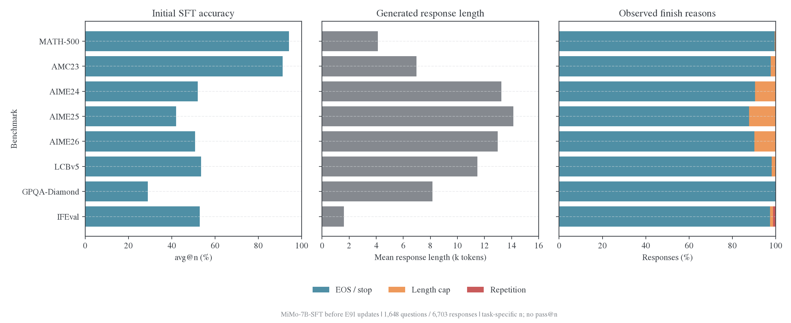

# E91：MiMo direct-RL teacher 到 SFT student

E91 已于 2026-11-07 启动，SFT 初始模型的全量评估已完成，正生成独立的 RL-Zero teacher bank；尚无 optimizer update 或训练后 RKL。问题限定为：同源、纯 RL teacher 的分布能否被已经完成 SFT 的 student 吸收。异源 Polaris 不进入这个比较；MiMo 的 SFT→RL teacher 也不称为纯 RL。

## 已有对照

| 实验 | Student      | Teacher         | Teacher 谱系                    | 作用          |
| ---- | ------------ | --------------- | ------------------------------- | ------------- |
| E72  | MiMo-7B-Base | MiMo-7B-RL-Zero | Base→direct RL（modified GRPO） | 已有 RL→Base  |
| E73  | MiMo-7B-Base | MiMo-7B-SFT     | Base→SFT                        | 已有 SFT→Base |
| E91  | MiMo-7B-SFT  | MiMo-7B-RL-Zero | Base→direct RL                  | 新增 RL→SFT   |

E71（Base→SFT→RL）不纳入纯 RL 主比较。E91 复用 E72/E73 的题池、teacher、rollout 和预算，只改变 student 初始 checkpoint，因此可以回答“同一个 direct-RL teacher 对 Base 和 SFT 初始化的可吸收性是否不同”。E72 的 teacher-prefix 四域终点 RKL 为 `0.002795`，E73 为 `0.337572`；两者条件于不同 teacher 前缀，不能直接作为教师难度排名。已有 E72 仍高于 teacher-copy 可行点，所以“完全吸收”需要同时看固定 bank、未见 bank 和任务表现。

## E91 设置

| 项目     | 设置                                                                                                                                                               |
| -------- | ------------------------------------------------------------------------------------------------------------------------------------------------------------------ |
| Student  | `MiMo-7B-SFT`，revision 见[模型与师生配对](../../../settings/模型与师生配对.md#mimo)                                                                               |
| Teacher  | `MiMo-7B-RL-Zero`，与 E72 相同 revision                                                                                                                            |
| 题池     | `questions-v2`，冻结，`shuffle=False`；沿用 E72/E73 的 prepared question manifest                                                                                  |
| 评估银行 | 在 E91 独立 bootstrap 目录按相同问题、协议和 teacher revision 生成 initial/SFT、teacher 及 finalize 读出；逐题核对与 E72 的公共银行                                |
| Rollout  | 当前 student，每 outer 每题 1 条，temperature=1，top-p=1，seed=42                                                                                                  |
| 目标     | full-vocab reverse KL；不启用 source/history held-out                                                                                                              |
| 预算     | 20 outer，reuse=16，320 optimizer updates，batch=128                                                                                                               |
| 优化器   | AdamW，LR `1e-6`，weight decay `0.01`，gradient clip `1`                                                                                                           |
| 长度     | prompt `2048`，train response `7168`，原生 context `32768`                                                                                                         |
| 精度     | 学生主权重 FP32；teacher/rollout BF16；沿用 E72/E73 的 shared-sync 执行路径                                                                                        |
| 重复停止 | 训练 rollout、`val_kwargs` 和统一评估协议均开启；参数为 16–128 token 片段连续重复 8 次即停止                                                                       |
| 记录     | current RKL、固定 teacher-prefix RKL、initial-student-prefix RKL（本组为 SFT）、未见四域 RKL、position RKL、loss before/after update、长度/停止原因、四域 accuracy |

重复检测三个入口必须分别显式设置，不能只改 `val_kwargs`：训练使用 `actor_rollout_ref.rollout.repetition_detection`，常规 validation 使用 `actor_rollout_ref.rollout.val_kwargs.repetition_detection`，`EvaluationCoordinator` 的 math/code/science/if `GenerationProtocol.repetition_detection` 也使用同一组参数。三处值均为 `{min_pattern_size: 16, max_pattern_size: 128, min_count: 8}`。共同 EOS 停止集合沿用 MiMo 的 `[151643,151645]`；重复停止保留已生成前缀，不伪造 EOS，也不丢弃样本。

E72/E73 的保存配置和评估 manifest 中，这三处 repetition detection 均为 `null`，即历史运行没有启用重复检测。公共 launcher 自 2026-11-05 起默认开启训练与验证检测，但历史配置不会因此改变。E91 按本方案新开两类路径，因此与 E72 的学生初始化对照还存在停止规则差异；读 E91/E72 差值时须同时报告 repetition/length stop 比例。训练记录 `rollout/repetition_detection/enabled_fraction`、`rollout/finish_reason/*`；每个评估协议记录 `eval/<dataset>/generation/finish_reason/*` 和 accuracy generation 的 `finish_reason/*`，并同时保留 `length_fraction`、`repetition_fraction`、`truncated_fraction`、`stop_fraction`、`unknown_fraction`。

E91 的 student 是 SFT checkpoint，不重跑 E73，也不把 RL→Base 作为新的实验臂；E72 已经承担这个对照。

## 已完成的初始 SFT 读出

2026-11-07 15:05（UTC+8），initial generation 与 initial accuracy 两个 artifact 均已完整发布，覆盖 1,648 道题、6,703 条回答。initial 进程正常退出，用时 16,429 秒（约 4 小时 34 分钟）；其中生成调度用时 16,104 秒。它是 MiMo-7B-SFT checkpoint 在任何 E91 更新之前的能力基线，不能解释为蒸馏收益。Teacher bank 与其 accuracy 尚未完成，固定前缀 RKL、teacher-copy 差值及 E91 的训练曲线暂缺。



| 基准         | 题数 / n | Accuracy avg@n | 平均长度，token | Length stop | Repetition stop |
| ------------ | -------- | -------------- | --------------- | ----------- | --------------- |
| MATH-500     | 500 / 1  | 94.20%         | 4,120           | 0.40%       | 0.00%           |
| AMC23        | 40 / 16  | 91.25%         | 6,982           | 2.34%       | 0.00%           |
| AIME24       | 30 / 16  | 52.08%         | 13,234          | 9.58%       | 0.00%           |
| AIME25       | 30 / 16  | 42.08%         | 14,124          | 12.08%      | 0.21%           |
| AIME26       | 30 / 16  | 50.83%         | 12,981          | 9.58%       | 0.21%           |
| LCBv5        | 279 / 10 | 53.51%         | 11,481          | 1.86%       | 0.00%           |
| GPQA-Diamond | 198 / 4  | 29.04%         | 8,153           | 0.00%       | 0.13%           |
| IFEval       | 541 / 1  | 52.87%         | 1,612           | 1.29%       | 1.29%           |

分数先在题内对 n 个回答求均值，再在题间求均值，不是 pass@n。Math／Code／Science 回答 cap 为 24,576，IFEval 为 8,192；公共生成 T1、top-p0.95，使用上文的共同 EOS 和重复检测。AIME24／25／26 的长度停止分别为 9.58%／12.08%／9.58%，因此后续任务分数变化需与长度和停止结构一起解释。图中的 EOS／stop 仅表示引擎停止类别，不保证答案推理完整。

每条 scored record 的哈希、逐题 sample 覆盖、准确率、平均长度和三类停止计数均已复算并与 immutable manifest 核对，见[CSV](../figures/e91-initial-20261107/initial-readout.csv)、[来源与协议](../figures/e91-initial-20261107/provenance.json)及[核验结果](../figures/e91-initial-20261107/source-audit.json)。[实际配置](../../../../../../runs/e91-mimo-rlzero-sft-20261107/configs/E91.yaml)和[源码合同](../../../../../../runs/e91-mimo-rlzero-sft-20261107/source-contract.json)保留运行条件；[队列状态](../../../../../../runs/e91-mimo-rlzero-sft-20261107/queue-state.json)承接执行进度。[绘图与复算源码](../../../../research/studies/pipeline/report_e91_snapshot.py)只读 CPU，不启动 GPU：

```bash
python -m examples.mirroropd.research.studies.pipeline.report_e91_snapshot
```

## 读出与判定

主表同时列 E72、E73、E91 的 absolute RKL、相对 step0 降幅、teacher-copy 差值和 accuracy。固定 bank 的前缀必须按 teacher 分开；current rollout 只说明访问到的状态，未见 bank 才能检验迁移。position RKL 按相同位置桶和相同颜色尺度绘制，另报告第一个 outer 的 first update 与最后一个 outer 的 first update。

E91 支持“**SFT 初始化帮助吸收 direct-RL 目标**”需要：相同 teacher 和预算下，E91 在 teacher-prefix 与未见 bank 都低于 E72，并且不是靠截断率或能力退化换来的。只在 current bank 下降而未见 bank 平台，仍应解释为局部拟合。E72 的低 RKL 不能单独证明 RL 本质上容易吸收。

## GRPO、PPO/token critic 的可比设置

仓库已有 Qwen3-4B-Base-GRPO 的同家族、纯 RL 教师记录，但它和 1.7B student 是跨尺寸，且没有同初始化、同题池和同 verifier 的 PPO teacher。320-step 留出 RKL 从 `0.664417` 降至 `0.335392`（49.52%）；延至 1280 步降至 `0.111017`，最后 640→1280 窗口的风险仍下降 1.07%。它是“已改善但有限预算后仍有残差”的反例，不是不可吸收或已经收敛的证明。相同 320-step Qwen 阶段表中的 SFT-step80 降幅为 25.55%，但属于不同 teacher 数据及来源的观察性比较。

优先候选是 Qwen3-1.7B-Base 的受控 teacher 网格：从完全相同的 Base 初始化分别训练 GRPO 与 PPO；若需要细粒度 credit，再加一个固定实现的 token-critic PPO。固定训练题及 verifier、温度、响应上限、rollout 总数与生成 token、actor optimizer updates、reference-KL 系数和停止条件；记录 critic 训练额外算力。冻结每个 teacher 后，让同一个 student checkpoint 在同一固定银行和同一按批刷新协议下做 OPD，比较 teacher-prefix 与 held-out RKL、position RKL 和任务 accuracy。这样算法差异只在 teacher 生成阶段，student 侧完全共享。

TEMPO 在 Qwen3-1.7B/4B 上对照 PPO、GRPO 等方法，同一问题有每题 6 个 episode、数据集 10 次遍历，即每题 60 个 episode；其 GRPO 还采用 DAPO 的无 KL、clip-higher 和 token-level loss 设置，PPO 使用与 actor 同尺寸的 critic。论文测任务能力和训练效率，不测 teacher absorption，可作为候选模型与预算的先例，但不能直接搬用结果。[AsyPPO](https://arxiv.org/abs/2510.01656) 则改变了 critic 架构和不确定性过滤，不是纯 PPO 算法对照。DeepSeekMath 将 GRPO 介绍为 PPO 的 critic-free 变体。[DeepSeekMath](https://arxiv.org/abs/2402.03300)；[TEMPO](https://arxiv.org/abs/2509.18314)；[AsyPPO](https://arxiv.org/abs/2510.01656)。

## RFT 与 post-training on-policy

这里的 on-policy 指 post-training 期间用当前策略刷新数据。可做一个独立的同源 teacher 对照：同一 Base、题池、verifier、accepted token 数和 optimizer budget，比较固定初始策略采样的 offline RFT 与每轮从当前策略重采样的 iterated RFT；二者都只对 verifier 接受的回答做 SFT。这样能把“成功回答的 weighted-SFT 效应”和“当前策略刷新状态”的效应分开。

最近的受控研究在 Qwen3-4B-Base procedural counting 上用同一题目、verifier 和 4352-token cap 比较 GRPO 与 RFT；Easy/Mixed 两组匹配 19,200 个 rollouts，Curated 组并未匹配 rollout 数，且 RFT 做 27 组超参搜索。GRPO 在各组领先 tuned RFT；三轮 iterated RFT（每轮按当前策略刷新）追回 curated 组 10.9 个百分点差距中的 3.2 个百分点，约 30%。它只覆盖一个合成任务和一个 base model，且优化步数/监督数据量不完全匹配，因此适合作为设计依据，不是 MiMo 结论。[Is it RL or Data?](https://arxiv.org/abs/2610.25812)。另一个基线工作报告 rejection sampling 可达到接近 GRPO/PPO 的效果，但其训练协议与本仓库不同。[A Minimalist Approach](https://arxiv.org/abs/2504.11343)。

offline RFT 接近 GRPO，支持“回答筛选/加权监督”解释；只有 iterated RFT 接近，支持 current-policy 数据刷新的重要性；RFT 仍明显落后，则说明 group-relative advantage、失败样本或更细粒度 credit assignment 可能贡献了额外信息。不能仅用 RFT 与 SFT 的差异证明 on-policy 因果。

## 证据边界

MiMo E72/E73 是当前最干净的本地对照，但 E72 的 RL teacher 是公开 direct-RL checkpoint，E73 的 SFT teacher 来源、数据和输出长度不同；E91 只新增 student 初始化控制，不能把三者扩展成 GRPO 对 PPO 的结论。E71 与 Polaris 保留在各自阶段/跨源文档中，不进入本页主表。

论文检索完整报告保存在 `runs/e91-literature-20261107.md` 和 `runs/e91-grpo-ppo-search-20261107.md`；OpenReview 在本次检索中返回 403 challenge，结论只采用可核验的 arXiv 摘要/HTML 与仓库已有记录。
