# Position KL：初始与末 outer 的 first-update 位置曲线

数据快照：2026-11-07T15:10:24+08:00。每张图只包含一个实验的两条曲线：第一个 outer 的 first update，以及最后已记录 outer 的 first update。所有值都在各自首次 optimizer 操作前测量，末 outer 的曲线没有使用该批第 16 次观测。

## 比较口径

横轴是相对回答位置的十等分桶，不是前十个 token；纵轴使用对数尺度，同时保留高低顺序和倍数关系。每个桶是有效 token 均值。表中“前 30% / 后 30%”为前三个桶的算术均值除以后三个桶的算术均值：大于 1 表示前段较高，小于 1 表示后段较高。这个形状摘要不等于完整回答的 token 加权 KL。最大位置桶用于识别中段峰值，不假定曲线单调。

各 outer 使用自己的新 rollout，末 outer first update 已包含此前所有 outer 的训练影响，尚未拟合当前 batch。两端的题目、前缀和长度分布不同；这些曲线描述当时访问状态上的形状，不是固定 state 的前后测量。不同 teacher 与 MDPO 的 target 不共用一个比较标尺，因此按实验分图、按指标分表。

覆盖此前 MiMo、R1-1.5B、Qwen 的九组正式实验、六组 MDPO，以及两组终止动作诊断。E78–E80 不纳入。固定 state 附录只有三个位置带，且无对应 outer/first-update 结构，保留在[清单](../appendix/position-kl-inventory.md)，不混入十等分图。

## 位置形状概览

MDPO 六组中有 6 组在末 outer 的最大桶为 0–10%；末 outer 的前 30% / 后 30% 为 1.15–1.47。MiMo E71/E73 的末 outer 比值为 1.54/1.80，前段残差更突出；E72 为 1.06，形状较平。

Polaris E48 的末 outer 比值为 0.81，最大桶在 70–80%；E49 为 1.03，前后接近。Qwen E39/E41 的末 outer 最高桶在 90–100%，但前三桶均值仍略高于后三桶均值，对应末端上翘而非全程递增。E35 的末 outer 比值为 0.61，最大桶在 50–60%。

## MiMo：原始 teacher RKL

| 实验 | 观测           | outer / update |       0–10% |     90–100% | 前 30% / 后 30% | 最大位置桶 |
| ---- | -------------- | -------------- | ----------: | ----------: | --------------: | ---------- |
| E71  | 初始 first     | 1 / 1          |    0.576227 |      0.2489 |           1.636 | 0-10%      |
| E71  | 末 outer first | 25 / 769       |    0.169392 |   0.0841756 |           1.541 | 0-10%      |
| E72  | 初始 first     | 1 / 1          |   0.0508867 |   0.0418581 |           1.121 | 0-10%      |
| E72  | 末 outer first | 20 / 305       | 0.000801445 | 0.000694433 |           1.059 | 10-20%     |
| E73  | 初始 first     | 1 / 1          |    0.535635 |    0.249836 |           1.622 | 0-10%      |
| E73  | 末 outer first | 20 / 305       |    0.166658 |   0.0668039 |           1.800 | 0-10%      |

### E71：MiMo-7B-RL

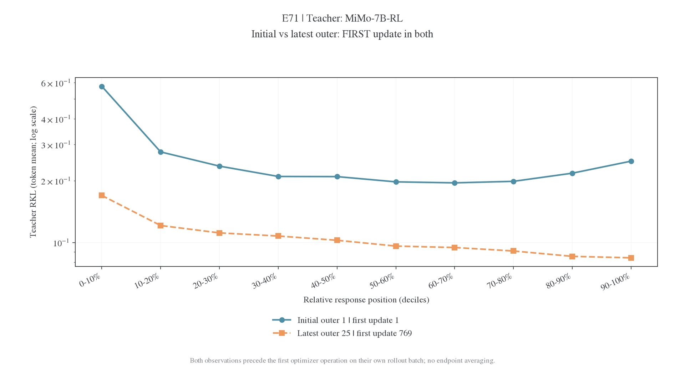

### E72：MiMo-7B-RL-Zero

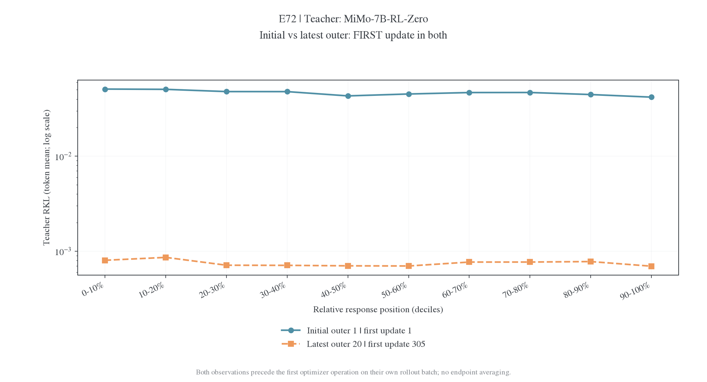

### E73：MiMo-7B-SFT

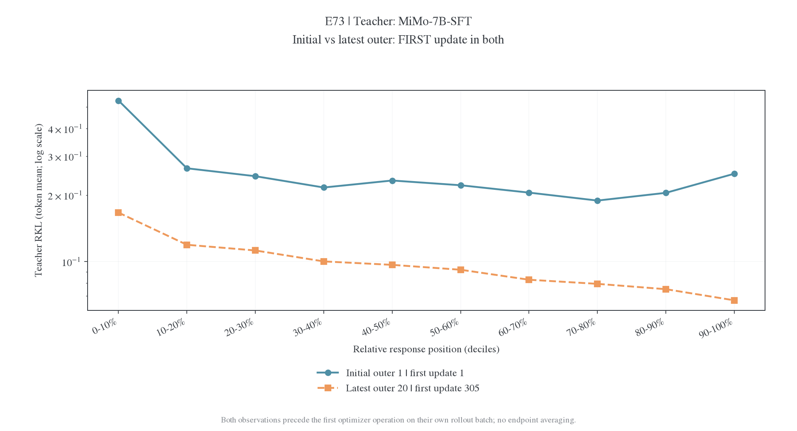

## R1-1.5B：原始 teacher RKL

E49 优化 conditional FKL，此处绘制日志中独立记录的原始 teacher RKL。

| 实验 | 观测           | outer / update |       0–10% |    90–100% | 前 30% / 后 30% | 最大位置桶 |
| ---- | -------------- | -------------- | ----------: | ---------: | --------------: | ---------- |
| E48  | 初始 first     | 1 / 1          |    0.232913 |   0.192546 |           1.142 | 0-10%      |
| E48  | 末 outer first | 256 / 4081     |    0.159408 |   0.189464 |           0.807 | 70-80%     |
| E49  | 初始 first     | 1 / 1          |    0.242724 |   0.192045 |           1.118 | 0-10%      |
| E49  | 末 outer first | 256 / 4081     |    0.195182 |   0.174704 |           1.035 | 0-10%      |
| E35  | 初始 first     | 1 / 1          |    0.119551 |   0.152441 |           0.828 | 90-100%    |
| E35  | 末 outer first | 250 / 3985     | 0.000863087 | 0.00115897 |           0.607 | 50-60%     |

### E48：Polaris-7B-Preview

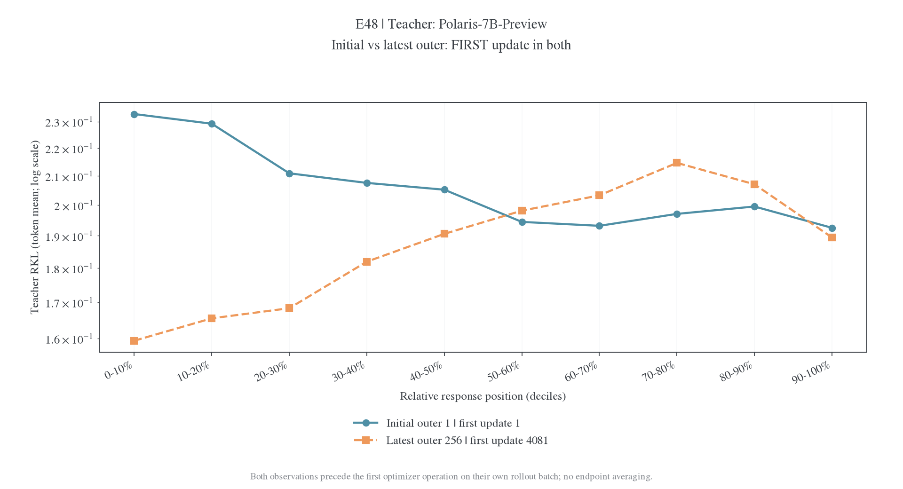

### E49: Polaris-7B-Preview (conditional FKL training)

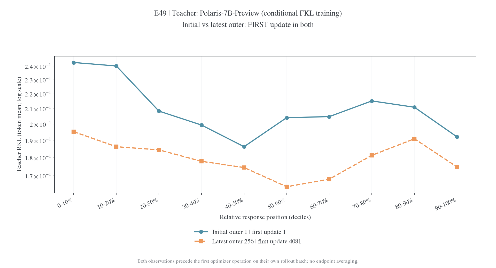

### E35: JustRL-DeepSeek-1.5B

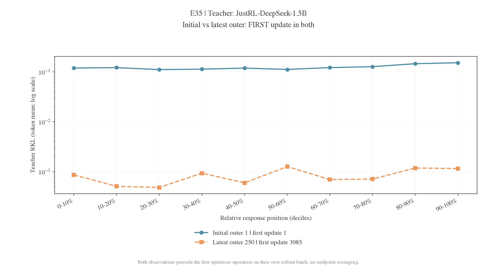

## Qwen：原始 teacher RKL

| 实验 | 观测           | outer / update |    0–10% |  90–100% | 前 30% / 后 30% | 最大位置桶 |
| ---- | -------------- | -------------- | -------: | -------: | --------------: | ---------- |
| E39  | 初始 first     | 1 / 1          |  1.25516 |  0.37831 |           2.279 | 0-10%      |
| E39  | 末 outer first | 200 / 3185     |  0.14374 | 0.169904 |           1.118 | 90-100%    |
| E41  | 初始 first     | 1 / 1          |  1.30218 | 0.415082 |           2.030 | 0-10%      |
| E41  | 末 outer first | 100 / 1585     | 0.137214 | 0.165762 |           1.075 | 90-100%    |
| E43  | 初始 first     | 1 / 1          | 0.432614 | 0.538827 |           0.991 | 90-100%    |
| E43  | 末 outer first | 100 / 1585     | 0.290801 | 0.237701 |           1.165 | 0-10%      |

### E39：Qwen3-8B

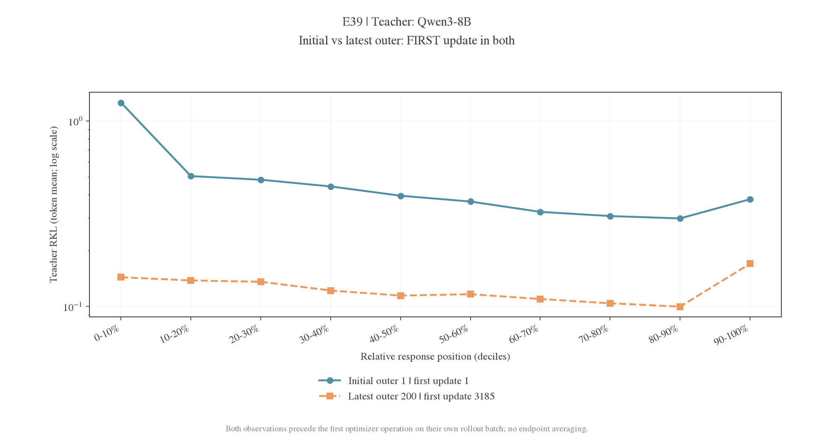

### E41：Qwen3-4B

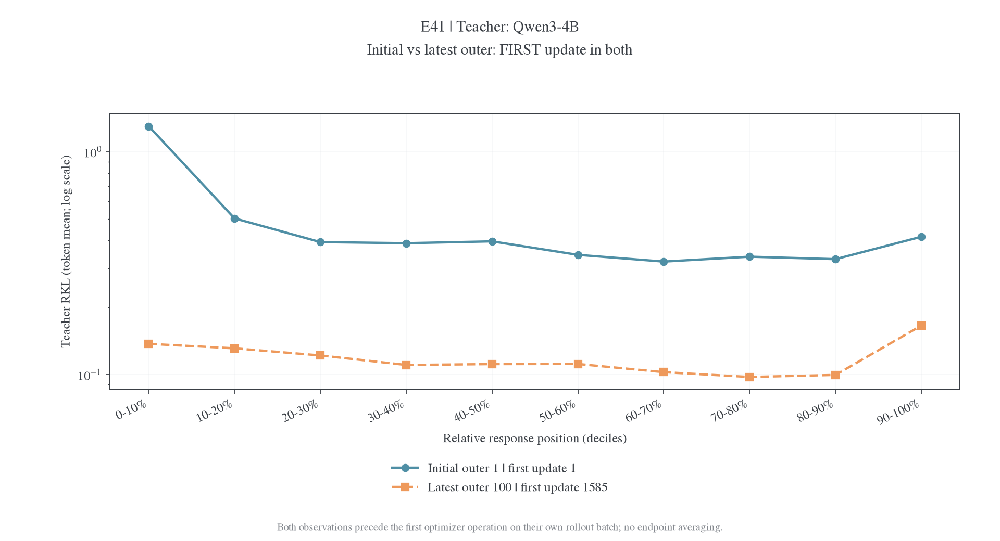

### E43：Qwen3-4B-Instruct-2507

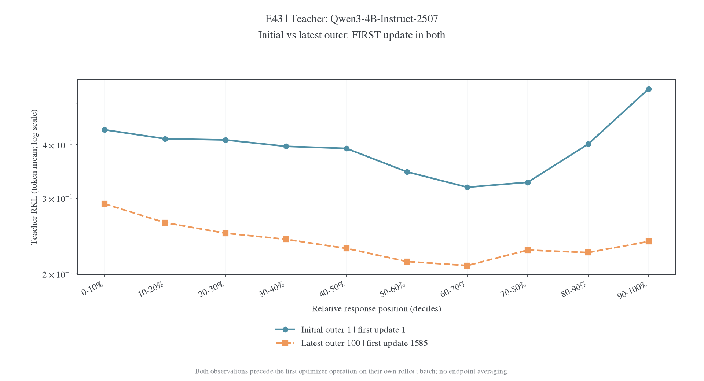

## MDPO：target 相关 objective

κ=1 的 E57、E81–E83 为 target RKL 的 10 倍；E55/E56 还包含归一化项。完整定义与训练热力图见[MDPO 专题](../../learning-signal/mdpo-position-kl.md)。

| 实验 | 观测           | outer / update |     0–10% |   90–100% | 前 30% / 后 30% | 最大位置桶 |
| ---- | -------------- | -------------- | --------: | --------: | --------------: | ---------- |
| E55  | 初始 first     | 1 / 1          |    1.1528 |  0.293856 |           2.465 | 0-10%      |
| E55  | 末 outer first | 100 / 1585     |  0.410732 |  0.221021 |           1.467 | 0-10%      |
| E56  | 初始 first     | 1 / 1          |  0.341432 |   0.16211 |           1.677 | 0-10%      |
| E56  | 末 outer first | 100 / 1585     |  0.154316 |  0.121497 |           1.156 | 0-10%      |
| E57  | 初始 first     | 1 / 1          | 0.0937222 | 0.0355831 |           2.142 | 0-10%      |
| E57  | 末 outer first | 100 / 1585     |  0.041244 |  0.031913 |           1.152 | 0-10%      |
| E81  | 初始 first     | 1 / 1          |  0.103788 | 0.0486466 |           1.714 | 0-10%      |
| E81  | 末 outer first | 25 / 385       | 0.0480381 | 0.0382528 |           1.180 | 0-10%      |
| E82  | 初始 first     | 1 / 1          | 0.0937007 | 0.0410487 |           1.730 | 0-10%      |
| E82  | 末 outer first | 70 / 1105      | 0.0429453 | 0.0323897 |           1.181 | 0-10%      |
| E83  | 初始 first     | 1 / 1          | 0.0965122 |  0.040861 |           1.792 | 0-10%      |
| E83  | 末 outer first | 30 / 465       | 0.0482672 | 0.0378584 |           1.181 | 0-10%      |

### E55：Qwen3-30B-A3B-Instruct-2507

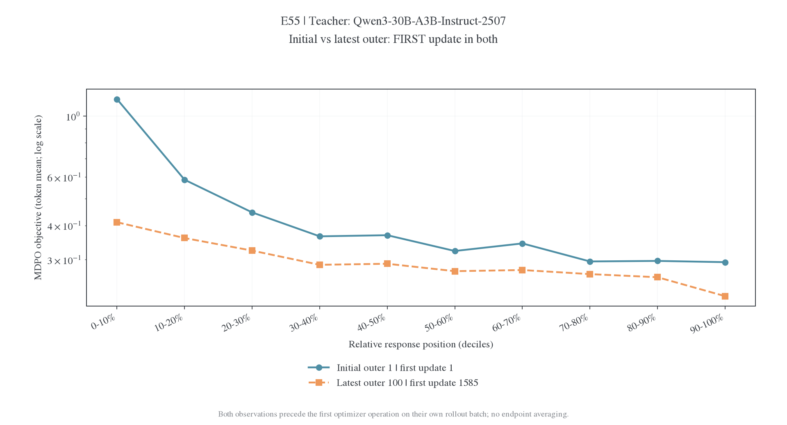

### E56：Qwen3-30B-A3B-Instruct-2507

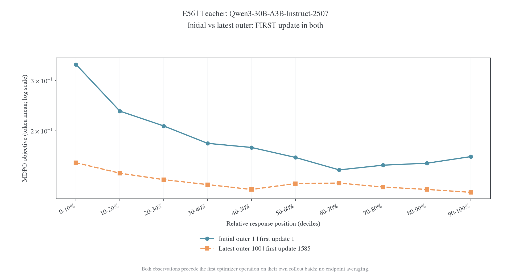

### E57：Qwen3-30B-A3B-Instruct-2507

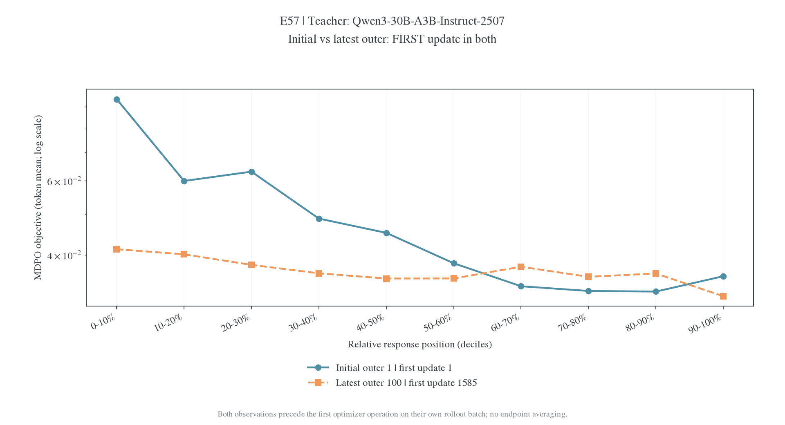

### E81：Qwen3-30B-A3B-Instruct-2507

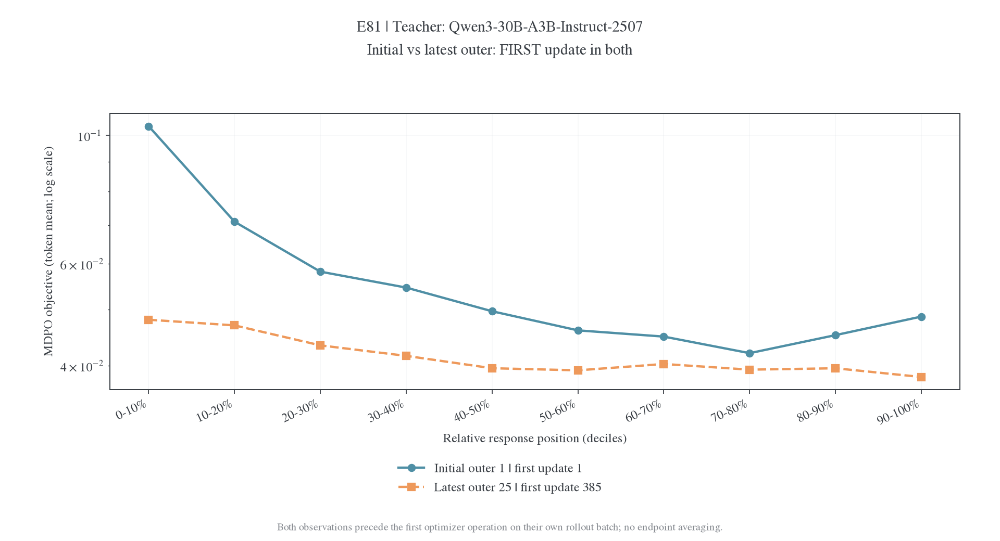

### E82：Qwen3-30B-A3B-Instruct-2507

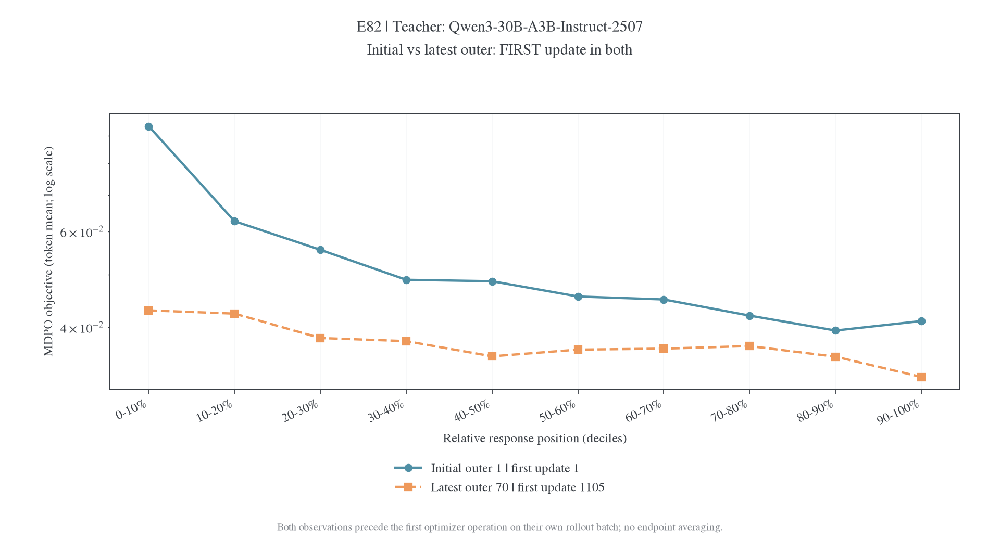

### E83：Qwen3-30B-A3B-Instruct-2507

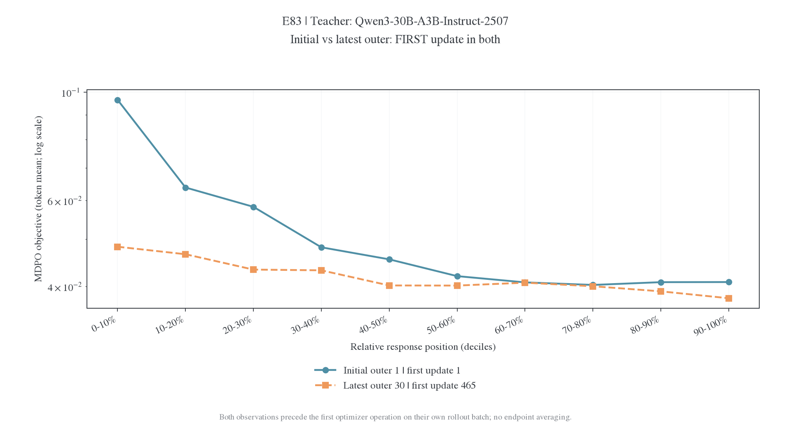

## 终止动作对照：原始 teacher RKL

| 实验                 | 观测           | outer / update |    0–10% |    90–100% | 前 30% / 后 30% | 最大位置桶 |
| -------------------- | -------------- | -------------- | -------: | ---------: | --------------: | ---------- |
| termination-baseline | 初始 first     | 1 / 1          |   1.1825 |   0.514159 |           1.717 | 0-10%      |
| termination-baseline | 末 outer first | 20 / 305       | 0.174109 | 0.00730771 |          12.150 | 0-10%      |
| termination-aligned  | 初始 first     | 1 / 1          |  1.24471 |   0.493922 |           1.725 | 0-10%      |
| termination-aligned  | 末 outer first | 20 / 305       | 0.162172 |   0.176529 |           1.210 | 90-100%    |

### termination-baseline: Qwen3-4B (native RKL training)

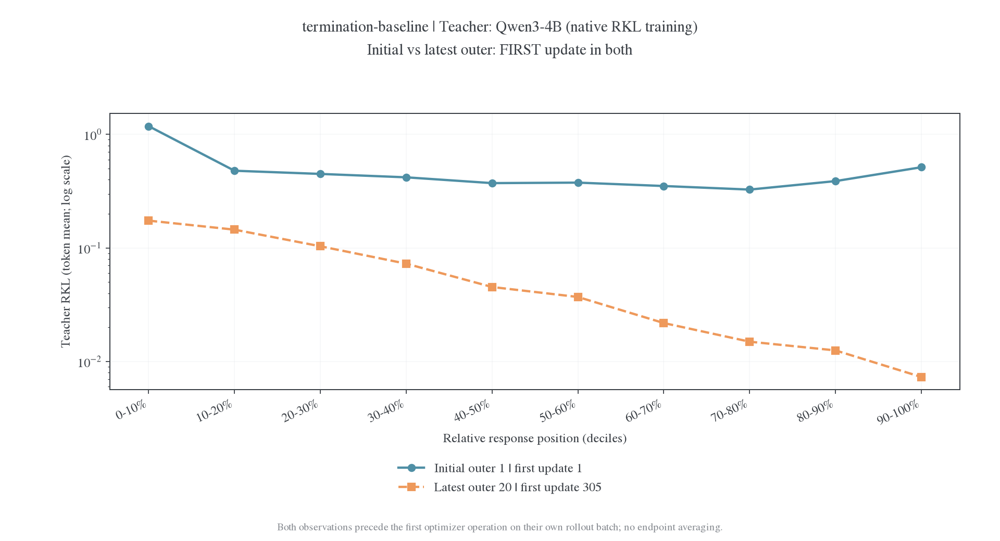

### termination-aligned: Qwen3-4B (EOS-aligned training)

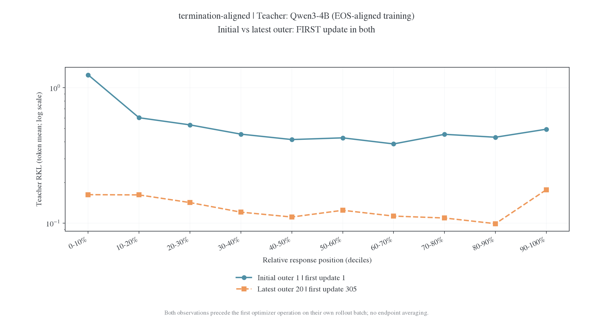

## 数据与复画

[完整十桶原值](../../learning-signal/figures/mdpo-position-20261107/profiles.csv)、[摘要表](../../learning-signal/figures/mdpo-position-20261107/profile-summary.csv)和[来源核验](../../learning-signal/figures/mdpo-position-20261107/provenance.json)使用同一快照；复画命令见[MDPO 专题](../../learning-signal/mdpo-position-kl.md#数据与复画)。
