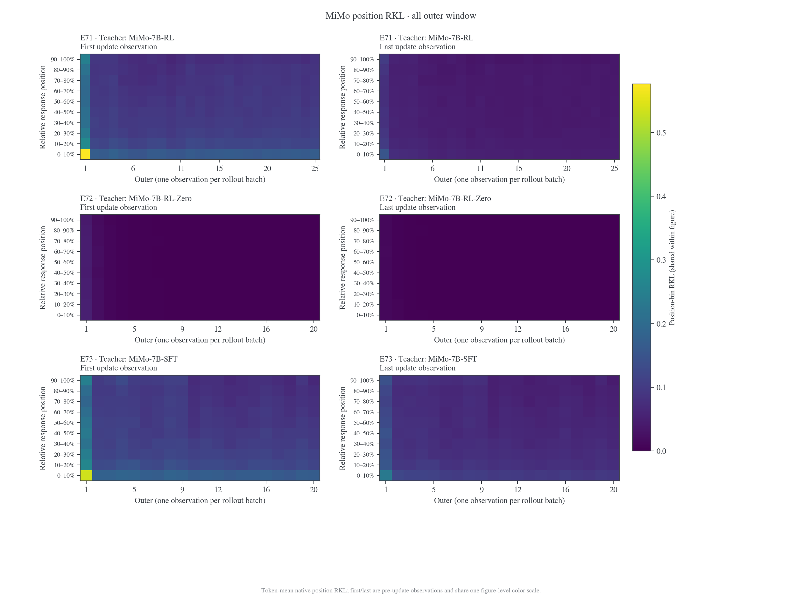
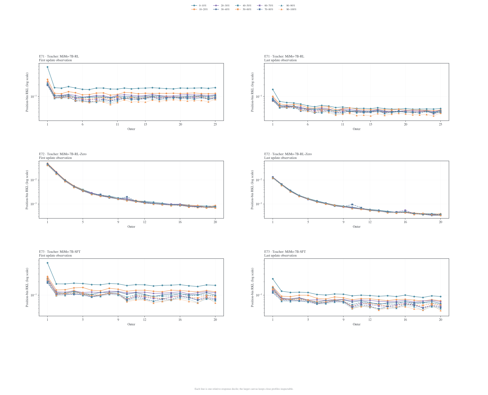
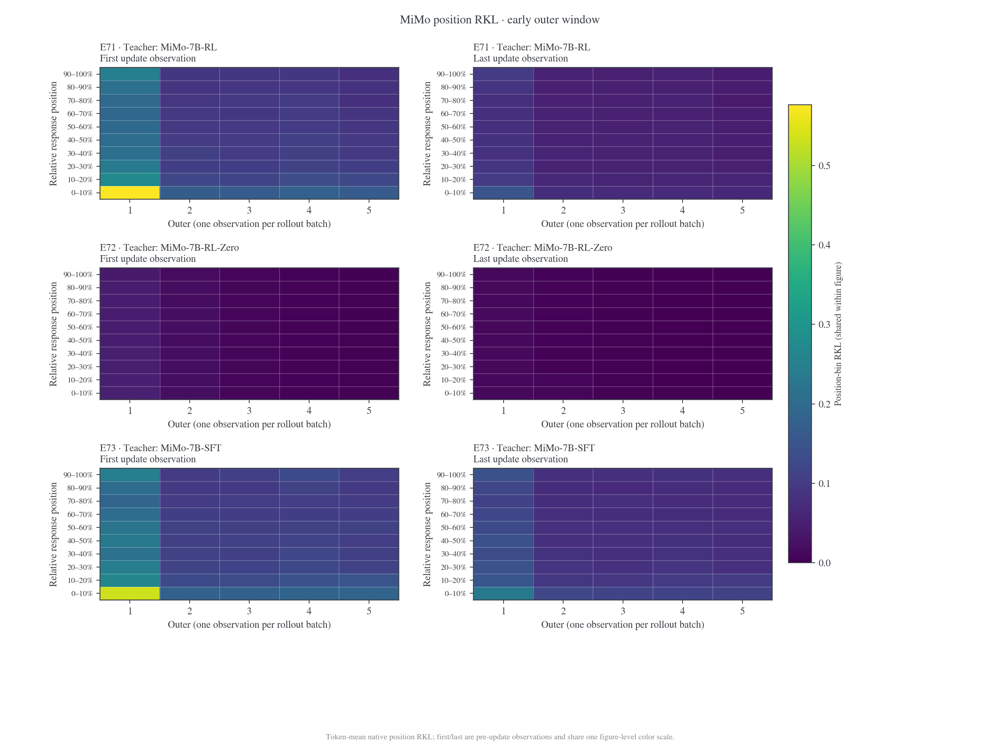
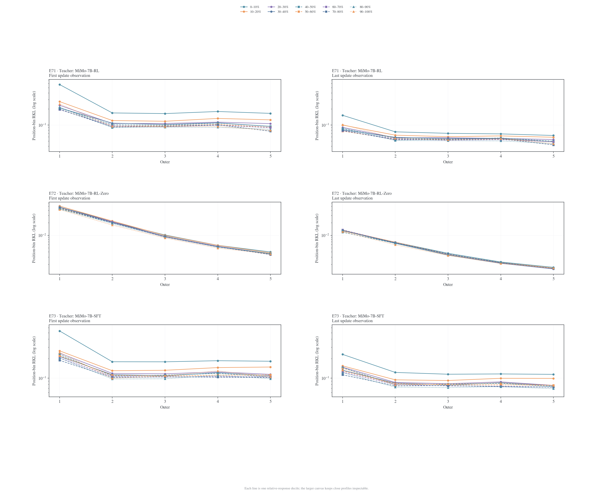
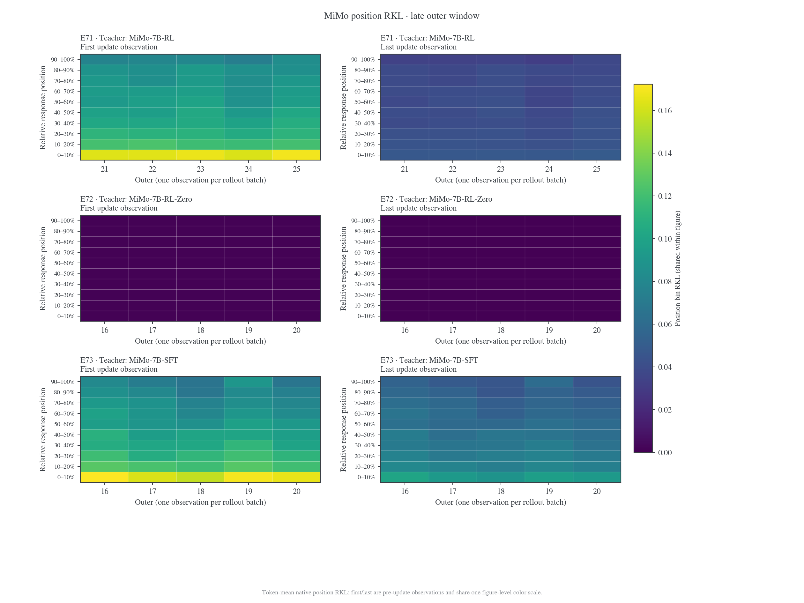
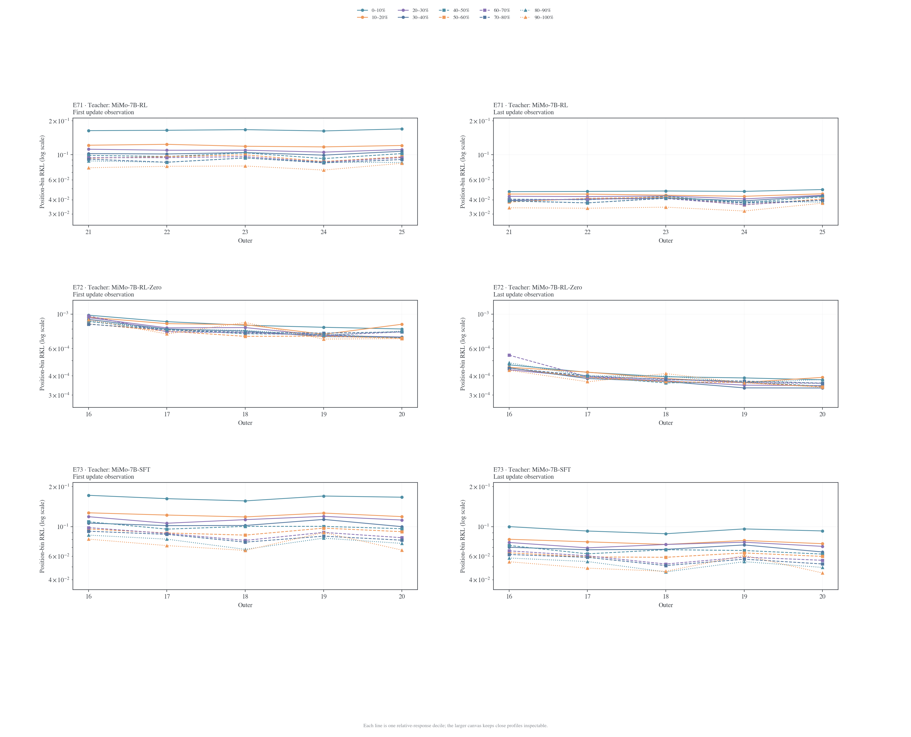
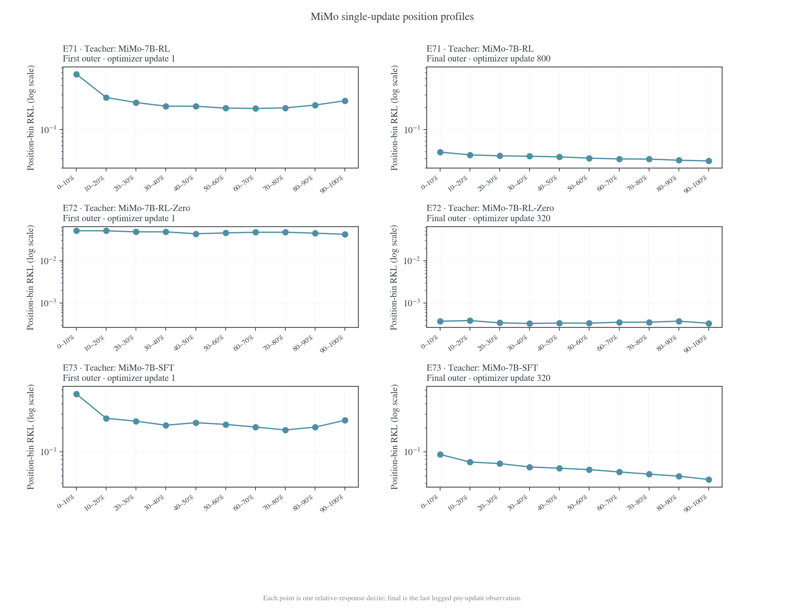
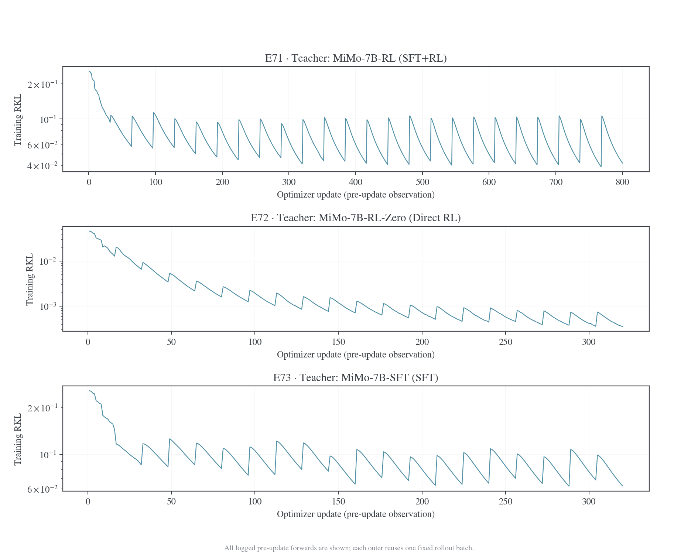
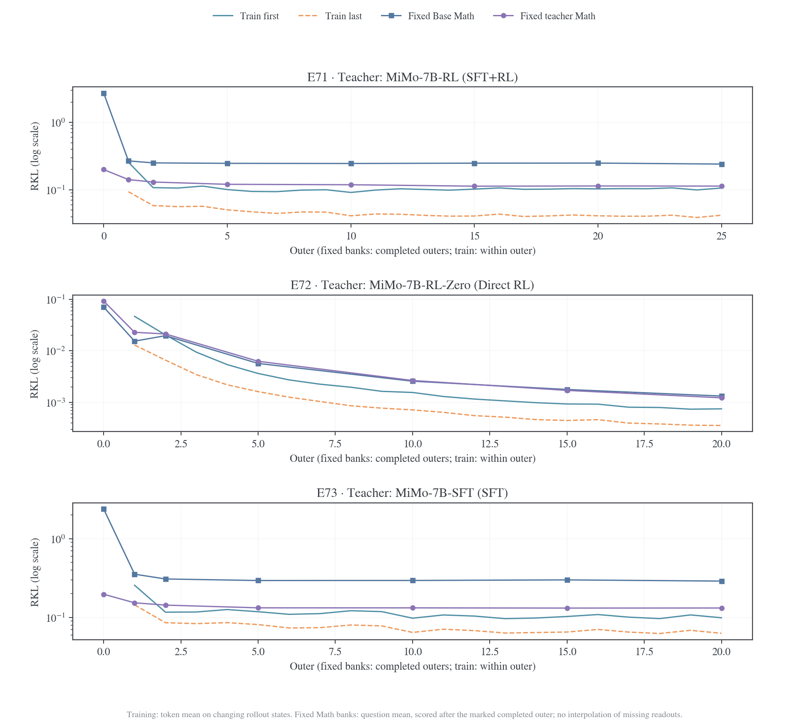

# MiMo position-KL: E71 / E72 / E73

更新：2026-11-08。Student 均为 MiMo-7B-Base；E91 使用 MiMo-7B-SFT student，已完成 320 updates，但本页仍只维护 E71/E72/E73 的位置曲线。E91 的最终 RKL 与评估读出见[阶段对照](../post-training-stages.md#e91)。

## 实验设置

| 实验 | Teacher         | 教师路径    | Batch / rollout n | Reuse | Outer / updates | 训练 response cap |
| ---- | --------------- | ----------- | ----------------: | ----: | --------------: | ----------------: |
| E71  | MiMo-7B-RL      | Base→SFT→RL |           128 / 1 |    32 |        25 / 800 |              7168 |
| E72  | MiMo-7B-RL-Zero | Base→RL     |           128 / 1 |    16 |        20 / 320 |              7168 |
| E73  | MiMo-7B-SFT     | Base→SFT    |           128 / 1 |    16 |        20 / 320 |              7168 |

三组均为 Full-vocab RKL、fresh AdamW、LR `1e-6`、weight decay `0.01`；完整设置见[后训练阶段](../post-training-stages.md#mimo)。

## 指标口径与早期位置数值

`position-KL` 为原始 full-vocabulary reverse KL（RKL），单位为 nat。十个桶按每条 response 的实际有效长度划分，`p00_10` 是相对位置 0–10%，不等于绝对前若干 token。first / last 是每个 outer 第一次／最后一次 optimizer 操作**之前**的观测；reuse16 的两次观测之间执行了 15 次更新。每张热力图内所有 panel 共用一个线性色阶和一个 colorbar；放大图根据所选窗口重新定色阶，跨图片读数以各自 colorbar 为准。MiMo E71 的 reuse 为 32，其 first/last 间隔为 31 次更新。

| 实验 | 初始 first p00–10% | 终点 last p00–10% | 后五个 outer first 均值 | 后五个 outer last 均值 |
| ---- | -----------------: | ----------------: | ----------------------: | ---------------------: |
| E71  |           0.576227 |         0.0493258 |                 0.16537 |              0.0478966 |
| E72  |          0.0508867 |       0.000376773 |             0.000869592 |            0.000409935 |
| E73  |           0.535635 |         0.0930565 |                0.165559 |              0.0942377 |

## First / last update 随 outer 的变化

左列为 first，右列为 last；每行在图内标明实验和 teacher。折线图每个 position 桶一条曲线，使用 20 英寸宽画布，并结合颜色、线型和 marker 区分。每个实验的 first/last 线图共用纵轴范围，纵轴为对数刻度。

### 全部 outer





### 最开始五个 outer





### 最后五个 outer





## 初始与终点单次观测的 position profile



## 训练 loss 与固定 Math-bank RKL

训练 loss 在当前 rollout state 上按 token 平均；固定 Math bank 使用固定前缀，按题内 token 平均后再按题平均。两者状态和归约方式不同。

| 实验 / teacher        | 训练 loss：初始→终点 last | 固定 teacher Math bank：outer0→终点 |
| --------------------- | ------------------------: | ----------------------------------: |
| E71 / MiMo-7B-RL      |         0.25639 → 0.04200 |                   0.19948 → 0.11349 |
| E72 / MiMo-7B-RL-Zero |        0.04655 → 0.000356 |                  0.09216 → 0.001225 |
| E73 / MiMo-7B-SFT     |         0.25627 → 0.06291 |                   0.19709 → 0.13180 |





## 固定 bank 的连续 batch 迁移短训

为检查 E71 的 RL teacher 是否有不同于 E73 SFT teacher 的跨 batch 迁移特征，从 E71/E72/E73 共用的 initial-bank artifact 中筛出 64 道互不重复的 Math prompt，切成 A/B/C/D 四组，每组 16 题。三个 teacher 均从同一 MiMo-7B-Base student 开始，按 A→B→C→D 顺序训练，每组 16 个 optimizer updates，共 64 步；切换 batch 时保留 AdamW 状态。固定 teacher 分布与前缀，使用 full-vocabulary RKL、token-mean 训练 loss、LR `1e-6`、weight decay `0.01`、gradient clip `1.0`。这是诊断性短训，不重放正式 OPD 的 student rollout，也不是收敛实验。

下表为各 checkpoint 在四组上的 question-mean RKL（nat）。每个 checkpoint 同时评估训练过和未训练的全部组：

| Teacher     | Updates / trained through |       A |       B |       C |       D |
| ----------- | ------------------------: | ------: | ------: | ------: | ------: |
| E71 RL      |                     0 / — |   1.144 |   1.064 |   1.138 |   1.265 |
| E71 RL      |                    16 / A |   0.176 |   0.407 |   0.415 |   0.413 |
| E71 RL      |                    32 / B |   0.196 |   0.055 |   0.314 |   0.312 |
| E71 RL      |                    48 / C |   0.215 |   0.088 |   0.050 |   0.295 |
| E71 RL      |                    64 / D |   0.227 |   0.100 |   0.086 |   0.044 |
| E72 RL-Zero |                     0 / — |  0.0263 |  0.0276 |  0.0275 |  0.0327 |
| E72 RL-Zero |                    16 / A | 0.00293 | 0.00982 | 0.00859 |  0.0133 |
| E72 RL-Zero |                    32 / B |  0.0141 | 0.00181 | 0.00633 | 0.00912 |
| E72 RL-Zero |                    48 / C |  0.0191 | 0.00713 | 0.00120 | 0.00793 |
| E72 RL-Zero |                    64 / D |  0.0218 | 0.00893 | 0.00514 | 0.00135 |
| E73 SFT     |                     0 / — |   1.035 |   0.962 |   0.985 |   1.090 |
| E73 SFT     |                    16 / A |   0.156 |   0.386 |   0.397 |   0.387 |
| E73 SFT     |                    32 / B |   0.185 |   0.059 |   0.304 |   0.292 |
| E73 SFT     |                    48 / C |   0.206 |   0.093 |   0.050 |   0.276 |
| E73 SFT     |                    64 / D |   0.223 |   0.109 |   0.089 |   0.048 |

E71 与 E73 的 matched-budget 轨迹接近。训练完 A 后，未见 B 的 RKL 分别从 `1.064→0.407` 和 `0.962→0.386`；训练完 B 后 A 有小幅反弹；到 64 步时 E71 的 A/B/C/D 为 `0.227/0.100/0.086/0.044`，E73 为 `0.223/0.109/0.089/0.048`。因此这次短训能看到迁移和 batch 切换后的部分回弹，但没有显示 SFT teacher 有明显更差的迁移或最终吸收。绝对残差不是零，也不能据此说“已经完全吸收”。E72 的起始 RKL 约比 E71/E73 小 35–40 倍；虽然最后一批降得很低，早先训练组随后明显回弹，说明只比较绝对终点会掩盖其相对遗忘幅度。

同一日期的初始全参数梯度探针在 Math 上得到 E71/E72/E73 的 A-B cosine `0.777/0.849/0.741`，在 IF 上为 `0.754/0.688/0.770`。SFT 不在两个域都呈现更低的梯度对齐；该 cosine 和一阶 transfer ratio 只是局部梯度诊断，并非 AGK 论文中完整计算的 A、K、G。单 batch 16 步短训也给出相近的 A→B 留出下降：E71 `1.143→0.429`（62.5%）、E73 `0.998→0.400`（59.9%）。这些不同筛选出的样本都没有建立稳定的 SFT 特有差距。

当前最稳妥的解释是：有限步数下，各批目标共享模型参数，更新后会产生跨批收益，也会对先前批次造成干扰；该效应在 E71 与 E73 中量级相近。由于 student 与 teacher 是同一架构，teacher checkpoint 本身就是理论上的零 RKL 解；本实验剩余误差不能解释成不可表达的 SFT 信息，更可能来自有限优化步数、共享参数下的干扰及当前样本覆盖。它还不能区分这些因素的相对贡献。要判断是否存在 teacher 阶段效应，下一步应在相同题集上增加 A/B/C/D 顺序置换和重复种子，并增加每批训练步数，同时记录同批 replay 与无 replay 的对照；再检查梯度 Gram/局部 transfer 是否能预测这些轨迹差异。

方法、限制、teacher/student revisions、源代码哈希及完整逐题 checkpoint 输出见[实验 manifest](../data/mimo-batch-transfer-20261107/manifest.json)和 [E71](../data/mimo-batch-transfer-20261107/rl-math.json)、[E72](../data/mimo-batch-transfer-20261107/rl_zero-math.json)、[E73](../data/mimo-batch-transfer-20261107/sft-math.json) 原始结果。结果指标是 question mean；训练目标按 response token 平均。每组 16 题，64 题是从过滤后 133 个候选中按 source 排序确定性抽样；三组首轮为 A→B→C→D，另对 E71/E73 运行了 D→C→B→A。由于题量较小且没有重复种子，结果仅作机制线索，不作统计显著性结论。

为检查顺序混杂，又在同一 64 题上把顺序反转为 D→C→B→A，重跑 E71 与 E73。64 步终点的 A/B/C/D 分别为 E71 `0.062/0.085/0.103/0.173`、E73 `0.066/0.081/0.113/0.170`；反序下两者仍然接近。正序和反序共同显示，RKL 在当前批下降、在后续批更新后对旧批部分回弹，且回弹位置随顺序移动。这个现象更支持有限预算下的共享参数干扰与顺序效应，暂时不支持 SFT teacher 特有的跨 batch 吸收障碍。反序结果保存在 [E71-DCBA](../data/mimo-batch-transfer-20261107/rl-math-dcba.json) 和 [E73-DCBA](../data/mimo-batch-transfer-20261107/sft-math-dcba.json)。

## 数据与复算

正式 E71/E72/E73 的 initial-student 与 teacher 两套固定 bank 吸收分析见[MiMo 双 held-out bank 结果](../fixed-state-results/absorption-diagnostics.md#mimoinitial-与-teacher-双-held-out-bank)；[离线交互面板](../fixed-state-results/figures/mimo-absorption-20261107/explorer.html)可切换 bank、domain、指标和 teacher。该分析不含本页的 64 题连续 batch 诊断实验。

[首末观测 CSV](../data/case-position-kl-20261107/mimo-endpoints.csv)保留每个 outer 的真实 update 编号、全局 RKL 和十个位置桶；[数值表 CSV](../data/case-position-kl-20261107/mimo-summary.csv)用于上表。[来源哈希](../data/case-position-kl-20261107/manifest.json)记录冻结输入和脚本版本。生成器为 [`plot_case_position_kl.py`](../figures/plot_case_position_kl.py)，同名图片提供 PNG、PDF、SVG 三种产物。

```bash
uv run --no-project --with matplotlib --with numpy \
  python examples/mirroropd/docs/experiments/teacher-transfer/figures/plot_case_position_kl.py
```

训练 loss / Math-bank 图由 [`plot_mimo_position_kl.py`](../figures/plot_mimo_position_kl.py)生成；[冻结数据与重建误差](../data/mimo-position-kl-20261106/manifest.json)单独保留。
