# Qwen position-KL: E39 / E41 / E43

更新：2026-11-07。E39、E41、E43 各自成节，每张图只包含一个实验；左列为 first update，右列为 last update。三组使用 DAPO、AdamW、LR `1e-6`、batch64、rollout n=1、reuse16，训练 response cap 为 7168。

`position-KL` 为原始 full-vocabulary reverse KL（RKL），单位为 nat。十个桶按每条 response 的实际有效长度划分，`p00_10` 表示相对位置 0–10%。first / last 均为 optimizer 操作之前的观测，两次观测间执行了 15 次更新。每张热力图的 first/last panel 共用一个线性色阶与 colorbar；放大图按所选窗口定标。线图每个 position 一条曲线，保留 20 英寸宽画布，并使用颜色、线型和 marker 区分；同图 first/last 共用对数纵轴范围。

[首末观测 CSV](../data/case-position-kl-20261107/qwen-endpoints.csv)、[数值表 CSV](../data/case-position-kl-20261107/qwen-summary.csv)保留原有数据；[绘图来源与审计清单](../data/case-position-kl-20261107/qwen-manifest.json)记录独立绘图的输入哈希和脚本版本。图片提供 PNG、PDF、SVG。

## E39: Qwen3-1.7B-Base → Qwen3-8B

### 设置与首桶数值

| Student         | Teacher  | 优化目标         | Outer / updates |
| --------------- | -------- | ---------------- | --------------: |
| Qwen3-1.7B-Base | Qwen3-8B | 终止动作对齐 RKL |      200 / 3200 |

优化时合并停止动作 151643 与 151645；下图保留未合并的原始 RKL。完整训练设置与验证结果见 [E39 原始分析](../failure-reproduction.md#qwen8)。

| 初始 first p00–10% | 终点 last p00–10% | 后五个 outer first 均值 | 后五个 outer last 均值 |
| -----------------: | ----------------: | ----------------------: | ---------------------: |
|            1.25516 |          0.104959 |                0.121048 |              0.0892609 |

### 全部 outer（1–200）

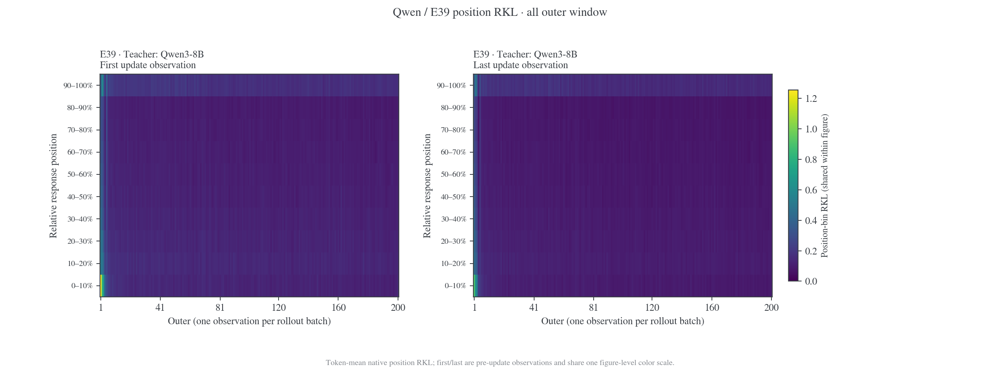

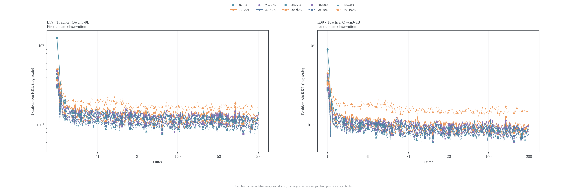

### 最开始五个 outer（1–5）

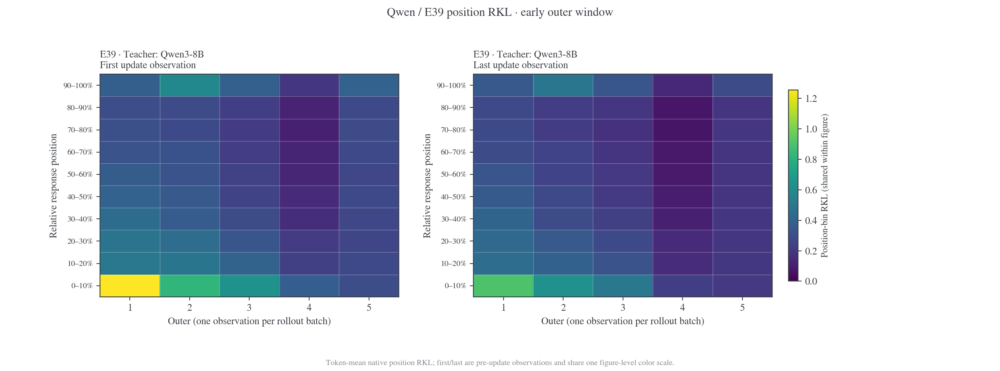

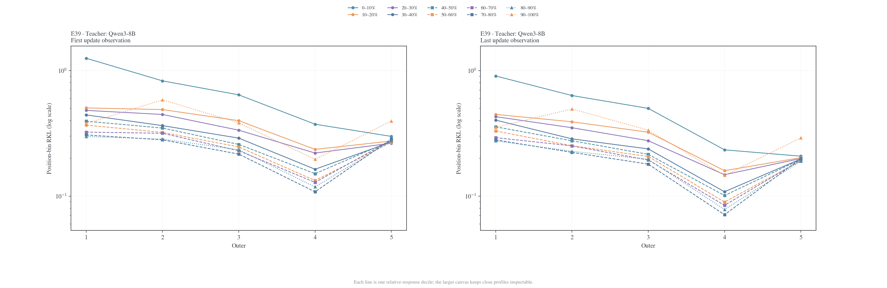

### 最后五个 outer（196–200）

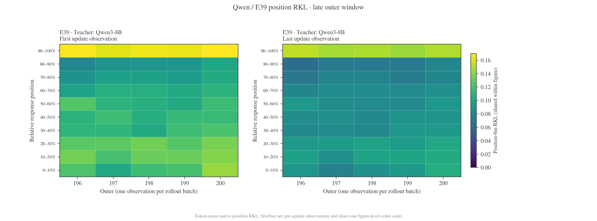

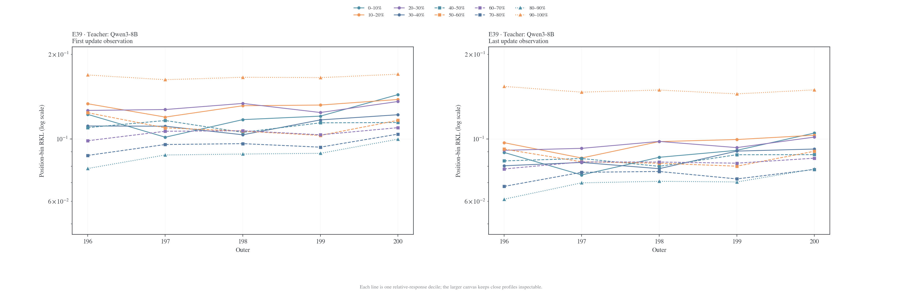

### 初始与终点单次观测的 position profile

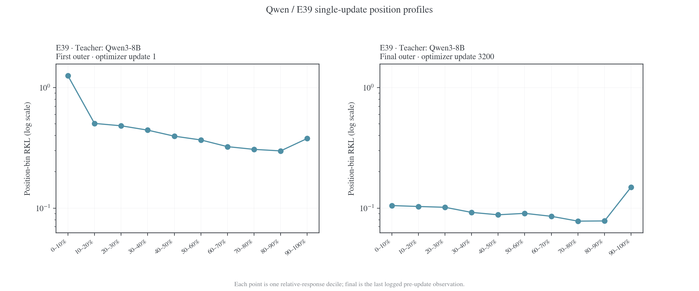

## E41: Qwen3-1.7B-Base → Qwen3-4B

### 设置与首桶数值

| Student         | Teacher  | 优化目标         | Outer / updates |
| --------------- | -------- | ---------------- | --------------: |
| Qwen3-1.7B-Base | Qwen3-4B | 终止动作对齐 RKL |      100 / 1600 |

优化时合并停止动作 151643 与 151645；下图保留未合并的原始 RKL。完整训练设置与验证结果见 [E41 原始分析](../failure-reproduction.md#qwen4)。

| 初始 first p00–10% | 终点 last p00–10% | 后五个 outer first 均值 | 后五个 outer last 均值 |
| -----------------: | ----------------: | ----------------------: | ---------------------: |
|            1.30218 |         0.0979217 |                0.135529 |              0.0990998 |

### 全部 outer（1–100）

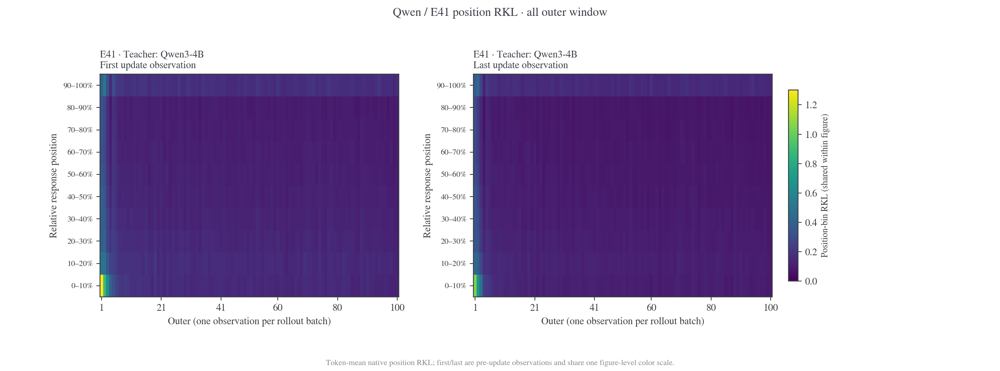

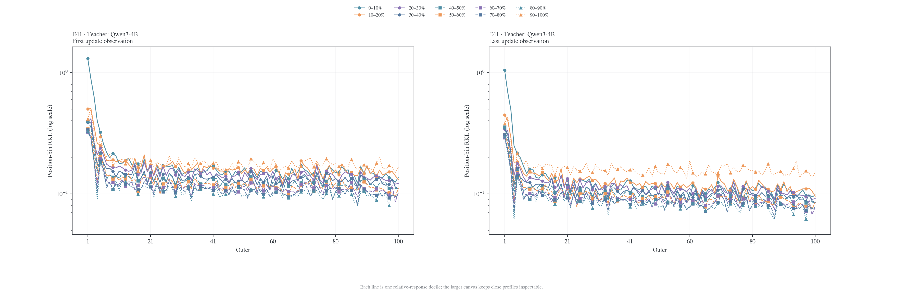

### 最开始五个 outer（1–5）

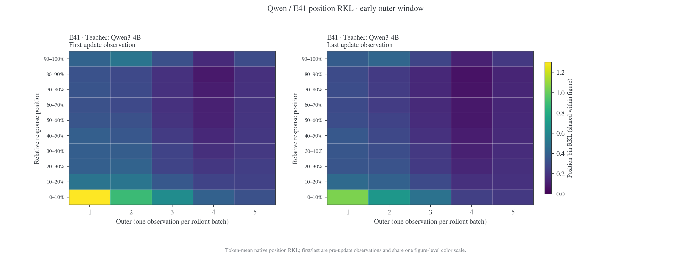

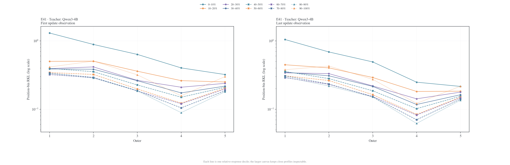

### 最后五个 outer（96–100）

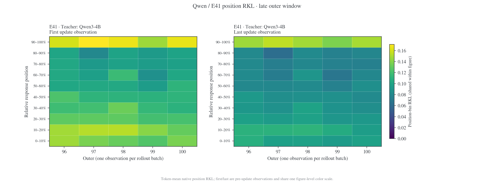

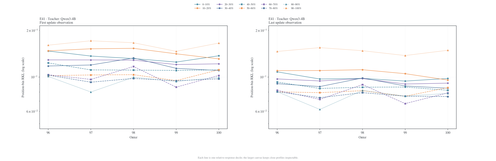

### 初始与终点单次观测的 position profile


## E43: Qwen3-1.7B Non-thinking → Qwen3-4B-Instruct-2507

### 设置与首桶数值

| Student                 | Teacher                | 优化目标       | Outer / updates |
| ----------------------- | ---------------------- | -------------- | --------------: |
| Qwen3-1.7B Non-thinking | Qwen3-4B-Instruct-2507 | Full-vocab RKL |      100 / 1600 |

完整训练设置与验证结果见 [E43 原始分析](../failure-reproduction.md#e43)。

| 初始 first p00–10% | 终点 last p00–10% | 后五个 outer first 均值 | 后五个 outer last 均值 |
| -----------------: | ----------------: | ----------------------: | ---------------------: |
|           0.432614 |          0.216759 |                0.286802 |               0.215926 |

### 全部 outer（1–100）

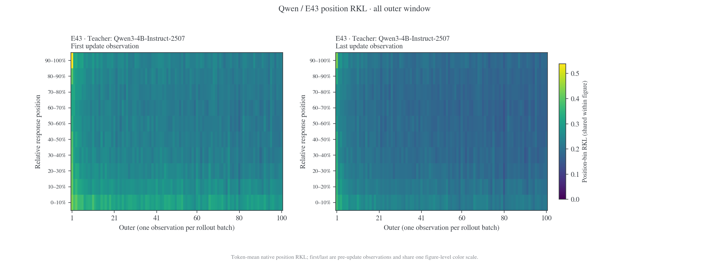

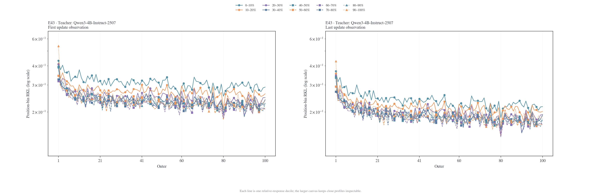

### 最开始五个 outer（1–5）

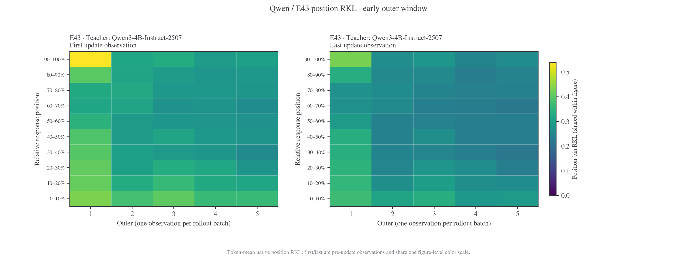

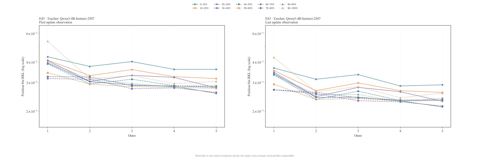

### 最后五个 outer（96–100）

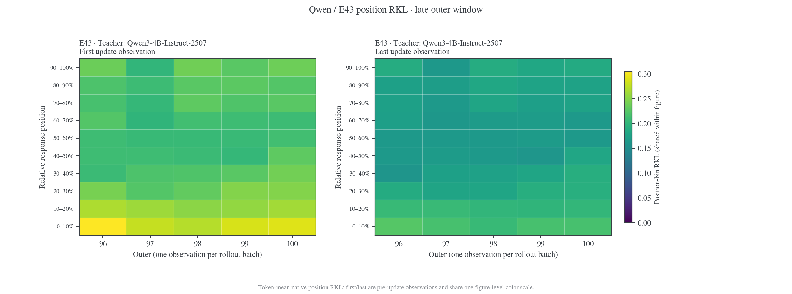

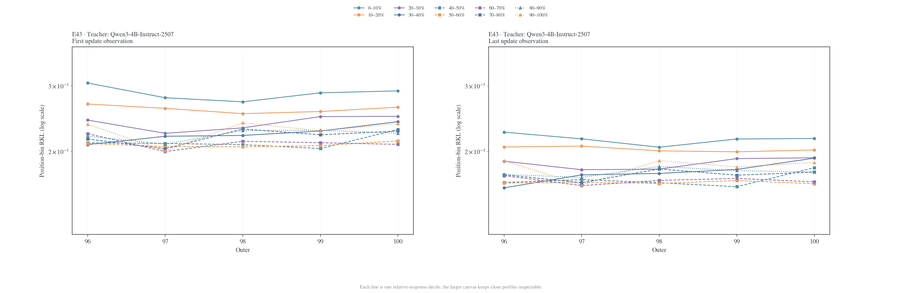

### 初始与终点单次观测的 position profile

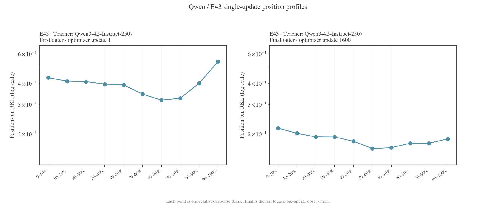

使用 [`plot_case_position_kl.py`](../figures/plot_case_position_kl.py) 的 Qwen 选项复算：

```bash
uv run --no-project --with matplotlib --with numpy \
  python examples/mirroropd/docs/experiments/teacher-transfer/figures/plot_case_position_kl.py --qwen-only
```
