# R1-1.5B position-KL: E48 / E49 / E35

更新：2026-11-07。Student 均为 DeepSeek-R1-Distill-Qwen-1.5B。E48/E49 使用同组图的独立 panel；E35 使用单独图。

## 实验设置

| 实验 | Teacher              | 优化目标             | Batch / rollout n | Reuse | Outer / updates | 训练 response cap |
| ---- | -------------------- | -------------------- | ----------------: | ----: | --------------: | ----------------: |
| E48  | Polaris-7B-Preview   | Full-vocab RKL       |            64 / 1 |    16 |      256 / 4096 |              7168 |
| E49  | Polaris-7B-Preview   | 学生支持上的条件 FKL |            64 / 1 |    16 |      256 / 4096 |              7168 |
| E35  | JustRL-DeepSeek-1.5B | Full-vocab RKL       |            64 / 1 |    16 |      250 / 4000 |             15360 |

三组使用 DAPO、AdamW、LR `1e-6`。E48/E49 从相同的初始 student 分别训练，各自生成在线轨迹；E35 的 response cap 不同。完整 Polaris 方向对照与验证结果保留在[长训证据附录](../appendix/polaris-long-run.md)。

## 指标口径与早期位置数值

`position-KL` 为原始 full-vocabulary reverse KL（RKL），单位为 nat。十个桶按每条 response 的实际有效长度划分，`p00_10` 是相对位置 0–10%，不等于绝对前若干 token。first / last 是每个 outer 第一次／最后一次 optimizer 操作**之前**的观测；reuse16 的两次观测之间执行了 15 次更新。每张热力图内所有 panel 共用一个线性色阶和一个 colorbar；放大图根据所选窗口重新定色阶，跨图片读数以各自 colorbar 为准。E49 的 position 字段是原始 teacher RKL 诊断，不是条件 FKL loss。E49 来源核对为 run `zyru8wdf`；`forward-kl-study` 目录中的 `run/history.jsonl` 实为 E48 基线，未用于 E49 绘图。

| 实验 | 初始 first p00–10% | 终点 last p00–10% | 后五个 outer first 均值 | 后五个 outer last 均值 |
| ---- | -----------------: | ----------------: | ----------------------: | ---------------------: |
| E48  |           0.232913 |          0.141864 |                0.163806 |               0.146268 |
| E49  |           0.242724 |          0.179692 |                0.204126 |               0.188783 |
| E35  |           0.119551 |       0.000309738 |              0.00086446 |            0.000307312 |

## Polaris：E48 / E49

### First / last update 随 outer 的变化

左列为 first，右列为 last；每行在图内标明实验和 teacher。折线图每个 position 桶一条曲线，使用 20 英寸宽画布，并结合颜色、线型和 marker 区分。每个实验的 first/last 线图共用纵轴范围，纵轴为对数刻度。

#### 全部 outer

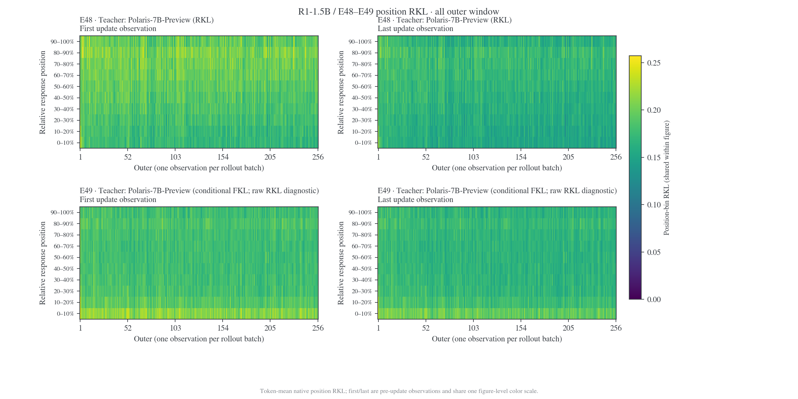

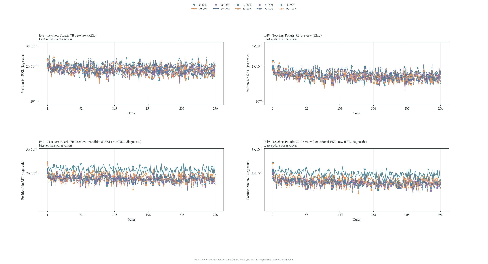

#### 最开始五个 outer

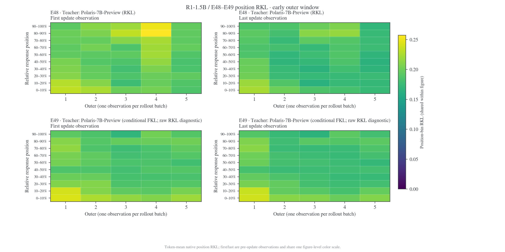

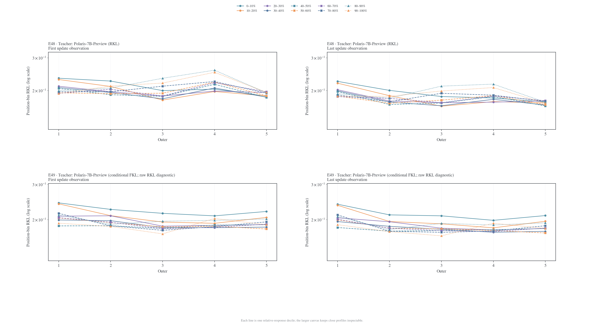

#### 最后五个 outer

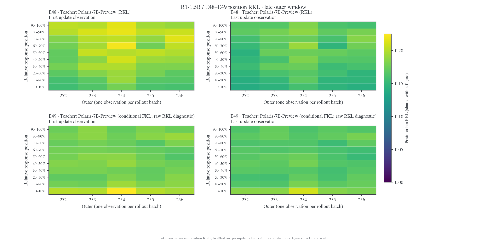

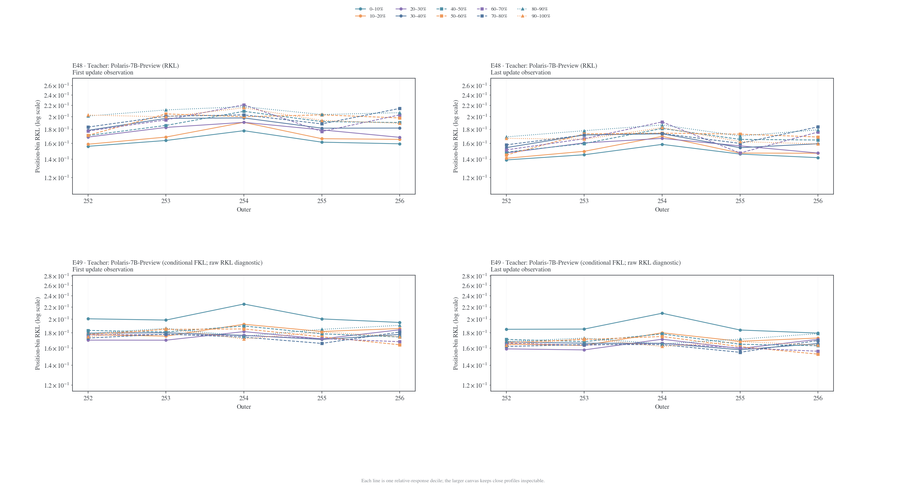

### 初始与终点单次观测的 position profile

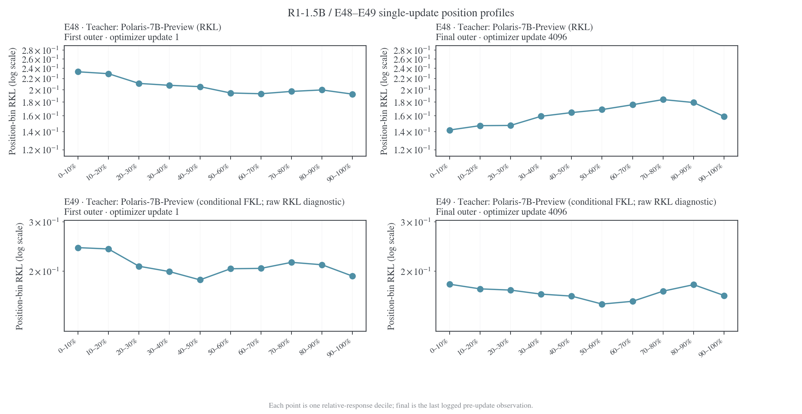

## JustRL：E35 单独图

### First / last update 随 outer 的变化

左列为 first，右列为 last；每行在图内标明实验和 teacher。折线图每个 position 桶一条曲线，使用 20 英寸宽画布，并结合颜色、线型和 marker 区分。每个实验的 first/last 线图共用纵轴范围，纵轴为对数刻度。

#### 全部 outer

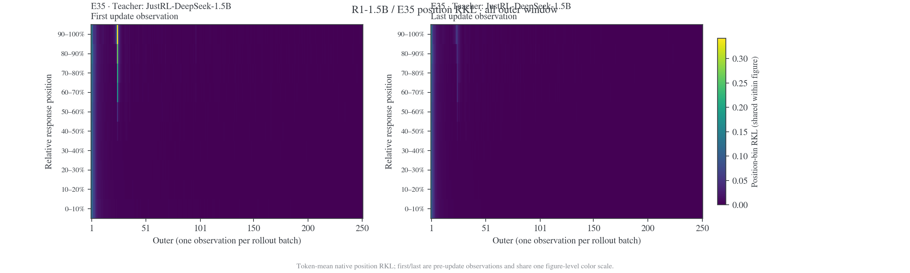

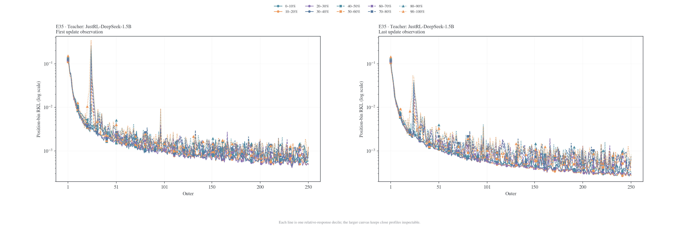

#### 最开始五个 outer

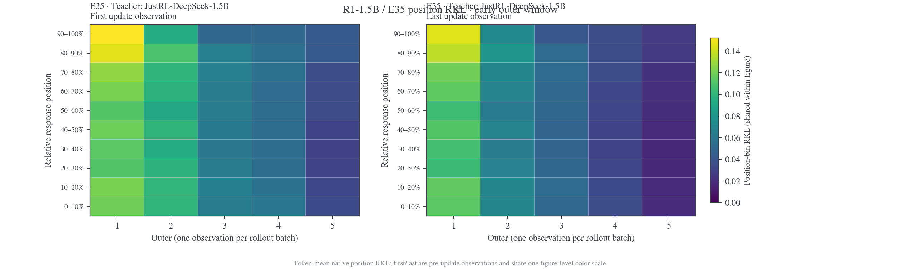

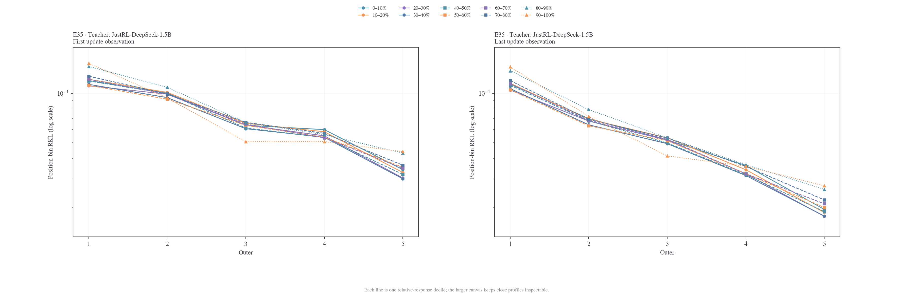

#### 最后五个 outer

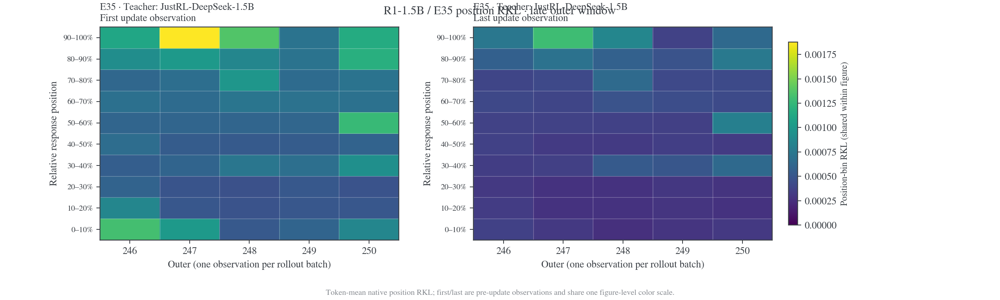

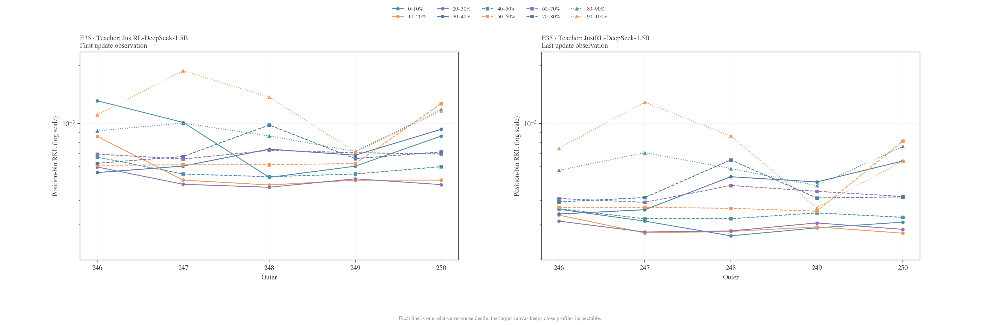

### 初始与终点单次观测的 position profile

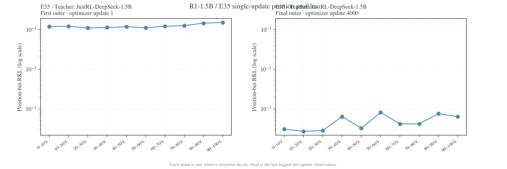

## 数据与复算

[首末观测 CSV](../data/case-position-kl-20261107/r1-1.5b-endpoints.csv)保留每个 outer 的真实 update 编号、全局 RKL 和十个位置桶；[数值表 CSV](../data/case-position-kl-20261107/r1-1.5b-summary.csv)用于上表。[来源哈希](../data/case-position-kl-20261107/manifest.json)记录冻结输入和脚本版本。生成器为 [`plot_case_position_kl.py`](../figures/plot_case_position_kl.py)，同名图片提供 PNG、PDF、SVG 三种产物。

```bash
uv run --no-project --with matplotlib --with numpy \
  python examples/mirroropd/docs/experiments/teacher-transfer/figures/plot_case_position_kl.py
```
