# OPD 吸收的参数位移、拟合与跨尺寸边界

共 22 个训练完成 pair；teacher 位移覆盖 17 组。图和表只纳入对应指标完整的 pair；轻量范数轨迹已完成全部矩阵覆盖。RKL 使用固定 bank 的逐题平均，每个统计点是一组 pair。
teacher 位移的范围是所有 decoder 层的七类 attention/MLP 投影，未包括 embedding、head、norm 与辅助 MTP。

## Pair 身份与统一图例

颜色表示 student family 与实际输入模式；点形表示 teacher 的训练来源；外侧黑色空心圆表示 cross-size。尺寸与 SFT/RL 是独立属性。曲线使用相同 family 色与来源点形，同一小图内的线型区分 pair。

Qwen3 thinking（E99–E101）与 non-thinking（E102/E112/E113）分开；同一权重使用不同模式仍属不同分析条件。Qwen3 Base（E117）单列。颜色不表示 teacher 架构，更不等于直接谱系。MiMo 的 Base/SFT 初始化、R1 的 1.5B/7B 尺寸保留在表中。

SFT? 表示 E104 的来源尚未确认；Instruct/mixed 表示 Qwen3-4B-Instruct-2507 的复合后训练端点，不将其强行当作追加 SFT。E108 的 R1-7B 是蒸馏 SFT teacher；E111/E114 的 Light-7B 也是 SFT，Polaris 是 RL。E113 是同尺寸独立端点，参数兼容不证明直接谱系。来源见[主报告的协议与配对](../../README.md#实验设置)及[模型来源](../../../../../settings/模型与师生配对.md#r1)。

| Pair | Student              | Teacher                | Family／输入模式   | Teacher 来源   | 尺寸       |
| ---- | -------------------- | ---------------------- | ------------------ | -------------- | ---------- |
| E94  | R1-1.5B              | DeepScaleR             | R1-Distill-Qwen    | RL             | same-size  |
| E95  | R1-1.5B              | JustRL                 | R1-Distill-Qwen    | RL             | same-size  |
| E96  | R1-1.5B              | MiniMath               | R1-Distill-Qwen    | SFT            | same-size  |
| E97  | R1-1.5B              | Nemotron               | R1-Distill-Qwen    | RL             | same-size  |
| E98  | R1-1.5B              | BroRL                  | R1-Distill-Qwen    | RL             | same-size  |
| E99  | Qwen3-1.7B           | GRPO-KL-math           | Qwen3 thinking     | RL             | same-size  |
| E100 | Qwen3-1.7B           | e3-1.7B                | Qwen3 thinking     | RL             | same-size  |
| E101 | Qwen3-1.7B           | Samsung Math           | Qwen3 thinking     | SFT            | same-size  |
| E102 | Qwen3-1.7B           | Qwen3-4B-Instruct-2507 | Qwen3 non-thinking | Instruct/mixed | cross-size |
| E103 | Llama3.2-3B-Instruct | Co-rewarding           | Llama-3.2 Instruct | RL             | same-size  |
| E104 | Llama3.2-3B-Instruct | arithmetic-full        | Llama-3.2 Instruct | SFT?           | same-size  |
| E105 | MiMo-7B-Base         | MiMo-7B-SFT            | MiMo               | SFT            | same-size  |
| E106 | MiMo-7B-Base         | MiMo-7B-RL-Zero        | MiMo               | RL             | same-size  |
| E107 | MiMo-7B-SFT          | MiMo-7B-RL             | MiMo               | RL             | same-size  |
| E108 | R1-1.5B              | R1-7B (distill SFT)    | R1-Distill-Qwen    | SFT            | cross-size |
| E109 | R1-1.5B              | Polaris-7B             | R1-Distill-Qwen    | RL             | cross-size |
| E110 | R1-7B                | Polaris-7B             | R1-Distill-Qwen    | RL             | same-size  |
| E111 | R1-7B                | Light-R1-7B-DS         | R1-Distill-Qwen    | SFT            | same-size  |
| E112 | Qwen3-0.6B           | Qwen3-4B-Instruct-2507 | Qwen3 non-thinking | Instruct/mixed | cross-size |
| E113 | Qwen3-4B             | Qwen3-4B-Instruct-2507 | Qwen3 non-thinking | Instruct/mixed | same-size  |
| E114 | R1-1.5B              | Light-R1-7B-DS         | R1-Distill-Qwen    | SFT            | cross-size |
| E117 | Qwen3-1.7B-Base      | Thinking-Space SFT     | Qwen3 Base         | SFT            | same-size  |

## Teacher 位移与终点误差：排序很强，但不是零误差预测

teacher bank 的 Math 终点 RKL 与 teacher_global_amplitude 的 Spearman 为 0.968。原图只有双对数散点，这个数是秩相关，不是拟合 R²。下图新增单变量 log-OLS 曲线，拟合全部 17 个兼容 pair：

$$
\widehat L_f=\exp(a)A^b,\qquad \log L_f=a+b\log A.
$$

teacher bank 上 b=1.141，样本内 log-R²=0.899。线只在已观测的位移范围内绘制；它没有控制初始 RKL。

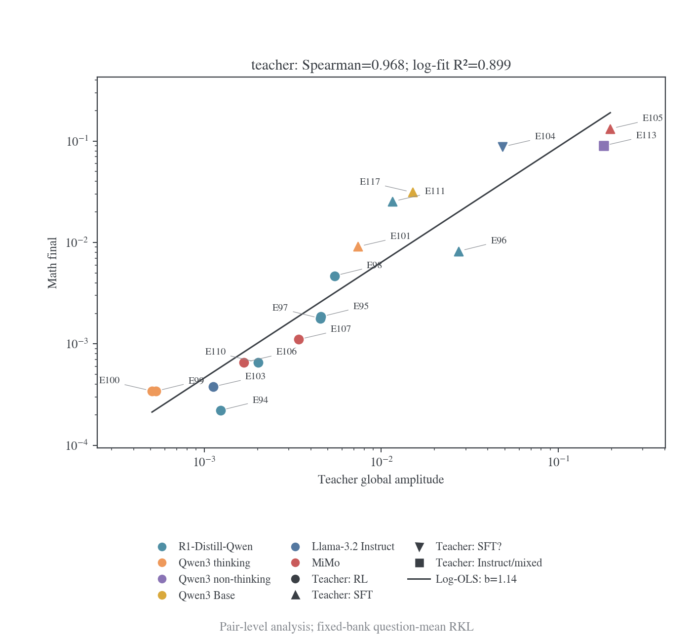

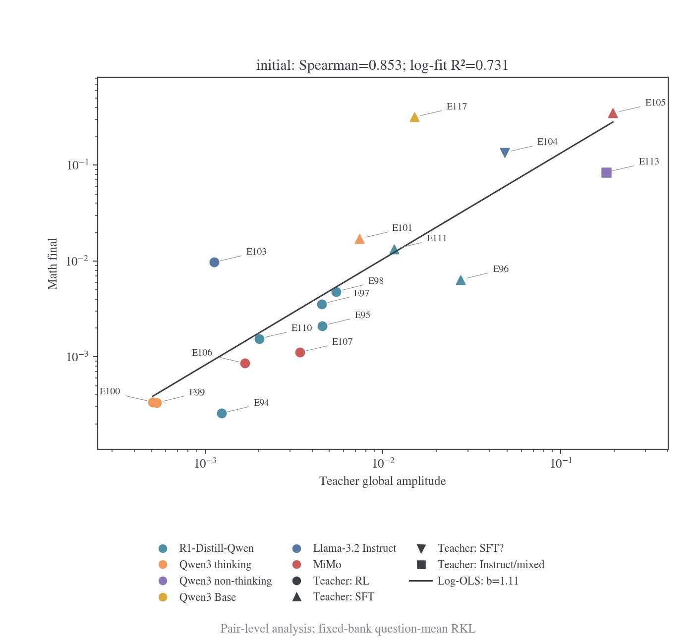

高相关有三个解释边界：位移和误差跨越多个数量级，对数坐标让尺度关系更清楚；同 student 的多组 teacher 提供了成对信息，但 pair 并非全部独立；初始功能差距、来源和参数位移会共同变化。因此该曲线是经验描述，不是从参数位移唯一决定最终误差的定律。

## 拟合残差与留出 student 的预测

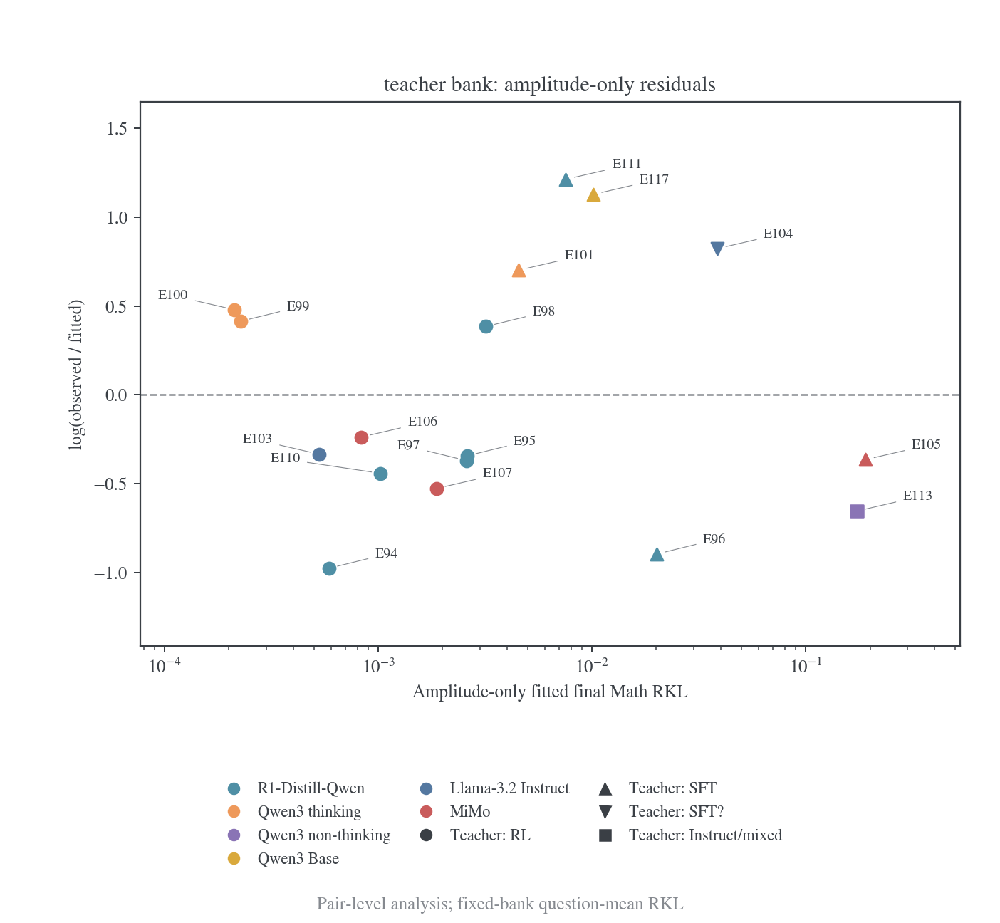

残差纵轴为 log(实测/拟合)，零线表示相符。最偏离的 teacher-bank 点包括：

- E111：实测 0.025333，拟合 0.007537，比值 3.36。
- E117：实测 0.031227，拟合 0.010115，比值 3.09。
- E94：实测 0.000221，拟合 0.000586，比值 0.38。

单变量拟合的留一 student 组 log-RMSE 为 0.796。这些误差与高 Spearman 可以同时存在。

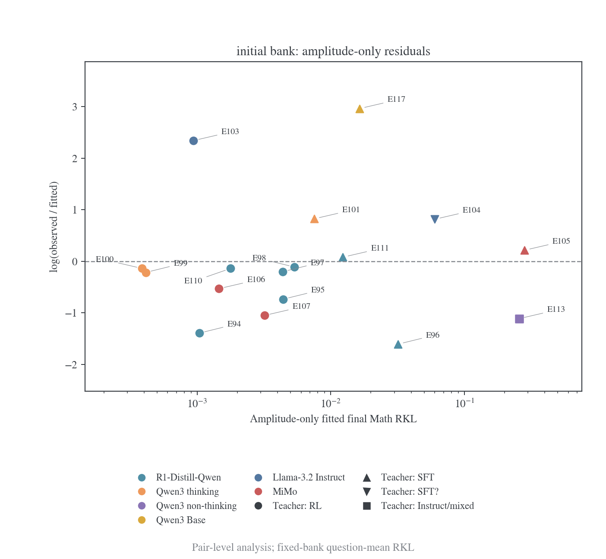

initial bank 的样本内 log-R² 为 0.731，低于 teacher bank；E117 的实测/拟合比约 19.4。关系的强度依赖 bank，不能推广到所有状态。

多变量模型还控制 log 初始 RKL，因此没有一条对所有 pair 都适用的二维 amplitude→Lf 曲线。下图使用整组留出预测值，虚线是实测=预测，不是额外拟合：

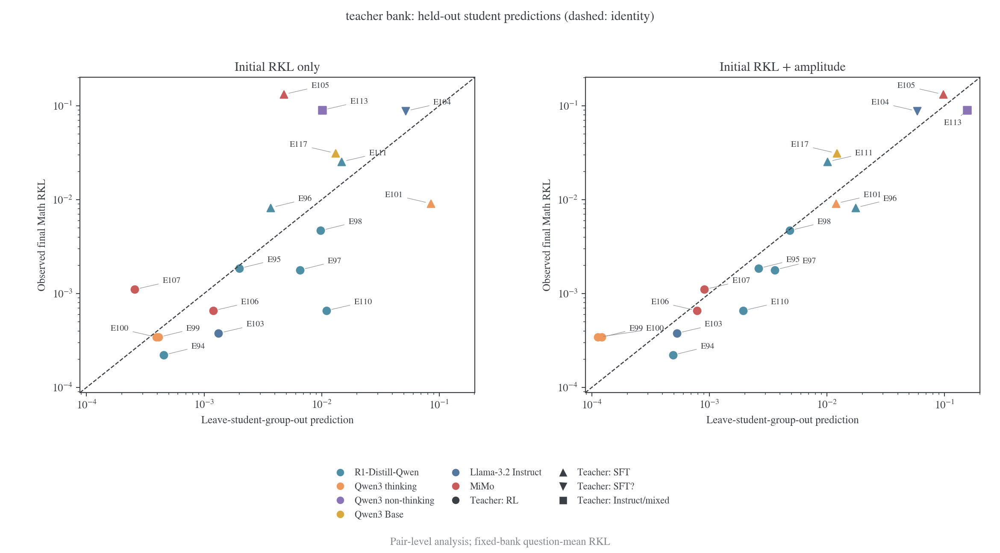

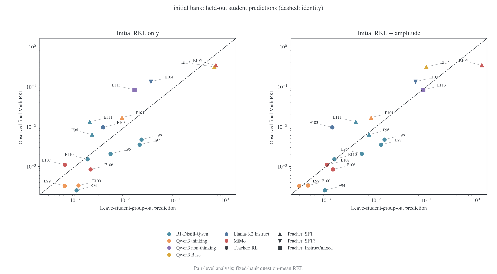

## 相对下降与绝对下降回答不同问题

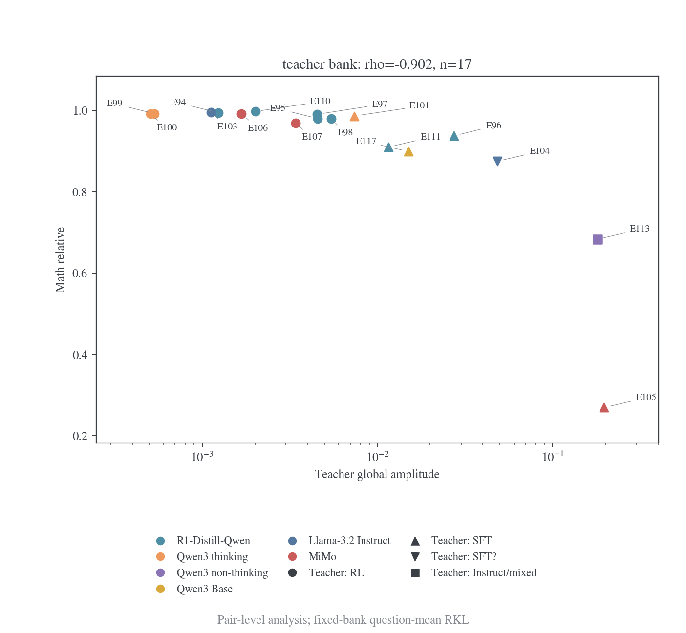

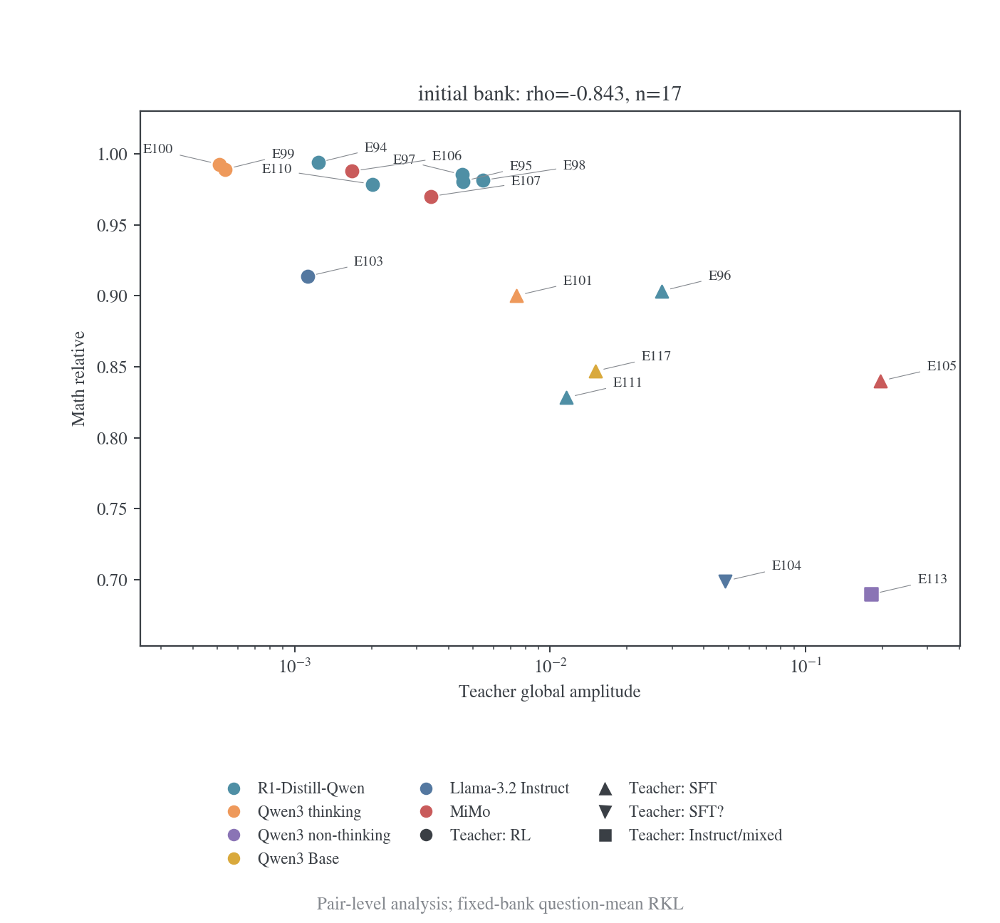

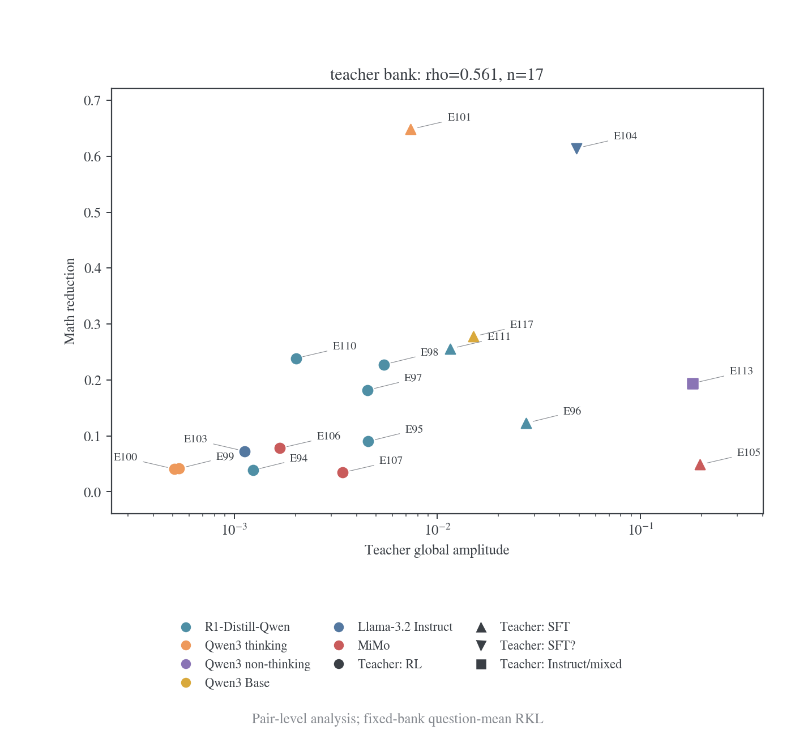

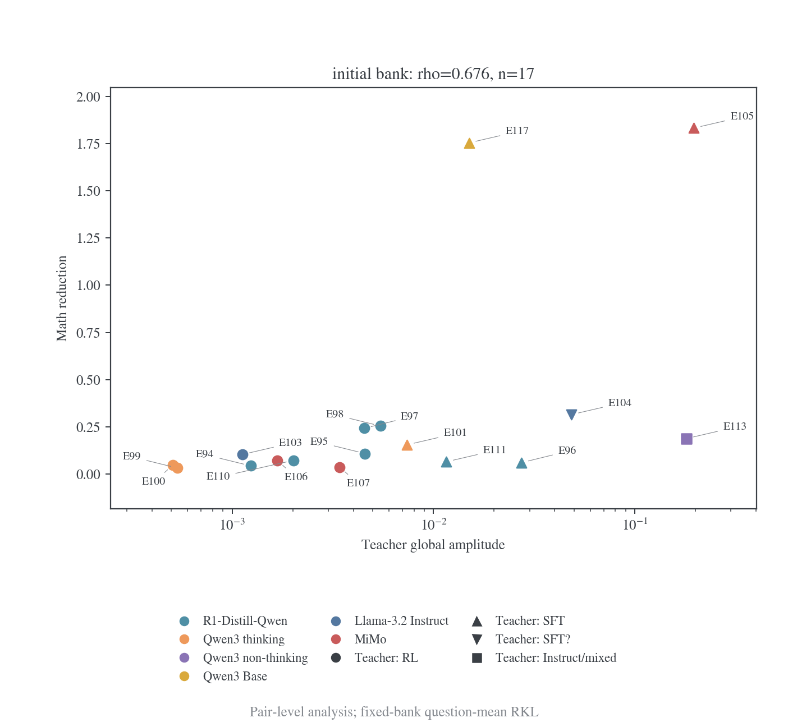

位移大与最终残差高、相对下降低相关，却与绝对下降量正相关。不能把三种结果统一叫作“吸收不好”。

## 合并相关与组内相关：teacher 来源的混杂

强合并相关不等于同一训练来源内部存在同样强的规律。下面对相同 17 个参数兼容 pair 检查 teacher_global_amplitude；RL 为 10 组、SFT 为 5 组，另有 SFT? 与 Instruct/mixed 各 1 组。五个 cross-size 不在参数位移分析中。

| Bank／结果        | 全部 17 组 Spearman | RL 组内 | SFT 组内 | 去来源组均值后的秩残差相关 | 组间项／总秩协变差 |
| ----------------- | ------------------: | ------: | -------: | -------------------------: | -----------------: |
| initial／最终 RKL |              +0.853 |  +0.564 |   +0.300 |                     +0.498 |              83.7% |
| initial／相对下降 |              -0.843 |  -0.406 |   +0.000 |                     -0.362 |              89.7% |
| teacher／最终 RKL |              +0.968 |  +0.915 |   +0.400 |                     +0.875 |              77.0% |
| teacher／相对下降 |              -0.902 |  -0.636 |   -0.700 |                     -0.705 |              76.2% |

分解先将 A 与结果分别变成全样本秩 X、Y，再按 teacher 来源 G 拆分协变差：

$$
\operatorname{Cov}(X,Y)=\operatorname{Cov}(\mathbb E[X\mid G],\mathbb E[Y\mid G])+\mathbb E[\operatorname{Cov}(X,Y\mid G)].
$$

表中的组间占比是这项秩协变差分解的描述，既不是 R²、不是相关系数的可加分解，也不是来源的因果贡献。秩残差相关则先减去各来源组的全样本秩均值，再计算 Pearson；它与每组重新排名后的 Spearman 不同，组内离散更大的来源会贡献更多权重。两个单点来源组的组内残差为零。

initial bank 的相对下降最受组间分离影响：RL 的位移中位数约 0.00185，SFT 约 0.0150；两组相对下降中位数约 98.3% 与 84.7%。合并后 −0.843 的强排序主要反映来源组之间的位置差异，SFT 内部没有观察到单调排序。不能把它解释成同类 teacher 内部可用的连续预测规律。

teacher bank 的终点结果保留了更多组内信号：RL 内部为 +0.915，去来源组均值后约 +0.875。其组间协变差占比约 77% 与较强的剩余相关可以同时成立，因为组间差异也占据了大量秩方差。SFT 的 +0.400 仅基于五点，证据不足以支持同样的关系。只保留 RL/SFT 的 15 点时，teacher-bank 最终值合并相关仍为 +0.954，来源调整后约 +0.859；initial-bank 相对下降则从 −0.789 降到约 −0.362，结论不由两个单点端点单独造成。

这属于组间与组内关系不同的混杂／聚合效应；当前没有出现典型的各组方向与合并方向反转，因此不直接称为辛普森悖论。来源可以同时影响参数位移与吸收，也可能通过改变位移、目标方向或状态覆盖而影响结果；观察性分组不能区分这些路径。

当前最强的可支持表述是：跨来源时 amplitude 有描述性预测价值；initial-bank 相对下降的证据明显依赖来源构成，teacher-bank 的 RL 终点关系较稳定，SFT 内部仍待增加独立条件。按 stage 与 family 同时残差化后，initial-bank 相对下降约 −0.391，teacher-bank 最终值约 +0.882；模型只剩 9 个残差自由度，尚不能作为充分控制混杂后的因果结果。

后续比较应在同一 bank、同一 student 与协议、同一来源内增加覆盖相近 amplitude 范围的 pair，并比较仅用来源／初始 RKL 的 baseline 与额外加入 amplitude 的留组预测。当前数据没有来源可比且独立的大样本，不能靠更复杂的拟合消除这一缺口。

[分组中位数、组内相关与协变差分解数据](group-confounding.json)。这项复算只使用已有测量，没有新增模型执行。

## Cross-size：小初始差距也可能难吸收

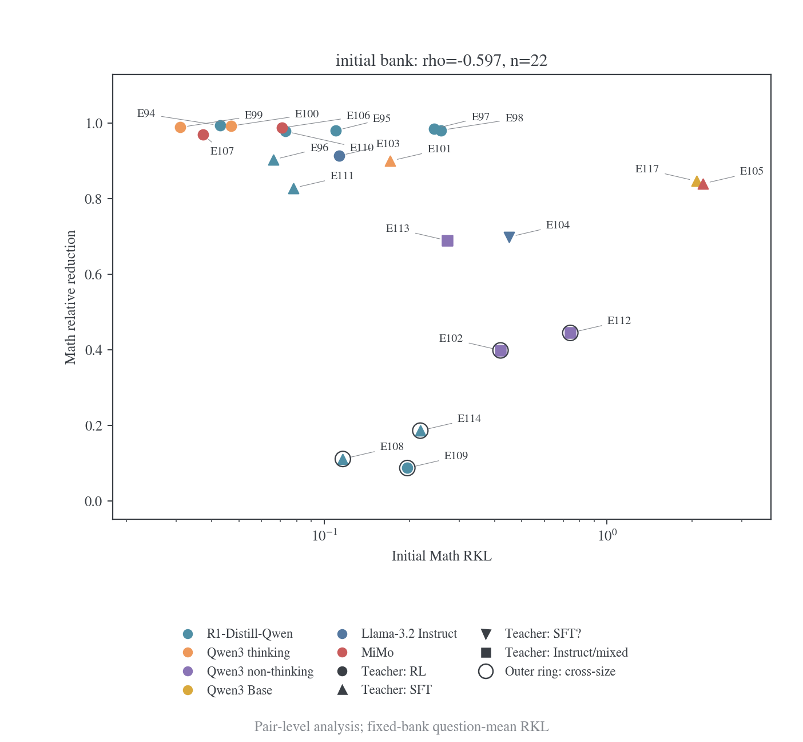

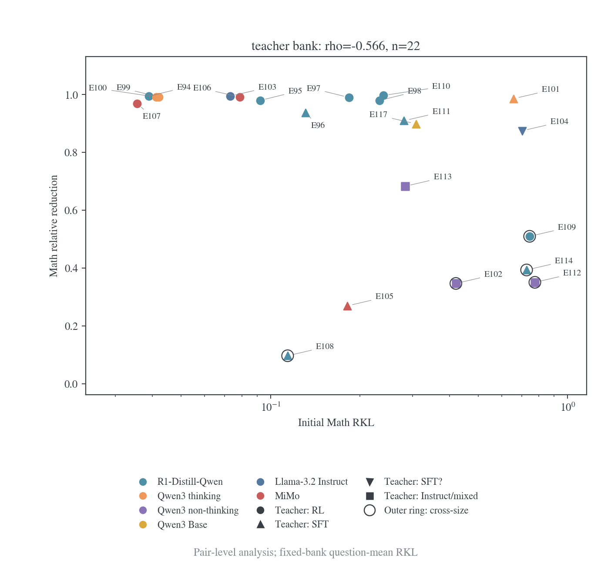

跨尺寸组是 E102、E108、E109、E112、E114。它们没有可相减的 teacher 参数坐标，不在 amplitude 的 17 点拟合里；不能把它们称作这条参数曲线的离群点。跨尺寸也不等于跨 tokenizer 家族。

| Pair | Bank    | 初始 Math RKL | 最终 Math RKL | 相对下降 | 最后 160 步下降 / step480 风险 |
| ---- | ------- | ------------: | ------------: | -------: | -----------------------------: |
| E102 | initial |       0.42023 |       0.25277 |    39.8% |                           1.8% |
| E102 | teacher |       0.42044 |       0.27447 |    34.7% |                           1.6% |
| E108 | initial |       0.11645 |       0.10354 |    11.1% |                           0.1% |
| E108 | teacher |       0.11409 |       0.10300 |     9.7% |                           1.0% |
| E109 | initial |       0.19683 |       0.17972 |     8.7% |                           1.1% |
| E109 | teacher |       0.74446 |       0.36467 |    51.0% |                          -0.1% |
| E110 | initial |       0.07295 |       0.00155 |    97.9% |                          20.5% |
| E110 | teacher |       0.23943 |       0.00066 |    99.7% |                          16.8% |
| E111 | initial |       0.07770 |       0.01334 |    82.8% |                          13.0% |
| E111 | teacher |       0.28123 |       0.02533 |    91.0% |                          13.7% |
| E112 | initial |       0.74151 |       0.41166 |    44.5% |                           0.6% |
| E112 | teacher |       0.77547 |       0.50328 |    35.1% |                           2.2% |
| E113 | initial |       0.27193 |       0.08443 |    69.0% |                           5.1% |
| E113 | teacher |       0.28400 |       0.08993 |    68.3% |                           5.3% |
| E114 | initial |       0.21875 |       0.17808 |    18.6% |                           1.3% |
| E114 | teacher |       0.72734 |       0.44092 |    39.4% |                           0.8% |

### 初始差距、状态分布与尺寸对照

E108 的初始 Math RKL 约 0.116，640 步仅消除约 11%；它反驳“初始差距小就容易吸收”的简单判断。E109 在 initial bank 仅消除约 8.7%，但在 teacher bank 消除约 51%。同一条训练轨迹在两种固定状态分布上表现不同，不能用一个全局吸收率替代二者。

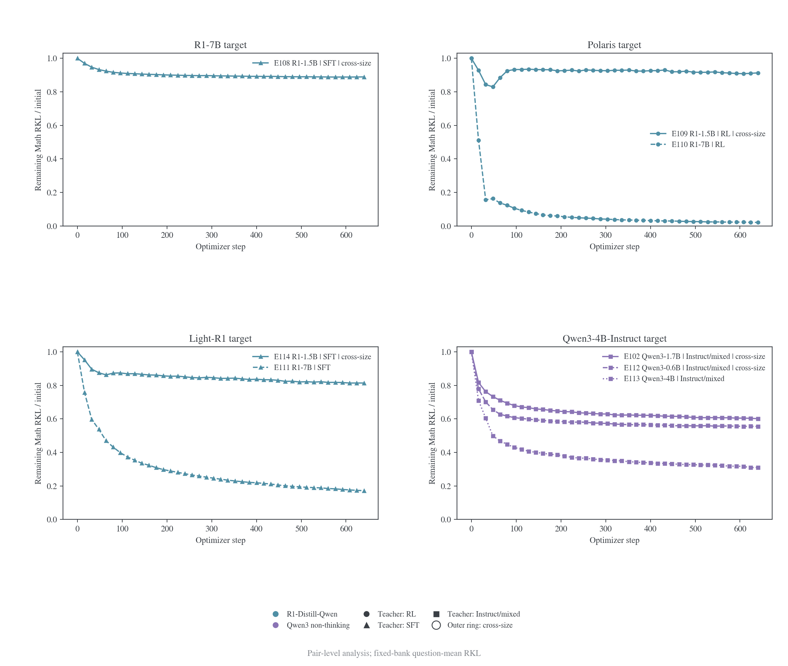

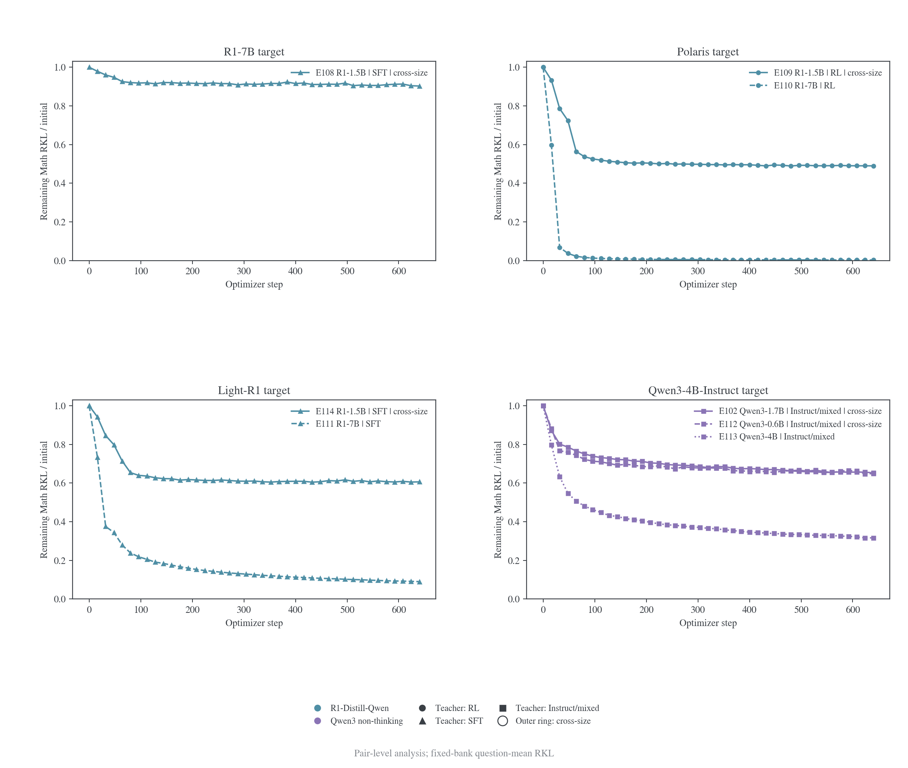

Polaris 的 E109/E110、Light 的 E114/E111 构成两个 teacher × 两种 student 尺寸的端点对照。大 student 的最终残差明显更低，但 student 初始化、head 宽度和各自 initial bank 也不同，不能据此单独归因于容量。同一个 R1-1.5B student 上，E108/E109/E114 又明显难于此前若干同尺寸 teacher。E102/E112/E113 共享 Qwen3-4B-Instruct 目标；E113 是同尺寸独立端点，不是已证实的直接后训练谱系。

尺寸与相对下降也不是单调关系：E112 的 0.6B student 在 initial bank 消除约 44.5%，高于 E102 的 1.7B student 的 39.8%；但 E112 最终绝对 RKL 约 0.412，仍高于 E102 的 0.253。两组 teacher-bank 相对下降都约 35%。因此最终误差与消除比例需要分别检验，并保留初始化和协议差异。

E109 还出现非单调留出轨迹：initial bank 在 step48 的 Math RKL 约 0.1633，终点回到 0.1797；teacher bank 则从 0.7445 降到 0.3647。这支持继续检查状态分布与跨题传播，不能只解释为训练时间不足。

E108 后期几乎不再降低风险；E109 在 teacher bank 后段也接近平坦。但平坦只能说明当前优化器、状态分布和预算下改善很慢，不能证明全局不可表达。已有的范数进度只衡量位移大小，step192/640 的比例不是 teacher 匹配程度，也没有直接测到 Fisher 慢方向或函数空间不可达能量。

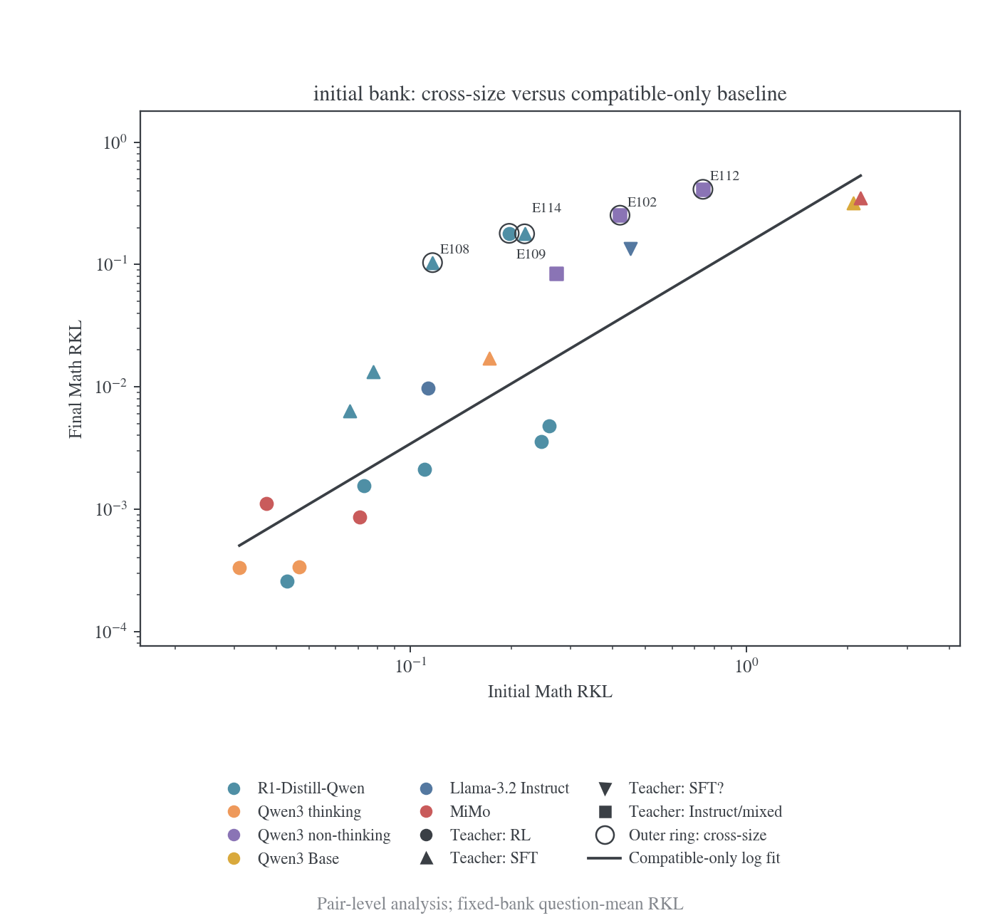

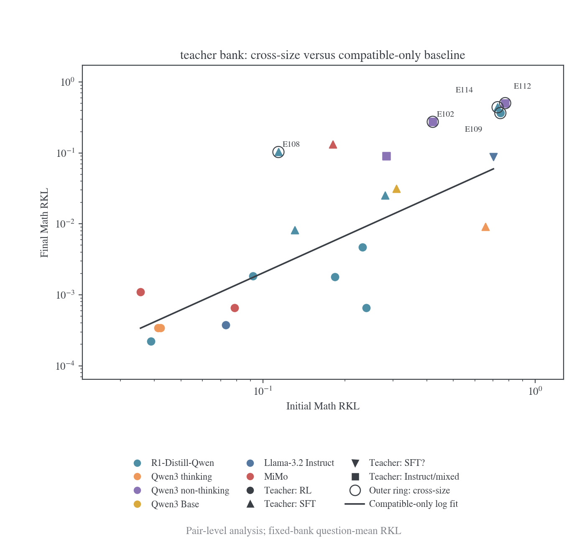

以上两图只用 17 个参数兼容 pair 拟合 log 最终 RKL 对 log 初始 RKL 的关系，5 个 cross-size 点全部位于该经验曲线之上。其 actual/predicted 比值见逐点 CSV。这是跨条件预测失败的描述，不是容量下界，也没有控制模型来源、head 支持和状态分布。

### 与现有理论的关系

现有[固定预算吸收理论](../../../../../theory/teacher-learnability.md#absorption-prediction)已经指出初始散度不能唯一决定吸收比例。局部固定前缀、固定响应与预条件器的二次代理给出：

$$
R(t)=\frac{\|f_\perp\|^2+\sum_i c_i^2e^{-2\lambda_i t}}{\|f\|^2}.
$$

这里 R 是剩余风险比例，f 是中心化 teacher 函数信号，lambda 与学生在相应方向的响应速度有关。cross-size 的困难与低响应能量较多、训练到评估传播弱等假说相容，但现有权重矩阵 SVD 并未测量这些算子，因此目前没有完成该理论的定量验证。

更关键的是：在这个固定算子模型里，若只把 f 乘同一个常数，归一化剩余比例中的幅度会消去。所以 teacher 参数位移与相对下降的强相关，本身不是这个理论直接推出来的结论；它可能同时反映目标方向、学生响应、状态覆盖和非线性程度。

### 原生 head 支持还引入一项可分解的风险

E108/E109/E114 的 student head 为 151936，teacher head 为 152064；执行使用 native RKL，teacher 的额外行仍参加归一化。对于一个固定 prefix，令 Z 为 teacher 在 student 可输出支持上的概率质量，则有精确分解：

$$
\mathrm{KL}(p_s\Vert T)=\mathrm{KL}(p_s\Vert T(\cdot\mid V_s))-\log Z.
$$

第二项是该 prefix 上由支持不一致产生的风险项，与参数优化无关。目前没有测 Z，不能把观测残差归因于这 128 行；E102/E112 的 head 宽度相同却也存在明显残差，所以支持差异不能统一解释所有 cross-size。报告保留原 native 指标，不改写历史评价口径。

### 下一步能区分解释的测量

先在同一批公共 prefix 上比较所有 teacher/student 的函数差距，并测 teacher 的支持外质量；再比较归一化初始下降信号和独立题目上的更新传播，区分“差距小”与“对差距响应弱”。需要检验慢响应假说时再测 Fisher/GGN 的函数响应或早期真实更新读出；权重更新的低秩不能替代该测量。当前未启动这些额外 GPU 实验。

## Spectrum／frame 优先面板的扩大样本结果

固定比较全部 22 个 pair，每组 up/q/o 三类投影 × 25%/50%/75% 深度，共 9 个矩阵、合计 198 个；E94–E104 从完整 28 层结果中选取 7/14/21 层，其余使用预先固定的优先任务面板（99/99 完成）。各指标先逐矩阵计算，再取 pair 内中位数。该面板独立于未完成的全层补测；跨架构按相对深度对齐不代表矩阵功能或维度完全相同。

下表统一预测 teacher bank 的 Math 相对下降。全部列 n=22，RL 列 n=11，SFT 列 n=7；另含 SFT? 一组、Instruct/mixed 三组。teacher 参数几何仍只对 17 个兼容 pair 定义。

| 指标                                 | 合并 Spearman | RL 组内 | SFT 组内 | 去来源组平均秩后的相关 |
| ------------------------------------ | ------------: | ------: | -------: | ---------------------: |
| 早期 frame overlap，step16→640，k64  |        +0.530 |  -0.145 |   -0.107 |                 -0.073 |
| 早期空间捕获终点能量／最优 k64       |        +0.621 |  +0.336 |   -0.429 |                 +0.084 |
| 后期 frame overlap，step480→640，k64 |        +0.749 |  -0.027 |   +0.964 |                 +0.524 |
| 终点 rank90／可用秩                  |        -0.273 |  -0.146 |   -0.536 |                 -0.338 |
| 终点稳定秩                           |        -0.724 |  -0.209 |   -0.714 |                 -0.520 |

扩大样本后，早期 frame 与能量捕获的合并相关明显弱于 E94–E104 的历史全层结果；去除来源组平均秩后接近零。相同指标与 initial-bank 相对下降分别为 +0.685/+0.645，来源调整后为 +0.321/+0.179。全层与九矩阵面板范围不同，因此这些结果说明当前面板未支持普遍规律，不能将相关变动全部归因于新增 pair。

E108 与 E110 的早期 overlap 几乎相同（0.481/0.478），teacher-bank 相对下降却约 9.7%/99.7%；E117 的早期 overlap 仅约 0.268，相对下降仍约 89.9%。这些实例直接限制“早期方向稳定即可吸收”的解释。

后期 overlap 的合并相关仍较强，但按 same-size 单独分析仅 +0.473，进一步去来源平均秩后约 −0.090；因此它也依赖尺寸与来源构成。稳定秩呈较强负相关，rank90／可用秩却很弱，两者对谱头部与长尾的敏感性不同；稳定秩尚未控制维度、模块和初始化，不能把它们合称为已验证的“低秩机制”。

所有 early→final、late→final 和终点秩指标引用训练终点，只能用于训练后诊断；它们不能替代训练前可预测性验证。来源调整也仅是描述性敏感性分析，不能证明因果。完整全层测量完成后，应在相同范围内重算并检查模块、尺寸与来源分层。

[优先面板逐 pair 指标](priority-panel-pairs.json) · [全部 bank／目标／分组相关](priority-panel-correlations.csv)。

## 按来源、尺寸和 family 分组的轻量指标

分组列允许重叠；每格标出实际 n，少于 4 个点或常量指标不计算相关，用破折号显示。小组高相关不作为稳定结论。

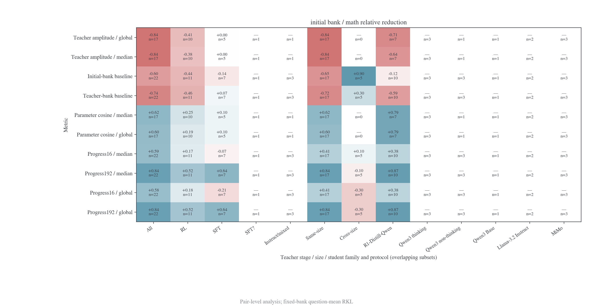

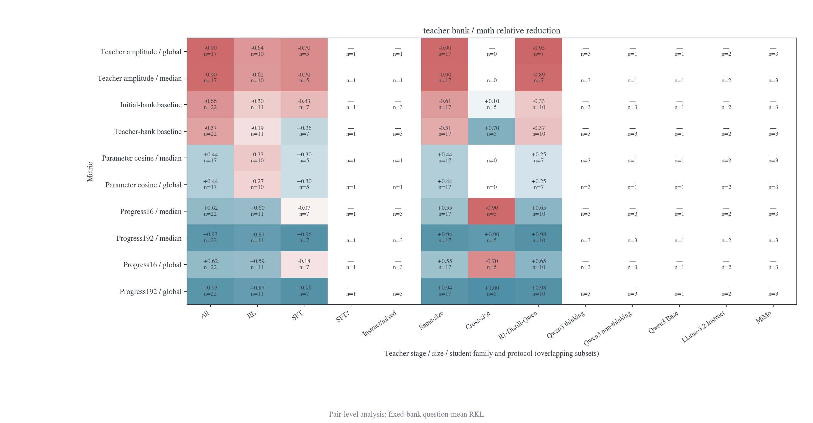

## 优先验证的机制指标

1. 功能差距：initial/teacher 两套 bank 的初始 RKL。它直接测当前分布上的输出距离，跨尺寸也适用；同时报告最终值、绝对下降与相对下降，避免只看一种目标。
2. 参数位移：teacher_global_amplitude。它衡量目标位移相对于初始权重的大小，是当前最值得检验的训练前参数指标；它受参数化与谱系影响，不代表通用函数距离。
3. 时间进度与方向稳定性：更新范数进度及早期—终点 frame overlap。前者只问走了多远，后者问是否沿稳定子空间前进，应合起来解释。两者引用终点，只能用于训练后诊断。
4. teacher 方向对齐与残差：参数余弦、norm ratio、残差能量。若更新幅度比为 a、余弦为 c，则残差比例为 1+a²−2ac。单看余弦会忽略步幅，需要与输出 RKL 并列检验，也不要求 OPD 恢复 teacher 的参数。
5. 谱结构：rank90/最小维度、稳定秩、top-k 能量和谱间隙。优先检验它们能否在初始差距、位移和进度之外提供额外信息；不同 rank/time 字段往往高度重复。

## 重点比较方法

按 teacher 来源、尺寸和 student family／输入模式分别检查方向，并报告完整样本结果。CSV 同时提供控制初始 RKL 的秩残差相关、留一 pair 敏感性、同 student 组内秩中心化相关。singleton student 在组内统计中贡献为零；组内统计不能消除其他训练来源差异，也不是独立复现实验。
MiMo Base→SFT/直接 RL、同 R1-7B→Polaris/Light、同 R1-1.5B→多个跨尺寸 teacher 是有价值的对照。Qwen3-4B 独立端点与跨尺寸 pair 分开解释，不把参数可比直接当作已证实的同源。

## 相关、对数坐标与回归的区别

原有分析以 Spearman 秩相关和散点为主，没有拟合预测曲线。Pearson 列比较原始数值的线性相关。teacher 位移横轴为 log；最终 RKL 图的纵轴也为 log；绝对下降和相对下降纵轴保持线性。坐标变换只改变显示，不会自动估计回归系数。对正值取 log 保持顺序，因此 Spearman 不变，Pearson 则通常改变。
Spearman 检验单调排序关系，不要求直线，但也不能描述 U 形等非单调关系；高相关既不证明因果，也不等于模型能预测新 student。论文中的方法应根据要回答的科学问题选择，不存在必须换成某一种拟合才正确的通用规则。

### 初始差距控制后的简单回归

为检查参数位移是否在初始 RKL 之外增加信息，在相同 17 个兼容 pair 上比较两个小模型。这是新增的探索性回归，与原有相关分析分开保存：

$$
\log L_f = \alpha + \beta\log L_0
$$

$$
\log L_f = \alpha + \beta\log L_0 + \gamma\log A
$$

其中 L0 为初始 RKL、Lf 为最终 RKL、A 为 teacher_global_amplitude。log 使用自然对数。固定其他变量时，gamma 描述位移的条件关联；该模型不是已证实的幂律或因果机制。两个模型在同一批 pair 上比较，避免用 22 组 baseline 对比 17 组参数几何造成样本差异。

| Bank / Math | 模型                    |   n | 训练 R² | 留一 student 组的 log-RMSE |  gamma |
| ----------- | ----------------------- | --: | ------: | -------------------------: | -----: |
| initial     | baseline                |  17 |   0.793 |                      1.162 |      — |
| initial     | baseline_plus_amplitude |  17 |   0.894 |                      0.950 | +0.583 |
| teacher     | baseline                |  17 |   0.583 |                      1.487 |      — |
| teacher     | baseline_plus_amplitude |  17 |   0.936 |                      0.680 | +0.941 |

log-RMSE 越小越好；验证时把同 student 的所有 pair 一起留出，避免共享 student 混入训练集和测试集。只有少量 student 组，此验证仍不稳定；训练 R² 是样本内描述，不能当作泛化证据。完整四域模型比较及删组后的 gamma 范围见 [log-model-comparison.csv](log-model-comparison.csv)。

### 后续检验顺序

先固定少量候选指标，用独立后续 pair 检查方向，并报告分组散点、留一 student 组和初始差距控制。模型比较以简单 baseline 是否被改进为核心，不按最高 R² 选公式。残差图若显示曲率，再考虑单调拟合或低自由度样条；当前规模不足以支持高阶多项式和大量交互项。

如果需要不确定性区间，应以独立 student／训练复现为重采样单位；bank 内指标的不确定性则按题目重采样。同一模型的数百个矩阵或同一回答的 token 不能充当数百次独立实验。已有聚合表不足以恢复题目级区间，需要读取原始逐题评估记录。相关筛查涉及大量字段，显著性结论还需要处理多重比较，并保留独立新条件验证。

预测模型优先拟合最终 RKL 并控制初始 RKL，同时把相对下降作为解释性视图。直接拟合 1−Lf/L0 会把初始值同时放在目标和解释中。该比例也可能为负，因此不能默认使用仅适用于 (0,1) 的 beta 回归。

## 完整相关系数与复算数据

[全部相关系数](correlations.csv) · [预测逐点数据](fit-predictions.csv) · [拟合诊断](fit-diagnostics.json) · [跨尺寸表](crosssize-comparison.csv) · [同尺寸 baseline 对跨尺寸的描述性外推误差](crosssize-baseline-residuals.csv)

下表的 n 随完整覆盖更新；留一范围不是置信区间。控制初始 RKL 是对秩做线性残差化，不是因果识别。所有单 seed、共享 student、多字段筛选和跨架构参数化限制仍适用。

| 指标                     | Bank    | 样本            |   n | Spearman（Math 相对下降） | 控制初始 RKL 后 | 留一范围       |
| ------------------------ | ------- | --------------- | --: | ------------------------: | --------------: | -------------- |
| baseline_initial_math    | initial | All             |  22 |                    -0.597 |               — | -0.652～-0.543 |
| baseline_initial_math    | teacher | All             |  22 |                    -0.658 |          -0.435 | -0.706～-0.621 |
| baseline_initial_math    | initial | RL              |  11 |                    -0.436 |               — | -0.661～-0.309 |
| baseline_initial_math    | teacher | RL              |  11 |                    -0.300 |          -0.245 | -0.564～-0.139 |
| baseline_initial_math    | initial | SFT             |   7 |                    -0.143 |               — | -0.371～+0.371 |
| baseline_initial_math    | teacher | SFT             |   7 |                    -0.429 |          -0.662 | -0.771～-0.257 |
| baseline_initial_math    | initial | Same-size       |  17 |                    -0.654 |               — | -0.709～-0.600 |
| baseline_initial_math    | teacher | Same-size       |  17 |                    -0.613 |          -0.407 | -0.712～-0.535 |
| baseline_initial_math    | initial | Cross-size      |   5 |                    +0.900 |               — | +0.800～+1.000 |
| baseline_initial_math    | teacher | Cross-size      |   5 |                    +0.100 |          -0.560 | -0.800～+0.400 |
| baseline_initial_math    | initial | R1-Distill-Qwen |  10 |                    -0.115 |               — | -0.367～+0.217 |
| baseline_initial_math    | teacher | R1-Distill-Qwen |  10 |                    -0.333 |          -0.212 | -0.533～-0.117 |
| baseline_teacher_math    | initial | All             |  22 |                    -0.739 |          -0.554 | -0.830～-0.705 |
| baseline_teacher_math    | teacher | All             |  22 |                    -0.566 |               — | -0.653～-0.529 |
| baseline_teacher_math    | initial | RL              |  11 |                    -0.464 |          -0.221 | -0.782～-0.285 |
| baseline_teacher_math    | teacher | RL              |  11 |                    -0.191 |               — | -0.467～+0.079 |
| baseline_teacher_math    | initial | SFT             |   7 |                    +0.071 |          +0.140 | -0.486～+0.371 |
| baseline_teacher_math    | teacher | SFT             |   7 |                    +0.357 |               — | -0.029～+0.600 |
| baseline_teacher_math    | initial | Same-size       |  17 |                    -0.718 |          -0.453 | -0.800～-0.671 |
| baseline_teacher_math    | teacher | Same-size       |  17 |                    -0.507 |               — | -0.629～-0.441 |
| baseline_teacher_math    | initial | Cross-size      |   5 |                    +0.300 |          -0.688 | -0.400～+0.800 |
| baseline_teacher_math    | teacher | Cross-size      |   5 |                    +0.700 |               — | +0.400～+1.000 |
| baseline_teacher_math    | initial | R1-Distill-Qwen |  10 |                    -0.588 |          -0.598 | -0.817～-0.433 |
| baseline_teacher_math    | teacher | R1-Distill-Qwen |  10 |                    -0.370 |               — | -0.650～-0.233 |
| parameter_cosine         | initial | All             |  17 |                    +0.625 |          +0.661 | +0.550～+0.738 |
| parameter_cosine         | teacher | All             |  17 |                    +0.441 |          +0.328 | +0.332～+0.565 |
| parameter_cosine         | initial | RL              |  10 |                    +0.248 |          +0.417 | -0.033～+0.467 |
| parameter_cosine         | teacher | RL              |  10 |                    -0.333 |          -0.335 | -0.600～-0.083 |
| parameter_cosine         | initial | SFT             |   5 |                    +0.100 |          +0.109 | -0.400～+0.600 |
| parameter_cosine         | teacher | SFT             |   5 |                    +0.300 |          +0.105 | -0.400～+0.800 |
| parameter_cosine         | initial | Same-size       |  17 |                    +0.625 |          +0.661 | +0.550～+0.738 |
| parameter_cosine         | teacher | Same-size       |  17 |                    +0.441 |          +0.328 | +0.332～+0.565 |
| parameter_cosine         | initial | R1-Distill-Qwen |   7 |                    +0.786 |          +0.785 | +0.657～+0.829 |
| parameter_cosine         | teacher | R1-Distill-Qwen |   7 |                    +0.250 |          +0.138 | -0.086～+0.714 |
| parameter_global_cosine  | initial | All             |  17 |                    +0.598 |          +0.634 | +0.518～+0.706 |
| parameter_global_cosine  | teacher | All             |  17 |                    +0.441 |          +0.331 | +0.332～+0.565 |
| parameter_global_cosine  | initial | RL              |  10 |                    +0.188 |          +0.341 | -0.117～+0.383 |
| parameter_global_cosine  | teacher | RL              |  10 |                    -0.273 |          -0.271 | -0.533～+0.000 |
| parameter_global_cosine  | initial | SFT             |   5 |                    +0.100 |          +0.109 | -0.400～+0.600 |
| parameter_global_cosine  | teacher | SFT             |   5 |                    +0.300 |          +0.105 | -0.400～+0.800 |
| parameter_global_cosine  | initial | Same-size       |  17 |                    +0.598 |          +0.634 | +0.518～+0.706 |
| parameter_global_cosine  | teacher | Same-size       |  17 |                    +0.441 |          +0.331 | +0.332～+0.565 |
| parameter_global_cosine  | initial | R1-Distill-Qwen |   7 |                    +0.786 |          +0.785 | +0.657～+0.829 |
| parameter_global_cosine  | teacher | R1-Distill-Qwen |   7 |                    +0.250 |          +0.138 | -0.086～+0.714 |
| progress_median_16       | initial | All             |  22 |                    +0.589 |          +0.425 | +0.545～+0.721 |
| progress_median_16       | teacher | All             |  22 |                    +0.624 |          +0.397 | +0.574～+0.699 |
| progress_median_16       | initial | RL              |  11 |                    +0.173 |          -0.151 | -0.042～+0.455 |
| progress_median_16       | teacher | RL              |  11 |                    +0.600 |          +0.618 | +0.491～+0.745 |
| progress_median_16       | initial | SFT             |   7 |                    -0.071 |          -0.006 | -0.314～+0.486 |
| progress_median_16       | teacher | SFT             |   7 |                    -0.071 |          -0.104 | -0.314～+0.257 |
| progress_median_16       | initial | Same-size       |  17 |                    +0.412 |          +0.129 | +0.335～+0.526 |
| progress_median_16       | teacher | Same-size       |  17 |                    +0.554 |          +0.340 | +0.479～+0.609 |
| progress_median_16       | initial | Cross-size      |   5 |                    +0.100 |          +0.656 | -0.400～+0.600 |
| progress_median_16       | teacher | Cross-size      |   5 |                    -0.900 |          -0.840 | -1.000～-0.800 |
| progress_median_16       | initial | R1-Distill-Qwen |  10 |                    +0.382 |          +0.376 | +0.217～+0.667 |
| progress_median_16       | teacher | R1-Distill-Qwen |  10 |                    +0.648 |          +0.597 | +0.517～+0.767 |
| progress_median_192      | initial | All             |  22 |                    +0.843 |          +0.743 | +0.819～+0.869 |
| progress_median_192      | teacher | All             |  22 |                    +0.929 |          +0.896 | +0.918～+0.956 |
| progress_median_192      | initial | RL              |  11 |                    +0.518 |          +0.372 | +0.358～+0.794 |
| progress_median_192      | teacher | RL              |  11 |                    +0.873 |          +0.954 | +0.830～+0.952 |
| progress_median_192      | initial | SFT             |   7 |                    +0.643 |          +0.645 | +0.429～+0.886 |
| progress_median_192      | teacher | SFT             |   7 |                    +0.964 |          +0.961 | +0.943～+1.000 |
| progress_median_192      | initial | Same-size       |  17 |                    +0.841 |          +0.706 | +0.809～+0.915 |
| progress_median_192      | teacher | Same-size       |  17 |                    +0.941 |          +0.965 | +0.929～+0.959 |
| progress_median_192      | initial | Cross-size      |   5 |                    -0.100 |          -0.890 | -0.400～+0.800 |
| progress_median_192      | teacher | Cross-size      |   5 |                    +0.900 |          +0.867 | +0.800～+1.000 |
| progress_median_192      | initial | R1-Distill-Qwen |  10 |                    +0.867 |          +0.884 | +0.817～+0.917 |
| progress_median_192      | teacher | R1-Distill-Qwen |  10 |                    +0.976 |          +0.972 | +0.967～+0.983 |
| teacher_amplitude        | initial | All             |  17 |                    -0.838 |          -0.697 | -0.894～-0.815 |
| teacher_amplitude        | teacher | All             |  17 |                    -0.897 |          -0.888 | -0.921～-0.876 |
| teacher_amplitude        | initial | RL              |  10 |                    -0.382 |          -0.199 | -0.650～-0.200 |
| teacher_amplitude        | teacher | RL              |  10 |                    -0.624 |          -0.812 | -0.733～-0.533 |
| teacher_amplitude        | initial | SFT             |   5 |                    +0.000 |          +0.137 | -0.400～+0.400 |
| teacher_amplitude        | teacher | SFT             |   5 |                    -0.700 |          -0.804 | -1.000～-0.400 |
| teacher_amplitude        | initial | Same-size       |  17 |                    -0.838 |          -0.697 | -0.894～-0.815 |
| teacher_amplitude        | teacher | Same-size       |  17 |                    -0.897 |          -0.888 | -0.921～-0.876 |
| teacher_amplitude        | initial | R1-Distill-Qwen |   7 |                    -0.643 |          -0.696 | -0.771～-0.429 |
| teacher_amplitude        | teacher | R1-Distill-Qwen |   7 |                    -0.893 |          -0.886 | -0.886～-0.829 |
| teacher_global_amplitude | initial | All             |  17 |                    -0.843 |          -0.707 | -0.900～-0.821 |
| teacher_global_amplitude | teacher | All             |  17 |                    -0.902 |          -0.893 | -0.926～-0.882 |
| teacher_global_amplitude | initial | RL              |  10 |                    -0.406 |          -0.239 | -0.683～-0.233 |
| teacher_global_amplitude | teacher | RL              |  10 |                    -0.636 |          -0.818 | -0.750～-0.550 |
| teacher_global_amplitude | initial | SFT             |   5 |                    +0.000 |          +0.137 | -0.400～+0.400 |
| teacher_global_amplitude | teacher | SFT             |   5 |                    -0.700 |          -0.804 | -1.000～-0.400 |
| teacher_global_amplitude | initial | Same-size       |  17 |                    -0.843 |          -0.707 | -0.900～-0.821 |
| teacher_global_amplitude | teacher | Same-size       |  17 |                    -0.902 |          -0.893 | -0.926～-0.882 |
| teacher_global_amplitude | initial | R1-Distill-Qwen |   7 |                    -0.714 |          -0.759 | -0.886～-0.543 |
| teacher_global_amplitude | teacher | R1-Distill-Qwen |   7 |                    -0.929 |          -0.922 | -0.943～-0.886 |
