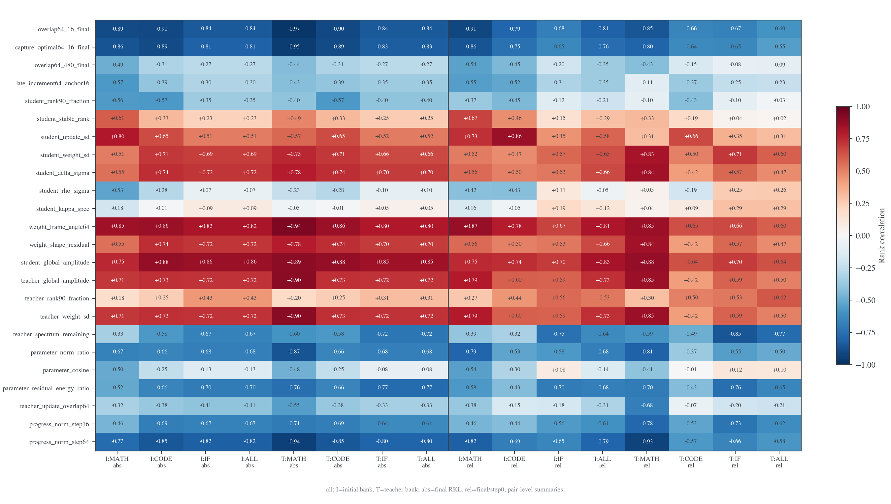
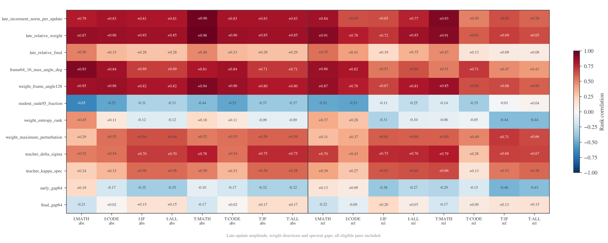
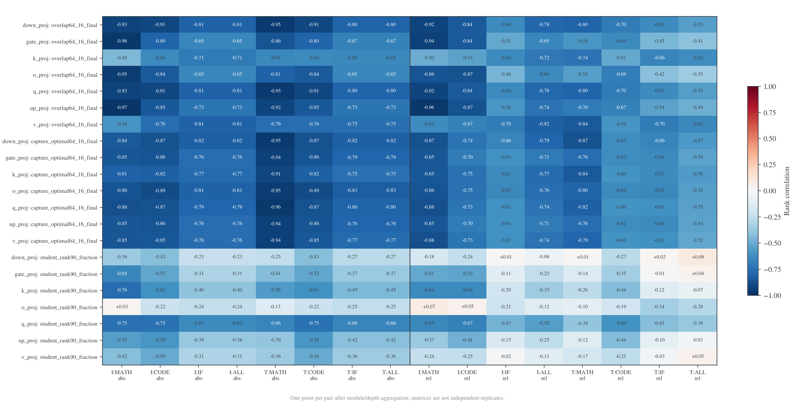

# Spectrum 全指标与终点 RKL 的探索性关联

现有完整测量覆盖 E94–E104 共 11 个 pair、每组 196 个矩阵、九个保存点。这里保留全部样本，展开 initial/teacher 两套固定响应 bank 与 Math/Code/IF/三域等权均值，分别比较终点绝对 RKL 和终点相对 step0 的剩余比例，共 16 个结果变量。没有启动新训练、SVD 或模型评分。

[打开可筛选的散点页面与完整图集](index.html)。页面内嵌数据，浏览器打开即可使用；不需要服务端或联网。页面上半部分可切换指标、模块/深度、bank、领域、结果口径与样本组；下半部分是可折叠的静态图及 PDF。分享完整图集时保留同目录图片；交互散点数据本身已内嵌。

## 覆盖与样本身份

| 层次                 | 覆盖                                                                        |
| -------------------- | --------------------------------------------------------------------------- |
| 现有几何汇总         | 原有 216 个字段，全部保留                                                   |
| 保存点轨迹与幅度进度 | 80 个字段，来自已有谱轨迹；其中包括 teacher 谱剩余距离                      |
| 功能参照             | 16 个字段：两套 bank × 四种领域的 step0 与 step128 RKL                      |
| 新增归一化读出       | 2 个字段：后期净位移速度除以初始权重范数或最终累计更新范数                  |
| 全模型字段总数       | 314；大量字段互为变换或不同 rank/时间展开，不是 314 个独立假设              |
| 汇总范围             | 全部投影、七类投影分别汇总、浅/中/深三段；共 11 种范围                      |
| 样本分组             | 全部、剔除 E102、同 student 权重组秩残差化，以及六种 family／模式；共九种   |
| 完整关联表           | 451,152 行；包含样本数、参与 pair、未定义结果；全模型范围另有留一 pair 分析 |
| 静态图               | 39 张，每张有 PNG、PDF 和审计文件；交互页可查看所有字段的散点               |

“所有点”指这套已完成且测量身份一致的 11 组 spectrum 条件，不将仅有训练输出、尚未接入同协议几何测量的其他 pair 混入。历史重试的相同 pair 不作为独立样本重复计数。

| Pair | Student              | Teacher                | Family／输入模式   | Teacher 来源   | 尺寸       |
| ---- | -------------------- | ---------------------- | ------------------ | -------------- | ---------- |
| E94  | R1-1.5B              | DeepScaleR             | R1-Distill-Qwen    | RL             | same-size  |
| E95  | R1-1.5B              | JustRL                 | R1-Distill-Qwen    | RL             | same-size  |
| E96  | R1-1.5B              | MiniMath               | R1-Distill-Qwen    | SFT            | same-size  |
| E97  | R1-1.5B              | Nemotron               | R1-Distill-Qwen    | RL             | same-size  |
| E98  | R1-1.5B              | BroRL                  | R1-Distill-Qwen    | RL             | same-size  |
| E99  | Qwen3-1.7B           | GRPO-KL-math           | Qwen3 thinking     | RL             | same-size  |
| E100 | Qwen3-1.7B           | e3-1.7B                | Qwen3 thinking     | RL             | same-size  |
| E101 | Qwen3-1.7B           | Samsung Math           | Qwen3 thinking     | SFT            | same-size  |
| E102 | Qwen3-1.7B           | Qwen3-4B-Instruct-2507 | Qwen3 non-thinking | Instruct/mixed | cross-size |
| E103 | Llama3.2-3B-Instruct | Co-rewarding           | Llama-3.2 Instruct | RL             | same-size  |
| E104 | Llama3.2-3B-Instruct | arithmetic-full        | Llama-3.2 Instruct | SFT?           | same-size  |

图中颜色表示 student family／实际输入模式，点形表示 teacher 来源，外侧空心圆表示 cross-size。Qwen3 thinking 与 non-thinking 分开；SFT? 保留来源不确定性，Instruct/mixed 保留复合端点身份。统一定义与完整 22 组表见[扩大样本报告](../expanded-lightweight/2026-11-16-扩大样本轻量分析.md#pair-身份与统一图例)。

E102 是同 Qwen 架构家族、non-thinking 协议下的跨尺寸独立后训练终点。容量、初始化关系和 thinking 协议同时变化，不能把它当成纯跨家族来源干预。当前没有另一个真正跨家族且具有完整可比 spectrum 的条件。因此分组实际回答的是“关系是否依赖 E102”，而不是估计独立的异源效应。

对 E102 可比较 student 自身的更新谱、完整权重谱、方向轨迹、范数与输出 RKL；teacher 减 student 的参数位移、同坐标参数残差和 teacher-update frame 等不定义。即使原始输入中某项缺失，也不会填成零。`same_coordinate` 在本表中特指剔除 E102 后的十组；不能把可相减的坐标条件当作来源关系的充分证明。

## 相关热图的读法



[全部样本 PDF](overview-all.pdf) · [剔除 E102](overview-same_coordinate.png) · [同 student 权重组秩残差化](overview-within_student.png)。横轴 I/T 分别为 initial/teacher bank，abs 为终点绝对值，rel 为终点/step0。所有热图共用 −1 至 +1 色标；灰格表示样本不足、常量或缺失导致无定义，不表示零相关。

全部原有字段分七张热图，按字段名排序：[1](full-metrics-01.png)、[2](full-metrics-02.png)、[3](full-metrics-03.png)、[4](full-metrics-04.png)、[5](full-metrics-05.png)、[6](full-metrics-06.png)、[7](full-metrics-07.png)。保存点轨迹见 [1](trajectory-01.png)、[2](trajectory-02.png)、[3](trajectory-03.png)。[功能参照热图](functional-controls.png)单独展示 step0 与 step128 的输出差距，避免把功能读出误写成几何机制。

## 两套 bank 与多域结果

下表保留若干含义不同的指标作为阅读入口。结果均为 pair 级 Spearman 相关；功能匹配越好，结果变量越小。

| 指标                                       | Initial Math | Teacher Math | Initial 三域 | Teacher 三域 | Initial Math 剩余比例 | Teacher Math 剩余比例 |
| ------------------------------------------ | -----------: | -----------: | -----------: | -----------: | --------------------: | --------------------: |
| step16→640 更新右子空间 overlap，k64       |       −0.891 |       −0.973 |       −0.836 |       −0.836 |                −0.909 |                −0.855 |
| 完整权重初始→终点右子空间主角中位数，k64   |       +0.845 |       +0.936 |       +0.818 |       +0.800 |                +0.873 |                +0.855 |
| 后期每步净更新幅度                         |       +0.791 |       +0.964 |       +0.809 |       +0.827 |                +0.836 |                +0.927 |
| OPD 全局相对位移                           |       +0.755 |       +0.891 |       +0.864 |       +0.845 |                +0.745 |                +0.882 |
| 累计更新 step16→640 谱形状变化             |       +0.800 |       +0.573 |       +0.509 |       +0.518 |                +0.727 |                +0.309 |
| 完整权重 step0→640 归一化谱距离            |       +0.509 |       +0.755 |       +0.691 |       +0.664 |                +0.518 |                +0.827 |
| OPD 更新 rank90/可用秩                     |       −0.564 |       −0.400 |       −0.355 |       −0.400 |                −0.373 |                −0.100 |
| OPD kappa_spec                             |       −0.182 |       −0.045 |       +0.091 |       +0.055 |                −0.164 |                +0.036 |
| Teacher 全局相对位移（n=10）               |       +0.709 |       +0.903 |       +0.721 |       +0.721 |                +0.794 |                +0.855 |
| Teacher 更新 rank90/可用秩（n=10）         |       +0.176 |       +0.200 |       +0.430 |       +0.309 |                +0.273 |                +0.297 |
| OPD/teacher 更新幅度比（矩阵中位数，n=10） |       −0.673 |       −0.867 |       −0.685 |       −0.685 |                −0.794 |                −0.806 |

早期方向关联跨 bank、跨领域保留：step16→640 overlap 对 initial/teacher Code 的绝对残差均为 −0.900，对两套 IF 分别为 −0.836/−0.836。去掉 E102 后，Math 的关联仍为 initial −0.867、teacher −0.976。它不完全由一个跨尺寸困难样本产生。

更新谱形状变化的解释更依赖 bank：对 initial Math 为 +0.800，对 teacher Math 为 +0.573；改看 teacher Math 剩余比例后只剩 +0.309。单独展示一个 bank 容易高估其普适性。

rank90、stable rank、top-k 能量、完整权重谱距离、更新谱距离不是同一个量。尤其 rank90 对 teacher Math 剩余比例仅为 −0.100，teacher rank90 与终点绝对 Math 也仅为 +0.200。它们不足以作为统一的吸收好坏分类器。

## 新候选：后期净位移与完整权重方向



[剔除 E102](new-candidates-same_coordinate.png) · [student 权重组秩残差化](new-candidates-within_student.png) · [Initial Math 散点](scatter-new-initial-absolute.png) · [Teacher Math 散点](scatter-new-teacher-absolute.png) · [Initial Math 剩余比例](scatter-new-initial-remaining.png) · [Teacher Math 剩余比例](scatter-new-teacher-remaining.png)。

后期每步净更新幅度来自最后保存窗口 480→640，共 160 次更新。对每个矩阵定义：

$$
L=\frac{\Vert W_{640}-W_{480}\Vert_F}{160},\qquad
L_W=\frac{L}{\Vert W_0\Vert_F},\qquad
L_\Delta=\frac{L}{\Vert W_{640}-W_0\Vert_F}.
$$

先逐矩阵计算，再取范围内中位数。L 是窗口净位移除以更新次数，不是窗口内逐步路径长度或梯度范数；内部往返会抵消。三个口径对应字段 `late_increment_norm_per_update`、`late_relative_weight`、`late_relative_final`。

| 后期幅度口径                 | Initial Math 绝对残差 | Teacher Math 绝对残差 | Initial Math 剩余比例 | Teacher Math 剩余比例 |
| ---------------------------- | --------------------: | --------------------: | --------------------: | --------------------: |
| 原始净位移/更新次数 L        |                +0.791 |                +0.964 |                +0.836 |                +0.927 |
| 除以初始权重范数 L_W         |                +0.873 |                +0.982 |                +0.909 |                +0.909 |
| 除以终点累计更新范数 L_delta |                +0.500 |                +0.482 |                +0.555 |                +0.473 |

它是值得针对验证的新候选，但“后期还在走得多”同时受总更新尺度和距离目标的远近影响。除以终点累计位移后关联减弱，提示幅度尺度是解释的一部分。它与“后期子空间是否继续旋转”也不同：后期 overlap 与 teacher Math 的相关只有 −0.436。

完整权重子空间主角 `weight_frame_angle64` 与 teacher Math 为 +0.936，去掉 E102 为 +0.927；student 权重组秩残差化后为 +0.963。这个角度衡量 W0 与 W640 的完整权重主子空间变化，不能与累计更新 Δ16 和 Δ640 的角度混称为同一种旋转。角度本身很小，且受到位移幅度、谱隙及奇异子空间敏感性的影响。`early_gap64/final_gap64` 一并展开，供检查边界谱隙是否与子空间变化相关；不能凭相关认定旋转导致输出变差。

kappa_spec 的关系不稳定：teacher Math 全样本 −0.045，剔除 E102 后 +0.273；R1 内 +0.900；Qwen3 thinking 三组为 +1.000，但 n=3，不能据此推断稳定关系。原来合并 thinking/non-thinking 的 Qwen 组不再作为 family 结果。不能将不同家族的趋势合并成一个统一机制。

## 模块与深度



[模块：完整权重谱、teacher 位移、teacher-update overlap](modules-2.png) · [深度分段 1](depths-1.png) · [深度分段 2](depths-2.png)。每个模块仍以 pair 为统计单位，没有把 28 层当作 28 个独立训练。

| 模块      | 早期 overlap 对 Teacher Math | 对 Teacher IF |
| --------- | ---------------------------: | ------------: |
| q_proj    |                       −0.955 |        −0.800 |
| k_proj    |                       −0.645 |        −0.645 |
| v_proj    |                       −0.764 |        −0.755 |
| o_proj    |                       −0.809 |        −0.655 |
| gate_proj |                       −0.864 |        −0.673 |
| up_proj   |                       −0.918 |        −0.727 |
| down_proj |                       −0.955 |        −0.800 |

上一轮展示 spectrum 形状时使用 k_proj 的全层 CDF，它不能代表全部模块的方向形成关系。当前 q_proj/down_proj 的关联更强，但只有 11 个 pair，尚不能据此宣称这些模块决定成败。浅/中/深层的 early overlap 对 teacher Math 分别约 −0.945/−0.945/−0.955，没有明显由单一深度段独占的现象。

## 指标语义与可定义范围

| 字段族                                      | 含义与解释条件                                                                            |
| ------------------------------------------- | ----------------------------------------------------------------------------------------- |
| overlap、angle、anglep90、frame chordal     | 累计更新的右奇异子空间与自身终点；k 与时间写在字段名中；部分量单调相关或近似重复          |
| capture、capture_optimal                    | 早期子空间捕获终点更新能量；后者除以终点最优 rank-k 能量覆盖                              |
| early/final_energy、energy_change           | 累计更新前 k 个奇异方向的平方能量比例，以及前后差值                                       |
| late_increment                              | 480→640 窗口净更新的范数或被指定累计更新子空间捕获的能量                                  |
| student_amplitude、student_global_amplitude | 单矩阵更新/初始范数比的中位数，或先加总平方范数后的全局比；两者不同                       |
| student_rank90/95、stable_rank              | 90%/95% 能量所需秩比例；stable rank 为平方 Frobenius 范数/最大奇异值平方                  |
| student_update_sd                           | Δ16 与 Δ640 的奇异值分别除以元素和后的欧氏距离                                            |
| student_weight_sd                           | W0 与 W640 的归一化奇异值形状距离；不同于更新谱距离                                       |
| delta_sigma、rho_sigma                      | 完整权重奇异值变化的 L2 范数，分别除以初始权重范数、参数更新范数                          |
| kappa_spec                                  | 更新在初始完整权重 SVD 配对对角方向上的能量集中度，含维度归一化；不是奇异值变化本身       |
| weight_frame_angle                          | 完整权重 W0 与 W640 右子空间主角                                                          |
| weight_scale/shape_residual/entropy_rank    | 完整权重谱的整体尺度拟合、去尺度残差和熵有效秩                                            |
| early_gap/final_gap                         | 累计更新 top-k 边界相对谱隙；子空间角度的敏感性检查                                       |
| trajectory__\_step_                         | 已保存 checkpoint 的完整权重谱或累计更新谱读出；teacher_spectrum_remaining 对 E102 无定义 |
| progress_norm_step*                         | 当前累计更新范数/最终累计更新范数；依赖终点，属于事后指标                                 |
| teacher__、parameter__                      | 有效对应坐标下的 teacher 位移或 OPD/teacher 关系；E102 排除                               |
| baseline__、rkl128__                        | 对应 bank/领域的起始或 step128 RKL；功能差距参照，不是几何特征                            |

原始定义由 [cohort_comparison.py](../../../../../../../mirroropd/research/studies/absorption_dynamics/cohort_comparison.py)、[metric_synthesis.py](../../../../../../../mirroropd/research/studies/absorption_dynamics/metric_synthesis.py)与 [decomposition.py](../../../../../../../mirroropd/research/studies/spectral/decomposition.py)维护。原始能量、未归一化 rank 和谱距离都可能受模型形状影响；跨家族比较需保留维度与模块身份，不把所有字段都解释为纯功能距离。

## 探索结论与验证边界

当前候选优先级可以按“关系是否跨 bank/领域保留、剔除 E102 后是否保留、是否依赖尺度口径”来评估。早期方向/能量捕获、后期净位移幅度、teacher 位移大小值得后续固定 pair 做验证。更新秩与 kappa_spec 更适合保留为对照；完整权重方向与谱变化需要检查尺度与谱隙的混杂。

秩相关以每个 pair 一个点计算。`within_student` 先对指标和结果分别作全样本秩变换，再分别减去相同 student 权重组的组内秩均值（Qwen3-1.7B 的不同输入模式共享权重组），最后计算 Pearson 相关；相当于对秩加入 student 组别截距后的残差关联，不是组内 Spearman 的简单平均，也没有证明因果。交互散点仍展示原始点，统计值按所选定义计算。

R1 有 5 组、Qwen3 thinking 3 组、non-thinking 1 组、Llama 2 组；MiMo、Qwen3 Base 在这套 spectrum 输入中为 0 组；n<3 或任一变量为常量时不报告相关。因此 Llama 单组相关保留为空，不能将两个点产生的 ±1 当成证据。留一 pair 的范围是敏感性描述，不是置信区间；共享 student、单 seed 和重复指标仍限制独立信息量。

所有保存点指标与终点 RKL 的比较都是探索；early-to-final overlap、相对终点进度、后期位移及 step128 功能读出含有训练过程甚至终点信息。未来若做在线预测，需要用当时可得特征，在新 pair/seed 上验证，不能从全量筛查里挑最高相关后宣称已具预测能力。

不同 pair 的固定响应内容不同。initial/teacher bank 都需保留生成身份；RKL 不等于正确率。绝对残差、相对剩余比例与 Code/IF 的关系可能不同，all 是三域等权平均，也不是第四个独立数据域。当前图不报告显著性 p 值或将数十万行表当成独立假设检验。

## 复现与核验

[完整数据](screen-data.json) · [完整相关表](correlations.csv) · [绘图与汇总代码](screen.py) · [交互页模板](viewer-template.html) · [来源及图像哈希](provenance.json)。所有输入来自现有 [metric-synthesis-20261113.json](../../../../../../../mirroropd/docs/experiments/teacher-transfer/checkpoint-dynamics/data/metric-synthesis-20261113.json)，记录来源 SHA256。运行目录与前一轮八组对照分开，原有正式报告未被覆盖。

仓库根目录执行：

```bash
export FIGURE_VIZ_MPL=/mnt/tidalfs-bdsz01/dataset/llm_dataset/zkn_data/fht_data/dotfiles/.agents/skills/figure-viz/assets/mpl
OMP_NUM_THREADS=4 OPENBLAS_NUM_THREADS=4 python examples/mirroropd/docs/experiments/teacher-transfer/checkpoint-dynamics/analyses/metric-screening/screen.py
```

默认重新汇总与绘图；`--data-only` 只生成数据和完整关联表；`--render-only` 使用已生成数据重绘。Python 通过 ruff/ruff-format；抽取 100 个普通相关与 SciPy 对照、64 个 student 秩残差相关与最小二乘残差化对照，误差均小于 1e-12。E102 的参数指标缺失、剔除分组、页面选择逻辑和产物完整性另做核验。

交互页脚本通过语法检查；384 种指标/bank/领域/样本组选择与 Python 结果逐一对照，样本数、相关值和 E102 排除一致，缺失模块字段保持空。39 组 PNG/PDF/审计文件、来源哈希及文档链接完整。全部图通过错误级审计；热图白字在深色单元格上的对比度被审计器按白色页面背景提示，部分散点有点标签邻近提示，已通过图像检查核对。图中标签与点可结合交互页数值表确认。
