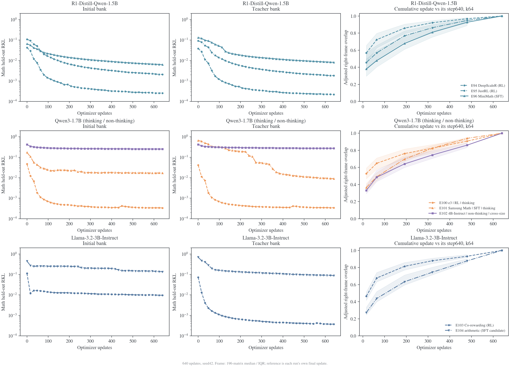
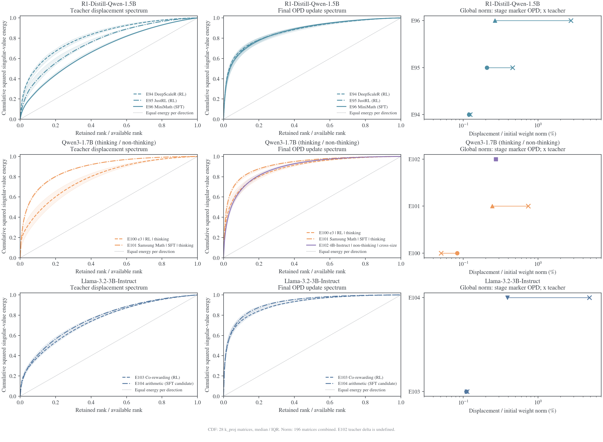
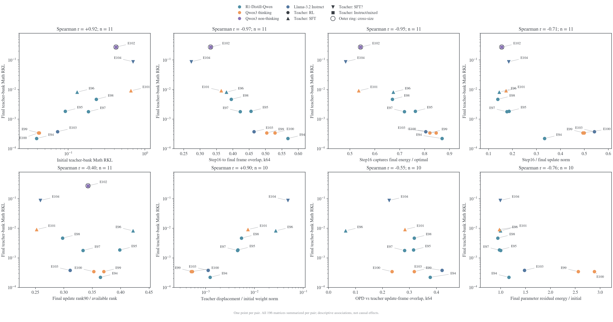
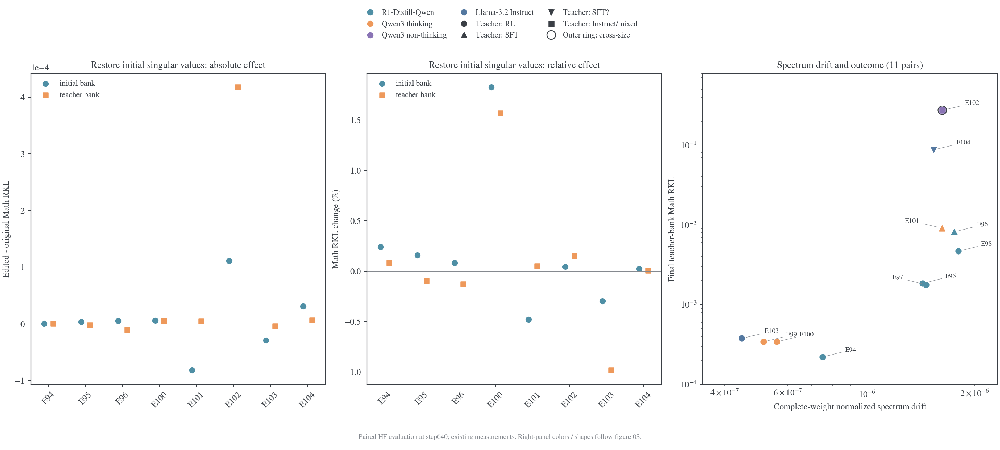

# 吸收好坏、teacher 来源与更新谱的对照

这是已有测量的选例与重绘，供整理 checkpoint-dynamics 材料时审阅。正式定义与完整实验记录仍由 [checkpoint-dynamics 主文档](../../../../../../../mirroropd/docs/experiments/teacher-transfer/checkpoint-dynamics/README.md)维护。这里没有新增训练或模型评分。

当前证据最支持的描述是：**吸收较好的 pair 更早形成接近自身训练终点的更新子空间；teacher 参数位移较大的 pair 往往留下较大的输出残差。单独看谱的低秩程度，无法统一解释吸收好坏。** teacher 的追加 SFT/RL 阶段与位移幅度在这些样本中相关，但还不能据此认定阶段或来源是原因。

图例与[扩大样本报告](../expanded-lightweight/2026-11-16-扩大样本轻量分析.md#pair-身份与统一图例)一致：颜色表示 student family／模式，点形表示 teacher 来源，散点外侧空心圆表示 cross-size。曲线的线型区分同一面板中的 pair；恢复干预图左侧两栏单独用颜色比较 bank，横轴保留 pair 身份。

## 选例与评价口径

固定 student 权重后比较不同 teacher，减少初始化与架构差异；Qwen3 的 thinking/non-thinking 协议仍分开标识。选取三组共八个条件；全部十一组参与后面的关联分析。标签描述 teacher 在 student 所属模型基础上追加的阶段；R1-Distill 已经过蒸馏，Qwen3 官方模型也有自己的后训练历史，不能把它们称为未经后训练的 Base。

| Student                 | Pair / teacher                 | 条件与选例作用                          | 终点 Math RKL：teacher bank | 终点 Math RKL：initial bank |
| ----------------------- | ------------------------------ | --------------------------------------- | --------------------------: | --------------------------: |
| R1-Distill-Qwen-1.5B    | E94 / DeepScaleR               | 同源追加 RL；匹配好                     |                    0.000221 |                    0.000257 |
| 同上                    | E95 / JustRL                   | 同源追加 RL；Math 较好、跨域有缺口      |                    0.001851 |                    0.002111 |
| 同上                    | E96 / MiniMath                 | 同源追加 SFT；比 E94 残差大             |                    0.008202 |                    0.006378 |
| Qwen3-1.7B thinking     | E100 / e3-1.7B                 | 同源追加 RL；匹配好                     |                    0.000343 |                    0.000337 |
| Qwen3-1.7B thinking     | E101 / Samsung Qwen3-1.7B-Math | 同源追加 SFT；绝对残差较大              |                    0.009104 |                    0.017099 |
| Qwen3-1.7B non-thinking | E102 / Qwen3-4B-Instruct-2507  | 跨尺寸、独立后训练终点；匹配差          |                    0.274474 |                    0.252773 |
| Llama-3.2-3B-Instruct   | E103 / Co-rewarding MATH       | 同源追加 RL；teacher bank 好、bank 敏感 |                    0.000378 |                    0.009726 |
| 同上                    | E104 / arithmetic-full         | SFT 候选，训练披露有限；匹配差          |                    0.087740 |                    0.135539 |

这里“同源”按公开模型来源所支持的延续关系使用，不额外宣称精确父 checkpoint revision 已被逐一证明。E104 保留 SFT candidate 标签，避免将来源披露不足当成确定的阶段实验。

**当前这批完整 spectrum 中，没有可以独立检验跨家族来源效应的 teacher。** E102 与 student 同属 Qwen，但不是该 1.7B student 的同尺寸延续；它同时改变容量、训练终点与 thinking 协议。E99–E101 使用 thinking=true，E102 使用 thinking=false。因此 E102 可作为跨尺寸困难样本，不能作为“异源导致难吸收”的单因素证据。

评价使用固定 held-out 响应 bank：initial bank 由初始 student 生成，teacher bank 由 teacher 生成。每套 Math 128、Code 64、IF 64 题；逐题有效 token 平均后域内平均，all 为三域等权平均。跨 pair 的响应内容不同，绝对 RKL 与相对 step0 的剩余比例需要一起读。这里的“好坏”指分布匹配，未测 accuracy，不能替代数学正确率或能力提升。

已测完整 spectrum 的十一组，按 teacher-bank 终点 Math RKL 排序如下。剩余比例为终点/step0，越小表示消除的初始差距比例越大。

| 排序 | Pair / teacher                          |    Math RKL | 剩余比例 |
| ---: | --------------------------------------- | ----------: | -------: |
|    1 | E94 / DeepScaleR                        | 0.000221113 |   0.569% |
|    2 | E99 / Qwen3-1.7B-GRPO-KL-math-reasoning | 0.000342272 |   0.813% |
|    3 | E100 / e3-1.7B                          | 0.000343142 |   0.833% |
|    4 | E103 / Co-rewarding MATH                | 0.000378029 |   0.517% |
|    5 | E97 / Nemotron                          | 0.001783944 |   0.972% |
|    6 | E95 / JustRL                            | 0.001851200 |   2.009% |
|    7 | E98 / BroRL                             | 0.004688448 |   2.019% |
|    8 | E96 / MiniMath                          | 0.008201563 |   6.255% |
|    9 | E101 / Samsung Math                     | 0.009104182 |   1.385% |
|   10 | E104 / arithmetic-full                  | 0.087739599 |  12.498% |
|   11 | E102 / Qwen3-4B-Instruct-2507           | 0.274473539 |  65.282% |

E101 的绝对残差比 E100 大约 27 倍，但已消除约 98.6% 的初始差距。给它简单贴“没学会”标签会丢失起点难度。E95 的 teacher-bank Code/IF RKL 约为 0.00457/0.24370，Math 成绩不能代表全域匹配。

## 输出匹配与方向形成



[矢量 PDF](01-absorption-and-direction.pdf)。每一行固定 student；左、中列是两套 bank 的输出误差，右列是累计更新的右奇异子空间与自身 step640 的重合度。阴影为矩阵间四分位区间，不是 seed 置信区间。

记初始权重为 $W_0$、teacher 为 $W_T$、训练 checkpoint 为 $W_t$。累计更新与 teacher 位移分别为：

$$
\Delta_t=W_t-W_0,\qquad \Delta_T=W_T-W_0.
$$

右列比较 $\Delta_t$ 与 $\Delta_{640}$ 的前 64 个右奇异向量子空间，使用扣除随机重合基线后的 overlap。它回答“早期累计更新是否已经沿着最终形成的方向”，不表示与 teacher 的方向相同。step640 的自比较必为 1。

| 同 student 对照 | 较好 pair 的 step16→640 overlap | 较差 pair 的 overlap |
| --------------- | ------------------------------: | -------------------: |
| E94 vs E96      |                           0.568 |                0.380 |
| E100 vs E101    |                           0.529 |                0.365 |
| E103 vs E104    |                           0.465 |                0.273 |

相对最优 rank64 的终点能量捕获率也保留该排序：E94/E96 为 0.870/0.675，E100/E101 为 0.847/0.535，E103/E104 为 0.804/0.483。它给子空间比较加入能量权重，避免把弱方向与强方向完全等同。

早期幅度进度也是相关因素：E100 在 step16 已达到终点更新范数的约 49.4%，E101 仅约 17.3%。但 E95/E104 的进度都约 18.5%，overlap 仍有 0.455/0.273 的差别，幅度进度不能解释全部差异。后期稳定性也不构成统一判据：E101 的 480→640 overlap 为 0.940，高于 E100 的 0.908，绝对输出残差仍更大。

这些量以最终 checkpoint 为参照，属于事后诊断。若要在训练早期预测结果，需要另用相邻早期 checkpoint 的稳定性、早期损失斜率等可在线读出的指标，并在新 pair 上验证。

## 谱形状与绝对位移必须一起看



[矢量 PDF](02-spectra-and-amplitude.pdf)。左列是 teacher 位移 $\Delta_T$，中列是 OPD 终点累计更新 $\Delta_{640}$，不是完整权重 $W$ 的谱。谱曲线使用八组条件各自全部 28 层 k_proj 的精确 FP64 奇异值；其他几何汇总使用全部 196 个矩阵。k_proj 曲线不能当成全部模块的共同形状。

谱横轴为保留秩/可用秩，纵轴为累计平方奇异值能量：

$$
F(r)=\frac{\sum_{i=1}^{r}\sigma_i^2(\Delta)}{\sum_i\sigma_i^2(\Delta)}.
$$

曲线越靠左上，能量越集中。对角线表示各方向能量相同。右列把全部 196 个矩阵的平方范数相加后开方，再除以相同集合的初始权重范数；圆点为 OPD，叉号为 teacher。这个全局幅度与“逐矩阵范数比的中位数”是不同统计量。

三个固定 student 的对照给出了不同的谱形状关系：

- R1：MiniMath 的 teacher 位移谱比 DeepScaleR 更分散，但 OPD 终点谱几乎重合，输出误差仍差约 37 倍。
- Qwen：Samsung SFT 的 teacher 位移谱比 e3 RL 更集中，吸收却更差；它反驳了“teacher 更新越低秩就越好吸收”的统一解释。
- Llama：两种 teacher 的 k_proj 位移谱接近，绝对位移却相差很大，输出残差也明显不同。

位移幅度的关系更一致：MiniMath 相对 DeepScaleR 约大 22 倍，Samsung 相对 e3 约大 14.6 倍，arithmetic 相对 Co-rewarding 约大 43 倍。对应 teacher 的位移/初始权重范数分别为 2.736% vs 0.124%、0.740% vs 0.0508%、4.847% vs 0.1127%。归一化谱把整体尺度消掉了，单看 CDF 无法看到这些差异。

合理的待验证解释是：在同样的 640 步、学习率与 Math 数据预算下，距离更大的目标要求更大的功能调整；优化过程能否及早形成有效方向，与最终剩余差距有关。目前数据没有隔离训练数据、起点差距、teacher 能力和位移幅度，不能认定追加 SFT 本身造成困难。

## 全部十一组的关联与反例



[矢量 PDF](03-pair-level-associations.pdf)。每个点是一组 pair；颜色表示 student family／输入模式，点形表示 teacher 来源，外侧空心圆表示 cross-size。不是把 2156 个矩阵当成独立实验。

下表为 Spearman 秩相关。结果变量分别是 teacher-bank 终点 Math RKL，以及终点/step0 剩余比例；负值表示指标较大时输出残差通常较小。

| 指标                              |   n | 与终点 RKL | 与剩余比例 |
| --------------------------------- | --: | ---------: | ---------: |
| 起始 Math RKL                     |  11 |     +0.918 |     +0.764 |
| step16→640 右子空间 overlap       |  11 |     −0.973 |     −0.855 |
| 早期子空间的相对最优能量捕获率    |  11 |     −0.945 |     −0.800 |
| step16/640 更新范数进度           |  11 |     −0.709 |     −0.782 |
| step480→640 overlap               |  11 |     −0.436 |     −0.427 |
| OPD 终点 rank90/可用秩            |  11 |     −0.400 |     −0.100 |
| teacher 位移/初始权重范数         |  10 |     +0.903 |     +0.855 |
| teacher rank90/可用秩             |  10 |     +0.200 |     +0.297 |
| OPD 与 teacher 更新子空间 overlap |  10 |     −0.552 |     −0.685 |
| 参数残差能量比                    |  10 |     −0.758 |     −0.697 |

早期 overlap 与绝对残差的 leave-one-pair-out 相关范围为 −0.976 至 −0.964。对起始 Math RKL 的秩做残差化后，相关为 −0.831；再加入早期范数进度，为 −0.818。这支持继续研究方向形成，不能把小样本残差化当成因果识别。换成 initial bank 后，早期 overlap 与终点 Math 的相关为 −0.891，关系仍在但数值改变。

参数接近程度有直接反例：E99/E100 的参数残差能量比为 2.56/2.88，已经比起点更远，输出匹配仍很好；E96/E101/E104 的参数残差约为 1，输出误差反而更大。对单个有效同坐标矩阵，令 $a=\Vert\Delta_{640}\Vert_F/\Vert\Delta_T\Vert_F$，$c$ 为两者的展平余弦，有：

$$
\frac{\Vert W_{640}-W_T\Vert_F^2}{\Vert W_0-W_T\Vert_F^2}=1+a^2-2ac.
$$

因此残差接近 1 也可能只是 OPD 位移相对 teacher 很小。表中各量分别取矩阵中位数，不能把不同列的中位数直接代入恒等式。残差的负相关不表示“离 teacher 越远越好”，其中包含 teacher 位移尺度的混杂。

## 完整权重谱变化与恢复谱干预



[矢量 PDF](04-spectrum-restoration.pdf)。左、中列分别为 RKL 的绝对与相对变化，正值表示恢复初始谱后匹配变差；右列的颜色与形状沿用上一图。

完整权重的归一化奇异值形状漂移仅约 $4.5\times10^{-7}$ 至 $1.8\times10^{-6}$。更关键的现成干预是把七类投影的完整权重从 $U_t\Sigma_tV_t^\top$ 编辑为 $U_t\Sigma_0V_t^\top$，其余参数保留 checkpoint 值。八个选例终点的 Math RKL 相对变化约为 −0.98% 至 +1.82%；E100 为 initial bank +1.82%、teacher bank +1.57%。这是同一 HF 评价路径下未编辑与编辑模型的配对比较。

这组干预支持：所测投影的奇异值幅度变化，对当前终点分布匹配的贡献较小。它保留了训练后的奇异向量、未编辑参数和它们之间的交互，不能证明所有学习都由某一种旋转独立完成。

## 现在适合并列的指标与补测方向

| 比较层面   | 建议一起展示                                           | 比较条件                                                        |
| ---------- | ------------------------------------------------------ | --------------------------------------------------------------- |
| 功能吸收   | 绝对 RKL、剩余比例、下降曲线；两套 bank × Math/Code/IF | 保留题单、模板、thinking、token 支持与生成身份；不混成 accuracy |
| 更新谱形状 | 能量 CDF、top-k 能量、rank90/可用秩                    | 固定模块与层；跨形状同时保留维度与 k/q                          |
| 位移大小   | teacher/OPD 全局相对范数、逐矩阵范数比分布             | 明确全局汇总与中位数的区别                                      |
| 方向形成   | 随机基线校正 overlap、主角、相对最优能量捕获           | 同时报告 rank 与能量覆盖；区分自身终点和 teacher 参照           |
| 参数接近   | 残差能量比、更新幅度比、更新余弦                       | 只用于有效同坐标模型；E102 不做 teacher 参数相减                |
| 完整权重谱 | 归一化谱距离、绝对谱变化、恢复谱干预效应               | 与累计更新谱分开；漂移相关不能代替干预                          |
| 来源与容量 | 父模型关系、追加阶段、参数量、训练域与数据、生成协议   | 作为实验条件；当前不能估计独立来源效应                          |

整理文档时适合将证据分为“功能结果”“谱形状与幅度”“方向与能量”“干预”四类，共用 pair 身份、测量覆盖和协议元数据。optimizer 实验应独立标记条件，再在固定 pair、相同数据与预算下接入这些指标，避免混入当前 teacher 阶段对照。

优先补齐的对照是同一个 Qwen3-4B teacher 下的 E112/E102/E113；它能检验困难是否随 student 容量与初始化改变，但也不是纯参数量干预。真正比较同源/异源，需要固定 student，明确父 checkpoint 与训练来源，尽量匹配 teacher 输出差距、容量和生成协议，并保留多 seed。未完成或未接入相同测量身份的 spectrum 不应补成零或混入当前十一组相关分析。

## 数据、代码与复现

- 汇总输入：[metric-synthesis-20261113.json](../../../../../../../mirroropd/docs/experiments/teacher-transfer/checkpoint-dynamics/data/metric-synthesis-20261113.json)，覆盖 E94–E104，每组 28 层 × 7 类投影、九个 checkpoint：16/32/48/64/128/192/320/480/640。
- 原始 spectrum：back-attempt1（原始资料缺失）与 front-attempt2（原始资料缺失）的 protocol 和 matrix JSON gzip。
- 选例 CDF 核验了 224 个 k_proj 原始记录的 SHA256 与任务身份、FP64 精度、奇异值排序及平方能量恒等式。其余标量直接使用完整汇总，不重新执行 SVD。
- 重绘入口：[compare.py](compare.py)；独立精简输入：[comparison-data.json](comparison-data.json)；全部 pair 标量：[pair-summary.csv](pair-summary.csv)；相关与留一分析：[correlations.json](correlations.json)；来源和文件哈希：[provenance.json](provenance.json)。
- 现有分析实现：[absorption_dynamics](../../../../../../../mirroropd/research/studies/absorption_dynamics/)；其中 cohort_comparison 汇总矩阵指标，geometry/frame_figures 维护谱与方向读出；[谱恢复文档](../../../../../../../mirroropd/docs/experiments/teacher-transfer/checkpoint-dynamics/谱恢复与RKL.md)维护干预记录。

在仓库根目录执行：

```bash
export FIGURE_VIZ_MPL=/mnt/tidalfs-bdsz01/dataset/llm_dataset/zkn_data/fht_data/dotfiles/.agents/skills/figure-viz/assets/mpl
OMP_NUM_THREADS=4 OPENBLAS_NUM_THREADS=4 python examples/mirroropd/docs/experiments/teacher-transfer/checkpoint-dynamics/analyses/selected-spectra/compare.py
```

默认从精简输入重绘；加 `--recollect` 重新读取完整汇总和原始 k_proj spectrum，并校验来源。Python 文件已通过 ruff 与 ruff-format。四图均通过错误级视觉审计；图 02 的轴范围警告来自同一行放置 CDF 与分类范数面板，图 04 的图例覆盖提示由右图沿用图 03 编码引起。所有图片已人工查看，未发现文字遮挡。统计仅为 11 个条件、3 个共享 student、单 seed 的探索性关联，未做因果或泛化预测声明。
