# 跨 batch 迁移、保持与状态来源

JustRL 和 Polaris 都能拟合已见状态，差距主要体现在更新向其他状态的传播。单批训练后，独立数学风险分别下降 73.31% 与 22.13%；20 批单遍训练后分别下降 93.60% 与 25.67%。Polaris 后 5 批的批内风险仍下降 31.25%，留出只下降 0.91%。B1 中两种教师各 18 次旧批复评都继续下降，平台主要体现在对未见状态的改善减弱。

下面先交代测量对象与实验系列，再比较跨批传播、状态来源和共享更新方向。[跨域报告](cross-domain-transfer.md)展开另一条泛化轴；[精度与 optimizer 实验](../../infra/numerics/optimization/README.md)提供局部求解的工程证据。

<a id="mechanism"></a>
<a id="mechanism-跨源蒸馏泛化统一实验设置证据与后续方向"></a>

S/I/B/N/L 来自 2026-10-27 的五个实验系列，合计 47 个非零学习率训练分支、3384 次更新，另有一次零学习率对照；梯度测量、交叉评分与任务生成单列。各系列使用不同题目、状态、预算和分母，具体条件如下。待执行的 R 协议见[双来源方案](mechanisms/双来源待执行协议.md)。

<a id="mechanism-definitions"></a>

<a id="mechanism-1-共用对象与评估定义"></a>

## 测量对象与风险定义

学生均为 `DeepSeek-R1-Distill-Qwen-1.5B`，实际参数量 1,777,088,000。教师为同源 `JustRL-DeepSeek-1.5B`（J）或异源 `Polaris-7B-Preview`（P），训练时冻结。这两个配对同时具有模型大小与后训练历史差异，来源标签只是其中一项描述。

State 是完整文本前缀 $s=(x,y_{<t})$。固定评估先保存整条参考回答的 token IDs，每个 checkpoint 都输入同样的 prompt 及前缀；不会只固定起点、再让新学生替换后缀。来源标签记录生成这条轨迹的策略。

设学生为 $p_\theta$、教师为 $q$，原生 reverse KL（RKL）为：

$$
\ell_q(s;\theta)=\sum_{v\in V_p}p_\theta(v\mid s)\log\frac{p_\theta(v\mid s)}{q(v\mid s)}.
$$

Polaris 保留原生 softmax 归一化，包括学生 head 之外的 128 行。Forward KL（FKL）对照使用教师在学生输出支持集上的条件分布；否则教师额外输出行会使原生 FKL 无穷大。JS 和 TV 在联合支持集上计算，包含教师额外行。RKL、FKL、JS 和 TV 分别记录。

I/B/N/L 的固定风险使用固定 horizon 分母；S 只对选定的稀疏 state 求均值：

$$
R_{\mu,H}(\theta)=\mathbb E_{x,o\sim\mu}\frac1H
\sum_{t\le\min(T_{x,o},H)}\ell_q(x,y^{\mathrm{fixed}}_{<t};\theta).
$$

EOS 之后贡献为零。I 的题目与三个参考来源等权，B/N 只有初始学生参考。相对下降均先求组风险，再算 $1-R_{\mathrm{after}}/R_{\mathrm{before}}$。

Fresh 评估由当前学生无约束重新生成，即使训练使用 teacher、intersection 或 top-k，评估仍取消这些限制。共同 EOS 约定和 H 下的截断序列风险为：

$$
J_H(\theta)=\mathbb E_{x,y\sim p_\theta}
\sum_{t\le\min(T,H)}\ell_q(x,y_{<t};\theta).
$$

由序列 KL 的链式法则，$J_H$ 估计指定 prompt 分布和 H 下的序列 RKL。它是轨迹上条件 KL 的**和**，不是 token 平均；同时报告长度和终止行为。训练把已采样 state 及 mask 视为常量，full-vocab 只消除了给定 state 上的动作采样误差，没有自动加入访问分布随参数变化的梯度项，所以局部训练目标的下降不保证 $J_H$ 下降。

所有训练分支从各自规定的模型起点建立 fresh AdamW，betas=(0.9,0.999)、weight decay=0.01、clip=1；默认 LR=1e-6。历史步长对照仅在 B2 附录保留，不列为后续研究重点。短训都更新全部学生参数，没有使用 LoRA 或只训练 head。

配对区间按 prompt bootstrap，fresh 先平均同一题的两个采样 seed；区间刻画给定模型下的 prompt 不确定性；训练 seed 方差和多重比较未纳入。S 的两个 fold 使用不同训练题，验证银行属于重复使用的诊断集。

<a id="mechanism-settings"></a>

<a id="mechanism-2-实验设置与数据关系"></a>

## 实验系列与数据关系

<a id="mechanism-21-sibn-四个系列的共用设置差异"></a>

<a id="21-sibn-四个系列的共用设置差异"></a>

### S/I/B/N 四个系列的共用设置差异

| 系列             | 训练数据与 state                                                        | 固定验证                                                                     | 每次更新的 loss 归一化                                           | 数值实现与裁剪                                                                                 |
| ---------------- | ----------------------------------------------------------------------- | ---------------------------------------------------------------------------- | ---------------------------------------------------------------- | ---------------------------------------------------------------------------------------------- |
| S：稀疏局部探针  | 16 数学 +4 代码 +4IF，三来源各一条；H768；每个训练 fold 只用 4 道数学题 | 数学 8 题、代码 4 题、IF4 题；全部三来源共 3376 个评分 state；另列同轨迹后段 | 训练 4 题×32 个前段位置，共 128 个 state 的均值                  | FP32 主权重、CPU AdamW；BF16 backbone；head 先舍入 BF16 再以 FP32 投影；160 次非零更新全部裁剪 |
| I：在线来源/交集 | 128 道独立数学训练题；每 outer32 题，当前策略生成 H1024 后 reuse16      | 独立数学 64、代码 16、IF16；每题 S0/J/P 三条参考，共 288 条                  | 主臂为全部有效 response token 均值；选择臂为 8192 个选定位置均值 | 原生 GPU AdamW；FP32 学生主权重及 head、BF16 backbone；teacher BF16 权重、FP32 投影            |
| B：固定跨批/覆盖 | 初始学生冻结轨迹；A–D 各 16 道数学；扩展池另加 448 题                   | 新数学 E–H 各 16 题；代码 16、IF16，均为 S0 参考；含训练组共 160 条银行      | 固定 $16\times1024$；参考 EOS 后贡献零                           | 同 I；完整前缀与全部 response 位置，不做稀疏位置训练                                           |
| N：batch 与阶段  | 与 B 相同的 512 题池，固定打乱顺序；初始或各自 B1-blocked128 权重       | 沿用 B 的固定银行及独立数学 E/F fresh 面板                                   | 固定 $B\times1024$，B 是有效 optimizer batch；逐条轨迹累积       | 同 I；每个分支重置 AdamW；后期全部未触发 clip                                                  |

S 的数据选择 seed 为 20261027，prompt 长 32–384 token；数学为 DAPO、代码为 TACO、IF 为英文 MultiIF，排除中文、外部 URL 及交互式代码题。I 的选择 seed 为 2026102702；B 的新数学题选择 seed 为 2026102704；N 池顺序 seed 为 2026102708。I 模型训练 seed 为 2026102702，B/N 为 42。确切 prompt、token IDs 与排序均已冻结，复现优先读冻结文件而非重新抽题。

S 生成温度 1、不截断 top-p/top-k，H768；观测前段为 0,8,…,248，后段为 512,528,…,752，超过实际长度的不补造。训练前向只保留选定位置需要的前缀，固定评分包含所需后段；所有更新前后差异都对照同一 FP32-master 实现的 step0。原始 BF16 评分不与训练后读数混用。I/B/N 保留整条参考前缀，生成温度 1，默认不截断支持集。

**跨系列数据有复用，不能合并成独立重复实验。** B 的 A–D 就是 I 原来 64 道数学验证题的 S0 轨迹，B 另采 64 道新数学题作为 E–H 留出；代码/IF 参考沿用 I 的 S0 轨迹。N 再沿用 B 的训练池和验证银行。每个系列内部训练/留出互斥，但 I 与 B 的数学验证百分比不能当成同一条学习曲线；N 的 warm128 也不是 I 的 64 步 endpoint，更不是 E48 生产 checkpoint。

<a id="mechanism-series-s"></a>

<a id="mechanism-22-s来源温度与局部梯度探针"></a>

<a id="22-s来源温度与局部梯度探针"></a>

### S：来源、温度与局部梯度探针

| ID  | 变量与起点                                            | 分支、预算与评估                                                                                                            |
| --- | ----------------------------------------------------- | --------------------------------------------------------------------------------------------------------------------------- |
| S1  | 初始学生；目标 J/P；训练 state 来自 S0 或对应 teacher | 2 教师×2 来源×2fold=8 组，每组 16 更新；fold 分别为数学 0–3、4–7；每步 128 个前段 state；验证统一报告 S0 前缀并保留其他来源 |
| S2  | P 目标温度 1.5，S0 训练 state；其余同 S1              | 2 个 fold 各 16 步，**评估回到原始温度 1 的 P**；另做 LR=0 的一次完整前后数值对照                                           |
| S3  | 初始参数的全参数梯度，不训练新模型                    | 跨 prompt 梯度；8 条 S0 轨迹各分 4 个 64-token 块，每块 8 个评分位置；所有块保持同样 248-token response 输入                |

S 共 160 次非零更新及 1 次零步长调用。零步长对照在 3376 个 state 上的 KL 最大变化为 0。数学和代码多数轨迹达到 H768，S 不评任务准确率，也不检验完整解题或自然 EOS。其稀疏位置、head 舍入和全程裁剪均与后续系列不同，S 的训练集降幅不能外推为生产训练速度。

<a id="mechanism-series-i"></a>

<a id="mechanism-23-i在线来源交集state-选择与任务检查"></a>

<a id="23-i在线来源交集state-选择与任务检查"></a>

### I：在线来源、交集、state 选择与任务检查

| ID  | 变量与起点                                      | 分支、预算与评估                                                                                                                   |
| --- | ----------------------------------------------- | ---------------------------------------------------------------------------------------------------------------------------------- |
| I1  | 初始学生；每 outer 由规定策略生成新的训练 state | J/student，P/student、teacher、intersection16、student-top16，共 5 组；4 outer×16 更新=每组 64 步，128 道训练题每题一个新 rollout  |
| I2  | 同一批初始学生 32 条轨迹，只改 loss 位置 mask   | High/low/random各16步；每条选256位置，每步8192个state；高低按初始overlap@16排序并随机打破ties；保留完整输入                        |
| I3  | I1 五个 endpoint 的只读评估                     | 参数×初始/最终 fresh 轨迹 2×2 评分；另用独立 32 道 MATH-500 题，初始模型及五个 endpoint 各生成一答，H4096、T=1，用仓库 grader 计分 |

I1 的固定评估在 16/32/48/64 步进行；fresh 在 0/32/64 步进行，使用预先指定的 32 道数学留出题，每题 seed91730/91731 各一条，H1024。I2 沿用同一无约束 fresh 协议。I 共 368 次更新，任务检查共 192 条输出，不是全量 benchmark；Code/IF 仅测分布风险。

Intersection 使用学生概率在交集上条件化：$r(a\mid s)=p(a\mid s)\mathbf1[a\in S_{16}\cap T_{16}]/P(S_{16}\cap T_{16})$。先从 p 提出动作，不在交集时用独立随机流重采；空交集回退 student top16 并计数，实测为空次数 0。Top16 控制同样按 p 条件化，但支持集仅由学生决定。Teacher 采样使用 q 在学生可输入输出行上的条件分布；loss 仍保留教师原生归一化。不能将这些干预混同于改变 loss 支持集。

非交集主臂各生成 131072 个新 response token、训练访问 2097152 token；交集组为 130744 和 2091904，差约 0.25%，长度差保留。五个主臂 clip 次数按上述顺序为 30/25/56/26/25（各 64 步）；I2 三组各 16 次裁剪，平均参数步幅相近。固定参考由 BF16 HF 生成器预生成，fresh 评分使用实际采样时的概率，二者不要求逐位相同。

<a id="mechanism-series-b"></a>

<a id="mechanism-24-b跨批保持独立覆盖与目标方向"></a>

<a id="24-b跨批保持独立覆盖与目标方向"></a>

### B：跨批保持、独立覆盖与目标方向

| ID  | 变量与起点                              | 分支与预算                                                                                                                                  |
| --- | --------------------------------------- | ------------------------------------------------------------------------------------------------------------------------------------------- |
| B1  | 初始学生；J/P；相同 64 条 S0 数学轨迹   | 每教师 4 种顺序，各 128 步：single 只用 A；blocked 按 A16/B16/C16/D16 循环；roundrobin 每步换批；mixed 每步各取 A–D 四题并轮换子组；共 8 组 |
| B2  | 初始学生；P；数据覆盖与历史步长对照     | 64 题 LR3e-6、512 题 LR1e-6、512 题 LR3e-6，各 128 步；64 题 LR1e-6 复用 B1-roundrobin。历史步长对照不作为后续研究重点                      |
| B3  | 同一个 P-blocked128 模型权重；重置 Adam | RKL/FKL/JS各32步；相同64题、roundrobin、LR1e-6；所有评估含原生RKL                                                                           |
| B4  | 只读全参数梯度与固定/新轨迹评估         | 5 个固定银行梯度案例、5 个 fresh 梯度案例、2 个新覆盖案例；具体组大小见[梯度结果](#mechanism-geometry)                                      |

B 共 1504 次更新。B1 的 blocked/roundrobin/mixed 每条训练轨迹恰好访问 32 次；single 每条 A 访问 128 次。64 条中 63 条长 1024、一条 908；三个 64 题复用条件 128 步访问 2,093,440 token，single 条件为 2,097,152 token；B2 的 512 题各访问 4 次、共 2,091,440 token。有效 token 差约 0.096%，固定 H 归一化保持相同 token 权重。

B2 的 512 题 LR1 首次尝试因共享显存不足而在首个 optimizer step 失败，最终从原始权重重跑，teacher 主体在评估之间 offload 到 CPU；缓存 hidden、FP32 输出投影和训练目标不变，首步 loss 与非 offload 对照一致。失败尝试不计入 1504 次完成更新。

B 每 16 步固定评估全部 160 条银行，endpoint 在 E/F 共 32 道数学题、seed65101/65102 上做无约束 fresh。B2 另评完整 512 题训练池，不能把共用 64 题子集当作整池。B3 的起点固定/fresh 统计与父 checkpoint 逐项一致。所有 endpoint 仅保存权重和 tokenizer，没有 Adam 状态。

<a id="mechanism-series-n"></a>

<a id="mechanism-25-n初期后期的有效-batch-与完整梯度统计"></a>

<a id="25-n初期后期的有效-batch-与完整梯度统计"></a>

### N：初期/后期的有效 batch 与完整梯度统计

| ID  | 变量与起点                                                     | 分支与预算                                                                                                                |
| --- | -------------------------------------------------------------- | ------------------------------------------------------------------------------------------------------------------------- |
| N1  | J/P 目标；初始学生或各自 B1-blocked128 权重；同一 512 题 S0 池 | 每个教师×阶段分别 B16×128 步、B64×32 步、B128×16 步，共 12 组、704 更新；每组处理同序 2048 条轨迹、2,091,440 个有效 token |
| N2  | P-blocked128；完整池 batch512                                  | 8 步；第 4 步保存同 2048 条预算的 fixed/fresh，第 8 步为 4096 条预算；新增 8 更新                                         |
| N3  | N1 四个起点，只读梯度                                          | 每起点 32 个互不重叠 B16 梯度+Held64+Seen64，共 34 个完整梯度；总计 136 向量；保存完整 Gram，无 head-only 或随机投影      |
| N4  | 初始学生与 P-blocked128，固定输入评分                          | 两组相同 32 条 E/F 参考轨迹排名/概率分解；另做参数×两套 fresh 轨迹 2×2 评分，每格 32 题×2 种子，共 6 组评分               |

N 共 712 次更新。除逐 16 步评估外，在 1/4/8/16 步及 endpoint 补充固定评估，便于同更新数与同处理量分别比较。N1/N2 每个分支均重置 AdamW，后期对照不能解释成保留生产优化器历史的直接续训。固定 LR1e-6，不按 batch 缩放。所有后期分支 clip 次数为 0；初期 clip 次数随分支不同，完整计数保留在验证记录。

N3 的小批先计算完整梯度，再转 CPU 保存、分块求 FP32 内积并以 FP64 累加；N4 的交叉表统一使用完整前缀评分路径。原自回归 KV-cache 评分与交叉评分有小幅数值差异，不能混用其对角线做分解。

<a id="batches-2-setting-与实验关系"></a>

## 单遍 L 系列的执行条件

L 系列固定 40 批输入，每个 teacher 只训练其中 20 批，各 320 次更新。B/S/I 的条件见前述系列表。

<a id="batches-series-l"></a>

<a id="batches-21-l-设置40-批输入20-批只走一遍"></a>

<a id="21-l-设置40-批输入20-批只走一遍"></a>

### L 设置：40 批输入、20 批只走一遍

| 项目                 | 实际执行                                                                                                                                                                      |
| -------------------- | ----------------------------------------------------------------------------------------------------------------------------------------------------------------------------- |
| 输入银行             | 40 批×16 题=640 题；训练 A–T 为 320 道数学题；永久留出 M01–M12 为 192 道数学，Code01–Code04 为 64 道代码，IF01–IF04 为 64 道 IF                                               |
| 题目与轨迹           | 从 DAPO/TACO/MultiIF 按 seed2026102711 抽取，标准化文本去重并排除旧 S/I/B 研究用题；初始学生预生成共同 H1024 轨迹，T1、不截断采样；训练中不重生成                             |
| 训练                 | 两个 teacher 各从原始学生开始，严格 A→B→…→T；每批一个连续训练区间，区间内 16 次更新，然后永不回访；每 teacher320 次全参数更新                                                 |
| 优化器               | LR1e-6、AdamW(.9,.999)、wd.01、clip1；跨批保留完整 momentum 与二阶矩；固定分母 16H、FP32 学生主权重/head、BF16 backbone                                                       |
| 四卡分工             | GPU0–1 运行 JustRL，GPU2–3 运行 Polaris；每个 teacher 两个数据并行副本，每 rank 处理 8 题并除以全局 16H，梯度 SUM all-reduce 后得到全局平均                                   |
| 固定评估             | 初始加每批结束，共 21 次，每次全部 640 题、全部 response 位置；形成每 teacher 一张 21×40 风险矩阵，包含已训练、未来训练和永久留出批                                           |
| L2 首步诊断          | 每批首步前只读计算 M01–M04 共 64 道留出题的梯度，清空后重新计算当前训练梯度，再做 Adam 更新；记录 raw cosine、实际参数位移投影、相同 64 题的真实一步风险变化                  |
| Fresh 与 L3 交叉评分 | 完成 0/5/10/15/20 批时，无约束学生生成 M01/M02 共 32 题，每题两条；两个 rank 分别用 77101/77102 与 78101/78102。终点再做初始/最终参数×初始/最终 fresh 轨迹的完整 2×2 只读评分 |
| Checkpoint           | 第 1/5/10/15/20 批保存模型、tokenizer、完整 Adam 状态及 RNG；先校验 A 批，再从同一 optimizer 状态续跑 B–T，未重训 A 或重置优化器                                              |

L 的两个分支共 640 次逻辑更新，每 teacher 实际训练访问 5,217,040 个 response token。40 个首步诊断和 8 格交叉评分不产生额外 optimizer 更新。初始 fresh 路径在两个 teacher 下逐条相同；两 rank 的模型参数在保存点逐参数比较完全相同，Adam 的 step 为 16/80/160/240/320。固定 teacher 的 entropy 在全部重复评分中漂移为 0。

这里“只走一遍”是 20 个批次各进入训练一次，并非把原来的批内 16 次更新也改成一次。与 B1 相比保留 batch16、H1024 和 LR，只延长独立批次序列并取消回访；这是更长的优化路径，不是 H7168 的生产重放。留出梯度只用于诊断，不用于样本选择或参数更新；训练配方与顺序没有根据中途结果调整。

<a id="mechanism-production"></a>

<a id="mechanism-3-生产-e48-给出的背景边界"></a>

## 生产训练中的平台

E48 将 E20 教师换为 Polaris：DAPO、full-vocab RKL、prompt batch=optimizer minibatch=64、rollout n=1、reuse16、256 outer/4096更新，训练response cap7168；LR1e-6。验证 MATH-500/AMC23/AIME25 分别 500/40/30 题，每题 16 答，cap31744、T0.7、top-p0.9。每 outer 先由当前学生生成，再固定该批前缀更新 16 次。

完整 E48 已结束，云端`finished`、本地 exit0，4353 行 history、4096 次更新连续；没有非有限 loss/grad 或跳过更新，只有前 8 次触发 clip。3840 个相邻批内观测全部下降，但新批首次 KL 的均值从前 32 outer 的 0.19651 仅降到后 32 的 0.18742；E20 后 32 为 0.000687。生产首次到第 16 次 loss 观测跨 15 次更新，本机 step16 是完成 16 次后另行评估，口径不同。

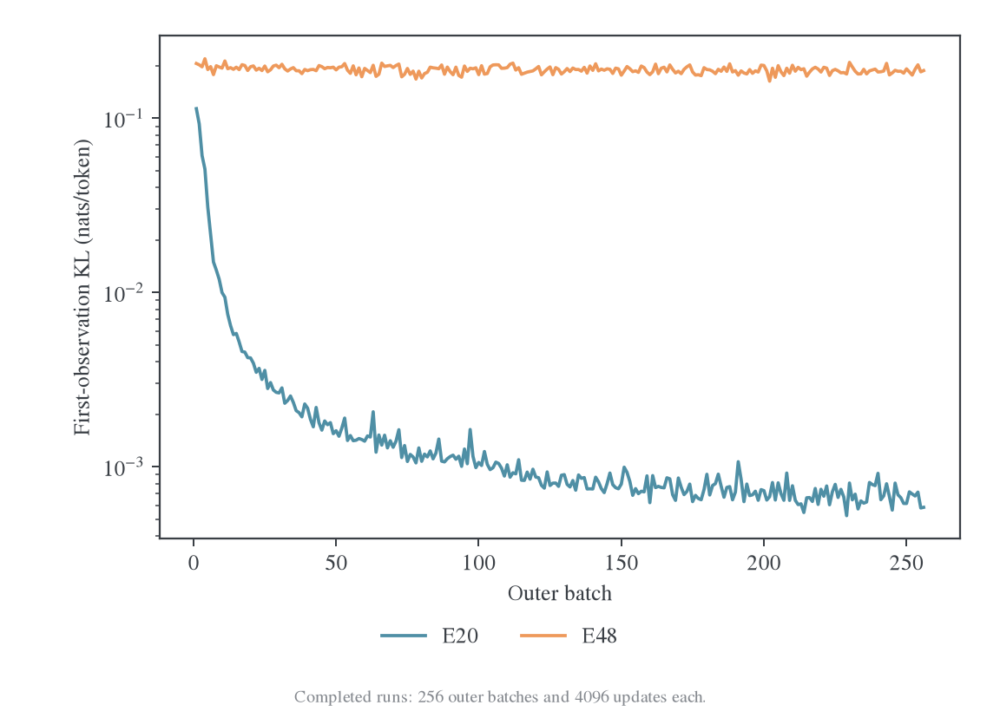

| 验证任务 | E48 初始 | E48 最终 | E20 最终 |
| -------- | -------: | -------: | -------: |
| Math500  |   82.75% |  87.825% | 88.1125% |
| AMC23    |  68.906% |  79.688% |  88.594% |
| AIME25   |  23.958% |   28.75% |  34.375% |

E48 学到了任务相关能力，分布平台不等于毫无学习。其 Math500 在 outer64 已为 87.7%，此后变化小；新批首次 KL 在 outer1–4、5–16、33–64、193–256 分别为 0.20650、0.19466、0.19055、0.18748。早期有所下降，但远小于 E20 同期 0.07962→0.01189 的初期幅度。后期梯度范数约 0.18，未趋近零。

原先“下一批起点上升抵消约 99% 的批内下降”是换题、换轨迹和参数变化混合的描述量，不是遗忘率或泛化失败比例。E48 原 checkpoint 及逐条 rollout 不在本机，S/I/B/N 是机制对照，不能直接给生产平台做唯一因果归因。完整生产指标仍见[E48 完整运行分析](cases/polaris.md#e48)。

<a id="batches"></a>
<a id="batches-跨批次迁移与单遍训练结果"></a>

<a id="batches-transfer"></a>

<a id="batches-3-实验结果跨批次与单遍训练"></a>

## 当前批、旧批与未见批的传播

旧 B1 的完整预算与其他分支见[总览 B 设置](#mechanism-series-b)。本节数值属于已完成的旧实验。

B1 只训练 A 的 16 条数学轨迹 128 次，其他批次不参与梯度。下图是各自初始固定 RKL 的相对下降；B–D 按合并风险计算。

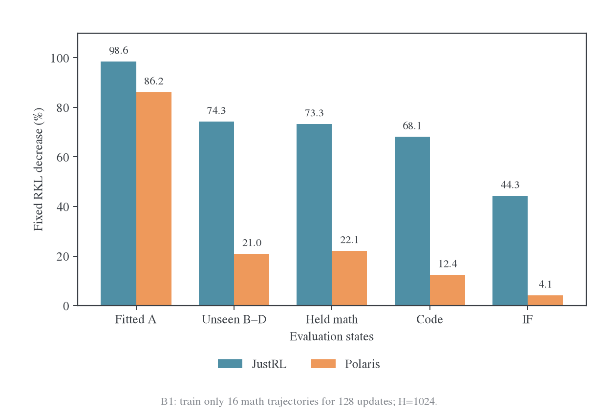

| 固定评估组       |          JustRL RKL 下降 |         Polaris RKL 下降 |
| ---------------- | -----------------------: | -----------------------: |
| 训练 A           |                   98.56% |                   86.18% |
| 未训练 B / C / D | 73.31% / 74.43% / 75.10% | 20.39% / 19.70% / 22.83% |
| 新数学 E–H       |                   73.31% |                   22.13% |
| Code             |                   68.14% |                   12.44% |
| IF               |                   44.31% |                    4.15% |

Polaris 独立数学 KL 为 0.24607→0.19161，训练 A 却能到 0.02891。差距不仅是初始 KL 更高：已见 state 能被大幅拟合，未见 state 的改进比例明显更小。最初 A16 也有正迁移，Polaris 对 B/C/D 下降 6.22%/5.57%/7.55%，JustRL 为 15.68%/16.18%/16.37%，因此“完全不迁移”不符合数据。

S1 的小探针得到同方向结果，但量级不同：J/student 训练前段下降 75.26%、数学/Code/IF 留出下降 5.34%/3.81%/2.36%；P/student 为 69.80%、1.84%/0.56%/0.26%。同轨迹后段仅下降 4.74% 与 2.48%。这些数值来自四题、稀疏位置、16 步，不能与 B1 百分比横向排行，也说明同源迁移并非对任意局部 state 都无损。

下面保留只训练 A 时的完整变化曲线，用来区分“当前批仍在拟合”和“未见批次已经变平”。这张图始终只用 A 训练；后面的多批实验才按 A/B/C/D 依次更新。

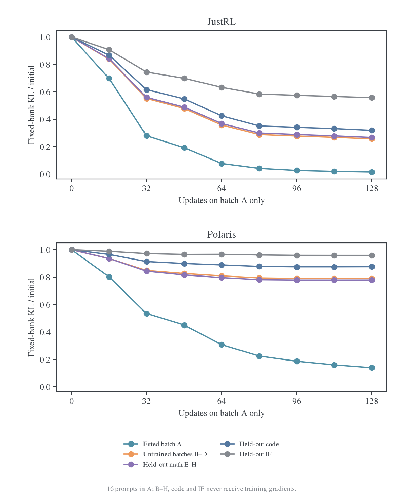

<a id="batches-retention"></a>

<a id="batches-31-依次训练-abcd同时复测所有批次"></a>

<a id="31-依次训练-abcd同时复测所有批次"></a>

### 依次训练 A/B/C/D，同时复测所有批次

这一组是 B1 的 blocked 条件。A–D 各含 16 道不同数学题，每题一条初始学生生成的固定轨迹；E–H 另有 64 道独立数学题，始终不参与梯度。两个 teacher 分别从相同初始学生重新训练，模型参数、Adam 动量和二阶矩在块之间连续保留，只有训练批次改变。

| 完成的更新          | 刚训练的批次  | 下一块训练批次   | 每个边界复测               |
| ------------------- | ------------- | ---------------- | -------------------------- |
| 0                   | 尚未训练      | A                | A–H、Code、IF 全部固定前缀 |
| 16 / 32 / 48 / 64   | A / B / C / D | B / C / D / A    | 同一组 A–H、Code、IF       |
| 80 / 96 / 112 / 128 | A / B / C / D | B / C / D / 结束 | 同一组 A–H、Code、IF       |

每块 16 次 optimizer 更新，每次整个当前批的 16 条轨迹、全部 response 位置参与 loss，固定除以 16H，H=1024。两轮结束时 A–D 每条轨迹访问 32 次。**跨块没有重新生成轨迹**，因此这些图隔离了固定输入下的参数变化，不混入 E48 那样的新学生 rollout 反馈。每 16 步才评估一次，连线连接实际观测点，不代表逐步连续监测。

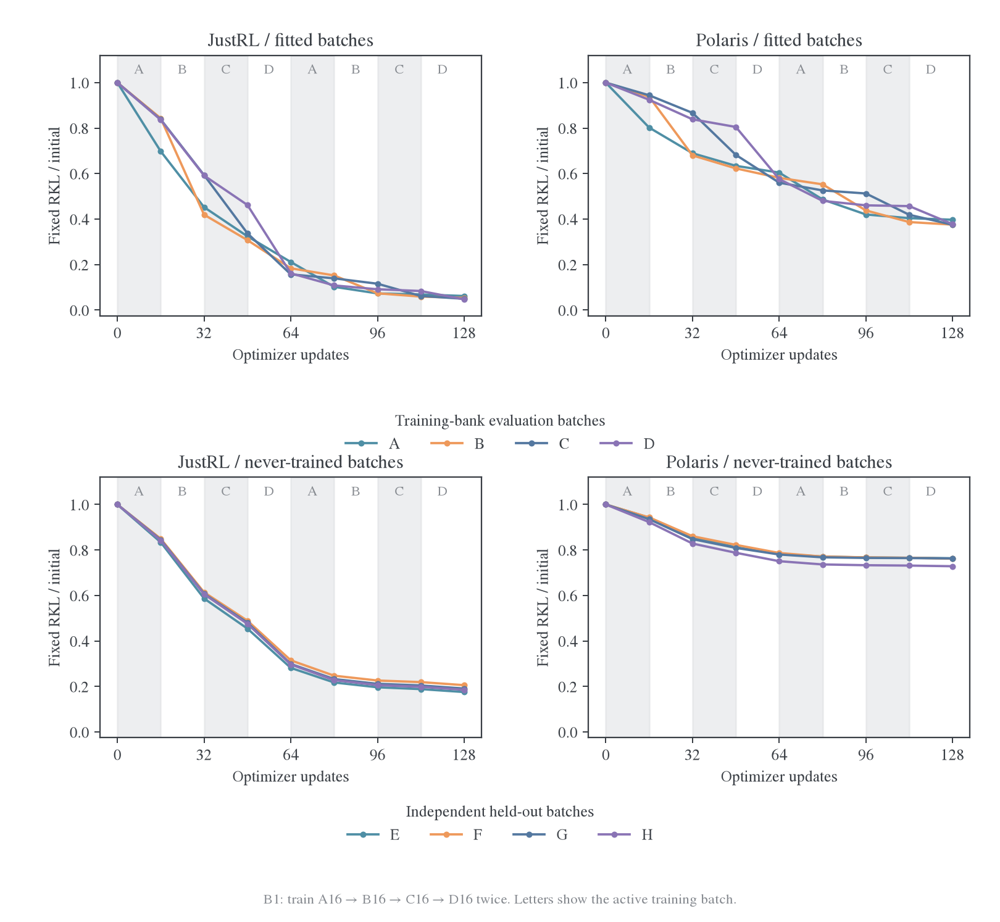

上排为 A–D，既会被训练，也会在其他批次更新后复测；下排为从未训练的 E–H。每条曲线除以自己 step0 的 KL，避免批次初始难度不同主导相对变化。上方字母和背景区间标明正在优化哪个批次。两种 teacher 使用相同坐标范围。

JustRL 中，A 以外的批次在 A 阶段已经明显改善，后续曲线整体继续下降；Polaris 也有正迁移，但 A–D 在轮到自己时下降更明显，E–H 在后半程越来越平。需要同时看上、下两排：已训练批的保持能力与对真正未见 state 的泛化能力，不是同一个问题。

<a id="batches-batch-matrix"></a>

<a id="batches-32-每个-16-步训练块改善了哪些批次"></a>

<a id="32-每个-16-步训练块改善了哪些批次"></a>

### 每个 16 步训练块改善了哪些批次

下面恢复逐块影响热图。每行是某 16 步训练块，每列是一个固定评估批次。格子的数值为该列初始 KL 归一化后的下降百分点：

$$
M_{k,j}=100\,\frac{R_j(\theta_{16(k-1)})-R_j(\theta_{16k})}{R_j(\theta_0)}.
$$

正值表示改善，负值才表示这一块使该组退步。分母始终是 step0，不是上一个块的风险；因此同一列的八行可以相加，得到该列总下降百分比。不同列的初始风险不同，数值相同不表示绝对 KL 下降相同。

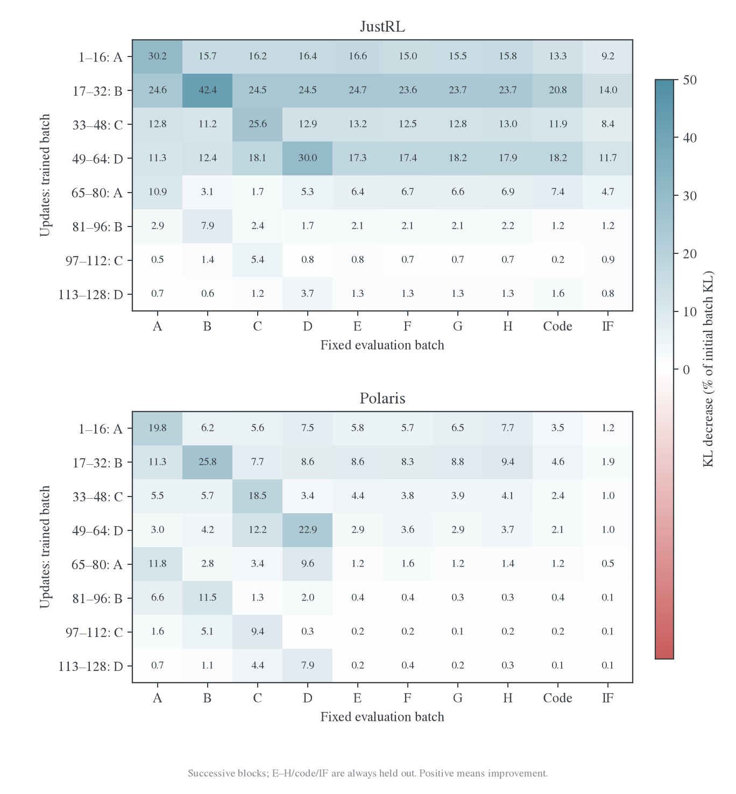

读图时可分别检查三类位置：当前训练批对应的格子；还没轮到第一次训练的其他数学批；已经训练过的旧批。E–H、Code 与 IF 则在八行中都不参与训练。最后几行对 E–H 的影响，直接反映新增更新能否继续改善独立 state。

第一块 A16 之后，Polaris 对 B/C/D 下降 6.22%/5.57%/7.55%，JustRL 为 15.68%/16.18%/16.37%。D 第一次被直接训练要到第 49 步：在此之前，JustRL 对 D 已经下降约 53.8%，Polaris 约 19.5%。所以异源 teacher 有向未来批次的迁移，只是更弱。

第二轮差异更鲜明：Polaris 在自己的训练块仍有明显下降，但对 E–H 每块仅贡献约 0.1–1.6 个初始 KL 百分点；JustRL 的改进更广。热图中的每行沿同一训练路径发生，参数和 Adam 状态不断变化，不能当成从同一个 checkpoint 分叉出来的八个独立因果干预。

<a id="batches-batch-values"></a>

<a id="batches-33-每个训练批及独立数学留出的绝对-kl"></a>

<a id="33-每个训练批及独立数学留出的绝对-kl"></a>

### 每个训练批及独立数学留出的绝对 KL

下面保留全部 16 步边界的原始风险，口径为每题 KL 总和除以 H1024 再取均值。E–H 为 64 道独立数学题的均值；它不属于 A–D 训练池。初始各批风险不同，所以“新批值高于旧批末尾”本身不能判断优化退步。

<a id="batches-justrl"></a>

#### JustRL

| 更新数 | 刚训练 |       A |       B |       C |       D | E–H 留出 |
| -----: | ------ | ------: | ------: | ------: | ------: | -------: |
|      0 | 初始   | 0.11366 | 0.11330 | 0.11510 | 0.11404 |  0.11800 |
|     16 | A      | 0.07933 | 0.09553 | 0.09648 | 0.09538 |  0.09943 |
|     32 | B      | 0.05141 | 0.04750 | 0.06830 | 0.06744 |  0.07121 |
|     48 | C      | 0.03684 | 0.03484 | 0.03884 | 0.05268 |  0.05600 |
|     64 | D      | 0.02401 | 0.02080 | 0.01806 | 0.01842 |  0.03513 |
|     80 | A      | 0.01160 | 0.01724 | 0.01605 | 0.01235 |  0.02727 |
|     96 | B      | 0.00831 | 0.00833 | 0.01332 | 0.01042 |  0.02475 |
|    112 | C      | 0.00779 | 0.00671 | 0.00712 | 0.00955 |  0.02387 |
|    128 | D      | 0.00702 | 0.00607 | 0.00569 | 0.00534 |  0.02231 |

<a id="batches-polaris"></a>

#### Polaris

| 更新数 | 刚训练 |       A |       B |       C |       D | E–H 留出 |
| -----: | ------ | ------: | ------: | ------: | ------: | -------: |
|      0 | 初始   | 0.20915 | 0.22969 | 0.22038 | 0.21654 |  0.24607 |
|     16 | A      | 0.16781 | 0.21540 | 0.20811 | 0.20020 |  0.23027 |
|     32 | B      | 0.14421 | 0.15619 | 0.19105 | 0.18161 |  0.20869 |
|     48 | C      | 0.13261 | 0.14306 | 0.15035 | 0.17432 |  0.19878 |
|     64 | D      | 0.12639 | 0.13349 | 0.12342 | 0.12467 |  0.19073 |
|     80 | A      | 0.10170 | 0.12695 | 0.11592 | 0.10395 |  0.18740 |
|     96 | B      | 0.08787 | 0.10056 | 0.11295 | 0.09970 |  0.18656 |
|    112 | C      | 0.08450 | 0.08886 | 0.09229 | 0.09895 |  0.18622 |
|    128 | D      | 0.08304 | 0.08627 | 0.08257 | 0.08175 |  0.18558 |

<a id="batches-batch-retention"></a>

<a id="batches-34-新批跳高旧批保持和迁移的区别"></a>

<a id="34-新批跳高旧批保持和迁移的区别"></a>

### 新批跳高、旧批保持和迁移的区别

以 Polaris 从 A 切到 B 为例：step16 时 A 为 0.16781，B 为 0.21540，看起来有明显跳高；但 B 已从初始 0.22969 下降。训练 B16 之后，旧 A 又从 0.16781 降到 0.14421；继续训练 C/D，A 再降到 0.13261/0.12639。这个例子同时包含“新批比旧批更难”“新批已获得正迁移”“旧批没有被遗忘”。

我们检查每个 16 步块结束时，所有已经训练过、但该块没有直接训练的旧批。JustRL 与 Polaris 各有 18 次这样的检查，**全部继续下降**。这只排除了所观测边界上的旧批退步，不排除区间内波动，也不意味着对从未见过的 E–H 有同样强的迁移。

还可把每列总下降按更新发生的时间分成三部分：直接训练该批期间、尚未第一次训练该批而训练其他批期间、已训练过该批后再训练其他批期间。三部分严格加回该批的总下降。

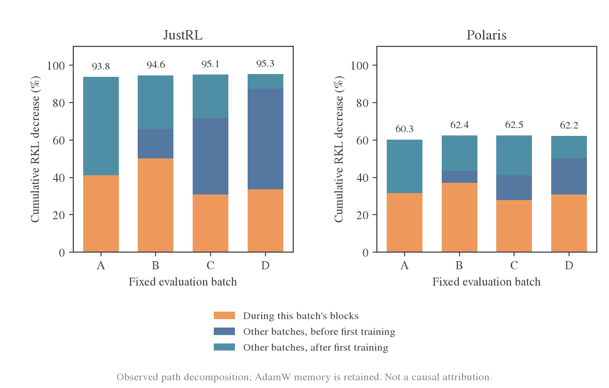

例如 A 的全部“其他批期间”下降都发生在它已被训练之后；D 则还包含前三个块提供的未见批次收益。JustRL 的 A 在其他批期间累计下降 0.05990，超过 A 自己两块提供的 0.04673；Polaris 对应 0.06008 与 0.06602。两种教师的绝对起点不同，图里统一按各自初始值展示，不能仅用这两个绝对数比较迁移强弱。

这是一种路径记账，不是独立数据的因果贡献：Adam 动量保留了前面批次的信息，“更新 B 期间 A 下降”不能全部归给 B 的新梯度。它仍能直接回答实际训练路径上旧批是否退步；若要进一步识别当前批的信息贡献，需要同参数、同 optimizer 状态分叉，并加入零新梯度但保留动量的控制，见[后续方向](appendix/pair-design.md#mechanism-next)。

<a id="batches-35-第二轮继续拟合训练池却几乎不改善-polaris-的独立批次"></a>

<a id="35-第二轮继续拟合训练池却几乎不改善-polaris-的独立批次"></a>

### 第二轮继续拟合训练池，却几乎不改善 Polaris 的独立批次

第一轮到 step64 时，A–D 每批都已训练 16 次；第二轮到 step128 时，四批各再训练 16 次。固定训练池与独立留出的变化如下，百分比均相对 step64 的风险：

| 教师    | 训练 A–D 均值：64→128 | 训练池下降 | E–H 留出：64→128 | 留出下降 |
| ------- | --------------------- | ---------: | ---------------- | -------: |
| JustRL  | 0.02032→0.00603       |     70.33% | 0.03513→0.02231  |   36.48% |
| Polaris | 0.12699→0.08341       |     34.32% | 0.19073→0.18558  |    2.70% |

Polaris 后半程仍有充分的训练集下降，独立留出的下降却只有 2.70%。这比只看相邻 batch 的 loss 跳变更直接地支持“局部拟合继续、未见 state 收益趋于平台”。新批次梯度并没有全部相消为零，有限更新的收益越来越集中于训练过的 state。

平台也不只来自后段位置。B1-blocked 的独立数学留出，按相同固定前缀的位置分层如下。这里是每个区间的**有效 token 均值**，与整条轨迹固定 H 归一化的主风险分母不同：

| Response 位置 | JustRL：初始→128 步 | Polaris：初始→128 步 |
| ------------- | ------------------- | -------------------- |
| 1–256         | 0.09760→0.01508     | 0.24929→0.19079      |
| 257–512       | 0.12443→0.02166     | 0.26111→0.19441      |
| 513–1024      | 0.12699→0.02668     | 0.24075→0.18145      |

Polaris 三个位置区间都下降，但都保留较大残差。这个结果不排除更长推理阶段的问题；它只说明当前 1K 窗口内的差距不能全归为“后半段没学到”。

<a id="batches-batch-order"></a>

<a id="batches-36-改变批次顺序会改变中途轨迹但没有修复最终平台"></a>

<a id="36-改变批次顺序会改变中途轨迹但没有修复最终平台"></a>

### 改变批次顺序会改变中途轨迹，但没有修复最终平台

为了检验连续 reuse 是否是充分解释，B1 还比较三种匹配访问量的调度：blocked 每批连续 16 步，roundrobin 每步轮换 A/B/C/D，mixed 每步各取四批中的 4 题并轮换子组。三种方式在每 64 步使用相同轨迹多重集，最终每条访问 32 次，固定 token 权重一致；途中某个 16 步边界的样本分配并不相同。

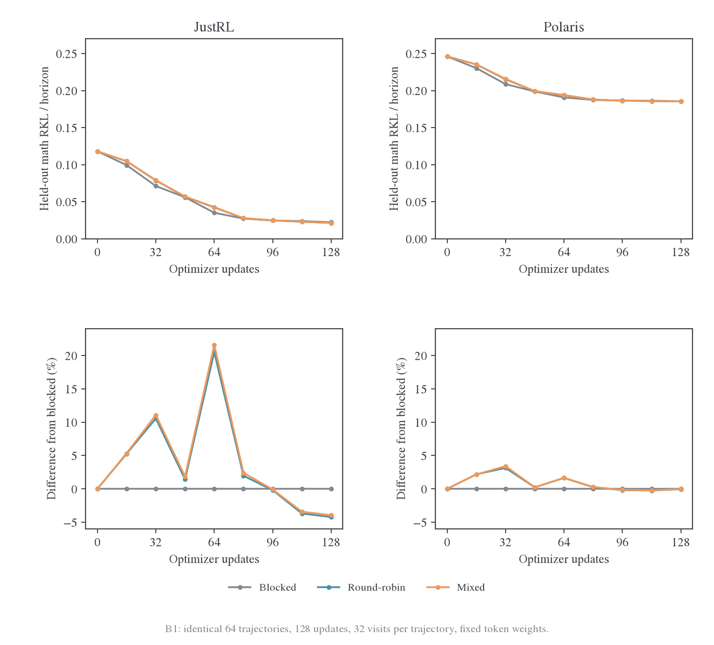

上排是相同 E–H 留出风险，下排是相对 blocked 的风险差，正值表示比 blocked 更高。JustRL 的中期顺序效应不小：step64 的 roundrobin/mixed 风险比 blocked 高约 20.5%/21.6%，但到 step128 略低约 4.2%/3.9%。因此不能用某一个中途 checkpoint 宣布某种顺序普遍更好。

| 教师    | blocked 最终留出 KL | roundrobin 最终留出 KL | mixed 最终留出 KL |
| ------- | ------------------: | ---------------------: | ----------------: |
| JustRL  |            0.022313 |               0.021372 |          0.021435 |
| Polaris |            0.185583 |               0.185509 |          0.185573 |

Polaris 最终 roundrobin−blocked 差为−0.000074，95% 配对区间[-0.000377,0.000179]；mixed−blocked 区间也包含零。只打乱同一个 64 题池没有明显解除泛化平台；[扩大独立覆盖](#mechanism-geometry)带来的收益应与这种重排分开。

I1 提供了另一个较大、但口径不同的检验：在线 64 步、三来源固定面板上，J/student 的数学/Code/IF 风险下降 72.51%/67.32%/39.67%，P/student 为 29.35%/14.36%/7.58%；fresh J 分别 115.20→31.44、232.21→195.41。它支持迁移差距并非 B1 单个固定训练池独有，但不能与 B1 拼成同一学习曲线。跨域结果仍只是 math→Code/IF 的概率迁移，未验证代码执行或指令遵循正确率。

<a id="batches-long-pass"></a>

<a id="batches-37-l20-个新训练批次走完后泛化缺口仍然明显"></a>

<a id="37-l20-个新训练批次走完后泛化缺口仍然明显"></a>

### L：20 个新训练批次走完后，泛化缺口仍然明显

这组扩大实验专门排除“必须循环回访旧批才会出现平台”的解释。两个 teacher 使用完全相同的 640 题银行，只在 A–T 这 20 批数学题上依次训练，剩余 20 批永久不进入优化器。以下均为固定 H1024 归一化的风险。

| 固定银行         | JustRL 初始→最终 | JustRL 下降 | Polaris 初始→最终 | Polaris 下降 |
| ---------------- | ---------------- | ----------: | ----------------- | -----------: |
| 训练 A–T，320 题 | 0.11427→0.00688  |      93.98% | 0.21497→0.09619   |       55.25% |
| 永久数学，192 题 | 0.11463→0.00734  |      93.60% | 0.21888→0.16269   |       25.67% |
| 永久 Code，64 题 | 0.14543→0.01413  |      90.28% | 0.24627→0.20282   |       17.64% |
| 永久 IF，64 题   | 0.09785→0.04743  |      51.53% | 0.79862→0.73586   |        7.86% |

初始训练与数学留出风险很接近：J 为 0.11427/0.11463，P 为 0.21497/0.21888。最终 P 的训练银行已到 0.09619，独立数学仍为 0.16269；J 两者则接近 0.00688/0.00734。后来的差距不能简单归为留出题初始平均风险特别高，尽管一个固定抽样仍不足以代表全部数据分布。

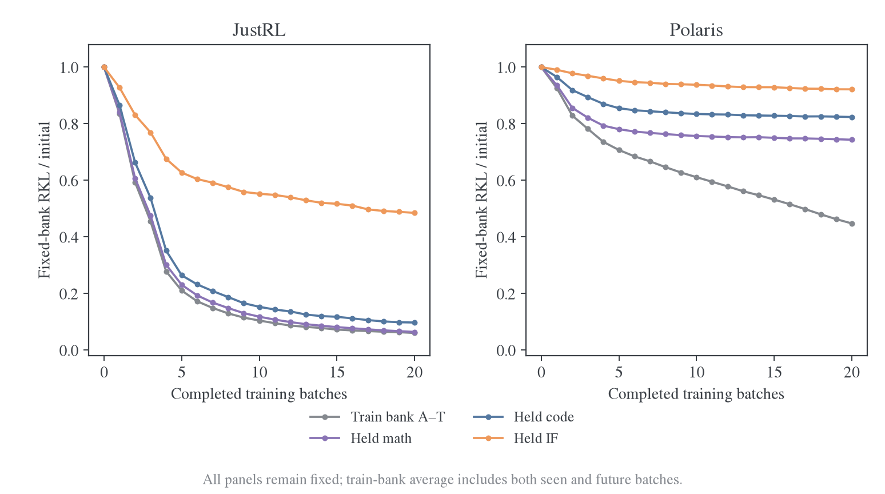

灰线是整个固定 A–T 银行的均值，途中包含尚未轮到训练的批次，并非只平均“已训练集合”。紫线、蓝线、橙线分别始终对应同一 192 题数学、64 题 Code、64 题 IF。P 的训练银行持续下降，独立银行在前几批以后明显放缓；J 的数学和代码改善更广。

<a id="batches-38-一个新批次第一次进入训练之前已经获得多少迁移"></a>

<a id="38-一个新批次第一次进入训练之前已经获得多少迁移"></a>

### 一个新批次第一次进入训练之前，已经获得多少迁移

对每批分别记录其初始风险、第一次训练前的风险，以及 16 步后的风险。分母使用该批在原始学生上的风险，避免不同批次难度造成假趋势。

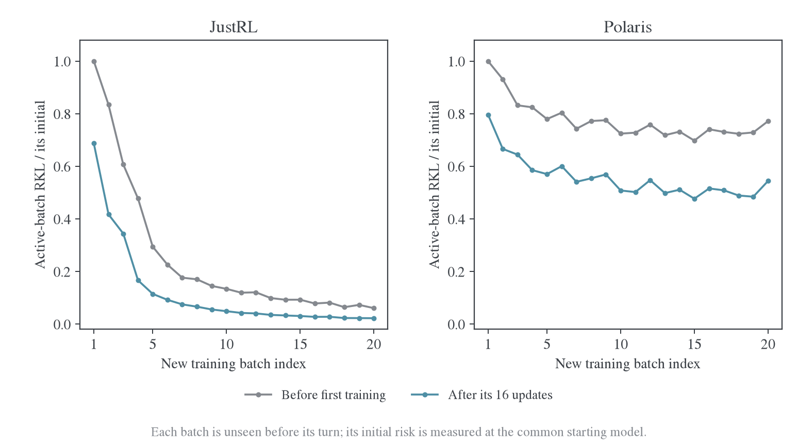

最后一批 T 在前 304 次更新中从未参与梯度。JustRL 对它的 KL 已经从 0.10555 降到 0.00639，即尚未直接训练就下降 93.94%；再训练 16 步到 0.00235。Polaris 对同一批的 KL 从 0.19421 降到 0.14986，前向迁移仅 22.84%；直接训练后到 0.10565。最后 5 批首次训练前的平均相对下降分别为 J 的 92.85%、P 的 26.10%。

这组结果直接区分“当前 batch 能不能下降”和“前面其他 batch 的更新能不能提前改善它”。P 仍然可以拟合新的训练批，但并没有让后面新批次的起点持续大幅降低。这个结论无需通过不同题之间的训练 loss 跳变来推断。

<a id="batches-39-初始及每批结束后的全部-40-批矩阵"></a>

<a id="39-初始及每批结束后的全部-40-批矩阵"></a>

### 初始及每批结束后的全部 40 批矩阵

每张风险图有 21 行：初始加 20 个训练边界；40 列按 A–T、12 个数学留出、4 个 Code、4 个 IF 排列。颜色是每列相对其初始 KL 的剩余比例，框线标出该行刚训练的批次。右侧 20 列始终未训练，左侧对角线右边是在该行尚未训练的未来批次。两 teacher 共用色标。

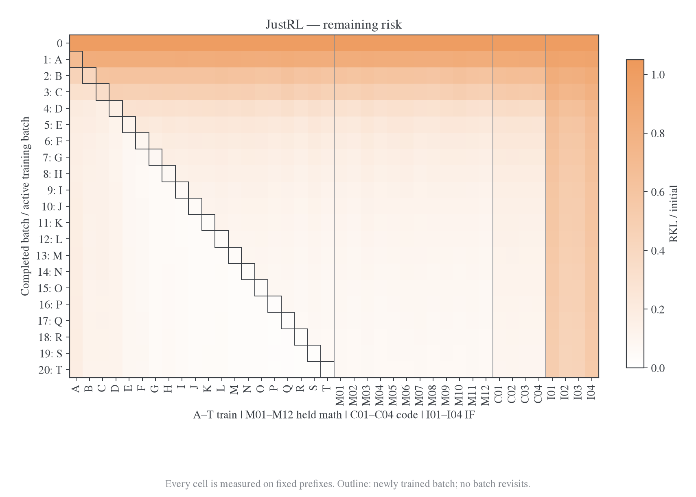

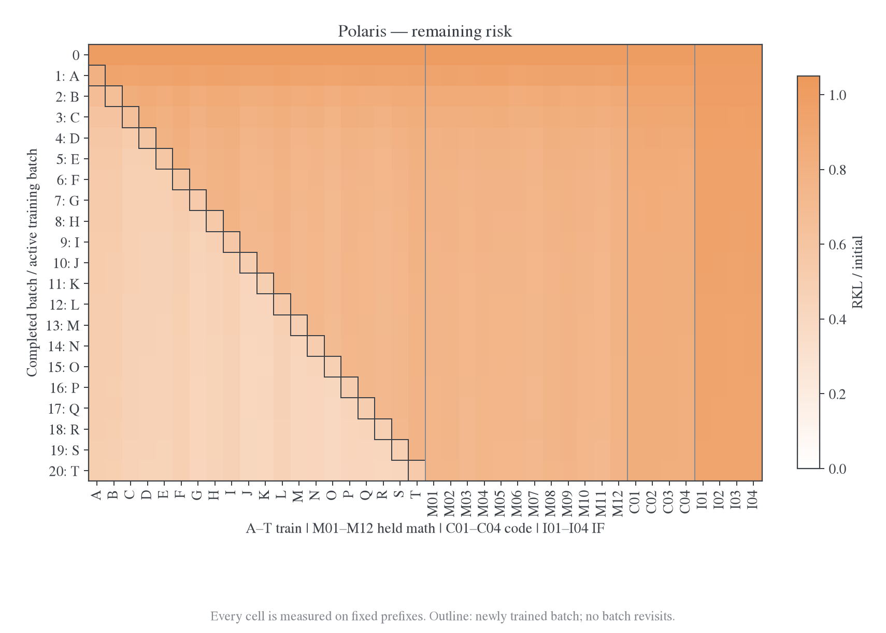

J 在对角线右侧、即尚未训练的数学批次上就逐渐变浅；P 的明显下降更集中在已经进入训练的对角线及其左侧。永久留出列的差异与汇总曲线一致，不是单个留出批主导。

逐块影响图进一步展示 $100(R_j(\theta_{b-1})-R_j(\theta_b))/R_j(\theta_0)$。正值为这一块带来的改善，负值是同一固定批次的回升，分母始终为该列的初始值。所有格子均实际评分，不对未来训练批填预测值。

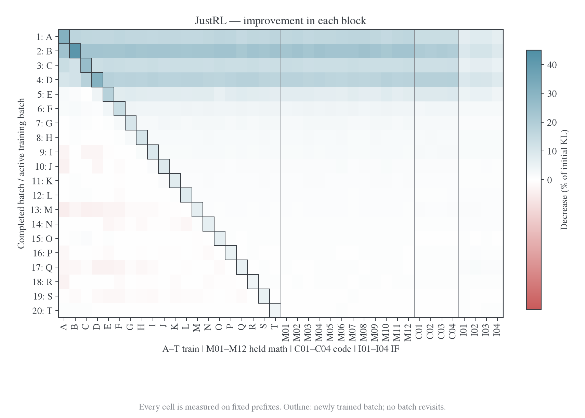

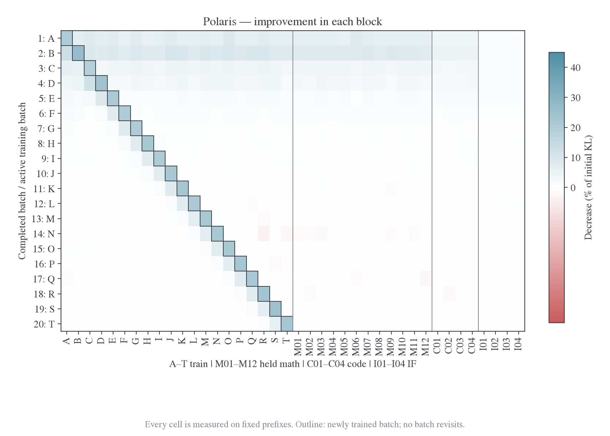

精确数值可逐格查看[JustRL CSV](../../../../../../wandb-logs/MirrorOPD-verl/analysis/twenty-batch-pass-20261027/justrl-risk-matrix.csv)和[Polaris CSV](../../../../../../wandb-logs/MirrorOPD-verl/analysis/twenty-batch-pass-20261027/polaris-risk-matrix.csv)。图中没有把 190 次相关的旧批检查当作 190 个独立训练重复。

<a id="batches-310-后期每个新批仍明显下降独立留出获得的收益越来越小"></a>

<a id="310-后期每个新批仍明显下降独立留出获得的收益越来越小"></a>

### 后期每个新批仍明显下降，独立留出获得的收益越来越小

下面按每 5 批划分阶段，阶段内仍全部是新题。“批内下降”是五个当前批各自 16 步相对下降的均值；“留出下降”相对该阶段开始的同一 192 题风险。两者的评估输入不同，不能直接当成同一种成功率。

| Teacher | 阶段     | 数学留出起点→终点 | 本阶段留出下降 | 平均批内下降 |
| ------- | -------- | ----------------- | -------------: | -----------: |
| JustRL  | 1–5 批   | 0.11463→0.02643   |         76.94% |       50.16% |
| JustRL  | 6–10 批  | 0.02643→0.01350   |         48.94% |       60.64% |
| JustRL  | 11–15 批 | 0.01350→0.00928   |         31.26% |       65.52% |
| JustRL  | 16–20 批 | 0.00928→0.00734   |         20.92% |       65.57% |
| Polaris | 1–5 批   | 0.21888→0.17086   |         21.94% |       25.44% |
| Polaris | 6–10 批  | 0.17086→0.16558   |          3.09% |       27.43% |
| Polaris | 11–15 批 | 0.16558→0.16418   |          0.85% |       30.28% |
| Polaris | 16–20 批 | 0.16418→0.16269   |          0.91% |       31.25% |

P 最后 5 批仍使各自训练批平均下降 31.25%，独立数学仅下降 0.91%。它不是严格不下降，也没有证明不可突破的硬下界；这里观察到的是相对于持续的局部拟合，独立收益明显趋于平台。

定义一块的经验迁移比为独立数学平均 KL 下降除以当前训练批平均 KL 下降。它使用同一批前后两次完整评估，不是跨不同 batch 起点的抵消比，也不是概率；可以为负或大于 1。

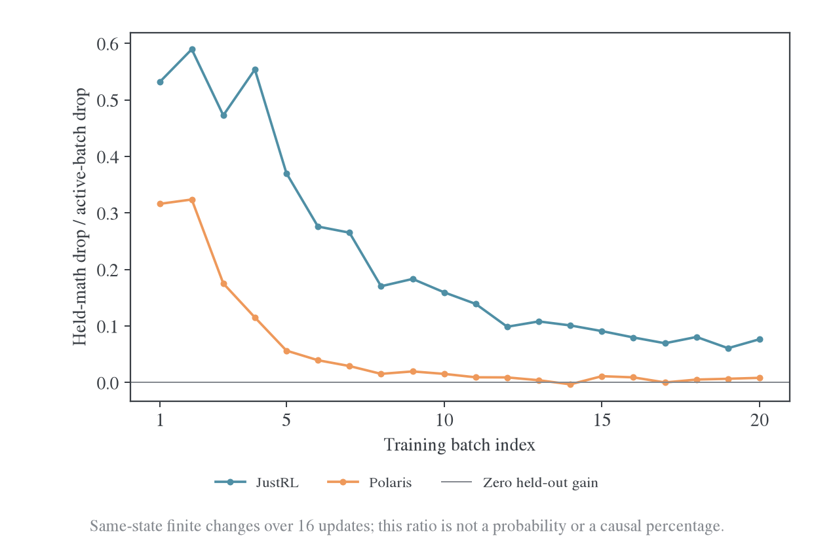

按阶段累计下降计算，P 的迁移比从前 5 批 0.197 降到后 5 批 0.00584，约下降 34 倍；J 为 0.520→0.07325。P 后期每观察到 1 单位当前批 KL 下降，只对应约 0.0058 单位独立数学风险下降。这个比值是有限银行上的描述，不是通用的因果“泛化百分比”。

<a id="batches-311-本机已经记录实际-adam-更新不能再仅凭-raw-cosine-解释"></a>

<a id="311-本机已经记录实际-adam-更新不能再仅凭-raw-cosine-解释"></a>

### 本机已经记录实际 Adam 更新，不能再仅凭 raw cosine 解释

每批首步，在固定 M01–M04 共 64 题上计算验证梯度，清空后用当前训练批梯度执行 AdamW。比较 $\cos(g_B,g_H)$、实际位移与验证下降方向的余弦 $-g_H^\top\Delta\theta/(\|g_H\|\|\Delta\theta\|)$，并复测同一 64 题的真实一步风险变化。

| Teacher / 阶段     | raw 训练—验证 cosine 均值 | 实际更新—验证下降方向 cosine 均值 | 验证梯度范数 | 参数步幅 L2 |
| ------------------ | ------------------------: | --------------------------------: | -----------: | ----------: |
| JustRL / 1–5 批    |                    0.8437 |                           0.08381 |       1.0263 |     0.02893 |
| JustRL / 16–20 批  |                    0.1385 |                           0.01746 |       0.1581 |     0.01102 |
| Polaris / 1–5 批   |                    0.5680 |                           0.06127 |       0.8218 |     0.02899 |
| Polaris / 16–20 批 |                    0.1196 |                           0.00298 |       0.3794 |     0.02212 |

后期 raw cosine 的 J/P 均值已经相近（0.138/0.120），所以只看这一项不足以解释明显不同的泛化结果。实际更新的方向一致性则为 0.01746/0.00298；P 仍有较大验证梯度和参数位移，不能简单描述为完全没有更新。

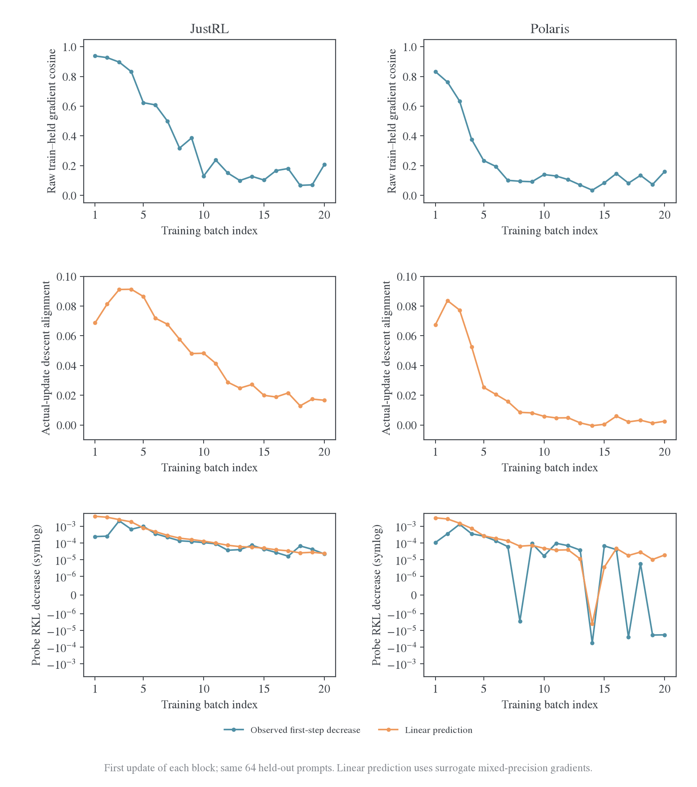

两个限制必须保留。第一，只测了每个新批的**首步**，其中包含上一批的 Adam 历史，不能代表 16 步全部更新，也不能把低投影全部归给当前批的信息。第二，混合精度 autograd 梯度给出的线性预测与真实有限变化并不总一致，初始首步甚至有明显尺度差异；BF16 舍入、曲率与预条件尚未被这项只读诊断分别识别。因此，全块固定风险矩阵是主要结论，投影提供机制线索，不能单独证明优化器或某个 feature 是唯一根因。

<a id="batches-312-更长窗口出现局部回升但不是-polaris-平台的主要表象"></a>

<a id="312-更长窗口出现局部回升但不是-polaris-平台的主要表象"></a>

### 更长窗口出现局部回升，但不是 Polaris 平台的主要表象

20 批形成每 teacher190 次“更新新批、复测已训练旧批”的边界检查。以绝对回升超过 1e-6 计，J 为 92 次、P 为 10 次；最大单次回升分别 0.000595 和 0.000202。它们没有经过多重比较校正，也不能用次数对两个 teacher 的整体质量排名。

再把最终风险与每批刚训练结束时比较：J 只有 3/20 批略高，最差也保留了当时局部下降的 98.63%；P 全部 20 批不高于刚训练完的风险。也就是说，P 的局部拟合大多保留着，但向永久未见 state 的收益很弱；J 允许少量局部波动，同时获得明显更低的独立风险。旧 B1 四批窗口的 0/18 检查仍是当时的事实，不能无限外推为所有后续阶段都不会回升。

<a id="batches-historical-fresh"></a>

<a id="batches-313-当前学生的访问分布又损失了一部分参数拟合收益"></a>

<a id="313-当前学生的访问分布又损失了一部分参数拟合收益"></a>

### 当前学生的访问分布又损失了一部分参数拟合收益

两种 teacher 的无约束 fresh 评估均为同一 32 题×两个随机流，初始和最终平均长度都是 1024；下面的差异不是由平均长度缩短造成。J 的序列 KL 从 123.46 到 8.75，P 从 230.81 到 191.95，二者相对起点的配对区间都支持净改善，但幅度明显不同。

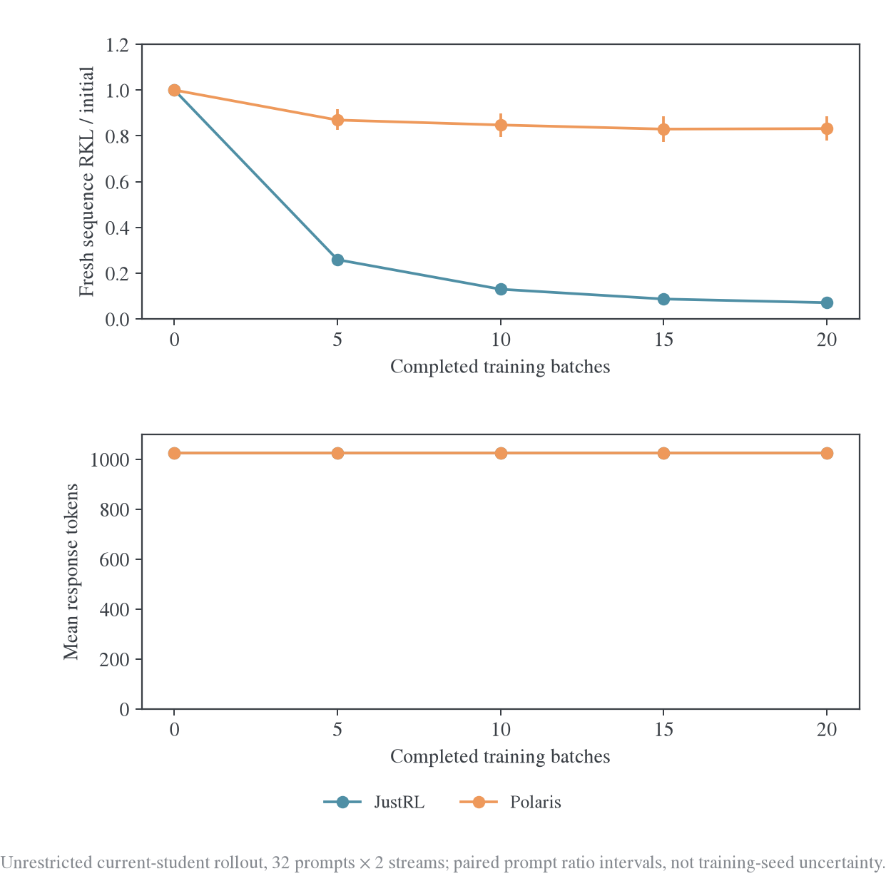

终点另用同一 teacher-forcing 路径计算参数×state 四格。以下“旧 state 参数收益”为 $L_{00}-L_{10}$，“访问代价”为 $L_{11}-L_{10}$，同一个参照路径下二者相减得到净下降。

| Teacher | 初始参数/初始 state | 初始参数/最终 state | 最终参数/初始 state | 最终参数/最终 state | 参数收益 | 访问代价及 95% 配对区间 |
| ------- | ------------------: | ------------------: | ------------------: | ------------------: | -------: | ----------------------- |
| JustRL  |              123.47 |              112.56 |                8.09 |                8.76 |   115.37 | +0.66 [-0.05, 1.38]     |
| Polaris |              230.77 |              281.25 |              173.17 |              191.92 |    57.59 | +18.75 [6.89, 31.07]    |

P 的访问代价 18.75 nats，区间[6.89,31.07]，约抵消这条分解路径下 32.6% 的参数收益；J 的代价 0.66，区间含零。交叉评分与生成时累计 KL 的对角线均值差最大约 0.048 nats，远小于 P 的访问代价。这里的比例依赖参照顺序，并非唯一因果分解。

所有训练 state 从头到尾固定，因此这并不是“在线训练反馈有害”的直接干预证明；它测到的是最终学生在自己访问的新 state 上风险更高。同时，固定永久留出本身已经趋于平台，故访问分布变化也不能解释全部泛化缺口。

同一 192 题固定数学银行上的其他指标同样需要保留：

| Teacher | RKL 下降 | 共享支持 FKL 变化 | JS 下降 | TV 下降 | 学生 entropy 初始→最终 | 固定 teacher entropy |
| ------- | -------: | ----------------: | ------: | ------: | ---------------------- | -------------------: |
| JustRL  |   93.60% |       下降 93.65% |  92.85% |  76.22% | 0.5975→0.5906          |               0.5921 |
| Polaris |   25.67% |       上升 15.95% |   8.41% |   9.85% | 0.5975→0.4289          |               0.4715 |

Entropy 按有效 token 平均，其余固定风险按 H 归一化。P 的 RKL 下降并未让 FKL 同时改善，学生在固定前缀上还比 teacher 更尖锐。不能把这一组结果称为全面概率对齐；也没有评测完整数学、代码或 IF 任务准确率。

<a id="batches-314-这轮更新了哪些判断"></a>

<a id="314-这轮更新了哪些判断"></a>

### 这轮更新了哪些判断

L 直接支持三点：即使每批只进入训练一次，P 的后期独立收益仍明显减弱；当前新批可以继续拟合，并且旧批收益大多保留；最终访问分布还会消耗一部分固定 state 上的参数收益。因此，循环回访旧批、灾难性遗忘或完全没有参数更新，都不是解释这些观测所必需的条件。

更符合当前数据的机制图景是：早期可以吸收跨 state 共有的修正，后期仍有较大残差，但新增更新越来越集中于当前批的条件概率。理想的同架构、同数值实现下，同源 teacher 函数可由学生的一组参数表示；更大异源 teacher 没有同样的可实现性保证。不过，局部可拟合与全局可实现性的差别仍需表示和目标干预来识别，不能由当前平台直接推出容量下界。

它尚未唯一证明缺少特定 feature、模型容量不足或 Adam 预条件是根因。只有一个固定题目顺序与训练 seed，H1024 仍是短回答窗口；本机 HF 混合精度实现不是 E48 的 FSDP2/H7168 重放。后续更值得做的是在同一起点和优化器状态上拆分“新题/同题新轨迹”、固定/刷新的生成器，以及实际更新的预条件与表示响应；不应只继续看当前批 loss 或集合 overlap。

<a id="batches-state-source"></a>

<a id="batches-4-实验结果来源与访问分布"></a>

## 训练来源与当前访问分布

S/I 的完整训练预算、精度与数据关系见[总览 S 设置](#mechanism-series-s)和[I 设置](#mechanism-series-i)。

S1 将 P 的训练 state 改为 teacher 自生成后，数学留出下降从 1.84% 变为 2.36%，没有消除与 J 的差距。S 的初始探针还发现：同一个初始学生在 P 自己的后段 state 上 KL 为 0.5417，在 S0 后段为 0.1853；对应 overlap@64 为 56.38% 与 68.94%。Teacher 熟悉自己的 state、student 容易拟合该 state、更新能迁移到其他 state，是不同问题。

I1 在同样的 64 道数学留出题上，分开三个参考来源后得到：

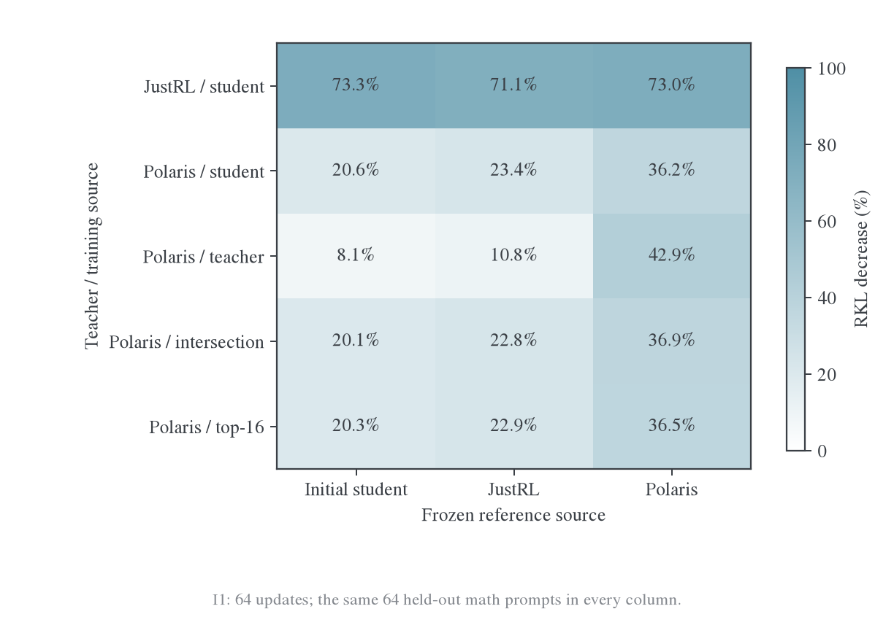

P/teacher 训练对 P 参考的 RKL 下降 42.90%，对 S0 参考仅 8.14%；P/student 分别下降 36.18% 和 20.58%。只报告 teacher 来源的 held-out，会高估对学生实际使用分布的改善；这不是 prompt 泄漏，而是评估分布不同。J/student 在三来源上下降 73.30%/71.14%/72.95%，更接近广泛迁移。

S 的初始诊断也保留了领域差异：仅看`</think>`之前的推理 state，初始学生与 J/P 的 KL 及 overlap@64 如下。代码和 IF 各只有 4 题，不能估计总体领域效应，但不支持“领域完全无关”。

| 推理 state 领域 | JustRL KL / overlap@64 | Polaris KL / overlap@64 |
| --------------- | ---------------------- | ----------------------- |
| Math            | 0.094 / 82.97%         | 0.188 / 66.74%          |
| Code            | 0.151 / 84.28%         | 0.272 / 71.17%          |
| IF              | 0.147 / 85.35%         | 1.267 / 54.44%          |

<a id="batches-41-固定前缀上的下降未必完整保留到新访问分布"></a>

<a id="41-固定前缀上的下降未必完整保留到新访问分布"></a>

### 固定前缀上的下降未必完整保留到新访问分布

I3 固定同一批 prompt 和 seed，将旧/新学生参数与旧/新轨迹交叉评分。记 $L_{ij}$ 为参数 $\theta_i$ 在冻结轨迹 $d_j$ 上的平均 KL 总和，以旧 state 作参照：

$$
L_{00}-L_{11}=(L_{00}-L_{10})-(L_{11}-L_{10}).
$$

右侧分别为旧 state 上的参数拟合收益和新访问分布代价；分解顺序改变会改变分量，不是唯一因果比例。

| I1 训练方式    | 旧 state 参数收益 | 新访问分布代价 | 最终 fresh J（交叉评分） |
| -------------- | ----------------: | -------------: | -----------------------: |
| J/student      |             83.90 |          +0.12 |                    31.44 |
| P/student      |             46.26 |          +9.45 |                   195.40 |
| P/teacher      |             17.31 |          −8.96 |                   205.93 |
| P/intersection |             45.31 |          −0.35 |                   186.54 |
| P/top16        |             45.47 |          +1.68 |                   188.41 |

Intersection 的点估计优势主要出现在访问分布项，旧 state 拟合并未更强。但 P/student 访问代价的 95% 区间为[-2.50,22.17]，尚不能称作已确证的漂移惩罚；这里约 20% 的点估计抵消也不能替换生产“99%”这个不同口径的数值。

I1 在固定 S0 数学参考上还出现距离方向不一致：P/teacher 训练使 RKL 下降 8.14%，JS 上升 23.47%、TV 上升 7.18%；学生 entropy 从 0.5919 降到 0.3096，低于教师 0.4639。P/student 的 RKL 下降 20.58%，JS/TV 只下降 2.99%/6.03%。这些是同一输入上的真实差异，不能归因于新旧 state 切换。

<a id="mechanism-overlap"></a>

<a id="mechanism-4-overlap采样质量与概率残差"></a>

## 采样覆盖与概率分配

令 $S_k=\operatorname{TopK}(p)$、$T_k=\operatorname{TopK}(q)$，交集 $C_k=S_k\cap T_k$，并集 $U_k=S_k\cup T_k$。本系列定义：

$$
O_k=\frac{|C_k|}{k},\qquad
\mathrm{Jaccard}_k=\frac{|C_k|}{2k-|C_k|},\qquad
M_p=\sum_{v\in C_k}p_v,\quad M_q=\sum_{v\in C_k}q_v.
$$

实际动作另分四类：都不在、仅 teacher、仅 student、都在，编码 0/1/2/3。学生无约束采样命中交集的条件概率是 $M_p$，不是 $O_k$。改变生成支持集也不等于改变 full-vocab loss 的支持集。

I1 初始相同学生路径上，J/P 的 top16 实际交集命中率已为 98.8846%/98.6176%；P 的集合 overlap 仅 71.60%。将 k 从 8 提高到 64，P 实际命中率从 96.84% 升到 99.74%，集合 overlap 却从 73.60% 降到 67.15%。不同 k、不同分母不可互换。

I1 初始 fresh 轨迹在两个 teacher 下逐条相同，共 65536 个实际 token。保留四类命中比例，避免把“不在 teacher top-k”和“不在 student top-k”混为一谈：

| 实际动作类别，k=16 |   JustRL |  Polaris |
| ------------------ | -------: | -------: |
| 都在               | 98.8846% | 98.6176% |
| 仅 student         |  0.3952% |  0.6622% |
| 仅 teacher         |  0.1007% |  0.1144% |
| 都不在             |  0.6195% |  0.6058% |

两组“不在 student top16”的数量均为 472，因为学生和轨迹相同；Polaris 下不在 teacher top16 的 token 为 831。I1 训练后取消采样限制，普通 student 组与 intersection 组的实际交集命中率分别 99.6724%/99.6938%，集合 overlap 却只有 70.48%/70.34%；不能用前一指标对方法作整体对齐排名。

<a id="mechanism-41-大量低概率候选决定集合分数剩余-kl-多在交集内部"></a>

<a id="41-大量低概率候选决定集合分数剩余-kl-多在交集内部"></a>

### 大量低概率候选决定集合分数，剩余 KL 多在交集内部

N4 在相同 32 条固定前缀上比较初始学生和 P-blocked128。训练后学生第一名承载 82.99% 的质量，99.95% 的位置上这一候选在 teacher top16 内；第 9–16 名总质量只有 0.68%，却有约 46% 的候选不在 teacher top16 内。后八名占集合指标一半，实际采样很少碰到它们。

为避免原始 $p\log(p/q)$ 的正负贡献抵消，采用非负可加分解：

$$
d_v=p_v\log(p_v/q_v)-p_v+q_v\geq0,\qquad
\sum_vd_v=\mathrm{KL}(p\Vert q).
$$

学生不支持的教师行取 $p_v=0$、$d_v=q_v$。这是原生 RKL 的一种非负分配，不是采样 token 的 loss 占比。P128 固定前缀上 88.87%、当前 fresh 前缀上 91.10% 的剩余差距位于交集内部。

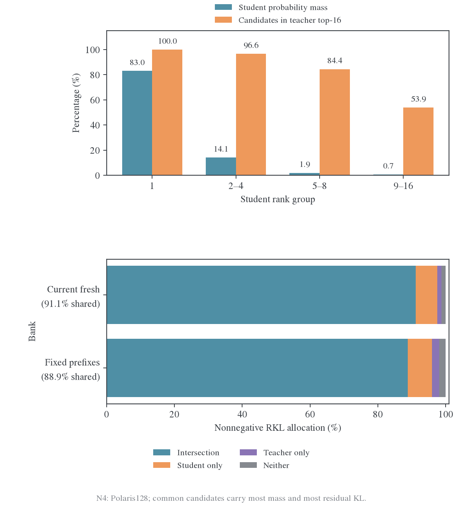

交集内部的误差也不能直接简化成“两边都极自信但选了相反 top1”：S 的数学 student-source 与 Polaris-source 各 768 个观测位置中，未出现双方 max probability 都大于 0.95 而 top1 相反的位置。这是有限短前缀上的排除性诊断，不保证长推理中不存在这种情况。

<a id="mechanism-42-参数改善与-state-变化可以抵消"></a>

<a id="42-参数改善与-state-变化可以抵消"></a>

### 参数改善与 state 变化可以抵消

N4 将参数与初始/最终 fresh state 分开，使用相同 32 题×2 种子、统一完整前缀评分。O 从 71.55% 到 72.40% 是同一初始前缀上的参数改善；换到当前学生生成的前缀又降到 71.64%，净变化仅 0.10 个百分点。对应学生交集质量仍从 98.32% 升到 99.54%。

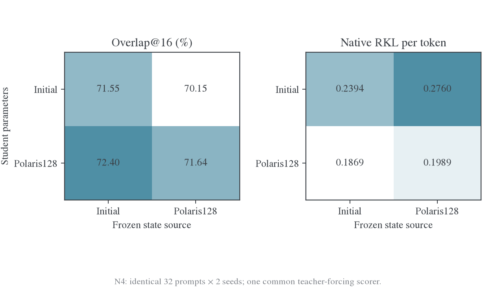

按此参照路径，参数贡献 +0.854pp、state 项−0.755pp。固定初始前缀上的学生 entropy 从 0.668 降到 0.509；换到新前缀后为 0.433，教师 entropy 也从 0.535 变为 0.408。自由生成 entropy 的变化混合了参数和访问分布，不能全部称作参数变尖锐。

<a id="mechanism-43-交集解码和高-overlap-筛选的额外价值尚不稳健"></a>

<a id="43-交集解码和高-overlap-筛选的额外价值尚不稳健"></a>

### 交集解码和高-overlap 筛选的额外价值尚不稳健

I1 交集组在 130744 个生成 token 中拒绝 945 个 proposal（0.723%），实际 token 命中交集 100%，但训练 state 的集合 overlap 为 71.31%，普通 student 组为 71.79%。取消约束后的 fresh J 为 186.41，普通 student 为 195.41，student-top16 为 188.62。Intersection−student 的 95% 配对区间[-22.09,2.90]，intersection−top16 为[-15.43,10.11]，均包含零。

I2 的 high/random/low 初始 overlap 为 86.27%/72.41%/56.62%，fresh J 为 218.97/218.01/219.99；high−random 与 low−random 区间同样包含零。High 组 entropy 反而更高，不是单纯筛了低 loss、低 entropy 位置；筛选改变多个 state 属性，不能独立证明 overlap 无因果作用。

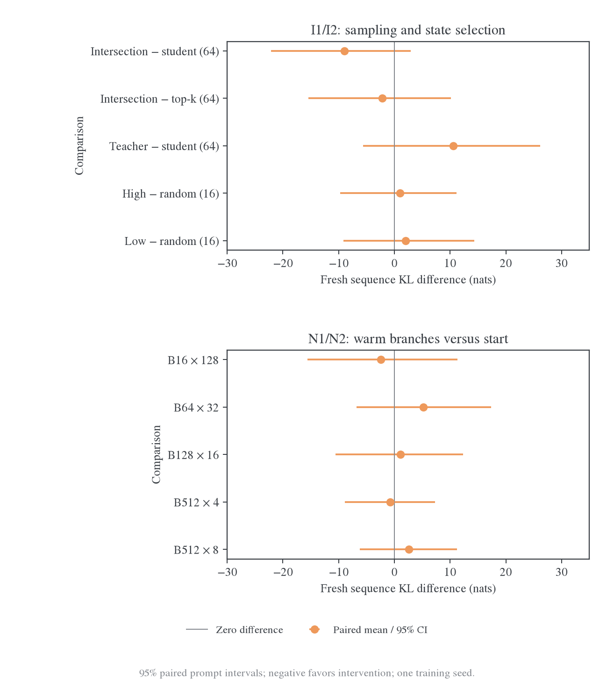

图上半来自 I1/I2，标签括号是训练步数；下半来自 N 的后期分支相对共同起点。上下不是同一训练起点，不能跨面板排名。所有区间仅含 prompt 不确定性。结果不否定所有交集策略，只约束已执行的 $p(\cdot\mid C_{16})$；teacher 加权或几何混合未在这组实验中验证。

<a id="mechanism-geometry"></a>

<a id="mechanism-5-平均方向的迁移性与覆盖"></a>

## 共享更新方向与数据覆盖

跨 state 迁移取决于参数响应与 teacher 要求的修正方向。记 student 的 logit Jacobian 为 $J_s$，则 RKL 的全参数梯度可写为：

$$
g_s=J_s^\top v_s,\qquad v_s=p_s\odot(\log p_s-\log q_s-\ell_q(s)\mathbf1),
\qquad g_a^\top g_b=v_a^\top J_aJ_b^\top v_b.
$$

共享 top-k 集合不固定概率修正 $v_s$，也不固定不同 state 的参数响应 $J_aJ_b^\top$。同源 teacher 若可近似为学生附近的一组共享参数修正 $\delta$，则 $z_T(s)-z_0(s)\approx J_0(s)\delta$ 提供可检验的解释；这不是从“同源”定义自动推出的定理。下面的梯度控制检验其中一部分，表示层机制仍留待后续实验。

B4 固定同一套 S0 输入，分别计算训练 64 题、独立数学 64 题、Code16 和 IF16 的全参数梯度。初始、各自 B1-blocked128、同一 P128 参数改换 J 目标构成五个案例。

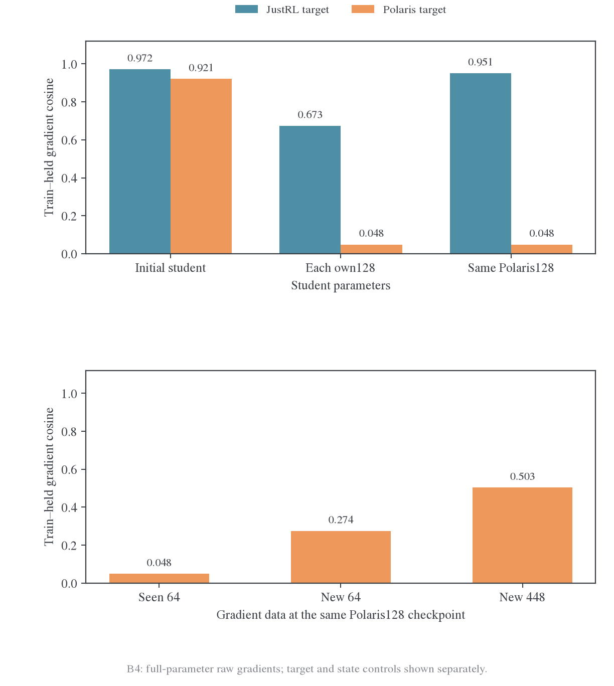

训练—数学留出余弦，初始 J/P 为 0.972/0.921，各自 128 步后为 0.673/0.048。同一 P128 参数和输入只将目标改成 J，余弦恢复到 0.951。该控制将差异与目标联系起来，但仍不能唯一分离教师历史、大小和剩余误差尺度的作用。

在同一个 P128 上，用 Seen64/New64/New448 形成梯度，与 Held64 余弦分别 0.048/0.274/0.503。New64 控制了题数，支持独立覆盖比反复拟合旧 state 更有代表性；New448 还叠加了更大的平均范围。B4 另在每个学生当前生成的 state 上分 4 组、每组 8 题×2 条测量，own128 的跨组平均余弦 J/P 为 0.422/0.226；同一个 P128 和相同 fresh state 改用 J 目标为 0.831。新 state 之间仍有正共享方向，不能说整个空间的梯度都互相抵消。

S3 的早期分段探针只给出较弱线索：四段梯度 coherence 均值 J/P 为 0.2675/0.2515，8 题中 6 题 J 更一致；跨 prompt 排序随 fold 反转。它与 B4 的完整轨迹梯度不是同一指标，不能拼成一条数值曲线。

B2 在固定 LR1e-6、有效 batch16、128 步下，将池从 64 题扩至 512 题：数学留出 RKL 从 0.18551 改善到 0.18191，配对差区间[-0.004363,-0.002885]；fresh J 从 208.95 到 190.79，差区间[-30.34,-4.88]。收益有限，也不能将冻结 S0 池的效果直接当作长程在线训练结果。

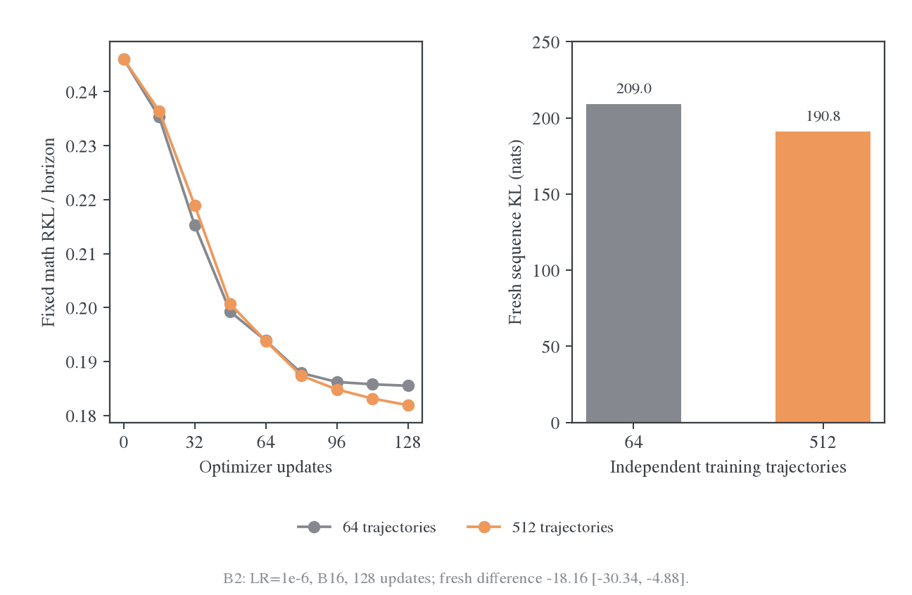

独立覆盖与小池重排的区别，另见[相同访问量的训练顺序对照](#batches-batch-order)。

<a id="mechanism-batch-size"></a>

<a id="mechanism-6-后期噪声更强但大-batch-不是充分修复"></a>

## 后期噪声与 batch 大小

N3 在同一参数点用 32 个 B16 完整梯度定义有限池平均和方差：

$$
\bar g=\frac1{32}\sum_i g_i,\quad V_{16}=\frac1{32}\sum_i\|g_i-\bar g\|^2,\quad
\rho_{16}=V_{16}/\|\bar g\|^2.
$$

这里的“信号”是固定 512 题池的平均，不是真实总体梯度。将 m 个不同小批均匀合并成 B=16m，池内方差为 $(32-m)V_{16}/(31m)$；B512 只消除池内抽样方差。B64/B128 的余弦平均由 4000 个真实梯度块组合估计。

| 参数点   | 平均梯度范数 | B16 方差迹 | 相对噪声 | 完整池平均与 Held64 余弦 |
| -------- | -----------: | ---------: | -------: | -----------------------: |
| J 初始   |        1.514 |      0.296 |    0.129 |                    0.985 |
| P 初始   |        1.244 |      0.622 |    0.402 |                    0.957 |
| J-own128 |        0.243 |      0.073 |    1.241 |                    0.879 |
| P-own128 |        0.211 |      0.380 |    8.568 |                    0.503 |

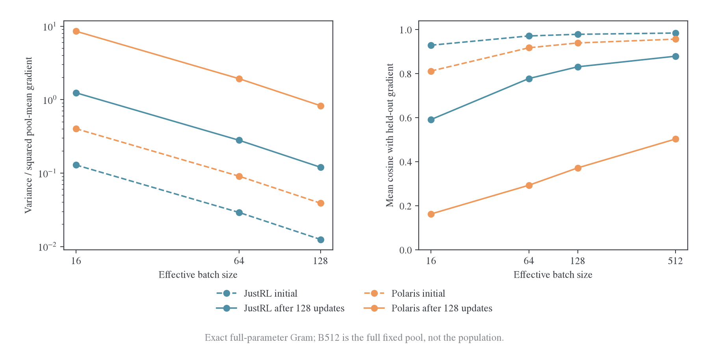

Polaris 绝对方差下降了，平均方向衰减得更快，才使相对噪声升高。后期 B16/64/128 相对噪声为 8.57/1.93/0.83，与留出梯度的平均余弦为 0.163/0.293/0.372；完整池仍只有 0.503。平均方向变弱与抽样波动是不同问题。

原始梯度不等于 Adam 更新。按冻结参数的真实批次顺序重放 beta1=0.9 一阶矩，P 后期第 16 步在 B16/64/128/512 下与留出余弦为 0.424/0.500/0.502/0.503。该重放只刻画一阶矩的平滑作用；实际更新还受参数变化、裁剪和二阶矩影响。结果说明单批 raw-gradient 噪声会高估动量后的部分波动。

<a id="mechanism-61-同更新次数与同样本预算给出不同结果"></a>

<a id="61-同更新次数与同样本预算给出不同结果"></a>

### 同更新次数与同样本预算给出不同结果

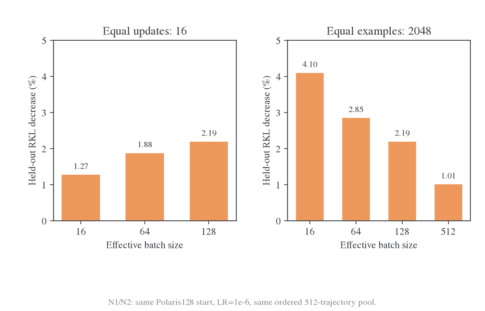

| 教师/阶段 | 同 16 更新：B16 / B64 / B128 下降 | 同 2048 条处理量：B16×128 / B64×32 / B128×16 下降 |
| --------- | --------------------------------- | ------------------------------------------------- |
| J 初始    | 10.23% / 14.36% / 16.69%          | 84.73% / 41.25% / 16.69%                          |
| P 初始    | 3.87% / 5.74% / 7.15%             | 26.05% / 15.31% / 7.15%                           |
| J-own128  | 23.74% / 30.37% / 33.24%          | 62.10% / 44.09% / 33.24%                          |
| P-own128  | 1.27% / 1.88% / 2.19%             | 4.10% / 2.85% / 2.19%                             |

P 后期同 16 步 B128−B16 的固定 RKL 差为−0.001706，区间[-0.001967,-0.001448]；同 2048 条预算则为 +0.003534，区间[0.002985,0.004033]。大 batch 提高单次更新效果，但同处理量下未弥补更新次数减少。

N2 完整 B512 的 4 步处理 2048 条，数学留出下降 1.01%；8 步处理 4096 条，KL 从 0.18558 到 0.18234，下降 1.75%。没有出现短程突破，也不能据此断言更长的大 batch 训练一定无效。

<a id="mechanism-62-固定下降尚未转化成可靠的-fresh-改善"></a>

<a id="62-固定下降尚未转化成可靠的-fresh-改善"></a>

### 固定下降尚未转化成可靠的 fresh 改善

P 后期起点 J 为 201.29。B16×128、B64×32、B128×16、B512×4、B512×8 的最终 J 分别 198.90、206.51、202.36、200.54、203.91，相对起点的 95% 区间全部包含零，已画在[干预对照图](#mechanism-overlap)下半。对应平均长度为 1024、1024、1012.64、1012.64、1012.64，长度单独保留。

同 2048 条预算下，P 后期 B16/B64/B128/B512 的 Code 风险分别下降 3.22%/2.26%/1.72%/0.80%，IF 下降 2.61%/1.71%/1.27%/0.51%；数学 FKL 反而上升 3.71%/2.32%/2.45%/1.56%。更稳定的 RKL 更新并未让双向距离同时改善。

这些结果不支持把生产 batch 直接扩大八倍当作主要修复。E48 本身已是 B64，而且训练 H7168；本机 H1024、B16 的噪声比不能直接套到生产。全部后期组未裁剪，所以后期差异不能归因于 clip 频率；Adam 重置、冻结 S0 轨迹和有限预算仍限制外推。

<a id="mechanism-supplement"></a>

<a id="mechanism-7-补充干预任务检查与文献定位"></a>

## 温度、目标方向与任务干预

<a id="mechanism-71-已运行但不作为主修复的目标干预"></a>

<a id="71-已运行但不作为主修复的目标干预"></a>

### 已运行但不作为主修复的目标干预

S 系列的来源与温度对照完整结果如下，均是 16 步后对原始温度 1 教师的固定风险降幅，两训练 fold 取均值；留出统一使用初始学生前缀。它只训练四题的稀疏前段，不能与 B/N 完整轨迹实验横比速度。

| 目标 / 训练 state    | 训练前段 | 同轨迹后段 | 数学留出 | Code 留出 | IF 留出 |
| -------------------- | -------: | ---------: | -------: | --------: | ------: |
| J / student          |   75.26% |      4.74% |    5.34% |     3.81% |   2.36% |
| J / JustRL           |   77.99% |      5.49% |    6.85% |     5.35% |   3.22% |
| P / student          |   69.80% |      2.48% |    1.84% |     0.56% |   0.26% |
| P / Polaris          |   76.04% |      5.57% |    2.36% |     0.69% |   0.24% |
| P 温度 1.5 / student |   64.28% |          — |    0.51% |     0.55% |   0.04% |

S2 用 P 温度 1.5 训练，初始 top-k 排序完全不变；回到原温度 1 评估，数学留出仅降 0.51%，温度 1 组为 1.84%。静态 KL 变小不代表对原始目标的迁移变好。

B3 在同一个 P-blocked128 上重新建立 Adam，三种目标各更新 32 次：

| 训练目标 | 数学 RKL 相对起点 | 数学 FKL 相对起点 | 数学 JS 相对起点 | Fresh J |
| -------- | ----------------: | ----------------: | ---------------: | ------: |
| RKL      |        下降 0.34% |        上升 2.20% |       上升 0.45% |  196.43 |
| FKL      |       上升 12.30% |       下降 14.41% |       下降 1.01% |  215.84 |
| JS       |        上升 2.94% |        下降 8.12% |       下降 2.10% |  200.07 |

父模型 fresh J 为 201.29。目标变换改善了它直接关注的距离，没有获得原生 RKL 和 fresh 风险的共同修复；该 warm 控制不预判正式 E49 或其他在线 FKL 配方。

B2 保留历史步长对照以完整记录 setting：64 题 LR1e-6/3e-6 的最终数学留出为 0.18551/0.18539；512 题为 0.18191/0.17665。512 题 LR3 的 fresh J 为 192.02，LR1 为 190.79，两者差区间含零。这部分不再展开为后续学习率研究方向。

<a id="mechanism-72-分布拟合与任务能力不能互相替代"></a>

<a id="72-分布拟合与任务能力不能互相替代"></a>

### 分布拟合与任务能力不能互相替代

I3 的 32 道 MATH-500 题、H4096、每题一答，初始/J-student/P-student/P-teacher/P-intersection/P-top16 的正确数为 21/22/20/23/22/21，自然 stop 数为 21/23/18/22/18/18；平均长度 2819/2558/2931/2372/2815/2766。相对初始的正确率配对区间均包含零。P/teacher 的序列 KL 不是最好，正确数点估计却最高，尚不能据此排名方法。

Grader 对非 boxed 答案有 fallback，空标准化 pred 不自动等于评分失败。其他本机系列未运行长回答任务准确率评测；Code/IF 的概率迁移不能表述成其任务性能提升。

<a id="mechanism-73-文献提供待检验方向不替代本机因果证据"></a>

<a id="73-文献提供待检验方向不替代本机因果证据"></a>

### 文献提供待检验方向，不替代本机因果证据

| 固定版本                         | 与本研究相关的结论                                                                                                    | 使用边界                                                                                     |
| -------------------------------- | --------------------------------------------------------------------------------------------------------------------- | -------------------------------------------------------------------------------------------- |
| 2610.11291v1[^mechanism-semi]    | 固定初始 student rollout 值得比较；图 5 的来源与完整推理阶段覆盖需分开，handoff 显示低 overlap 配对可能受在线反馈影响 | 主要是 sampled-token 目标；不能直接替代 full-vocab 实验，也不支持 teacher-on-policy 越强越好 |
| 2608.16647v3[^mechanism-coin]    | 图 3 同源跨领域影响更广，异源对领域更敏感；同源数学教师也可能损害非主领域                                             | 广泛迁移不等于所有任务能力均提升，不能推出领域无关                                           |
| 2604.13016v2[^mechanism-rethink] | 图 8 的 SFT 起点同时改变能力、数据与参数位置；后续 OPD 增益需分离                                                     | 高初始 overlap 不是唯一被识别因素；梯度抵消是作者提出但未直接验证的解释                      |

对四个梯度，早期报告的 $C=\|\sum_i g_i\|^2/(4\sum_i\|g_i\|^2)$ 以 0.25 表示两两正交；范数加权 pairwise cosine 与后续普通平均 cosine 也不同。论文中的交集内归一化 advantage 等于 $-\mathrm{KL}(\bar p_C\Vert\bar q_C)/|C|$，不是任务优势或跨 state 梯度一致性。正信号比例 $q(a)>p(a)$ 又受采样策略影响，S 中 P 虽比例更高却迁移更弱。这些量都不适合单独充当全局对齐分数。

<a id="batches-5-分析与后续问题"></a>

## 解释与下一步证据

现有结果支持三个判断：当前批仍可优化；收益向未见状态的传播明显弱于 JustRL；状态来源会影响固定风险与 fresh 表现。旧批保持、覆盖扩展及参数×轨迹交叉评分帮助区分这些现象。

剩余问题是共享更新为何减弱，以及增加覆盖、改变访问状态或表示是否能改善它。已有实际首步投影提供局部证据，完整更新区间与生产 E48 的匹配重放仍缺数据。[诊断设计依据](appendix/pair-design.md#mechanism-next)记录候选控制，[双来源协议](mechanisms/双来源待执行协议.md)给出尚未执行的具体比较。

<a id="mechanism-reproduction"></a>

<a id="mechanism-9-数据与图表复算"></a>

## 数据与复算

| 系列 | 数据与命令                                                                                                       | 主脚本                                                                                                                                                                                                                                               |
| ---- | ---------------------------------------------------------------------------------------------------------------- | ---------------------------------------------------------------------------------------------------------------------------------------------------------------------------------------------------------------------------------------------------- |
| S    | [冻结证据](transfer-mechanism/data/state-transfer-20261027/README.md)                                            | [state_transfer_probe.py](../../../research/studies/state_sources/state_transfer_probe.py)                                                                                                                                                           |
| I    | [冻结证据](transfer-mechanism/data/intersection-study-20261027/README.md)                                        | [intersection_study.py](../../../research/studies/state_sources/intersection_study.py)                                                                                                                                                               |
| B    | 冻结证据（本地证据：`../wandb-logs/MirrorOPD-verl/analysis/batch-transfer-20261027/README.md`）                  | [batch_generalization.py](../../../research/studies/cross_batch/batch_generalization.py)、[梯度测量](../../../research/studies/cross_batch/batch_gradient_geometry.py)                                                                               |
| N    | 冻结证据（本地证据：`../wandb-logs/MirrorOPD-verl/analysis/batch-size-stage-20261027/README.md`）                | [batch_size_stage.py](../../../research/studies/cross_batch/batch_size_stage.py)、[交叉概率分解](../../../research/studies/cross_batch/probe_overlap_mass.py)                                                                                        |
| L    | [40 批单遍数据与复算](../../../../../../wandb-logs/MirrorOPD-verl/analysis/twenty-batch-pass-20261027/README.md) | [双卡训练与真实更新诊断](../../../research/studies/cross_batch/long_batch_transfer.py)、[统计](../../../research/studies/cross_batch/analyze_long_batch_transfer.py)、[交叉评分](../../../research/studies/cross_batch/cross_score_long_transfer.py) |

八幅总览图直接读取上述冻结 JSON，保存 PNG/PDF、[绘图值与来源](transfer-mechanism/figures/synthesis-20261027/plot-data.json)、[图形审计](transfer-mechanism/figures/synthesis-20261027/audit.json)，没有手工录入图中实验数值。原整合的二十四幅结果图均保留，按主题分别展示在本文与[跨批次专题](README.md)中；其中跨批细节、来源对照和 L 的九幅图已迁入专题。复算仅用 CPU，不启动模型或训练：

```bash
# 在 MirrorOPD-verl 仓库根目录执行
FIGURE_VIZ_MPL="$PWD/../dotfiles/.agents/skills/figure-viz/assets/mpl" \
/root/.local/share/mirroropd/venvs/profile-cu128/bin/python \
  -m examples.mirroropd.research.studies.polaris_transfer.plot_transfer_synthesis \
  --workspace "$PWD/.." \
  --out examples/mirroropd/docs/experiments/teacher-transfer/transfer-mechanism/figures/synthesis-20261027
```

跨批细节图与 L 的九幅图、验证结果和复算命令已迁至[双来源专题的历史复算说明](#batches-historical-reproduction)。

冻结实验数据、模型和绘图输入按上述入口复算。状态来源、批间传播和单遍条件在本页的各节保留独立设置；[研究入口](README.md)汇总与失败复现、跨域迁移的关系。

<a id="mechanism-参考文献"></a>

### 参考文献

[^mechanism-semi]: Siyan Zhao et al. _When Do We Need On-Policy Distillation? Distilling on Offline Student Rollouts Is Often Better_. arXiv:2610.11291v1, 2026. [固定版本](https://arxiv.org/abs/2610.11291v1)。原 S 报告已核对 LaTeX 正文、图 5 及 handoff 设置。

[^mechanism-coin]: Zhaoyi Li et al. _Every Coin Has Two Sides: On the Dual Nature of Generalization in On-Policy Distillation of Large Language Models_. arXiv:2608.16647v3, 2026. [固定版本](https://arxiv.org/abs/2608.16647v3)。原报告核对图 3/6/9，另有[逐图笔记](../../literature/teacher-transfer/2026-10-26-策略蒸馏泛化的双重性实验与设置.md)。

[^mechanism-rethink]: Yaxuan Li et al. _Rethinking On-Policy Distillation of Large Language Models: Phenomenology, Mechanism, and Recipe_. arXiv:2604.13016v2, 2026. [固定版本](https://arxiv.org/abs/2604.13016v2)。原 S 报告核对图 8、overlap 定义及未验证的梯度各向异性假设。

<a id="batches-historical-reproduction"></a>

<a id="batches-6-证据与图表复算"></a>

### B/L 系列的读出与核验

旧 B 的原始证据位于工作区 `wandb-logs/MirrorOPD-verl/analysis/batch-transfer-20261027/`；旧 L 位于 `wandb-logs/MirrorOPD-verl/analysis/twenty-batch-pass-20261027/`，缓存和完整检查点位于 `wandb-logs/derived/MirrorOPD-verl/twenty-batch-pass-20261027/`。这些是历史数据路径，不是 R 的输出目录。

L 的 `risk-summary.json`、`transfer-matrix.json`、`incoming-batches.json`、`retention.json`、`within-block-summary.json`、`fresh-summary.json`、`cross-summary.json` 和 `verification.json` 分别保留风险、跨批矩阵、新批预先收益、旧批保持、块内变化、自由生成、参数—state 交叉评分与完成核验。旧 L 每 teacher 的 21×40 矩阵已完成，但完整模型只保存第 1/5/10/15/20 批；这正是新协议改为每批保存的原因。R 将完整重跑，不补评分旧 checkpoint。

本文迁入的单批与来源汇总图仍由 [plot_transfer_synthesis.py](../../../research/studies/polaris_transfer/plot_transfer_synthesis.py) 复算，共用图的来源索引见[总览复算说明](#mechanism-reproduction)。下述命令只复算已有历史图，不执行新实验。

多批细节图另由[plot_batch_transfer_detail.py](../../../research/studies/cross_batch/plot_batch_transfer_detail.py)复算，保存[完整曲线与路径分解数据](transfer-mechanism/figures/batch-transfer-detail-20261027/plot-data.json)及[图形审计](transfer-mechanism/figures/batch-transfer-detail-20261027/audit.json)。同样在 MirrorOPD-verl 仓库根目录运行：

```bash
FIGURE_VIZ_MPL="$PWD/../dotfiles/.agents/skills/figure-viz/assets/mpl" \
/root/.local/share/mirroropd/venvs/profile-cu128/bin/python \
  -m examples.mirroropd.research.studies.cross_batch.plot_batch_transfer_detail \
  --data ../wandb-logs/MirrorOPD-verl/analysis/batch-transfer-20261027 \
  --out examples/mirroropd/docs/experiments/teacher-transfer/transfer-mechanism/figures/batch-transfer-detail-20261027
```

L 系列的[九幅结果图及审计](transfer-mechanism/figures/twenty-batch-pass-20261027/audit.json)由[plot_long_batch_transfer.py](../../../research/studies/cross_batch/plot_long_batch_transfer.py)读取冻结汇总数据生成。双卡归一化、20 批单遍、640 次全局更新、21×40 固定银行、40 个只读首步诊断、640 条 fresh 输出和完整 Adam 状态连续性均通过[独立核验](../../../../../../wandb-logs/MirrorOPD-verl/analysis/twenty-batch-pass-20261027/verification.json)。每组首步 loss 与此前固定评分的最大差低于 6e-9，两副本参数在五个 checkpoint 处完全相同。全部 GPU 训练及交叉评分已经结束。
