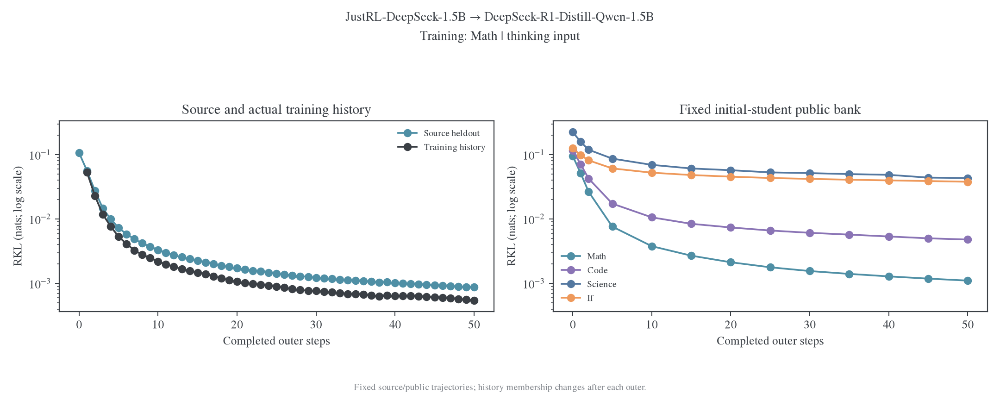
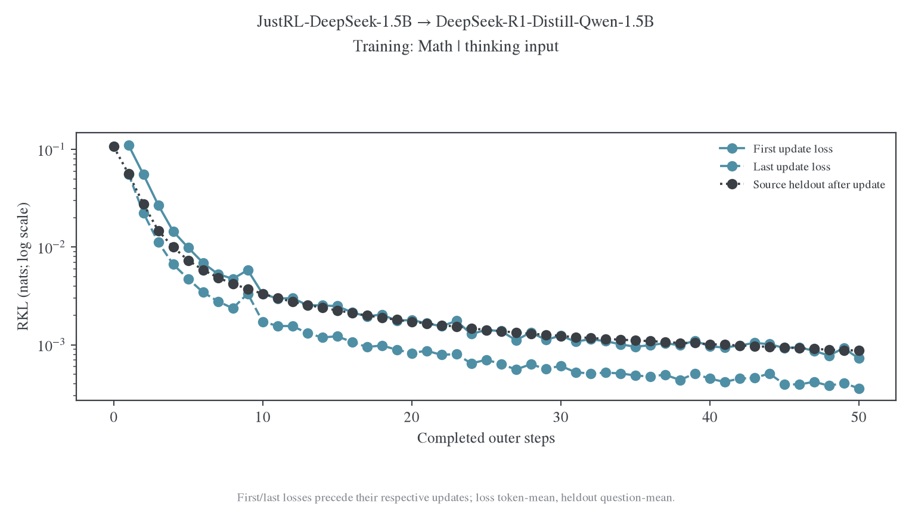
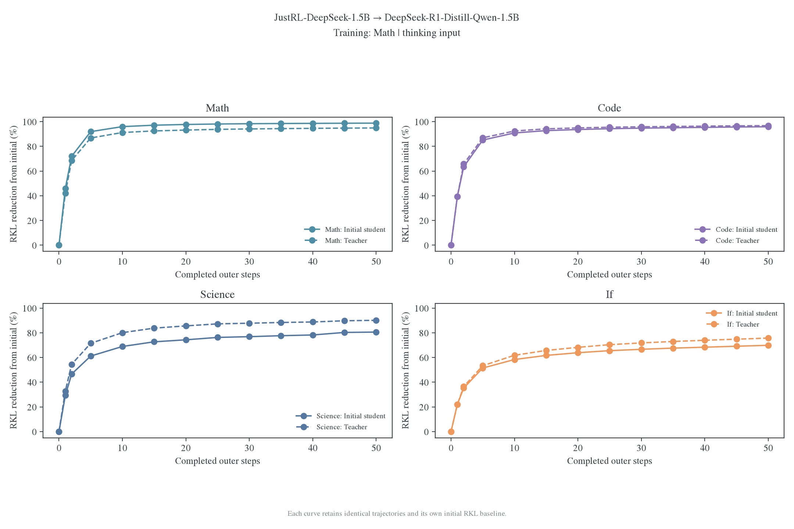
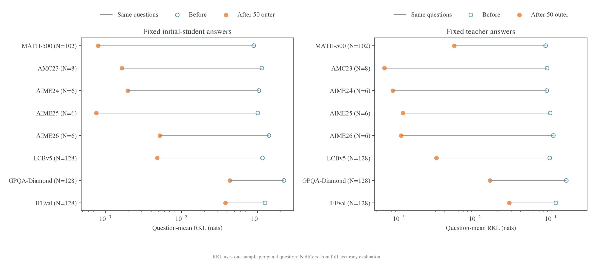
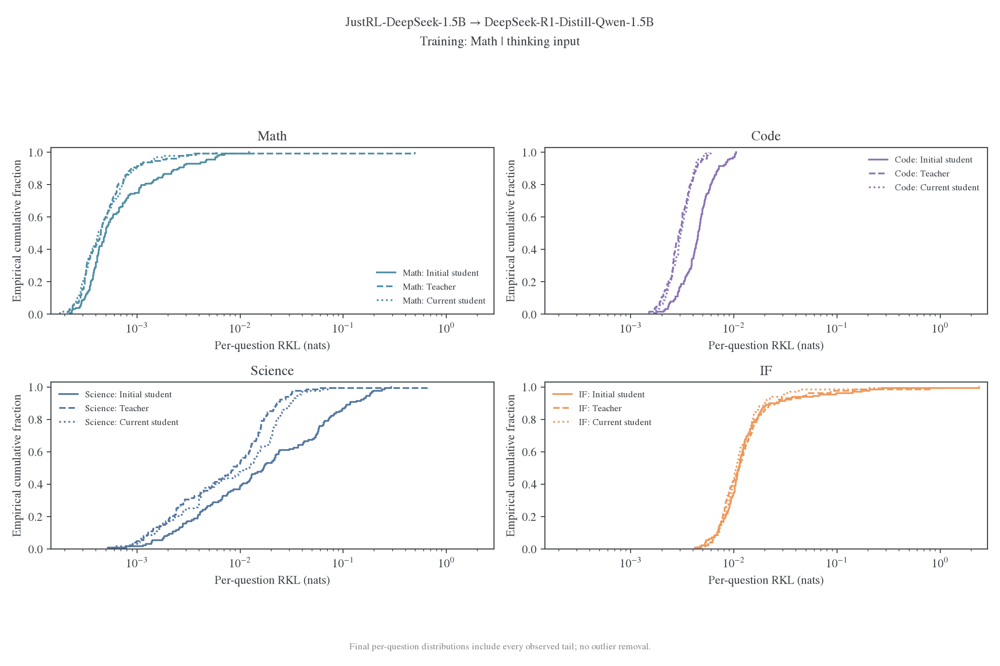
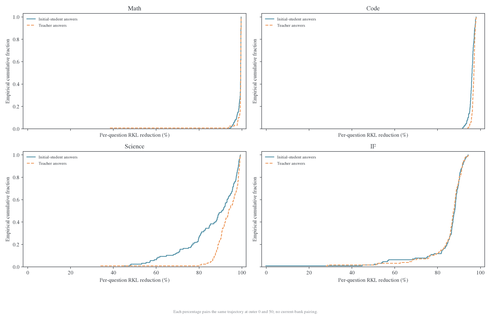
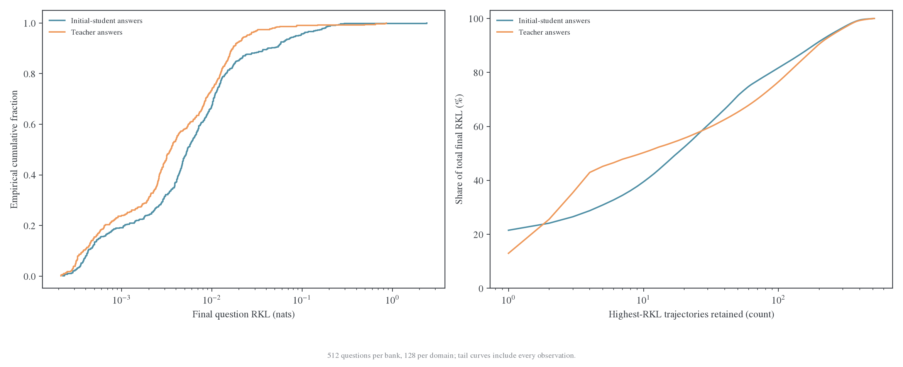
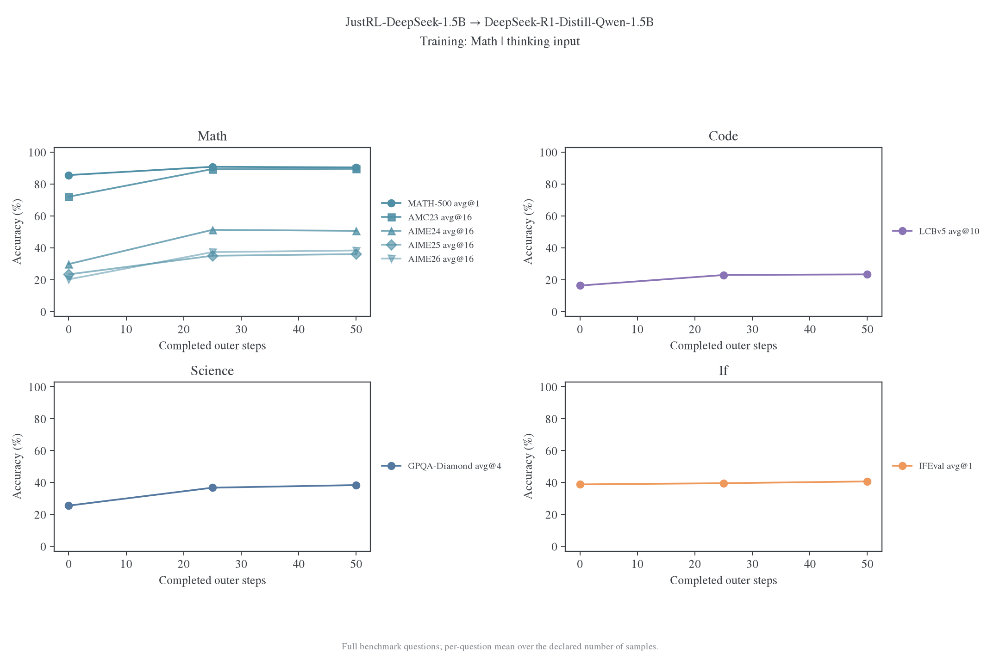

# 跨 domain 迁移：数学训练与四域读出

本页按训练域到评估域组织证据，当前完整结果来自下述数学单域分支。其他训练域的短程接入不填作完整科研结果；固定状态与按批刷新读出分别解释。

JustRL-DeepSeek-1.5B→DeepSeek-R1-Distill-Qwen-1.5B 完成数学单域的 50 outer、1600 次更新。来源留出 RKL 下降 99.18%，固定 initial-student 公共银行的四域均值下降 84.45%。数学与代码上的拟合程度高于 Science／IF；后两域的残差仍在下降，且部分均值由少量高风险轨迹贡献。

这是[按批刷新协议](protocols/online-four-domain.md)的首条正式分支。6400 道训练题跨 outer 不重复，每批的 32 次更新复用该批回答。既有固定状态 0–320 实验另行保留，不能把这里的 1600 次更新解释为重复旧题池的延长。

## 1. 研究问题与实际设置

研究同尺寸、同架构的 RL teacher，在数学训练后能否被学生充分拟合，以及这一拟合是否迁移到其他领域。教师与学生分别固定为下列本地 revision；该实验只有一个师生对、一个训练 seed，不直接比较 RL 与 SFT 算法。

| 项目       | 实际设置                                                                                    |
| ---------- | ------------------------------------------------------------------------------------------- |
| Student    | `deepseek-ai/DeepSeek-R1-Distill-Qwen-1.5B`，`ad9f0ae0864d7fbcd1cd905e3c6c5b069cc8b562`     |
| Teacher    | `hbx/JustRL-DeepSeek-1.5B`，`0637e4096c789c67f9eecbe8355e0bdeddede1c2`                      |
| 输入与生成 | 共享 student 的 thinking 输入；bootstrap／current 均使用共同 sampler 和合法 token 支持 mask |
| 训练来源   | 清洗后的 DAPO 数学题，6400 道训练题；来源留出 128 道                                        |
| 训练预算   | batch128、每题 1 条回答、reuse32、50 outer，1600 次实际更新                                 |
| 轨迹刷新   | 每 outer 用 current student 生成新批；批内保持 token 前缀，更新时重算 student 分布          |
| 优化器     | 全参数 AdamW，LR1e-6、constant、weight decay0.01；训练采用 token-mean                       |
| 回答预算   | 训练／来源留出 cap7168，公共 bench cap32768                                                 |
| 采样       | T=1、top-k=-1；训练／来源 top-p=1，公共 top-p=0.95，seed42                                  |
| RKL 定义   | T=1 的原生 151936 维 head 分布，未合并 EOS；生成支持 mask 与评分 head 支持分别定义          |
| 执行       | 原生 verl V1／FSDP2，四张 H800，teacher→student 串行；不长期缓存 teacher latent             |

RKL 先在题内按有效 response token 取均值，再按题平均。公共四域各取 128 题，外层按域等权；history 每轮从真实训练轨迹抽取 128 条，按历史批次分层，报告批等权均值。训练 loss 和 history／留出的平均方式不同，图中分别标明。

来源与 history 每 outer 读出；固定公共 initial-student／teacher 银行在 0／1／2 及每 5 outer 读出；current 公共 RKL 与全量 accuracy 在 0／25／50 读出。Current sample0 来自同一轮全量 accuracy 生成。完整评估包含 1648 道公共题、每模型／节点 6703 条回答：MATH-500×1，AMC23 与 AIME24／25／26×16，LCBv5×10，GPQA-Diamond×4，IFEval×1。

### 逐题 RKL 的统计单位

这里的“逐题”是**某一道题在某一来源的一条 sample0 回答上的 RKL**。设该回答包含 $L_i$ 个有效 response token，前缀为 $h_{it}$，则读数为

$$
K_i(\theta;y_i)=\frac{1}{L_i}\sum_{t=1}^{L_i}
D_{\mathrm{KL}}\!\left[p_\theta(\cdot\mid h_{it})\,\|\,p_T(\cdot\mid h_{it})\right],
\qquad \bar K=\frac{1}{N}\sum_{i=1}^{N}K_i.
$$

每个位置计算完整词表分布的 RKL；回答决定访问哪些前缀。Initial-student／teacher／current 表示**回答由谁生成**，三类银行的参考分布始终来自 JustRL teacher。Teacher 银行不是 teacher 与自身比较。

固定银行的初末比较使用同一道题、同一条回答、相同 token mask，只改变被评分的 student 权重。Current 银行换成当前模型新生成的回答，数值同时反映权重变化与访问状态变化。因此，固定旧轨迹上残差高，不能直接写成“当前学生不会做这道题”。

图中“整体相对降幅”采用 $100(1-\bar K_{50}/\bar K_0)$；逐题降幅采用 $100(1-K_{i,50}/K_{i,0})$。前者等于按初始 $K_{i,0}$ 加权的逐题降幅，通常不等于逐题降幅的算术平均或中位数。题内先平均后，长回答也不会仅因 token 多而获得更高的题间权重。

## 2. 训练与同来源留出共同下降

来源留出从 0.106830 降至 0.000873，下降 99.18%。最终训练 history 批等权 RKL 为 0.000548；这是动态抽样的历史轨迹，不能与另一组 history 成员直接计算固定集合的初末降幅。二者长期共同下降，表明收益延伸到了未训练过的同来源题目。

每批第一次与最后一次 loss 的相对降幅中位数为 51.47%。这些 loss 分别在各自更新之前计算，因此两点之间已经发生 31 次更新，图中的末点不是第 32 次更新之后的额外读出。下一批开始时的 loss 高于前一批末点，部分来自输入题目与 rollout 状态改变；不能只凭这条锯齿认定模型遗忘。

History 的共同轨迹变化和按历史批次拆分的曲线分别见[共同历史轨迹变化](transfer-mechanism/r1/figures/justrl-math-refresh-20261101/paired-history-change.png)、[历史批矩阵](transfer-mechanism/r1/figures/justrl-math-refresh-20261101/training-history.png)。这些图只展示实际抽到的训练轨迹，未全量重评所有旧批。

## 3. 固定银行上的跨域迁移

| 固定 initial-student 轨迹 | 初始 RKL | 最终 RKL | 相对降幅 |
| ------------------------- | -------: | -------: | -------: |
| 公共 Math                 | 0.094747 | 0.001107 |   98.83% |
| 公共 Code                 | 0.116505 | 0.004801 |   95.88% |
| 公共 Science              | 0.223244 | 0.043327 |   80.59% |
| 公共 IF                   | 0.125876 | 0.037923 |   69.87% |
| 四域等权均值              | 0.140093 | 0.021789 |   84.45% |

固定 teacher 银行的四域均值为 0.114655→0.012854，下降 88.79%。Math／Code／Science／IF 分别下降 94.92%／96.78%／90.12%／75.72%。同一银行保持相同轨迹，初末差异可解释为这些状态上的分布拟合变化；不同银行包含不同回答与状态，初始难度和末端绝对值分别报告。

Current-student 公共银行在终点的四域平均 RKL 为 0.010149，分域为 Math0.000602、Code0.003156、Science0.014484、IF0.022354。它衡量当前模型自己访问的状态；相较初始读数的变化同时包含参数拟合与状态分布迁移。[三类轨迹曲线](transfer-mechanism/r1/figures/justrl-math-refresh-20261101/rkl-by-domain.png)将其与固定银行分开画出。

### 按 benchmark 拆分的固定银行结果

此前保存的逐题 Parquet 包含 benchmark 标签，可以直接拆分，无需重新 forward。公共 Math 的 128 题按题库规模分配为 MATH-500 102 题、AMC23 8 题、每届 AIME 各 6 题；Code／Science／IF 各 128 题。下面每题只有一条固定回答，与后面的全量 accuracy 评估不同。

| Benchmark    | RKL 题数 | Initial-bank 初始→最终 |   降幅 | Teacher-bank 初始→最终 |   降幅 | Current-bank 最终 |
| ------------ | -------: | ---------------------: | -----: | ---------------------: | -----: | ----------------: |
| MATH-500     |      102 |      0.089492→0.000796 | 99.11% |      0.084932→0.005318 | 93.74% |          0.000532 |
| AMC23        |        8 |      0.114440→0.001651 | 98.56% |      0.088783→0.000641 | 99.28% |          0.000720 |
| AIME24       |        6 |      0.104325→0.001969 | 98.11% |      0.087783→0.000829 | 99.06% |          0.000641 |
| AIME25       |        6 |      0.101368→0.000755 | 99.26% |      0.097542→0.001127 | 98.85% |          0.001487 |
| AIME26       |        6 |      0.141623→0.005173 | 96.35% |      0.107493→0.001061 | 99.01% |          0.000702 |
| LCBv5        |      128 |      0.116505→0.004801 | 95.88% |      0.096499→0.003105 | 96.78% |          0.003156 |
| GPQA-Diamond |      128 |      0.223244→0.043327 | 80.59% |      0.159102→0.015717 | 90.12% |          0.014484 |
| IFEval       |      128 |      0.125876→0.037923 | 69.87% |      0.116062→0.028175 | 75.72% |          0.022354 |

Math 域均值按 102／8／6／6／6 道题加权，不能直接平均这五个 benchmark 的均值。AIME 每届仅 6 题，其差异适合定位样本，不适合据此排列三届 benchmark 的拟合难度。Teacher-bank MATH-500 的均值由单条异常回答主导，具体见下一节。完整数值见[分 bench RKL](transfer-mechanism/r1/data/justrl-bench-audit-20261101/bench-rkl.csv)，各读出节点见[分 bench 曲线数据](transfer-mechanism/r1/data/justrl-bench-audit-20261101/bench-curves.csv)。

## 4. 残差的尾部与代表轨迹

| 银行与领域              | 终点均值 |   中位数 |      P90 | 最大单题 RKL | 最大单题对均值的贡献 |
| ----------------------- | -------: | -------: | -------: | -----------: | -------------------: |
| Initial-student Math    | 0.001107 | 0.000495 | 0.002496 |     0.012231 |                8.63% |
| Teacher Math            | 0.004419 | 0.000447 | 0.000883 |     0.492066 |               86.99% |
| Initial-student Science | 0.043327 | 0.016901 | 0.116589 |     0.291808 |                5.26% |
| Initial-student IF      | 0.037923 | 0.011126 | 0.023519 |     2.400566 |               49.45% |

### 整体下降与少数尾部轨迹同时存在

固定 initial-student 银行的 512 条轨迹中有 511 条下降，唯一上升项是下面的 IF 重复回答；teacher 银行的 512 条全部下降。上图每个领域含 128 对相同轨迹，横轴为逐题相对降幅，纵轴为不超过该降幅的题目比例。它直接展示收益覆盖面，不能用“整体均值下降 84.45%”替代这项逐题统计。

左图保留全部 512 题，以对数横轴展示低残差的大多数和高残差尾部；右图把轨迹按终点 RKL 降序排列，展示最大的前若干条贡献了多少总残差。原先共用线性尺度的[初末散点图](transfer-mechanism/r1/figures/justrl-math-refresh-20261101/paired-question-rkl.png)会被最大值 2.4 拉开，多数点挤在零附近，因此需要结合这两张分布图阅读。

### 同一道题，换一条回答，RKL 可以相差很大

下表所有 RKL 都使用 **outer50 student 与同一个 JustRL teacher** 评分，区别只在输入轨迹。通过／未通过是该条生成回答的原始 grader 结果，不是用 RKL 推算的分数。

| 题目              | 回答来源                 | Response token | 结束原因 | 终点 RKL | 回答评分 |
| ----------------- | ------------------------ | -------------: | -------- | -------: | -------- |
| MATH-500 乘积化简 | Initial student          |           9354 | stop     | 0.001050 | 通过     |
| 同题              | Teacher                  |          32768 | length   | 0.492066 | 未通过   |
| 同题              | Current student，outer50 |          18302 | stop     | 0.003591 | 未通过   |
| IFEval 爵士歌曲   | Initial student          |          17033 | stop     | 2.400566 | 未通过   |
| 同题              | Teacher                  |           1753 | stop     | 0.012171 | 未通过   |
| 同题              | Current student，outer50 |            529 | stop     | 0.009390 | 通过     |

**MATH-500 乘积化简。** Teacher 的回答达到 32768 token，未出现 `</think>`，末段已经退化为碎片化数字、标点和文字。这条固定轨迹的 RKL 从 0.799203 降到 0.492066，仍贡献 teacher Math 终点均值的 86.99%，以及 teacher MATH-500 均值的 90.72%。相比之下，teacher Math 的中位数仅 0.000447，P90 为 0.000883。该均值主要反映一条异常长轨迹上的剩余差异，不能把它概括成所有数学题都留下较大残差。同题 current 回答 RKL 已很低，但 grader 仍判错，说明沿一条回答的低分布差异也不是正确性的保证。

**IFEval 爵士歌曲。** 固定 initial-student 回答包含大量 `!rate!rate!...`：`rate` 与 `!` 两种 token 合计 16547 个，占全部 17033 token 的 97.14%。它以 stop 结束，并非撞到 32K cap。该旧轨迹的 RKL 为 2.396698→2.400566，略升约 0.16%，贡献 initial IF 终点均值的 49.45%；其余 127 条 IF 轨迹均下降。同题 current 回答只有 529 token，RKL 为 0.009390，而且通过了 IFEval。准确的描述是“**固定的旧重复轨迹几乎没有改善**”，而不是“这道题在训练后没有改善”。97.14% 是 token 比例，不是这些位置占 KL 的比例；后者需要逐位置读出才能确定。

Science 的 P90 为 0.116589，最大单题只占域内终点残差的 5.26%，说明其残差比上述两个例子更分散。正文保留未筛选均值，同时报告中位数、P90 和尾部贡献；不把异常回答删除后得到的更低均值当作主结果。

两题的完整 ID、原始 Parquet 位置及文本摘要见[轨迹核对记录](transfer-mechanism/r1/data/justrl-bench-audit-20261101/case-trajectories.json)，对应评分见[回答评分](transfer-mechanism/r1/data/justrl-bench-audit-20261101/case-accuracy.csv)。全部固定轨迹的配对值见[逐题初末表](transfer-mechanism/r1/data/justrl-bench-audit-20261101/paired-questions.csv)；三种回答来源之间的同题比较另存为[同题不同轨迹表](transfer-mechanism/r1/data/justrl-bench-audit-20261101/same-question-different-trajectories.csv)，不将其当作固定轨迹的学习降幅。

## 5. 后半程仍有收益

| 固定银行                | 25→50 outer 剩余 RKL 的相对降幅 |
| ----------------------- | ------------------------------: |
| 来源留出                |                          38.50% |
| Initial-student Math    |                          37.84% |
| Initial-student Code    |                          27.61% |
| Initial-student Science |                          18.22% |
| Initial-student IF      |                          12.56% |

后半程的绝对降幅小于初期，但各固定银行仍改善。这里同时增加了 3200 道新题和 800 次更新，因此不能将收益单独归因于更多优化步数。这个结果支持继续研究残差与训练分布的关系，尚未给出不可拟合的极限。这里没有追加训练或重复题池延长，也不将有限预算下非零 RKL 当作容量障碍的证明。

### 全量 benchmark accuracy

Accuracy 使用全部 1648 题，每模型／节点生成 6703 条回答。各 benchmark 按题先平均 n 条回答的分数，再按题平均，报告 avg@n；它不是 pass@n。IFEval 此处为 prompt-level strict accuracy。表中数值为百分比，GapRecovery 使用 outer50 相对 initial student 恢复的师生准确率差距。

| Benchmark    | 全量题数 |   n | Initial student | Teacher | Outer25 | Outer50 | GapRecovery |
| ------------ | -------: | --: | --------------: | ------: | ------: | ------: | ----------: |
| MATH-500     |      500 |   1 |           85.60 |   92.00 |   90.80 |   90.40 |      75.00% |
| AMC23        |       40 |  16 |           72.03 |   90.00 |   89.38 |   89.53 |      97.39% |
| AIME24       |       30 |  16 |           29.79 |   53.54 |   51.25 |   50.62 |      87.72% |
| AIME25       |       30 |  16 |           23.33 |   37.92 |   35.00 |   36.04 |      87.14% |
| AIME26       |       30 |  16 |           20.21 |   38.75 |   37.29 |   38.33 |      97.75% |
| LCBv5        |      279 |  10 |           16.31 |   22.65 |   22.94 |   23.33 |     110.73% |
| GPQA-Diamond |      198 |   4 |           25.51 |   39.90 |   36.74 |   38.38 |      89.47% |
| IFEval       |      541 |   1 |           38.82 |   42.70 |   39.56 |   40.67 |      47.62% |

八个 benchmark 的 outer50 准确率均高于 initial student。25→50 时，MATH-500 为 90.8%→90.4%，AIME24 为 51.25%→50.625%，其余六项上升；同期固定轨迹 RKL 继续下降，所以两类指标的变化并非一一对应。LCBv5 的本次估计超过 teacher，GapRecovery 为 110.73%，不等于已经证明总体能力超过 teacher。终点固定为 outer50，没有按 accuracy 挑选中途节点。

[重算后的准确率表](transfer-mechanism/r1/data/justrl-bench-audit-20261101/bench-accuracy.csv)保留题数、n、实际回答数与未四舍五入的结果。RKL 与 accuracy 的题数和轨迹集合不同，不能将全量 accuracy 与单个 128 题银行的 RKL 当作同一样本上的相关性分析。

## 6. 产物、复现与解释范围

### 本次逐题统计核对

从原始 `rkl.parquet` 与 accuracy 分片重新计算，完成了以下核对：

- 各事件的读数 ID 无重复；RKL sum 有限且非负，有效 token 数为正。
- 两个固定公共银行共 1024 条轨迹，在实际读出节点与 outer0 的题目 ID、轨迹 ID、benchmark、sample index 和 token 数一致。
- 终点 initial／teacher／current 三个银行共 1536 条记录，逐条核对到生成文件中的 source ID、sample0 和 response mask，有效 token 数一致；三类银行共享相同的 512 道题。
- 从逐题 sum/count 重建各域均值和四域均值，与事件记录一致；从四组 accuracy 的原始回答评分重建 avg@n，与记录一致。

题目身份、分母和图表聚合值与原始记录一致。分析按 benchmark 题数、残差尾部和轨迹来源展开：固定回答上的残差描述这些前缀上的拟合程度。

核对结果与来源 hash 见[统计审计](transfer-mechanism/r1/data/justrl-bench-audit-20261101/audit.json)、[轨迹及 mask 核对](transfer-mechanism/r1/data/justrl-bench-audit-20261101/bank-audit.json)。核对使用既存标量与轨迹身份。原始数据粒度为逐题；定位重复段内的 KL 峰值还需要逐 token 读出。

完整日志位于仓库 `runs/unified-evaluation-20261031/justrl-r1-1p5b-math-50outer-common-v1/`。运行清单核对到 6400 道唯一训练题、1600 条实际更新、51 个完整评估节点，RKL 无无效读数。最终只保留一个 HF 模型，不含 optimizer 或中途恢复点；native 重载和独立新进程 HF 回读均通过，原 128 条来源轨迹的逐题 RKL 最大误差为 0，见[独立回读记录](transfer-mechanism/r1/data/justrl-math-refresh-20261101/hf-reload.json)。

[分析表与来源 hash](transfer-mechanism/r1/data/justrl-math-refresh-20261101/summary.json)、[图表清单](transfer-mechanism/r1/figures/justrl-math-refresh-20261101/manifest.json)记录实际产物。图表由[统一绘图入口](../../../research/studies/pipeline/plot_unified_evaluation.py)生成，分析表由[汇总入口](../../../research/studies/pipeline/summarize_unified_evaluation.py)生成；CSV、PNG、PDF 与审计记录同目录保存。

图目录同时保存`plot-inputs.json`与完整数值 CSV。在相同 Python 依赖及 figure-viz 样式环境下，可以将这个图目录直接传给绘图入口的`--run`，输出到新的`--output`目录，不需要模型权重或原始 rollout 文件。12 张 PNG 的独立重绘已逐像素核对一致；图输入有 hash 校验，每个 run 必须使用独立输出目录。

分 bench 与逐题审计由[审计绘图入口](../../../research/studies/pipeline/audit_question_rkl.py)生成，新图见[图表清单](transfer-mechanism/r1/figures/justrl-bench-audit-20261101/manifest.json)。

其余诊断包括[1600 次更新的 loss／梯度](transfer-mechanism/r1/figures/justrl-math-refresh-20261101/training-updates.png)、[逐题初末配对](transfer-mechanism/r1/figures/justrl-math-refresh-20261101/paired-question-rkl.png)、[评估阶段耗时](transfer-mechanism/r1/figures/justrl-math-refresh-20261101/evaluation-timing.png)。实际协议以冻结配置为准，后续共同支持条件 RKL 和模型适配代码不会改变本实验的原生 head 指标。

这条分支显示，在所测数学题池与固定状态上，同构 RL 教师可以得到很高的拟合程度，也显示了跨域与尾部轨迹的残差。尚未完成 Code／Science／IF 各自训练的正式对照、同构 SFT 比较或小 teacher→大 student 的新协议实验；这些问题仍需各自的控制实验。
