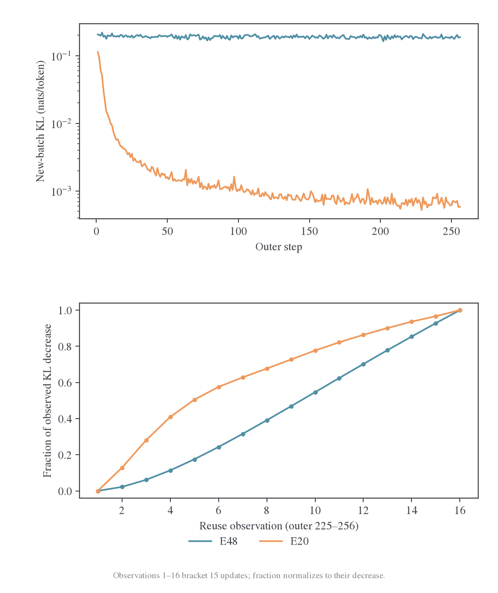
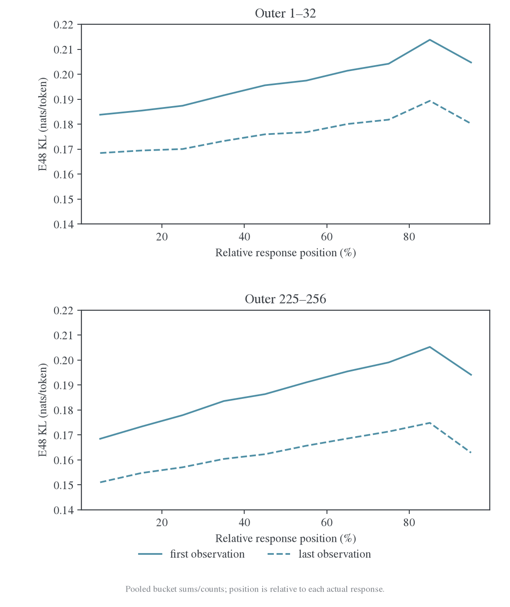
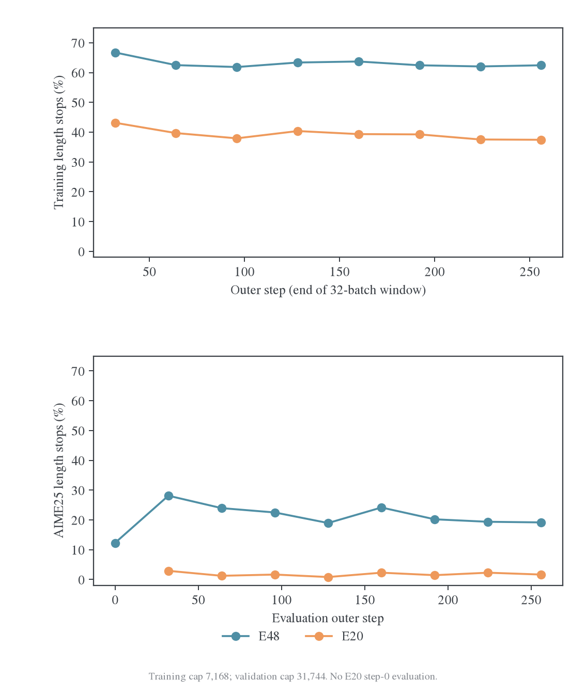

# E48 完整训练与后期平台分析

## 背景与 motivation

Polaris 跨源蒸馏中，当前批仍能优化而新批起点保持较高残差。完整训练用于判断这一现象是否只是早期暂态，并区分分布拟合平台、生成长度和实际任务收益；不能把换批 loss 回升直接解释成遗忘。

## Setting 与实验设计

### 1. 新证据边界与口径

从独立日志仓库拉取至提交 `b5cdd40f2ea42c92e2f3f25b0ca380c49e5c8f53`，原始 `.wandb` 从约 9.8 MiB 扩展到约 41.8 MiB。读取器完整解码得到 4353 条 history、4096 条逐更新观测、256 条 outer 摘要和 8018 条周期系统记录；读到正常退出记录。API 只读核对的最后 `_step` 为 4352，真实 optimizer 计数 4096，不能把 W&B 事件数当训练步数。

新快照的前 987 条 history 与上次 58-outer 快照逐项完全相同，config 也完全相同。这是同一 run 的完整后续记录，没有把另一次实验拼接到旧结果后。新增指标只有 `perf/timing/save_checkpoint_seconds`；总计 2271 个不同 history 字段，完整数值目录在 `E48-all-metrics.csv`。

主对照 E20 `lwgb5eex`同样完整到 256 outer / 4096 更新。两者的 student、DAPO、batch64、rollout n=1、reuse16、LR=1e-6、训练 cap=7168、验证 cap=31744 及 Full-KL backend/chunk设置一致；teacher分别为Polaris-7B和JustRL-1.5B。E48有初始验证，E20没有。接口和代码版本差异、相同seed不等于相同轨迹等边界沿用[早期诊断](../../../../archive/experiments/polaris/2026-10-26-E48异源教师收敛诊断.md)。

所有 KL 均以自然对数计算。第 1、第 16 次观测来自相应 optimizer 操作之前，两条观测之间是 15 次更新；日志没有第 16 次操作完成后对同一批的额外前向。下文不把“第 16 次观测”称为 16 次操作后的严格终点。

## 实验结果

更新日期：2026-10-27。Run：`grcuotmi`[^run]，`math-opd-E48-20261026-180739-2571`。完整原始日志已更新至 **256 outer / 4096 optimizer updates，exit_code=0**；云端状态也为 finished。本文替代旧报告对“当前运行状态”的描述，但不覆盖旧报告冻结的 58-step 数据。[完整证据与复算入口](data/polaris-complete-20261027/README.md)。

完整曲线确认了一个长期高残差平台：最后 32 批的新轨迹起点 KL 为 0.187417，批内第 16 次观测为 0.162859。当前批仍能下降约 13.11%，梯度仍明显非零，但后续新批没有积累相应的分布拟合收益。**这更符合不断刷新前缀、有限批内优化和当前 optimizer 共同形成的动态平衡，而不是固定目标已经达到不可降低的 0.16 下界。**

同时有三项需要修正或补充早期判断：验证长尾在 outer32 达到较差水平后有所恢复，没有持续膨胀；E20 进入低 KL 平台后也有接近 99% 的“批间抵消比”，所以该比值不是迁移失败的专属判据；最终 MATH-500 任务表现已接近 E20，不能把 teacher KL 高直接解释为任务能力没有改善。

### 2. 高残差平台在 outer64 附近已经基本形成

以下每行按 32 个 outer 平均；首次与末次先分别平均。

| Outer 窗口 | E48 首次 KL | E48 第 16 次 KL | E48 第 16 次梯度范数 | E20 首次 KL | E20 第 16 次 KL |
| ---------- | ----------: | --------------: | -------------------: | ----------: | --------------: |
| 1–32       |    0.196509 |        0.176548 |              0.19845 |    0.016111 |        0.011740 |
| 33–64      |    0.190545 |        0.168073 |              0.14138 |    0.001775 |        0.001076 |
| 65–96      |    0.188542 |        0.165270 |              0.13889 |    0.001219 |        0.000693 |
| 97–128     |    0.191402 |        0.167082 |              0.14030 |    0.000956 |        0.000540 |
| 129–160    |    0.189355 |        0.164889 |              0.13917 |    0.000798 |        0.000444 |
| 161–192    |    0.188557 |        0.163834 |              0.13959 |    0.000765 |        0.000426 |
| 193–224    |    0.187542 |        0.162962 |              0.14026 |    0.000691 |        0.000379 |
| 225–256    |    0.187417 |        0.162859 |              0.13890 |    0.000687 |        0.000375 |

从 65–96 窗口到 225–256 窗口，E48 新批起点只下降 **0.60%**，批内末次只下降 **1.46%**；E20 分别下降 43.63% 和 45.84%。E48 后期不是完全没有变化，但继续相同配方的边际拟合收益已很小。

最后 32 批中，E48 的首次和末次 KL 分别约为 E20 的 273 倍和 434 倍。它们拟合不同 teacher，绝对 loss 不能用来直接比较任务能力；在相同 student 与预算下，这个差距仍明确说明 Polaris 条件分布难以按当前配方充分对齐。

4096 次更新全部执行，没有非有限 loss/梯度或跳步。全程只有前 8 次更新的梯度范数大于 1，后期不触发裁剪；LR 全程保持 1e-6。Loss 与完整 KL 的最大差值仅`3.80e-8`，位置桶重建总 KL 的误差仅`1.79e-8`。平台不是由记录归约误差、学习率降到零或大量跳过更新造成的。

#### 2.1 去掉 token 均值的长度归一化，平台仍然存在

每批首次 KL 与同批 response token 数可以还原“每条回答的累计条件 KL”：

$$
\widehat J_j=A_j\frac{N_{\mathrm{response\ tokens},j}}{B_j}
=\frac1{B_j}\sum_{i=1}^{B_j}\sum_t d_\theta(s_{it}).
$$

先逐批计算，再对 32 批平均；不能用窗口平均 KL 乘窗口平均长度替代它。

| Outer 窗口 | E48 累计条件 KL/回答 | E20 累计条件 KL/回答 |
| ---------- | -------------------: | -------------------: |
| 1–32       |              1248.67 |                95.01 |
| 65–96      |              1164.62 |                 6.91 |
| 225–256    |              1170.50 |                 3.90 |

E48 从 65–96 到最终窗口的累计量反而略升约 0.50%。因此平台不是单纯由 token-mean 的长度分母变化制造的假象。这个量只能用新批首次观测解释为 fresh 轨迹统计，不能把第 16 次 reuse 的 loss 代入后仍称作 fresh。

在生成策略与评分时的当前 student 一致、相同 EOS 停止规则和固定 H=7168 等条件下，完整条件 KL 沿 student 轨迹的和可估计有限长度序列 KL。配置的 temperature=1、top-p=1 与同步生成符合这一意图，但该 run 没有记录跨 backend 概率差来检验数值一致性，故这里保守称为“累计条件 KL/回答”，不宣称已独立验收严格的序列 KL 估计器。它也不代表训练反传了 state 访问分布的梯度。

### 3. 新线索：批内前几步慢，停止复用时仍未充分拟合

E48 全部 256 批的 3840 个批内相邻 KL 观测都严格下降，未出现同批更新后的 KL 反弹。后期平均轨迹如下：

| Reuse 观测序号 |   E48 KL | E48 梯度范数 |     E20 KL |
| -------------- | -------: | -----------: | ---------: |
| 1              | 0.187417 |      0.23123 | 0.00068735 |
| 2              | 0.186876 |      0.23243 | 0.00064735 |
| 4              | 0.184626 |      0.20746 | 0.00055961 |
| 8              | 0.177813 |      0.17634 | 0.00047609 |
| 12             | 0.170178 |      0.15296 | 0.00041785 |
| 16             | 0.162859 |      0.13890 | 0.00037522 |

以观测 1→5 的四个操作和观测 12→16 的四个操作比较：

| Outer225–256 | 前 4 次平均 KL 降幅/操作 | 后 4 次平均 KL 降幅/操作 |    后/前 |
| ------------ | -----------------------: | -----------------------: | -------: |
| E48          |               0.00107446 |               0.00182974 | **1.70** |
| E20          |               0.00003939 |               0.00001066 | **0.27** |

E48 最后 32 批全部满足“后 4 次收益大于前 4 次”，E20 为 0/32。E48 每批开始的数次更新较慢，约第 9–11 次观测附近单步降幅较大，随后有所回落，但到第 16 次仍有明显下降。它没有呈现“当前固定批已经基本到最低点，所以接下来怎么更新都没用”的形状。

一个值得优先检验的机制是：每次换成新批前缀后，Adam 的历史方向需要重新适应。对于β1=0.9，旧一阶矩在更新 4、8、16 次后的线性系数分别为 0.656、0.430、0.185。这不是实际参数位移由旧动量贡献的百分比，因为还存在当前梯度、二阶矩、bias correction 和权重舍入；它只是说明 reuse16 并没有让旧历史瞬间消失。

同源 teacher 的修正方向可能跨批更一致，旧历史可以帮助新批；跨源监督更依赖具体前缀时，相同历史也可能拖慢新批开始的拟合。现有曲线与这个解释相容，**但尚没有测量 E48 的梯度—动量夹角或实际参数更新，不能认定动量已被证明是根因**。BF16 可见更新、局部曲率、参数步幅和 state-specific 梯度同样可能影响这种形状。

已有[Full-vocab 优化器计划](../../optimizer-precision/full-rkl/2026-10-27-Full-vocab-OPD优化器大规模实验计划.md)正好区分这些问题；其小实验和另一项 MDPO 历史对照都不能直接替代 E48 晚期 checkpoint 的因果重放。

### 4. “99% 抵消”只能描述平台，不能单独解释它

令每批首次 KL 为 $A_j$，第 16 次观测为 $B_j$，则有恒等式：

$$
\sum_{j=l}^{h-1}(A_{j+1}-B_j)
=\sum_{j=l}^{h-1}(A_j-B_j)+(A_h-A_l).
$$

只要窗口起终点的 $A$ 接近，右侧第二项接近零，“下一批起点差值 / 批内下降量”的比值就自然接近 1，平台高低都可以如此。

| 窗口                 | E48 比值 | E20 比值 |
| -------------------- | -------: | -------: |
| 1–58（此前分析范围） |   99.01% |   29.01% |
| 1–256                |   99.69% |   51.79% |
| 65–256               |  100.19% |   98.70% |
| 193–256              |  100.38% |   99.77% |

E20 后期也接近 99%，但它的 loss 平台低了两个以上数量级。因此不能把“99%”解释为 99% 的学习被遗忘，更不能据此判定梯度完全不能迁移。批间还同时换题、换轨迹，夹着未单独观测的第 16 次更新。

跨 state 迁移较弱的证据应来自固定 input 对照，而不是这个比值。本机[受控短实验](../../transfer-mechanism/2026-10-27-跨源蒸馏泛化研究总览.md#series-s)以及后续[扩大前缀与 fresh 评估](../../transfer-mechanism/2026-10-27-跨源蒸馏泛化研究总览.md#series-i)确实观察到 Polaris 的迁移弱于 JustRL；扩大实验也显示 Polaris 有正向迁移，并非完全不能泛化。这些独立实验的 horizon、训练 budget 与 E48 不同，不能把它们的百分比直接代入 E48。

### 5. 位置与长度：没有单独的尾段崩溃，仍存在长期覆盖不足

后期第一 10% 位置桶的 KL 为 0.16846→0.15104，最后 10% 为 0.19409→0.16290；残余最高的是 80–90% 桶，约 0.17483。十个桶都能批内下降，十个桶也都保留较高残差。最后一桶并不是残差最大的桶，不能把全部平台归为 EOS 附近的问题。

这些桶按每条实际回答的相对位置定义。约六成回答被截断时，最后一桶主要仍是推理中的 state，不等于最终答案段。当前 run 没有绝对位置、推理/答案阶段、正确/错误及 stop/length 条件下的 KL，无法从这些十分桶再作更细的语义归因。

E48 训练平均长度在各 32-batch 窗口约 6175–6353 token 之间，length finish 比例约 61.9%–66.7%。后期长度稳定，没有不断膨胀。最后 32 批的平均长度为 6244.5，触顶率 62.45%；E20 为 5669.2 和 37.45%。

按 7168 cap 和实际 length finish 计数估算，E48 后期约 **71.69% 的训练 response token 来自截断回答**，E20 约 47.35%。这使 token-mean loss 长期偏向未完成的长推理轨迹；完整答案和自然停止位置的覆盖仍是一个结构性问题。但由于训练长度没有持续增长，它不足以支持“后期越来越长，所以 KL 持续恶化”的叙述。

4096 次 optimizer 操作只对应 256 批新生成轨迹，即 16,384 个 prompt 槽位，而不是 4096 批新题。E48 共生成 102.127M response token，16 次复用对应约 1.634B response-token 训练访问；E20 新生成 93.368M。大量更新花在同一批固定前缀上，扩大新 state 覆盖和加深同批拟合是不同的预算选择。

### 6. 完整验证曲线：MATH 接近同源，困难任务仍有差距

全部训练后验证均为相同的 MATH-500/AMC23/AIME25，500/40/30 题，各 16 答。下表为 mean accuracy 百分比：

| Outer / 更新数 |   E48 MATH |    E48 AMC |   E48 AIME |   E20 MATH |    E20 AMC |   E20 AIME |
| -------------- | ---------: | ---------: | ---------: | ---------: | ---------: | ---------: |
| 0 / 0          |     82.750 |     68.906 |     23.958 |          — |          — |          — |
| 32 / 512       |     86.575 |     75.625 |     27.708 |     87.488 |     86.719 |     35.000 |
| 64 / 1024      |     87.700 |     78.906 |     28.958 |     88.263 |     88.906 |     34.583 |
| 96 / 1536      |     87.338 |     77.969 |     31.458 |     87.737 |     87.188 |     35.625 |
| 128 / 2048     |     87.500 |     77.344 |     31.250 |     88.200 |     88.750 |     34.375 |
| 160 / 2560     |     87.575 |     74.531 |     28.750 |     87.963 |     89.219 |     35.625 |
| 192 / 3072     |     87.562 |     78.906 |     27.917 |     88.425 |     89.688 |     35.208 |
| 224 / 3584     |     87.838 |     79.062 |     30.833 |     87.800 |     88.906 |     37.292 |
| 256 / 4096     | **87.825** | **79.688** | **28.750** | **88.113** | **88.594** | **34.375** |

E48 最终相对自身初始分别提高 5.075、10.781、4.792 pp。相对 outer64，再增加 3072 次更新后，变化只有 +0.125、+0.781、−0.208 pp；中间仍有波动，没有各集合持续改善的趋势。

不能只看 mean：最终完整指标还揭示了不同的瓶颈。

| 数据集 / 指标       |    E48 |    E20 |
| ------------------- | -----: | -----: |
| MATH pass@16        |  96.4% |  95.8% |
| MATH majority@16    |  92.6% |  92.1% |
| MATH all-correct@16 |  69.8% |  69.8% |
| AMC pass@16         |  97.5% |  95.0% |
| AMC majority@16     |  95.0% |  95.0% |
| AMC all-correct@16  |  50.0% |  57.5% |
| AIME pass@16        |  50.0% |  60.0% |
| AIME majority@16    | 36.67% | 41.67% |
| AIME all-correct@16 |  6.67% | 16.67% |

MATH 的 mean 仅差 0.2875pp，其余几个指标甚至略高或相同。AMC 在 16 答覆盖和投票上不差，但 mean 低 8.906pp、全对题数更少；这更像平均回答的稳定性和完成行为不足，不能称为“完全学不会这些题”。AIME 则在平均正确率、覆盖和稳定性上都落后，说明更难任务上仍有未解决差距。

所有验证的 failed_count 为 0。单个 run、AIME30 题和 AMC40 题不足以给出跨 seed 能力排序；最终 AIME mean 的题目 bootstrap 区间为 E48 [13.41%,42.42%]、E20 [18.41%,49.09%]。不能挑 E48 的 outer96 最好点与 E20 最终点混比，也不能把区间重叠当作已证明等效。

### 7. 验证长尾有所恢复，但仍远多于 E20

| 数据集   | E48 outer0 触顶率 | E48 outer32 | E48 outer256 | E20 outer256 |
| -------- | ----------------: | ----------: | -----------: | -----------: |
| MATH-500 |             2.21% |       4.39% |        2.40% |        1.00% |
| AMC23    |             5.31% |      12.97% |        8.59% |        1.41% |
| AIME25   |            12.29% |      28.13% |       19.17% |        1.67% |

E48 最终 AIME 平均长度 18364，低于 outer32 的 20244，但仍高于初始 16095 和 E20 最终 10307。AMC 为 10551，对照 6502；MATH 为 5846，对照 4368。它没有发生持续长度崩溃，但也没有恢复到同源对照的完成效率。

最终 MATH/AMC/AIME 的答案解析缺失数为 184/55/87，对照 77/7/7；各集合回答预算为 8000/640/480。这些是已完成评分但没有可解析答案的槽位，不是评测基础设施丢失回答。现有聚合日志不能证明哪些缺失同时触顶，也不能确定这些回答若完成会答对多少，因此不把全部准确率差归因于截断。

这一点也限制了 teacher KL 的解释：它包含局部措辞、概率置信度、推理和答案等多种差异，不是正确率的替代指标。最终 MATH 已接近 E20 而 KL 仍高很多，说明继续拟合 teacher 分布与继续获得任务收益不能混为一谈；也没有证据认定剩余 KL 全部是无关紧要的风格差异。

## 分析与下一步

### 8. 对原因的分级判断

| 判断                                                | 当前证据强度                                                    |
| --------------------------------------------------- | --------------------------------------------------------------- |
| 当前批的条件分布仍可优化，16 次复用未使该批完全拟合 | 强：所有批内相邻观测下降，末段仍有较大收益                      |
| 大量批内拟合收益没有转化为新轨迹上的持续 KL 下降    | 强：完整 256 批曲线；但比值本身不作因果解释                     |
| 跨源目标的跨 state 迁移弱于同源                     | 有独立固定 state 与扩大实验支持；未直接回放 E48 晚期 checkpoint |
| 长推理截断和不完整阶段覆盖限制学习                  | 明确存在的输入条件，机制合理；没有独立干预量化其贡献            |
| Adam 历史/预条件与刷新批次不匹配                    | 新的批内速度形状支持优先检验；尚非已确认根因                    |
| BF16 可见更新或参数步幅参与平台                     | 已有其他小实验提示；E48 缺实际更新诊断，不能从 norm 非零排除    |
| 0.16 是 1.5B 容量的不可约下界                       | 不支持：固定前缀仍可下降，也没有长期固定训练集拟合对照          |
| 数值归约、LR 归零、跳步、梯度裁剪导致后期停滞       | 当前日志不支持                                                  |
| Teacher 输出头额外行或 EOS 配置错配是主因           | 既有兼容性/固定前缀检查不支持；不是对所有晚期 state 的穷尽验证  |

梯度范数非零不等于存在可改善所有新 state 的统一方向。在随机训练或访问分布平衡附近，每个 batch 仍可能有较大梯度并能被单独拟合，而不同 batch 的更新无法积累成同等的总体改善。要辨别这种情况，需要梯度方向、实际参数位移和固定 held-out 风险，不能只增加 grad_norm 曲线。

E48 没有记录 overlap、student/teacher entropy、JS/TV、固定前缀 probe、参数更新范数、BF16 可见变化比例或 Adam 历史方向。新的完整日志并没有补出这些量。后续[交集与扩大前缀实验](../../transfer-mechanism/2026-10-27-跨源蒸馏泛化研究总览.md#series-i)还观察到 reverse KL 下降而 JS/TV 变差的情况，更说明不能从一条 KL 标量推断完整概率对齐。

### 9. 下一步优先做晚期 checkpoint 的短重放

现有本地归档只有原始指标、控制台和环境信息，没有 E48 的 step192/224/256 模型与 optimizer checkpoint，也没有对应训练批 token IDs。日志中的保存计时不能代替这些文件。本文没有用初始模型构造另一个短实验，冒称已经复现 4096 更新后的状态。

| 优先级 | 对照                                                                                            | 区分的问题                                                            |
| ------ | ----------------------------------------------------------------------------------------------- | --------------------------------------------------------------------- |
| 1      | 从同一晚期 checkpoint 和同一新批，测 reuse1…64；保留训练批和独立固定 held-out                   | 批内预算不足，还是只会更深地拟合当前批                                |
| 1      | 同一θ、梯度与 batch，保留 Adam / 清一阶矩但保留 v 和 counter / fresh Adam；同时匹配实际参数位移 | 历史方向与步幅是否造成批初适应慢；不把 reset 的步幅变化误算成方向改善 |
| 1      | 同一 FP32 参数更新，用固定 buffers 比较 BF16/FP32 前向及可见权重变化                            | 更新存在但函数变化不足，还是方向/曲率问题                             |
| 2      | 在同一验证题上比较固定 S0-state、固定 teacher-state、fresh student-state                        | 固定风险已改善，但新访问分布重新产生高差距，还是固定风险本身就不改善  |
| 2      | 对齐更新数，比较当前 online 与初始 student 固定 cache；另报新 state/token 成本                  | 在线访问分布反馈与覆盖不足                                            |
| 2      | stop/length、推理/答案、正确/错误分组的KL与完成行为                                             | 后期残差是否集中在具体语义阶段或错误轨迹                              |

若延长 reuse 能把当前批 KL 大幅降低，held-out 仍不动，就不应把“加 reuse”直接作为解决方案。若清 m 或匹配步幅的方向改善明显，才有理由优先调整 optimizer。若固定 state 风险下降而 fresh 风险不下降，则应优先改变采样/缓存策略。只有完整任务评测进一步改善，才能确认这些干预有实际收益。

当前最有依据的操作建议是**停止把同配方加长训练当作首选**：从 outer64 到 256 已经提供了 3072 次新增更新，teacher KL 与任务均分的边际收益都很小。下一笔预算更适合上述短重放，而不是先盲目延长到 512 outer、提高 LR 或换更大的 teacher。

## 证据与复算

### 10. 资源、复算与交付

E48 在 8 张 A100 80GB 上完成。日志记录的训练 outer 计时之和为 10.573 小时、验证计时 6.122 小时，保存 checkpoint 计时约 64.85 秒；E20 为 8.653 小时、3.302 小时、64.63 秒。E48 多一次初始验证，且验证回答更长；这些 timer 保持原定义，不把嵌套阶段再相加。周期观测的 E48 各卡平均 GPU busy 约 87.85%–90.17%，显存峰值约 54.86GiB；未观察到非有限或跳过更新。它不是因有效训练次数不足而看起来平台。

本报告仅读取完整日志和已有本机实验，没有启动新 GPU 训练。数据保存在新的 `polaris-complete-20261027` 目录，早期 58-step 快照和结论保留原边界。复算使用 `analyze_completed_transfer.py` 与 `plot_completed_transfer.py`，详见[数据目录 README](data/polaris-complete-20261027/README.md)。

#### 参考文献

[^run]: W&B. math-opd-E48-20261026-180739-2571. 2026. [完整 run](https://forge.coreweave.com/wandb/wncfht/MirrorOPD-verl/runs/grcuotmi)。正文以完整本地 `.wandb` 为证据，API 仅核对状态与边界。
