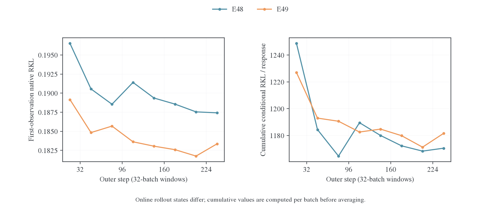

# E49：KL 方向能否改善跨源迁移

## 1. 背景与 motivation

[E48 完整分析](2026-10-27-E48完整训练与后期平台分析.md)显示，同批 Reverse KL（RKL）始终能下降，但后期新批起点维持约 0.187。固定前缀实验也发现，Polaris 的已见 state 拟合收益较难推广到未见 state。它不是“固定批不能优化”，也没有证据证明 0.16 是学生容量决定的不可约下界。

[Forward KL 动机与短训练](2026-10-27-E48后期平台与Forward-KL及知识迁移.md)提出两条可能路径：增强 teacher 高概率而 student 低概率动作的监督；减轻 teacher 极低概率带来的强 log-ratio 惩罚。Full-vocab 只消除动作求和的采样误差，并不消除这些方向差异。

固定 state，记 student 为 $p=\operatorname{softmax}(z)$，teacher 为 $T$，则

$$
\frac{\partial D_{\mathrm{KL}}(p\Vert T)}{\partial z_i}
=p_i\left(\log\frac{p_i}{T_i}-D_{\mathrm{KL}}(p\Vert T)\right),
\qquad
\frac{\partial D_{\mathrm{KL}}(T\Vert p)}{\partial z_i}=p_i-T_i.
$$

E49 的判断标准因而是：FKL 训练能否带来跨批累积改善，且这种改善能否同时体现在原生 RKL、JS/TV、完成行为与任务覆盖上。仅观察到自己的 FKL 下降，不足以说明完整教师分布更容易迁移。

E49 仍在学生生成的前缀上优化条件 FKL，没有改成 teacher rollout。它检验的是目标方向干预，不能替代教师轨迹 SFT 或整个序列 Forward KL。Polaris 多出的 128 个输出行不在学生支持内；E49 明确使用 teacher 在学生支持上的条件分布计算 FKL，同时记录原生 RKL。该设置也不同于从同一晚期 E48 checkpoint 分叉续训：E49 是从初始 student 开始的正式长训练。

## 2. Setting 与实验设计

| 项目              | E48 对照                                               | E49 干预                                               |
| ----------------- | ------------------------------------------------------ | ------------------------------------------------------ |
| Student / teacher | DeepSeek-R1-Distill-Qwen-1.5B / Polaris-7B-Preview     | 相同                                                   |
| 目标              | Full-vocab RKL                                         | 学生支持条件化的 FKL；同时记录原生 RKL、JS/TV、entropy |
| 训练数据与预算    | DAPO，batch64，256 outer × reuse16，4096 更新          | 相同                                                   |
| 优化              | AdamW，LR1e-6，BF16 执行                               | 相同                                                   |
| Backend / chunk   | precompute / 512                                       | precompute_fused / 512                                 |
| 生成与验证        | 训练 cap7168；验证 cap31744，每题 16 答，T0.7/top-p0.9 | 相同                                                   |
| 起点与状态        | 初始 student；完整 256 轮                              | 初始 student；完整 256 轮，非 E48 checkpoint 续训      |
| Run               | `grcuotmi`                                             | `zyru8wdf`                                             |

本对照首先比较自己的批内目标能否下降，再看新批首次原生 RKL 与每回答累计条件差异，最后评价正确率、候选覆盖和完成行为。两项使用各自在线轨迹，不能当作同一固定 state 的因果重放。

## 3. 实验结果

### 3.1 训练目标有效下降，但收益没有持续累积到新批

E49 的 256 批、3840 对相邻 FKL 观测全部下降，说明这个目标能够在已访问前缀上被正常优化。判断跨源迁移仍需看每批第一次观测随训练的变化。

| E49 的 32-batch 窗口 | 首次 FKL | 第 16 次 FKL | 首次原生 RKL | 第 16 次原生 RKL |
| -------------------- | -------: | -----------: | -----------: | ---------------: |
| outer1–32            | 0.140459 |     0.133161 |     0.189149 |         0.180414 |
| outer65–96           | 0.135118 |     0.125697 |     0.185678 |         0.174158 |
| outer225–256         | 0.132793 |     0.122873 |     0.183355 |         0.171395 |

从 outer65–96 到末段，首次 FKL 只下降 1.72%，首次原生 RKL 只下降 1.25%。末段同批 FKL 仍下降约 7.47%，但这些下降没有转化为持续的大幅新批改善。E48 的“已见批能继续拟合、新访问前缀保持高残差”形态仍在。

相同末段窗口，E48 原生 RKL 为 0.187417→0.162859，E49 为 0.183355→0.171395：E49 的新批起点略低，但同批末次更高。它没有在这个共同诊断指标上全面优于 RKL 训练。

### 3.2 去掉回答长度的均值效应，也没有明显突破

逐批将首次原生 RKL 乘以该批每条回答的平均有效 token 数，再跨批平均：

$$
\widehat J=\frac1{K}\sum_{j=1}^{K}
\left[A_j\frac{N_{\mathrm{response\ tokens},j}}{B_j}\right].
$$

$A_j$ 是该批首次 token-mean 原生 RKL，$B_j=64$。先逐批相乘，不能用两个窗口均值的乘积替代。它描述当前学生轨迹上的累计条件差异；没有把它当成独立固定测试分布的风险。

| 首次观测累计条件 RKL / 回答 |     E48 |     E49 |
| --------------------------- | ------: | ------: |
| outer1–32                   | 1248.67 | 1226.95 |
| outer65–96                  | 1164.62 | 1190.62 |
| outer225–256                | 1170.50 | 1181.55 |

E49 较低的末段 token-mean RKL 没有变成更低的每回答累计差异。末段训练长度停止率为 68.70%，E48 为 62.45%；E49 仍大量训练于被截断的推理前缀。方向改变没有自动补齐完整推理与答案阶段的访问覆盖。

### 3.3 多距离与 entropy 不支持已完成分布对齐

E49 末段首次→第 16 次的 JS 为 0.03046→0.02863，TV 为 0.11715→0.11317。它们在同批内也改善，FKL 的下降并非完全没有其他概率距离的响应；但残差仍明显。

同一窗口 student entropy 为 0.79959→0.80123，teacher entropy 固定为 0.67297。学生在这些前缀上仍更分散，不能用“student 已普遍过度尖锐化”解释这组残差。跨训练窗口 entropy 的变化也混入了 rollout state 变化，不能直接解释成同一输入的校准曲线。

Teacher 落在学生输出支持之外的概率质量约为 1e-8，排除了这部分质量作为大平台的主要量级来源；它与“共享词表中 teacher 高概率、student 低概率”的模式遗漏是两个问题。E49 未记录后者的概率分桶或固定 state probe，不能从额外行质量很小推断不存在模式遗漏。

这些结果与[跨源研究总览](../../transfer-mechanism/2026-10-27-跨源蒸馏泛化研究总览.md)及[能力筛选对照](../../transfer-mechanism/capability-filter/2026-10-28-OPD能力筛选假说的受控实验.md)相容：目标方向会改变优化偏好，但共享参数的跨 state 迁移、输入覆盖与当前策略访问分布仍是独立问题。E49 不支持“只要把 RKL 换成 FKL，就能完整吸收 Polaris”，也不能推出“OPD 无法学习新知识”。

### 3.4 最明确的行为收益是更少截断与答案缺失

以下均为 outer256；每题生成 16 答，MATH-500 / AMC23 / AIME25 分别有 8000 / 640 / 480 条回答。

| 指标             | MATH-500：E48→E49 | AMC23：E48→E49 | AIME25：E48→E49 |
| ---------------- | ----------------: | -------------: | --------------: |
| 长度停止条数     |            192→76 |          55→17 |           92→25 |
| 答案解析缺失条数 |            184→61 |          55→12 |           87→23 |
| Mean accuracy    |     87.83%→89.03% |  79.69%→83.13% |   28.75%→28.96% |
| Pass@16          |       96.4%→96.4% |    97.5%→95.0% |     50.0%→43.3% |
| All-correct@16   |       69.8%→71.8% |    50.0%→57.5% |      6.7%→10.0% |

E49 明显减少长尾失败，MATH/AMC 的平均回答和全部 16 答均正确的比例也提高。然而候选覆盖没有同步扩大：MATH pass@16 不变，AMC 和 AIME 的末次点估计更低。AIME 的截断从 92 条降到 25 条，mean 却只提高 0.21 个百分点，说明改善完成行为并不自动解决难题正确性。

因此，这组结果更支持“完成行为与部分回答可靠性改善”，尚不支持“获得了更多此前缺失的困难解题能力”。这里比较的是各自抽样结果，缺少逐题配对答案，不能断言哪些题被新学会或遗忘。

全部 8 个训练后共同评测点中，E49 的 AMC/MATH 均高于 E48，但训练前 AMC 已相差 5.94 个百分点，且只有单 run。完整曲线见[共享评测图](../../../../archive/experiments/shared-transfer-precision/figures/evaluation.png)；绝对分数改善与方向的因果效应仍须区分。

## 4. 分析与下一项判别实验

FKL 在同批内能被正常优化，也改善了验证完成行为，但新批首次 RKL 与按回答累计的差异仍处于平台。它没有支持“更换 KL 方向即可完整吸收 Polaris”的强判断。已有能力筛选实验也表明，RKL 可以记住不泛化的信息；监督方向、state 覆盖与共享参数的迁移条件需要分别研究。

下一步沿既定双来源协议比较固定 S0-state、teacher-state 和 fresh-state 风险。若要回答“在已训练状态切换方向是否有效”，应从同一 warm checkpoint、同一 optimizer 状态分叉；本次从初始化独立训练的 E49 不替代该问题。任务层面比较逐题正确性、候选覆盖和自然完成，不以训练 FKL 单独替代能力获取。

## 5. 证据与复算

统计位于 `wandb-logs/MirrorOPD-verl/analysis/e49-e51-20261028/` 的 `polaris-windows.csv`、`polaris-evaluation.csv`、`evaluations.csv`。窗口统计按批先计算再平均；第 1 到第 16 次观测跨 15 次更新尝试。

[机制复算脚本](../../../../../research/analysis/transfer_precision/motivation_analysis.py)；[基础统计脚本](../../../../../research/analysis/transfer_precision/analyze.py)；[累计 RKL 矢量图](../../../../archive/experiments/shared-transfer-precision/figures/polaris-transfer.pdf)。共同原始脚本和图留在证据目录，研究结论只在本文维护。
