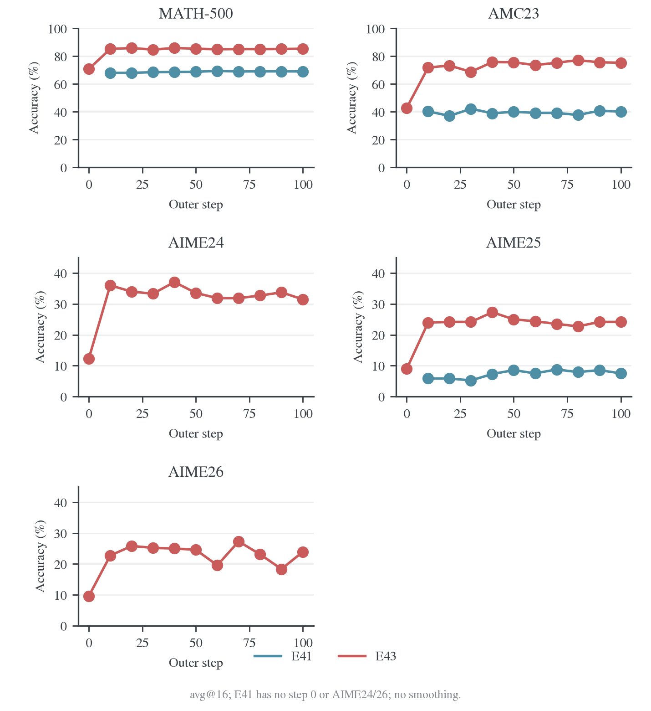
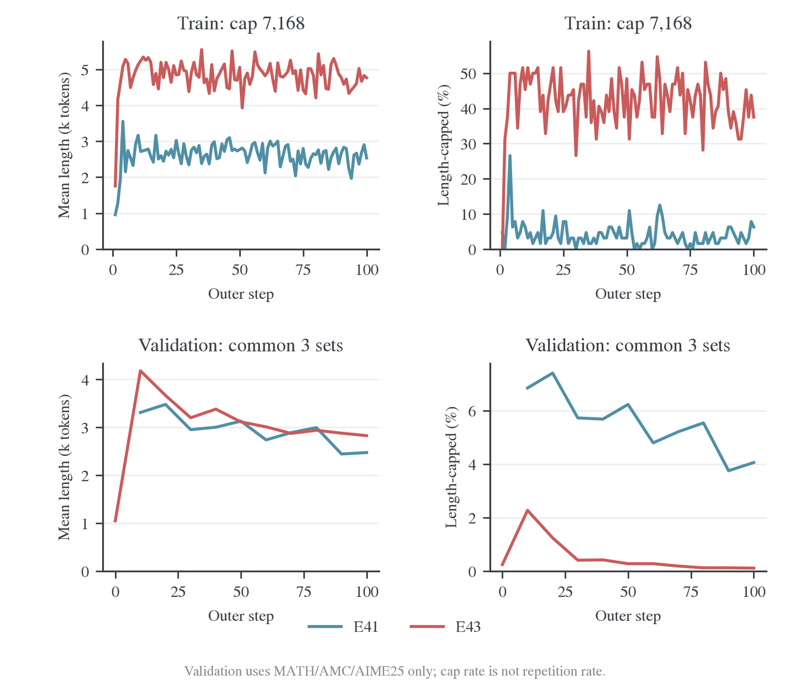
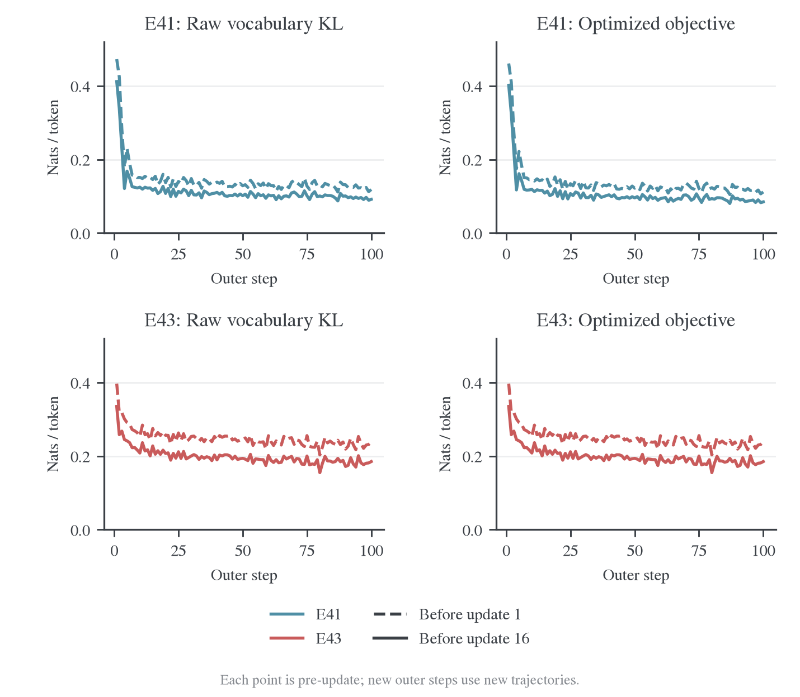
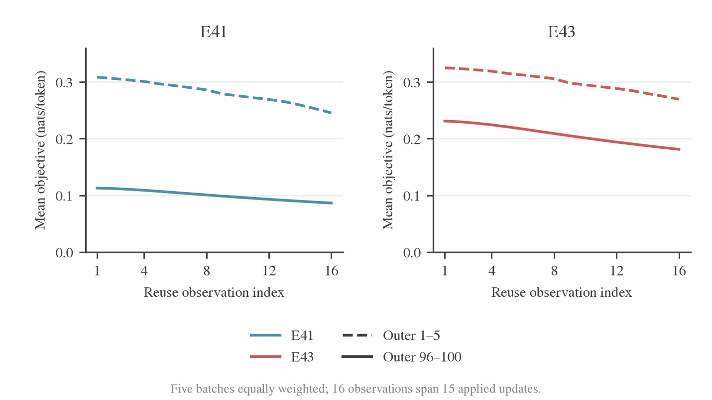
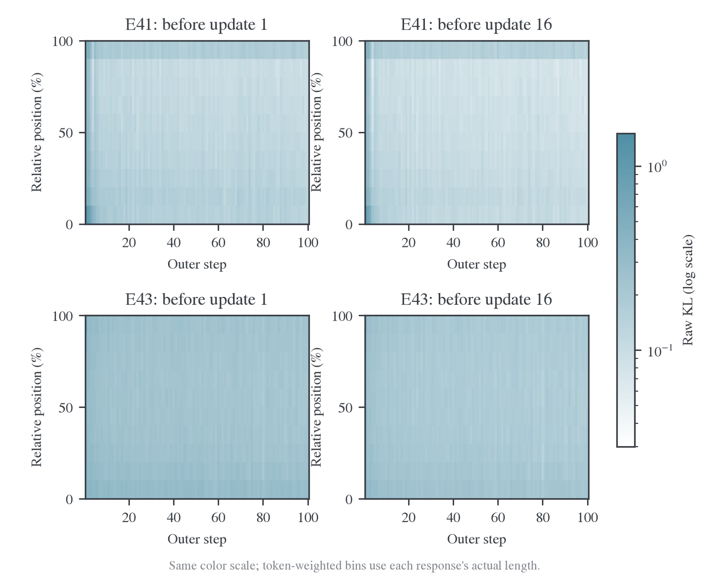
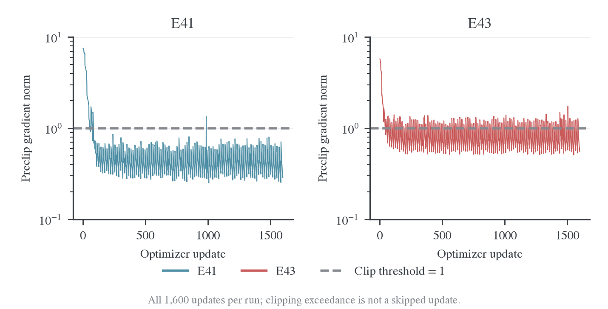
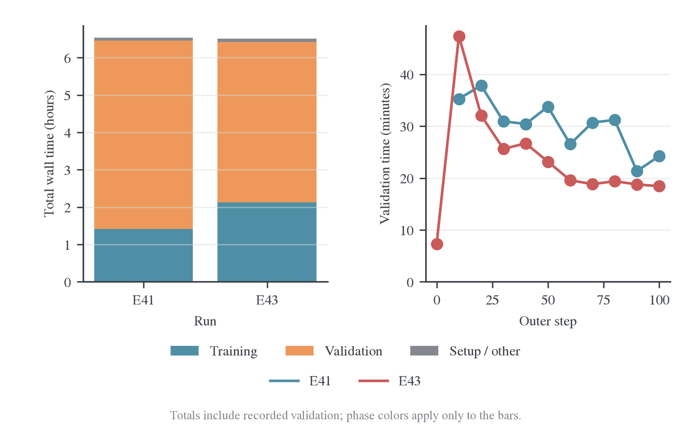
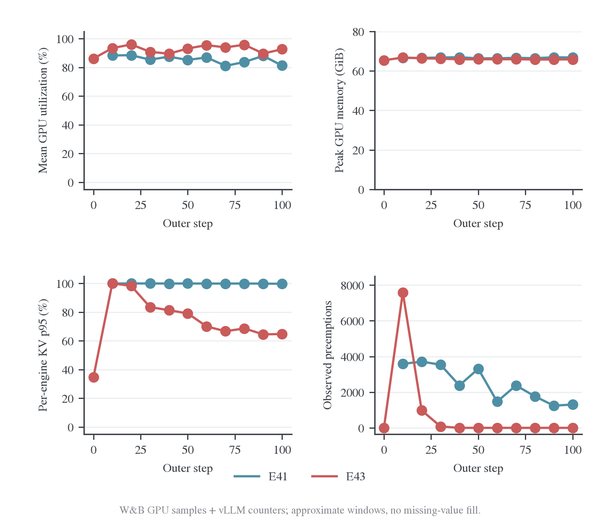

# 失败复现与师生吸收边界

本页按实际 pair 和 setting 汇总正式训练中的拟合、平台与任务表现。每组同时记录训练风险、独立读出和 teacher 参照，以定位吸收差距。

[固定状态谱系结果](fixed-state-results.md)补充 R1/Qwen/Llama 的不同初始化、尺寸与输入条件；[后训练阶段](post-training-stages.md)集中比较 SFT、SFT+RL 和实际存在的 RL-only 教师；[Polaris](cases/polaris.md)保留 E48/E49 的平台与方向对照。固定状态 0–320、正式在线训练和各输入模式按自己的协议解释。

先查[实际矩阵](#matrix)，再读 Qwen Base←8B 和两组 4B 教师的完整证据。矩阵同时标明已完成、短测和缺测条件。

<a id="matrix"></a>

<a id="matrix-模型与长度的失败复现"></a>

## 配对矩阵与实际运行条件

早期设计使用 DAPO 训练及 MATH-500／AMC23／AIME25 验证，比较 sampled/full 与 reuse。后续变体采用各自实际预算和验证集合，见下表。详细模型、prompt/response 长度、终止协议、采样、训练预算、论文依据和启动命令集中在[正式实验方案](../../archive/experiments/teacher-transfer/2026-10-25-失败复现原方案.md)。

<a id="matrix-实验与实际-setting"></a>

### 实验与实际 setting

| 设置                                             | 基础 sampled / full | Reuse16 sampled / full | 现有记录与结果入口                                                      |
| ------------------------------------------------ | ------------------- | ---------------------- | ----------------------------------------------------------------------- |
| R1-1.5B → JustRL-1.5B，7168 response             | E15 / E13           | E33 / E17              | E13/E15/E17 有 200-step 结果；E33 未记录正式 run                        |
| 同模型对，15360 response                         | E23 / E24           | E34 / E35              | E35 Full-r16 已完成 250 outer；其他三臂未记录正式运行                   |
| R1-1.5B → R1-7B，7168 response                   | E25 / E26           | E36 / E37              | 有 E25 两步链路短测；该配对尚无正式任务结果                             |
| Qwen3-1.7B-Base → Qwen3-8B                       | E27 / E28           | E38 / E39              | [E39 终止动作对齐变体](#qwen8)已完成 200 outer/3200更新                 |
| Qwen3-1.7B-Base → Qwen3-4B Non-thinking          | E29 / E30           | E40 / E41              | [E41 完整结果](#qwen4)：100 outer/1600 更新，关闭初始验证               |
| Qwen3-1.7B Non-thinking → Qwen3-4B-Instruct-2507 | E31 / E32           | E42 / E43              | [E43 完整结果](#qwen4)：100 outer/1600 更新，训练 cap7168、初始五集验证 |

表中历史未执行臂依据 2026-10-25 项目清单与日志提交 `ff8b9f0`；E35/E39/E41/E43 按后续专题结果登记。E21/E22 是 E15/E13 的启动别名，不重复计算独立实验。初始方案的 250 outer、batch=mini-batch=64、n=1、LR=1e-6 作为设计背景保留，实际步数见各报告。

E39 采用终止动作对齐、200 outer、每 10 步验证和初始验证；E41/E43 各完成 100 outer。这些预算覆盖了报告讨论的学习过程。E25 的两步结果仅用于接入验收。

矩阵用于查看设置与定位证据，分析口径见[实验维护说明](../维护说明.md#矩阵与训练步数)。学习速度、成本和平台分析分别使用相应预算口径。

<a id="matrix-原始师生参考与分析条件"></a>

### 原始师生参考与分析条件

各模型对还需要相同验证协议下的原始 student/teacher 评测。现有 1.5B 历史参考见[Full-KL 师生分析](../learning-signal/sampled-full.md#reference)；执行／模板不同，不能直接补成新矩阵的真实 step 0。正式比较保持同组 sampled/full 的停止协议与过滤后题目集合一致，并补充相同 seed 集合。

<a id="matrix-研究依据与工程证据"></a>

### 研究依据与工程证据

- [原论文设置档案](../../literature/opd/2026-10-24-OPD失败复现设置与Full-vocab对照.md)记录作者参数与本仓适配差异。
- [论文原图](teacher-comparison/failure-matrix/figures/README.md)与 [原始检索记录](teacher-comparison/failure-matrix/sources/2026-10-24-OPD收敛原始检索报告.md)随实验方案维护。
- [实现与对齐诊断](../../infra/model-compatibility/probes/2026-10-24-OPD实现验收与对齐诊断.md)保留 EOS、词表、探针和短测证据；数据和脚本仍属于实现验收，不计入正式运行表。

<a id="qwen8"></a>

<a id="qwen8-qwen3-17b-base-蒸馏-qwen3-8b完整训练与验证分析"></a>

## Qwen Base←8B：正式训练与最终样本

<a id="qwen8-1-背景与-motivation"></a>

### 1. 背景与 motivation

Qwen3 Base 学生与后训练 teacher 的停止 token 语义不一致，短程控制已经定位到循环退化。E39 检验终止动作对齐后，Base←8B 教师的长程训练能否持续改善任务，以及剩余错误是未完成、重复还是推理错误。与短程机制验证相比，本组还改变了 teacher 和预算。

<a id="qwen8-2-setting-与实验设计"></a>

### 2. Setting 与实验设计

| 设置              | 实际值                                                            |
| ----------------- | ----------------------------------------------------------------- |
| Student / Teacher | Qwen3-1.7B-Base / Qwen3-8B，teacher 冻结                          |
| 目标              | Full-vocabulary reverse KL；合并终止动作 151643 与 151645         |
| 训练预算          | 200 outer × 16 reuse；全局 batch/mini-batch 64；每题 1 个 rollout |
| 优化              | AdamW，LR 1e-6，seed 42；常量学习率                               |
| 资源              | 8 张 H800，共享同步执行；vLLM TP1，每卡并发 64，显存比例 0.8      |
| 生成协议          | Qwen3 non-thinking 提示，enable_thinking=False                    |
| 训练长度          | prompt 1,024 / response 7,168                                     |
| 验证              | 570 题 × 16，温度 0.7、top-p 0.9、top-k -1，回答上限 31,744       |
| 验证与保存        | 初始及每 10 outer 验证；step 50/100/150/200 保存 checkpoint       |

这是 E39 模型配置上的 200-step 对齐目标实验，预算、验证频率与目标开关均记录在实际配置中，不等同于预设原有的 250-step 原始词表 KL 对照。以下分数来自 student，完整同协议 teacher 基线缺失。

<a id="qwen8-3-实验结果与分析"></a>

### 3. 实验结果与分析

Qwen3-1.7B-Base 在本次 Full-r16、终止动作对齐设置下完成 200 个 outer step、3,200 次实际参数更新。21 轮完整验证覆盖初始 checkpoint 与 step 10–200，合计 191,520 条回答。

主要收益发生在前 10 步：模型从大量极短无效输出和长循环，转为较完整、可结束的解答，验证准确率大幅上升。此后同批 KL 仍能下降，但新批 KL 与验证准确率逐渐进入平台。最终模型没有继续崩溃，仍保留困难题错误、部分长循环与明显的 teacher 差距。

准确率使用每题 16 次采样的平均正确率。表中长度是平均生成 token 数，截断率来自实际 finish_reason=length，而不是 padded_width_fraction。

| 数据集   | 初始准确率 | Step 10 | 最终 Step 200 | 平均长度：初始 → 最终 | 截断率：初始 → 最终 |
| -------- | ---------: | ------: | ------------: | --------------------: | ------------------: |
| MATH-500 |     18.59% |  67.44% |        68.39% |        14.57k → 1.87k |      44.20% → 2.65% |
| AMC23    |     11.41% |  37.50% |        41.72% |        12.91k → 3.89k |      39.06% → 5.62% |
| AIME25   |      0.42% |   6.25% |         8.54% |        14.47k → 7.20k |     43.33% → 14.37% |


全体回答加权后的平均正确率从 17.13% 升到 63.37%，平均长度从 14.45k 降到 2.29k，截断率从 43.79% 降到 3.48%。MATH-500 占 500/570 道题，因而主导这个加权总分；三个数据集等权平均正确率为 10.14% → 39.55%。初始不足 32 token 的回答占 16.89%，最终为 0，长度下降伴随着有效解答增加。

最终 pass@16 分别为 MATH-500 89.2%、AMC23 77.5%、AIME25 33.3%。它衡量 16 次里至少答对一次，与平均正确率不是同一指标。本文按预先约定的最终 checkpoint 报告结果，没有从多个验证点挑选最高分替代末点。

后半程增长较小。以同一道题的 16 次平均正确率作配对，按题 bootstrap 5,000 次，step 10 到 step 200 的变化如下。区间反映这一 seed 下的题目抽样不确定性，不包含独立训练 seed 的方差；多 checkpoint 的探索性比较不应当作预注册显著性检验。

| 数据集   | Step 10 → 200 的变化（百分点） | 配对 bootstrap 95% 区间（百分点） |
| -------- | -----------------------------: | --------------------------------: |
| MATH-500 |                          +0.95 |                    [-0.55, +2.51] |
| AMC23    |                          +4.22 |                    [-0.31, +8.91] |
| AIME25   |                          +2.29 |                    [-0.42, +6.25] |

三个区间都跨过零，当前证据不足以确认 step 10 后的提升稳定。AIME25 相对 step 100 的后期提升在这一配对分析中更明显，但只有 30 道题，且不同参考 checkpoint 的结论会变化；应保留“小幅、波动的改善”这一判断，而不是把最后一个点解释为持续突破。

为直接检查重复，固定每题 sample_index=0，分别读取 step 0/10/100/200 的 570 条回答。保存文本用同一 student tokenizer 重新分词；长循环定义为周期 1–128 token、至少重复 4 次且连续跨度至少 128 token，repeat8 为回答内部重复 8-gram 占比再按回答平均。这是固定题目面板的文本重复统计，不是全部 191,520 条回答的原始生成 token 重复率。公式复述等正常内容也会产生重复 8-gram，应与长循环、长度和样本一起解释。

| Checkpoint | 面板回答数 | 长循环回答比例 | 平均重复 8-gram 比例 |
| ---------- | ---------: | -------------: | -------------------: |
| 0          |        570 |         41.58% |               48.08% |
| 10         |        570 |          3.16% |               18.70% |
| 100        |        570 |          3.16% |               16.63% |
| 200        |        570 |          2.28% |               16.47% |


改善后仍有两类不同问题：少量回答继续长循环，另一些回答正常结束但数学推导错误。最终 AIME25 的 14.38% 回答撞长度上限，平均错误回答约 7.74k token，正确回答约 1.45k；长度长尾仍主要落在错误输出。一个判分正确的样本也出现了未经推导的“已知结果”，所以答案匹配不能证明推理过程可靠。具体题目、原文摘录与错误定位见[最终样本分析](#qwen8-4-最终样本与错误类型)。

训练损失优化的是 `distill/termination_equiv_kl`。`distill/full_kl` 保留原始词表 KL，`distill/eos_identity_kl` 是两者的差。三者应分别解释，不能把原始 KL 或终止 token 身份差异下降当作任务正确率提升。

| Outer 窗口 | 批首优化 KL | 批末优化 KL | 平均同批相对下降 | 批首原始 KL | 批末原始 KL |
| ---------- | ----------: | ----------: | ---------------: | ----------: | ----------: |
| 1–10       |      0.2394 |      0.1884 |           22.13% |      0.2494 |      0.1980 |
| 11–30      |      0.1300 |      0.1038 |           20.19% |      0.1378 |      0.1117 |
| 81–100     |      0.1133 |      0.0861 |           24.01% |      0.1219 |      0.0947 |
| 121–140    |      0.1113 |      0.0856 |           23.09% |      0.1196 |      0.0938 |
| 181–200    |      0.1078 |      0.0820 |           23.89% |      0.1162 |      0.0904 |


批首和批末分别是同一批第 1 次和第 16 次更新前的 loss 观测。末期每批仍能降低约 24%，但换到新的一批轨迹后，批首优化 KL 仍约 0.108；这与验证准确率平台同时存在。它说明“同批拟合仍有效”与“跨新轨迹、跨验证题目继续提升”是两件不同的事，不能据此直接判定过拟合或确定平台的唯一成因。

3,200 次更新均实际执行，没有非有限 loss、非有限梯度或跳过更新。最大裁剪前梯度范数为 6.11，主要出现在早期；末 20 批首／末均值约 0.634／0.258。最终一次更新前，优化 KL 为 0.0892，原始 KL 为 0.0971，终止 token 身份项约 0.0080。教师前向、actor 更新及权重同步均完成，没有 OOM 退出。

`full_kl_position` 按回答自身相对位置分成十段，图中对每段累计 sum/count 后求均值，避免把 token 数量当成损失大小。它仍是原始词表 KL，包含终止 token 身份差异。


末 20 步的批末原始 KL，在前 90% 的位置约为 0.070–0.099，最后 10% 约为 0.149；前 10 步对应尾段约 0.233。整体位置失配降低，但末端仍较高。由于回答长度和访问前缀随训练变化，同一相对位置不代表相同绝对 token 位置；原始尾段 KL 也不能直接代表合并终止动作后的尾段优化梯度。

训练 DAPO 的批次题目持续变化，训练平均长度及任务分数不能与固定验证集一一比较。末 20 个训练 batch 平均长度约 2.38k，截断率约 1.33%，任务平均分约 22.11%；任务分数只作诊断，本次损失不使用任务奖励。完整训练长度、截断和任务分数见下面的原始逐批曲线。


整个运行墙钟约 13.76 小时：初始验证 3.21 小时，之后 20 次验证合计 7.71 小时，训练与保存等 outer-step 主流程合计 2.77 小时，其余为初始化、收尾等开销。验证占墙钟约 79%。总计生成约 5.74 亿个验证 token；不能把全部墙钟时间当作 3,200 次参数更新的计算时间。

训练主流程内部，rollout 管线累计 1.08 小时、actor 更新 1.43 小时、teacher 前向约 5.0 分钟；这些是主流程的组成部分，不能再与 2.77 小时重复相加。FSDP worker 上报的 allocated peak 最大约 11.45 GiB，未单独分解 teacher 与 actor 的峰值；这与包含 vLLM 预分配池的整卡显存不是同一个口径。


图中耗时轴采用对数刻度。生成期间各卡经常满载，但整轮验证还包含等待长尾。训练后各轮 valid 的 GPU 平均利用率约为 73.7%–93.2%，整卡采样显存峰值最高约 67.0 GiB。当前运行未完整记录 KV block 使用率和抢占计数，不能据此声称没有 KV 竞争或算出重算损失。资源口径和逐卡收尾证据见[完整验证资源实测](../../infra/performance/inference/validation-resources.md#observed)。

完整 teacher 基线仍待补齐，公开论文参考与同协议验证入口见[Qwen non-thinking 附录](appendix/qwen-nonthinking-reference.md)。现有 Qwen3-8B 历史子集每个数据集 8 题、每题 4 次；将最终 student 的相同题目、每题 16 次与其比较，得到下表。两边均为 non-thinking、温度 0.7、top-p 0.9、回答上限 31,744，但每题采样次数、模型及执行条件不同；该表不能替代 teacher 全集评测。

| 相同的 8 道题 | Teacher 平均正确率 | 最终 Student 平均正确率 | Teacher 平均长度 | Student 平均长度 |
| ------------- | -----------------: | ----------------------: | ---------------: | ---------------: |
| MATH-500      |             87.50% |                  70.31% |            1.51k |            2.98k |
| AMC23         |             87.50% |                  53.91% |            1.19k |            3.26k |
| AIME25        |             28.12% |                   6.25% |            5.22k |            8.58k |

本次结果证明这组设置在单 seed 下能显著缓解 Base 的生成退化，并改善三个验证集的准确率。单条长程运行无法把全部收益归因于某一项修改，也不足以证明继续增加 step 或 reuse 会带来相应的准确率增长。后续最有价值的证据是同协议 teacher 全集参考，以及对平台阶段的新前缀失配和具体解题错误做受控分析。

本报告使用本地原始 W&B 文件解码的完整 3,401 条 history，未用云端采样 history 拼接学习曲线。启动保存的源码快照记录为 `a73dcbc0f`；SDK 自动记录的 Git 字段来自父目录仓库，不能代替该快照的来源说明。原始日志、本次配置和分析输入位于独立日志仓库；正文只链接冻结数据及可复算脚本。运行页面见参考链接。[^qwen8-run]

- [冻结配置](../../../../../../wandb-logs/MirrorOPD-verl/analysis/e39-qwen3base-final-20261027/config.json)、[完整 history](../../../../../../wandb-logs/MirrorOPD-verl/analysis/e39-qwen3base-final-20261027/history.jsonl)、[完成状态与分析摘要](../../../../../../wandb-logs/MirrorOPD-verl/analysis/e39-qwen3base-final-20261027/analysis.json)。
- [逐次验证 CSV](../../../../../../wandb-logs/MirrorOPD-verl/analysis/e39-qwen3base-final-20261027/validation.csv)、[逐批训练 CSV](../../../../../../wandb-logs/MirrorOPD-verl/analysis/e39-qwen3base-final-20261027/training.csv)、[位置 KL](../../../../../../wandb-logs/MirrorOPD-verl/analysis/e39-qwen3base-final-20261027/position-kl.csv)。
- [配对准确率区间](../../../../../../wandb-logs/MirrorOPD-verl/analysis/e39-qwen3base-final-20261027/paired-accuracy.json)、[固定题目重复面板](../../../../../../wandb-logs/MirrorOPD-verl/analysis/e39-qwen3base-final-20261027/sample-panel-summary.csv)、[完整样本摘录](../../../../../../wandb-logs/MirrorOPD-verl/analysis/e39-qwen3base-final-20261027/sample-examples.json.gz)。
- [分析脚本](../../../research/studies/qwen_base/analyze_final.py)、[绘图脚本](../../../research/studies/qwen_base/plot_final.py)。所有六组图均保存 PNG、PDF、SVG，审计文件随图保存。

[^qwen8-run]: W&B. Qwen3-1.7B-Base ← Qwen3-8B，Full-r16，200 outer step. [运行页面](https://wandb.ai/wncfht/MirrorOPD-verl/runs/f0e44ec7)。

<a id="qwen8-4-最终样本与错误类型"></a>

### 4. 最终样本与错误类型

这些例子来自固定题目面板：每个验证题目的 sample_index=0，比较原始 checkpoint 与最终 step 200。按预先定义的症状类别筛选后，取 prompt_id 排序中的首个匹配样本；它们用于定位错误类型，不代表全部样本的比例。重复统计采用保存文本的重新分词；最终平均正确率来自完整每题 16 次验证。

1. AMC23:1，从无关文本循环到正确解答。

题目给定正实数 $y^3=x^2$ 与 $(y-x)^2=4y^2$，求 $x+y$。初始模型输出 31,744 token，主要反复出现“状态：已完成／解释”；没有有效答案。最终回答为 895 token，得到 $x=27,y=9$ 与答案 36，未检测到长循环。

这道题的简洁核对是：由 $|y-x|=2y$ 且 $x,y>0$，只能有 $x=3y$；代入得 $y^3=9y^2$，所以 $y=9,x=27$，答案 36。最终样本在结果与关键关系上均正确。

2. AIME25:13，从极短无效输出到答案匹配，但推导仍有缺口。

该题求特定五边形中五个顶点到平面上一点距离之和的最小值，再求表达式参数之和。初始输出只有 3 token，内容为“.slff”。最终输出 4,388 token，给出判分匹配的答案 60，未检测到长循环。

但最终回答在坐标求解困难后，直接声称最小值是一个“已知结果”$37+10\sqrt{13}$，没有建立这一数值的推导。能据此确认的是答案匹配；不能把该例当作完整几何证明正确的证据。

3. AIME25:11，仍存在反复自我否定的长循环。

题目涉及平面 $x+y+z=75$ 上由不等式划出的有限面积区域，参考答案为 510。初始样本是 4 token 的无效代码片段；最终样本达到 31,744 token 上限，并反复输出面积 $\frac{5625}{2}\sqrt{3}$，随后又说这个结果不可接受，再重复同样的内容，未形成有效最终答案。

因此总体循环减少不意味着每道题都改善，也不能把所有短输出都视为健康。该例从极短无效输出转成了长循环；聚合统计必须同时观察短输出、循环和准确率。

4. AIME25:0，正常结束但遗漏变量替换。

题目要求满足 $b>9$ 且 $17_b\mid97_b$ 的整数进制之和。初始样本反复输出“umably”并撞长度上限。最终样本只有 560 token，能正常结束，也正确推出：

$$
b+7\mid56.
$$

错误出现在下一步：它把 56 中大于 9 的约数 $14,28,56$ 当作有效进制，求和得到 98。实际需要令 $d=b+7>16$，所以 $d=28,56$，再换回 $b=21,49$，正确和为 70。

这个样本把剩余问题定位到了变量与约束处理，而非终止协议或循环。继续压短输出本身不能修正这一步数学错误。

完整前后回答、题目和机器判分字段保存在[样本数据](../../../../../../wandb-logs/MirrorOPD-verl/analysis/e39-qwen3base-final-20261027/sample-examples.json.gz)。总体指标与面板定义见[完整分析](#qwen8)。

<a id="qwen4"></a>

<a id="qwen4-qwen3-教师配对e41e43-完整结果"></a>

## E41/E43：不同学生与4B教师

<a id="qwen4-1-背景与-motivation"></a>

### 1. 背景与 motivation

终止语义修正能减少 Base 生成退化，但能否突破学习平台、已有后训练学生能否进一步吸收 teacher，仍需正式长训练评价。E41 对应 Base←Qwen3-4B，E43 对应后训练 Qwen3-1.7B←4B-Instruct。两组同时改变 student 与 teacher，结果描述各自配对的学习行为。

<a id="qwen4-2-setting-与实验设计"></a>

### 2. Setting 与实验设计

| 设置                       | E41                         | E54                                           | E43                         |
| -------------------------- | --------------------------- | --------------------------------------------- | --------------------------- |
| Student                    | Qwen3-1.7B-Base             | Qwen3-1.7B-Base                               | Qwen3-1.7B                  |
| Teacher                    | Qwen3-4B                    | Qwen3-30B-A3B-Instruct-2507                   | Qwen3-4B-Instruct-2507      |
| Outer / 参数更新预算       | 100 / 1,600                 | 100 / 1,600                                   | 100 / 1,600                 |
| 训练 prompt / response cap | 1,024 / 7,168               | 1,024 / 7,168                                 | 4,096 / 7,168               |
| 初始验证                   | 关闭                        | 关闭                                          | 开启                        |
| 验证 / 保存间隔            | 10 / 50 outer               | 10 / 50 outer                                 | 10 / 50 outer               |
| 本次验证题目数             | 570，原三集                 | 630，五集                                     | 630，五集                   |
| 每题采样 / 回答上限        | 16 / 31.7k token            | 16 / 31.7k token                              | 16 / 31.7k token            |
| 每卡推理并发 / 显存预算    | 64 / 0.80                   | 64 / 0.80                                     | 64 / 0.80                   |
| 终止动作 KL                | 合并 151643、151645         | 合并 151643、151645                           | 原生终止协议                |
| 当前状态                   | 完成 100 outer / 1,600 更新 | 人工停止；更新至 30 outer/480次，完整验证到20 | 完成 100 outer / 1,600 更新 |

共同训练设置：Full-vocab RKL、batch64、每题 1 条 rollout、reuse16、学习率 1e-6、seed42；每组 8 张 H800。三组使用 non-thinking 提示，训练采样温度 1、top-p 1；验证温度 0.7、top-p 0.9、top-k -1，回答上限 31,744。Teacher 通过 shared-sync FSDP2 评分，表内并发 64 属于 student 生成引擎。

E41 此次只有 MATH-500、AMC23、AIME25，E43/E54 增加 AIME24/26；公共入口的新运行默认五集，不能反向补成旧 E41 的已测结果。[数学验证协议](../../settings/验证设置.md)统一说明题目与判分。E43 同时改变 student 和 teacher，不能用跨组差值单独判断教师效应。

E54 的 MoE teacher 按全部权重进行八卡分片；该运行已按用户要求停止，阶段结果与独立探针见[长度诊断](../../infra/model-compatibility/qwen-e54/2026-10-29-E54长度膨胀诊断.md)，不并入 E41/E43 的完整结果。原始运行身份与日志入口见[运行记录](../运行记录.md)。

E41/E43均完成100 outer、1600 更新。E41 没有初始验证，E43 有五集初始验证；E54 不在本文完成结果中。

<a id="qwen4-2-准确率与平台"></a>

<a id="qwen4-3-实验结果准确率与平台"></a>

### 3. 实验结果：准确率与平台

准确率单位为 %，均为本项目 avg@16。E41 启动时只有原三集；未测项目保留为空，不补估计值。运行页面见参考文献。[^qwen4-e41][^qwen4-e43]

| 基准     | E41 第 10 步 | E41 最终 | E43 初始 | E43 第 10 步 | E43 最终 |
| -------- | -----------: | -------: | -------: | -----------: | -------: |
| MATH-500 |        68.03 |    69.04 |    70.79 |        85.25 |    85.39 |
| AMC23    |        40.31 |    40.16 |    42.81 |        71.88 |    75.31 |
| AIME24   |            — |        — |    12.29 |        36.04 |    31.46 |
| AIME25   |         5.83 |     7.50 |     8.96 |        23.96 |    24.17 |
| AIME26   |            — |        — |     9.58 |        22.71 |    23.96 |



图 1：逐基准的全部验证节点。E41 从第 10 步开始；其 AIME24/26 未测，不绘制对应曲线。MATH/AMC 与 AIME 面板的纵轴范围不同，跨面板比较看数值，不看视觉斜率。

E41 在第 10 步后总体接近平台：MATH 增加约 1.01 个百分点，AMC 基本不变，AIME25 有波动。缺少初始验证，因此本运行支持“早期达到此水平后增长有限”，不支持直接计算相对原始 Base 的增益。

E43 相比自己的初始点，各项都有明显提高，MATH 和 AMC 分别增加 14.60、32.50 个百分点。多数收益在前 10 步形成；后期 AMC 继续提高，但 AIME24 最终低于第 10 步。不能把所有基准概括为单调上升。AIME 每集只有 30 题，16 个回答并非 480 道独立题；单 seed 的小幅变化不能作为显著优劣结论。

<a id="qwen4-4-实验结果长度与终止行为"></a>

### 4. 实验结果：长度与终止行为

下面是验证回答的平均长度，单位为千 token；触顶率按真实 finish_reason=length 计算。它不等于重复率。

| 实验与基准   | 第 10 步长度 | 最终长度 | 第 10 步触顶率 | 最终触顶率 |
| ------------ | -----------: | -------: | -------------: | ---------: |
| E41 MATH-500 |        2.61k |    1.95k |          4.99% |      2.98% |
| E41 AMC23    |        6.26k |    4.04k |         14.53% |      6.25% |
| E41 AIME25   |       11.12k |    9.12k |         27.50% |     19.17% |
| E43 MATH-500 |        3.25k |    2.27k |          1.48% |      0.06% |
| E43 AMC23    |        7.57k |    5.16k |          4.06% |      0.16% |
| E43 AIME24   |       15.82k |    9.61k |         16.04% |      1.67% |
| E43 AIME25   |       15.10k |    9.05k |         13.13% |      0.83% |
| E43 AIME26   |       15.40k |    9.35k |         13.33% |      2.92% |

最终 E41 有 370/9,120 条回答触顶，约 4.06%；E43 为 32/10,080，约 0.32%。各验证集生成失败数均为 0。E43 的初始全体回答加权平均长度为 1.31k，最终为 3.46k；其变化是前期变长、后期缩短，仍长于初始回答，不能写成“相对初始化长度下降”。E41 第 10 步至最终的同口径长度为 3.31k → 2.47k。



图 2：上排为训练，下排为共同三集 MATH/AMC/AIME25 的验证；验证按回答数加权，确保两条曲线使用相同题目集合。它与 E43 五集全体加权长度不是同一个统计量。训练和验证的 cap 不同，分别使用纵轴范围。

最近 10 个训练 batch 的统计与验证分开解释：

| 指标                  | E41 outer 91–100 | E43 outer 91–100 |
| --------------------- | ---------------: | ---------------: |
| 平均训练回答长度      |            2.56k |            4.65k |
| 训练触顶率，cap 7,168 |            4.22% |           37.34% |
| 训练题目平均正确率    |           27.19% |           52.34% |

E43 训练仍有较多回答达到 7,168 上限，但验证允许 31,744，最终验证触顶很少。这说明训练截断仍值得观察，不能用训练触顶率直接代替长窗口下的异常率。当前完整运行日志没有统一的 repeat 指标，本文不把触顶比例改名为循环比例。E41 原始 KL 与终止动作对齐的 20 步受控重复实验见[短程对照](../../infra/model-compatibility/termination/README.md)，不能把那组重复率直接套到本次 100 步运行。

<a id="qwen4-5-分析优化动力学与资源"></a>

### 5. 分析：优化动力学与资源

<a id="qwen4-51-kl-下降与验证平台"></a>

#### 5.1 KL 下降与验证平台

以下使用每批第 16 次更新前的观测，避免把批内不同复用位置混合；不同批次的 rollout 内容仍然不同。

| 指标                 | E41 首批 → 最终批 | E43 首批 → 最终批 |
| -------------------- | ----------------: | ----------------: |
| 原始词表 Full-KL     |   0.4121 → 0.0919 |   0.3351 → 0.1853 |
| 实际优化 loss        |   0.4020 → 0.0850 |   0.3351 → 0.1853 |
| 最终批前 10% 位置 KL |            0.0979 |            0.2168 |
| 最终批后 10% 位置 KL |            0.1489 |            0.1869 |

E41 的实际 loss 使用停止动作合并，而 Full-KL 指标仍是原始词表诊断；E43 未合并，两者一致。位置按每条回答自身实际长度分桶，长回答在 token 聚合中权重更高。不能把不同 teacher 下的 KL 绝对大小直接解释为哪个 student 更强。



图 3：每个 outer 分别取第 1、16 次更新前的观测。E41 的两种 KL 含义不同，E43 的 raw KL 与实际目标相等。后期曲线仍有批内下降，但新 batch 的起点较高；由于前缀与样本已经变化，这个跨批差值不能直接解释为同一题目的遗忘或参数更新反弹。

<a id="qwen4-52-同批复用仍在拟合能力提升并未同步持续"></a>

#### 5.2 同批复用仍在拟合，能力提升并未同步持续



图 4：分别对前 5 批、后 5 批等权平均，展示实际优化目标。16 个更新前观测之间包含 15 次已执行更新，不是同一轮参数的重复测量。

末 10 批中，从批内第 1 次到第 16 次观测，E41 的 loss 平均相对下降 24.13%，E43 下降 21.73%。最终批分别从 0.1120 降至 0.0850、从 0.2383 降至 0.1853。结合准确率曲线，这支持“固定当前 batch 仍能进一步拟合，而独立验证收益已经有限”；它不证明更多 reuse 会提高泛化，也不证明 reuse 导致平台，因为缺少匹配的复用次数对照。

<a id="qwen4-53-full-kl-position-的变化"></a>

#### 5.3 Full-KL Position 的变化



图 5：四个面板共享 0.03–1.5 nats 的对数色标；纵轴按每条回答自身有效长度分为十段，颜色是该桶 sum/count。没有将全局对齐 loss 分摊为位置 loss；所有格子都是原始词表 KL。分析脚本逐次核验十桶加权聚合能恢复全局 Full-KL。

E41 的初始前缀失配下降明显，但末段 KL 在后期相对更高；E43 的失配更分散，后期仍有残余。热图能定位监督误差分布，不能证明尾部内容正确或错误。长短回答的相对位置不对应相同绝对 token 数，也不能用不同轨迹热图代替固定前缀诊断。

<a id="qwen4-54-梯度与数值稳定性"></a>

#### 5.4 梯度与数值稳定性



图 6：每次更新的裁剪前梯度范数，纵轴为对数，虚线为配置阈值 1。E41/E43 的最大观测分别为 7.56/5.76；超过阈值的观测比例为 4.44%/23.38%。E43 更频繁触及裁剪阈值，但两组各 1,600 次更新全部执行，非有限 loss、非有限梯度和 skipped update 均为 0。裁剪频率不等同于数值故障或跳步。

<a id="qwen4-55-验证占据主要墙钟"></a>

#### 5.5 验证占据主要墙钟



图 7：左侧按互不重叠的已记录训练、验证及其余开销分解墙钟，右侧为每次验证耗时，E43 包含初始验证。左图颜色表示阶段，右图颜色表示实验。

| 墙钟构成         |       E41 |       E43 |
| ---------------- | --------: | --------: |
| 训练阶段         | 1.42 小时 | 2.13 小时 |
| 验证阶段         | 5.04 小时 | 4.29 小时 |
| 初始化与其他收尾 | 4.50 分钟 | 5.62 分钟 |
| 合计             | 6.53 小时 | 6.51 小时 |
| 验证占比         |    77.13% |    65.85% |

E43 单轮验证从第 10 步的 47.4 分钟降至最终 18.4 分钟，伴随回答缩短及触顶减少。E41 最终验证仍需 24.2 分钟。这里的耗时变化包含工作量变化，不能解释成固定 token 工作量下的纯引擎加速。

<a id="qwen4-56-相同并发的-kv-压力不同"></a>

#### 5.6 相同并发的 KV 压力不同



图 8：GPU 数据来自 W&B 系统监控，KV 与抢占来自同时归档的 vLLM telemetry。GPU util 对八卡及窗口内采样点平均；显存取窗口内单卡最大值；KV p95 对引擎与时间采样联合计算；抢占量为每个引擎在窗口内相邻可见端点的 counter 增量之和，不是失败回答数。

| 验证节点     | 八卡平均 GPU util | 单卡峰值显存 | 引擎 KV p95 | 窗口内观察到的抢占 |
| ------------ | ----------------: | -----------: | ----------: | -----------------: |
| E41 第 10 步 |            88.23% |    66.55 GiB |      99.90% |              3,587 |
| E41 最终     |            81.18% |    66.78 GiB |      99.68% |              1,304 |
| E43 第 10 步 |            93.35% |    66.76 GiB |      99.94% |              7,594 |
| E43 最终     |            92.57% |    65.83 GiB |      64.71% |                  0 |

E43 第 40 步起，每次验证的观测窗口内均未增加抢占计数；E41 最终仍有明显缓存竞争。相同 max_num_seqs=64 与显存预算 0.8，在不同轨迹长度分布下的表现不同。显存占用接近不代表 KV 需求接近，因为引擎会预留缓存。后期 E43 的这组配置较平稳，E41 则仍需以吞吐对照判断是否调整并发；单凭抢占次数不能确定降低并发必定更快。

窗口由 W&B 聚合记录的时间戳减去 validation_seconds 近似定位。GPU/KV 分位统计剔除边界各 30 秒；counter 增量使用窗口内完整观测，可能漏掉边界采样间隙，因此是观测增量。缺失请求、关闭服务时的遥测错误不填零。全程 W&B 采样到的单卡峰值分别为 66.89、66.76 GiB，它们不保证覆盖亚秒瞬态，也不是独立 teacher 峰值。

<a id="qwen4-5-与-failure-reproduction-原论文比较"></a>

<a id="qwen4-6-分析与-failure-reproduction-原论文比较"></a>

### 6. 分析：与 Failure-reproduction 原论文比较

原研究入口及完整论文设置见[失败复现方案](../../archive/experiments/teacher-transfer/2026-10-25-失败复现原方案.md)。该方案是历史 250-step 配对设计；这里已经完成的是 100-step、reuse16 变体，不表示原矩阵的 sampled/full 配对或多 seed 已完成。

<a id="qwen4-61-e41-对应-rethinking-opd-的学习受限设置"></a>

#### 6.1 E41 对应 Rethinking OPD 的学习受限设置

Rethinking OPD 第 3.1 节使用相同的 Qwen3-1.7B-Base ← Qwen3-4B Non-thinking 模型对。图 2 的学生三基准均分约从 5% 升至 15%，弱于使用 Base-GRPO teacher 的曲线；这是近似读图值，原现象是收益受限，不能称为完全不学习。原文采用 student-top-16，而非这里的 full-vocab 终止动作对齐目标。[^qwen4-rethinking]

原图及完整原始设置统一见[失败复现方案第 5 节](../../archive/experiments/teacher-transfer/2026-10-25-失败复现原方案.md#5-e29e30base-学生与-non-thinking-4b-教师的初始失配)。

原图三项是 AIME24、AIME25、AMC23；E41 缺少 AIME24，因此不能把本项目含 MATH 的三项均分与约 15% 比较。原文每题 4 条 rollout、验证 top-p=0.95；E41 每题 1 条、reuse16、验证 top-p=0.9，并加入终止动作对齐。模型对相同不足以构成算法的受控比较。

E41 现有证据说明：此 Base 模型对在当前配方下可以稳定完成长程更新，但第 10 步后收益有限。判断 Full-KL 对 teacher mismatch 的独立作用，还需要同设置 sampled 对照和原始师生同协议评测。

<a id="qwen4-62-e43-对应-semi-opd-的在线轨迹受限设置"></a>

#### 6.2 E43 对应 Semi-OPD 的在线轨迹受限设置

Semi-OPD 论文采用相同的 Qwen3-1.7B Non-thinking ← Qwen3-4B-Instruct-2507。原文表 1 对训练后的方法报告 step 60/80/100 的平均成绩；这里也对 E43 的同三个 outer 节点求平均。单位为 %，但评测采样和训练预算仍不同：[^qwen4-semi]

| 来源与方法                         | AIME24 | AIME25 | AIME26 |
| ---------------------------------- | -----: | -----: | -----: |
| 论文：初始 student                 |   12.6 |    9.6 |    7.4 |
| 本机：E43 初始 student             |  12.29 |   8.96 |   9.58 |
| 论文：标准 OPD，60/80/100 平均     |   35.8 |   25.5 |   23.3 |
| 本机：E43 Full-r16，60/80/100 平均 |  32.01 |  23.75 |  22.22 |
| 论文：Semi-OPD，60/80/100 平均     |   50.3 |   38.9 |   41.8 |

按共同三个 AIME 简单等权平均，论文标准 OPD 为 28.20%，本机 E43 为 26.00%，论文 Semi-OPD 为 43.67%。这些是本表共同列的算术整理，不是论文包含 HMMT 的四项均分。本机没测 HMMT，不能填成论文的完整 Avg@32。

数值上，E43 处于原文标准 OPD 相近的范围，没有显示出达到 Semi-OPD 高分的结果。它证明当前训练能提升该 student，尚未证明 full-vocab 与 reuse16 已解决在线 rollout 的局限。

| 比较条件          | 论文表 1                                      | 本机 E43                                       |
| ----------------- | --------------------------------------------- | ---------------------------------------------- |
| 监督与采样来源    | 标准 OPD / Semi-OPD；主要为 sampled-token RKL | 在线 Full-vocab RKL，reuse16                   |
| 训练 response cap | 标准 OPD 16,384；Semi-OPD 4,096               | 7,168                                          |
| 数据与每批轨迹    | DAPO 英文去重子集；128×1                      | 本项目 DAPO；64×1                              |
| 报告节点          | 60/80/100；标准 OPD 条目注明引自 Relay-OPD    | 相同 outer 数字，但对应 960/1,280/1,600 次更新 |
| 验证              | avg@32，温度 1、top-p 1、cap 32,768           | avg@16，温度 0.7、top-p 0.9、cap 31,744        |
| 数据集            | AIME24/25/26、HMMT Feb26                      | MATH、AMC、AIME24/25/26                        |

论文另在相同 4K 训练 cap 下报告该模型对的 Semi-OPD 末点优势 +9.5 个百分点（四基准均分）。那是另一组匹配长度对照，不能把表 1 的不同 cap 分数差当作纯 on/off-policy 效应，也不能把 +9.5 直接视为本机待复现的差值。[^qwen4-semi]

我们没有同配置的 E42 sampled 对照，也没有本机 Semi-OPD 臂，因此当前结果不支持对 full-vocab、reuse 或离线来源的独立因果归因。E43 后期缩短、准确率平台的现象与论文研究问题相容，但并未验证唯一机制。

<a id="qwen4-63-tide-结果的归属"></a>

#### 6.3 TIDE 结果的归属

失败复现文档中的 TIDE 强失配主结果对应 Qwen3-1.7B-Base ← Qwen3-8B，属于 E39 模型对，不是 E41 的 4B teacher，也不是 E43 的 post-trained student。其九基准 Avg@8 不能直接填入上面的两组结果。[^qwen4-tide] 本机相应运行见[E39 完整报告](#qwen8)。

<a id="qwen4-6-冻结证据与结论边界"></a>

<a id="qwen4-7-冻结证据与结论边界"></a>

### 7. 冻结证据与结论边界

分析使用本地完整 `.wandb` 解码记录，并与归档 file logger 逐字段核对。逐次 optimizer 更新编号均覆盖 1–1,600，无缺号；W&B 退出记录也为成功。原始文件和冻结 telemetry 归档在独立日志仓库，正文不依赖临时运行目录：

- [数据说明](../../../../../../wandb-logs/MirrorOPD-verl/analysis/qwen-e41-e43-final-20261028/README.md)、[完成状态](../../../../../../wandb-logs/MirrorOPD-verl/analysis/qwen-e41-e43-final-20261028/summary.json)。
- [全部验证节点](../../../../../../wandb-logs/MirrorOPD-verl/analysis/qwen-e41-e43-final-20261028/validation.csv)、[逐批训练](../../../../../../wandb-logs/MirrorOPD-verl/analysis/qwen-e41-e43-final-20261028/training.csv)、[全部更新及首尾位置 KL](../../../../../../wandb-logs/MirrorOPD-verl/analysis/qwen-e41-e43-final-20261028/updates.csv)。
- [E41 配置](../../../../../../wandb-logs/MirrorOPD-verl/analysis/qwen-e41-e43-final-20261028/E41/config.yaml)、[E43 配置](../../../../../../wandb-logs/MirrorOPD-verl/analysis/qwen-e41-e43-final-20261028/E43/config.yaml)；对应子目录保留原始 metrics.jsonl 与 exit.json。

- [W&B 一致性与动力学汇总](../../../../../../wandb-logs/MirrorOPD-verl/analysis/qwen-e41-e43-final-20261028/wandb-diagnostics.json)、[逐位置 KL](../../../../../../wandb-logs/MirrorOPD-verl/analysis/qwen-e41-e43-final-20261028/position-kl-detail.csv)、[验证资源统计](../../../../../../wandb-logs/MirrorOPD-verl/analysis/qwen-e41-e43-final-20261028/validation-resources.csv)。
- [分析与绘图源码](../../../research/studies/qwen_teachers/analyze_qwen_teacher_runs.py)、[图形审计](teacher-comparison/qwen-teachers/figures/completed-20261028/figure-audit.json)。每张图同时提供同名 PNG/PDF，PDF 便于导出。

从源码仓库根目录复算；使用已有 plotting 环境，分析不占用 GPU、不上传 W&B：

```bash
../wandb-logs/.venv/bin/python ../wandb-logs/tools/wandb_local.py decode --run 53dd553d
../wandb-logs/.venv/bin/python ../wandb-logs/tools/wandb_local.py decode --run eccc09a1
FIGURE_VIZ_MPL=../dotfiles/.agents/skills/figure-viz/assets/mpl \
  /root/.local/share/mirroropd/venvs/plotting/bin/python \
  -m examples.mirroropd.research.studies.qwen_teachers.analyze_qwen_teacher_runs \
  --logs-root ../wandb-logs \
  --data ../wandb-logs/MirrorOPD-verl/analysis/qwen-e41-e43-final-20261028 \
  --out examples/mirroropd/docs/experiments/teacher-transfer/teacher-comparison/qwen-teachers/figures/completed-20261028
```

E41/E43 的单 seed 完整结果已经确认；原计划中的 250-step 配对、同协议 teacher 参考、重复率完整重算与多 seed 统计仍未完成。E54 的人工停止状态与独立探针统一见长度诊断，避免在本报告重复维护阶段结论。

<a id="qwen4-参考文献"></a>

#### 参考文献

[^qwen4-e41]: MirrorOPD-verl. E41，Qwen3-1.7B-Base ← Qwen3-4B，2026，本地完整指标与退出记录已核对。[W&B](https://wandb.ai/wncfht/MirrorOPD-verl/runs/53dd553d)。

[^qwen4-e43]: MirrorOPD-verl. E43，Qwen3-1.7B ← Qwen3-4B-Instruct-2507，2026，本地完整指标与退出记录已核对。[W&B](https://wandb.ai/wncfht/MirrorOPD-verl/runs/eccc09a1)。

[^qwen4-rethinking]: Yaxuan Li et al. _Rethinking On-Policy Distillation of Large Language Models: Phenomenology, Mechanism, and Recipe_. arXiv:2604.13016v2，2026，第 3.1 节、图 2、附录 A；2026-10-28 复核原文及原图。[论文](https://arxiv.org/html/2604.13016v2)。图的获取及转换说明见[原图档案](teacher-comparison/failure-matrix/figures/README.md)。

[^qwen4-semi]: Siyan Zhao et al. _When Do We Need On-Policy Distillation? Distilling on Offline Student Rollouts Is Often Better_. arXiv:2610.11291v1，2026，表 1、表 3、第 2–4 节与附录 A；2026-10-28 复核。[论文](https://arxiv.org/html/2610.11291v1)。

[^qwen4-tide]: Zichao Yu et al. _Mismatch Matters: On-Policy Distillation Beyond Token Agreement_. arXiv:2608.09836v1，2026，第 4 节与表 1。[论文](https://arxiv.org/html/2608.09836v1)。
