# 失败复现与师生吸收边界

本页按实际 pair 和 setting 汇总正式训练中的拟合、平台与任务表现。每组同时记录训练风险、独立读出和 teacher 参照，以定位吸收差距。

[固定状态谱系结果](fixed-state-results.md)补充 R1/Qwen/Llama 的不同初始化、尺寸与输入条件；[后训练阶段](post-training-stages.md)集中比较 SFT、SFT+RL 和实际存在的 RL-only 教师；[Polaris](appendix/polaris-long-run.md)保留 E48/E49 的平台与方向对照。固定状态 0–320、正式在线训练和各输入模式按自己的协议解释。

先查[实际矩阵](#matrix)，再分别阅读 Qwen Base←8B、[E41 Base←4B](#qwen4)与[E43 后训练 student←4B-Instruct](#e43)的完整证据。矩阵同时标明已完成、短测和缺测条件。

<a id="matrix"></a>

<a id="matrix-模型与长度的失败复现"></a>

## 配对矩阵与实际运行条件

早期设计使用 DAPO 训练及 MATH-500／AMC23／AIME25 验证，比较 sampled/full 与 reuse。后续变体采用各自实际预算和验证集合，见下表。详细模型、prompt/response 长度、终止协议、采样、训练预算、论文依据和启动命令集中在[正式实验方案](../../archive/experiments/teacher-transfer/2026-10-25-失败复现原方案.md)。

<a id="matrix-实验与实际-setting"></a>

### 实验与实际 setting

| 设置                                             | 基础 sampled / full | Reuse16 sampled / full | 现有记录与结果入口                                                    |
| ------------------------------------------------ | ------------------- | ---------------------- | --------------------------------------------------------------------- |
| R1-1.5B → JustRL-1.5B，7168 response             | E15 / E13           | E33 / E17              | E13/E15/E17 有 200-step 结果；E33 未记录正式 run                      |
| 同模型对，15360 response                         | E23 / E24           | E34 / E35              | E35 Full-r16 已完成 250 outer；其他三臂未记录正式运行                 |
| R1-1.5B → R1-7B，7168 response                   | E25 / E26           | E36 / E37              | 有 E25 两步链路短测；该配对尚无正式任务结果                           |
| Qwen3-1.7B-Base → Qwen3-8B                       | E27 / E28           | E38 / E39              | [E39 终止动作对齐变体](#qwen8)已完成 200 outer/3200更新               |
| Qwen3-1.7B-Base → Qwen3-4B Non-thinking          | E29 / E30           | E40 / E41              | [E41 完整结果](#qwen4)：100 outer/1600 更新，关闭初始验证             |
| Qwen3-1.7B Non-thinking → Qwen3-4B-Instruct-2507 | E31 / E32           | E42 / E43              | [E43 完整结果](#e43)：100 outer/1600 更新，训练 cap7168、初始五集验证 |

表中历史未执行臂依据 2026-10-25 项目清单与日志提交 `ff8b9f0`；E35/E39/E41/E43 按后续专题结果登记。E21/E22 是 E15/E13 的启动别名，不重复计算独立实验。初始方案的 250 outer、batch=mini-batch=64、n=1、LR=1e-6 作为设计背景保留，实际步数见各报告。

E39 采用终止动作对齐、200 outer、每 10 步验证和初始验证；E41/E43 各完成 100 outer。这些预算覆盖了报告讨论的学习过程。E25 的两步结果仅用于接入验收。

矩阵用于查看设置与定位证据，分析口径见[实验维护说明](../维护说明.md#矩阵与训练步数)。学习速度、成本和平台分析分别使用相应预算口径。

<a id="matrix-原始师生参考与分析条件"></a>

### 原始师生参考与分析条件

各模型对还需要相同验证协议下的原始 student/teacher 评测。现有 1.5B 历史参考见[Full-KL 师生分析](../learning-signal/sampled-full.md#reference)；执行／模板不同，不能直接补成新矩阵的真实 step 0。正式比较保持同组 sampled/full 的停止协议与过滤后题目集合一致，并补充相同 seed 集合。

<a id="matrix-研究依据与工程证据"></a>

### 研究依据与工程证据

- [原论文设置档案](../../literature/opd/2026-10-24-OPD失败复现设置与Full-vocab对照.md)记录作者参数与本仓适配差异。
- [论文原图](teacher-comparison/failure-matrix/figures/README.md)与 [原始检索记录](teacher-comparison/failure-matrix/sources/2026-10-24-OPD收敛原始检索报告.md)随实验方案维护。
- [实现与对齐诊断](../../infra/model-compatibility/probes/2026-10-24-OPD实现验收与对齐诊断.md)保留 EOS、词表、探针和短测证据；数据和脚本仍属于实现验收，不计入正式运行表。

<a id="qwen8"></a>

<a id="qwen8-qwen3-17b-base-蒸馏-qwen3-8b完整训练与验证分析"></a>

## Qwen Base←8B：正式训练与最终样本

<a id="qwen8-1-背景与-motivation"></a>

### 1. 背景与 motivation

Qwen3 Base 学生与后训练 teacher 的停止 token 语义不一致，短程控制已经定位到循环退化。E39 检验终止动作对齐后，Base←8B 教师的长程训练能否持续改善任务，以及剩余错误是未完成、重复还是推理错误。与短程机制验证相比，本组还改变了 teacher 和预算。

<a id="qwen8-2-setting-与实验设计"></a>

### 2. Setting 与实验设计

| 设置              | 实际值                                                            |
| ----------------- | ----------------------------------------------------------------- |
| Student / Teacher | Qwen3-1.7B-Base / Qwen3-8B，teacher 冻结                          |
| 目标              | Full-vocabulary reverse KL；合并终止动作 151643 与 151645         |
| 训练预算          | 200 outer × 16 reuse；全局 batch/mini-batch 64；每题 1 个 rollout |
| 优化              | AdamW，LR 1e-6，seed 42；常量学习率                               |
| 资源              | 8 张 H800，共享同步执行；vLLM TP1，每卡并发 64，显存比例 0.8      |
| 生成协议          | Qwen3 non-thinking 提示，enable_thinking=False                    |
| 训练长度          | prompt 1,024 / response 7,168                                     |
| 验证              | 570 题 × 16，温度 0.7、top-p 0.9、top-k -1，回答上限 31,744       |
| 验证与保存        | 初始及每 10 outer 验证；step 50/100/150/200 保存 checkpoint       |

这是 E39 模型配置上的 200-step 对齐目标实验，预算、验证频率与目标开关均记录在实际配置中，不等同于预设原有的 250-step 原始词表 KL 对照。以下分数来自 student，完整同协议 teacher 基线缺失。

<a id="qwen8-3-实验结果与分析"></a>

### 3. 实验结果与分析

Qwen3-1.7B-Base 在本次 Full-r16、终止动作对齐设置下完成 200 个 outer step、3,200 次实际参数更新。21 轮完整验证覆盖初始 checkpoint 与 step 10–200，合计 191,520 条回答。

主要收益发生在前 10 步：模型从大量极短无效输出和长循环，转为较完整、可结束的解答，验证准确率大幅上升。此后同批 KL 仍能下降，但新批 KL 与验证准确率逐渐进入平台。最终模型没有继续崩溃，仍保留困难题错误、部分长循环与明显的 teacher 差距。

准确率使用每题 16 次采样的平均正确率。表中长度是平均生成 token 数，截断率来自实际 finish_reason=length，而不是 padded_width_fraction。

| 数据集   | 初始准确率 | Step 10 | 最终 Step 200 | 平均长度：初始 → 最终 | 截断率：初始 → 最终 |
| -------- | ---------: | ------: | ------------: | --------------------: | ------------------: |
| MATH-500 |     18.59% |  67.44% |        68.39% |        14.57k → 1.87k |      44.20% → 2.65% |
| AMC23    |     11.41% |  37.50% |        41.72% |        12.91k → 3.89k |      39.06% → 5.62% |
| AIME25   |      0.42% |   6.25% |         8.54% |        14.47k → 7.20k |     43.33% → 14.37% |

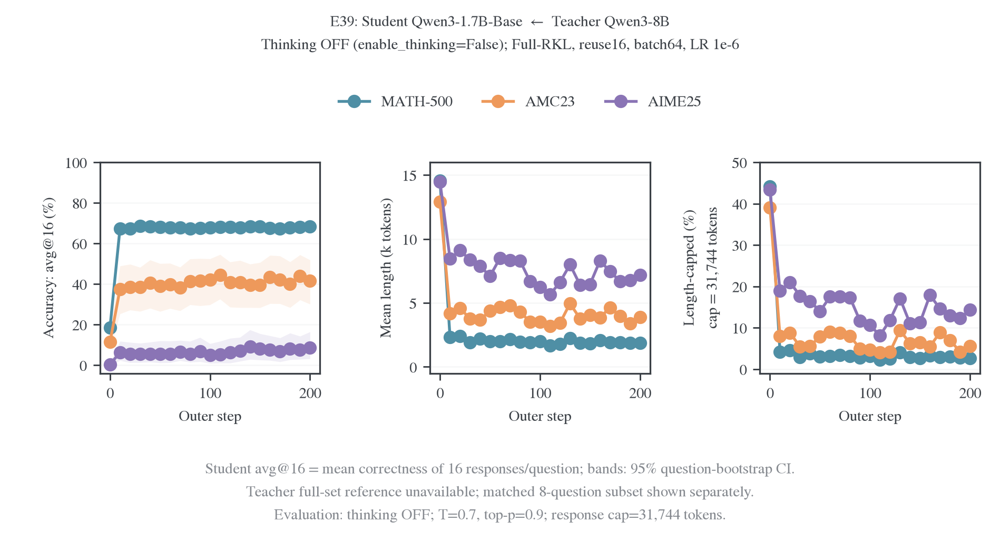

图内标明 student 为 Qwen3-1.7B-Base、teacher 为 Qwen3-8B，thinking 关闭（`enable_thinking=False`），训练为 Full-RKL、reuse16、batch64、LR1e-6。准确率是每题 16 条回答的平均正确率 avg@16，阴影为按题 bootstrap 的 95% 区间；length-capped 列直接标明验证 response cap=31,744 tokens，训练触顶图标明 cap=7,168 tokens。Teacher 全集参考缺失，图中明确标注；已有相同 8 题的 teacher/student 参考单独展示在下文。

全体回答加权后的平均正确率从 17.13% 升到 63.37%，平均长度从 14.45k 降到 2.29k，截断率从 43.79% 降到 3.48%。MATH-500 占 500/570 道题，因而主导这个加权总分；三个数据集等权平均正确率为 10.14% → 39.55%。初始不足 32 token 的回答占 16.89%，最终为 0，长度下降伴随着有效解答增加。

最终 pass@16 分别为 MATH-500 89.2%、AMC23 77.5%、AIME25 33.3%。它衡量 16 次里至少答对一次，与平均正确率不是同一指标。本文按预先约定的最终 checkpoint 报告结果，没有从多个验证点挑选最高分替代末点。

后半程增长较小。以同一道题的 16 次平均正确率作配对，按题 bootstrap 5,000 次，step 10 到 step 200 的变化如下。区间反映这一 seed 下的题目抽样不确定性，不包含独立训练 seed 的方差；多 checkpoint 的探索性比较不应当作预注册显著性检验。

| 数据集   | Step 10 → 200 的变化（百分点） | 配对 bootstrap 95% 区间（百分点） |
| -------- | -----------------------------: | --------------------------------: |
| MATH-500 |                          +0.95 |                    [-0.55, +2.51] |
| AMC23    |                          +4.22 |                    [-0.31, +8.91] |
| AIME25   |                          +2.29 |                    [-0.42, +6.25] |

三个区间都跨过零，当前证据不足以确认 step 10 后的提升稳定。AIME25 相对 step 100 的后期提升在这一配对分析中更明显，但只有 30 道题，且不同参考 checkpoint 的结论会变化；应保留“小幅、波动的改善”这一判断，而不是把最后一个点解释为持续突破。

为直接检查重复，固定每题 sample_index=0，分别读取 step 0/10/100/200 的 570 条回答。保存文本用同一 student tokenizer 重新分词；长循环定义为周期 1–128 token、至少重复 4 次且连续跨度至少 128 token，repeat8 为回答内部重复 8-gram 占比再按回答平均。这是固定题目面板的文本重复统计，不是全部 191,520 条回答的原始生成 token 重复率。公式复述等正常内容也会产生重复 8-gram，应与长循环、长度和样本一起解释。

| Checkpoint | 面板回答数 | 长循环回答比例 | 平均重复 8-gram 比例 |
| ---------- | ---------: | -------------: | -------------------: |
| 0          |        570 |         41.58% |               48.08% |
| 10         |        570 |          3.16% |               18.70% |
| 100        |        570 |          3.16% |               16.63% |
| 200        |        570 |          2.28% |               16.47% |

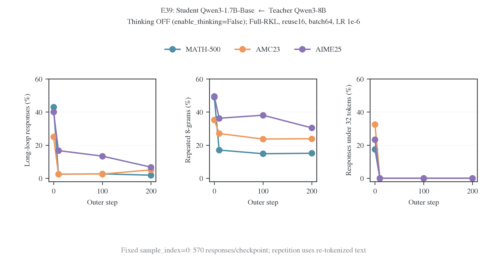

改善后仍有两类不同问题：少量回答继续长循环，另一些回答正常结束但数学推导错误。最终 AIME25 的 14.38% 回答撞长度上限，平均错误回答约 7.74k token，正确回答约 1.45k；长度长尾仍主要落在错误输出。一个判分正确的样本也出现了未经推导的“已知结果”，所以答案匹配不能证明推理过程可靠。具体题目、原文摘录与错误定位见[最终样本分析](#qwen8-4-最终样本与错误类型)。

训练损失优化的是 `distill/termination_equiv_kl`。`distill/full_kl` 保留原始词表 KL，`distill/eos_identity_kl` 是两者的差。三者应分别解释，不能把原始 KL 或终止 token 身份差异下降当作任务正确率提升。

| Outer 窗口 | 批首优化 KL | 批末优化 KL | 平均同批相对下降 | 批首原始 KL | 批末原始 KL |
| ---------- | ----------: | ----------: | ---------------: | ----------: | ----------: |
| 1–10       |      0.2394 |      0.1884 |           22.13% |      0.2494 |      0.1980 |
| 11–30      |      0.1300 |      0.1038 |           20.19% |      0.1378 |      0.1117 |
| 81–100     |      0.1133 |      0.0861 |           24.01% |      0.1219 |      0.0947 |
| 121–140    |      0.1113 |      0.0856 |           23.09% |      0.1196 |      0.0938 |
| 181–200    |      0.1078 |      0.0820 |           23.89% |      0.1162 |      0.0904 |

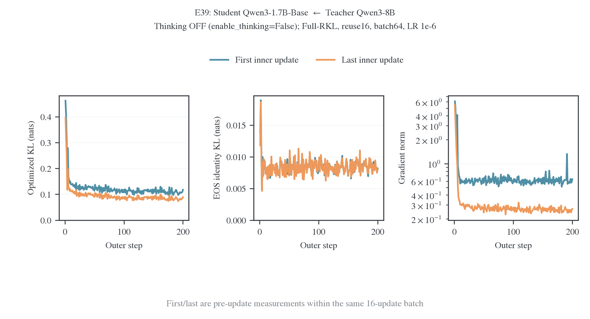

批首和批末分别是同一批第 1 次和第 16 次更新前的 loss 观测。末期每批仍能降低约 24%，但换到新的一批轨迹后，批首优化 KL 仍约 0.108；这与验证准确率平台同时存在。它说明“同批拟合仍有效”与“跨新轨迹、跨验证题目继续提升”是两件不同的事，不能据此直接判定过拟合或确定平台的唯一成因。

3,200 次更新均实际执行，没有非有限 loss、非有限梯度或跳过更新。最大裁剪前梯度范数为 6.11，主要出现在早期；末 20 批首／末均值约 0.634／0.258。最终一次更新前，优化 KL 为 0.0892，原始 KL 为 0.0971，终止 token 身份项约 0.0080。教师前向、actor 更新及权重同步均完成，没有 OOM 退出。

`full_kl_position` 按回答自身相对位置分成十段，图中对每段累计 sum/count 后求均值，避免把 token 数量当成损失大小。它仍是原始词表 KL，包含终止 token 身份差异。

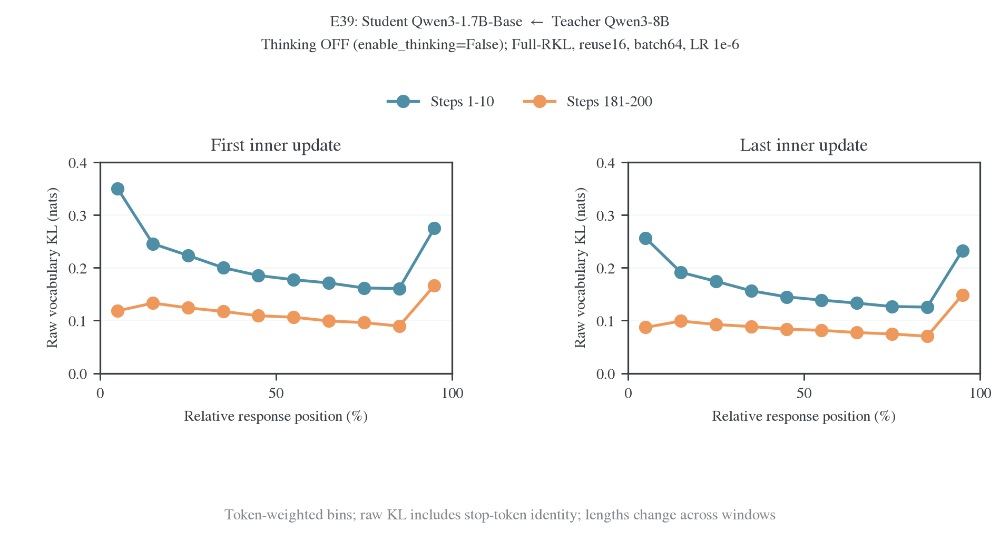

末 20 步的批末原始 KL，在前 90% 的位置约为 0.070–0.099，最后 10% 约为 0.149；前 10 步对应尾段约 0.233。整体位置失配降低，但末端仍较高。由于回答长度和访问前缀随训练变化，同一相对位置不代表相同绝对 token 位置；原始尾段 KL 也不能直接代表合并终止动作后的尾段优化梯度。

训练 DAPO 的批次题目持续变化，训练平均长度及任务分数不能与固定验证集一一比较。末 20 个训练 batch 平均长度约 2.38k，截断率约 1.33%，任务平均分约 22.11%；任务分数只作诊断，本次损失不使用任务奖励。完整训练长度、截断和任务分数见下面的原始逐批曲线。

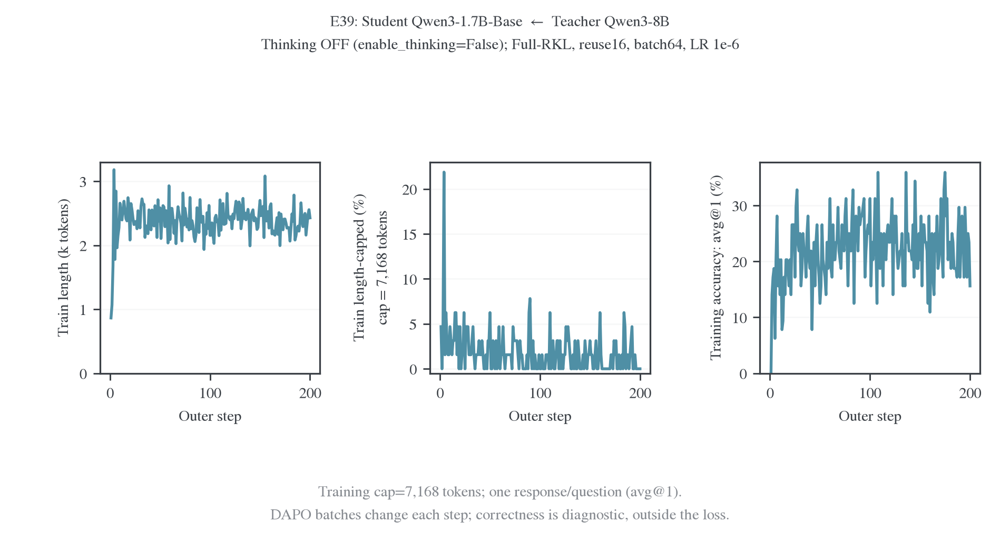

整个运行墙钟约 13.76 小时：初始验证 3.21 小时，之后 20 次验证合计 7.71 小时，训练与保存等 outer-step 主流程合计 2.77 小时，其余为初始化、收尾等开销。验证占墙钟约 79%。总计生成约 5.74 亿个验证 token；不能把全部墙钟时间当作 3,200 次参数更新的计算时间。

训练主流程内部，rollout 管线累计 1.08 小时、actor 更新 1.43 小时、teacher 前向约 5.0 分钟；这些是主流程的组成部分，不能再与 2.77 小时重复相加。FSDP worker 上报的 allocated peak 最大约 11.45 GiB，未单独分解 teacher 与 actor 的峰值；这与包含 vLLM 预分配池的整卡显存不是同一个口径。

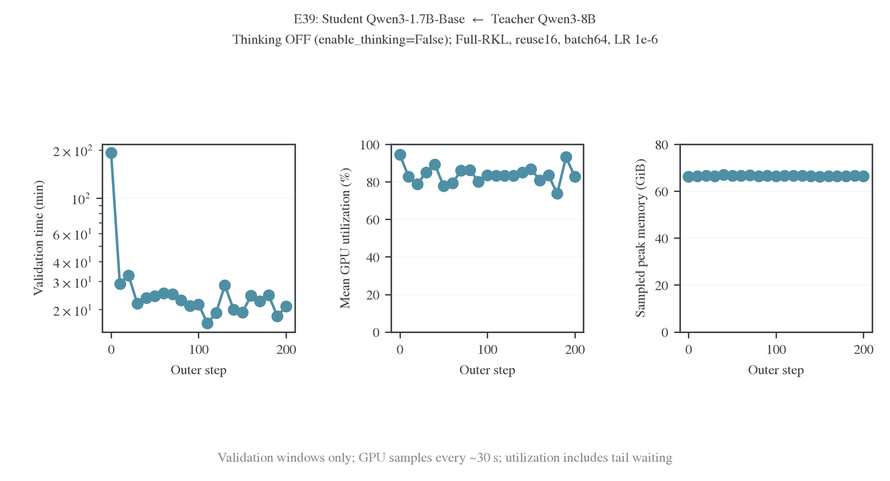

图中耗时轴采用对数刻度。生成期间各卡经常满载，但整轮验证还包含等待长尾。训练后各轮 valid 的 GPU 平均利用率约为 73.7%–93.2%，整卡采样显存峰值最高约 67.0 GiB。当前运行未完整记录 KV block 使用率和抢占计数，不能据此声称没有 KV 竞争或算出重算损失。资源口径和逐卡收尾证据见[完整验证资源实测](../../infra/performance/inference/validation-resources.md#observed)。

完整 teacher 基线仍待补齐，公开论文参考与同协议验证入口见[Qwen non-thinking 附录](appendix/qwen-nonthinking-reference.md)。现有 Qwen3-8B 历史子集每个数据集 8 题、每题 4 次；将最终 student 的相同题目、每题 16 次与其比较，得到下表。两边均为 non-thinking、温度 0.7、top-p 0.9、回答上限 31,744，但每题采样次数、模型及执行条件不同；该表不能替代 teacher 全集评测。

| 相同的 8 道题 | Teacher 平均正确率 | 最终 Student 平均正确率 | Teacher 平均长度 | Student 平均长度 |
| ------------- | -----------------: | ----------------------: | ---------------: | ---------------: |
| MATH-500      |             87.50% |                  70.31% |            1.51k |            2.98k |
| AMC23         |             87.50% |                  53.91% |            1.19k |            3.26k |
| AIME25        |             28.13% |                   6.25% |            5.22k |            8.58k |

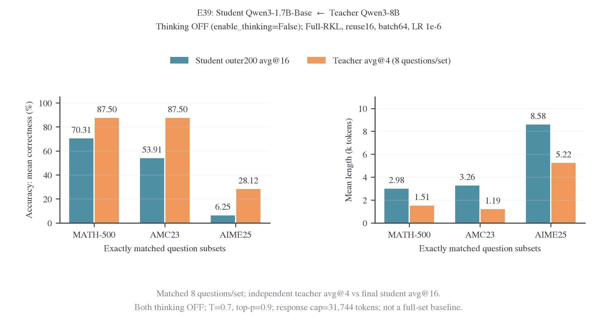

图中柱顶标出实测数值；teacher 为 avg@4、最终 student 为 avg@16，均是按题平均的正确率，采样数分别为每题 4 条和 16 条。两者只比较各基准相同的 8 道题；图内注明 thinking 关闭、温度 0.7、top-p0.9 及 response cap31,744。子集分数不画为完整 570 题验证曲线上的水平参考。

本次结果证明这组设置在单 seed 下能显著缓解 Base 的生成退化，并改善三个验证集的准确率。单条长程运行无法把全部收益归因于某一项修改，也不足以证明继续增加 step 或 reuse 会带来相应的准确率增长。后续最有价值的证据是同协议 teacher 全集参考，以及对平台阶段的新前缀失配和具体解题错误做受控分析。

本报告使用本地原始 W&B 文件解码的完整 3,401 条 history，未用云端采样 history 拼接学习曲线。启动保存的源码快照记录为 `a73dcbc0f`；SDK 自动记录的 Git 字段来自父目录仓库，不能代替该快照的来源说明。原始日志、本次配置和分析输入位于独立日志仓库；正文只链接冻结数据及可复算脚本。运行页面见参考链接。[^qwen8-run]

- [冻结配置](../../../../../../wandb-logs/MirrorOPD-verl/analysis/e39-qwen3base-final-20261027/config.json)、[完整 history](../../../../../../wandb-logs/MirrorOPD-verl/analysis/e39-qwen3base-final-20261027/history.jsonl)、[完成状态与分析摘要](../../../../../../wandb-logs/MirrorOPD-verl/analysis/e39-qwen3base-final-20261027/analysis.json)。
- [逐次验证 CSV](../../../../../../wandb-logs/MirrorOPD-verl/analysis/e39-qwen3base-final-20261027/validation.csv)、[逐批训练 CSV](../../../../../../wandb-logs/MirrorOPD-verl/analysis/e39-qwen3base-final-20261027/training.csv)、[位置 KL](../../../../../../wandb-logs/MirrorOPD-verl/analysis/e39-qwen3base-final-20261027/position-kl.csv)。
- [配对准确率区间](../../../../../../wandb-logs/MirrorOPD-verl/analysis/e39-qwen3base-final-20261027/paired-accuracy.json)、[固定题目重复面板](../../../../../../wandb-logs/MirrorOPD-verl/analysis/e39-qwen3base-final-20261027/sample-panel-summary.csv)、[完整样本摘录](../../../../../../wandb-logs/MirrorOPD-verl/analysis/e39-qwen3base-final-20261027/sample-examples.json.gz)。
- [分析脚本](../../../research/studies/qwen_base/analyze_final.py)、[绘图脚本](../../../research/studies/qwen_base/plot_final.py)。七组图均保存 PNG、PDF、SVG，包含独立的 teacher 匹配子集图；[逐图审计](teacher-comparison/qwen-base-8b/figures/final/figure-audit.json)与[输入来源及哈希](teacher-comparison/qwen-base-8b/figures/final/figure-provenance.json)随图保存。

[^qwen8-run]: W&B. Qwen3-1.7B-Base ← Qwen3-8B，Full-r16，200 outer step. [运行页面](https://wandb.ai/wncfht/MirrorOPD-verl/runs/f0e44ec7)。

<a id="qwen8-4-最终样本与错误类型"></a>

### 4. 最终样本与错误类型

这些例子来自固定题目面板：每个验证题目的 sample_index=0，比较原始 checkpoint 与最终 step 200。按预先定义的症状类别筛选后，取 prompt_id 排序中的首个匹配样本；它们用于定位错误类型，不代表全部样本的比例。重复统计采用保存文本的重新分词；最终平均正确率来自完整每题 16 次验证。

1. AMC23:1，从无关文本循环到正确解答。

题目给定正实数 $y^3=x^2$ 与 $(y-x)^2=4y^2$，求 $x+y$。初始模型输出 31,744 token，主要反复出现“状态：已完成／解释”；没有有效答案。最终回答为 895 token，得到 $x=27,y=9$ 与答案 36，未检测到长循环。

这道题的简洁核对是：由 $|y-x|=2y$ 且 $x,y>0$，只能有 $x=3y$；代入得 $y^3=9y^2$，所以 $y=9,x=27$，答案 36。最终样本在结果与关键关系上均正确。

2. AIME25:13，从极短无效输出到答案匹配，但推导仍有缺口。

该题求特定五边形中五个顶点到平面上一点距离之和的最小值，再求表达式参数之和。初始输出只有 3 token，内容为“.slff”。最终输出 4,388 token，给出判分匹配的答案 60，未检测到长循环。

但最终回答在坐标求解困难后，直接声称最小值是一个“已知结果”$37+10\sqrt{13}$，没有建立这一数值的推导。能据此确认的是答案匹配；不能把该例当作完整几何证明正确的证据。

3. AIME25:11，仍存在反复自我否定的长循环。

题目涉及平面 $x+y+z=75$ 上由不等式划出的有限面积区域，参考答案为 510。初始样本是 4 token 的无效代码片段；最终样本达到 31,744 token 上限，并反复输出面积 $\frac{5625}{2}\sqrt{3}$，随后又说这个结果不可接受，再重复同样的内容，未形成有效最终答案。

因此总体循环减少不意味着每道题都改善，也不能把所有短输出都视为健康。该例从极短无效输出转成了长循环；聚合统计必须同时观察短输出、循环和准确率。

4. AIME25:0，正常结束但遗漏变量替换。

题目要求满足 $b>9$ 且 $17_b\mid97_b$ 的整数进制之和。初始样本反复输出“umably”并撞长度上限。最终样本只有 560 token，能正常结束，也正确推出：

$$
b+7\mid56.
$$

错误出现在下一步：它把 56 中大于 9 的约数 $14,28,56$ 当作有效进制，求和得到 98。实际需要令 $d=b+7>16$，所以 $d=28,56$，再换回 $b=21,49$，正确和为 70。

这个样本把剩余问题定位到了变量与约束处理，而非终止协议或循环。继续压短输出本身不能修正这一步数学错误。

完整前后回答、题目和机器判分字段保存在[样本数据](../../../../../../wandb-logs/MirrorOPD-verl/analysis/e39-qwen3base-final-20261027/sample-examples.json.gz)。总体指标与面板定义见[完整分析](#qwen8)。

<a id="qwen4"></a>
<a id="qwen4-qwen3-教师配对e41e43-完整结果"></a>

## E41：Qwen Base←4B，正式训练与初始参考

<a id="qwen4-1-背景与-motivation"></a>

### 背景与实际设置

E41 检验终止动作对齐后，Qwen3-1.7B-Base 能否吸收 Qwen3-4B non-thinking teacher，并在早期增长后继续提高任务表现。Student 为 Base 初始化；教师与 E39 的 8B 不同。E43 使用已有后训练的 student，其设置与结果在[独立章节](#e43)分析。

<a id="qwen4-2-setting-与实验设计"></a>

共同训练条件为 DAPO、Full-vocab reverse-KL、batch=mini-batch64、每题一条当前 student rollout、reuse16、AdamW LR1e-6、seed42、100 outer／1600 次更新，8 张 H800、shared-sync FSDP2 teacher 评分。训练温度 1、top-p1、response cap7168；student 每卡并发 64、显存预算 0.80。每 10 outer 验证、每 50 outer 保存；验证 avg@16、温度 0.7、top-p0.9、top-k -1、response cap31744。[数学验证协议](../../settings/验证设置.md)解释题目与判分。

| 设置                  | E41 实际值                                      |
| --------------------- | ----------------------------------------------- |
| Student / Teacher     | Qwen3-1.7B-Base / Qwen3-4B                      |
| Prompt / response cap | 1024 / 7168                                     |
| 停止动作 KL           | 合并 151643、151645；诊断同时保留原始词表 KL    |
| 训练内初始验证        | 关闭；图中初始点采用已测的共享 Base 参考        |
| 验证集合              | MATH-500、AMC23、AIME25，共 570 题／9120 条回答 |
| 完成状态              | 100 outer／1600 次成功更新，exit 0              |

E54 沿用 Base 初始化和 100 outer 设计预算，teacher 改为 Qwen3-30B-A3B-Instruct-2507，五集验证共 630 题。该运行人工停止于 30 outer／480 次更新，完整验证到 20；MoE teacher 以全部权重在八卡分片。其实际设置、阶段结果和独立探针见[E54 长度诊断](../../infra/model-compatibility/qwen-e54/2026-10-29-E54长度膨胀诊断.md)。

<a id="qwen4-3-实验结果准确率与平台"></a>

### 初始准确率、长度与训练收益

E41 训练日志从 outer10 开始验证，但原始 Base 已经在 E39 的 outer0 测过完整三集。核对两次冻结配置，`data`、`actor_rollout_ref.model`和 rollout 的生成配置一致，包括模型路径、题集、non-thinking 空思考段模板、seed42、avg@16、温度 0.7、top-p0.9、cap31744 与停止 IDs。Rollout 的差异仅为实验 trace 名称和日志统计开关。绘图脚本逐项核验后复用这次实测初始评测，来源为 E39 run `f0e44ec7`；该点是共享初始化的参考，不是 E41 训练内补测的事件。配置与输入哈希见[来源记录](teacher-comparison/qwen-teachers/figures/separate-runs/base-reference-provenance.json)。

| 基准     | 共享 Base 初始 avg@16 | E41 outer10 | E41 outer100 | 初始→最终，百分点 |
| -------- | --------------------: | ----------: | -----------: | ----------------: |
| MATH-500 |                18.59% |      68.03% |       69.04% |            +50.45 |
| AMC23    |                11.41% |      40.31% |       40.16% |            +28.75 |
| AIME25   |                 0.42% |       5.83% |        7.50% |             +7.08 |

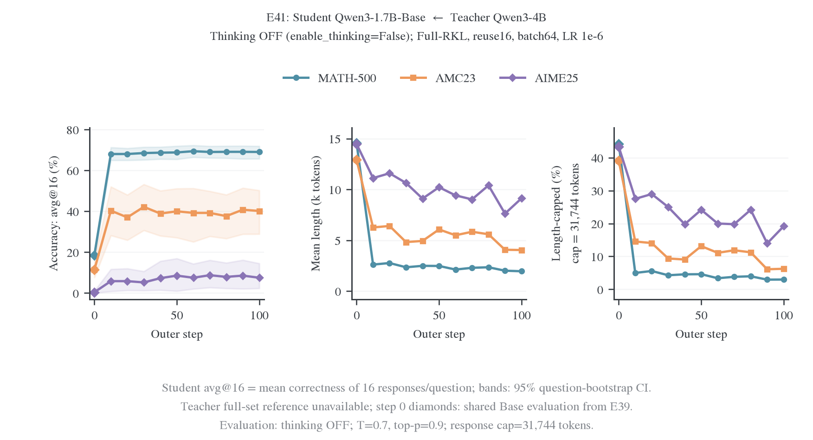

图内标题标明 student、teacher、thinking 关闭与训练方法；准确率使用每题 16 条回答的平均正确率 avg@16，pass@16 则是 16 条中至少一次答对的概率，本图使用前者。E41 原版 Qwen3-4B 的完整同协议 teacher 参考缺失，图内明确标注，不使用其他 4B 型号或题目子集替代。验证 length-capped 列标明 response cap=31,744 tokens；训练图标明 cap=7,168 tokens。

图 E41-1 沿用 Base←8B 的画法：颜色区分基准，三列依次为准确率、平均长度与触顶率；step0 的菱形来自共享 Base 评测，outer10–100 来自 E41。准确率阴影为按题 bootstrap 的 95% 区间。MATH 有 500 题、AMC 有 40 题、AIME 有 30 题；同题 16 条回答保留为一簇，区间不包含独立训练 seed 方差。AIME24/26 未在 E41 测量。

相对共享 Base 初始评测，E41 三项均明显提高；主要增益在前 10 outer 形成。outer10 到 100，MATH 只增加 1.01 个百分点，AMC 下降 0.16，AIME25 增加 1.67，后续增长有限。完整同协议 4B teacher 基线仍缺失，不能只据 student 改善判定已充分吸收 teacher。[^qwen4-e41]

<a id="qwen4-4-实验结果长度与终止行为"></a>

| 基准     | 初始长度→最终，千 token | outer10 长度 | 初始触顶率→最终 | outer10 触顶率 |
| -------- | ----------------------: | -----------: | --------------: | -------------: |
| MATH-500 |              14.57→1.95 |         2.61 |    44.20%→2.98% |          4.99% |
| AMC23    |              12.91→4.04 |         6.26 |    39.06%→6.25% |         14.53% |
| AIME25   |              14.47→9.12 |        11.12 |   43.33%→19.17% |         27.50% |

E41 最终 370/9120 条回答触顶，约 4.06%，各验证集生成失败数均为 0。三集按回答数加权的平均长度在 outer10 到 100 由 3.31k 降到 2.47k。初始长尾收缩与准确率增长同时发生，困难题仍有截断；触顶率按真实`finish_reason=length`计算，不能代替循环重复率。

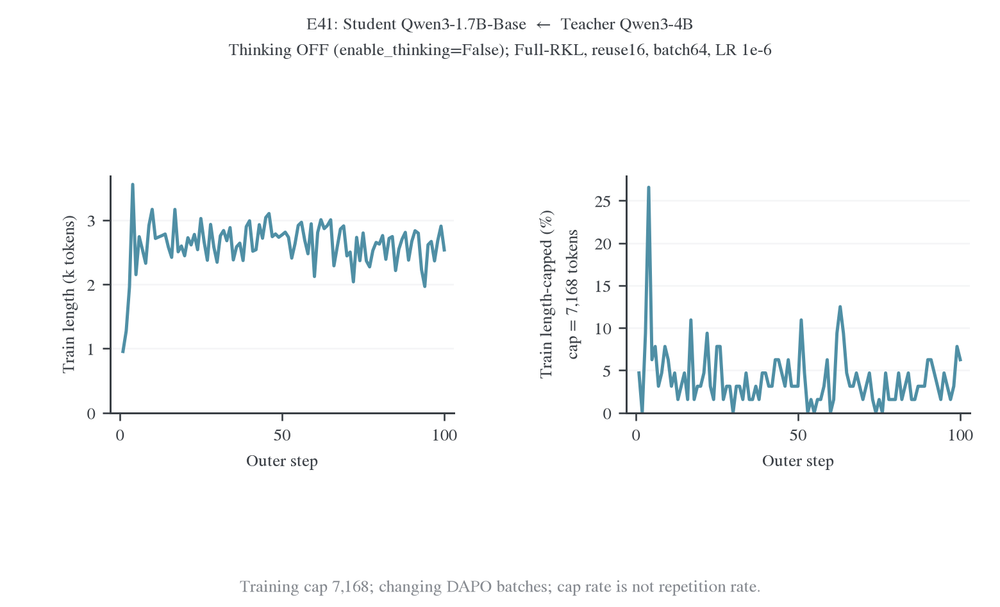

图 E41-2 单独展示训练 cap7168 下的长度与触顶率；最后 10 批平均回答 2.56k、触顶 4.22%、训练题目平均正确率 27.19%。验证允许 31744 token，两种触顶事件分别解释。完整运行日志没有统一 repeat 指标；原始 KL 与终止对齐的 20 步[受控重复实验](../../infra/model-compatibility/termination/README.md)使用自己的样本和预算。

<a id="qwen4-5-学习信号优化与系统诊断"></a>
<a id="qwen4-51-完整-kl-与实际优化目标"></a>

### KL、批内复用与数值稳定性

E41 原始词表 KL 包含两种 EOS 的身份差异；实际 loss 合并停止动作，两者单独展示。每个 outer 换新题目和学生轨迹，因此跨批起点混合了访问状态变化，不能直接解释为同题遗忘。

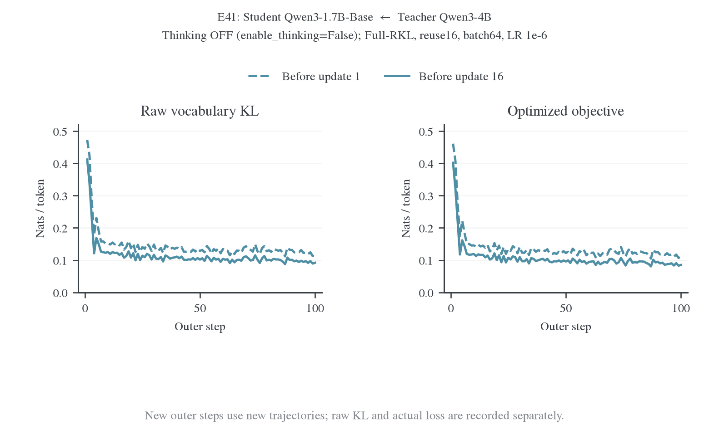

图 E41-3 每批分别取第 1、16 次更新前的观测。第 16 次观测的 raw KL 从首批 0.4121 降到末批 0.0919，实际 loss 从 0.4020 降到 0.0850。

<a id="qwen4-52-同批复用仍在拟合能力提升并未同步持续"></a>

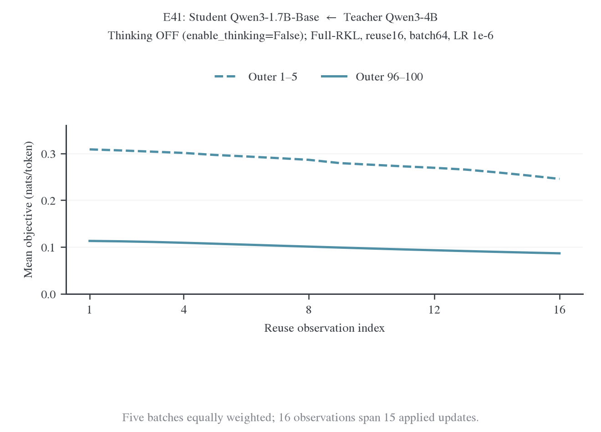

图 E41-4 对 outer1–5、96–100 各自按批等权平均，展示 16 次更新前的观测，首末之间执行 15 次更新。最后 10 批实际 loss 平均首末下降 24.13%；最终批 0.1120→0.0850。同批仍可拟合，独立验证收益已经有限；缺少匹配 reuse 对照，不能将平台归因于 reuse 本身。

<a id="qwen4-53-full-kl-position-的变化"></a>

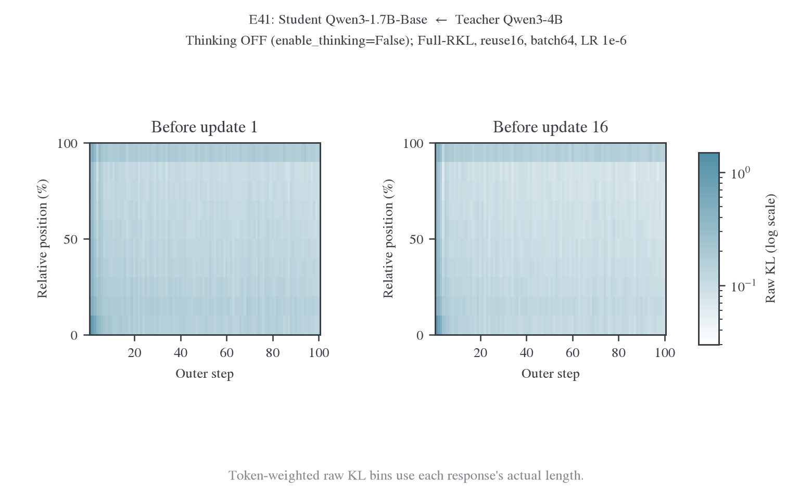

图 E41-5 分别显示每批第 1、16 次更新前的原始词表 KL，色标 0.03–1.5 nats、对数刻度。十桶按每条回答自身有效长度划分，sum/count 聚合；脚本逐次核验十桶加权结果恢复全局 Full-KL。前缀失配下降明显，后期末段仍有较高残差。相对位置不等于固定绝对 token 位置，热图不判定推理内容正确性，也不将全局对齐 loss 分摊到位置。

<a id="qwen4-54-梯度与数值稳定性"></a>

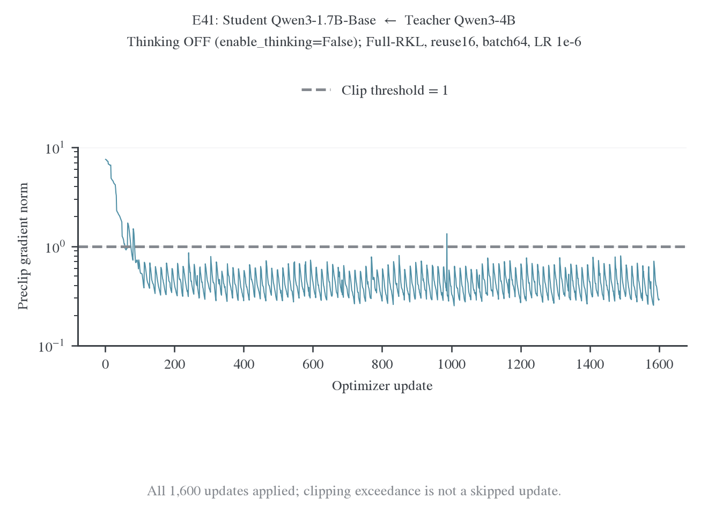

图 E41-6 为全部 1600 次更新的裁剪前梯度范数，对数纵轴，阈值 1。最大 7.56，4.44% 的观测超过阈值；更新全部执行，非有限 loss、非有限梯度、skipped update 均为 0。裁剪不表示数值故障或跳步。

<a id="qwen4-55-验证占据主要墙钟"></a>

### 训练耗时与验证资源

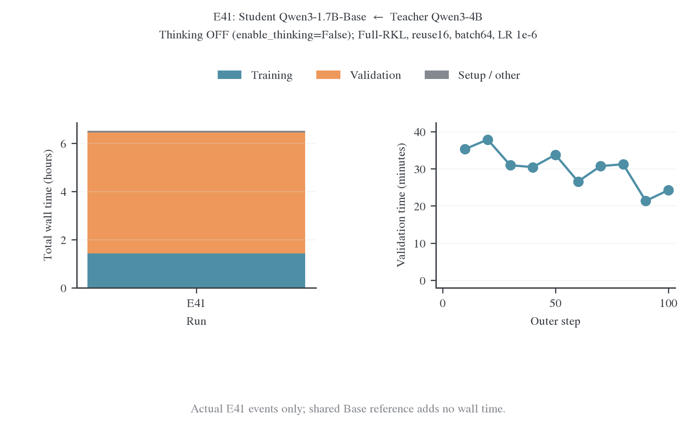

图 E41-7 只统计 E41 实际事件，共享 Base 参考不计入其墙钟。训练 1.42 小时、验证 5.04 小时、初始化与收尾 4.50 分钟，合计 6.53 小时，验证占 77.13%；最终一轮验证 24.2 分钟。耗时包含轨迹工作量变化，不能当作固定 token 吞吐。

<a id="qwen4-56-相同并发的-kv-压力不同"></a>

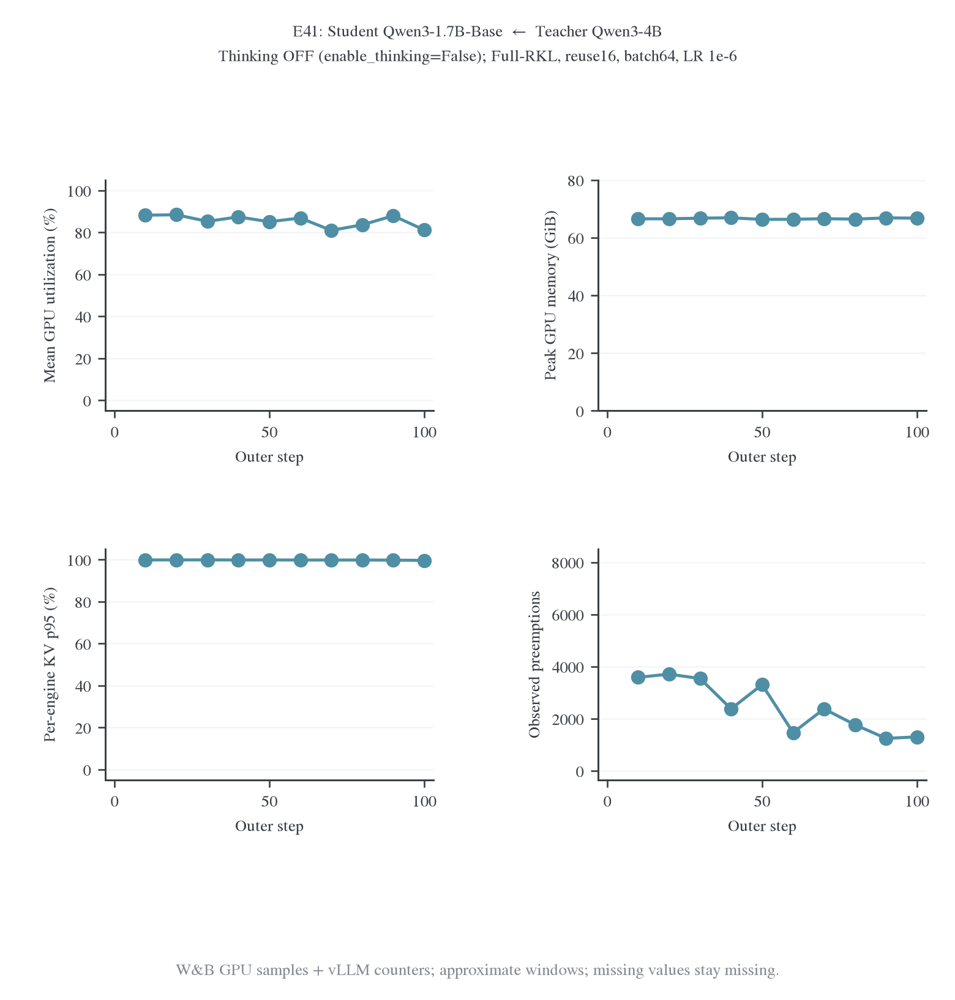

图 E41-8 中 GPU 利用率按八卡与窗口采样平均，显存取单卡最大值，KV p95 合并引擎和时间样本，抢占为每引擎窗口内 counter 增量之和。outer10→100：GPU 利用率 88.23%→81.18%，峰值显存 66.55→66.78 GiB，KV p95 为 99.90%→99.68%，观察到的抢占 3587→1304。最终仍有缓存竞争，但单凭抢占不能确定降低并发的吞吐效果。

窗口由 W&B 时间戳减`validation_seconds`近似定位；GPU/KV 分位统计剔除两端各 30 秒，counter 使用完整窗口可见端点，采样间隙可能漏计。缺失请求与关闭服务时的遥测错误不填 0。全程采样到单卡峰值 66.89 GiB，不保证覆盖亚秒瞬态，也不是独立 teacher 峰值。

<a id="qwen4-5-与-failure-reproduction-原论文比较"></a>
<a id="qwen4-6-分析与-failure-reproduction-原论文比较"></a>
<a id="qwen4-61-e41-对应-rethinking-opd-的学习受限设置"></a>

### 与 Rethinking OPD 的对应关系

Rethinking OPD 第 3.1 节使用相同的 Qwen3-1.7B-Base ← Qwen3-4B Non-thinking 模型对。图 2 的学生三基准均分约从 5% 升至 15%，弱于使用 Base-GRPO teacher 的曲线；这是近似读图值，原现象是收益受限，不能称为完全不学习。原文采用 student-top-16，而非这里的 full-vocab 终止动作对齐目标。[^qwen4-rethinking]

原图及完整原始设置统一见[失败复现方案第 5 节](../../archive/experiments/teacher-transfer/2026-10-25-失败复现原方案.md#5-e29e30base-学生与-non-thinking-4b-教师的初始失配)。

原图三项是 AIME24、AIME25、AMC23；E41 缺少 AIME24，因此不能把本项目含 MATH 的三项均分与约 15% 比较。原文每题 4 条 rollout、验证 top-p=0.95；E41 每题 1 条、reuse16、验证 top-p=0.9，并加入终止动作对齐。模型对相同不足以构成算法的受控比较。

E41 现有证据说明：此 Base 模型对在当前配方下可以稳定完成长程更新，但第 10 步后收益有限。判断 Full-KL 对 teacher mismatch 的独立作用，还需要同设置 sampled 对照和完整同协议 teacher 评测。

<a id="e43"></a>
<a id="qwen4-62-e43-对应-semi-opd-的在线轨迹受限设置"></a>

## E43：后训练 Qwen3-1.7B←4B-Instruct，正式训练与教师差距

### 背景与实际设置

E43 检验已有后训练的 Qwen3-1.7B 能否进一步吸收 Qwen3-4B-Instruct-2507。它同时改变了 E41 的 student 和 teacher，独立分析其初始表现、增长和末期差距，不以 E41/E43 之间的分数差识别教师效应。

共同训练条件为 DAPO、Full-vocab reverse-KL、batch=mini-batch64、每题一条当前 student rollout、reuse16、AdamW LR1e-6、seed42、100 outer／1600 次更新，8 张 H800、shared-sync FSDP2 teacher 评分。训练温度 1、top-p1、response cap7168；student 每卡并发 64、显存预算 0.80。每 10 outer 验证、每 50 outer 保存；验证 avg@16、温度 0.7、top-p0.9、top-k -1、response cap31744。[数学验证协议](../../settings/验证设置.md)解释题目与判分。

| 设置                  | E43 实际值                                             |
| --------------------- | ------------------------------------------------------ |
| Student / Teacher     | Qwen3-1.7B / Qwen3-4B-Instruct-2507                    |
| Prompt / response cap | 4096 / 7168                                            |
| 输入与终止            | non-thinking；原生终止协议，raw KL 等于实际 loss       |
| 初始验证              | 开启，在本 run 内测量                                  |
| 验证集合              | MATH-500、AMC23、AIME24/25/26，共 630 题／10080 条回答 |
| 完成状态              | 100 outer／1600 次成功更新，exit 0                     |

### 准确率、长度与终止行为

| 基准     | 初始 avg@16 | outer10 | outer100 |
| -------- | ----------: | ------: | -------: |
| MATH-500 |      70.79% |  85.25% |   85.39% |
| AMC23    |      42.81% |  71.88% |   75.31% |
| AIME24   |      12.29% |  36.04% |   31.46% |
| AIME25   |       8.96% |  23.96% |   24.17% |
| AIME26   |       9.58% |  22.71% |   23.96% |

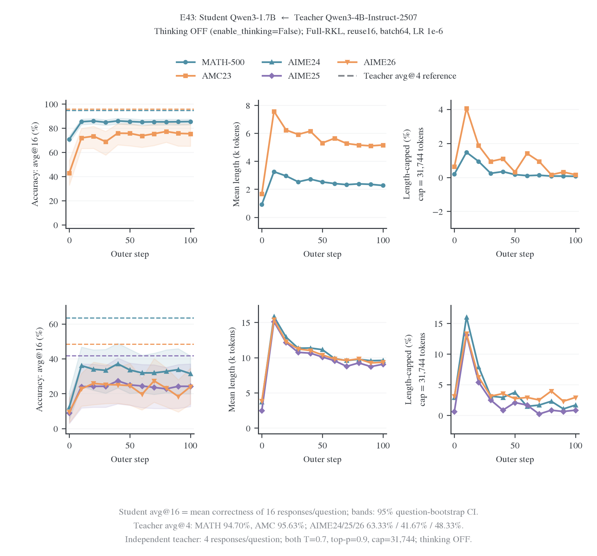

图 E43-1 的标题标明 student、teacher、thinking 关闭与 Full-RKL/reuse16/batch64/LR 设置。准确率实线为 student avg@16，虚线为对应基准的独立 teacher avg@4；两者都是按题平均的正确率，采样数分别为每题 16 条和 4 条，不使用 pass@k。图内列出 teacher 五集数值及共同温度 0.7、top-p0.9、response cap31,744，保留两次执行的 seed 差异。length-capped 列直接标明 cap=31,744 tokens。

图 E43-1 只含 E43：上排 MATH/AMC，下排 AIME24/25/26，三列依次为准确率、平均长度、触顶率，保留各自纵轴范围。阴影为按题 bootstrap 的 95% 区间。E43 相对自己的初始点各项提高，MATH 和 AMC 分别增加 14.60、32.50 个百分点；多数收益在前 10 步形成，后期 AMC 继续提高，AIME24 最终低于 outer10。每个 AIME 只有 30 题，单 seed 小幅变化不能作为稳定优劣结论。[^qwen4-e43]

| 基准     | outer10 长度→最终，千 token | outer10 触顶率→最终 |
| -------- | --------------------------: | ------------------: |
| MATH-500 |                   3.25→2.27 |         1.48%→0.06% |
| AMC23    |                   7.57→5.16 |         4.06%→0.16% |
| AIME24   |                  15.82→9.61 |        16.04%→1.67% |
| AIME25   |                  15.10→9.05 |        13.13%→0.83% |
| AIME26   |                  15.40→9.35 |        13.33%→2.92% |

最终 32/10080 条回答触顶，约 0.32%，所有验证集生成失败数均为 0。五集按回答数加权的平均长度从初始 1.31k 到最终 3.46k，前期变长后再缩短，仍长于初始化。单基准曲线直接使用该集数据，避免将原先共同三集加权长度误当成五集统计。

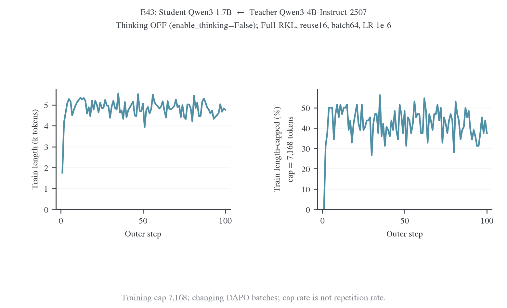

图 E43-2 中最后 10 批平均训练回答 4.65k、触顶 37.34%、题目平均正确率 52.34%。训练 cap7168 仍截断较多，验证允许 31744 且最终触顶很少，两者反映不同长度限制；日志没有统一 repeat 指标，不能把训练触顶率改称循环比例。

### KL、复用与数值稳定性

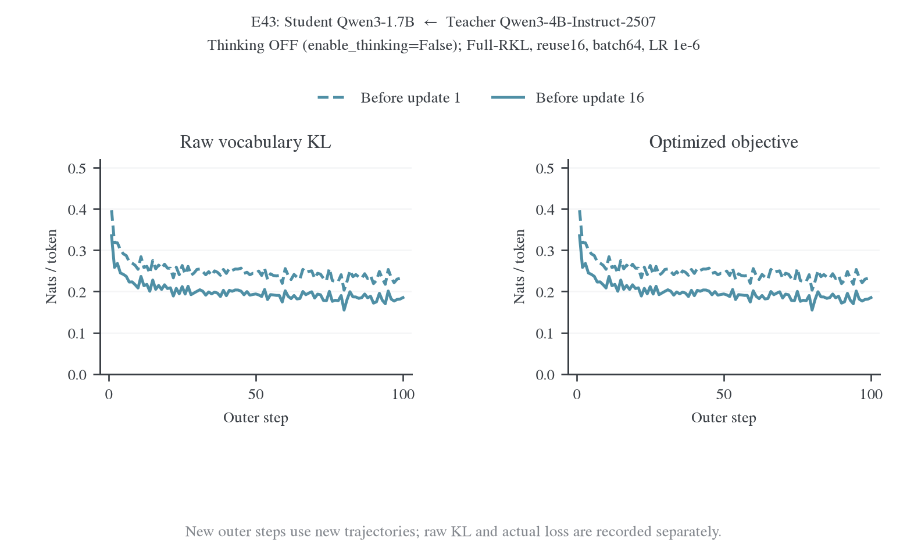

图 E43-3 中 raw KL 等于实际 loss；两列保留相同口径，分别展示记录字段。每批第 1、16 次更新前的 KL 首末观测区分线型，第 16 次观测从首批 0.3351 降到末批 0.1853。新批更换轨迹，跨批曲线不等于固定题目的风险轨迹。

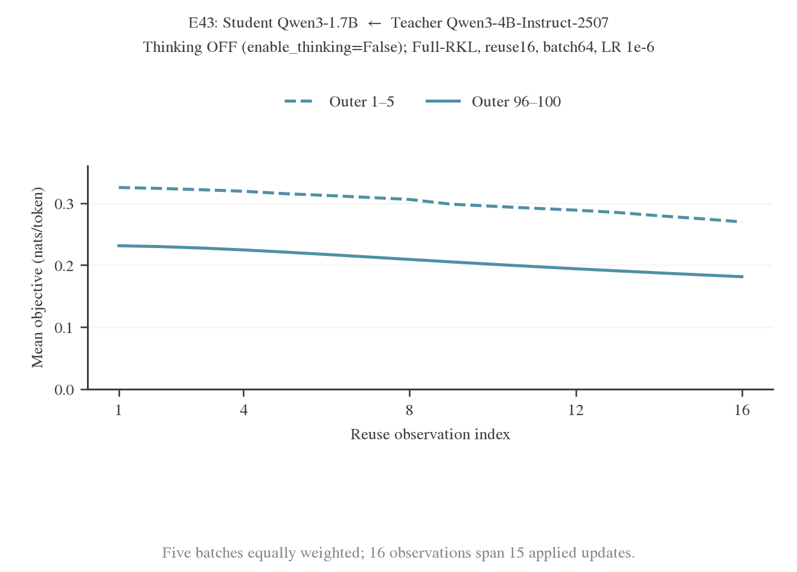

图 E43-4 分别对 outer1–5、96–100 按批等权平均；最后 10 批 loss 平均首末下降 21.73%，最终批 0.2383→0.1853。给定当前 batch 仍有拟合空间，验证收益后期有限；尚无 E42 sampled 或匹配 reuse 对照来分离各方法因素。

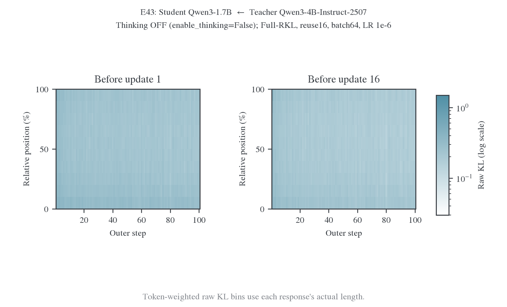

图 E43-5 对数色标 0.03–1.5 nats，展示两次批内观测的十个相对位置桶。每桶 sum/count 按 token 聚合，十桶可恢复全局 KL。失配分布较广、后期仍有残余；热图定位监督差异，不证明回答正确性。

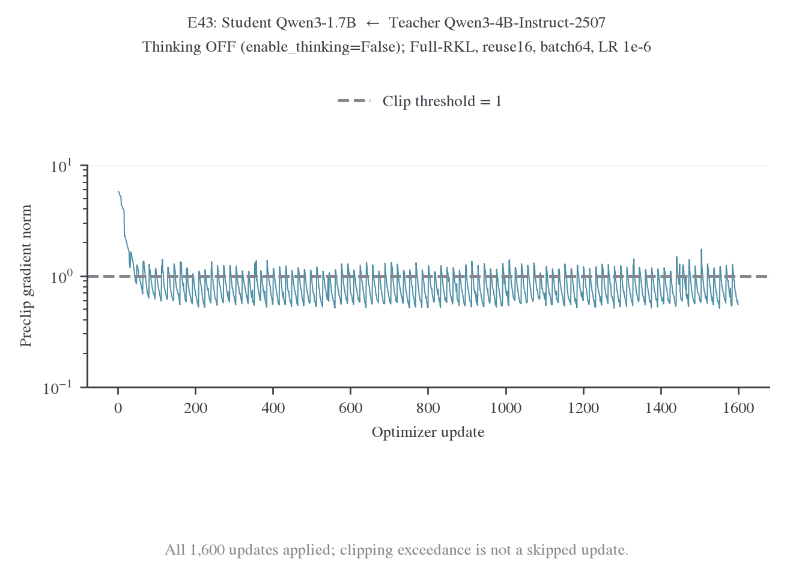

图 E43-6 记录 1600 次更新，最大裁剪前梯度范数 5.76，23.38% 的观测超过阈值 1。全部更新执行，非有限 loss、非有限梯度、skipped update 均为 0，裁剪频繁不等于数值故障。

### 耗时与验证资源

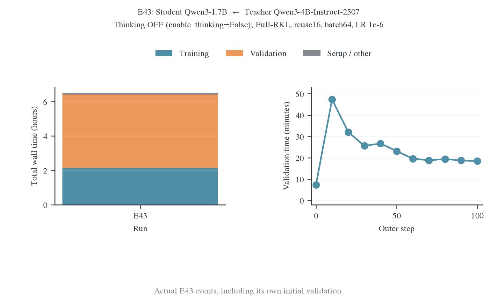

图 E43-7 包含本 run 内初始验证。训练 2.13 小时、验证 4.29 小时、初始化与收尾 5.62 分钟，总计 6.51 小时，验证占 65.85%。outer10 验证 47.4 分钟、最终 18.4 分钟，同时伴随回答变短与触顶减少；不解释为固定 token 工作量下的引擎加速。

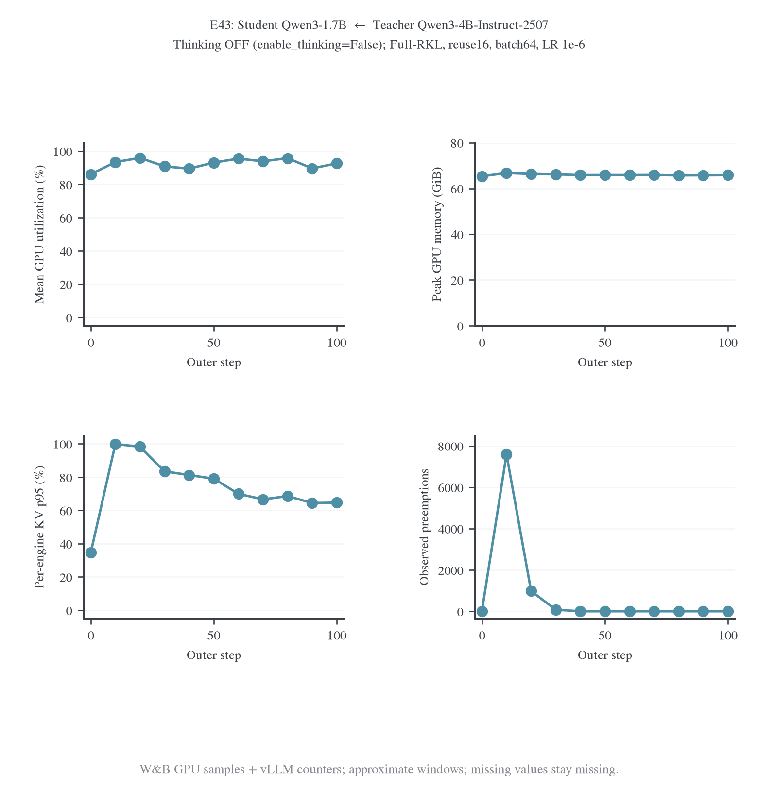

图 E43-8 使用本 run 的 W&B 系统监控与 vLLM telemetry。outer10→100：八卡平均 GPU 利用率 93.35%→92.57%，单卡峰值显存 66.76→65.83 GiB，KV p95 为 99.94%→64.71%，观察到的抢占 7594→0。outer40 起各验证窗口均无 counter 增量；后期该并发配置较平稳。全程采样单卡峰值 66.76 GiB，边界定位、两端 30 秒剔除、counter 缺口与缺测处理沿用 E41 图的统计定义；资源统计不填补独立 teacher 内存或瞬态峰值。

### 与 Semi-OPD 及独立 teacher 的对应关系

已有独立 teacher 完整 630 题 avg@4 参考为 MATH/AMC/AIME24/25/26 的 94.70%／95.63%／63.33%／41.67%／48.33%；E43 最终均低于这一参考。Teacher 与 student 同为 non-thinking、T0.7/top-p0.9/cap31744，但采样数、seed 与执行实例不同。参考来源及图示见[周会 E43 独立配对](../../progress/2026-11-01-周会报告.md#e43后训练-student--4b-instruct任务提高但仍低于-teacher-参考)。

Semi-OPD 论文采用相同的 Qwen3-1.7B Non-thinking ← Qwen3-4B-Instruct-2507。原文表 1 对训练后的方法报告 step 60/80/100 的平均成绩；这里也对 E43 的同三个 outer 节点求平均。单位为 %，但评测采样和训练预算仍不同：[^qwen4-semi]

| 来源与方法                         | AIME24 | AIME25 | AIME26 |
| ---------------------------------- | -----: | -----: | -----: |
| 论文：初始 student                 |   12.6 |    9.6 |    7.4 |
| 本机：E43 初始 student             |  12.29 |   8.96 |   9.58 |
| 论文：标准 OPD，60/80/100 平均     |   35.8 |   25.5 |   23.3 |
| 本机：E43 Full-r16，60/80/100 平均 |  32.01 |  23.75 |  22.22 |
| 论文：Semi-OPD，60/80/100 平均     |   50.3 |   38.9 |   41.8 |

按共同三个 AIME 简单等权平均，论文标准 OPD 为 28.20%，本机 E43 为 26.00%，论文 Semi-OPD 为 43.67%。这些是本表共同列的算术整理，不是论文包含 HMMT 的四项均分。本机没测 HMMT，不能填成论文的完整 Avg@32。

数值上，E43 处于原文标准 OPD 相近的范围，没有显示出达到 Semi-OPD 高分的结果。它证明当前训练能提升该 student，尚未证明 full-vocab 与 reuse16 已解决在线 rollout 的局限。

| 比较条件          | 论文表 1                                      | 本机 E43                                       |
| ----------------- | --------------------------------------------- | ---------------------------------------------- |
| 监督与采样来源    | 标准 OPD / Semi-OPD；主要为 sampled-token RKL | 在线 Full-vocab RKL，reuse16                   |
| 训练 response cap | 标准 OPD 16,384；Semi-OPD 4,096               | 7,168                                          |
| 数据与每批轨迹    | DAPO 英文去重子集；128×1                      | 本项目 DAPO；64×1                              |
| 报告节点          | 60/80/100；标准 OPD 条目注明引自 Relay-OPD    | 相同 outer 数字，但对应 960/1,280/1,600 次更新 |
| 验证              | avg@32，温度 1、top-p 1、cap 32,768           | avg@16，温度 0.7、top-p 0.9、cap 31,744        |
| 数据集            | AIME24/25/26、HMMT Feb26                      | MATH、AMC、AIME24/25/26                        |

论文另在相同 4K 训练 cap 下报告该模型对的 Semi-OPD 末点优势 +9.5 个百分点（四基准均分）。那是另一组匹配长度对照，不能把表 1 的不同 cap 分数差当作纯 on/off-policy 效应，也不能把 +9.5 直接视为本机待复现的差值。[^qwen4-semi]

我们没有同配置的 E42 sampled 对照，也没有本机 Semi-OPD 臂，因此当前结果不支持对 full-vocab、reuse 或离线来源的独立因果归因。E43 后期缩短、准确率平台的现象与论文研究问题相容，但并未验证唯一机制。

<a id="qwen4-63-tide-结果的归属"></a>

TIDE 强失配主结果属于 Base←8B 的[E39](#qwen8)，其九基准 Avg@8 不填入 E41 或 E43。[^qwen4-tide] 历史 250-step sampled/full配对设计与已完成的100-step reuse16 运行分别登记，原方案见[失败复现方案](../../archive/experiments/teacher-transfer/2026-10-25-失败复现原方案.md)。

<a id="qwen4-6-冻结证据与结论边界"></a>
<a id="qwen4-7-冻结证据与结论边界"></a>

<a id="qwen-figure-reproduction"></a>

## E39/E41/E43 的绘图输入与复算

分析使用本地完整 `.wandb` 解码记录，并与归档 file logger 逐字段核对。逐次 optimizer 更新编号均覆盖 1–1,600，无缺号；W&B 退出记录也为成功。原始文件和冻结 telemetry 归档在独立日志仓库，正文不依赖临时运行目录：

- [数据说明](../../../../../../wandb-logs/MirrorOPD-verl/analysis/qwen-e41-e43-final-20261028/README.md)、[完成状态](../../../../../../wandb-logs/MirrorOPD-verl/analysis/qwen-e41-e43-final-20261028/summary.json)。
- [全部验证节点](../../../../../../wandb-logs/MirrorOPD-verl/analysis/qwen-e41-e43-final-20261028/validation.csv)、[逐批训练](../../../../../../wandb-logs/MirrorOPD-verl/analysis/qwen-e41-e43-final-20261028/training.csv)、[全部更新及首尾位置 KL](../../../../../../wandb-logs/MirrorOPD-verl/analysis/qwen-e41-e43-final-20261028/updates.csv)。
- [E41 配置](../../../../../../wandb-logs/MirrorOPD-verl/analysis/qwen-e41-e43-final-20261028/E41/config.yaml)、[E43 配置](../../../../../../wandb-logs/MirrorOPD-verl/analysis/qwen-e41-e43-final-20261028/E43/config.yaml)；对应子目录保留原始 metrics.jsonl 与 exit.json。

- [W&B 一致性与动力学汇总](../../../../../../wandb-logs/MirrorOPD-verl/analysis/qwen-e41-e43-final-20261028/wandb-diagnostics.json)、[逐位置 KL](../../../../../../wandb-logs/MirrorOPD-verl/analysis/qwen-e41-e43-final-20261028/position-kl-detail.csv)、[验证资源统计](../../../../../../wandb-logs/MirrorOPD-verl/analysis/qwen-e41-e43-final-20261028/validation-resources.csv)。
- [分析与绘图源码](../../../research/studies/qwen_teachers/analyze_qwen_teacher_runs.py)、[图形审计](teacher-comparison/qwen-teachers/figures/separate-runs/figure-audit.json)、[逐点验证输入](teacher-comparison/qwen-teachers/figures/separate-runs/validation-inputs.json)、[共享 Base 参考的配置核对与来源哈希](teacher-comparison/qwen-teachers/figures/separate-runs/base-reference-provenance.json)、[teacher 参考值与来源哈希](teacher-comparison/qwen-teachers/figures/separate-runs/teacher-reference-provenance.json)。E41、E43 各有独立子目录；每张图提供同名 PNG/PDF/SVG。

正式绘图使用专题维护的[冻结输入说明](data/qwen-training-figures/README.md)和[输入清单](data/qwen-training-figures/manifest.json)。模型、thinking、reuse、batch、LR、训练 cap 与验证解码设置从各 run 的冻结配置提取并核对 SHA-256。E43 teacher 指标从[原始指标](data/qwen-training-figures/e43-teacher-metrics.json)、[完成回执](data/qwen-training-figures/e43-teacher-complete.json)与[协议副本](data/qwen-training-figures/e43-teacher-protocol.json)重建，核对指纹、指标哈希、630 题 × 4 回答及双方可比的解码设置。采样数和 seed 分别保留，avg@16／avg@4 均为平均正确率。正式实验图不读取周报附件。

| 实验 | 当前生成器                                                                                           | 当前输出                                                                                                | 参考边界                                                |
| ---- | ---------------------------------------------------------------------------------------------------- | ------------------------------------------------------------------------------------------------------- | ------------------------------------------------------- |
| E39  | [plot_final.py](../../../research/studies/qwen_base/plot_final.py)                                   | [final/](teacher-comparison/qwen-base-8b/figures/final/)：7 图，各 PNG/PDF/SVG                          | 原始 Base 初始实测；teacher 只有匹配 8 题子集，独立展示 |
| E41  | [analyze_qwen_teacher_runs.py](../../../research/studies/qwen_teachers/analyze_qwen_teacher_runs.py) | [separate-runs/e41/](teacher-comparison/qwen-teachers/figures/separate-runs/e41/)：8 图，各 PNG/PDF/SVG | 初始点来自 E39，共享初始化；teacher 全集缺测            |
| E43  | 同上                                                                                                 | [separate-runs/e43/](teacher-comparison/qwen-teachers/figures/separate-runs/e43/)：8 图，各 PNG/PDF/SVG | 本 run 初始验证；独立 teacher 全集 avg@4                |

下列命令从源码仓库根目录执行，依赖既有 `wandb-logs` 和 plotting 环境，只进行本地 CPU 分析与绘图。`--figure-inputs` 默认读取专题清单，也可显式指定同结构清单。输出记录配置、输入清单、读取器与生成器哈希；冻结输入改变时失败。E39 额外核对七份绘图输入；E41/E43 核对 decoded history、解压后的系统采样以及 file logger、vLLM 采样和退出记录的哈希。E39/E41 的停止动作合并 IDs 和 E43 原生目标分别保留在协议输出中。

E39 重画：

```bash
FIGURE_VIZ_MPL=../dotfiles/.agents/skills/figure-viz/assets/mpl \
  /root/.local/share/mirroropd/venvs/plotting/bin/python \
  -m examples.mirroropd.research.studies.qwen_base.plot_final \
  --data ../wandb-logs/MirrorOPD-verl/analysis/e39-qwen3base-final-20261027 \
  --out examples/mirroropd/docs/experiments/teacher-transfer/teacher-comparison/qwen-base-8b/figures/final
```

E41/E43 重画；首次使用先解码三个既有 run，已有完整解码记录时直接执行绘图命令：

```bash
../wandb-logs/.venv/bin/python ../wandb-logs/tools/wandb_local.py decode --run f0e44ec7
../wandb-logs/.venv/bin/python ../wandb-logs/tools/wandb_local.py decode --run 53dd553d
../wandb-logs/.venv/bin/python ../wandb-logs/tools/wandb_local.py decode --run eccc09a1
FIGURE_VIZ_MPL=../dotfiles/.agents/skills/figure-viz/assets/mpl \
  /root/.local/share/mirroropd/venvs/plotting/bin/python \
  -m examples.mirroropd.research.studies.qwen_teachers.analyze_qwen_teacher_runs \
  --logs-root ../wandb-logs \
  --data ../wandb-logs/MirrorOPD-verl/analysis/qwen-e41-e43-final-20261028 \
  --out examples/mirroropd/docs/experiments/teacher-transfer/teacher-comparison/qwen-teachers/figures/separate-runs
```

新生成的[动力学诊断](teacher-comparison/qwen-teachers/figures/separate-runs/wandb-diagnostics.json)、[逐位置 KL](teacher-comparison/qwen-teachers/figures/separate-runs/position-kl-detail.csv)与[验证资源统计](teacher-comparison/qwen-teachers/figures/separate-runs/validation-resources.csv)写入输出目录；日志仓库中的既有同名表保持冻结。

旧 E41/E43 合并图 `completed-20261028/` 与周报 `rq41-e39`、`rq41-e41`、`rq41-e43`、`rq41-e39-teacher-subset` 已由本节登记的图替代。旧附件保持原位，当前周报生成器只生成 RQ4.4/RQ5 的三张补充图。准确率展示统一保留两位小数、按四舍五入处理边界；输入保留原始浮点值。

E41/E43 的单 seed 完整结果已经确认；E43 已有独立的同协议 teacher 全集参考，E41 仍缺该参考。原计划中的 250-step 配对、重复率完整重算与多 seed 统计仍未完成。E54 的人工停止状态与独立探针统一见长度诊断，避免在本报告重复维护阶段结论。

<a id="qwen4-参考文献"></a>

### 参考文献

[^qwen4-e41]: MirrorOPD-verl. E41，Qwen3-1.7B-Base ← Qwen3-4B，2026，本地完整指标与退出记录已核对。[W&B](https://wandb.ai/wncfht/MirrorOPD-verl/runs/53dd553d)。

[^qwen4-e43]: MirrorOPD-verl. E43，Qwen3-1.7B ← Qwen3-4B-Instruct-2507，2026，本地完整指标与退出记录已核对。[W&B](https://wandb.ai/wncfht/MirrorOPD-verl/runs/eccc09a1)。

[^qwen4-rethinking]: Yaxuan Li et al. _Rethinking On-Policy Distillation of Large Language Models: Phenomenology, Mechanism, and Recipe_. arXiv:2604.13016v2，2026，第 3.1 节、图 2、附录 A；2026-10-28 复核原文及原图。[论文](https://arxiv.org/html/2604.13016v2)。图的获取及转换说明见[原图档案](teacher-comparison/failure-matrix/figures/README.md)。

[^qwen4-semi]: Siyan Zhao et al. _When Do We Need On-Policy Distillation? Distilling on Offline Student Rollouts Is Often Better_. arXiv:2610.11291v1，2026，表 1、表 3、第 2–4 节与附录 A；2026-10-28 复核。[论文](https://arxiv.org/html/2610.11291v1)。

[^qwen4-tide]: Zichao Yu et al. _Mismatch Matters: On-Policy Distillation Beyond Token Agreement_. arXiv:2608.09836v1，2026，第 4 节与表 1。[论文](https://arxiv.org/html/2608.09836v1)。
