# 师生配对 RKL 总览：R1、Qwen3 与 Llama

本页汇总多组 teacher–student 配对的固定状态 RKL 结果，按学生及输入模式展示训练拟合与 Math／Code／IF 留出表现。表格和主图采用学生更新 0–320 范围内的有效读出；模型名中的 SFT step640 表示教师 checkpoint。

<!-- generated:counts:start -->

R1、Qwen3、Llama 主比较包含 42 个固定权重版本，其中 42 个已落地；已完成 42 个师生权重配对、50 个输入条件。各条件在 0–320 范围内的最新有效终点合计 13952 次更新。统计单位为本页主比较的有效终点；中间阶段和重放预算不重复累加，自教师、teacher-copy、重复评分和数值验算不计作训练分支。

<!-- generated:counts:end -->

<!-- generated:inventory:start -->

| 谱系  | 计划中的权重版本 | 权重已到本地 | 已完成训练的不同师生配对 |
| ----- | ---------------: | -----------: | -----------------------: |
| R1    |               12 |           12 |                       14 |
| Qwen3 |               19 |           19 |                       18 |
| Llama |               11 |           11 |                       10 |
| 合计  |           **42** |       **42** |                   **42** |

<!-- generated:inventory:end -->

[训练与留出相关性散点图](correlations.md)比较各 teacher run 的对数吸收倍数、最终残差、绝对下降与相对下降，按 student／输入模式分组，64 与 320 更新在同图展示。

[RL 与 SFT 的训练过程吸收轨迹](absorption-trajectories.md)使用 JustRL／MiniMath／DeepScaleR 与 Llama 对照的中间快照，比较训练拟合和跨领域迁移，并分析 R1-1.5B 的同尺寸、跨尺寸与追加训练方式。

[各 student 的全教师训练轨迹](student-trajectories.md)将全部 teacher 叠画，分别比较同尺寸的追加 SFT／RL 分支，以及同尺寸／跨尺寸条件。

[吸收量、迁移效率与后期偏离](absorption-diagnostics.md)提供四类量化图、窗口定义及缺失比值的解释。

[Teacher difference 的 PAC 与噪声底诊断](../absorption/README.md)进一步测量已有 checkpoint 的梯度与跨 batch 共享方向；它使用单独冻结的子面板，不改变本页固定状态结果的条件与统计。

[RL 前后模型的 KL 量级](rl-parent-kl.md)汇总相关论文，并从原始 S0 全词表评分复算 R1、Qwen3、Llama 与 MiMo 的 RL 前后距离、SFT 对照和两个方向的差异。

[MiMo 双 held-out bank](absorption-diagnostics.md#mimoinitial-与-teacher-双-held-out-bank)分别展示 initial 与 teacher 轨迹上的固定 RKL 和吸收量；MiMo 交互面板（本地文件 `figures/mimo-absorption-20261107/data/explorer.html`）可叠加三个 teacher、切换四个 domain 与 Avg。

交互探索器（本地文件 `data/explorer.html`）可按 student、尺寸、追加阶段和 teacher 筛选，悬停读取快照与残差；[打开方式与使用说明](interactive.md)。

[教师变化与 OPD 吸收的谱实验设计](../absorption/README.md)说明如何利用现有 checkpoint 与固定 bank 分析已学和未学内容，并通过重构干预检验功能作用；计划状态与现有结果分开。

## 阅读结果

当前诊断使用下方的单遍图集：固定训练池、Math／Code／IF 永久留出及整体留出分别展示，不设旧 A–D 面板。每个 student／输入模式独立成组，Polaris 排除；跨尺寸条件仅作上下文。下方保留的历史总览图与表仍含原比较条件，解释同源 RL／SFT 差异时使用单遍图集中的配对与共同预算。

固定状态协议、模型输入和支持集见[实验条件](../protocols/fixed-state.md)。完整任务成绩另见[历史任务评测](../appendix/task-scores.md)，逐 run 曲线与数据从[图谱与复算](../reproduction.md)进入。

## 单遍训练的完整诊断

2026-11-07 从已有日志重绘 47 个输入条件，共 711 张逐 run 图、50 张跨 teacher 比较图。没有新增训练；只读取同一执行实例的 0–320 内完整单遍前缀，验证 A→T 顺序、每批 reuse16、快照与训练日志完整性、固定题目与状态身份。后续跨轮重访与混接续训不进入图集。来源目录名可能包含更长预算，但这里仅读取首遍。完整图集是本机可重建产物：逐 run 入口 `../transfer-mechanism/appendix/data/clean-diagnostics/README.md`、跨 teacher 比较入口 `../transfer-mechanism/appendix/data/clean-diagnostics/comparisons/README.md`。[精选图、端点 CSV 与来源记录](../figures/fixed-state-clean-20261107/provenance.json)保留在仓库，重绘命令见[复算说明](../reproduction.md#clean-diagnostics)。

每个输入条件单独评分固定训练池、Math64、Code32、IF32 以及按题数合并的整体留出。固定训练池在早期包含未来会训练的题，永久留出始终不参与该 run 的梯度更新。跨 teacher 折线重点展示相同 student、相同输入、相同 320 更新的条件；这控制了蒸馏设置，没有控制公开 teacher 的数据、训练前史和初始 KL。模型直接继承与模式匹配另按[师生谱系](../../../settings/模型与师生配对.md)核对；同尺寸不自动等于同源。

| 指标                            | 分母与读法                                                                                           | 保存范围                                |
| ------------------------------- | ---------------------------------------------------------------------------------------------------- | --------------------------------------- |
| 绝对 RKL、绝对下降量、剩余比例  | 全局风险为累计 KL 除以题数×1024；下降量为初始减当前，剩余比例为当前除初始                            | 全部 47 条件                            |
| early／middle／late RKL         | 绝对位置 0–255／256–511／512–1023，各段除以实际观测 token 数；不是相对位置十分位                     | 45 条件；R1 小教大两条无位置读出        |
| Student／teacher entropy 与差值 | 同一冻结状态上每个实际 token 的 Shannon entropy，单位 nats                                           | 全部 47 条件                            |
| 逐步 loss 与梯度范数            | 当前批更新前的记录；换批处分段，step t 的 loss 对应更新前参数，不与更新后快照拼接                    | 全部 47 条件                            |
| top-16 overlap、交集概率质量    | overlap 为交集大小除以 16；两条质量曲线分别为 student／teacher 在交集上的概率和，再对实际 token 平均 | 10 条件；Qwen／Llama 未记录，缺失不补零 |
| JS／TV、逐题散点与变化 ECDF     | 同一冻结状态；逐题图保留题目配对，不当作训练 seed 置信区间                                           | 全部 47 条件                            |

图集 CSV 同时保留 fixed-H 与实际 token 平均、每段 token 数与覆盖率。短回答的后段贡献较少，尤其 Llama、Qwen non-thinking；不能把这两种分母混为一谈。现有聚合日志不能还原逐 token KL 或增加位置桶。所有 47 条件的冻结 teacher entropy 跨快照最大漂移为 0；141 个 domain 端点与原始总表独立核对一致。761 张图均执行 `fv.audit` 且无 error；审计文件保留独立面板尺度、全图图例识别等 warning，代表图另做原尺寸与缩略图目检。

### 绝对下降、最终残差与训练 loss

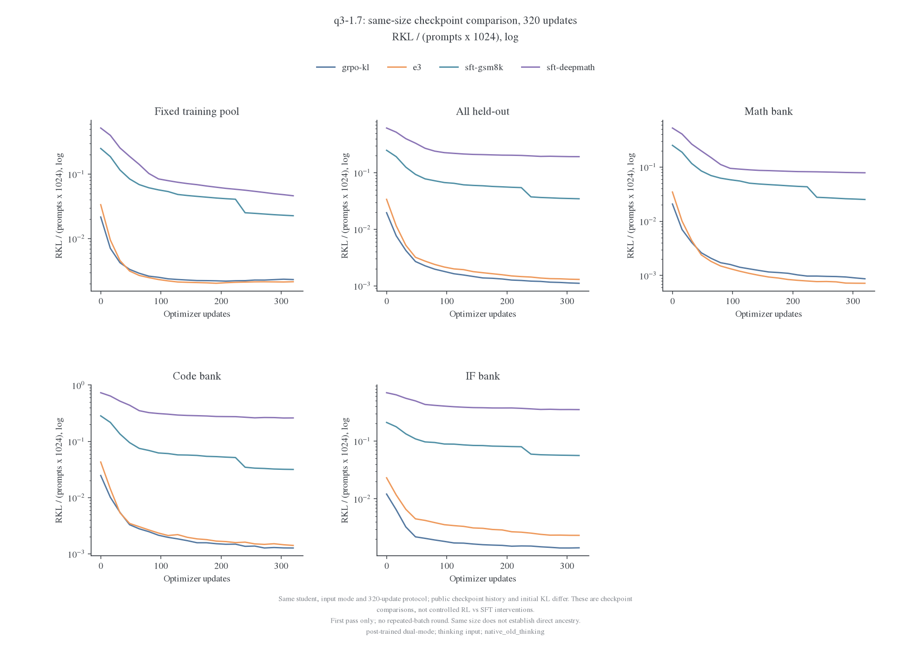

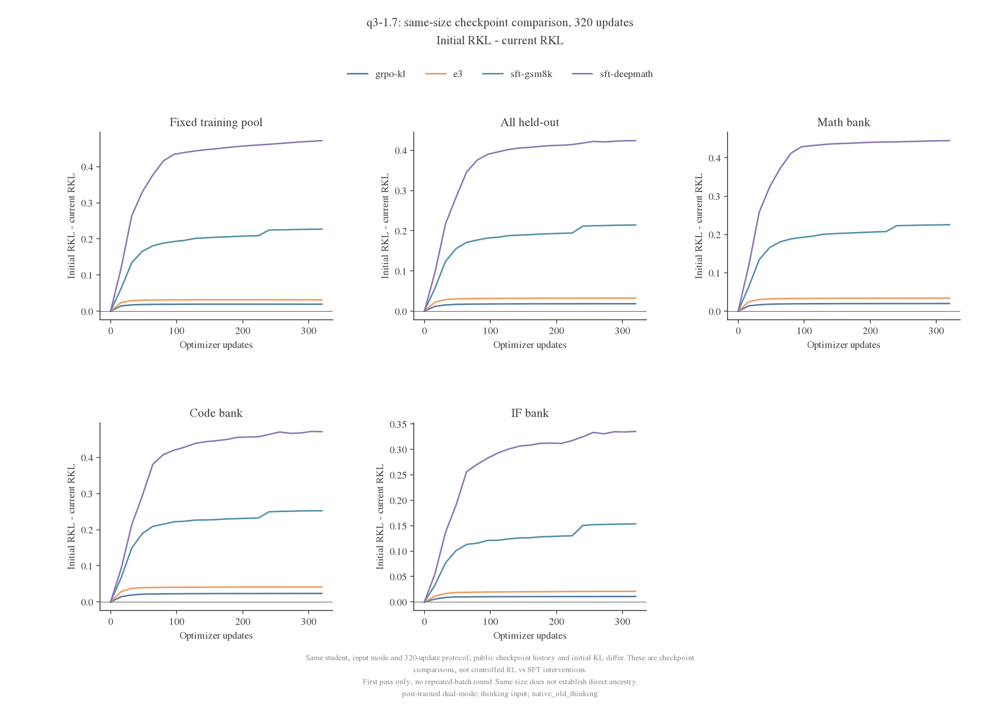

Qwen thinking 的整体永久留出结果如下；所有值均为题数×1024 分母，原始端点与其余条件见[端点表](../figures/fixed-state-clean-20261107/endpoints.csv)。

| Teacher            | 初始 RKL | 最终 RKL | 绝对下降 | 相对下降 |
| ------------------ | -------: | -------: | -------: | -------: |
| GRPO-KL            | 0.019611 | 0.001109 | 0.018502 |   94.34% |
| e3                 | 0.033804 | 0.001298 | 0.032506 |   96.16% |
| Samsung SFT        | 0.248817 | 0.034588 | 0.214229 |   86.10% |
| Thinking-Space SFT | 0.616008 | 0.191977 | 0.424031 |   68.84% |

两个 SFT 条件实际消除了更多绝对 KL，但初始距离大，最终残差仍高。只看相对下降会漏掉被吸收的绝对变化；只看绝对下降又会漏掉未吸收的结构。初始 KL 差异也意味着这里不能直接推出“SFT 更新的每单位误差都更难学”。

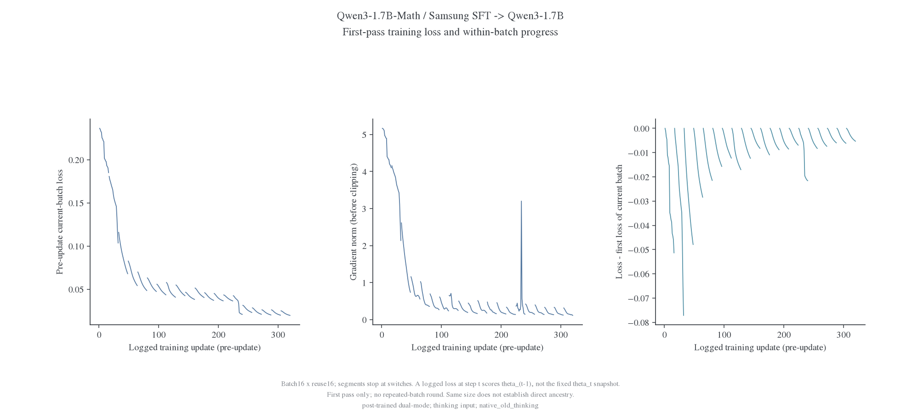

图中每段只连接同批 16 次 reuse。换批带来的跳变与本批优化是两种变化，固定 bank 曲线才用于检查更新能否迁移到相同的其他状态。[GRPO-KL 的训练曲线](../figures/fixed-state-clean-20261107/rl-training-loss.png)、[线性绝对 RKL](../figures/fixed-state-clean-20261107/qwen-rkl-absolute.png)与[剩余比例](../figures/fixed-state-clean-20261107/qwen-rkl-remaining.png)提供对应读法。

### 位置残差有两种形态

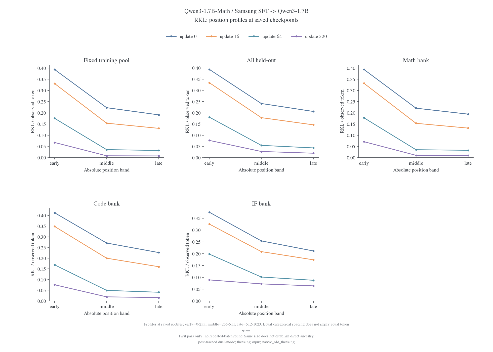

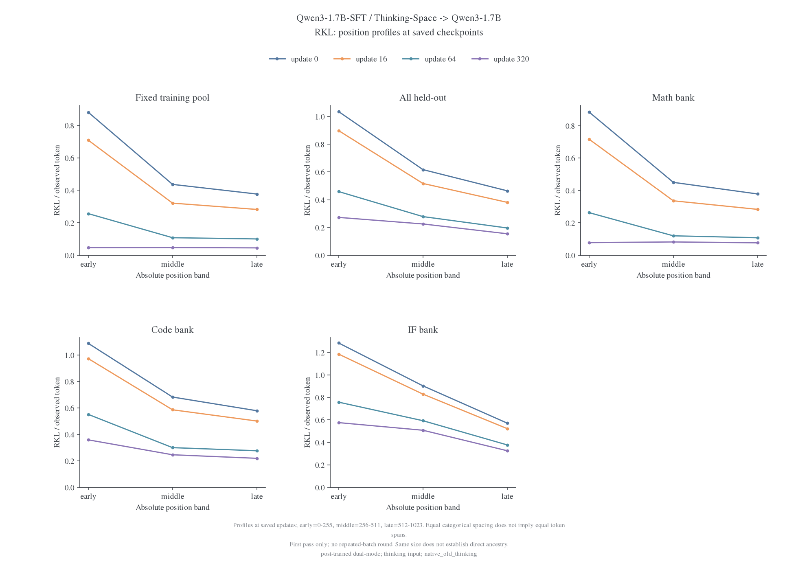

| Teacher，Math bank，step320 | early RKL/token | middle RKL/token | late RKL/token |
| --------------------------- | --------------: | ---------------: | -------------: |
| GRPO-KL                     |        0.001034 |         0.000851 |       0.000800 |
| e3                          |        0.000676 |         0.000710 |       0.000747 |
| Samsung SFT                 |        0.071123 |         0.010200 |       0.009742 |
| Thinking-Space SFT          |        0.077896 |         0.082009 |       0.076676 |

Samsung SFT 在 Math bank 上的 early 单 token 残差约为 late 的 7.3 倍；前 256 位置占最终累计 KL 的 70.55%。固定训练池也有类似集中，early 占 74.60%。Thinking-Space SFT 在 Math bank 的三段残差接近，训练池三段也接近 0.045–0.047。因此，“SFT 剩余误差集中在回答开头”只适用于部分配对，不能统一解释这两个 SFT 条件。

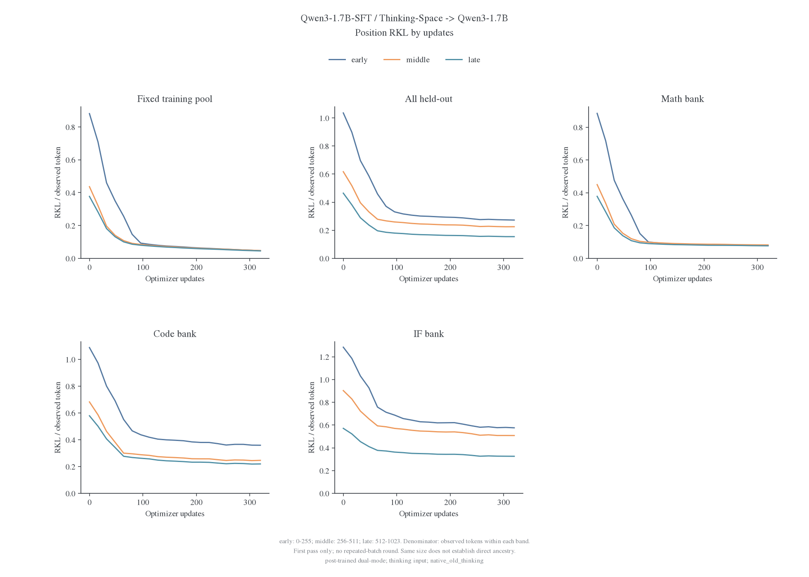

Thinking-Space SFT 在 Math／Code／IF 的最终 fixed-H RKL 分别为 0.078314／0.261042／0.350239，固定训练池为 0.046168。训练题拟合、数学留出迁移和跨领域迁移需要分别解释。该 thinking 条件与其公开 non-thinking 训练模式不匹配；图集同时保留独立的 non-thinking 条件，不把两套银行混接。Samsung 的[全程位置曲线](../figures/fixed-state-clean-20261107/samsung-position-updates.png)与 Thinking-Space 的[位置热图](../figures/fixed-state-clean-20261107/thinkingspace-position-heatmap.png)可检查残差在何时形成。

### Entropy 对齐与 KL 吸收不同步

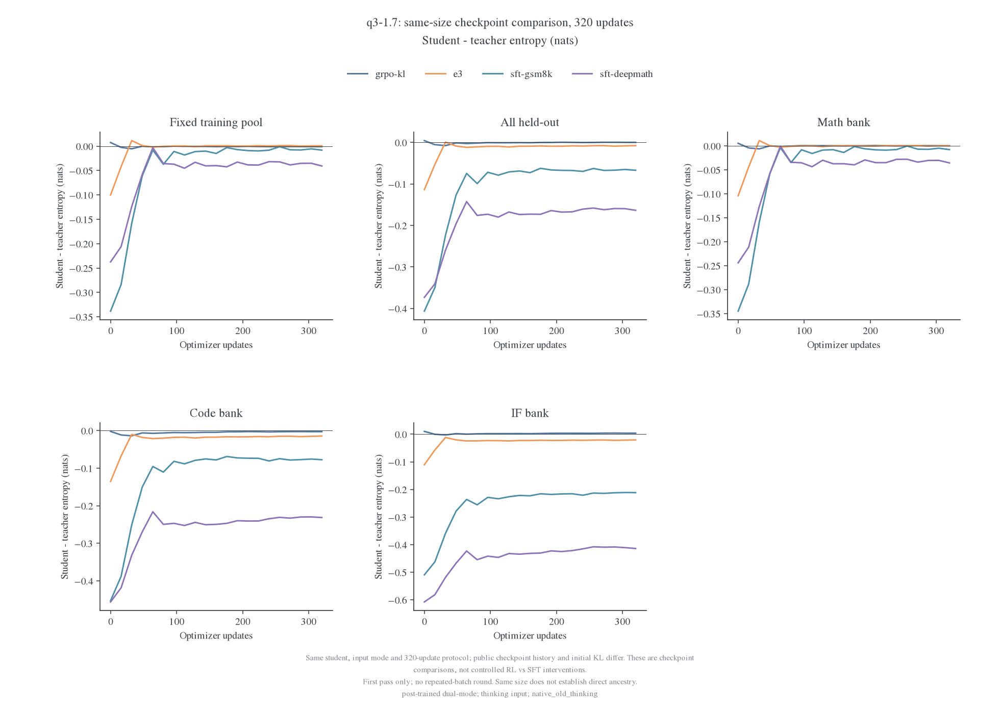

Math bank 中，Samsung SFT 的最终 student／teacher entropy 为 0.5893／0.5969 nats，已接近，但 RKL 仍为 0.025202；Thinking-Space 为 0.4607／0.4961，RKL 为 0.078314。GRPO-KL 为 0.2471／0.2466，RKL 为 0.000871。熵这个标量接近，不能保证概率质量分配给了相同 token。后续机制分析需要区分分布尖锐度与动作间的概率重排；这些图支持这种区分，尚未识别哪种参数方向或 AGK 分量造成差异。

e3 的 teacher entropy 高于初始 student，也能被吸收到较小残差；因此“teacher 更高熵就难吸收”不成立。[Samsung 的 student／teacher entropy 全程图](../figures/fixed-state-clean-20261107/samsung-entropy.png)同时展示了 Code／IF 上更明显的熵差。

### Top-16 排名与概率质量

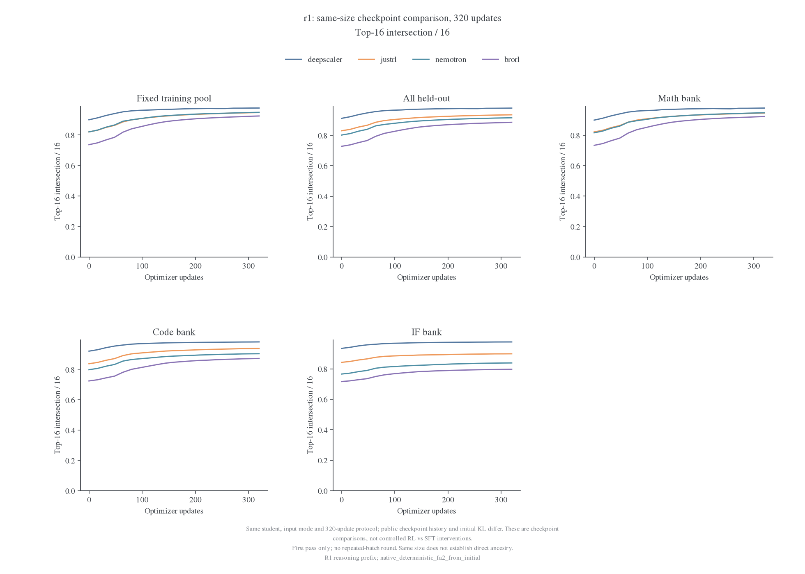

整体留出按实际 token 平均，DeepScaleR 的 overlap16 从 0.9125 升到 0.9799，JustRL 从 0.8309 升到 0.9358，Nemotron 从 0.8026 升到 0.9161，BroRL 从 0.7285 升到 0.8865。它们的最终 RKL 仍不同；排名交集只覆盖动作身份，不能替代完整分布距离。

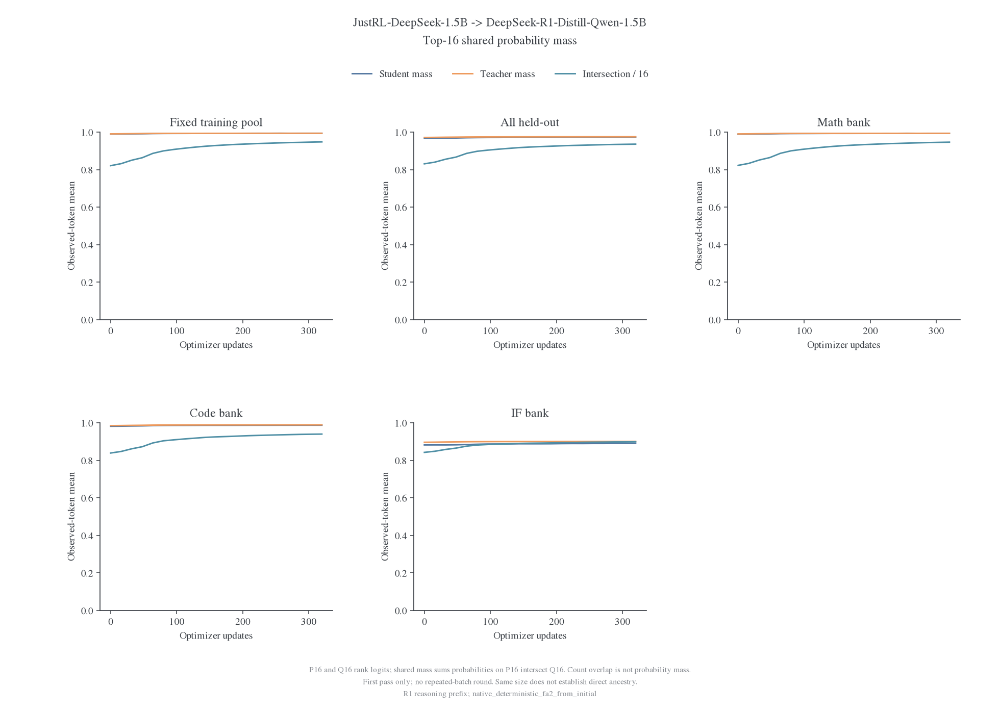

JustRL 的交集概率质量曲线与 overlap 曲线分开：高概率 token 已较一致时，低概率的 top-16 成员仍可不同。完整图集另含每个位置段的 overlap 随更新变化、[重点配对的位置 overlap](../figures/fixed-state-clean-20261107/r1-position-top16.png)。Qwen／Llama 未保存该指标，现有材料不能用 top-k 来直接验证其 SFT 残差来源。

### Llama 对照与证据边界

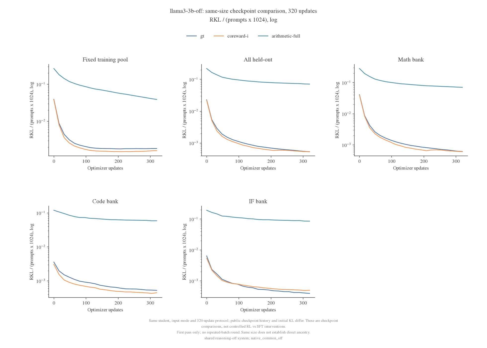

Llama GT／Co-rewarding-I 的整体留出最终 RKL 为 0.000540／0.000541，arithmetic-full SFT 为 0.071417；后者固定训练池仍有 0.038887。SFT 条件同时存在训练题残差与留出残差，不能全部归因于跨 bank 泛化。[位置轮廓](../figures/fixed-state-clean-20261107/llama-position.png)与实际 token 覆盖一起读取，避免把早停后缺少的 late 位置解释成低损失。

这些固定 S0 实验把状态变化排除在同一 run 的时间比较之外，能够定位差异发生在训练拟合、未见领域、位置段、entropy 还是 top-k 排名；它们没有直接测量参数梯度核，也没有将公开 RL／SFT teacher 的初始化距离和训练前史控制相同。当前更准确的待解释对象是“配对特定、位置与领域相关的剩余误差”，尚不能把 SFT 标签本身作为已经验证的原因。

## R1-1.5B student

<!-- generated:r1:start -->

| Teacher（条件见图）                           | 更新数 | 整体初始 RKL | 整体最终 RKL | 整体下降 | Math 下降 | Code 下降 | IF 下降 |
| --------------------------------------------- | -----: | -----------: | -----------: | -------: | --------: | --------: | ------: |
| DeepScaleR-1.5B-Preview                       |    320 |     0.032978 |     0.000716 |   97.83% |    98.53% |    98.30% |  92.29% |
| JustRL-DeepSeek-1.5B                          |    320 |     0.117835 |     0.017768 |   84.92% |    93.69% |    90.35% |  52.79% |
| Nemotron-Research-Reasoning-Qwen-1.5B v1      |    320 |     0.200227 |     0.045246 |   77.40% |    95.41% |    80.03% |  49.16% |
| Nemotron-Research-Reasoning-Qwen-1.5B / BroRL |    320 |     0.293644 |     0.072881 |   75.18% |    93.72% |    78.76% |  40.18% |
| MiniMath-R1-1.5B                              |    320 |     0.093081 |     0.028692 |   69.18% |    81.52% |    74.88% |  49.16% |
| DeepCoder-1.5B-Preview                        |     64 |     0.088564 |     0.031569 |   64.35% |    76.53% |    53.09% |  46.55% |
| Skywork-OR1-Math-7B                           |     64 |     0.436848 |     0.362188 |   17.09% |    30.55% |    18.06% |   4.32% |
| Polaris-7B-Preview                            |     64 |     0.358446 |     0.318826 |   11.05% |    21.33% |    12.74% |   3.92% |
| Light-R1-7B-DS                                |     64 |     0.442815 |     0.396952 |   10.36% |    16.78% |    14.01% |   4.06% |
| DeepSeek-R1-Distill-Qwen-7B                   |     64 |     0.273158 |     0.260708 |    4.56% |     6.38% |     5.76% |   3.44% |

<!-- generated:r1:end -->

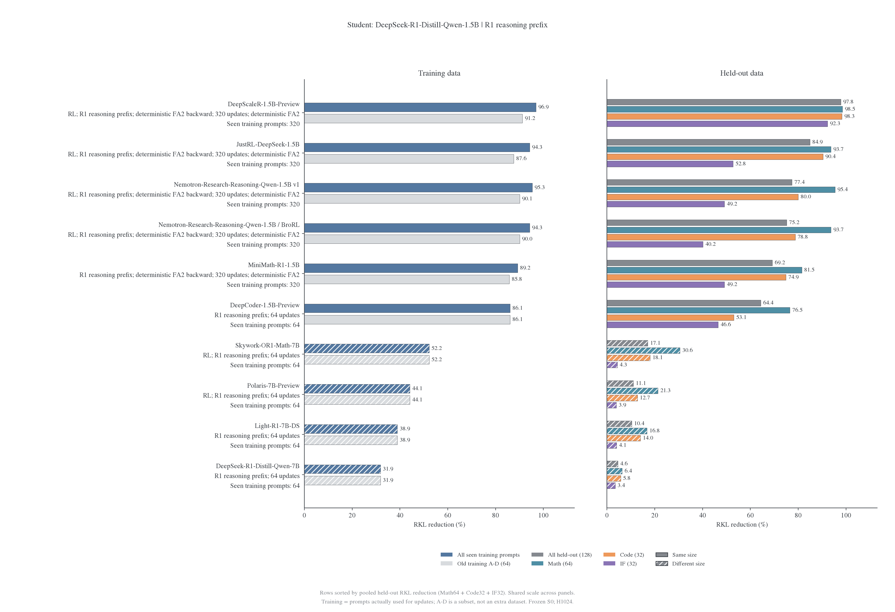

## R1-7B student

<!-- generated:r7:start -->

| Teacher（条件见图）             | 更新数 | 整体初始 RKL | 整体最终 RKL | 整体下降 | Math 下降 | Code 下降 | IF 下降 |
| ------------------------------- | -----: | -----------: | -----------: | -------: | --------: | --------: | ------: |
| Polaris-7B-Preview              |     64 |     0.044832 |     0.004115 |   90.82% |    92.74% |    87.65% |  84.23% |
| Light-R1-7B-DS                  |     64 |     0.117059 |     0.055215 |   52.83% |    56.75% |    53.08% |  44.69% |
| JustRL-DeepSeek-1.5B †          |    320 |     0.349913 |     0.246454 |   29.57% |    44.73% |    40.02% |  14.24% |
| DeepSeek-R1-Distill-Qwen-1.5B † |    320 |     0.236807 |     0.189057 |   20.16% |    26.00% |    22.98% |  17.22% |

<!-- generated:r7:end -->

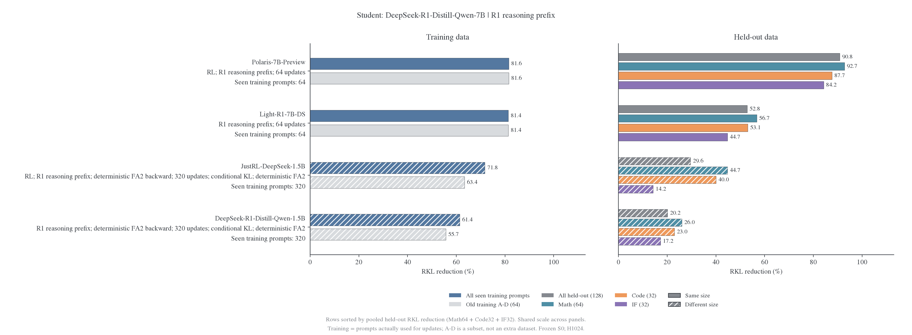

† 小 teacher→大 student 使用共同 151936 维条件 RKL，其余旧行保留原生口径；不把不同支持口径当作完全相同目标。

## Qwen3-1.7B：thinking 输入

<!-- generated:q3-1.7:start -->

| Teacher（条件见图）                  | 更新数 | 整体初始 RKL | 整体最终 RKL | 整体下降 | Math 下降 | Code 下降 | IF 下降 |
| ------------------------------------ | -----: | -----------: | -----------: | -------: | --------: | --------: | ------: |
| e3-1.7B                              |    320 |     0.033804 |     0.001298 |   96.16% |    97.92% |    96.71% |  89.89% |
| Qwen3-1.7B-GRPO-KL-Math              |    320 |     0.019611 |     0.001109 |   94.34% |    95.81% |    94.86% |  88.25% |
| Qwen3-1.7B-Math / Samsung SFT        |    320 |     0.248817 |     0.034588 |   86.10% |    89.94% |    88.84% |  73.20% |
| Qwen3-1.7B-SFT / Thinking-Space      |    320 |     0.616008 |     0.191977 |   68.84% |    85.03% |    64.35% |  48.92% |
| Qwen3-1.7B-Base-OPD / Thinking-Space |    320 |     0.746448 |     0.280455 |   62.43% |    78.96% |    55.55% |  32.85% |
| Qwen3-1.7B-Base                      |    320 |     0.599753 |     0.230065 |   61.64% |    76.24% |    58.91% |  39.82% |
| Qwen3-4B-Base-GRPO / Thinking-Space  |    320 |     0.664417 |     0.335392 |   49.52% |    65.17% |    46.85% |  23.06% |
| Qwen3-0.6B                           |    320 |     0.300502 |     0.183960 |   38.78% |    43.84% |    48.12% |  27.16% |
| Qwen3-4B Math-CoT SFT step80         |    320 |     0.386144 |     0.287476 |   25.55% |    31.23% |    29.77% |  17.15% |
| Qwen3-4B-Thinking-2507               |     64 |     0.671903 |     0.584879 |   12.95% |    29.79% |     7.99% |   0.13% |
| Qwen3-4B Math-CoT SFT step640        |    320 |     0.419072 |     0.370862 |   11.50% |    10.65% |    16.43% |   7.49% |
| Polaris-4B-Preview                   |    320 |     0.329342 |     0.311394 |    5.45% |     5.01% |     6.88% |   4.70% |
| Qwen3-4B                             |    320 |     0.300000 |     0.295592 |    1.47% |    -1.56% |     2.90% |   3.39% |
| Qwen3-8B                             |    320 |     0.313654 |     0.312846 |    0.26% |    -3.24% |     2.55% |   1.89% |

<!-- generated:q3-1.7:end -->

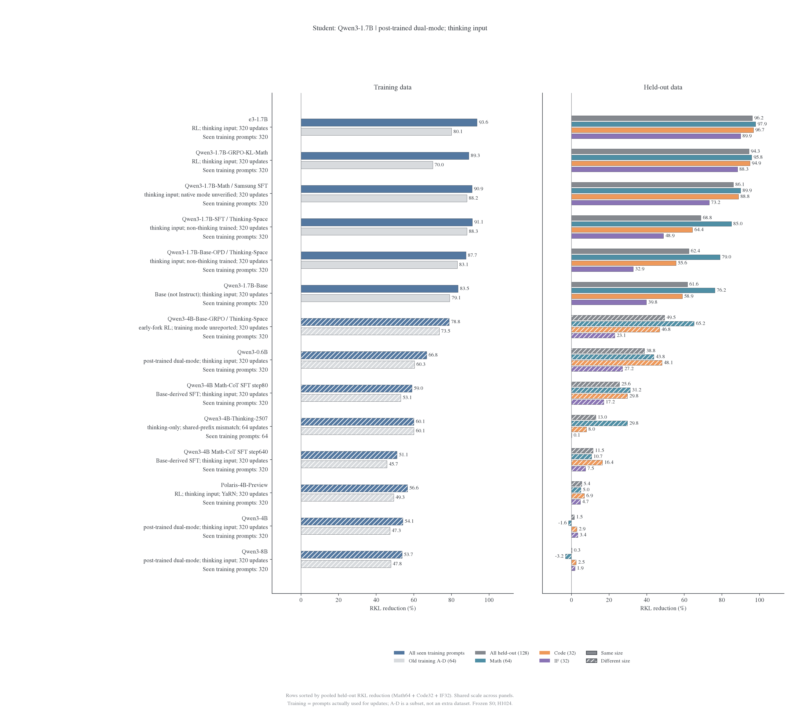

## Qwen3-1.7B：non-thinking 输入

<!-- generated:q3-1.7-nonthinking:start -->

| Teacher（条件见图）                  | 更新数 | 整体初始 RKL | 整体最终 RKL | 整体下降 | Math 下降 | Code 下降 | IF 下降 |
| ------------------------------------ | -----: | -----------: | -----------: | -------: | --------: | --------: | ------: |
| Qwen3-1.7B-Math / Samsung SFT        |    320 |     0.144801 |     0.014366 |   90.08% |    96.58% |    68.40% |  71.42% |
| Qwen3-1.7B-Base-OPD / Thinking-Space |    320 |     0.253677 |     0.080693 |   68.19% |    77.82% |    31.85% |  31.47% |
| Co-rewarding-II-Qwen3-1.7B-Base-MATH |    320 |     0.232627 |     0.077350 |   66.75% |    76.80% |    34.90% |  31.48% |
| Co-rewarding-I-Qwen3-1.7B-Base-MATH  |    320 |     0.242120 |     0.081580 |   66.31% |    76.12% |    36.59% |  30.54% |
| GT-Qwen3-1.7B-Base-MATH              |    320 |     0.245982 |     0.083704 |   65.97% |    75.57% |    34.50% |  30.32% |
| Qwen3-4B-Base-GRPO / Thinking-Space  |    320 |     0.234365 |     0.115318 |   50.80% |    63.58% |    21.29% |  15.14% |
| Qwen3-0.6B                           |    320 |     0.121295 |     0.082580 |   31.92% |    38.22% |    32.14% |  24.01% |
| Qwen3-1.7B-SFT / Thinking-Space      |    320 |     0.085970 |     0.063103 |   26.60% |    38.53% |    16.10% |  17.26% |
| Qwen3-8B                             |    320 |     0.123020 |     0.117522 |    4.47% |     5.69% |     4.51% |   3.29% |
| Qwen3-4B                             |    320 |     0.134794 |     0.129585 |    3.86% |     5.92% |     3.90% |   2.11% |

<!-- generated:q3-1.7-nonthinking:end -->

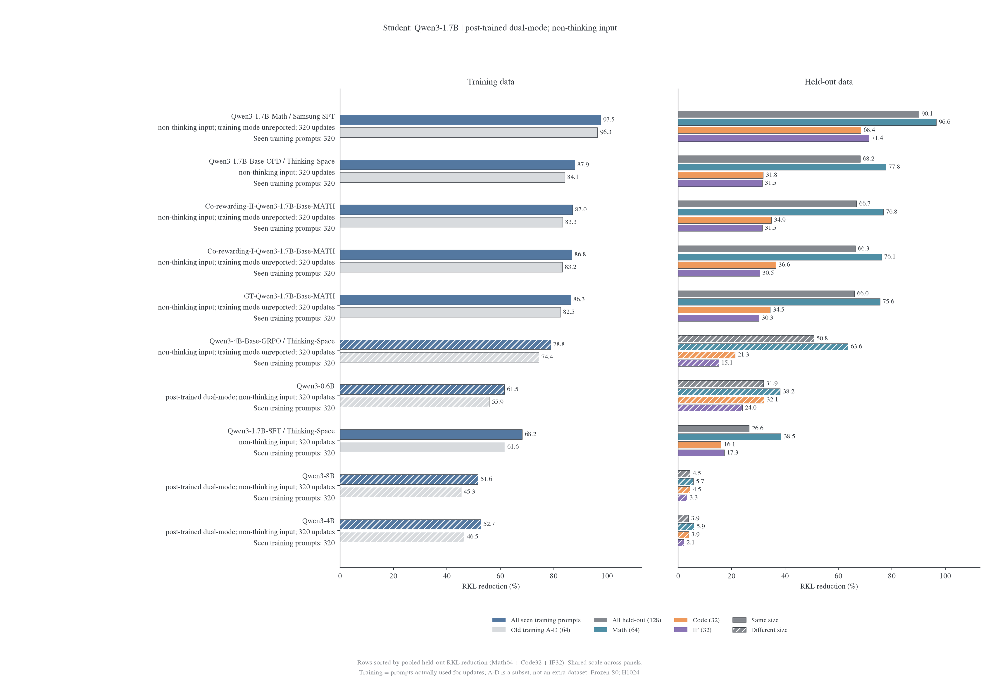

## Instruct-2507 模板专用对照

<!-- generated:q3-1.7-native-instruct2507:start -->

| Teacher（条件见图）    | 更新数 | 整体初始 RKL | 整体最终 RKL | 整体下降 | Math 下降 | Code 下降 | IF 下降 |
| ---------------------- | -----: | -----------: | -----------: | -------: | --------: | --------: | ------: |
| Qwen3-4B-Instruct-2507 |    320 |     0.768475 |     0.582851 |   24.15% |    42.67% |    14.49% |   8.27% |

<!-- generated:q3-1.7-native-instruct2507:end -->

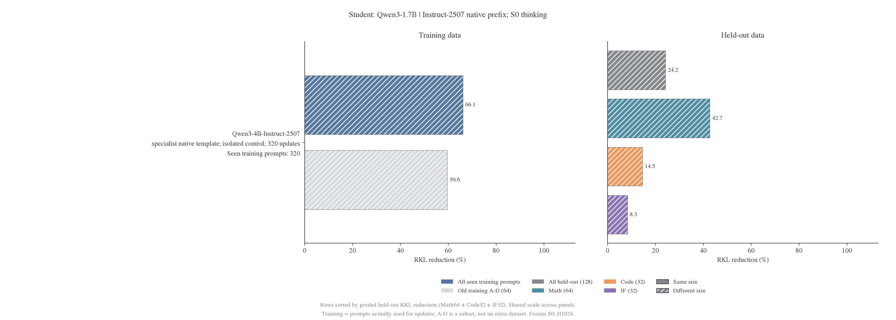

## Llama-3.2-3B-Instruct student

<!-- generated:llama3-3b-off:start -->

| Teacher（条件见图）                       | 更新数 | 整体初始 RKL | 整体最终 RKL | 整体下降 | Math 下降 | Code 下降 | IF 下降 |
| ----------------------------------------- | -----: | -----------: | -----------: | -------: | --------: | --------: | ------: |
| GT-Llama-3.2-3B-Instruct-MATH             |    320 |     0.022932 |     0.000540 |   97.65% |    98.48% |    85.27% |  93.86% |
| Co-rewarding-I-Llama-3.2-3B-Instruct-MATH |    320 |     0.021832 |     0.000541 |   97.52% |    98.46% |    85.38% |  90.80% |
| Llama-3.2-3B-Instruct-arithmetic-full     |    320 |     0.219375 |     0.071417 |   67.45% |    75.02% |    50.88% |  55.55% |
| Llama-3.1-8B-SimpleRL-Zoo                 |    320 |     0.263856 |     0.117807 |   55.35% |    62.79% |    38.21% |  43.32% |
| Llama-3.1-Nemotron-Nano-8B-v1             |    320 |     0.380807 |     0.174600 |   54.15% |    63.57% |    28.95% |  42.90% |
| Llama-3.1-Tulu-3-8B                       |    320 |     0.453277 |     0.236005 |   47.93% |    56.52% |    32.20% |  25.80% |
| Llama-3.1-Tulu-3-8B-DPO                   |    320 |     0.428990 |     0.227525 |   46.96% |    55.14% |    31.87% |  26.41% |
| Llama-3.1-Tulu-3-8B-SFT                   |    320 |     0.192855 |     0.104783 |   45.67% |    53.85% |    37.69% |  33.27% |
| Llama-3.2-1B-Instruct / Unsloth           |    320 |     0.100543 |     0.072446 |   27.95% |    31.43% |    30.13% |  20.75% |
| Llama-3.1-8B-Instruct / Unsloth           |    320 |     0.073250 |     0.059211 |   19.16% |    23.76% |    11.95% |  12.63% |

<!-- generated:llama3-3b-off:end -->

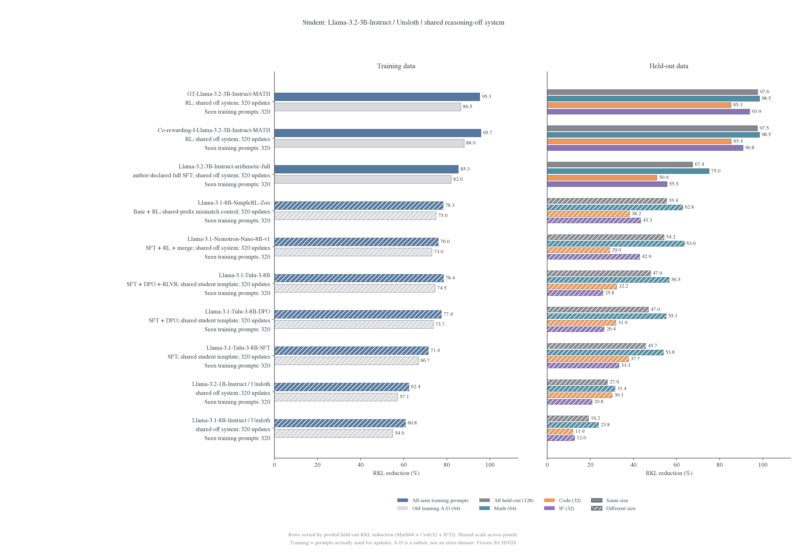

## Thinking-2507 模板专用对照

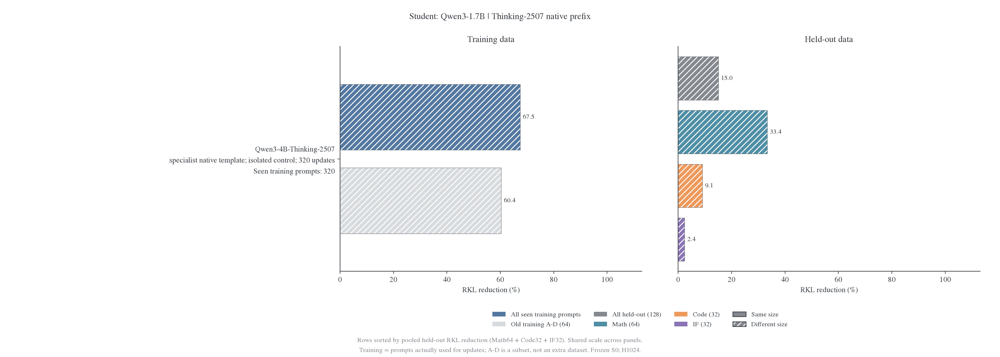

两个 2507 条件使用专用模板，结果单列；输入与 RoPE 条件见实验协议。

## 等预算阶段比较

- [Qwen SFT 深度与 Llama 阶段对照](../post-training-stages.md#fixed-stage)：只比较三组／四组共同的 0–320 区间。
- [R1 同尺寸结果](../protocols/fixed-state.md#r1)与[小教大结果](../protocols/fixed-state.md#small-to-large)：注明数值执行条件，保留历史重放失败与新副本的区别。
- [补充材料](../reproduction.md)：不进入主比较的材料单独保留。

表格、计数和图来自同一份[逐题读出汇总](../transfer-mechanism/data/overview-20261029/risks.csv)。各行的 source 指向实际读出文件；生成器按评分步数选取 0–320 范围内的终点。
