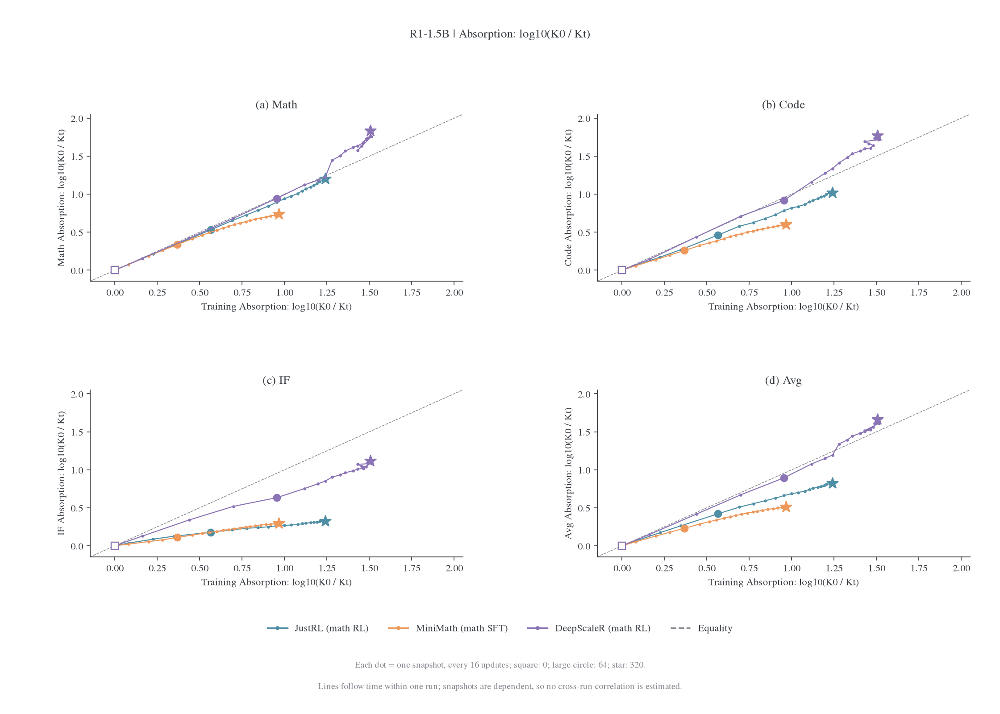
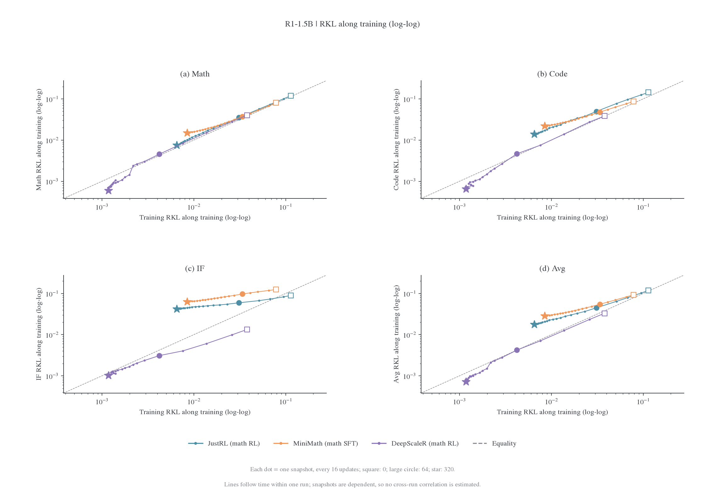
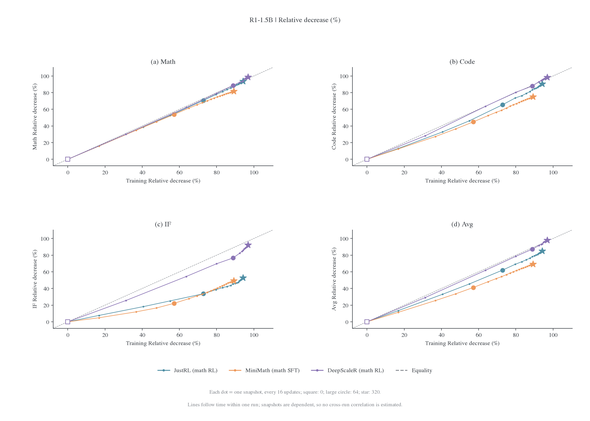
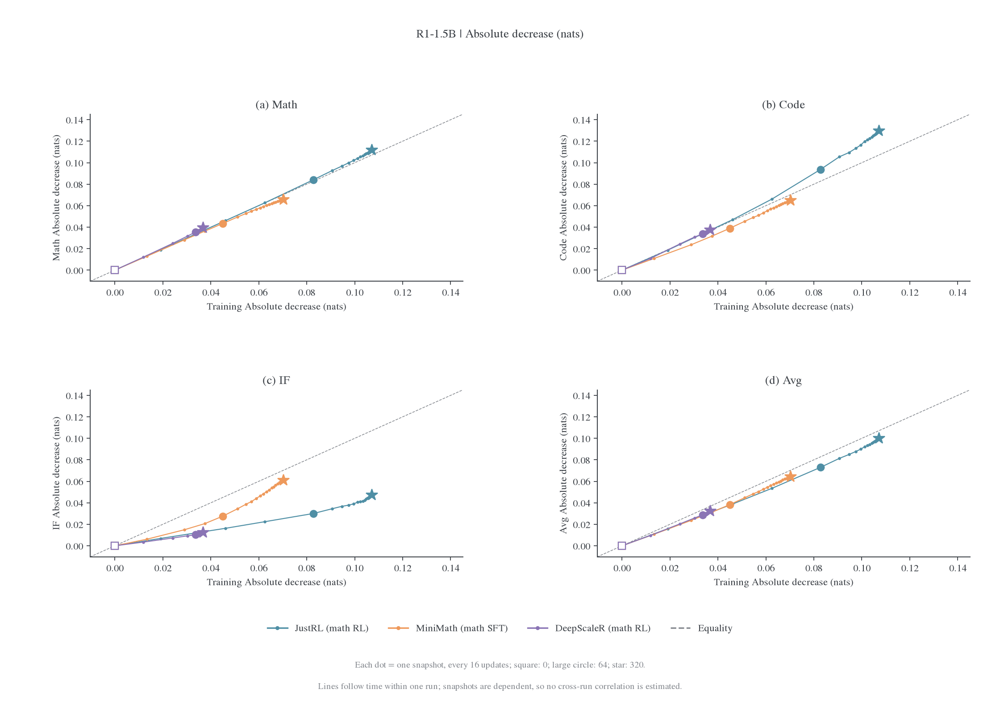
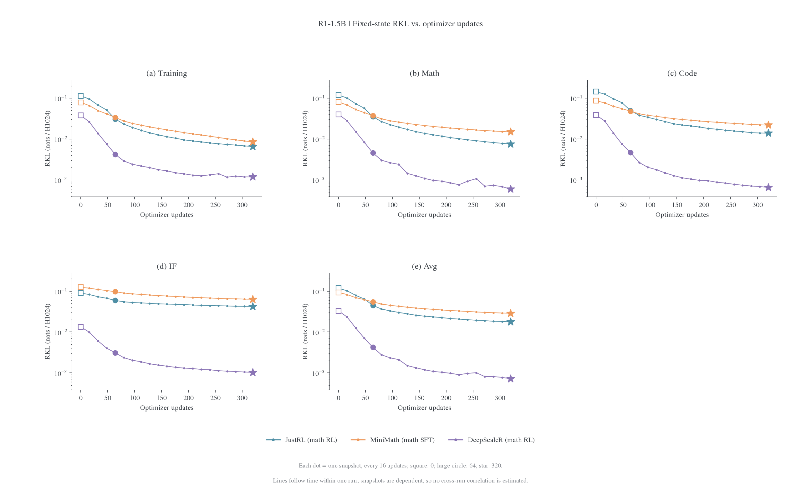
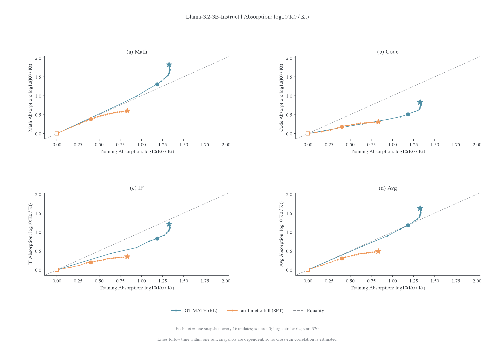
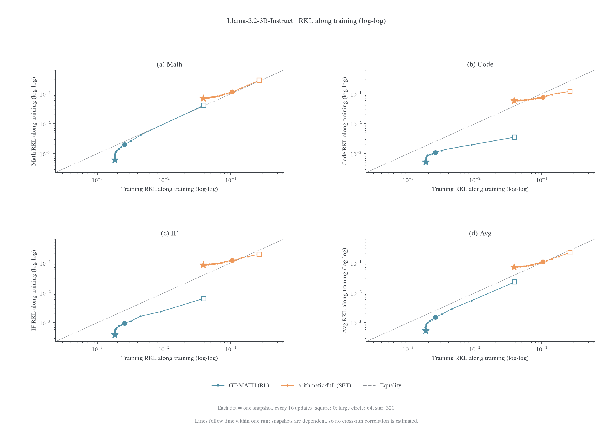
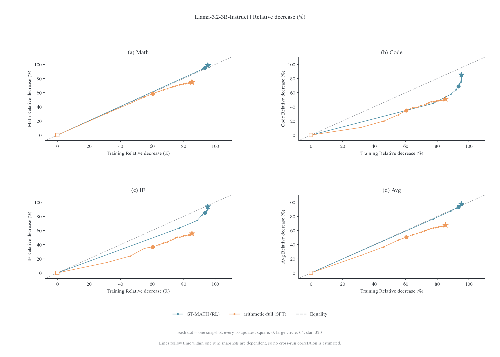
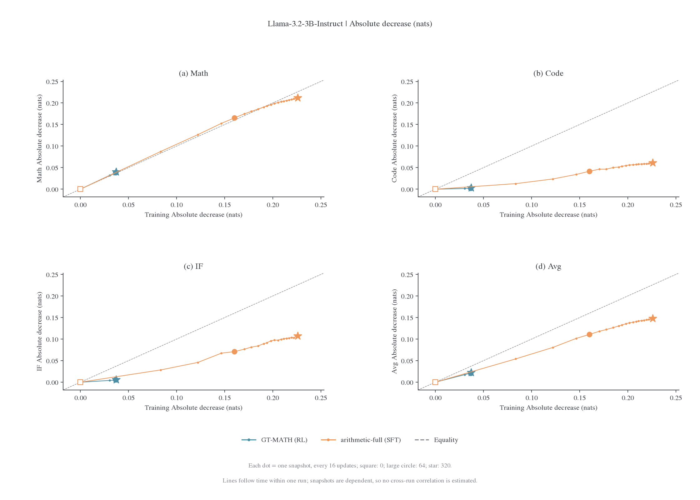
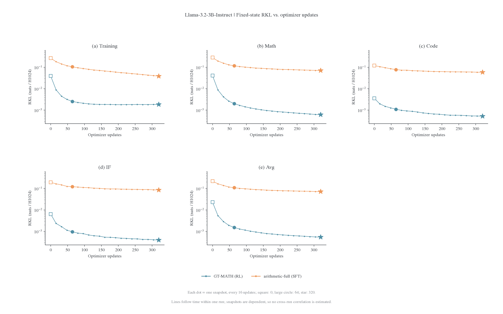

# RL 与 SFT 教师的训练过程吸收轨迹

固定状态实验中，JustRL、DeepScaleR 与 MiniMath 提供同一个 R1-1.5B student 上的 RL／SFT 对照；Llama 的 GT-MATH 与 arithmetic-full 提供另一组同尺寸对照。这里把每个 run 的训练中间快照画成训练池→永久留出的轨迹，检查吸收发生在哪里、哪些领域改善较慢。端点相关性见[散点图总览](correlations.md)，完整配对见[固定状态结果](README.md)。

R1-1.5B 的当前证据支持配对与领域相关的吸收差异：同尺寸 RL 中 DeepScaleR 的留出残差很小，但 JustRL、Nemotron 和 BroRL 在 IF 上仍有明显残差；同一父模型追加 SFT 的 MiniMath 也吸收了大部分训练池差距。现有曲线与“选择性吸收”的描述相容，尚未识别被过滤的参数或函数分量，也没有证明 320 更新已经达到收敛极限。

## 实际配对与设置

| Student               | Teacher                               | 追加阶段                   | 选择理由                               |
| --------------------- | ------------------------------------- | -------------------------- | -------------------------------------- |
| R1-Distill-Qwen-1.5B  | JustRL-DeepSeek-1.5B                  | 数学 RL                    | 用户指定的 RL 主例                     |
| 同上                  | MiniMath-R1-1.5B                      | 数学 SFT                   | 从同一个 R1-1.5B 追加 SFT；主 SFT 对照 |
| 同上                  | DeepScaleR-1.5B-Preview               | 数学 RL                    | 同尺寸、同父型号且残差更小的 RL 参照   |
| Llama-3.2-3B-Instruct | GT-Llama-3.2-3B-Instruct-MATH         | 数学 RL                    | Llama 组内 RL 参照                     |
| 同上                  | Llama-3.2-3B-Instruct-arithmetic-full | 算术全参数 SFT（作者声明） | 同尺寸 SFT 补充；数据配方披露不完整    |

MiniMath 从 R1-Distill-Qwen-1.5B 出发，在 MetaMathQA-R1 的数学题与 DeepSeek-R1 回答上做 SFT。它比跨尺寸 SFT、或从另一个 Base 分叉的 SFT 更适合这次比较。累计链仍包含父模型已有的蒸馏 SFT，因此这里 RL／SFT 标签指追加阶段。Llama student 来自 Unsloth 镜像，公开父型号和精确父 revision 的证据范围沿用[模型来源](../../../settings/模型与师生配对.md)；不将它写成严格受控的同一初始化实验。

五条 run 均独立从各自原始 student 与 fresh Adam 开始。训练采用冻结初始学生 S0 前缀、数学题池 A–T 共 320 题，每批 16 题、reuse16，AdamW LR1e-6，H1024，共 320 更新；Math64／Code32／IF32 永久留出不参与该 run 更新。训练池评分始终覆盖全部 320 题，早期包括尚未优化的未来批。R1 主比较使用确定性 FA2 副本，各 run 的来源实例与实际支持口径保存在[来源记录](figures/absorption-paths/provenance.json)，数值执行条件见[协议](../protocols/fixed-state.md)。没有拼接旧重放、后续轮次或不同实例，也没有新增训练。

固定风险统一为累计 KL(student ∥ teacher) 除以题数×1024。Llama 回答较短，fixed-H 与实际 token 平均不同；此页始终使用前者。同 student 组内验证题目与冻结前缀身份一致，跨 student 组各画各的银行，不能将两组当作共享同一输入的重复实验。

## 图的读法

每条线表示一个固定 teacher 的训练过程，21 个点对应 step0、16、…、320；方形表示起点、较大的圆形表示 step64、星形表示 step320。线按时间连接，不要求横纵轴单调，也不拟合回归线。相邻快照来自同一 run，彼此依赖，不计算把它们当独立 run 的相关系数。

四类训练池→留出图均包含 Math／Code／IF／Avg 四个面板：对数吸收倍数比较训练与留出各自消除了多少数量级；双对数 RKL 图比较同一步的训练与留出残差；相对下降图比较消除了初始差距的百分比；绝对下降图比较消除的 RKL 数量。它们的横轴均为训练池，纵轴为对应留出。时间图另直接显示五个题池的 RKL 随更新变化，用于辨认末段是否仍在改善。

$$
A_D(t)=\log_{10}\frac{K_D(0)}{K_D(t)},\qquad
\Delta_D(t)=K_D(0)-K_D(t),\qquad
r_D(t)=100\left(1-\frac{K_D(t)}{K_D(0)}\right)\%.
$$

Avg 先按题数合并风险，再计算比例或取对数；不平均三个领域的百分比或对数吸收倍数。虚线表示两轴数值相等。对数吸收图右移而纵轴增长很慢，对应训练拟合改善快于留出吸收；最终残差图越靠左下，训练与留出残差越小。比例和最终残差应一起读取，因为不同 teacher 的初始距离不同。

## R1-1.5B：JustRL、MiniMath 与 DeepScaleR

### 对数吸收倍数



[矢量 PDF](figures/absorption-paths/r1-log_absorption.pdf)

### 同步快照的 RKL 残差



[矢量 PDF](figures/absorption-paths/r1-rkl.pdf)

### 相对下降与绝对下降



[矢量 PDF](figures/absorption-paths/r1-relative.pdf)



[矢量 PDF](figures/absorption-paths/r1-absolute.pdf)

### RKL 随更新变化



[矢量 PDF](figures/absorption-paths/r1-time.pdf)

## R1 图支持的结论

### 相同 320 更新的吸收与领域差异

下面五条 run 均有 320 更新；DeepCoder 只有 64 更新，留到共同 step64 表中比较。下降指 step0→320，保留训练池与各领域的不同分母。

| Teacher     | 追加阶段 | 训练池最终 RKL | 整体最终 RKL | 训练池下降 | Math 下降 | Code 下降 | IF 下降 | 整体下降 |
| ----------- | -------- | -------------- | ------------ | ---------- | --------- | --------- | ------- | -------- |
| DeepScaleR  | RL       | 0.001181       | 0.000716     | 96.88%     | 98.53%    | 98.30%    | 92.29%  | 97.83%   |
| JustRL      | RL       | 0.006537       | 0.017768     | 94.25%     | 93.69%    | 90.35%    | 52.79%  | 84.92%   |
| Nemotron v1 | RL       | 0.007067       | 0.045246     | 95.30%     | 95.41%    | 80.03%    | 49.16%  | 77.40%   |
| BroRL       | RL       | 0.013550       | 0.072881     | 94.26%     | 93.72%    | 78.76%    | 40.18%  | 75.18%   |
| MiniMath    | SFT      | 0.008471       | 0.028692     | 89.24%     | 81.52%    | 74.88%    | 49.16%  | 69.18%   |

DeepScaleR 在 Math／Code／IF 上均有超过 92% 的下降，是这组中吸收最充分的例子；残差仍为正。JustRL 的训练池与 Math／Code 下降超过 90%，IF 下降为 52.79%。Nemotron 和 BroRL 的 Math 下降约为 95% 和 94%，IF 只下降约为 49% 和 40%。因此“同尺寸 RL 基本全部吸收”不能作为跨领域的一般结论，尤其不能由 Math 单域代替整体结论。

MiniMath 的训练池下降 89.24%，Math／Code／IF 分别下降 81.52%／74.88%／49.16%。SFT 目标中的很大一部分已经被拟合；尚存的训练池残差和更大的 IF 相对残差同时存在。JustRL 相比 MiniMath 的优势在 Math／Code 更明显，IF 的相对下降仅相差约 3.62 个百分点。IF 本身的初始风险不同，绝对残差也应并列读取。

JustRL 的初始整体留出 RKL 为 0.117835，MiniMath 为 0.093081，DeepScaleR 为 0.032978。DeepScaleR 的初始距离更近，但 JustRL 比 MiniMath 初始距离更大、最终残差却更低；“初始距离越小就一定越好吸收”也不足以解释全部排序。它仍然不能排除距离、教师数据与训练历史的共同作用。

### 共同 step64 的同尺寸与跨尺寸比较

下表统一在 step64 读取，控制这张表的更新预算；原有混合 64／320 的端点散点保留作全貌。追加阶段和 teacher 尺寸分列，同尺寸不替代父模型证据。

| Teacher       | 追加阶段       | Teacher 尺寸 | 训练池下降 | Math 下降 | Code 下降 | IF 下降 | 整体下降 |
| ------------- | -------------- | ------------ | ---------- | --------- | --------- | ------- | -------- |
| DeepScaleR    | RL             | 1.5B         | 88.86%     | 88.62%    | 87.88%    | 76.69%  | 87.20%   |
| JustRL        | RL             | 1.5B         | 72.80%     | 70.57%    | 65.41%    | 33.65%  | 62.00%   |
| Nemotron v1   | RL             | 1.5B         | 71.85%     | 68.62%    | 54.34%    | 27.45%  | 52.41%   |
| BroRL         | RL             | 1.5B         | 59.83%     | 56.82%    | 42.64%    | 19.81%  | 42.82%   |
| DeepCoder     | RL             | 1.5B         | 81.71%     | 76.53%    | 53.09%    | 46.55%  | 64.35%   |
| MiniMath      | SFT            | 1.5B         | 57.15%     | 53.87%    | 44.91%    | 22.18%  | 41.21%   |
| Skywork       | RL             | 7B           | 40.57%     | 30.55%    | 18.06%    | 4.32%   | 17.09%   |
| Light-R1-7B   | SFT            | 7B           | 27.33%     | 16.78%    | 14.01%    | 4.06%   | 10.36%   |
| R1-Distill-7B | 父型号蒸馏 SFT | 7B           | 18.37%     | 6.38%     | 5.76%     | 3.44%   | 4.56%    |

相同 64 更新下，当前同尺寸候选的整体留出下降为 41.21%–87.20%，三个 7B teacher 为 4.56%–17.09%。跨尺寸条件在这一组中迁移较弱，这个排序在统一预算后仍存在，但容量差、初始距离、teacher 训练和数值来源同时不同，不能识别单一的“异源效应”。

同尺寸组内部也有明显变化：MiniMath SFT 为 41.21%，BroRL 的 RL 为 42.82%，两者接近；JustRL 和 DeepScaleR 的数学 RL 则为 62.00% 和 87.20%。“RL/SFT”标签不足以单独解释同尺寸组的吸收差异。

### 末段改善与 filter 假说

下表是 step256→320 相对于 step256 残差的进一步下降，不是相对初始风险的百分点变化。

| Teacher    | 训练池残差再下降 | Math   | Code   | IF    | Avg    |
| ---------- | ---------------- | ------ | ------ | ----- | ------ |
| JustRL     | 14.56%           | 17.28% | 11.52% | 3.79% | 8.51%  |
| MiniMath   | 22.06%           | 10.31% | 9.29%  | 4.75% | 7.13%  |
| DeepScaleR | 16.13%           | 44.78% | 16.09% | 9.01% | 29.29% |

MiniMath 在末段训练池残差仍下降 22.06%，整体留出下降 7.13%、IF 下降 4.75%；JustRL 对应为 14.56%、8.51%、3.79%。训练拟合与 IF 迁移都在变慢，但速度不同。DeepScaleR 的整体留出末段还下降 29.29%。固定题池曲线反映首遍新增训练批与已有参数更新的共同作用；这些记录不足以宣称任何一条已到优化收敛极限。

把 filter 表述为“OPD 选择性拟合／迁移教师差异”与这些观察相容。将它进一步表述为“只保留 RL 分量、滤去 SFT 分量”需要测量教师差异的组成及学生沿这些组成的变化；现有 RKL 是总体分布距离，不能直接分解为可相加的 RL 与 SFT 误差。当前更明确的观察是：部分 teacher 的训练池误差仍可继续消除，而跨领域残差改善得较少。优化、状态覆盖、目标距离和 teacher 所学内容都可能参与这种差异。

### 同源与异源的分组

可以按研究假说把点分为“同尺寸 RL”和“SFT 或跨尺寸”两组，但建议直接用这两个名称。若把前者定义成同源、后者定义成异源，标签同时编码了训练方式与尺寸，随后观察到的组间差异便无法区分这两个因素。

MiniMath 是关键反例：它追加的是 SFT，却与 JustRL 一样从 R1-Distill-Qwen-1.5B 出发。源模型关系、追加训练方式、尺寸关系和输入模式应分别记录。这样后续同一 SFT run 的不同深度 teacher 才能用于判断“教师 SFT 深度怎样改变训练拟合和留出残差”，而不会在命名时预先决定结论。

## Llama：同尺寸 RL 与 SFT 的补充

Llama 的 GT-RL 终点训练池／整体留出 RKL 为 0.001846／0.000540，arithmetic-full SFT 为 0.038887／0.071417；训练池相对下降分别为 95.29%／85.33%，整体留出为 97.65%／67.45%。SFT 配对同时留下较大的训练池残差与留出残差，不能全部解释成纯泛化失败。其初始距离也大于 GT-RL，父权重与数据披露范围不同，属于补充现象而非严格算法对照。



[矢量 PDF](figures/absorption-paths/llama3-3b-off-log_absorption.pdf)



[矢量 PDF](figures/absorption-paths/llama3-3b-off-rkl.pdf)



[矢量 PDF](figures/absorption-paths/llama3-3b-off-relative.pdf)



[矢量 PDF](figures/absorption-paths/llama3-3b-off-absolute.pdf)



[矢量 PDF](figures/absorption-paths/llama3-3b-off-time.pdf)

## 数据与复算

[逐快照 CSV](figures/absorption-paths/snapshots.csv)包含五条 run 的全部 21 个检查点、五个题池，共 525 行；[关键检查点](figures/absorption-paths/endpoints.csv)保留 step0／64／256／320。[R1 共同预算与末段数据](figures/absorption-paths/r1-context.csv)覆盖现有九条 R1-1.5B teacher 条件，按可用性保留这些检查点；其中六条只有原先已验证图集的聚合读数，不在本页重新核对其全程原始快照。

生成器逐文件校验所选五条 run 的 105 个原始快照哈希，验证每条轨迹的冻结身份与组内共享银行，并从逐题 KL 独立复算训练池和四个留出面板，逐点对齐已有单遍图集。原始来源、哈希和指标 CSV 哈希见[来源记录](figures/absorption-paths/provenance.json)。每张图附 PNG、PDF 和 `.audit.json`，源码为 [plot_absorption_paths.py](../../../../research/studies/fixed_transfer/plot_absorption_paths.py)。在仓库根目录运行：

```bash
export FIGURE_VIZ_MPL=/mnt/tidalfs-bdsz01/dataset/llm_dataset/zkn_data/fht_data/dotfiles/.agents/skills/figure-viz/assets/mpl
OMP_NUM_THREADS=1 OPENBLAS_NUM_THREADS=1 /root/.local/share/mirroropd/venvs/plotting/bin/python -m examples.mirroropd.research.studies.fixed_transfer.plot_absorption_paths
```

后续不同 SFT 深度的 OPD 问题已有[同一 Qwen SFT run 的 step80／step640 对照](../post-training-stages.md#fixed-stage)，但它是 4B→1.7B，不能替代同尺寸、同一初始化的阶段链。这里先交付已有训练过程的重分析，后续实验选择与收敛预算另行确定。
