# 各 student 的全教师训练轨迹

将现有单遍诊断的 47 个输入条件按 student／输入模式分组，每条 teacher run 的完整训练曲线叠在同一张图中。每组有同尺寸追加阶段比较、同尺寸与跨尺寸比较两个版本，每个版本分别展示对数吸收轨迹、双对数残差轨迹和随更新变化的 RKL。重点配对的分析见[RL 与 SFT 吸收轨迹](absorption-trajectories.md)，端点相关性见[散点图](correlations.md)。

离线交互页面（本地文件 `data/explorer.html`）支持筛选尺寸与阶段、勾选 teacher、悬停读数、缩放、更新上限和 CSV 导出；打开方式见[交互说明](interactive.md)。

[曲线量化诊断](absorption-diagnostics.md)进一步比较吸收量、累计迁移效率、早晚窗口及相对初始位置的对角线偏离。

## 两个版本与分类起点

同尺寸版本只画 teacher 与 student 尺寸相同的 run，实线表示追加 RL、没有另加 SFT 的分支，虚线表示明确追加 SFT 的分支。这里的“没有 SFT”限定在所述分叉起点之后：R1 的 JustRL 等分支继承父模型已有的蒸馏 SFT，Llama 继承 Instruct 历史，Qwen 的 e3／GRPO-KL 继承官方后训练历史。它们不表示从预训练起从未做过 SFT。

MiniMath、Samsung、Thinking-Space SFT、arithmetic-full 都归入追加 SFT。Base、Base-OPD 等目标不是无 SFT 的 RL 对照，使用点线单列；官方完整训练历史不按名字推断。Qwen 的 Base 直接 RL 分支与从官方后训练终点追加 RL 的分支都画实线，实际父型号另见[师生谱系](../../../settings/模型与师生配对.md)。这两个小组的初始化关系不同。

全尺寸版本画该 student／输入条件下全部 teacher，圆点表示同尺寸，菱形表示跨尺寸，数据曲线统一为实线；颜色始终表示 teacher，同一 student 的两个版本保持配色一致。SFT、RL、DPO、OPD 等公开训练路径仍由模型来源判断。灰色虚线仅表示两轴数值相等。

## 坐标与训练过程

对数吸收轨迹与双对数残差轨迹各含 Math／Code／IF／Avg 四个面板，横轴为训练池，纵轴为永久留出。前者使用 $A_D(t)=\log_{10}[K_D(0)/K_D(t)]$，后者直接展示 $K_D(t)$，两轴均取对数。时间图另含训练池与四类留出的五个面板，横轴是 optimizer 更新，纵轴为对数 RKL。

小点每 16 次更新一个，线按时间连接；同尺寸阶段版用空心方形标记 step0、大圆形标记 step64、星形标记 step320；全尺寸版在 step64／320 放大相应尺寸的圆点／菱形，step0 保留方形。64-step run 到 64 即停止，不延伸至 320。图例标明 teacher 短键、实际终点及阶段或尺寸类别，下面的表给出完整名称。连续点来自同一条 run，不计算将快照当独立重复的相关系数。

风险口径为累计 KL(student ∥ teacher) 除以题数×1024。Avg 先按 Math64／Code32／IF32 题数合并，再计算吸收倍数。不同 student／输入模式的 S0 银行分开，Polaris 和附录条件沿用原单遍图集的排除范围。

训练池评分范围以逐 run 保存的题数为准：部分早期 64-step run 的银行只含 A–H 共 128 题，后续常规 320-step run 含 A–T 共 320 题。表格与 CSV 保留真实题数；这些训练池在早期都包含尚未参与优化的未来批，因此它不是当前 mini-batch loss，也不是所有 run 严格相同的训练评分集合。固定留出 Math64／Code32／IF32 的题数不随预算改变，组内共同题目身份逐项核对。

## R1-1.5B

| 图例短键   | Teacher                                       | 尺寸关系 | 追加阶段分类            | 更新终点 | 训练池评分题数 |
| ---------- | --------------------------------------------- | -------- | ----------------------- | -------- | -------------- |
| deepcoder  | DeepCoder-1.5B-Preview                        | 同尺寸   | RL，未另加 SFT          | 64       | 128            |
| deepscaler | DeepScaleR-1.5B-Preview                       | 同尺寸   | RL，未另加 SFT          | 320      | 320            |
| r7         | DeepSeek-R1-Distill-Qwen-7B                   | 跨尺寸   | Base／OPD／公开历史对照 | 64       | 128            |
| justrl     | JustRL-DeepSeek-1.5B                          | 同尺寸   | RL，未另加 SFT          | 320      | 320            |
| light      | Light-R1-7B-DS                                | 跨尺寸   | 追加 SFT                | 64       | 128            |
| minimath   | MiniMath-R1-1.5B                              | 同尺寸   | 追加 SFT                | 320      | 320            |
| brorl      | Nemotron-Research-Reasoning-Qwen-1.5B / BroRL | 同尺寸   | RL，未另加 SFT          | 320      | 320            |
| nemotron   | Nemotron-Research-Reasoning-Qwen-1.5B v1      | 同尺寸   | RL，未另加 SFT          | 320      | 320            |
| skywork    | Skywork-OR1-Math-7B                           | 跨尺寸   | RL，未另加 SFT          | 64       | 128            |

### 同尺寸：追加 SFT 与未另加 SFT

#### 对数吸收倍数

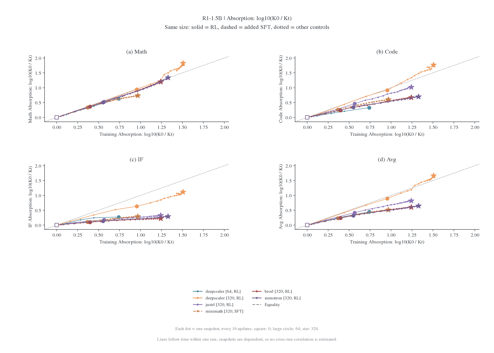

[矢量 PDF](figures/student-paths/same-size/r1-log_absorption.pdf)

#### 训练池与留出 RKL（双对数）

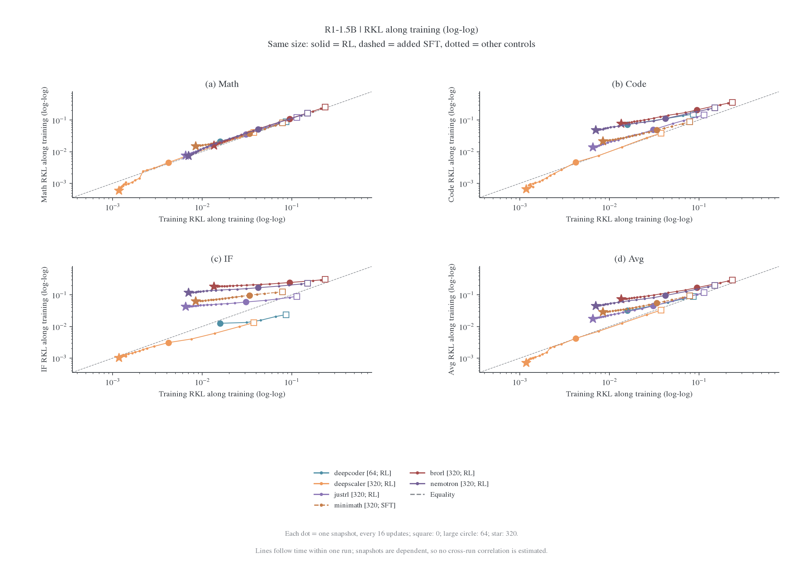

[矢量 PDF](figures/student-paths/same-size/r1-rkl.pdf)

#### RKL 随更新变化

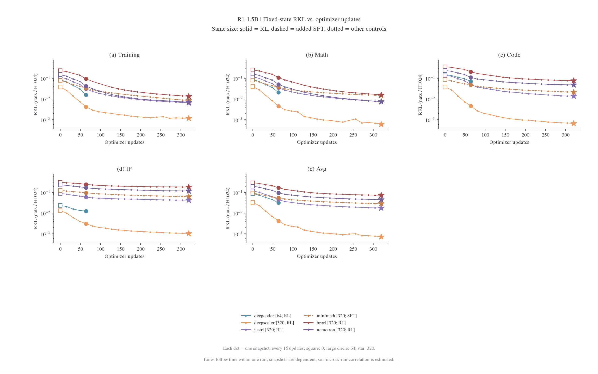

[矢量 PDF](figures/student-paths/same-size/r1-time.pdf)

### 全部 teacher：同尺寸与跨尺寸

#### 对数吸收倍数

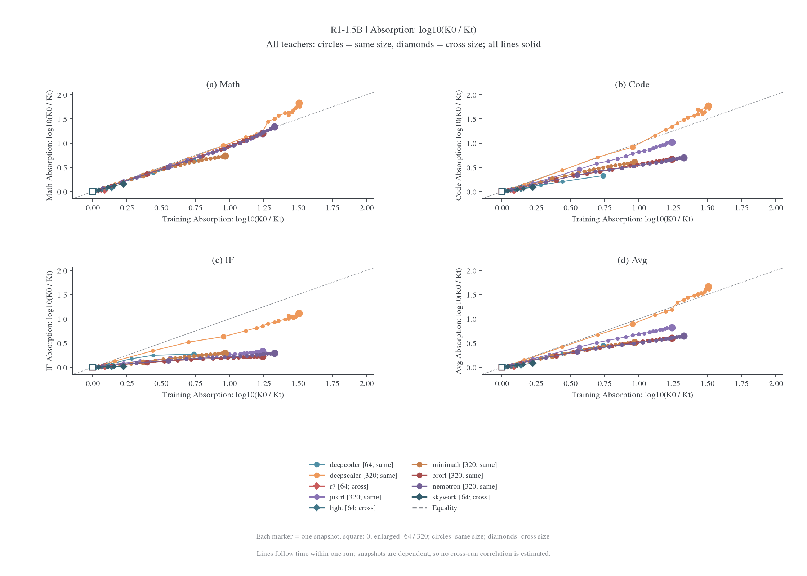

[矢量 PDF](figures/student-paths/all-size/r1-log_absorption.pdf)

#### 训练池与留出 RKL（双对数）

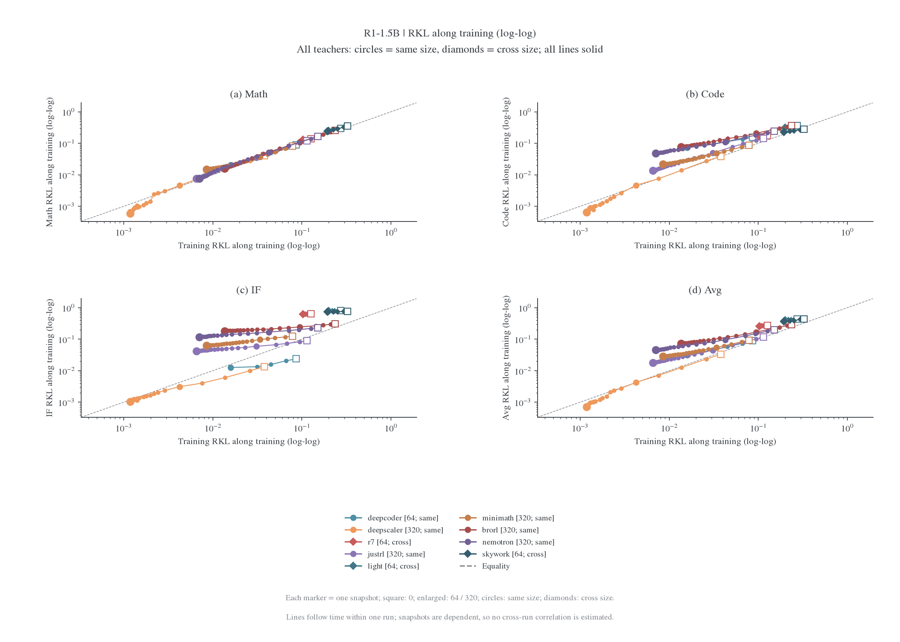

[矢量 PDF](figures/student-paths/all-size/r1-rkl.pdf)

#### RKL 随更新变化

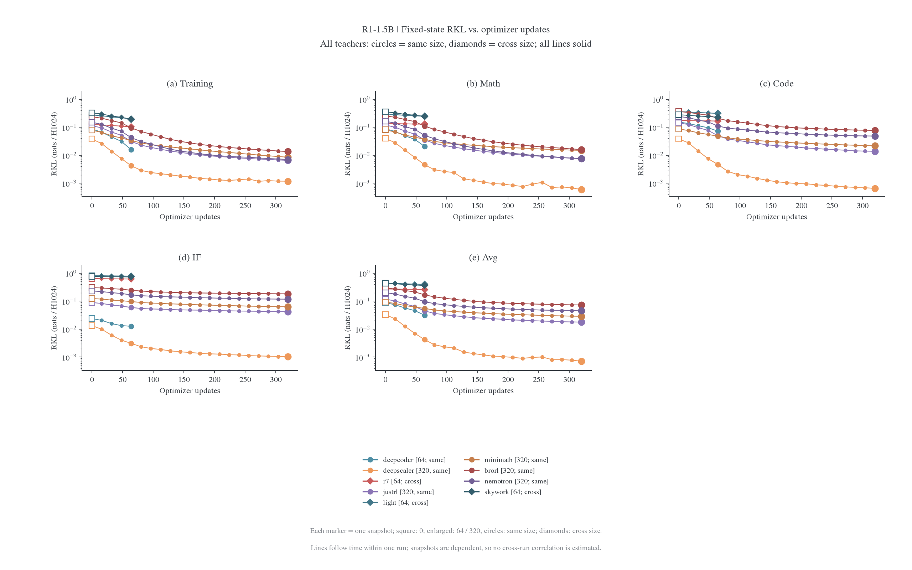

[矢量 PDF](figures/student-paths/all-size/r1-time.pdf)

## R1-7B

| 图例短键 | Teacher                       | 尺寸关系 | 追加阶段分类            | 更新终点 | 训练池评分题数 |
| -------- | ----------------------------- | -------- | ----------------------- | -------- | -------------- |
| r1       | DeepSeek-R1-Distill-Qwen-1.5B | 跨尺寸   | Base／OPD／公开历史对照 | 320      | 320            |
| justrl   | JustRL-DeepSeek-1.5B          | 跨尺寸   | RL，未另加 SFT          | 320      | 320            |
| light    | Light-R1-7B-DS                | 同尺寸   | 追加 SFT                | 64       | 128            |

### 同尺寸：追加 SFT 与未另加 SFT

当前同尺寸组没有符合定义的 RL 分支，不能据此形成 SFT／RL 成对比较。

#### 对数吸收倍数

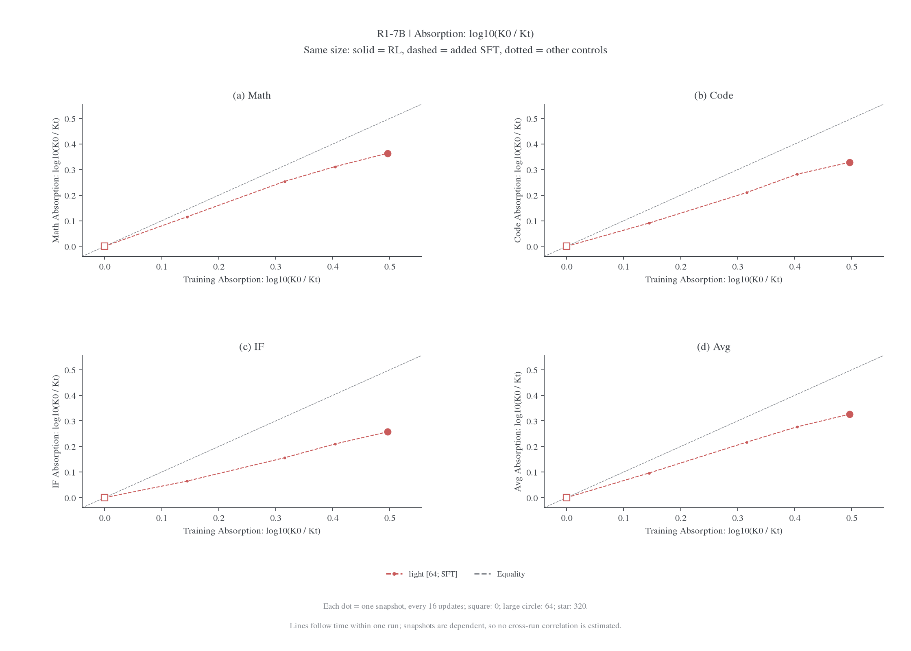

[矢量 PDF](figures/student-paths/same-size/r7-log_absorption.pdf)

#### 训练池与留出 RKL（双对数）

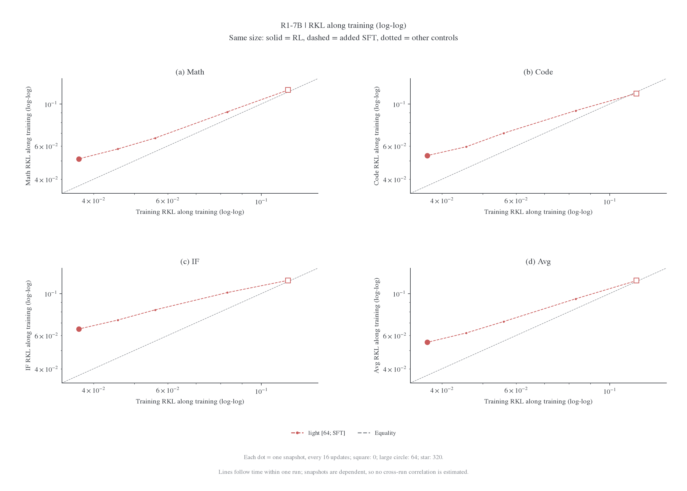

[矢量 PDF](figures/student-paths/same-size/r7-rkl.pdf)

#### RKL 随更新变化

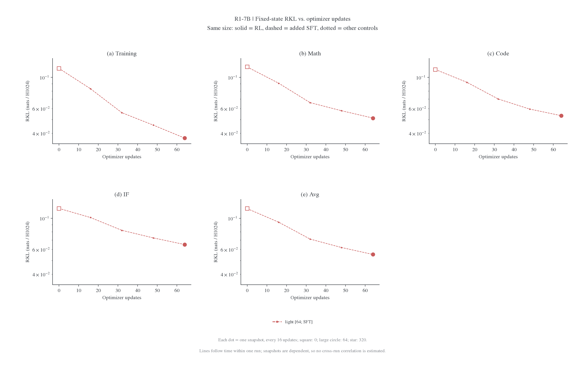

[矢量 PDF](figures/student-paths/same-size/r7-time.pdf)

### 全部 teacher：同尺寸与跨尺寸

#### 对数吸收倍数

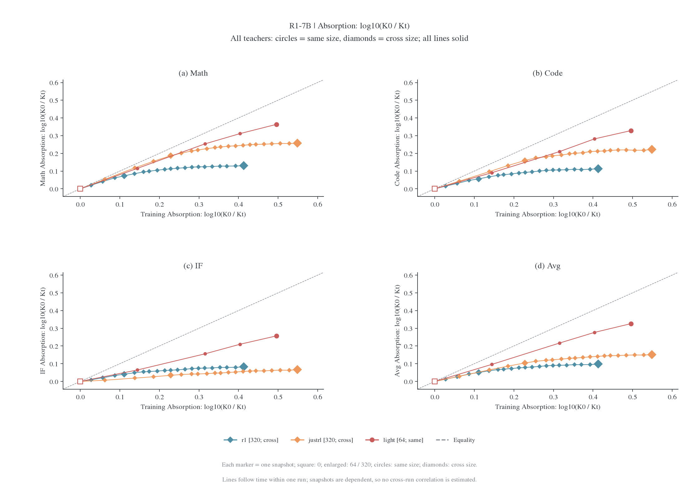

[矢量 PDF](figures/student-paths/all-size/r7-log_absorption.pdf)

#### 训练池与留出 RKL（双对数）

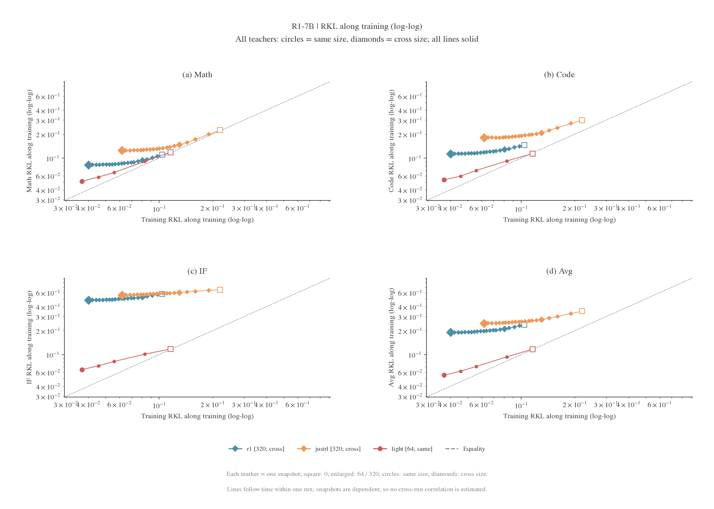

[矢量 PDF](figures/student-paths/all-size/r7-rkl.pdf)

#### RKL 随更新变化

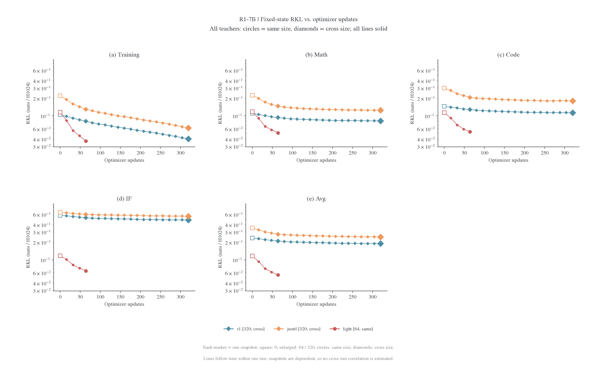

[矢量 PDF](figures/student-paths/all-size/r7-time.pdf)

## Qwen3-1.7B / thinking

| 图例短键          | Teacher                              | 尺寸关系 | 追加阶段分类            | 更新终点 | 训练池评分题数 |
| ----------------- | ------------------------------------ | -------- | ----------------------- | -------- | -------------- |
| q3-0.6            | Qwen3-0.6B                           | 跨尺寸   | Base／OPD／公开历史对照 | 320      | 320            |
| q3-base           | Qwen3-1.7B-Base                      | 同尺寸   | Base／OPD／公开历史对照 | 320      | 320            |
| base-opd          | Qwen3-1.7B-Base-OPD / Thinking-Space | 同尺寸   | Base／OPD／公开历史对照 | 320      | 320            |
| grpo-kl           | Qwen3-1.7B-GRPO-KL-Math              | 同尺寸   | RL，未另加 SFT          | 320      | 320            |
| sft-gsm8k         | Qwen3-1.7B-Math / Samsung SFT        | 同尺寸   | 追加 SFT                | 320      | 320            |
| sft-deepmath      | Qwen3-1.7B-SFT / Thinking-Space      | 同尺寸   | 追加 SFT                | 320      | 320            |
| q3-4              | Qwen3-4B                             | 跨尺寸   | Base／OPD／公开历史对照 | 320      | 320            |
| Q2                | Qwen3-4B Math-CoT SFT step640        | 跨尺寸   | 追加 SFT                | 320      | 320            |
| Q1                | Qwen3-4B Math-CoT SFT step80         | 跨尺寸   | 追加 SFT                | 320      | 320            |
| base-grpo-4       | Qwen3-4B-Base-GRPO / Thinking-Space  | 跨尺寸   | RL，未另加 SFT          | 320      | 320            |
| q3-4-thinking2507 | Qwen3-4B-Thinking-2507               | 跨尺寸   | Base／OPD／公开历史对照 | 64       | 128            |
| q3-8              | Qwen3-8B                             | 跨尺寸   | Base／OPD／公开历史对照 | 320      | 320            |
| e3                | e3-1.7B                              | 同尺寸   | RL，未另加 SFT          | 320      | 320            |

### 同尺寸：追加 SFT 与未另加 SFT

#### 对数吸收倍数

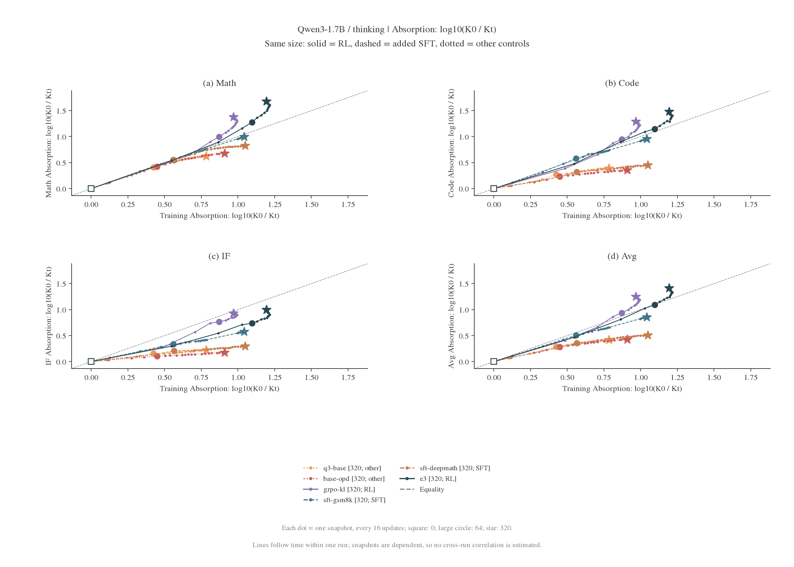

[矢量 PDF](figures/student-paths/same-size/q3-1.7-log_absorption.pdf)

#### 训练池与留出 RKL（双对数）

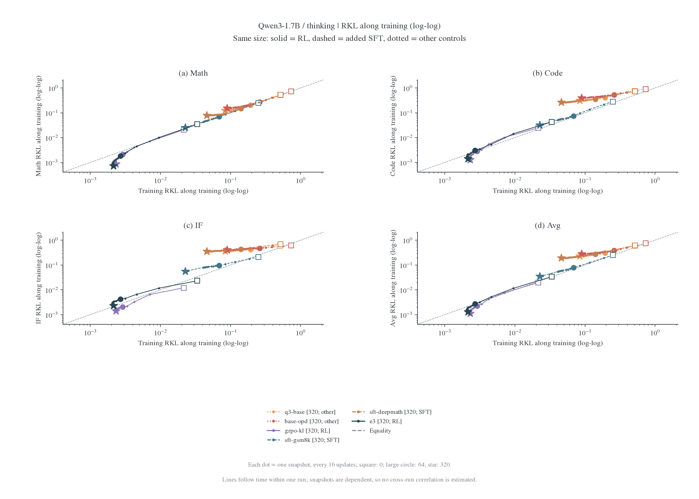

[矢量 PDF](figures/student-paths/same-size/q3-1.7-rkl.pdf)

#### RKL 随更新变化

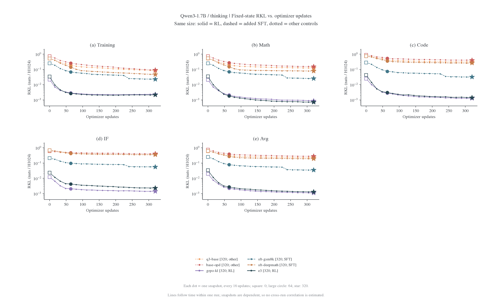

[矢量 PDF](figures/student-paths/same-size/q3-1.7-time.pdf)

### 全部 teacher：同尺寸与跨尺寸

#### 对数吸收倍数

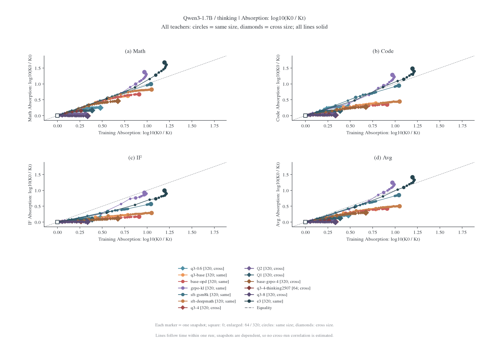

[矢量 PDF](figures/student-paths/all-size/q3-1.7-log_absorption.pdf)

#### 训练池与留出 RKL（双对数）

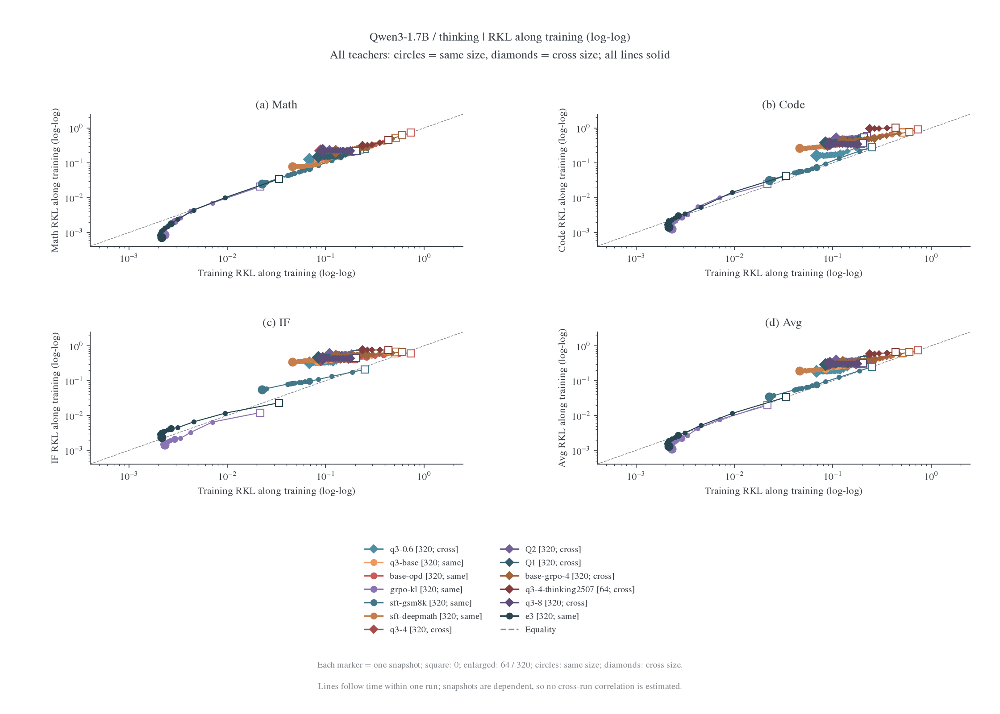

[矢量 PDF](figures/student-paths/all-size/q3-1.7-rkl.pdf)

#### RKL 随更新变化

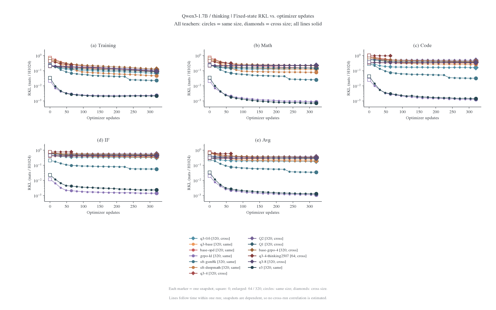

[矢量 PDF](figures/student-paths/all-size/q3-1.7-time.pdf)

## Qwen3-1.7B / non-thinking

| 图例短键     | Teacher                              | 尺寸关系 | 追加阶段分类            | 更新终点 | 训练池评分题数 |
| ------------ | ------------------------------------ | -------- | ----------------------- | -------- | -------------- |
| coreward-i   | Co-rewarding-I-Qwen3-1.7B-Base-MATH  | 同尺寸   | RL，未另加 SFT          | 320      | 320            |
| coreward-ii  | Co-rewarding-II-Qwen3-1.7B-Base-MATH | 同尺寸   | RL，未另加 SFT          | 320      | 320            |
| base-gt-math | GT-Qwen3-1.7B-Base-MATH              | 同尺寸   | RL，未另加 SFT          | 320      | 320            |
| q3-0.6       | Qwen3-0.6B                           | 跨尺寸   | Base／OPD／公开历史对照 | 320      | 320            |
| base-opd     | Qwen3-1.7B-Base-OPD / Thinking-Space | 同尺寸   | Base／OPD／公开历史对照 | 320      | 320            |
| sft-gsm8k    | Qwen3-1.7B-Math / Samsung SFT        | 同尺寸   | 追加 SFT                | 320      | 320            |
| sft-deepmath | Qwen3-1.7B-SFT / Thinking-Space      | 同尺寸   | 追加 SFT                | 320      | 320            |
| q3-4         | Qwen3-4B                             | 跨尺寸   | Base／OPD／公开历史对照 | 320      | 320            |
| base-grpo-4  | Qwen3-4B-Base-GRPO / Thinking-Space  | 跨尺寸   | RL，未另加 SFT          | 320      | 320            |
| q3-8         | Qwen3-8B                             | 跨尺寸   | Base／OPD／公开历史对照 | 320      | 320            |

### 同尺寸：追加 SFT 与未另加 SFT

#### 对数吸收倍数

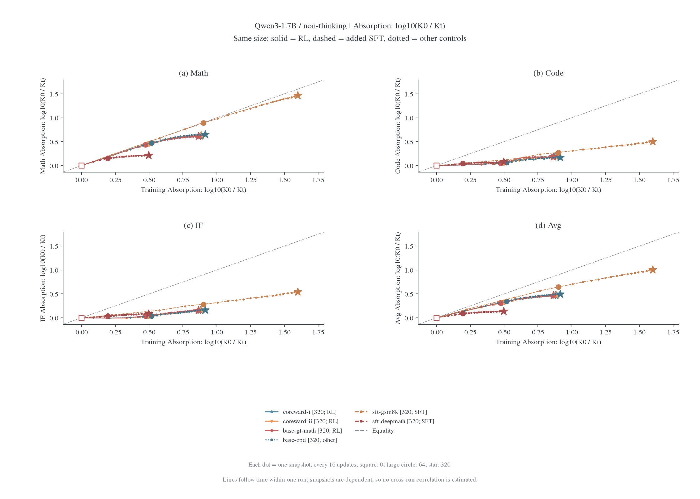

[矢量 PDF](figures/student-paths/same-size/q3-1.7-nonthinking-log_absorption.pdf)

#### 训练池与留出 RKL（双对数）

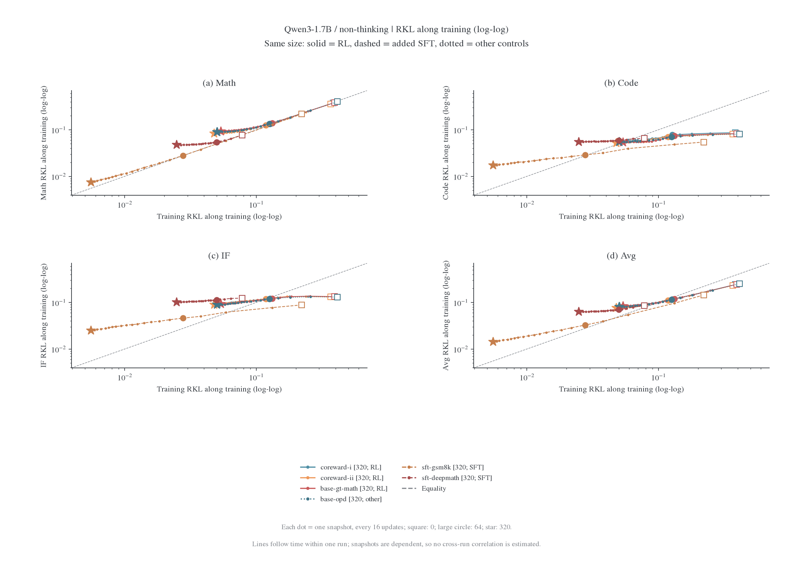

[矢量 PDF](figures/student-paths/same-size/q3-1.7-nonthinking-rkl.pdf)

#### RKL 随更新变化

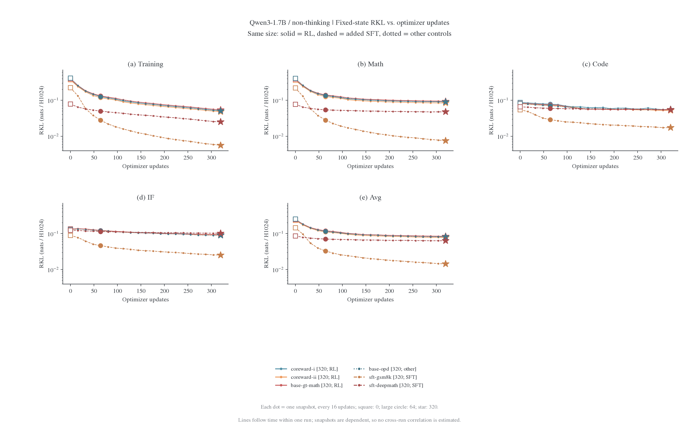

[矢量 PDF](figures/student-paths/same-size/q3-1.7-nonthinking-time.pdf)

### 全部 teacher：同尺寸与跨尺寸

#### 对数吸收倍数

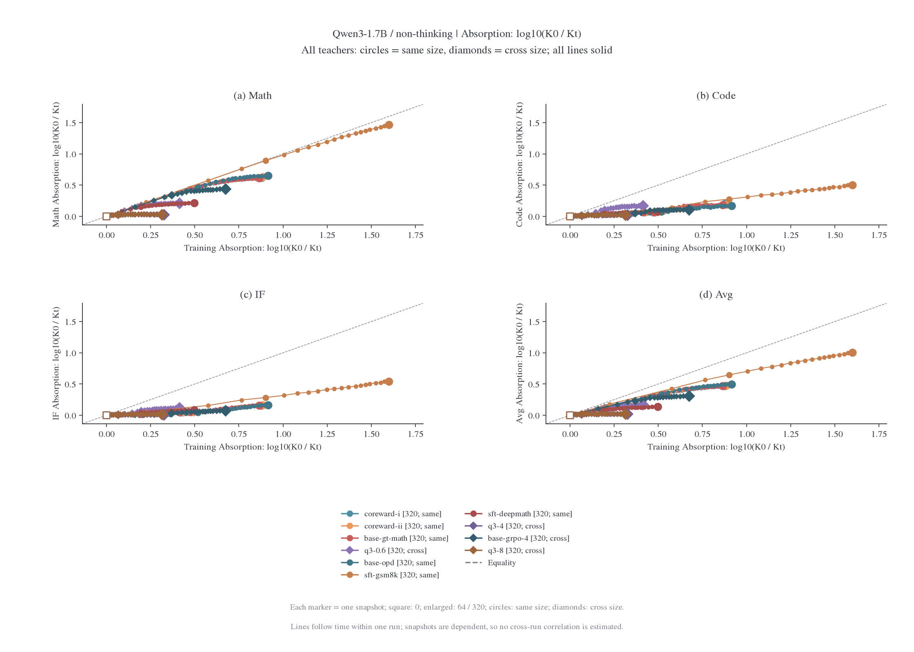

[矢量 PDF](figures/student-paths/all-size/q3-1.7-nonthinking-log_absorption.pdf)

#### 训练池与留出 RKL（双对数）

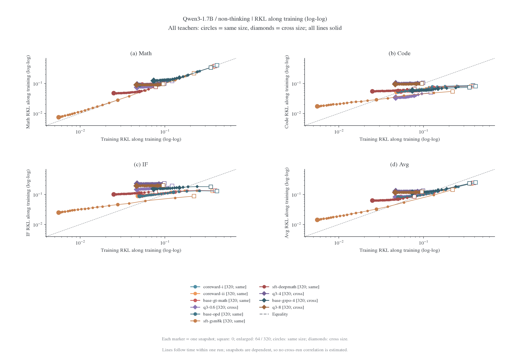

[矢量 PDF](figures/student-paths/all-size/q3-1.7-nonthinking-rkl.pdf)

#### RKL 随更新变化

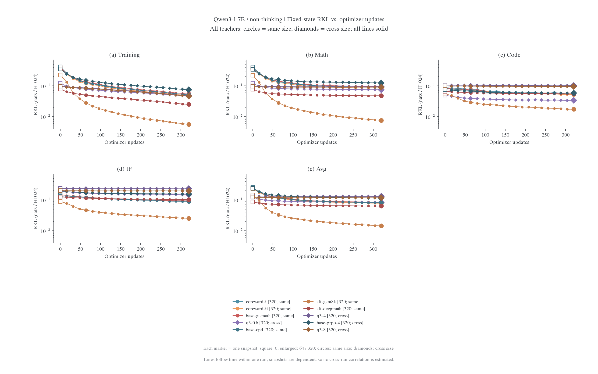

[矢量 PDF](figures/student-paths/all-size/q3-1.7-nonthinking-time.pdf)

## Llama-3.2-3B-Instruct

| 图例短键        | Teacher                                   | 尺寸关系 | 追加阶段分类            | 更新终点 | 训练池评分题数 |
| --------------- | ----------------------------------------- | -------- | ----------------------- | -------- | -------------- |
| coreward-i      | Co-rewarding-I-Llama-3.2-3B-Instruct-MATH | 同尺寸   | RL，未另加 SFT          | 320      | 320            |
| gt              | GT-Llama-3.2-3B-Instruct-MATH             | 同尺寸   | RL，未另加 SFT          | 320      | 320            |
| llama-8b        | Llama-3.1-8B-Instruct / Unsloth           | 跨尺寸   | Base／OPD／公开历史对照 | 320      | 320            |
| L4              | Llama-3.1-8B-SimpleRL-Zoo                 | 跨尺寸   | RL，未另加 SFT          | 320      | 320            |
| nemotron-8b     | Llama-3.1-Nemotron-Nano-8B-v1             | 跨尺寸   | Base／OPD／公开历史对照 | 320      | 320            |
| L3              | Llama-3.1-Tulu-3-8B                       | 跨尺寸   | 追加 SFT                | 320      | 320            |
| L2              | Llama-3.1-Tulu-3-8B-DPO                   | 跨尺寸   | 追加 SFT                | 320      | 320            |
| L1              | Llama-3.1-Tulu-3-8B-SFT                   | 跨尺寸   | 追加 SFT                | 320      | 320            |
| llama-1b        | Llama-3.2-1B-Instruct / Unsloth           | 跨尺寸   | Base／OPD／公开历史对照 | 320      | 320            |
| arithmetic-full | Llama-3.2-3B-Instruct-arithmetic-full     | 同尺寸   | 追加 SFT                | 320      | 320            |

### 同尺寸：追加 SFT 与未另加 SFT

#### 对数吸收倍数

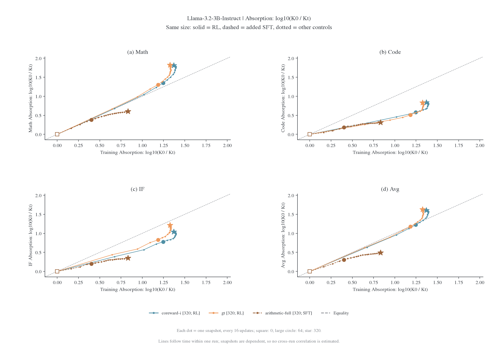

[矢量 PDF](figures/student-paths/same-size/llama3-3b-off-log_absorption.pdf)

#### 训练池与留出 RKL（双对数）

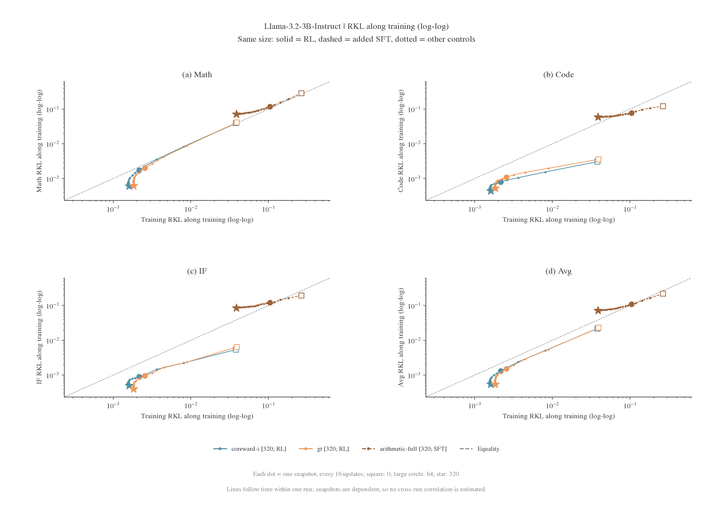

[矢量 PDF](figures/student-paths/same-size/llama3-3b-off-rkl.pdf)

#### RKL 随更新变化

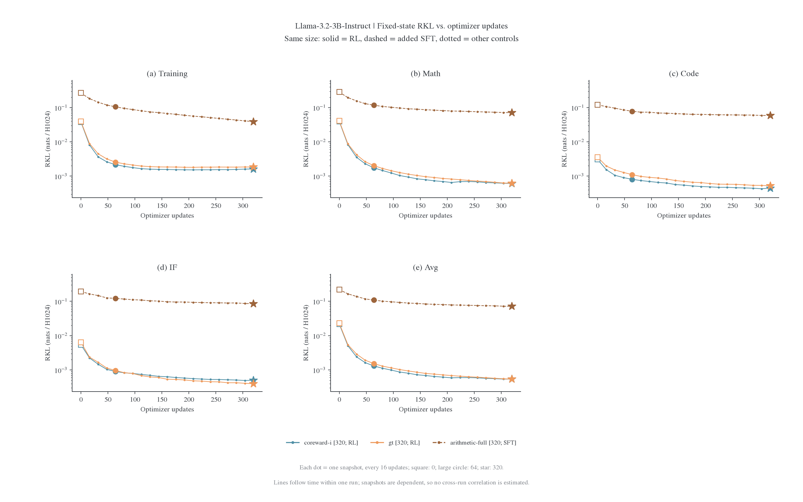

[矢量 PDF](figures/student-paths/same-size/llama3-3b-off-time.pdf)

### 全部 teacher：同尺寸与跨尺寸

#### 对数吸收倍数

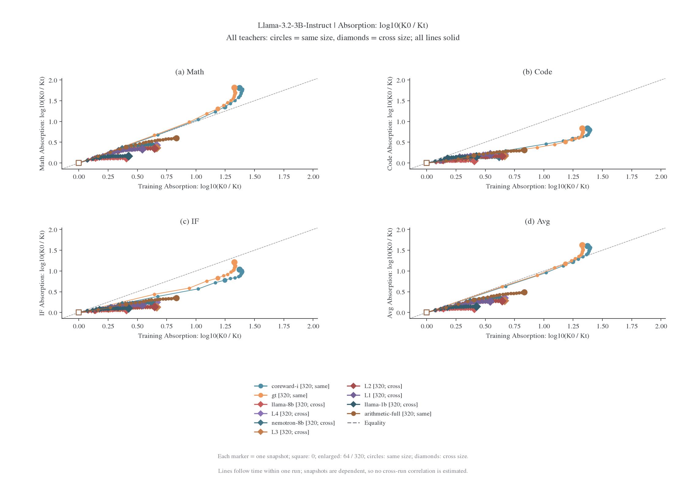

[矢量 PDF](figures/student-paths/all-size/llama3-3b-off-log_absorption.pdf)

#### 训练池与留出 RKL（双对数）

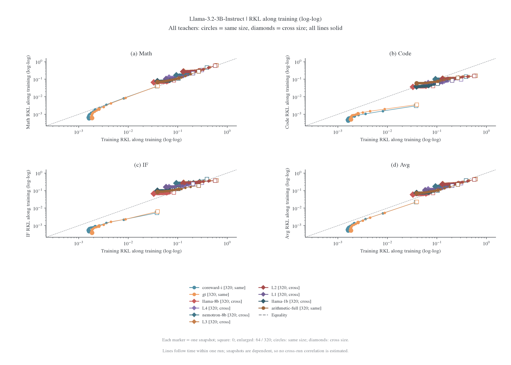

[矢量 PDF](figures/student-paths/all-size/llama3-3b-off-rkl.pdf)

#### RKL 随更新变化

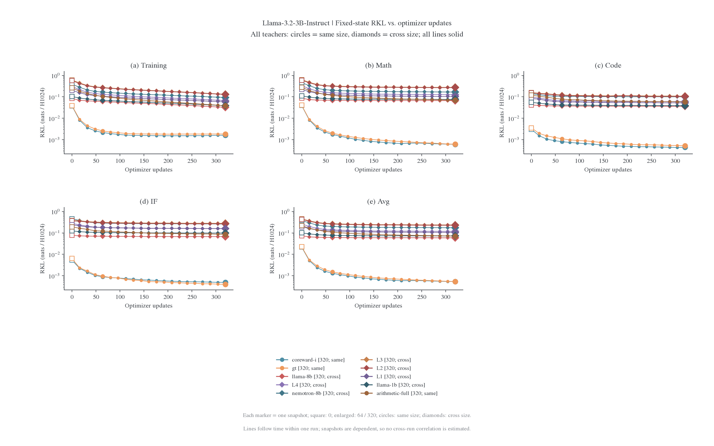

[矢量 PDF](figures/student-paths/all-size/llama3-3b-off-time.pdf)

## Qwen3-1.7B / native Thinking-2507

| 图例短键          | Teacher                | 尺寸关系 | 追加阶段分类            | 更新终点 | 训练池评分题数 |
| ----------------- | ---------------------- | -------- | ----------------------- | -------- | -------------- |
| q3-4-thinking2507 | Qwen3-4B-Thinking-2507 | 跨尺寸   | Base／OPD／公开历史对照 | 320      | 320            |

### 同尺寸：追加 SFT 与未另加 SFT

该输入模板没有同尺寸 teacher run，暂无该版本；下方保留跨尺寸轨迹。

### 全部 teacher：同尺寸与跨尺寸

#### 对数吸收倍数

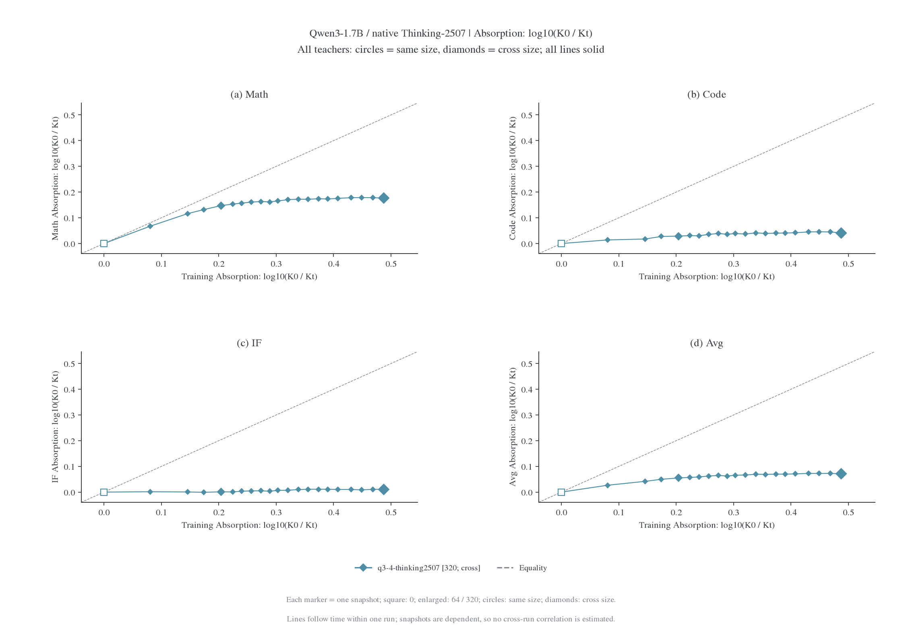

[矢量 PDF](figures/student-paths/all-size/q3-1.7-native-thinking2507-log_absorption.pdf)

#### 训练池与留出 RKL（双对数）

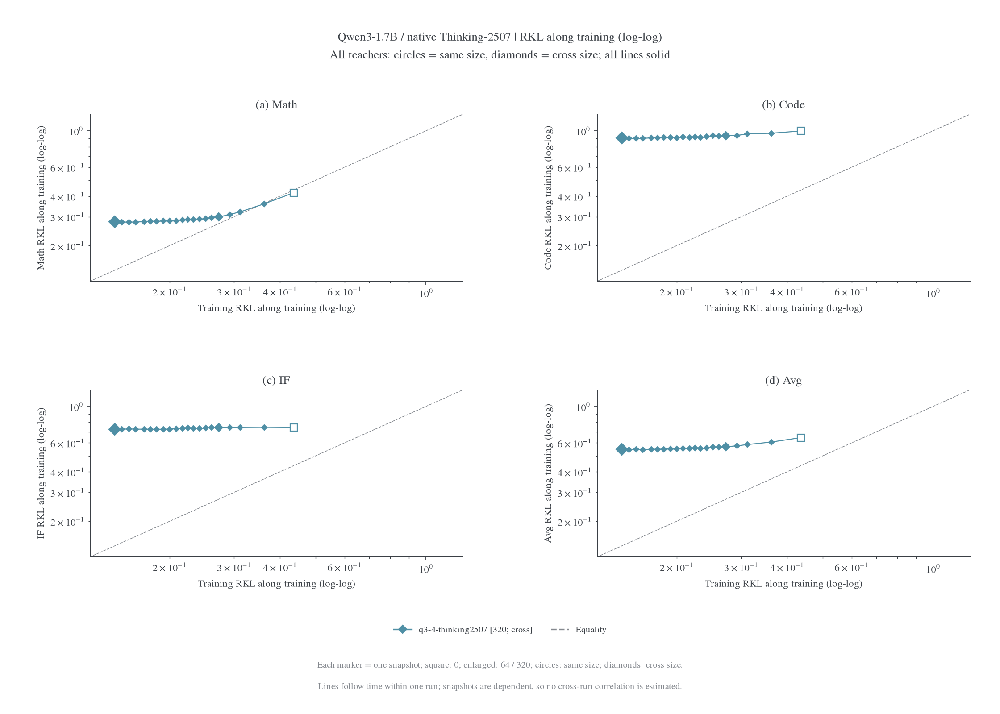

[矢量 PDF](figures/student-paths/all-size/q3-1.7-native-thinking2507-rkl.pdf)

#### RKL 随更新变化

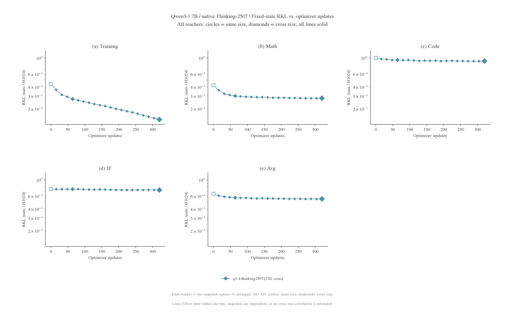

[矢量 PDF](figures/student-paths/all-size/q3-1.7-native-thinking2507-time.pdf)

## Qwen3-1.7B / native Instruct-2507

| 图例短键          | Teacher                | 尺寸关系 | 追加阶段分类            | 更新终点 | 训练池评分题数 |
| ----------------- | ---------------------- | -------- | ----------------------- | -------- | -------------- |
| q3-4-instruct2507 | Qwen3-4B-Instruct-2507 | 跨尺寸   | Base／OPD／公开历史对照 | 320      | 320            |

### 同尺寸：追加 SFT 与未另加 SFT

该输入模板没有同尺寸 teacher run，暂无该版本；下方保留跨尺寸轨迹。

### 全部 teacher：同尺寸与跨尺寸

#### 对数吸收倍数

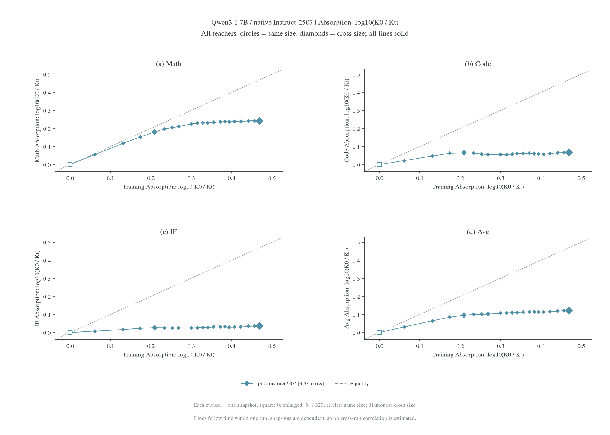

[矢量 PDF](figures/student-paths/all-size/q3-1.7-native-instruct2507-log_absorption.pdf)

#### 训练池与留出 RKL（双对数）

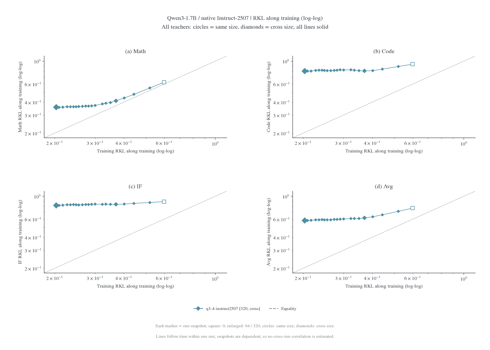

[矢量 PDF](figures/student-paths/all-size/q3-1.7-native-instruct2507-rkl.pdf)

#### RKL 随更新变化

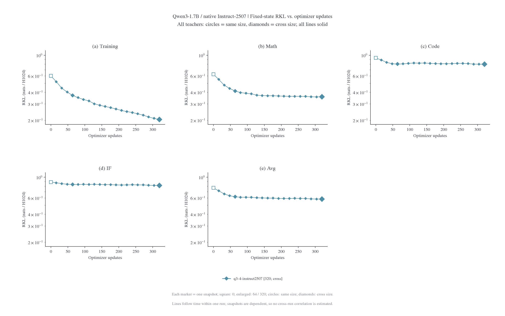

[矢量 PDF](figures/student-paths/all-size/q3-1.7-native-instruct2507-time.pdf)

## 来源与复算

图集读取已有 47 个 run 的全部首遍前缀快照，验证每个原始快照的 SHA256、run 内冻结题目身份、每 16 更新的完整网格，并从逐题 KL 重算五个评分面板；不同 run 的共同题目核对 group／source／length，允许真实训练评分集合大小不同。全部曲线、训练池题数与检查点见[逐快照 CSV](figures/student-paths/snapshots.csv)，配对分类见[run 清单](figures/student-paths/inventory.csv)，原始来源与验证回执见[provenance.json](figures/student-paths/provenance.json)。

同尺寸版本五组、全尺寸版本七组，各有三张图，共 36 张，附 PDF 与图形审计。每组 teacher 都保留独立曲线，不对 SFT／RL 或尺寸组做均值池化。

在仓库根目录运行：

```bash
export FIGURE_VIZ_MPL=/mnt/tidalfs-bdsz01/dataset/llm_dataset/zkn_data/fht_data/dotfiles/.agents/skills/figure-viz/assets/mpl
OMP_NUM_THREADS=1 OPENBLAS_NUM_THREADS=1 /root/.local/share/mirroropd/venvs/plotting/bin/python -m examples.mirroropd.research.studies.fixed_transfer.plot_student_paths
```

可编辑源码为 [plot_student_paths.py](../../../../research/studies/fixed_transfer/plot_student_paths.py)，复用[快照验证与轨迹渲染](../../../../research/studies/fixed_transfer/plot_absorption_paths.py)。只重分析已有日志，不新增训练。
