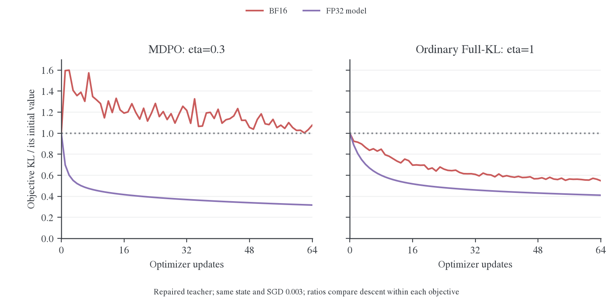
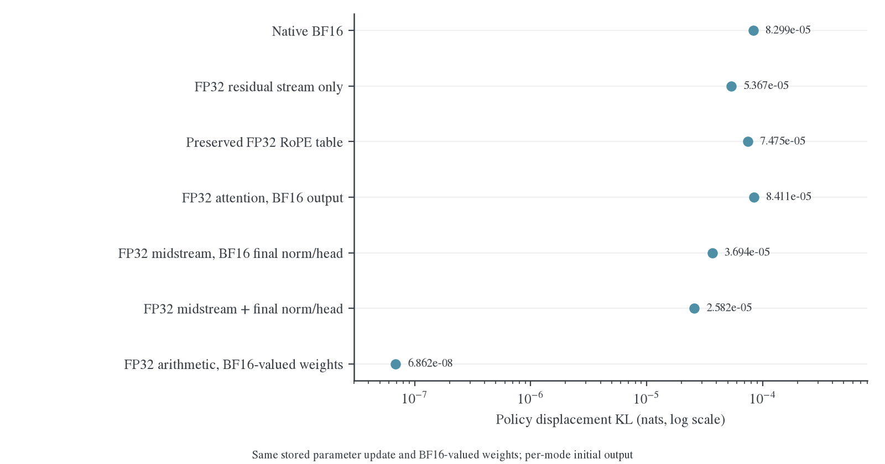
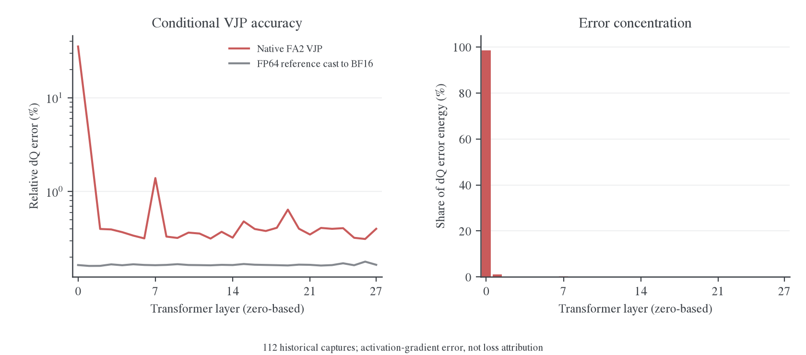
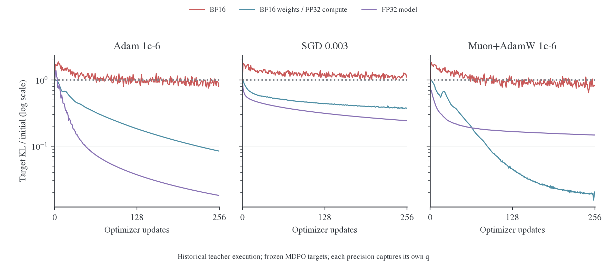
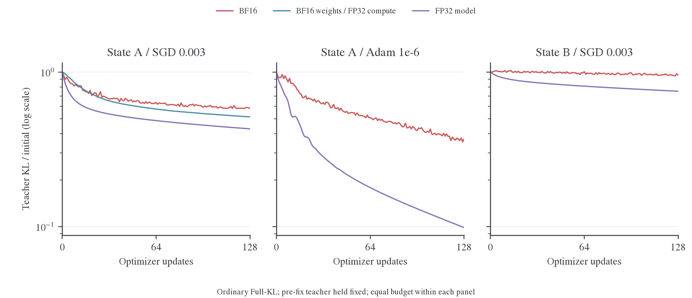

# MDPO 与 OPD 的精度问题：机制、验证与修复

**本机实验已经能解释 KL 为什么上升，也证实问题会影响普通 full-vocab OPD 的优化。** 关键是近目标求解所要求的细微策略变化，与当前低精度执行路径的实际响应不匹配；优化器步长和有限预算又决定了能否找到并保留改善。另有一处已经完整定位并修复的加载错误：统一参数 dtype 时，意外舍入了教师的 RoPE 频率 buffer。

这些证据不等于已经找到原 E45/E47 全部异常的唯一原因。原 run 的晚期 checkpoint 不可用；这里使用真实 1.5B 学生／教师、固定数学前缀和本机保存状态。已验证的是目标拟合与更新效率，正式任务正确率、在线 rollout 和公平吞吐尚未验收。

## 1. 结论与修复状态

| 问题                             | 已有证据                                                                                 | 当前判断                                                            |
| -------------------------------- | ---------------------------------------------------------------------------------------- | ------------------------------------------------------------------- |
| 教师加载改变了模型常量           | 同一权重，仅整模型 dtype 转换即产生平均 1.112e-4 的分布 KL；保留原 buffer 后输出逐位恢复 | 加载处已修复，并通过真实模型与 FSDP2 验证                           |
| 小参数更新产生过大的实际策略位移 | 固定同一更新、同一 BF16 权重值，BF16 与 FP32 算术的位移 KL 相差约 1209 倍                | 前向精度是已确认的关键机制                                          |
| Attention 条件梯度偏差           | 实际 FA2 的 dQ 相对 FP64 参考误差为 6.59%，集中在第 0 层                                 | 局部偏差真实；替换全部 attention VJP 后仍反弹，不能单独解释整体问题 |
| 内层求解不足                     | 长预算能找到更好点，末点可能丢失改善；FP32 下调整 Muon+AdamW 学习率仍有明显收益          | 精度、步长、预算和返回迭代点需要共同验收                            |
| 普通 OPD 是否受影响              | 两份状态、SGD／Adam、修复前后教师的对照均显示精度影响拟合；BF16 有较多上升步             | 已在 full-vocab reverse-KL 的固定前缀复用路径验证                   |

生产 loss 公式与最终的 $1/\eta$ 没有改动。生产默认 BF16 主干也没有被替换成未经正式验收的组合策略。输出 KL／CE 已完成的数值修复单独记录在[实现验收](../../../../infra/numerics/precision/2026-10-27-蒸馏数值修复与验收.md)，不与下面的模型执行问题混为一项。

## 2. MDPO 的 KL 上升可以直接由目标分解解释

对一个固定前缀，记当前学生为 $p$，内层开始时冻结的旧策略为 $q$，冻结教师为 $T$。本文主对照取 $\kappa=0$、$\eta=0.3$。在相同正支持上，融合目标为

$$
\widetilde m_i=q_i^{1-\eta}T_i^\eta,\qquad
Z=\sum_i\widetilde m_i,\qquad m_i=\widetilde m_i/Z.
$$

将 $\log m_i=(1-\eta)\log q_i+\eta\log T_i-\log Z$ 代入 KL 定义，使用 $\sum_i p_i=1$，得到

$$
\begin{aligned}
\mathrm{KL}(p\Vert m)
&=(1-\eta)\mathrm{KL}(p\Vert q)+\eta\mathrm{KL}(p\Vert T)+\log Z,\\
J(p)&=\frac{\mathrm{KL}(p\Vert m)-\log Z}{\eta}
=\mathrm{KL}(p\Vert T)+\left(\frac1\eta-1\right)\mathrm{KL}(p\Vert q).
\end{aligned}
$$

同一内层中 $Z$ 与 $\eta$ 不变，比较 $J$ 和比较 target KL 的升降完全等价。$\eta=1$ 时，目标就是普通 Full-KL；$\eta=0.3$ 时，anchor KL 的系数为 $7/3$。

**修复教师加载后，仍有一个直接的数值例子。** 状态 A 的 BF16 SGD 在 64 次 MDPO 更新中，teacher KL 从 9.018e-4 降到 6.937e-4，改善 2.081e-4；anchor KL 从零增至 9.777e-5，乘 $7/3$ 后增加 2.281e-4。于是 $J$ 增加约 2.008e-5，target KL 从 7.900e-5 升到 8.502e-5。学生靠近了教师，但没有以足够小的策略位移完成这次学习。



图 1：同一状态 A、同一保真教师、SGD 0.003、64 次更新。每个面板内比较相同目标下的 BF16 与 FP32；纵轴以各自起点归一化，不能跨面板据此给算法排名。MDPO 的 BF16 target KL 上升，而普通 OPD 的 teacher KL 整体下降；提高学生执行精度后，两种目标均能下降。

在理想可微起点 $p=q$，

$$
\nabla_\theta\mathrm{KL}(p_\theta\Vert q)\big|_{\theta_0}
=\sum_i\nabla_\theta p_i[\log(p_i/q_i)+1]\big|_{\theta_0}
=\nabla_\theta\sum_i p_i=0.
$$

因此，减小 $\eta$ 不会自动缩小第一步的学习率，却提高了离开旧策略的代价。若令 $\ell=\log(T/q)$、$A(\eta)=\log\mathbb E_q e^{\eta\ell}$，则 $\mathrm{KL}(q\Vert m)=A(\eta)-\eta\mathbb E_q\ell$。由 $A'(0)=\mathbb E_q\ell$、$A''(0)=\operatorname{Var}_q\ell$，其二阶项为 $\eta^2\operatorname{Var}_q\ell/2$。目标距离会变得更小，而数值执行未必提供同样细的更新响应。

旧参数本身属于可行集合，所以子问题的全局最优值不会高于起点。返回更差的迭代点说明实际有限步求解没有达到这个标准；不能用精确 mirror descent 的理论结论替代内层求解验收。

## 3. 已定位的执行问题

### 3.1 教师 RoPE buffer 被加载流程舍入，已修复

HF 将 Qwen2 的 `inv_freq` 和 `original_inv_freq` 初始化为 FP32。原 FSDP 构建代码为了统一参数 dtype 调用 `module.to(torch_dtype)`；该 API 会同时转换浮点参数和 buffer。[^module-to] 默认 forward-only 教师的存储 dtype 为 BF16，两个频率 buffer 随之舍入；学生的 FP32 master 路径则保留了原频率。

这改变了相同 checkpoint 权重对应的实际教师。RoPE 的频率误差还会被位置因子放大：相位变化为 $t\,\Delta\omega$。角度计算内部再调用 `.float()` 只能扩展已舍入的值，不能恢复原频率。它与 RoPE 历史 casting 问题属于同一类失真。[^rope-issue][^rope-pr]

| 同一真实教师权重、四条固定前缀  | 相对原 HF 加载模型的平均 KL |
| ------------------------------- | --------------------------- |
| 原始加载，BF16 参数与 FP32 频率 | 0                           |
| 再做整模型 BF16 转换            | 1.112e-4                    |
| 对已舍入频率仅转回 FP32         | 1.112e-4                    |
| 参数 dtype 统一时保留原 buffer  | 0，输出逐位一致             |

修复集中在共享的 [FSDP 模型构建](../../../../../../../verl/workers/engine/fsdp/transformer_impl.py)与 [cast_module_parameters](../../../../../../../verl/utils/torch_dtypes.py)：继续使用原有参数转换，保留已经初始化的 buffer 对象、值、dtype、别名及持久性。它不按损失类型分叉，也不把整个教师改成 FP32 算术。

参数／buffer 转换与实验控制的 28 项 CPU 回归测试通过。真实 1.5B 模型恢复原频率后输出逐位一致；两卡 FSDP2 中，相同权重的教师与学生保留相同 FP32 buffer，隐藏状态逐位相等，重复 CPU/GPU offload 后仍成立。Qwen2／Qwen3 的 Full-KL 更新、checkpoint、optimizer／scheduler 以及恢复后的下一步等价检查也通过。

修复改变了旧加载路径的实际监督分布，因此不能直接比较两种教师各自的训练 loss。统一用**保真教师**评分时，状态 A 的同预算 64-step BF16 OPD 得到：

| 训练时的教师         | 对同一保真教师的末点 KL |
| -------------------- | ----------------------- |
| 旧舍入频率           | 5.523e-4                |
| 显式恢复原频率的对照 | 5.020e-4                |
| 修复后的默认加载     | 4.945e-4                |

这里的保真教师指同一 BF16 权重、HF 初始化的原始 FP32 RoPE 频率和原生 BF16 主干，不是另一个模型。结果验证了预期教师的拟合改善，不代替最终任务正确率评测。已有运行中的 worker 和旧 teacher-hidden/logits 缓存不会因源码更新自动恢复；新运行应重新构建教师及缓存，并记录版本。

### 3.2 相同参数位移在 BF16 前向中被放大

固定一份已保存的实际参数更新，保持相同的 BF16 有效权重值，不重新计算梯度或 optimizer 更新。原 BF16 的策略位移 KL 为 8.299e-5，FP32 算术为 6.862e-8，约相差 1209 倍。相同 SDPA math backend 的额外控制也有同样量级的差异，不能全部归于 attention backend 切换。



图 2：横轴是更新前后策略位移 KL，不是 target KL。每种执行方式相对自身初始输出计算，去掉切换精度带来的静态偏移。较小位移不自动等于学习进展；真实求解能力另由训练曲线验证。

令低精度前后的 log probabilities 为 $\widehat\ell_0,\widehat\ell_1$，同一有效权重下的 FP32 参考为 $r_0,r_1$，计算差异为 $e_i=\widehat\ell_i-r_i$。则精确地有

$$
\Delta\widehat\ell=\Delta r+\Delta e.
$$

按初始低精度策略 $q$ 中心化、平方并求期望，得到

$$
\tfrac12\operatorname{Var}_q(\Delta\widehat\ell)
=\tfrac12\operatorname{Var}_q(\Delta r)
+\tfrac12\operatorname{Var}_q(\Delta e)
+\operatorname{Cov}_q(\Delta r,\Delta e).
$$

该固定更新中，二次型总量为 8.297e-5，参考变化项为 6.816e-8，计算差异变化项为 8.205e-5，交叉项为 8.578e-7。二次型与实际位移 KL 接近；它说明主要的局部变化来自计算差异随参数改变，不是同参数重复前向的随机漂移。这个方差分解不能解释成训练损害的百分比分账。

与 KL 的关系只在小变化下成立：记 $a=\Delta\widehat\ell$，归一化条件为 $\mathbb E_q e^a=1$。展开得到 $\mathbb E_q a=-\mathbb E_q a^2/2+O(\lVert a\rVert_\infty^3)$，再代入 $\mathrm{KL}(p_1\Vert q)=\mathbb E_q[e^a a]$，得到二阶项 $\operatorname{Var}_q(a)/2$。实验仍使用精确 KL 评分，没有用该近似替代 loss。

### 3.3 局部 attention VJP 偏差真实，但单独修正不足

在四条前缀、28 层的真实 backward 中固定 Q/K/V 与已到达该算子的上游梯度，比较原生 FA2 与理想因果 attention 的 FP64 条件导数。拼接后的 dQ 相对误差为 **6.59%**，只将参考梯度转成 BF16 的误差约为 **0.165%**。第 0 层相对误差为 **35.2%**，贡献约 **98.5% 的 dQ 误差平方范数**。



图 3：这些是 query 激活的条件梯度，不是完整参数梯度，也不是训练 loss 的归因比例。数据来自历史状态及旧教师目标；修复加载后，上游梯度已经变化，不能直接沿用这个百分比描述所有训练。

FA2 的 backward 使用 $\delta=\sum dO\cdot O$。保存的低精度输出包含计算与存储误差；再转成 FP32 累加不能恢复丢失的信息。[^fa283] 对 $P=\operatorname{softmax}(S)$、$O=PV$，有 $G_P=G_OV^\top$、$G_S=P\odot(G_P-\delta)$；若仅 $O$ 受误差 $E_O$ 影响，则 $\Delta\delta=\langle G_O,E_O\rangle$，进而 $\Delta G_{S,j}=-P_j\Delta\delta$。本机测量与这条误差路径相符。

该机制与相关论文有关，但论文重实现和真实 kernel 的数值行为不能混用。[^fa-fails][^fa-discussion] 我们已在实际 FA2 上捕获数据，并做了**保持原生前向逐位不变、替换全部 attention VJP**的 FP32／FP64 对照。16 步后仍反弹，所以这项局部偏差不是整体问题的充分解释。RMSNorm backward-only 与确定性 attention backward 对照也没有单独恢复下降。

<a id="precision-path"></a>

### 3.4 精度必须在实际边界上验收

`fp32_residual` 原型同时影响残差流、归一化输出、RoPE、FSDP 输入转换及最后 head；其收益不能全部归给 residual add。拆分后，仅 FP32 残差流把固定更新的位移 KL 降到 5.367e-5，组合路径为 2.582e-5，仍明显高于完整 FP32 算术的 6.862e-8。

另一个负对照揭示了干预失效：RoPE 模块输出 FP32 表值，但 `cast_forward_inputs=True` 在 block 边界将其重新转成 BF16。[^fsdp-policy] 修正版实际保留了 FP32 表值，却仍未单独消除反弹。因此，这个实验设置错误已修正，但它不能解释原训练。

| 干预                                                   | 受控结果                                     |
| ------------------------------------------------------ | -------------------------------------------- |
| 关闭 BF16 GEMM 低精度中间归约                          | 保存快照的前向输出不变；短内层仍反弹         |
| 单独提高 residual、内部 norm、RoPE 或 MLP 局部计算精度 | 没有在原短预算下恢复下降                     |
| 原生前向＋高精度 attention／RMSNorm VJP                | 短内层仍反弹                                 |
| FP32 残差流、内部 norm、RoPE 及最后 norm/head 组合     | 找到改善，但仍有波动                         |
| 更完整的 FP32 算术路径                                 | 多种求解器能拟合得更细；仍受学习率与预算约束 |

BF16 的 FP32 累加器、FP32 master 参数或 FP32 loss，都不能单独定义整个模型的执行精度。输入、输出存储和 block 边界的转换也需要记录。[^torch-accuracy]

## 4. 长预算与优化器对照

历史配对实验将初始 master 统一舍入到同一组 BF16 可表示值，再独立恢复求解 256 次；不是 256 个 outer。每种精度冻结自身初始 $q$。Adam 保留原状态，SGD 无动量，Muon 与辅助 AdamW 从空状态开始；weight decay 为零。



图 4：历史加载路径下的 MDPO 固定目标。曲线没有平滑。不同精度的目标不完全相同，严格前向因果判断使用图 2。这里的 FP32 指学生模型执行；Muon 内部正交化维持原生实现。

| 256 步末点 target KL | BF16     | BF16 权重＋FP32 算术 | FP32 模型 |
| -------------------- | -------- | -------------------- | --------- |
| Adam，LR=1e-6        | 5.317e-5 | 5.472e-6             | 1.168e-6  |
| SGD，LR=0.003        | 7.569e-5 | 2.419e-5             | 1.579e-5  |
| Muon+AdamW，LR=1e-6  | 5.291e-5 | 1.328e-6             | 9.583e-6  |

起点约为 6.48e-5～6.51e-5。32 步低估了后续拟合空间；同时，BF16 并非存在不可突破的固定 KL 下限，长预算中的部分设置能下降。FP32 Muon+AdamW 的统一 LR 改为 3e-7 后，末点降至 1.476e-6；两个参数组的 LR 同时改变，不能只归因于其中一个组。

返回最后一步也会丢失改善。早期冷 Adam 对照在第 254 步达到 4.896e-5，末点却回到 6.702e-5，高于 6.480e-5 的起点；最佳模型及 optimizer 已恢复复测。选择最佳状态能防止交付更差迭代点，但当预算内没有更好点时，只能退回起点，不能产生学习进展。

## 5. 普通 OPD 的迁移验证

这里的 OPD 明确指 **full-vocab reverse-KL＋固定前缀复用**，通过原生 `eta=1` endpoint 执行，没有偷偷保留 anchor 惩罚。它避免了 sampled-token 估计方差，便于隔离底层执行精度。输入、teacher 和 loss mask 固定，独立评分使用原生投影及 FP64 行代数。



图 5：修复前的实际教师保持冻结，两个状态、两个优化器进行配对比较。纵轴是 teacher KL 相对自身起点的比例；每个面板内预算与学习率相同。曲线中的上升不来自新增 rollout 样本。

| 状态／目标版本 | 求解器与预算      | BF16 末点（上升步数） | FP32 末点（上升步数） |
| -------------- | ----------------- | --------------------- | --------------------- |
| A，旧教师      | SGD 0.003，128 步 | 4.301e-4（54/128）    | 3.201e-4（0/128）     |
| B，旧教师      | SGD 0.003，128 步 | 5.289e-4（61/128）    | 4.342e-4（0/128）     |
| A，旧教师      | Adam 1e-6，128 步 | 2.739e-4（51/128）    | 7.348e-5（3/128）     |
| A，保真教师    | SGD 0.003，64 步  | 4.945e-4（22/64）     | 3.751e-4（0/64）      |

上升步数按相邻独立评分增加超过 1e-10 统计。A 的旧目标起点约 7.4e-4，B 约 5.6e-4；保真教师下 A 约 9.1e-4。提高精度并不保证每步下降，Adam 的 FP32 分支也有上升步。对状态 A 的 SGD，仅保留 BF16 权重并提高算术精度，128 步末点也从 4.301e-4 改善到 3.827e-4。

**普通 OPD 整体 KL 下降，可以同时存在数值精度损害。** 它没有 anchor 项，较大的教师拟合收益能够掩盖策略位移中的数值误差；MDPO 的目标更靠近旧策略，又显式惩罚该位移，因此更容易表现为整个内层目标高于起点。图 1 在修复教师加载后仍观察到这一区别。

边界同样明确：从普通 OPD 保存的更近状态 C 继续 16 步，所测分支末点均低于各自起点，没有复现“所有 OPD 续训都整段反弹”。把已经按 BF16 拟合的状态临时改用较高算术精度，起始 teacher KL 还可能增加；精度切换改变了实际策略，不能只改评估 dtype 就声称训练改善。

以上验证了目标拟合精度与更新效率受影响，不等于已经量化最终数学正确率或吞吐损失。Sampled OPD 的梯度估计与正式在线训练尚未在这组对照中验证；共享加载路径的 buffer 修复适用，但不能直接沿用这里的性能幅度。

## 6. 最本质的修复方案

已经能解释现象；尚未完成的是最低成本、适用于正式训练的稳定执行与求解配置。修复应落在下面三个层面，而不是改变 KL 定义来隐藏反弹。

1. **保留模型的数值语义。** 已修复参数 dtype 统一时的 buffer 舍入。Teacher、anchor、current actor 的加载与执行策略要明确；尤其同一参数的 actor 与 anchor 必须代表同一实际策略。旧缓存需要重算，不能对已经丢失的信息事后升 dtype。
2. **让实际前向满足目标尺度的精度要求。** 建立一致的高精度执行基准，再逐项恢复低精度优化并验证真实策略位移。现有实验支持提高学生算术精度；只将最终 loss、某一个 norm 或某个 VJP 改为 FP32 不足以保证解决。参数 dtype、buffer dtype、GEMM 输入／输出和中间表示应在执行层统一管理，而非给每个损失各写一套 cast。
3. **按真实更新后的目标验收内层求解。** 学习率、预算和返回迭代点都需要校准。若采用接受／回退，必须在同一冻结目标上评分，并同步恢复参数与 optimizer 等状态。反复退回起点意味着求解没有进展，需要改善精度或求解策略；回退本身不是修复精度的替代品。

Teacher buffer 修复已进入共享构建代码。高精度主干、自动步长或生产接受／回退策略尚未作为新默认落地。正式 rollout 的数值一致性、长序列、多样本 packed attention、多 seed 与任务分数仍需验收；共享 GPU 下含额外评分和状态复制的耗时不用于吞吐排名。

## 7. 相关资料与复现

### 7.1 文献的作用边界

| 来源                                                                              | 与本机问题的关系                                                                 |
| --------------------------------------------------------------------------------- | -------------------------------------------------------------------------------- |
| Mixed Precision Training、BF16 训练研究[^mixed-precision][^bf16-study]            | FP32 master 能保留参数更新；不保证全部低精度中间计算能拟合很近的策略             |
| Revisiting BFloat16、Stochastic Rounding for LLM Training[^revisit-bf16][^sr-llm] | 主要研究低精度更新写回；不能直接套用到本项目已有 FP32 master 的路径              |
| Low-Precision Transformer Training Fails 及维护者讨论[^fa-fails][^fa-discussion]  | 提供输出误差进入 backward 修正量的线索；真实 kernel 已测，局部偏差不等于整体归因 |
| RoPE 精度论文与 Transformers issue／PR[^rope-paper][^rope-issue][^rope-pr]        | 区分角度计算、buffer 保真与后续低精度转换；本仓加载问题已做独立干预              |
| PyTorch 精度语义[^module-to][^fsdp-policy][^torch-accuracy]                       | 整模型转换、模块边界转换与算子内部精度是不同控制层                               |

### 7.2 状态、数据与代码

学生为 DeepSeek-R1-Distill-Qwen-1.5B，教师为 JustRL-DeepSeek-1.5B；四张 H800、FSDP2，每 rank 一条固定数学回答。状态 A 来自 144 次 MDPO 更新后的 checkpoint；B 来自 128 次普通 Full-KL 更新，使用回答的后 128 个位置；C 是 A 再做 128 次普通 OPD Adam 更新后保存的状态。配对主实验将初始 master 舍入到相同 BF16 可表示值；C 的续训保留原 master，用于忠实恢复。横轴均为 optimizer updates，不是 outer。

旧实验基线与数据版本保留在归档中。新 OPD 迁移实验以 `f712af223` 为基线，并显式区分旧舍入教师、保真教师和修复后的默认加载；不把不同目标版本的 loss 混比。新增 1344 次非零 LR 更新，另有一次零 LR checkpoint 复查。指标与对齐独立评分最大差约 5.38e-10，MDPO 目标恒等式最大误差约 7.59e-19。

| 入口                                                                                                                                                                         | 内容                                                          |
| ---------------------------------------------------------------------------------------------------------------------------------------------------------------------------- | ------------------------------------------------------------- |
| [OPD 与 buffer 修复数据](data/opd-transfer-20261027.json)                                                                                                                    | 全部新分支、逐步评分、上升次数、实际 buffer 与恢复检查        |
| [长预算与算子定位数据](data/localization-20261027.json)                                                                                                                      | 历史配对曲线、固定参数位移、真实 attention 捕获分析、阴性结果 |
| [早期求解器数据](data/solver-precision-20261027.json)                                                                                                                        | 优化器历史、学习率扫描、两份状态与最佳迭代点                  |
| [统一绘图脚本](../../../../../research/studies/precision/plot_precision_report.py)                                                                                           | 只生成本文五张图及同名 PDF；原始测量不平滑                    |
| [求解器重放](../../../../../research/studies/precision/audit_mirror_solvers.py)                                                                                              | `--eta 1` 原生 Full-KL、默认 MDPO、可选共同保真教师评分       |
| [真实教师 buffer 探针](../../../../../research/studies/termination/probe_teacher_rope.py)                                                                                    | 相同参数下的加载转换、事后 upcast 与修复对照                  |
| [OPD 汇总](../../../../../research/studies/precision/summarize_opd_transfer.py)                                                                                              | 实际 LR、更新、目标恒等式、checkpoint 评分与修复验收          |
| [单因素干预](../../../../../research/studies/precision/factor_mirror_precision.py)、[attention 分析](../../../../../research/studies/precision/analyze_attention_capture.py) | Qwen2 诊断工具；原始张量与完整阴性对照在归档目录              |

早期过程记录保留在[内层审计](2026-10-26-MDPO内层KL反弹与数值链路审计.md)和[优化器对照](2026-10-27-MDPO优化器历史与前向精度因果对照.md)。主报告去掉了重复的阶段叙述、重复图表和无关检索条目；原始数据保留用于复核。阴性结果与短期精度切换的不利结果没有被当作无效数据删除。

原始资源目录为 `outputs/opd-precision-transfer-20261027/`；其 `state-a.json`、`state-b.json` 等保存分支配置。`--teacher-rope rounded_bf16` 显式重现旧目标，`canonical` 重建原频率，`native` 使用当前生产加载。`--monitor-canonical-teacher` 在同一参数状态额外评分，以比较不同监督目标的优化结果。采集旧 buffer 值的字段名 `original_inv_freq` 本身也可能已经被舍入，不能仅凭名称判断保真。

```bash
PYTHON=/root/.local/share/mirroropd/venvs/profile-cu128/bin/python
MD_DIR=examples/mirroropd/docs/theory/mirror-descent
"$PYTHON" -m examples.mirroropd.research.studies.precision.summarize_opd_transfer \
  --root outputs/opd-precision-transfer-20261027 \
  --out "$MD_DIR/data/opd-transfer-20261027.json"
"$PYTHON" -m examples.mirroropd.research.studies.precision.plot_precision_report --figure-skill /实际路径/figure-viz
```

训练复查继续使用 `torch.distributed.run --nproc-per-node=4` 启动求解器脚本，指定 student／teacher／prefixes／checkpoint、分支 JSON 与新输出目录。标准 checkpoint 重载的零 LR 评分与保存前逐位一致。更早的 `best-arm*.pt` 则是诊断状态，不能直接当作完整 trainer checkpoint。

### 参考文献

[^mixed-precision]: Paulius Micikevicius et al. Mixed Precision Training. arXiv 2017，ICLR 2018。[论文](https://arxiv.org/abs/1710.03740)。

[^bf16-study]: Dhiraj Kalamkar et al. A Study of BFLOAT16 for Deep Learning Training. arXiv 2019。[论文](https://arxiv.org/pdf/1905.12322)。

[^revisit-bf16]: Pedram Zamirai et al. Revisiting BFloat16 Training. arXiv 2020/2021。[论文](https://arxiv.org/pdf/2010.06192)。

[^sr-llm]: Kaan Ozkara, Tao Yu, Youngsuk Park. Stochastic Rounding for LLM Training: Theory and Practice. arXiv 2025，核对 v1。[论文](https://arxiv.org/html/2502.20566v1)。

[^fa-fails]: Haiquan Qiu, Quanming Yao. Why Low-Precision Transformer Training Fails: An Analysis on Flash Attention. arXiv 2025，ICLR 2026，机制按 v1 核对。[论文](https://arxiv.org/html/2510.04212v1)。

[^fa-discussion]: Tri Dao et al. Discussion #1931. FlashAttention GitHub 2025，2026-10-27 核对。[维护者讨论](https://github.com/Dao-AILab/flash-attention/discussions/1931)。

[^fa283]: FlashAttention contributors. dot_do_o. FlashAttention v2.8.3，2026-10-27 核对。[CUDA 源码](https://github.com/Dao-AILab/flash-attention/blob/v2.8.3/csrc/flash_attn/src/flash_bwd_preprocess_kernel.h)。

[^rope-paper]: Haonan Wang et al. When Precision Meets Position: BFloat16 Breaks Down RoPE in Long-Context Training. arXiv 2024，核对 v1。[论文](https://arxiv.org/html/2411.13476v1)。

[^rope-issue]: Kerem Turgutlu et al. LlamaRotaryEmbedding casting/cache issue #25681. Transformers GitHub 2023，2026-10-27 核对。[讨论](https://github.com/huggingface/transformers/issues/25681)。

[^rope-pr]: Daniel Han et al. RoPE precision PR #29285. Transformers GitHub 2024，已合并，2026-10-27 核对。[PR](https://github.com/huggingface/transformers/pull/29285)。

[^module-to]: PyTorch contributors. Module.to. PyTorch 2.11 文档，2026-10-27 核对。[参数与 buffer 转换语义](https://docs.pytorch.org/docs/2.11/generated/torch.nn.Module.html#torch.nn.Module.to)。

[^fsdp-policy]: PyTorch contributors. MixedPrecisionPolicy. PyTorch 2.11 文档，2026-10-27 核对。[模块边界精度](https://docs.pytorch.org/docs/2.11/distributed.fsdp.fully_shard.html#torch.distributed.fsdp.MixedPrecisionPolicy)。

[^torch-accuracy]: PyTorch contributors. Numerical accuracy. PyTorch 2.11 文档，2026-10-27 核对。[文档](https://docs.pytorch.org/docs/2.11/notes/numerical_accuracy.html)。
