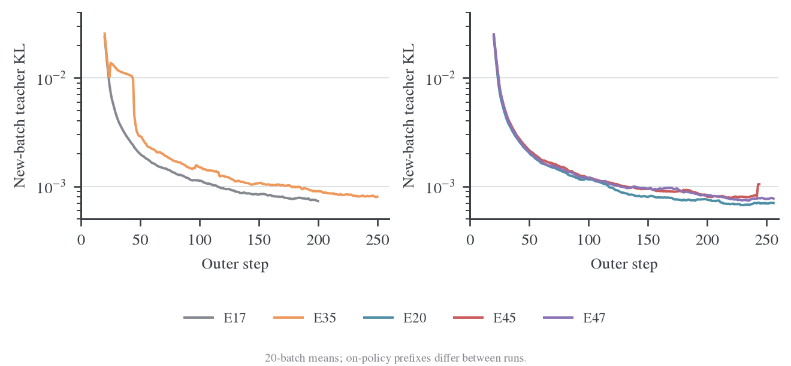
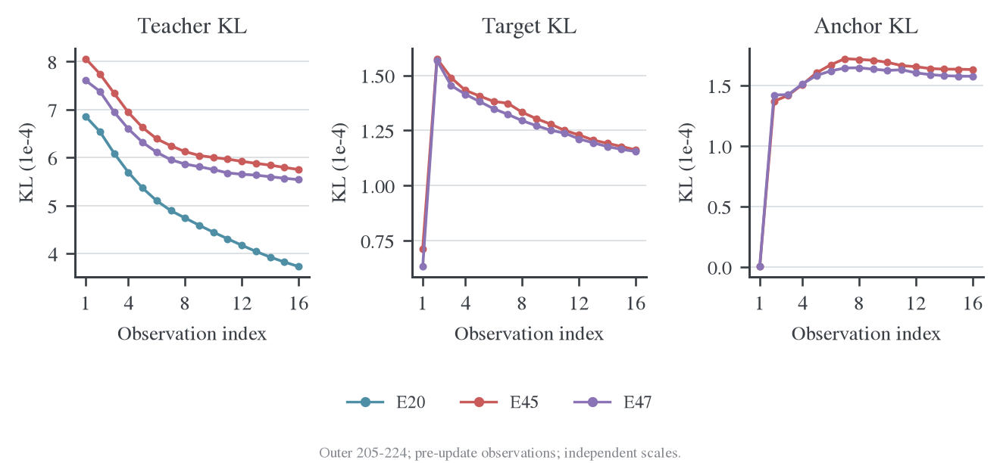

# E45/E47：镜像目标的任务表现与内层反弹

## 1. 背景与 motivation

Mirror descent 用接近旧策略的融合目标约束每轮移动。其预期价值依赖于内层求解确实接近该目标，不能以teacher KL下降代替子问题验收。E45/E47检验η=0.3下的目标形状，以及短内层优化能否实现预期约束。

## 2. Setting 与实验设计

R1-Distill-Qwen-1.5B ← JustRL-DeepSeek-1.5B，DAPO，batch64、reuse16、AdamW LR1e-6、BF16，训练cap7168，验证cap31744、每题16答、T0.7/top-p0.9。E45为κ=0、η=0.3；E47为κ=0.5、η=0.3；二者均为precompute_fused/chunk128。E45在本文冻结证据中有244轮、评测至224，当前完整结果见生成表；E47完成256轮。Full-KL历史参照E20使用不同硬件和backend，正式同版本E44仍缺。

## 3. 实验结果：任务表现

三组共同的最后验证预算是 outer 224 / update 3584：

| Run | MATH mean | AMC mean | AIME mean | AIME pass@16 | AIME majority@16 | AIME all-correct@16 |
| --- | --- | --- | --- | --- | --- | --- |
| E20 | 87.8000% | 88.9063% | 37.2917% | 60.0000% | 48.3333% | 16.6667% |
| E45 | 87.9375% | 89.6875% | 34.1667% | 60.0000% | 40.0000% | 13.3333% |
| E47 | 88.2375% | 89.2188% | 32.7083% | 56.6667% | 40.0000% | 10.0000% |

E45 在 AIME 上与 E20 的 pass@16 相同，但 mean、majority 和 all-correct 更低。它们衡量的是候选覆盖、平均正确率和回答稳定性的不同侧面，不能只报告相同的 pass@16 就称为等效。E47 在这个点上候选覆盖和回答稳定性也较低。AIME 的答案解析缺失为 E20/E45/E47 的 7/7/4 条；E47 的解析缺失更少，却仍有更低 mean，因此本点差距不是简单的格式失败增加。

七个共同 checkpoint 的描述性均值为：

| Run | MATH | AMC | AIME |
| --- | --- | --- | --- |
| E20 | 87.9821% | 88.4821% | 35.3869% |
| E45 | 88.0607% | 88.4375% | 34.2560% |
| E47 | 88.0768% | 88.3259% | 34.4643% |

在这段共同轨迹中，两种 MDPO 的 MATH 略高，AIME 均值低约 0.92–1.13 pp，没有逐集合一致收益。E45/E47 的平均训练长度与 E20 接近，outer 1–224 的 response token 只分别多 0.34%/0.30%，训练长度停止率均约 40%；任务差别不能直接归因于某组多生成了大量训练数据。

E47 的最终 outer 256 结果又高于 E20：

| Run | MATH mean | AMC mean | AIME mean |
| --- | --- | --- | --- |
| E20，outer 256 | 88.1125% | 88.5938% | 34.3750% |
| E47，outer 256 | 88.5250% | 89.8438% | 35.8333% |
| 差值 | +0.4125 pp | +1.2500 pp | +1.4583 pp |

224 与 256 的 AIME 排序反转，说明只挑终点或最好 checkpoint 容易改变结论。E45 没有 256 的验证记录，不能拿其 224 分数填入这张表。

AIME 仅有 30 题。共同 outer 224 的 mean 95% 题目 bootstrap 区间为 E20 [23.57,52.32]、E45 [19.11,48.88]、E47 [17.73,48.33]%。这些区间很宽；区间重叠不是等效性检验。当前日志不含可供本分析使用的跨 run 逐题联合回答记录，也没有重复 seed，不能做配对显著性或跨 seed 稳定性结论。

## 4. 实验结果：固定目标的内层求解

新批起点 teacher KL 在全部 run 中总体下降，但存在个别批次尖峰。它是在各自当前策略生成的前缀上测量，不是固定 held-out 前缀上的泛化 KL；下一批起点与上一批末点也不能直接解释为同一个输入的 loss 反弹。

E35 在 outer 25 的 teacher KL 从 0.10678 降至 0.01979，该批最大梯度范数为 1.4001；E45 在 outer 243 从 0.005468 降至 0.003117，最大梯度范数为 0.09518。两批都没有非有限观测，且批内能够下降。20 批滑动均值会把这样的高值展宽成台阶，不能把图中的台阶直接判断为持续发散。E45 的最后验证在 224，尚无这次尖峰后的任务验证，不能判断其下游影响。

共同后期窗口 outer 205–224 的逐批首末观测为：

| Run | teacher KL 首次 → 第16次 | 逐批相对降幅均值 | target KL 首次 → 第16次 | 逐批 target KL 相对变化均值 |
| --- | --- | --- | --- | --- |
| E20 | 6.855e-4 → 3.733e-4 | −45.36% | 不适用 | 不适用 |
| E45 | 8.058e-4 → 5.751e-4 | −28.27% | 7.142e-5 → 1.162e-4 | +66.44% |
| E47 | 7.604e-4 → 5.541e-4 | −27.21% | 6.326e-5 → 1.155e-4 | +83.42% |

表中的首末值先分别对 20 批取平均；相对变化先在每批计算再平均，因此不等于两个表中均值的比值。第 1、16 次都是产生各自梯度的前向观测，两个观测之间执行了 15 次更新；日志没有同批第 16 次 optimizer 更新后的额外测量。

在这 20 批中，两种 MDPO 都有以下事实：

- target KL 的最小观测都在第 1 次，即开始本轮更新之前。
- 第 2 次观测，也就是第一步更新之后，target KL 全部升高。
- E45 的平均 target KL 为 7.142e-5 → 1.576e-4 → 1.162e-4；E47 为 6.326e-5 → 1.567e-4 → 1.155e-4，依次对应第 1、2、16 次观测。
- 同时 teacher KL 继续下降，anchor KL 从约 3.3e-7 增至约 1.6e-4。

早期 outer 1–20 的情况不同：两组 target KL 的逐批首末降幅约 48.36%/47.04%，最低观测都在第 16 次。到 outer 81–100，两个 run 的 20 批已经全部变成“起点最好，末次更差”。这是一种随训练阶段改变的内层拟合行为，不是整个训练从第一批就完全不下降。

E45 的 κ=0 目标给出直接的分解：

$$
L_{\mathrm{MDPO}}=\mathrm{KL}(p\Vert T)+\frac73\mathrm{KL}(p\Vert q).
$$

在上述后期窗口，第一步之后 teacher KL 约下降 3.16e-5，anchor 惩罚约增加 3.19e-4，净 objective 上升。只监控 teacher KL 会遗漏这种固定目标拟合退化。

统计还验证了以下一致性：

| 检查 | E45 | E47 |
| --- | --- | --- |
| 同批 target log Z 的最大变化 | 0 | 0 |
| $\eta L=\mathrm{KL}(p\Vert m)-\log Z_m$ 最大绝对误差 | 4.69e-9 | 1.99e-9 |
| E45 几何目标分解最大绝对误差 | 6.39e-8 | 不适用 |
| 位置 sum/count 重建全局 objective 最大绝对误差 | 1.62e-8 | 7.02e-9 |

这些误差远小于观测到的 target KL 跳升，支持把它视作真实的优化轨迹，而非目标常数刷新或指标换算错误。它们没有验证参数梯度的高精度参考，也不能排除低精度计算对更新方向的影响。

κ=0 时，在 p=q 起点，anchor KL 的一阶梯度为零；第一步并不会因为存在 anchor 正则就自动成为受约束的精确 mirror step。固定 LR、跨 outer 保留的 Adam 动量/二阶矩与越来越近的 target 距离可能不匹配，但现有日志没有参数更新范数、方向夹角或优化器状态对照，不能据此认定具体根因。

## 5. 分析与后续证据

这些结果支持先解决内层求解，再评价镜像目标的算法价值。原E45/E47的后期子问题反弹不能直接用作“正确求解的MDPO没有价值”的证据。后续正式精度验证见[E50/E51](2026-10-28-E50E51近目标求解与精度验证.md)：系统性反弹基本消失，任务收益仍需独立判断。

## 6. 证据与复算

[冻结联合分析](../../../../archive/experiments/length-mirror/2026-10-26-E35长窗口与E45E47镜像目标对照.md)保存位置分桶、运行条件与原统计口径。数据位于 `wandb-logs/MirrorOPD-verl/analysis/length-mirror-20261026/`；上升比例先逐批计算再平均，不与E50/E51报告的窗口均值比值混用。
