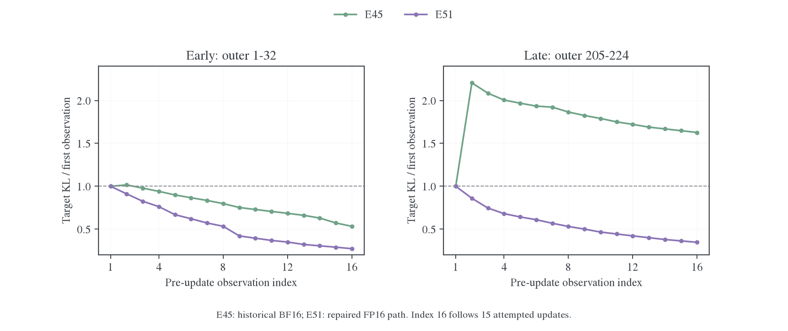

# E50/E51：提高精度能否恢复近目标内层求解

## 1. 背景与 motivation

[内层反弹审计](../mechanism/2026-10-26-MDPO内层KL反弹与数值链路审计.md)记录了旧 E45 的异常：后期固定同一批、同一个 target，更新后的 target KL 反而高于更新前。Teacher KL 仍能下降，因此只检查 teacher loss 或是否跳步会漏掉问题。

[精度机制报告](../mechanism/2026-10-27-MDPO反弹机制与浮点精度研究报告.md)与[优化器因果对照](../mechanism/2026-10-27-MDPO优化器历史与前向精度因果对照.md)进一步指出，接近目标时要求的细微策略变化，与 BF16 执行的实际响应不匹配。Adam 历史和有限步长也参与轨迹；仅修正最终 KL 标量或输出梯度，不足以保证内层下降。FP16 是提高表示分辨率的生产候选，不等同于完整 FP32 参考路径。

因此，[正式精度矩阵](../../../../infra/numerics/precision/2026-10-27-共享训练精度与实验入口.md)同时安排 η=1 的 E50 与 η=0.3 的 E51：E50 检查普通 Full-vocab OPD 在同一执行路径下是否正常；E51 检查更近、带 anchor 约束的 MDPO 子问题是否真正被优化。首要指标是同批 target KL 的首末变化、第一步反弹和 teacher 收益与 anchor 代价的分解。任务正确率是下一层问题。

## 2. Setting 与实验设计

| 项目 | E50：普通 OPD | E51：MDPO | E45：历史参照 |
| --- | --- | --- | --- |
| Student / teacher | R1-Distill-Qwen-1.5B / JustRL-DeepSeek-1.5B | 相同 | 相同 |
| 目标 | Full-vocab RKL，η=1 | κ=0、η=0.3 | κ=0、η=0.3 |
| Actor / anchor 执行 | FP16 | FP16 | 历史 BF16 |
| Backend / chunk | precompute_fused /128 | 相同 | 相同 |
| 训练预算 | DAPO，batch64，reuse16，计划256 outer，AdamW LR1e-6 | 相同 | 相同 |
| 训练 / 验证 cap | 7168 /31744 | 相同 | 相同 |
| 验证 | 每32 outer；每题16答，T0.7/top-p0.9，无初始验证 | 相同 | 相同 |
| 可用训练 / 验证边界 | 256 /256 | 253 /224 | 历史机制快照244 /224 |
| Run | `rsi5krqd` | `6vv5o9b8` | `625vw4ob` |

E45的当前原始日志已补齐256轮；本文保留原机制统计的244轮冻结边界，末次任务状态见生成表。

指标在更新前记录，首次与第16次观测之间包含15次更新尝试。E50/E51 是同一执行路径的目标对照；E45/E51 跨代码时期，期间有 teacher buffer、VJP 与 AMP 等修复，不能把全部改善孤立归给 dtype。主要判据是同批固定目标的净进展；任务优势另行判断。

## 3. 实验结果：MDPO 子问题

### 3.1 判据来自固定目标的分解

对于 κ=0、η=0.3，记同一内层冻结的旧策略为 $q$，融合目标为

$$
m_i=\frac{q_i^{1-\eta}T_i^\eta}{Z},
\qquad Z=\sum_iq_i^{1-\eta}T_i^\eta.
$$

代入 $\log m_i=(1-\eta)\log q_i+\eta\log T_i-\log Z$，有

$$
\begin{aligned}
D_{\mathrm{KL}}(p\Vert m)
&=(1-\eta)D_{\mathrm{KL}}(p\Vert q)
+\eta D_{\mathrm{KL}}(p\Vert T)+\log Z,\\
J(p)&=\frac{D_{\mathrm{KL}}(p\Vert m)-\log Z}{\eta}
=D_{\mathrm{KL}}(p\Vert T)+\frac73D_{\mathrm{KL}}(p\Vert q).
\end{aligned}
$$

同批 $q,T,Z$ 固定，target KL 的下降与 $J$ 的下降等价。Teacher KL 的改善必须超过加权 anchor 代价，才能称为这次 MDPO 子问题取得了净进展。

### 3.2 对齐原审计的 outer205–224，反弹方向已经改变

以下均值先跨 20 批计算，再比较首末比例；它与先算每批比例再平均的统计量不同。

| 指标 | E45：历史 BF16 | E51：修复后的 FP16 |
| --- | ---: | ---: |
| 首次 target KL | 7.1423e-5 | 4.5021e-5 |
| 第二次 target KL | 1.5756e-4 | 3.8723e-5 |
| 第 16 次 target KL | 1.1622e-4 | 1.5599e-5 |
| 窗口均值的首末变化 | **上升 62.72%** | **下降 65.35%** |
| 末次高于起点的批数 | 20 / 20 | 0 / 20 |

图中每个窗口用各自首次 target KL 均值归一化。早期两项都能下降，后期旧 E45 第一步跳高后始终未回到起点以下；E51 则从第一步开始向目标靠近。该比较关注同一内层目标的变化方向，不把两次训练不同起点的绝对 KL 差直接解释成纯精度收益。

将窗口扩大到 outer193–224，结论一致：E45 的 32/32 批末次更差，窗口 target KL 上升 64.05%；E51 的 32/32 批改善，下降 63.84%。因此后期恢复下降并非挑选了一个有利 checkpoint。

### 3.3 改善来自 teacher 收益与策略位移代价的重新平衡

定义同批首次到第 16 次的 teacher 收益和 anchor 成本：

$$
G_T=D_{\mathrm{KL}}(p_1\Vert T)-D_{\mathrm{KL}}(p_{16}\Vert T),
\qquad
C_q=\frac73\left[D_{\mathrm{KL}}(p_{16}\Vert q)-D_{\mathrm{KL}}(p_1\Vert q)\right].
$$

则 $J(p_1)-J(p_{16})=G_T-C_q$。仍取 outer205–224：

| 分解量 | E45 | E51 |
| --- | ---: | ---: |
| Teacher 收益 $G_T$ | 2.3067e-4 | 1.8665e-4 |
| 加权 anchor 成本 $C_q$ | 3.7999e-4 | 8.8578e-5 |
| 净目标改善 $G_T-C_q$ | **−1.4932e-4** | **+9.8071e-5** |
| 成本 / 收益 | 1.647 | 0.475 |

E51 的 teacher 收益绝对值没有比旧 E45 更大；关键是它用更小的 anchor 代价完成了这段拟合。旧 E45 虽靠近教师，却付出了超过收益的策略位移成本；E51 的成本约占收益的 47%，留下正的 MDPO 净收益。这与此前“低精度近目标更新产生过大的实际策略位移”的诊断相符。

两项日志的同批 `target_log_z` 均完全不变；目标分解的最大绝对残差分别约 6.4e-8、1.1e-8，远小于这里约 1e-4 的净变化。改善不是通过内层刷新目标或改变 η 掩盖出来的。

### 3.4 整段训练基本修复系统性反弹，仍有局部例外

| 全部可用完整批次 | E45 | E51 |
| --- | ---: | ---: |
| 批数 | 244 | 253 |
| 末次 target KL 高于起点 | 190 / 244 | **1 / 253** |
| 第一步 target KL 上升 | 240 / 244 | **3 / 253** |
| 批内相邻观测上升 | 377 / 3660 | 103 / 3795 |

E51 有 252/253 批最终观测优于本批起点，但并非每一步单调下降。唯一末次更差的批次是 outer155，target KL 从 4.7492e-5 到 5.1395e-5，上升约 8.2%；这一批也发生了 3 次非有限梯度跳步。两者在同批出现，日志不足以判定跳步、scaler、Adam 历史或某个算子的各自贡献。

因此可以确认的是：**原先普遍发生于后期的“整段内层返回更差点”已基本消失，修复后的 FP16 配置通过了核心机制验收。** 仍不能宣称完整 16 次更新后的状态都更好，因为没有最后一步后的额外评分，也不能宣称 FP16 在更近目标下永不反弹。

E45/E51 的记录配置具有相同的 `precompute_fused/chunk128`、κ=0、η=0.3、LR 和复用预算。它们仍属于不同代码时期：期间包含稳定 VJP、target 表示、教师 buffer 保真和 FP16/AMP 路径修复。结合已有固定状态精度干预，正式结果支持这套修复路径有效；单凭两个在线 run，无法把全部改善单独归给 BF16→FP16。要量化纯精度效应，需要同一修复版本的 BF16 E45 与 FP16 E51 对照。

## 4. 实验结果：普通 OPD 参照

E50 使用与 E51 相同的 FP16 生产路径，η=1 时目标退化为原生 teacher Reverse KL，没有 anchor 惩罚。它的 256 批全部满足末次 KL 低于首次，第一步没有上升；3840 对相邻观测中仅 8 对上升。普通 OPD 的优化链路正常，E51 的成功不能只靠“teacher KL 也下降了”来判断，其额外价值在于第 3 节验证了带 anchor 的净目标也下降。

在共同后期窗口 outer193–224：

| 实验 | 首次 Teacher RKL | 第 16 次 Teacher RKL | 首末降幅 |
| --- | ---: | ---: | ---: |
| E20，历史 BF16 OPD | 6.9076e-4 | 3.7902e-4 | 45.13% |
| E50，FP16 OPD | 4.7982e-4 | 2.3234e-4 | 51.58% |
| E51，FP16 MDPO | 5.3142e-4 | 3.4140e-4 | 35.76% |

E50 比历史 E20 达到了更细的拟合，但 E20 的 backend、chunk、代码及硬件条件不同；缺少同版本 BF16 E44 正式日志时，它只能作历史参照。E50/E51 则说明，在同一 FP16 配置下，η=0.3 确实限制了同批 teacher 拟合的幅度，同时仍实现正的 MDPO 净收益。第 16 次 teacher KL 高于 η=1 本身不是 MDPO 求解失败。

这改变了后续算法比较的解释前提：旧 E45 的任务结果混入了内层系统性反弹，无法据此评价正确求解的 MDPO 是否有价值。E51 大幅减轻了这一干扰，现在才更适合继续研究镜像约束是否改善在线学习。

## 5. 内层修复尚未变成稳定的 MDPO 任务优势

任务曲线见[共享评测图的下排](../../../../archive/experiments/shared-transfer-precision/figures/evaluation.png)。

表中 mean 是每题 16 答的平均正确率，不是 pass@16。

| 实验与轮次 | AIME25 | AMC23 | MATH-500 |
| --- | ---: | ---: | ---: |
| E45，224，历史 BF16 MDPO | 34.17% | 89.69% | 87.94% |
| E50，224，FP16 OPD | 34.58% | 88.13% | 88.63% |
| E51，224，FP16 MDPO | 36.46% | 87.50% | 88.41% |
| E50，256，FP16 OPD | 37.29% | 90.00% | 88.70% |

在 E50/E51 共同的 7 个评测点，E51−E50 的均值差为 AIME25 +0.21、AMC23 −0.58、MATH-500 −0.25 个百分点。E51 相对历史 E45 则为 +0.63、−1.07、+0.28 个百分点。两组比较均没有跨任务一致的优势；重复 checkpoint 来自同一次训练，不能当成独立 seed。

这不削弱第 3 节的机制结论：内层从“返回更差目标值”变成“取得净下降”已经得到直接验证。它表明正确求解是评价 MDPO 的必要前提，却不是任务准确率提升的充分条件。当前不应仅凭最终分数接近就认定精度修复无效，也不应仅凭 target KL 下降就认定 η=0.3 在算法上更好。

E51 的 256 轮评测尚缺；AIME25 只有 30 题，缺少跨 seed 和逐题配对结果。现有证据支持继续区分数值求解收益与算法任务收益，尚不足以终结 η 或精度配置的比较。

## 6. 分析与下一项判别实验

修复后的 FP16 MDPO 在252/253个完整批次取得净目标下降，基本消除了旧运行后期普遍反弹的问题。Teacher 收益对 anchor 成本的覆盖恢复，是机制验收的核心。任务分数尚无稳定优势，不否定内层修复；目标下降也不自动证明 η=0.3 更优。

下一步应在同一修复版本下比较 BF16、FP16 与 BF16 GEMM+FP32中间表示，使用相同teacher缓存、输入及optimizer状态，并补充第16次操作后的独立target评分。E51最终验证与多seed E50/E51用于判断算法任务收益；旧E45不能继续代表已正确求解的MDPO。

## 7. 证据与复算

`wandb-logs/MirrorOPD-verl/analysis/e49-e51-20261028/` 中的 `inner-cohorts.csv`、`inner-trajectories.csv`、`mdpo-decomposition.csv` 与 `mechanism-checks.json` 保存逐窗口与恒等式检查；反弹容差为1e-10，首末比例先跨批求均值再计算。

[机制复算脚本](../../../../../research/analysis/transfer_precision/motivation_analysis.py)；[基础统计脚本](../../../../../research/analysis/transfer_precision/analyze.py)；[MDPO内层PDF](../../../../archive/experiments/shared-transfer-precision/figures/mdpo-inner.pdf)。
