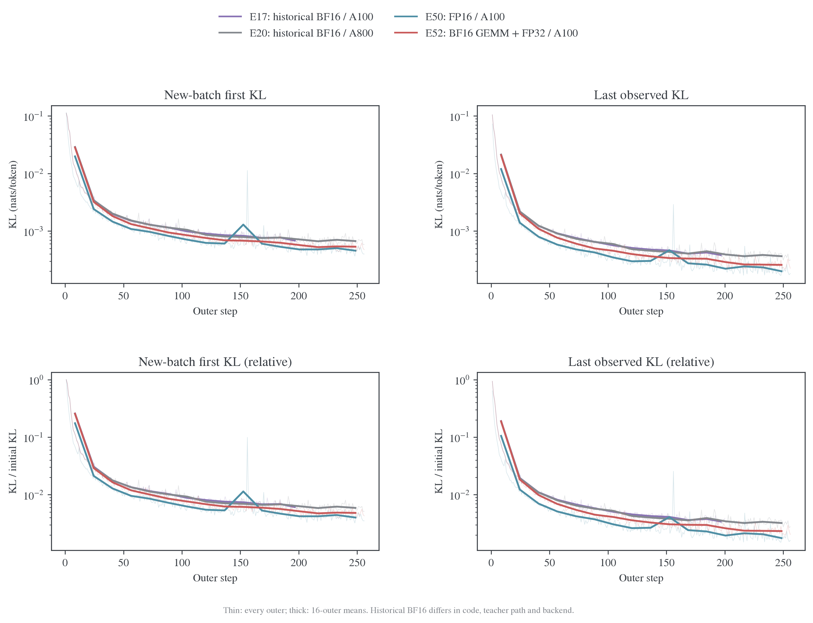
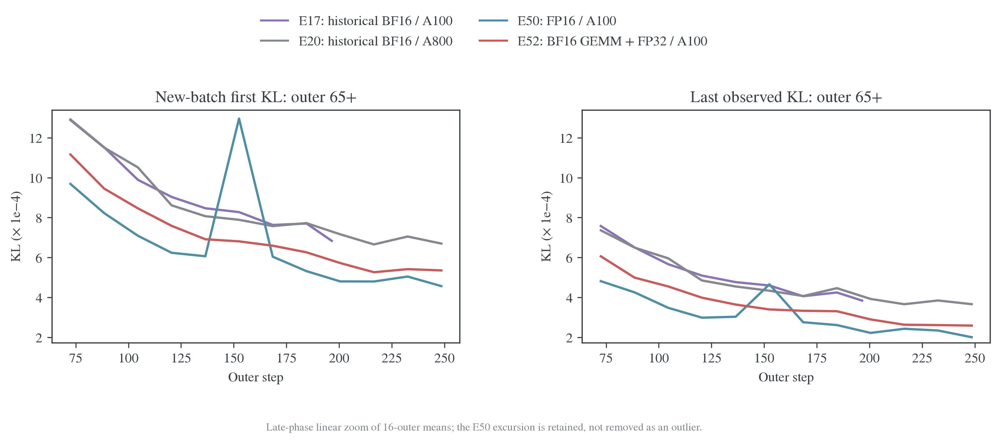
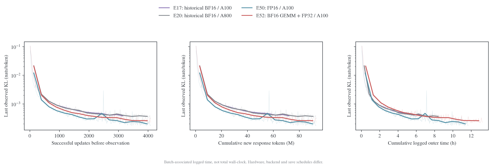

# BF16 基线与普通 Full-KL 的下降速度

## 结论与比较问题

已有 BF16 baseline。最接近 E50/E52 更新预算的是 **E20，256 outer、reuse16、4096 次更新**；E17 提供 **同为 A100、200 outer** 的补充参照。两组都正常结束，全部已记录批次首末 KL 净下降。不能把“没有同版本完整三方精度对照”误写成“没有 BF16 baseline”。

现有曲线支持：BF16 足以取得明显学习进展，整体 KL 从约 0.11 降到几乘 $10^{-4}$；FP16 E50 按相同 outer/更新预算通常下降更快、末段残差更低；混合精度 E52 多处介于其间。这个差距不是训练成败的区别，也不能视作可以忽略的纯显示误差。由于历史 BF16 与新运行还改变了 backend、数值实现和教师加载路径，下面是实际运行轨迹比较，不是纯 dtype 因果效应估计。

## 找到的 baseline 与实际配置

共同条件是 DeepSeek-R1-Distill-Qwen-1.5B 学生、JustRL-DeepSeek-1.5B 教师、DAPO、batch64、每题一条训练 response、reuse16、AdamW、LR=$10^{-6}$、betas=(.9,.999)、weight decay=.01、clip=1、constant schedule、seed42、训练 cap7168。E17/E20 使用直接 `full_reverse_kl`；E50/E52 使用数学等价的 η=1 endpoint，均无 anchor 惩罚。

| 运行 | ID         | 执行精度                 | outer / 成功更新 | Backend / token chunk  | GPU / CPU              | 记录的 commit |
| ---- | ---------- | ------------------------ | ---------------: | ---------------------- | ---------------------- | ------------- |
| E17  | `cix5i2x2` | 历史 BF16                |       200 / 3200 | precompute / 512       | 8×A100-SXM4-80GB / 128 | `df93f4d`     |
| E20  | `lwgb5eex` | 历史 BF16                |       256 / 4096 | precompute / 512       | 8×A800-SXM4-80GB / 128 | `376e818`     |
| E50  | `rsi5krqd` | FP16＋GradScaler         |       256 / 4091 | precompute_fused / 128 | 8×A100-SXM4-80GB / 128 | `222e9db`     |
| E52  | `7rwc1ioz` | BF16 GEMM／FP32 中间表示 |       256 / 4096 | precompute_fused / 128 | 8×A100-SXM4-80GB / 128 | `222e9db`     |

历史配置的 `model_dtype=fp32` 表示 master 参数，不代表前向采用完整 FP32；旧 `forward_precision` 字段为空，执行沿用 BF16 混合路径。其他已收到的 BF16 Full-KL 运行还有 E13/E14、E16、E18/E19、E35，但它们的 reuse、LR 或 cap 不同，不作为本图的主对照。本机当前已解码日志及收到的运行日志中未找到 E44 完整正式 run。

教师 checkpoint 名称相同不保证实际监督输出完全相同：这些历史运行跨过 RoPE/buffer 保真与稳定 KL/VJP 等修复。E17 与 E50/E52 的 GPU 型号相同，仍没有控制代码、backend 和 teacher 执行路径。配置差异保存在冻结数据 `config-differences.json`，没有把当前默认设置回填到旧运行。

E17/E20 的验证频率为 20/32 outer，保存频率为 100/64；E50/E52 均每 32 outer 验证、每 128 outer 保存。因此，时间图也不能当作严格的纯精度或硬件吞吐基准。

## 整体下降曲线



左列为每批第一次 teacher KL，右列为每批第 16 次观测；每批两个点之间跨 15 次更新尝试，不是第 16 次实际更新后的额外评分。细线保留全部 outer，粗线为不重叠的 16-outer 均值；E17 最后一个窗口只有 8 批，不补到 256 轮。纵轴为对数，下排再除以各 run 第一个训练前向的 KL。初始 KL 约为 E17 .11192、E20 .11352、E50 .11369、E52 .11088。

三点值得区分：

1. E17/E20 两条 BF16 曲线非常接近，均持续取得进展；这不是独立多 seed 估计，因为两组 seed 相同。
2. FP16 E50 从前期就显示更低的同预算 KL，后期差异在下面的线性放大图中更清楚。归一化没有消除这种排序，但也不能消除 teacher 版本差异。
3. E52 的混合模式没有全面超过 FP16。名字包含 FP32，不代表它的所有计算都比 FP16 更细；它仍使用 BF16 GEMM 操作数。



E50 约 outer156 的峰值保留在图中，没有按“异常值”删除。它与非有限梯度/跳步相邻，下一批又恢复；相关逐步图见 [KL 全程图册](2026-10-29-KL轨迹与κ选择分析.md)。新批首次 KL 测量各自当前 rollout 的前缀，不能当成固定 held-out 风险；跨批变化不直接等于同一输入上的优化反弹。

| 窗口         | E17 BF16：首次 / 末次 | E20 BF16：首次 / 末次 | E50 FP16：首次 / 末次 | E52 混合：首次 / 末次 |
| ------------ | --------------------- | --------------------- | --------------------- | --------------------- |
| outer65–96   | 1.222e-3 / 7.040e-4   | 1.219e-3 / 6.928e-4   | 8.954e-4 / 4.532e-4   | 1.030e-3 / 5.524e-4   |
| outer169–200 | 7.459e-4 / 4.060e-4   | 7.425e-4 / 4.147e-4   | 5.474e-4 / 2.621e-4   | 6.248e-4 / 3.243e-4   |
| outer225–256 | 未记录                | 6.873e-4 / 3.752e-4   | 4.804e-4 / 2.172e-4   | 5.383e-4 / 2.600e-4   |

末段 E50/E52 的批末 KL 相对 E20 分别低约 42%/31%。这不是“下降速度快 42%/31%”，而是固定窗口的残差比例；不能进一步将全部比例归给 dtype。E17/E20 在共同后期窗口接近，也不能用两次同 seed 运行充当统计显著性证据。

## 按更新、生成 token 与记录时间看速度



左图按该次前向之前已成功执行的更新计数，排除跳步，并避免把第 16 次更新前的观测标到第 16 次更新之后。中图按累计新 response token；这里不把同一条 response 的 16 次 reuse 算成 16 份新数据。右图把该批 KL 与累计 `perf/timing/outer_step_seconds` 关联，不将其当作精确的 loss 时间戳或包含所有初始化、等待和验证的完整进程墙钟。

| 运行 | 可用 outer | 新 response token（百万） | 记录 outer 时间（小时） | Actor 阶段累计时间（小时） | 记录 actor 峰值（GiB） |
| ---- | ---------: | ------------------------: | ----------------------: | -------------------------: | ---------------------: |
| E17  |        200 |                    73.175 |                   6.791 |                      4.611 |                  10.21 |
| E20  |        256 |                    93.368 |                   8.653 |                      5.858 |                  10.20 |
| E50  |        256 |                    92.983 |                  11.690 |                      8.894 |                  10.24 |
| E52  |        256 |                    93.134 |                  13.230 |                     10.434 |                  14.96 |

按 outer、成功更新或生成 token 比较，FP16 的下降优势较明显；换成记录时间，旧 BF16 的每批成本更低，差距缩小，混合模式的成本尤其需要一起考虑。不能从“同样更新数下更低”直接推导“同样时间下有同等幅度的优势”。这里的时间差包含历史代码、kernel/chunk、硬件、保存频率和在线轨迹差异，不能把 E20→E50 的耗时增加直接解释为 FP16 算术慢。

## 精度差一点是否可以暂时不管

对“训练能否取得大幅进展”，现有 BF16 baseline 给出了肯定答案；没有必要把它描述成无法训练。四组所有已记录批次的首次到末次 KL 都下降：E17 为 200/200，其余为 256/256。

| 运行 | 第一观测→第二观测上升批数 | 相邻 inner 观测上升 / 总对数 | 跳步 / 更新尝试 |
| ---- | ------------------------: | ---------------------------: | --------------: |
| E17  |                         0 |                    10 / 3000 |        0 / 3200 |
| E20  |                         2 |                    15 / 3840 |        0 / 4096 |
| E50  |                         0 |                     8 / 3840 |        5 / 4096 |
| E52  |                         1 |                     9 / 3840 |        0 / 4096 |

对“同样预算能拟合多细、后期单步是否稳定”，精度和执行路径仍然有关系，不能把约 42% 的末段残差差异称为没有影响。更早的固定输入精度干预已经确认舍入可削弱真实更新，不能由整段曲线下降反推精度误差不存在。另一方面，当前历史/新运行的差异包含多项修复，不能由本图认定这 42% 就是精度的独立贡献。

对“是否值得付出额外成本”，应看任务效果与时间预算，而不是只看 KL。已有 E50/E52 的完整任务结果没有证明更高成本的混合路径带来稳定准确率优势；这里也没有提供精度对最终能力的独立因果估计。合理做法是把精度固定为清楚的实验条件，再推进 optimizer 比较，而非要求先找到所有场景下最优的精度。

## 后续 optimizer 比较的建议

当前仅复算已有运行，没有启动新的 GPU 训练。已有[大规模计划](../full-rkl/2026-10-27-Full-vocab-OPD优化器大规模实验计划.md)保留完整候选与预算；这里补充与本基线有关的选择。

- **建立同版本 AdamW 对照。** 旧 E20 可作历史参考，不能作为新 optimizer 唯一控制组；否则 teacher、backend、precision 与 optimizer 同时改变。
- **先固定一条精度。** 若问题是实际 BF16 下谁更有效，就统一使用当前已修复的 BF16 路径；若希望减轻近目标精度干扰，可统一 FP16＋GradScaler，并记录实际成功更新及跳步。两种问题都合理，不能在同一排名中混用。
- **区分短程求解与在线学习。** 固定同一前缀、教师输出和模型起点检查 KL 拟合，再用在线 rollout 与独立固定 probe、任务验证看迁移。更低的在线 KL 可能混入访问分布改变。
- **各 optimizer 独立校准 LR，保持相同搜索机会。** AdamW、AdamW β1=0、无动量 SGD、Muon＋辅助 AdamW 不能机械共用一个 LR；冷启动/恢复状态、weight decay、clipping 与参数组要明确。已有短程实验中，同参数 L2 步幅下函数空间漂移相差很大，不能用参数范数匹配替代公平预算。
- **同时报告更新、生成和时间三条轴。** 主读数至少包括固定 probe KL、任务 mean/pass、非有限梯度及跳步、记录时间和峰值内存。按相同成功更新比较，同时保存尝试次数；不能把失败更新的计算成本丢掉。

因此，可以继续做 optimizer 对比，不必先把精度问题全部解决。当前最重要的是把它控制住，使后续差异能够归到 optimizer，而不是混入另一套数值与执行路径。

## 证据与复算

原始 run ID、输入 SHA-256、配置差异、逐 outer 数据和绘图聚合保存在日志仓库 `MirrorOPD-verl/analysis/bf16-convergence-20261029/`。其中 `outer.csv` 为逐批观测，`blocks.csv` 为实际绘图的窗口均值，`windows.csv` 为正文固定窗口统计；归一化分母和硬件信息保存在 `summary.json`。

可编辑[脚本](../../../../../research/studies/production_precision/bf16_convergence.py)不加载模型。PNG 与同名 PDF 位于[图目录](figures/bf16-convergence-20261029/)，审计与绘图输入摘要随图保存。

```bash
python -m examples.mirroropd.research.studies.production_precision.bf16_convergence \
  --logs-repo ../wandb-logs \
  --out ../wandb-logs/MirrorOPD-verl/analysis/bf16-convergence-20261029 \
  --figures examples/mirroropd/docs/experiments/teacher-transfer/optimizer-precision/production/figures/bf16-convergence-20261029 \
  --style ~/.agents/skills/figure-viz/assets/mpl
```

脚本核对完整退出、解码新鲜度、连续 outer、每批 16 条观测，以及成功更新计数与日志 optimizer counter 的一致性。原始日志保持不变，缺少的 E17 后期点不外推。
