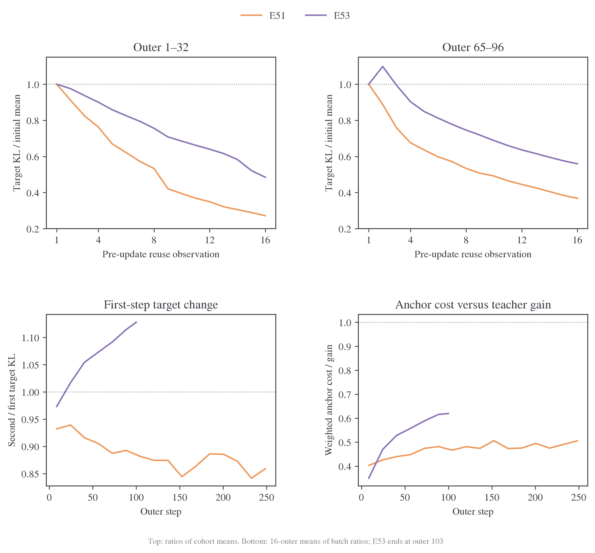
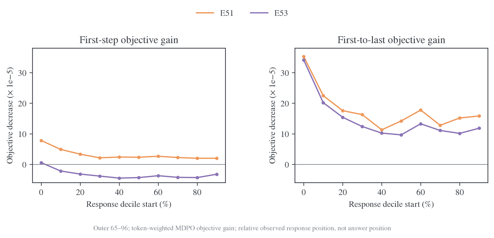
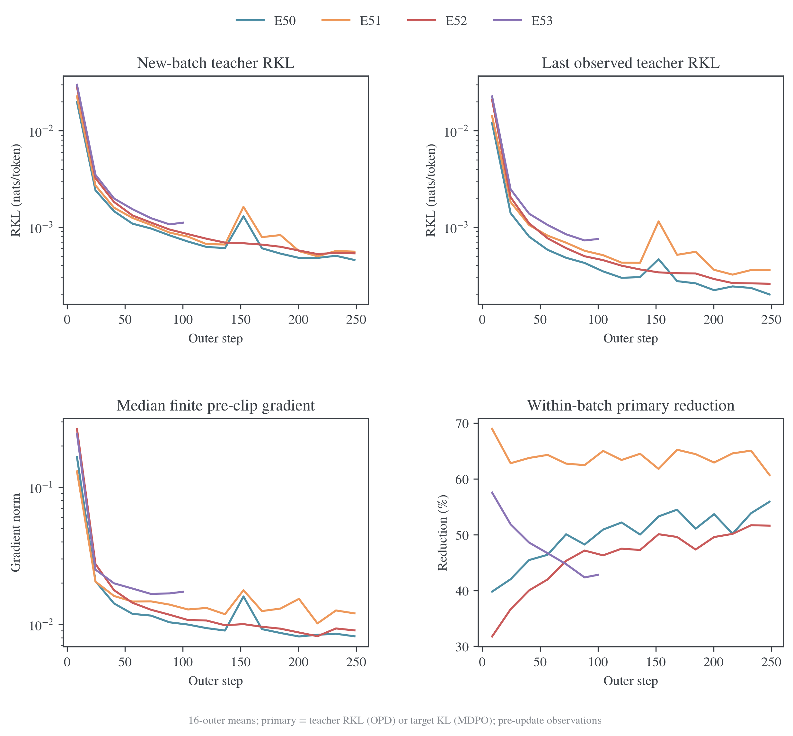
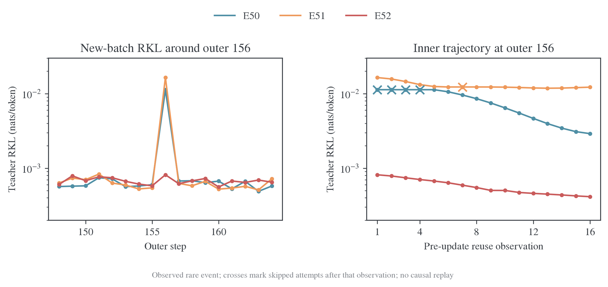
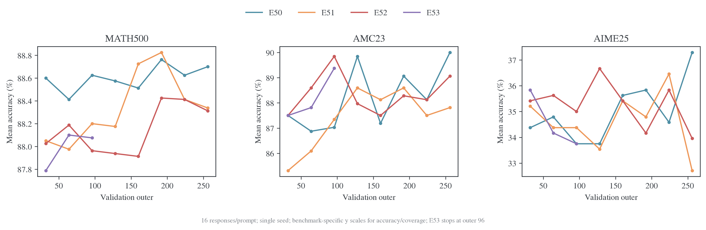
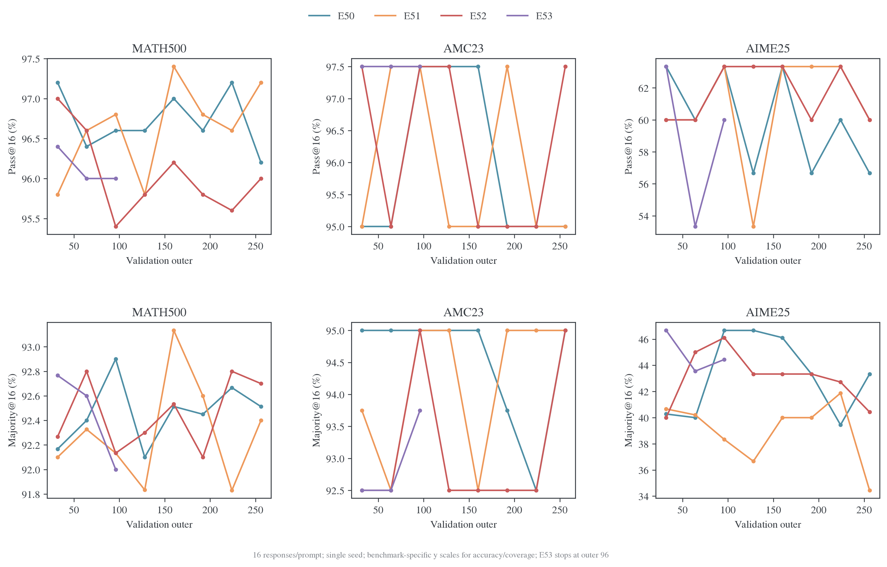
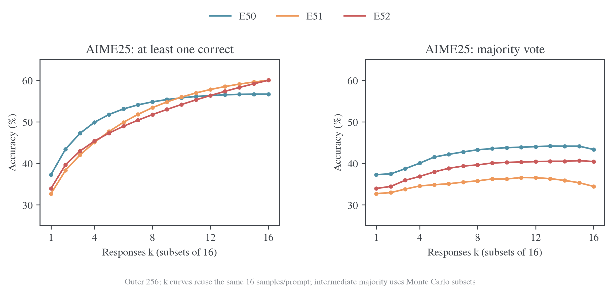
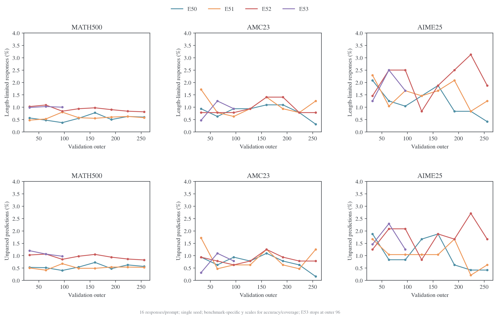
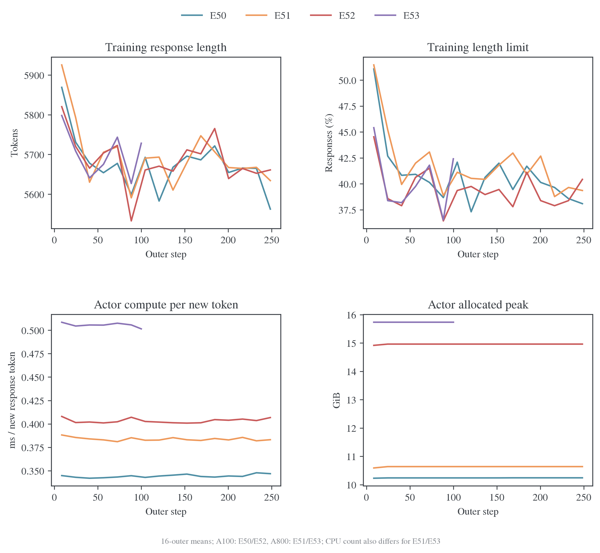

# E50–E53：完整终点、混合精度与近目标求解

## 背景与问题

[E50/E51 的冻结分析](2026-10-28-E50E51近目标求解与精度验证.md)确认 FP16 路径基本消除了旧 MDPO 的整批目标反弹，但当时 E51 只有 outer253 的训练与 outer224 的验证。日志仓库 `31775eb` 补齐 E51，并新增 E52 的完整训练和 E53 的前期快照。本报告据此区分三个问题：完整 E51 是否支持 MDPO 的任务优势；BF16 GEMM 加 FP32 中间表示能否保持普通 OPD 的优化；MDPO 的第一步反弹是否意味着整个内层没有被有效求解。

数据支持的判断是：E51 在 255/256 批取得内层净下降，最终 mean acc 没有超过 E50，但候选覆盖与多数票指标呈现不同方向的变化；E52 普通 OPD 的 256 批均净下降，混合精度没有带来一致的任务收益；E53 已有 103/103 批净下降，尽管 88 批第一步上升，不能据此把它归为整批求解失败。E53 没有后期证据，尚不能评价其 256 批终点。

## 实际设置与证据边界

四组均为 DeepSeek-R1-Distill-Qwen-1.5B 学生、JustRL-DeepSeek-1.5B 教师，DAPO、batch64、reuse16、AdamW、LR1e-6、seed42。训练 response cap7168，验证 cap31744；每 32 outer 验证 MATH-500、AMC23、AIME25，每题 16 答，T0.7、top-p0.9，无初始验证。Backend 为 `precompute_fused`，token chunk128、vocab chunk8192，κ=0、终止 token 覆盖为空。

| 实验 / run       | 目标        | Actor/anchor 精度 | 可用训练 / 验证 outer | 成功更新 / 跳步 | 退出证据                     |
| ---------------- | ----------- | ----------------- | --------------------: | --------------: | ---------------------------- |
| E50 / `rsi5krqd` | OPD，η=1    | FP16              |             256 / 256 |        4091 / 5 | exit=0                       |
| E51 / `6vv5o9b8` | MDPO，η=0.3 | FP16              |             256 / 256 |        4091 / 5 | exit=0                       |
| E52 / `7rwc1ioz` | OPD，η=1    | `bf16_fp32`       |             256 / 256 |        4096 / 0 | exit=0                       |
| E53 / `k7db6qxl` | MDPO，η=0.3 | `bf16_fp32`       |              103 / 96 |        1648 / 0 | partial_snapshot，无退出记录 |

配置逐项比较后，除实验名和输出路径外，四组记录的差异只有 `forward_precision` 和 η；记录的 Git commit 均为 `222e9db`。这不能证明启动时没有未提交代码差异。精度和目标改变后，各组使用自己的在线学生轨迹，因此这里是配方级结果，不是固定同一批状态的精度因果重放。

`bf16_fp32` 的主干 Linear 使用 BF16 操作数和 FP32 输出；embedding、残差、norm、gating、head 保留 FP32，attention 及部分反向计算仍为低精度，不能简称完整 FP32。定义见[精度入口](../../../../infra/numerics/precision/2026-10-27-共享训练精度与实验入口.md)。E50/E52 为八张 A100-SXM4-80GB、128 CPU；E51/E53 为八张 A800-SXM4-80GB，但记录的 CPU 数分别为 64、128。效率比较保留这些差异。

## 指标覆盖与统计口径

四组分别记录了 2272、2277、2271、2275 个不同 history 键。键数不能当作独立证据数：大量字段是同一评测量的不同 k、bootstrap 区间或别名。此次逐项盘点保存在 `diagnostics/inventory.csv`；正文按问题选择指标，而不是把所有键机械画一遍。

| 指标组       | 实际利用的观测                                                                   | 能回答的问题与边界                                                     |
| ------------ | -------------------------------------------------------------------------------- | ---------------------------------------------------------------------- |
| 优化与目标   | teacher/target/anchor KL、objective、log Z、16 次内层轨迹                        | 固定批净进展与 anchor 代价；不能替代未见状态风险                       |
| 位置         | objective/full-KL 的十个响应位置分桶 sum/count                                   | 反弹是否集中在少数位置；相对位置不等于答案阶段                         |
| 数值与执行   | pre-clip gradient、update_applied/skipped、空 loss mask、staleness               | 非有限梯度、跳步和明显的数据执行异常；没有 Adam 内部状态或实际参数位移 |
| 任务与采样   | mean、pass@1…16、majority@1…16、all_correct@16、within_prompt_std                | 单次正确率、候选覆盖、多数票与同题一致性；不同 k 来自同一批 16 答      |
| 生成与完整性 | response length、length stop、prediction missing、failed/nonfinite/missing score | 生成是否完成、答案是否能解析、评测是否漏样本                           |
| 成本         | 新 response token、actor/outer 时间、allocated peak                              | 已记录成本与生成预算；跨主机差异保留                                   |

81 个数据集评测事件均有完整的每题 16 答：materialized 数与 response 数一致，failed、nonfinite score、missing accuracy 均为 0，prediction/score 冲突比例也为 0。`score/mean`、`reward/mean` 与 `acc/mean` 逐事件完全相等，不能当作三项相互印证的任务结果。答案解析缺失与分数缺失不同：前者仍计入正常评测分母。训练配置的 `use_task_rewards=false`，因此 `rollout/score` 是变化中的在线批诊断，不是直接加入 loss 的任务奖励，也不与固定验证准确率混排。

四组已记录的空 loss mask 比例及 trajectory staleness 最大值均为 0。位置分桶的 sum/count 重建全局 objective/Full-KL 的最大误差不超过 `1.18e-8`，同批 16 次观测的位置 token count 没有变化。E51/E53 的 target 恒等式

$$
D_{\mathrm{KL}}(p\Vert m)=0.3D_{\mathrm{KL}}(p\Vert T)+0.7D_{\mathrm{KL}}(p\Vert q)+\log Z
$$

最大绝对残差分别为 `1.70e-9`、`2.30e-9`。这些检查支持指标分解与统计口径一致，不替代逐参数梯度正确性证明或完整目标分布哈希检查。本次四组 history 输入没有独立的 held-out KL、完整师生 JS/TV/entropy、逐题预测文本和最后一次更新后的额外 target 评分，相应问题不能从缺失字段推断。

图中颜色始终表示同一个 run。训练动态使用不重叠的 16-outer 窗口，横坐标为窗口平均 outer；E53 最后一个窗口只有 outer97–103。验证图只连接实际 checkpoint，不补后期点。不同难度基准的 accuracy/coverage 分别设置纵轴范围；这种缩放不能用来比较跨任务的变化幅度。

## 内层求解：净下降与第一步反弹分开看

指标在更新前记录。每批首次至第 16 次观测跨越 15 次更新尝试，不是最后一次更新后的额外评分。普通 OPD 检查 teacher RKL；MDPO 检查固定融合目标的 target KL。上升判据采用绝对容差 `1e-10`。

| 实验 | 完整批数 | 首次→第二次上升 | 首次→第 16 次变差 | 相邻观测上升 / 总对数 |
| ---- | -------: | --------------: | ----------------: | --------------------: |
| E50  |      256 |               0 |                 0 |              8 / 3840 |
| E51  |      256 |               3 |                 1 |            107 / 3840 |
| E52  |      256 |               1 |                 0 |              9 / 3840 |
| E53  |      103 |              88 |                 0 |             93 / 1545 |

E51 新补齐的三批没有出现整批净退步，旧报告的 252/253 更新为 255/256；唯一变差仍是 outer155。该批 target KL 从 `4.7492e-5` 到 `5.1395e-5`，并伴随三次跳步，日志不足以区分跳步与其他优化状态的各自作用。E52 没有跳步且 256 批全部净下降，普通 OPD 路径未出现系统性反弹。

共同前 96 批中，E51 的第一步反弹为 0/96，E53 为 81/96；两组均为 96/96 批净下降。前期大 KL 批次会主导跨批均值，故再看 outer65–96：

| MDPO，outer65–96 | 首次 target KL 均值 |    第二次 |  第 16 次 | 首末降幅 | 第一步上升批数 |
| ---------------- | ------------------: | --------: | --------: | -------: | -------------: |
| E51，FP16        |           8.4492e-5 | 7.5019e-5 | 3.1101e-5 |   63.19% |         0 / 32 |
| E53，`bf16_fp32` |           1.0073e-4 | 1.1064e-4 | 5.6354e-5 |   44.05% |        32 / 32 |

E53 此窗口第一步均值上升约 9.84%，后续更新仍能把目标降到起点以下。它的近目标轨迹与 FP16 明显不同，但不复现旧 E45 后期整批返回更差点的现象。上升频率不能替代净收益判据，最后 16 次实际更新后的状态仍缺直接观测。

对 κ=0、η=0.3，令 $q$ 为冻结旧策略、$T$ 为教师、$m\propto q^{0.7}T^{0.3}$，则

$$
J(p)=D_{\mathrm{KL}}(p\Vert T)+\frac73D_{\mathrm{KL}}(p\Vert q)
=\frac{D_{\mathrm{KL}}(p\Vert m)-\log Z}{0.3}.
$$

outer65–96 中，E51 的 teacher 收益为 `3.3732e-4`、加权 anchor 成本为 `1.5935e-4`，成本占收益 47.24%；E53 分别为 `3.6798e-4`、`2.2006e-4`，占比 59.80%。两者仍有正净收益，E53 在自己的轨迹上付出了更高比例的 anchor 成本。两组同批 `log_z` 漂移均为 0；目标分解的最大绝对残差分别为 `1.07e-8`、`1.74e-8`，不足以解释上述 `1e-4` 量级的变化。已有日志支持继续定位近目标实际步幅，尚不足以把全部差异归给单个算子或 dtype。



图上排先对同一窗口的原始 target KL 求均值，再除以首次均值；下排先计算每批比例，再做 16-outer 平均。两种统计不能混成一个百分比。E53 的第一次上升恰好覆盖 outer16–103 的连续 88 批，提示它随训练进入近目标区域后成为系统性现象，而不是几次孤立跳步；已有日志只支持这种时序关联，未证明具体浮点算子就是原因。

### 位置分解：E53 的第一步反弹覆盖大部分响应



图取 outer65–96，同一位置先跨批累计 objective sum 和 token count 再求均值，绘制首次减去第二次/第 16 次的目标值；正值表示下降。E51 第一步在全部十个分桶均改善；E53 只有 0–10% 分桶改善，其余九桶均变差，其中 40–50% 的目标增加约 `4.51e-5`。到第 16 次观测，两者全部十桶都取得净下降。因而 E53 的全局反弹不能解释成只由少量末尾 token 拉高；后续净下降也不是只来自开头一桶。

这里记录的是 MDPO objective J，而不是每桶 target KL 本身；不能用 J 的绝对值当作 target 距离。十等分依据实际观察到的 response 长度，训练回答常被 cap 截断，因此 90–100% 桶也不等于完整推理的答案阶段。定义与归一化见[位置统计](../../../../../../../verl/utils/metric/position.py)及[loss 汇总](../../../../../../../verl/trainer/distillation/losses.py)。

### 训练动态、梯度与跳步



新批首次 teacher RKL 从 outer65–96 到 outer225–256，E50/E51/E52 分别由 `8.954e-4/9.665e-4/1.030e-3` 降至 `4.804e-4/5.616e-4/5.383e-4`。局部拟合以外，新访问状态的平均 teacher 差异仍在降低；但状态也随策略改变，不能据此单独分离参数泛化与访问分布变化。右下角 OPD 与 MDPO 的 primary reduction 对应不同目标，只用于看各自阶段变化，不用于按降幅排名算法。

E50/E51 在完整 4096 次尝试中各跳过 5 次，即约 0.12%；E52 为 0/4096，E53 为 0/1648。E50 跳步位于 outer156 的第 1–4 次及 outer227 的第 1 次；E51 位于 outer155 的第 3–5 次、outer156 的第 7 次及 outer245 的第 6 次。非有限梯度事件缺少普通的 `grad_norm_preclip` 数值，曲线只汇总有限值，跳步另外计数，没有把缺值补为零。四组的 `loss_nonfinite` 计数均为 0，但 E50/E51 的非有限梯度标记各为 5，恰好对应跳步次数；只监控 loss 是否出现 NaN/Inf 会漏掉这些数值事件。

outer65–96 的有限梯度中位数，E51 为 0.01395、E53 为 0.01633，两者均无大于 1 的观测，也没有跳步。E53 这段 32/32 批第一步反弹仍然存在，因而非有限梯度跳步不足以解释其系统性反弹。这个对照没有记录 Adam 动量、实际参数位移或 clipping 后梯度，不能据此进一步认定 optimizer 历史、学习率或特定算子的各自贡献。

### outer156 的罕见数值事件



训练动态图中约 outer150 的峰值需要回到逐批记录，不能当作平滑后的正常趋势。E50 和 E51 在 outer32 之后最高的新批 teacher RKL 都出现在 outer156；图右的叉号标出该次观测之后被跳过的更新尝试。

| 实验 | outer155 首次 RKL | outer156 首次 / 第 16 次 RKL | outer156 跳步 | outer157 首次 RKL |
| ---- | ----------------: | ---------------------------: | ------------: | ----------------: |
| E50  |          6.002e-4 |          1.130e-2 / 2.905e-3 |             4 |          6.729e-4 |
| E51  |          5.446e-4 |          1.644e-2 / 1.221e-2 |             1 |          6.250e-4 |
| E52  |          5.798e-4 |          8.153e-4 / 4.145e-4 |             0 |          6.198e-4 |

两条 FP16 运行下一批的首次 RKL 又回到约 `6e-4`，不呈现持续全局发散；E52 在相同 outer 没有同量级尖峰。这是 `bf16_fp32` 的一项正面数值执行观测，与其完整运行没有跳步一致，应与任务和成本结果一起保留。E51 的 outer155 目标净退步和三次跳步发生在它之前，日志不能确定两者的因果顺序或共同原因。

此窗口由已观察到的峰值选出，是探索性定位，不是预先规定的独立检验。四组虽有相同数据 seed，各自 rollout 不同；尚缺相同输入、teacher 缓存与 optimizer 状态的重放，不能认定纯 dtype 已被证明是唯一原因，也不能把这一个事件外推为 FP16 必然不稳定。E51 另有 outer167、183 的新批 RKL 局部峰值，逐批 CSV 保留全部记录。

普通 OPD 的末段 outer225–256 中，E50 的 teacher RKL 为 `4.8044e-4→2.1720e-4`，降幅 54.79%；E52 为 `5.3829e-4→2.5997e-4`，降幅 51.70%。两者仍能优化，E52 的残差更高；这些是各自变化中的 rollout 状态，不能把两个绝对值直接解释为固定留出风险或不可约误差。

## 任务结果：完整终点没有建立 MDPO 优势

下表为每题 16 答的平均正确率，单位为百分数，不是 pass@16。前 96 批的三个共同 checkpoint 为 32、64、96；完整终点只列已结束的三组。

| 实验 | 验证 outer | MATH-500 | AMC23 | AIME25 |
| ---- | ---------: | -------: | ----: | -----: |
| E50  |         96 |    88.63 | 87.03 |  33.75 |
| E51  |         96 |    88.20 | 87.34 |  34.38 |
| E52  |         96 |    87.96 | 89.84 |  35.00 |
| E53  |         96 |    88.08 | 89.38 |  33.75 |
| E50  |        256 |    88.70 | 90.00 |  37.29 |
| E51  |        256 |    88.34 | 87.81 |  32.71 |
| E52  |        256 |    88.31 | 89.06 |  33.96 |



E51−E50 的最终差值依次为 −0.36、−2.19、−4.58 个百分点；8 个共同 checkpoint 的平均差值依次为 −0.26、−0.78、−0.39。新终点把旧七点统计中 AIME25 的微弱正均差改为负值，说明“MDPO 已取得稳定任务优势”没有得到这次完整训练支持。这个结果不否定 255/256 批的目标净下降：数值求解有效与任务准确率受益是两个不同结论。

E52−E50 最终差值为 −0.39、−0.94、−3.33 个百分点，但 8 个共同 checkpoint 的平均差值为 −0.45、+0.16、+0.26。MATH-500 八点均低于 E50，AMC23/AIME25 的排序随 checkpoint 变化，不能只用最后一点宣称混合精度在所有阶段更差，也没有证据支持它带来一致收益。

E53 在三个共同 checkpoint 相对 E51 的均差为 MATH-500 −0.09、AMC23 +1.98、AIME25 −0.07 个百分点；相对同精度普通 OPD E52 为 −0.07、−0.42、−0.76。前期 AMC23 的改善没有形成跨任务一致优势，更不能外推到尚未观察到的后期。

所有比较都是单训练 seed。MATH-500、AMC23、AIME25 分别只有 500、40、30 题；E50/E51 最终 AIME25 的单 run 题目 bootstrap 区间分别约为 [21.54%,52.76%]、[16.41%,48.05%]。这些不是差值的配对置信区间，也不是 seed 方差。checkpoint 均差只描述曲线，不能把同一 run 的八个点当八个独立实验。逐数据集完整 CI、pass@16、majority@16 保留在[验证汇总](../../../验证结果汇总.md)及冻结 CSV。

### 候选覆盖与多数票：mean 较低不等于所有采样指标较低



| outer256、AIME25 |   Mean | Pass@16 | Majority@16 | All-correct@16 | 已覆盖题数 / 30 | 正确回答数 / 480 |
| ---------------- | -----: | ------: | ----------: | -------------: | --------------: | ---------------: |
| E50              | 37.29% |  56.67% |      43.33% |         20.00% |              17 |              179 |
| E51              | 32.71% |  60.00% |      34.44% |         20.00% |              18 |              157 |
| E52              | 33.96% |  60.00% |      40.43% |         16.67% |              18 |              163 |

E51 比 E50 多覆盖一题，但正确回答总数少 22 个。每个“至少有一答正确”的题目，平均正确回答数从 `179/17=10.53` 降到 `157/18=8.72`；两者 16 答全对的题数均为 6。这是候选覆盖与正确答案概率集中程度的不同切面，不支持把 E51 简化为所有任务指标全面退步，也不支持称其更容易通过多数票得到正确答案。本次日志输入没有逐题配对文本，无法判断哪道新题被覆盖、哪些旧题正确率下降，或错误推理类型是否变化。



AIME25 的 E51−E50 pass@k 在 k=1–9 均为负，k=10 才转正，k=16 为 +3.33 个百分点；majority@16 反而低 8.89 个百分点。故这组有限样本支持“较大候选集的覆盖稍高、小预算和多数票利用较弱”，没有建立一致的采样效率优势。pass@k 按同一组 16 答的组合公式计算，不是重新采样的 16 次实验；中间 k 的多数票使用子集 Monte Carlo，k=16 为完整集合并包含并列多数的处理。口径见[评测实现](../../../../../../../verl/utils/metric/evaluation.py)。AIME25 一题就是 3.33 个百分点，单 seed 的一题差异不能据此推广到普遍优势。

### 完成行为不足以单独解释 E51 的终点差距



AIME25 终点 E50/E51/E52 的 length-stop 比例为 0.42%/1.25%/1.88%，预测答案解析缺失为 0.42%/0.63%/1.67%。E51 的 mean 落后 E50 4.58 个百分点，不能只归因于它的 3 条解析缺失回答：即使全部变正确，最多增加 0.625 个百分点。再把 6 条长度截断回答也按互不重叠、全部变正确的最宽松上界加入，总增益仍不超过 `9/480=1.875` 个百分点，尚不足以弥补 4.58 个百分点。这个上界无需假设截断与解析缺失是否实际重叠，但不解释剩余错误的具体原因。

E51 的 AIME25 平均长度由 outer96 的 11073 降到终点 10472 token，mean 却由 34.38% 降到 32.71%；更短回答不自动对应更高正确率。MATH-500 终点的解析缺失在 E51 反而略低于 E50（0.525% 对 0.563%），mean 仍略低。行为指标可以排除简单的“都是漏样本/解析故障”解释，但还不能识别知识迁移或推理策略变化。

## 生成预算与运行成本

共同前 96 批均尝试 1536 次更新，生成 response token 数相近。表中时间为日志中的 actor 更新阶段累计值和 outer 阶段累计值，不包含未记录的排队/初始化开销，不将其视为纯内核基准。

| 实验 | 新 response token（百万） | actor 时间（小时） | outer 时间（小时） | 记录 actor allocated peak（GiB） |
| ---- | ------------------------: | -----------------: | -----------------: | -------------------------------: |
| E50  |                    35.030 |              3.342 |              4.398 |                            10.24 |
| E51  |                    35.189 |              3.759 |              4.791 |                            10.64 |
| E52  |                    34.985 |              3.923 |              4.984 |                            14.96 |
| E53  |                    35.014 |              4.924 |              5.982 |                            15.73 |

E52 相对 E50 的新 token 少 0.13%，actor 时间多 17.38%、outer 时间多 13.32%、记录峰值显存多 46.14%。E53 相对 E51 的新 token 少 0.50%，对应成本多 30.98%、24.86%、47.91%。相近生成量不能解释全部开销差距；当前记录没有显示 `bf16_fp32` 的运行成本优势。但跨主机尤其 E51/E53 的 CPU 配置不同，不能把全部差额直接归给精度算子，也不能用不同 GPU 型号的 E50/E51 排纯算法吞吐。



训练 cap7168 下，outer65–96 的长度停止比例仍为 E50 39.40%、E51 40.97%、E52 38.96%、E53 39.16%；与验证 cap31744 下通常几个百分点以内的截断率不是同一协议。这意味着训练仍大量访问被截断的前缀。位置桶“全部改善”只能说明已访问前缀内的目标下降，不能证明完整答案阶段已被充分监督；当前四组没有改变训练 cap，无法判定提高 cap 是否会改善最终能力。

成本图把 actor 时间除以新 response token，四组 reuse 都为 16；这个明确的新 response token 分母不与其他 time-per-token 字段混用。`bf16_fp32` 的显存和 actor 时间较高，而训练长度及生成量接近，未显示预期的生产成本优势。硬件与 CPU 差异仍阻止把整个墙钟差额单独归给精度算子。

## Motivation 中的问题解决到什么程度

下表回到 [E50/E51 的动机](2026-10-28-E50E51近目标求解与精度验证.md#1-背景与-motivation)、[内层反弹审计](../mechanism/2026-10-26-MDPO内层KL反弹与数值链路审计.md)及[精度机制研究](../mechanism/2026-10-27-MDPO反弹机制与浮点精度研究报告.md)。结论限定于已有运行，不新增训练要求或“完全蒸馏”的评价门槛。

| 原问题                                           | 当前回答                                   | 关键证据与剩余缺口                                                                                                              |
| ------------------------------------------------ | ------------------------------------------ | ------------------------------------------------------------------------------------------------------------------------------- |
| 普通 OPD 在修复路径下能正常优化吗？              | 当前正式运行支持                           | E50/E52 均 256/256 批净下降；FP16 仍有 5 次跳步，不能称数值异常绝迹                                                             |
| 近目标 MDPO 是否真的取得净进展？                 | E51 已基本回答；E53 前期支持               | E51 255/256、E53 103/103 批净下降，teacher 收益覆盖 anchor 成本；缺最后一次实际更新后的独立评分                                 |
| 是否仅是日志目标变动、归一化或少数位置造成表象？ | 明显统计假象得到排查                       | log Z 同批固定、分解残差小、位置 count 恒定、全局重建一致；E53 九桶第一步变差、十桶最终改善；没有完整分布哈希和新增梯度数值验算 |
| BF16+FP32 是否消除了近目标反弹？                 | 没有消除第一步反弹；也没有出现已有整批失败 | E53 outer16–103 连续反弹后全部净下降；不能外推其后期                                                                            |
| 反弹能否直接归因于非有限梯度或单一 dtype？       | 不能                                       | E53 中段没有跳步、有限梯度较小仍反弹；缺相同输入/optimizer 状态的正式轨迹重放及参数位移                                         |
| 正确求解是否带来 MDPO 任务优势？                 | 尚未建立一致优势，现有证据不支持简单肯定   | mean 和多数票较弱，pass@16 有局部一题覆盖收益；缺多 seed、逐题配对和初始验证                                                    |
| `bf16_fp32` 是否提供效果与成本的折中收益？       | 数值执行有正面观测，任务/成本尚无一致优势  | E52 无跳步且 outer156 无同量级尖峰；E52/E53 成本较高、任务排序变化；未建立纯 dtype 因果                                         |
| 是否已解决完整回答覆盖与教师知识吸收？           | 尚未解决                                   | 训练约四成截断，无独立 held-out KL/JS/TV/entropy、同协议教师与初始学生对照；低在线 KL 不等于完整吸收                            |

已有数据最明确解决的是“这些生产配置有没有取得可观测的内层净下降”；它没有同时解决“为什么某精度第一步反弹”“这种镜像约束是否有稳定任务价值”和“是否完整吸收教师”。因此当前结果既不能用第一步反弹否定全部 MDPO 求解，也不能用低 target KL 宣称算法收益已经成立。

## 当前结论与复算

最新证据强化了“先验收内层求解，再评价算法任务收益”的区分。E51 完整终点继续支持生产路径可有效求解 MDPO，但没有建立 η=0.3 的任务优势；E52 普通 OPD 稳定运行，却没有显示一致准确率或成本收益；E53 的第一步反弹应作为近目标轨迹现象保留，而不是直接判为实现失败。当前仍缺 E53 后期与最后一次实际更新后的目标评分，不扩展为更多训练计划。

冻结输入摘要、SHA-256、配置差异和统计在日志仓库的 `MirrorOPD-verl/analysis/e50-e53-20261029/`，分别为 `summary.json`、`config-differences.json`、`cohorts.csv`、`batches.csv`、`evaluations.csv`、`comparisons.csv` 和 `costs.csv`。原始日志及 10 月 28 日冻结统计保留不变；新统计由[复算脚本](../../../../../research/studies/production_precision/precision_comparison.py)生成：

```bash
python -m examples.mirroropd.research.studies.production_precision.precision_comparison \
  --logs-repo ../wandb-logs \
  --out ../wandb-logs/MirrorOPD-verl/analysis/e50-e53-20261029
python -m examples.mirroropd.research.studies.production.refresh_tables \
  --logs-repo ../wandb-logs --skip-decode
```

原主表的降幅统一先跨批求首末均值再计算，比例不与逐批百分比均值混用；新增动态图的逐批比例平均在各图注中单独注明。脚本检查解码新鲜度、每批 16 条更新记录和窗口完整性；E53 只使用已完整解出的记录。

扩展统计位于上述证据目录的 `diagnostics/`：`inventory.csv`、`inner.csv`、`training.csv`、`evaluation.csv`、`sampling.csv`、`positions.csv`、`trajectories.csv` 和 `metric-audit.json`。九幅图的 PNG、同名 PDF、逐系列绘图值 `plotted-data.json` 与审计结果保存在 [图目录](figures/precision-diagnostics-20261029/)。accuracy/coverage 的跨基准纵轴差异是显式设计例外；其他压字、越界、调色板等检查均实际执行。可编辑源码为[指标分析与绘图脚本](../../../../../research/studies/production_precision/precision_diagnostics.py)。

```bash
python -m examples.mirroropd.research.studies.production_precision.precision_diagnostics \
  --logs-repo ../wandb-logs \
  --out ../wandb-logs/MirrorOPD-verl/analysis/e50-e53-20261029/diagnostics \
  --figures examples/mirroropd/docs/experiments/teacher-transfer/optimizer-precision/production/figures/precision-diagnostics-20261029 \
  --figure-skill ~/.agents/skills/figure-viz
```

绘图 Python 环境需要 matplotlib；不改变训练环境。图的窗口平均只用于展示，逐批/逐次原始观测和置信区间保留在 CSV 中，不用平滑曲线制造独立样本或隐藏 E53 尚无后期记录的事实。

位置统计的浮点累计使用 `math.fsum`。Python 3.10 与 3.12 独立复算后，七份 CSV 和 `metric-audit.json` 逐字节一致；图目录记录的源表 SHA-256 均与冻结文件匹配。九幅图均经过实际机器审计与目检。

全部 outer 的未平滑 KL、每批 inner 的完整图册，以及学习率/η/κ 的理论区分见 [KL 轨迹与 κ 选择](2026-10-29-KL轨迹与κ选择分析.md)。
