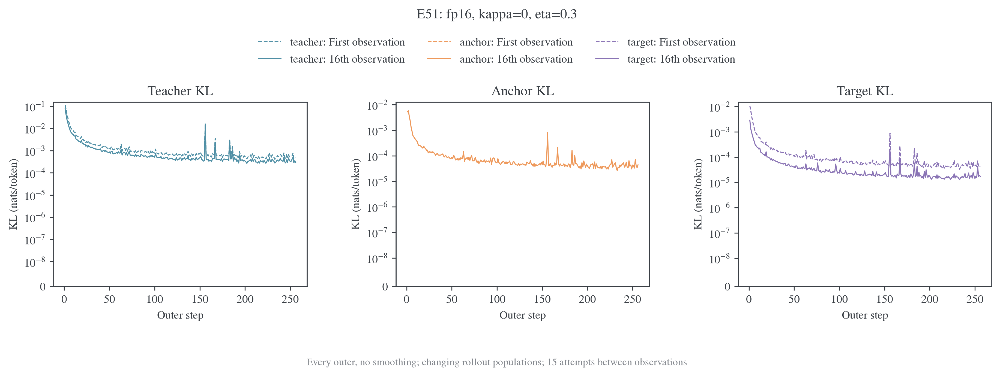
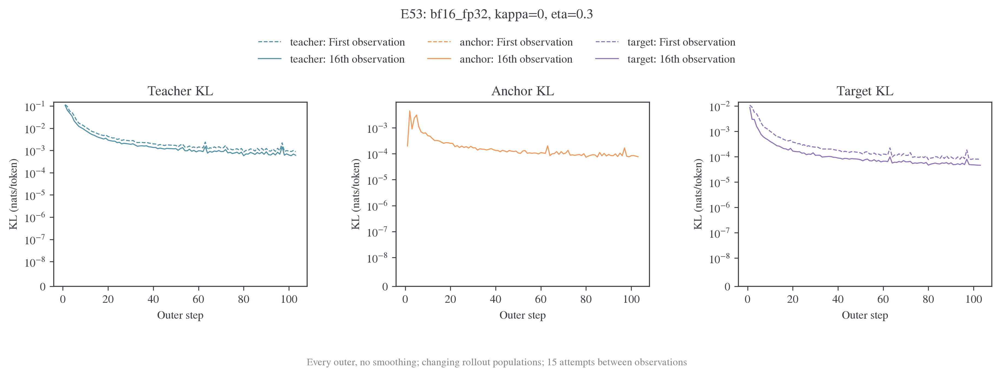
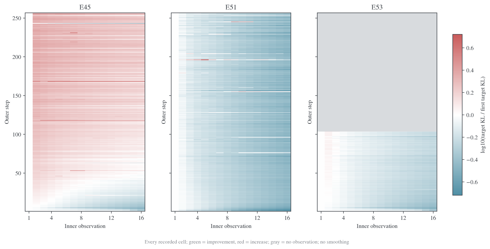
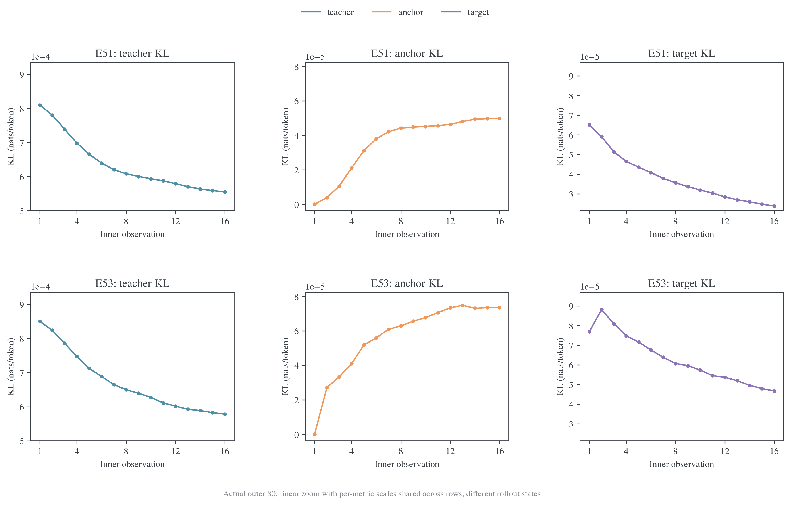
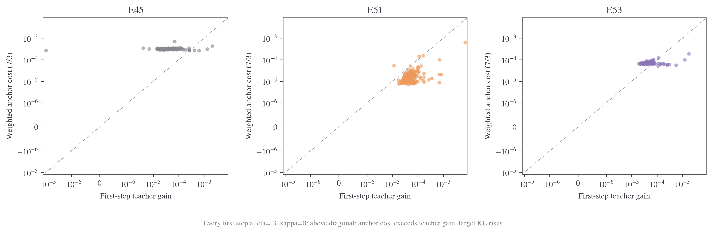
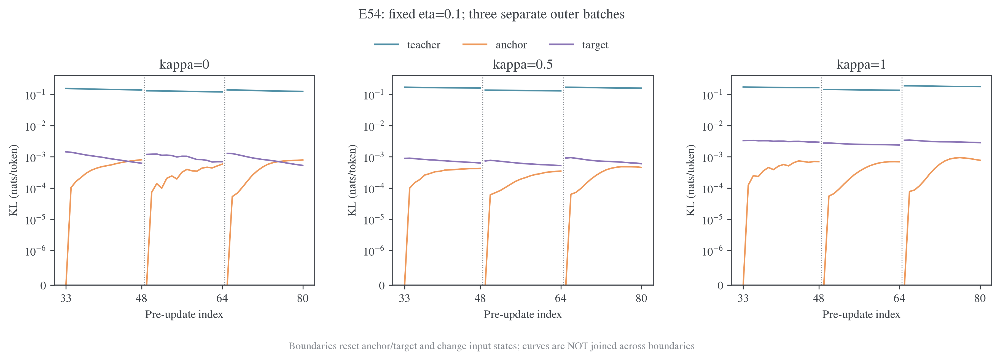

# KL 全程轨迹、精度与 κ 的选择

## 范围与结论

本报告回答三个具体问题：学习率 $10^{-6}$ 是否仍可能让第一步越过近目标；提高执行精度是否值得；固定 η 后，理论和 E54 能否确定更好的 κ。它补充 [E50–E53 指标分析](2026-10-29-E50至E53完整结果与混合精度对照.md)，保留原报告的单 seed、有限预算与硬件边界。

**当前没有证据要求把所有长程训练统一换成完整 FP32。** 已有证据支持保留稳定 KL/VJP、教师 buffer 保真与 FP32 RoPE，并把更高精度用作近目标求解的受控参考。R1/JustRL 的 FP16 路径已明显改善内层求解，但存在非有限梯度；`bf16_fp32` 在已测运行中减少了部分数值异常，同时增加成本，且仍可能第一步反弹。精度、实际步幅和求解预算需要分别判断。

**Anchor 系数确实参与了第一步之后的净成本，但不能单独解释不同精度的差异。** 在相同 η=0.3 下，FP16 E51 的 teacher 收益大于 anchor 成本，混合精度 E53 的第一步则经常相反。系数没有变，实际位移代价变了。另一方面，普通学习率数值小不等于策略空间步长小。

**理论可以说明 κ 改变什么，不能给出对所有状态、任务和有限神经网络求解都最优的 κ。** E54 的现有任务证据支持把 κ=1 当作停止行为的候选；同 η 的正确率比较仍有反转，κ=0.5 扩展组尚缺独立任务评测。不能从较小 target KL 给 κ 排名。

本地输入快照读取于 **2026-10-29 15:32（北京时间）**。E54 十组短程训练均已有 exit=0、每组 48 次新增更新；独立评测汇总仅包含首轮四组。E53 的 R1 长程日志仍只覆盖 outer1–103，不将其补成 256 轮。

## 全部 outer 与每批 inner 的图

所有曲线均为实际记录，不做窗口平滑。颜色在本组图中表示 KL 种类：teacher 为蓝绿色、anchor 为橙色、target 为紫色；outer 概览的虚线为第 1 次观测，实线为第 16 次观测。每批的 16 个点是更新前观测，首末之间跨 15 次更新尝试；没有同批第 16 次实际更新后的独立评分。跨 outer 的起点、输入前缀和 anchor 都会变化。

| 运行                        | 全部 outer 概览                                | 每个 outer 的完整 inner PDF                                     | 可用 outer |
| --------------------------- | ---------------------------------------------- | --------------------------------------------------------------- | ---------: |
| E45，历史 BF16，κ=0、η=.3   | [PNG](figures/kl-kappa-20261029/outer-E45.png) | [图册](figures/kl-kappa-20261029/inner-atlas-E45.pdf)           |        256 |
| E50，FP16，η=1              | [PNG](figures/kl-kappa-20261029/outer-E50.png) | [图册](figures/kl-kappa-20261029/inner-atlas-E50.pdf)           |        256 |
| E51，FP16，κ=0、η=.3        | [PNG](figures/kl-kappa-20261029/outer-E51.png) | [图册](figures/kl-kappa-20261029/inner-atlas-E51.pdf)           |        256 |
| E52，`bf16_fp32`，η=1       | [PNG](figures/kl-kappa-20261029/outer-E52.png) | [图册](figures/kl-kappa-20261029/inner-atlas-E52.pdf)           |        256 |
| E53，`bf16_fp32`，κ=0、η=.3 | [PNG](figures/kl-kappa-20261029/outer-E53.png) | [图册](figures/kl-kappa-20261029/inner-atlas-E53.pdf)           |        103 |
| E54，十组 κ/η 短程分支      | 下文固定 η 对照                                | [全部 30 批图册](figures/kl-kappa-20261029/inner-atlas-E54.pdf) |  每组 3 批 |

六份图册共 145 页、1157 个 outer 面板，覆盖 18512 条内层观测。图册每个面板独立标注尺度，便于查看单批内细节；不能凭不同面板的线段高度比较绝对 KL。E50/E52 没有独立记录 anchor KL，图中留为“未记录”；η=1 的 target KL 与 teacher KL 相同，是理论别名，不伪装成另一项测量。







热图每一行是一批，每一列是一条 inner 观测，数值为 $\log_{10}(K_m^{(i)}/K_m^{(1)})$。绿色表示比本批起点更好，红色表示更差；灰色是没有记录，不能解读为零。E45 历史运行后期常在首步上升后始终没有回到起点以下；E51 大多下降；E53 常先上升再取得净下降。E45 与后两者跨代码时期，这张图不单独承担纯 dtype 因果识别。

为便于看清小幅变化，下图把共同窗口中的实际 outer80 单独用线性坐标展开，每列尺度在两行间共享。完整图册的第 9–12 页对应 outer65–96；E51 的 outer155 异常在第 20 页。这里比较的是相同 outer 编号，不是同一组生成前缀。



## 学习率、η 与 anchor 系数

当前的 $10^{-6}$ 是 optimizer 学习率，下面写作 $\alpha$。MDPO 插值系数写作 η；R1 近目标对照取 η=0.3，anchor 系数为 $\lambda=(1-\eta)/\eta=7/3$，不是 $10^6$。

在 κ=0、同一批固定 $q,T$ 时，定义

$$
K_T=\mathrm{KL}(p\Vert T),\qquad
K_q=\mathrm{KL}(p\Vert q),\qquad
K_m=\mathrm{KL}(p\Vert m),\qquad
m\propto q^{1-\eta}T^\eta.
$$

有精确关系

$$
L=K_T+\lambda K_q,\qquad
\Delta K_m=\eta\Delta K_T+(1-\eta)\Delta K_q.
$$

令本次更新的 teacher 收益为 $G=K_T^{(1)}-K_T^{(2)}$，anchor 成本为 $C=\lambda(K_q^{(2)}-K_q^{(1)})$。则

$$
\Delta K_m=\eta(C-G).
$$

因此，**teacher KL 降低而 target KL 升高，等价于这次 teacher 收益没有覆盖 anchor 成本**。这首先是已发生更新的代数诊断，不是“系数配置错误”的证明。



每点是一批的第一步，横轴为 $G$、纵轴为 $C$；对角线上方表示 target KL 上升。图中三组 η 均为 0.3。共同 outer65–96 的均值为：

| 执行路径         | Teacher 收益 G | 加权 anchor 成本 C | Δtarget KL = .3(C−G) |
| ---------------- | -------------: | -----------------: | -------------------: |
| E45，历史 BF16   |       3.621e-5 |           3.136e-4 |            +8.323e-5 |
| E51，FP16        |       4.960e-5 |           1.802e-5 |            −9.474e-6 |
| E53，`bf16_fp32` |       4.228e-5 |           7.531e-5 |            +9.907e-6 |

E53 的第一步 teacher 收益与 E51 同量级，anchor 成本却约为其 4.18 倍。把“系数太大”作为代数描述有一部分道理：相对于该次实际位移，成本确实超过收益；但三个执行方式使用同一个系数，仍需要解释实际位移为何不同。

在 $G>0,\Delta K_q>0$ 的已经执行步骤上，可定义临界系数 $\lambda_{\rm crit}=G/\Delta K_q$。上述窗口的逐批中位数约为 E45 0.250、E51 8.118、E53 1.220，实际系数是 2.333。它解释同一步在何种加权下会被评价为净下降；它不是推荐的 η，因为改变 η 会改变目标、后续梯度，有限精度也可能改变第一步的实际执行。

### 系数不直接推动理想起点的第一步

理想起点 $p_{\theta_0}=q$ 时，$\nabla K_q(\theta_0)=0$。所以 κ=0 下，保留正确 $1/\eta$ 缩放后，第一步梯度是 teacher RKL 的梯度，与 η 无关。Anchor 代价是在更新产生位移后以二阶量出现的。历史 E45 的起点 anchor KL 存在微小非零值，不能把理想恒等式机械当作它的浮点逐位保证。

令 $g=\nabla K_T(\theta_0)$，$F_q$ 为起点的参数 Fisher，$H_T$ 为 teacher KL Hessian。在平滑模型、固定前缀下，

$$
\Delta L
\approx g^\top\delta\theta
+\frac12\delta\theta^\top(H_T+\lambda F_q)\delta\theta.
$$

若是普通梯度下降 $\delta\theta=-\alpha g$，teacher 的一阶收益为 $\alpha\lVert g\rVert^2$，曲率代价为二阶量。教师附近 $H_T\approx F_q$，总曲率近似 $F_q/\eta$。沿 Fisher 特征值 $\mu_i$ 的局部 inner 因子为

$$
1-\frac{\alpha\mu_i}{\eta},\qquad
0<\alpha<\frac{2\eta}{\mu_{\max}}
$$

是这一局部普通 GD 模型的稳定条件。它说明较强近端约束确实要求相应控制步幅，但没有给出当前 Adam 的数值阈值：日志没有估计预条件后的曲率谱，不能只看 $\alpha=10^{-6}$ 就判定它足够小或太大。

Adam 的方向还含历史矩与自适应预条件，未必是 $-g$；低精度前向又可能破坏上述平滑近似。已有固定更新缩放实验中，一些 BF16 小步仍上升，而同一更新的 FP32 前向可以下降。因此“继续减学习率一定解决”也没有得到保证。局部谱表达及适用条件见[有限拟合理论](../../../../../../../../MirrorOPD/theory/core/sections/06_finite.tex)。

## 提高精度是否必要，以及 loss 会受多大影响

需要区分标量计算精度、模型执行精度和教师保真度。

1. **稳定标量与 VJP 必须保留。** 近零 KL 是二阶小量，直接用近数相减可能丢失值和梯度；已有稳定归约与 target 小增量编码属于已定位问题的修复，不能为了省成本退回旧表达。
2. **更高精度参考有必要，全面升级长程训练尚无充分依据。** 当前 FP16 能有效求解大多数 R1 批次；`bf16_fp32` 的完整 OPD 运行没有跳步，也避免了 outer156 的同量级尖峰，但近目标 MDPO 仍会第一步上升，成本更高。
3. **FP32 loss/head 不等于 FP32 模型。** 主干 Linear 操作数、attention、中间表示和反向的舍入都可能影响真实策略位移；单独把最终 loss 转为 FP32 不能恢复先前丢失的信息。
4. **教师与 RoPE 保真度要独立维护。** 整模型 dtype 转换曾舍入教师 RoPE buffer，改变实际监督分布；切换学生精度不应顺带改写教师缓存的数值语义。

已有固定更新控制中，同一有效权重与同一参数更新，BF16 的策略位移 KL 为 `8.299e-5`，FP32 算术下为 `6.862e-8`，相差约 1209 倍。**这是更新前后策略位移，不是“loss 误差 1209 倍”。** 另一个共同冻结目标的控制中，原 Adam 更新乘 0.1 后，BF16 target KL 从 `6.480e-5` 到 `1.221e-4`，FP32 则从 `1.855e-4` 到 `1.852e-4`。两模式起点不同，体现了执行精度改变策略本身；比较应看各自起点后的变化，不能用两个起始绝对值直接判断高精度更差。证据与限制见[精度机制报告](../mechanism/2026-10-27-MDPO反弹机制与浮点精度研究报告.md)。

FP16 和 `bf16_fp32` 不是严格的精度高低序：FP16 的尾数比 BF16 更细但动态范围更小，后者则在保留 BF16 GEMM 的同时使用更多 FP32 中间表示。应比较具体执行路径，而不是只看配置名。

当前生产日志的 KL 恒等式与位置重建残差约在 `1e-9–1e-8`，观测到的第一步 target 变化约为 `1e-5–1e-4`。所以主要现象不能解释为日志显示的最后几位舍入，应该继续区分模型响应和优化步幅。完整 FP32 更适合作为固定输入/目标/更新的参考；当前没有新跑 GPU 精度实验，也没有用现有成本数据宣称某模式普遍最优。

## 固定 η 后，κ 的理论作用

记 $r=\log(T/q)$。冻结信号及目标为

$$
f_\kappa(r)=\begin{cases}\eta r,&\kappa=0,\\
\kappa^{-1}\log(1-\eta+\eta e^{\kappa r}),&\kappa>0,
\end{cases}
\quad A_\kappa=f_\kappa/\eta,\quad m\propto q e^{f_\kappa}.
$$

κ 改变高维目标方向，不只是把同一梯度乘一个常数。

| κ   | 目标                                      | 对极端负 log-ratio 的信号 | 教师覆盖下界       |
| --- | ----------------------------------------- | ------------------------- | ------------------ |
| 0   | $m\propto q^{1-\eta}T^\eta$               | $A_0=r$，可任意负         | 无分布无关的正系数 |
| 0.5 | $m\propto[(1-\eta)\sqrt q+\eta\sqrt T]^2$ | 下界 $2\log(1-\eta)/\eta$ | $m_a\ge\eta^2T_a$  |
| 1   | $m=(1-\eta)q+\eta T$                      | 下界 $\log(1-\eta)/\eta$  | $m_a\ge\eta T_a$   |

例如固定 η=.1，κ=.5/1 的信号下界分别为 −2.107/−1.054，而 κ=0 没有有限下界。κ=1 同时保留旧策略的 90% 概率质量和教师的 10% 概率质量；它更温和地压制教师极不认可的动作，并提供显式教师覆盖，但也保留了旧策略质量。不能由“覆盖更强”推出它对每个输入都更接近教师。

对小 log-ratio 展开：

$$
f_\kappa(r)=\eta r+\frac{\kappa\eta(1-\eta)}2r^2+O(r^3).
$$

各 κ 在教师附近具有相同的一阶概率收缩，差异主要出现在远离教师的方向、尾部信号与高阶项。因此不能期待改 κ 自动修复近目标的浮点响应。κ=.5 的小步监督方差与 Hellinger 性质有理论依据，但本实验是 full-vocab 求和，已经消除条件动作采样误差，不能把采样方差界直接当成更快优化或更高 acc 的保证。更完整的证明见[形状理论](../../../../theory/mirror-descent/形状与插值目标.md#parameters)。

### 不存在逐实例统一最优 κ：两个精确反例

以下是二动作概率空间的理论例子，非语言模型实验。固定 η=.1，精确构造各形状目标 m，再计算 $\mathrm{KL}(m\Vert T)$：

| q / T                     |      κ=0 |     κ=.5 |      κ=1 | 本例最小值 |
| ------------------------- | -------: | -------: | -------: | ---------- |
| $(.9,.1)$ / $(.1,.9)$     | 1.561852 | 1.530059 | 1.435691 | κ=1        |
| $(.1,.9)$ / $(.999,.001)$ | 4.890898 | 5.298024 | 5.110085 | κ=0        |

两个例子各自都向教师改善，却给出不同形状排序，第二例中 κ=.5 也不是最佳。这已经排除了“理论能对任意 q/T 指定同一个最佳 κ”。理论可以给适用条件下的保证或最坏情形准则，实际任务还受神经网络投影、访问分布和有限预算影响。

## 用 E54 判断 κ：固定 η 比较，而非比较不同目标的 loss 大小

E54 为 Qwen3-1.7B-Base ← Qwen3-30B-A3B-Instruct-2507，四卡、batch64、reuse16、α=$10^{-6}$、训练 cap16384。从共同 outer2 checkpoint 恢复模型、Adam、loader，每组新增 outer3–5。每组只有一个训练 seed（42）。Teacher/anchor/target KL 在合并 `[151643,151645]` 停止等价类后的动作空间计算；不能与 R1 或旧原始词表 KL 拼一条曲线。



虚线边界是换批，不连接边界两侧的曲线。每次换批 anchor 重置，target 和输入状态也变了；teacher KL 跨边界跳高不等于同一输入上的退步。η=.2 的同口径图见[完整曲线](figures/kl-kappa-20261029/e54-kappa-eta02.png)。

固定 η=.1，三批首末均值如下：

| κ   | Teacher KL 首→末 | Target KL 首→末     | Anchor KL 末次 |
| --- | ---------------- | ------------------- | -------------: |
| 0   | .14135 → .12788  | .0013106 → .0006176 |       .0007275 |
| .5  | .15853 → .14937  | .0008471 → .0005862 |       .0004111 |
| 1   | .16779 → .15886  | .0031488 → .0027281 |       .0007245 |

全部十组的 30 批均有 target 净下降，但各 κ 的目标与 log Z 常数不同，不能用绝对 target KL 或 objective 降幅排名模型质量。首批 teacher KL 也已经不同，说明这里不是同一固定前缀的逐位重放。κ>0 时不能套用 κ=0 的 $K_T+(1-\eta)K_q/\eta$ 分解。

已有独立评测采用 MATH/DAPO 各 64 题、每题一次、cap31744。固定 η 的形状比较为：

| η   | κ   | MATH 正确数 | DAPO 正确数 | 合并触顶 | 判对且停止 | 合并平均长度 |
| --- | --- | ----------: | ----------: | -------: | ---------: | -----------: |
| .1  | 0   |       44/64 |       10/64 |   23/128 |     54/128 |        9.21k |
| .1  | 1   |       45/64 |       13/64 |   12/128 |     58/128 |        6.65k |
| .2  | 0   |       48/64 |       14/64 |   35/128 |     61/128 |       10.62k |
| .2  | 1   |       44/64 |       14/64 |   24/128 |     56/128 |        8.87k |

在 η=.1，κ=1 的正确数与判对且停止数各增加 4，触顶少 11，长度更短；尽管它的批内 KL 相对降幅小于 κ=0，任务结果反而更好。在 η=.2，κ=1 仍减少触顶，却少了 4 个正确回答、少 5 个判对且停止。**现有证据支持优先把 κ=1 看作 E54 停止行为的候选，不支持宣判 κ=1 的任务正确率普遍最优。** κ=.5 的四个 η 已完成训练，独立评测汇总尚缺，不能用它的训练 loss 代替任务排名。

首轮只是单 seed、小题集的比较，扩展筛选又复用了该题集；4 个正确回答的差异不是显著性结论。所有形状仍用 reverse KL 拟合目标。对当前学生 logits z，

$$
\frac{\partial L}{\partial z_j}
=\frac{p_j}{\eta}\left[\log\frac{p_j}{m_j}-\mathrm{KL}(p\Vert m)\right].
$$

当学生给停止动作的概率极小时，梯度仍被 $p_j$ 压低。κ=1 增强 target 的教师覆盖，并不等于采用 forward KL 的 $p-m$ 梯度；当已进入坏前缀、教师本身也不倾向停止时，改 κ 更不能凭空制造停止监督。这解释了为何理论形状性质不足以保证 E54 的长度问题被修复。

## 当前选择与证据范围

对于 R1 近目标求解，现有结果支持保留已修复的高保真数值路径，以 FP16 的有效下降为生产证据之一，同时监控非有限梯度；不把所有训练直接升级完整 FP32。`bf16_fp32` 是成本与稳定性的另一候选，不能只因名字含 FP32 就预设它总是更精确或更优。

对于 E54 的 κ，保持 κ=0 作为几何目标对照，κ=1 作为已有停止行为改善证据的候选，κ=.5 的任务判断等待已经安排的独立评测。这里没有启动新训练，也没有从该小题集指定普遍最优参数。完整理论保证针对精确分布更新或明确条件下的局部模型，不是一般 Adam 轨迹的逐步单调保证。

冻结数值输入、来源摘要及理论反例位于日志仓库 `MirrorOPD-verl/analysis/kl-kappa-20261029/`，包括 `snapshot.json`、`traces.csv`、`outer-summary.csv` 和 `evaluations.csv`。图和六份完整图册来自同一 snapshot；读取时刻写入图形设计记录。可编辑[脚本](../../../../../research/analysis/transfer_precision/kl_trajectories.py)提供收集与绘图两个阶段：

```bash
python -m examples.mirroropd.research.analysis.transfer_precision.kl_trajectories \
  --collect --logs-repo ../wandb-logs \
  --data ../wandb-logs/MirrorOPD-verl/analysis/kl-kappa-20261029
python -m examples.mirroropd.research.analysis.transfer_precision.kl_trajectories \
  --data ../wandb-logs/MirrorOPD-verl/analysis/kl-kappa-20261029 \
  --figures examples/mirroropd/docs/experiments/teacher-transfer/optimizer-precision/production/figures/kl-kappa-20261029 \
  --figure-skill ~/.agents/skills/figure-viz --atlas
```

第二阶段只读冻结输入，不重新读取正在变化的评测目录。图册均保留实际记录的全部 inner，末页空白面板不填充，不把缺失 anchor 或未观察 outer 补零。
