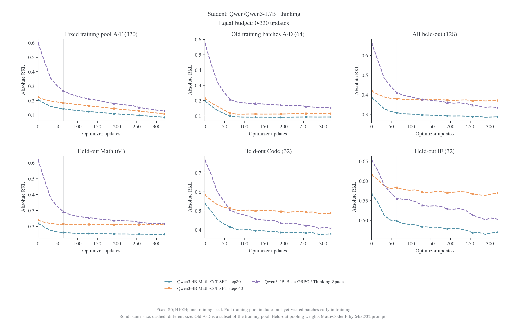
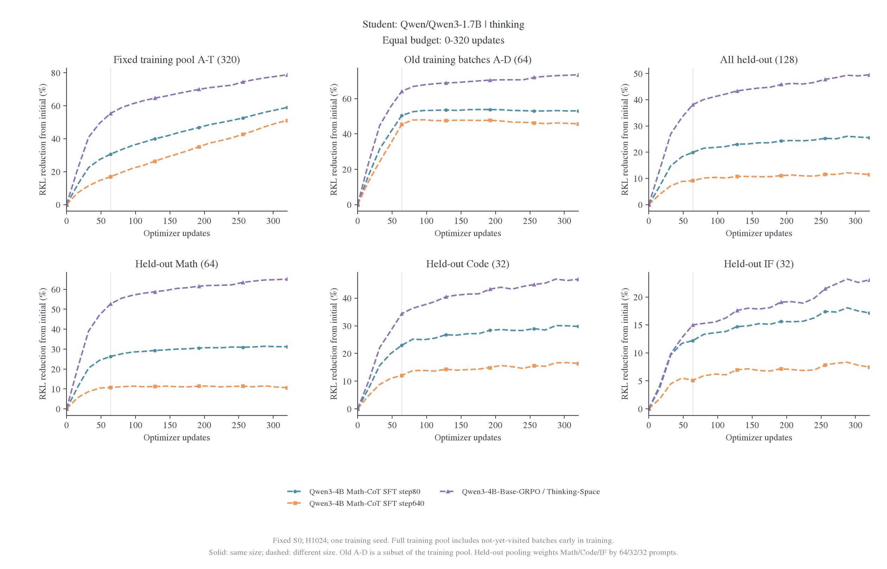
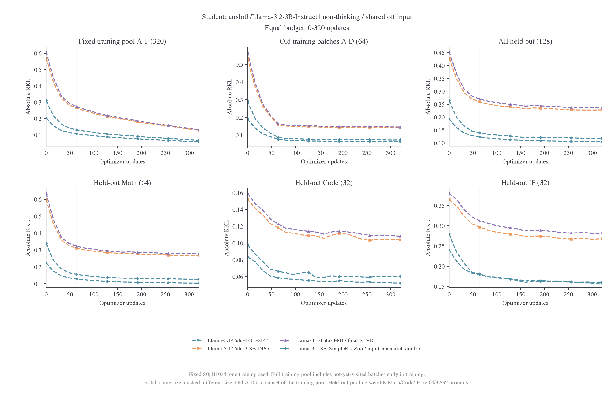
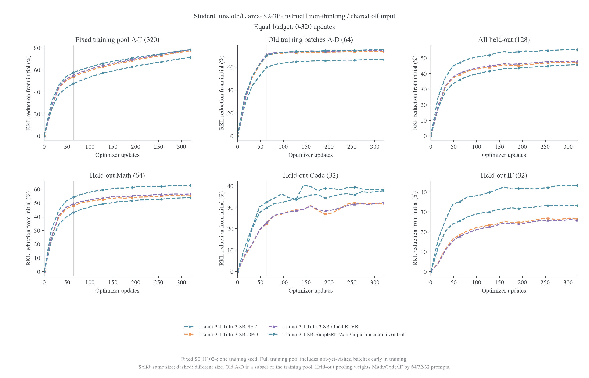
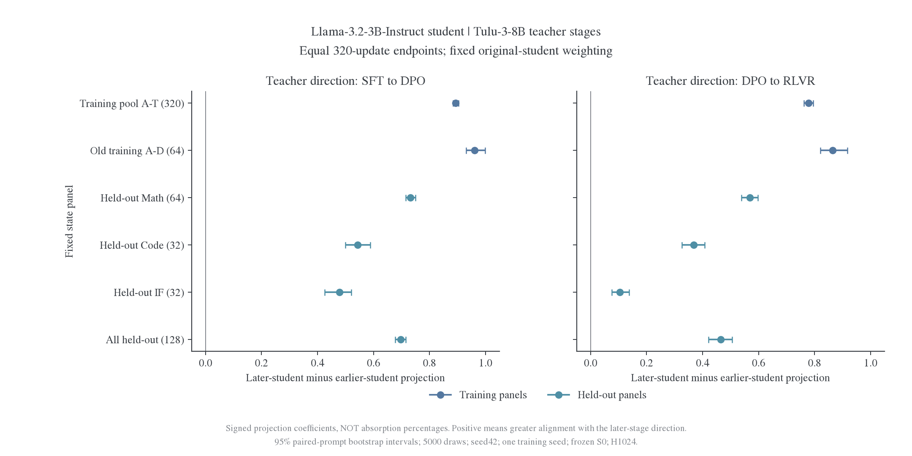
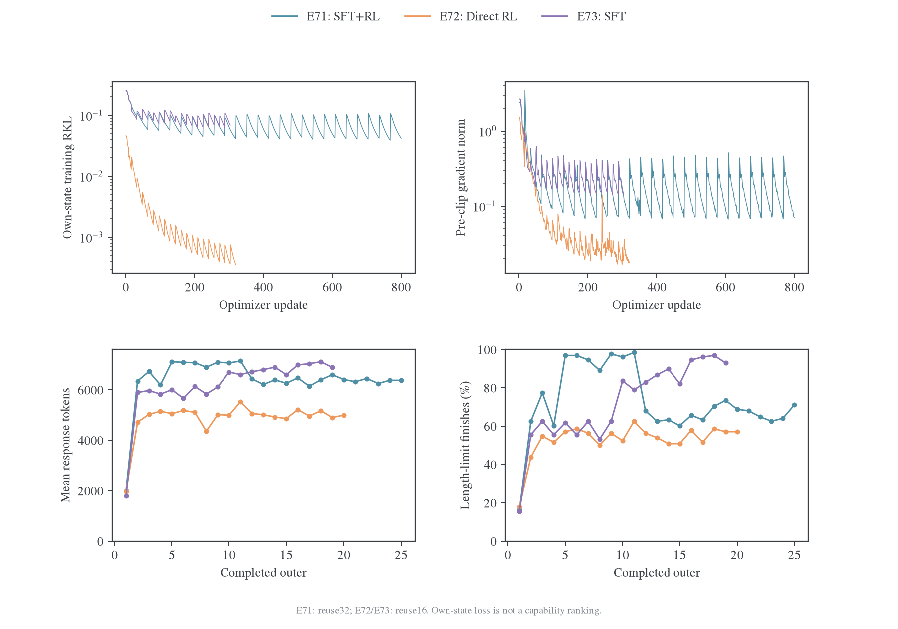
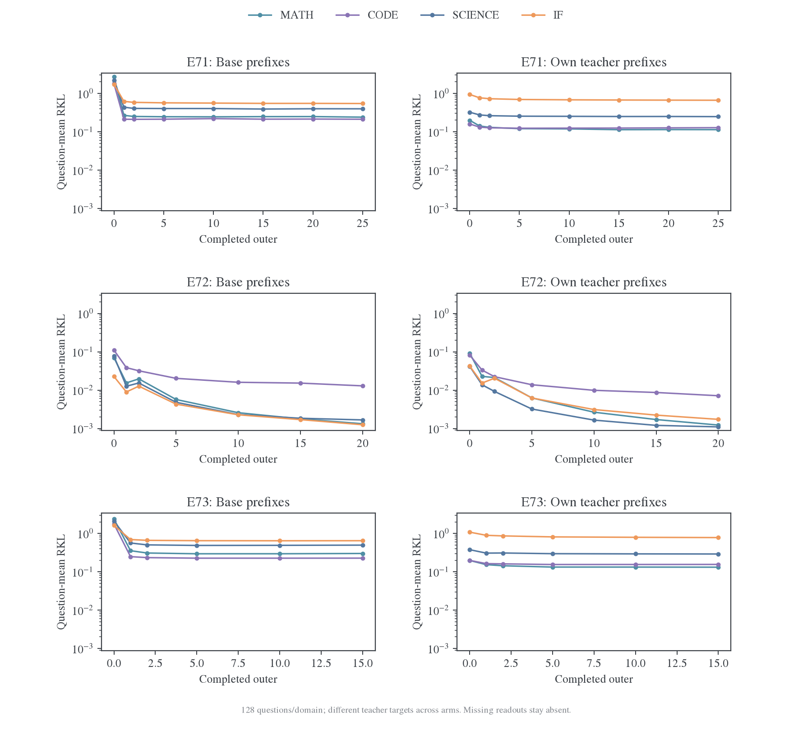
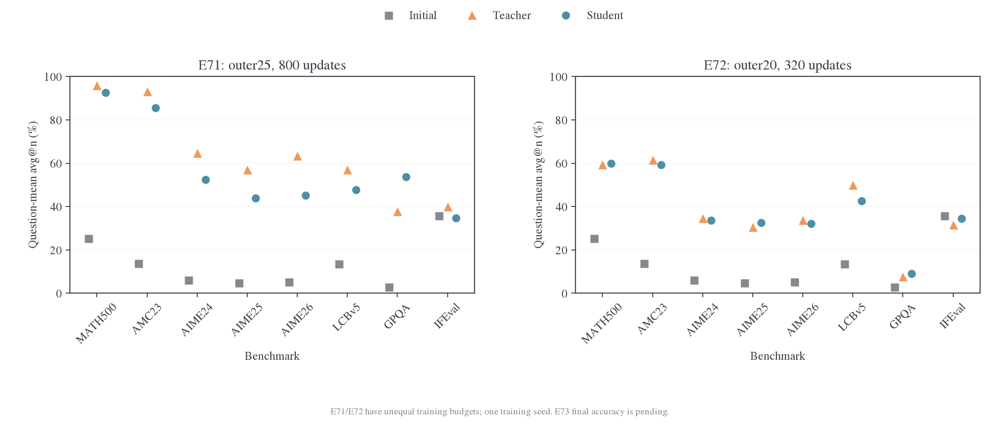

# 后训练阶段的教师可学习性

比较同一学生对不同后训练阶段教师的拟合。Qwen/Tulu 提供固定 S0、0–320 更新的历史结果；MiMo 及后续阶段链采用按批刷新协议。各组共享哪些条件、改变哪些因素，在对应设置中说明。

完整配对结果见[师生 RKL 总览](fixed-state-results.md)，阶段来源和公开权重见[模型资料](../../settings/模型与师生配对.md)。

<a id="local-llm-probe"></a>

## Qwen3-1.7B-Base 的局部阶段对照

这组小实验检验[组合教师推导](../../theory/2026-11-01-SFT与RL组合教师的可蒸馏性.md)中的近邻可恢复性，使用真实预训练 LLM 的全部参数。它不测长推理任务，不替代后文 MiMo 的完整阶段链实验。

### 实际设置

模型为 `Qwen/Qwen3-1.7B-Base`，revision `ea980cb0a6c2ae4b936e82123acc929f1cec04c1`，共 1,720,574,976 参数、原生词表 151936。输入为两位整数相加后的个位数问题，要求下一 token 输出一个数字。训练 8 题、独立数字组合留出 8 题，prompt 与标签完全固定，无聊天模板。响应 horizon 为 1，所以不存在随学生改变的后续前缀；这是 on-policy 条件目标的单步特例。

SFT 最小化正确 token 的交叉熵；RL 最大化正确 token 的概率减去相对阶段起点的 KL 正则。奖励为正确数字 1、其余 token 0，直接对完整词表积分求精确策略梯度，不使用 GRPO 或 sampled-token 估计。三类 teacher 都由同一 Base 构造，SFT／直接 RL 各 8 次更新，SFT→RL 为 8＋8 次更新。随后每个 student 都从原始 Base 重置，进行 48 次 full-vocab RKL 更新。

师生全参数 FP32，关闭 TF32，H800 单卡执行，seed42，训练全批 8 题、microbatch2，无动量、无 weight decay。教师使用梯度方向和单步参数范数上限，并以 loss 下降回溯；学生使用初始 SGD LR0.01、按训练 loss 回溯，另在指定组限制单步范数。此处的范数限幅及回溯定义了实验优化器，不声称复现生产 Adam 配方。

| 组别 | 教师单步范数上限 | RL 的 KL 系数 | 学生单步范数上限 | 比较目的                             |
| ---- | ---------------: | ------------: | ---------------: | ------------------------------------ |
| V2   |             0.02 |           0.1 |               无 | 初始探索；记录大步与分布饱和失败     |
| V3   |           0.0002 |        0.0001 |           0.0002 | 检验小函数偏移下三类教师是否均可拟合 |
| V4   | 复用 V2 原样缓存 |       复用 V2 |            0.002 | 固定同一教师，仅改变学生的单步限制   |

V3 在观察 V2 的失败后设计；它同时改变教师位移、RL 正则和学生步长限制，不能据 V2/V3 的差值识别其中单一因素。V4 对三类 teacher 逐项复用 V2 的完整 logits 缓存，核对模型、prompt、标签、词表和参数量；它才是保持教师不变的优化干预。

### 近邻组 V3 的结果

| 教师   | 留出初始 RKL | 48 步后留出 RKL | 相对下降 | 训练初始 RKL | 48 步后训练 RKL |
| ------ | -----------: | --------------: | -------: | -----------: | --------------: |
| SFT    |  0.025451280 |     0.000310842 |   98.78% |  0.026112989 |     0.000314196 |
| RL     |  0.024767840 |     0.000312908 |   98.74% |  0.025422292 |     0.000316251 |
| SFT→RL |  0.092741325 |     0.002820122 |   96.96% |  0.094471142 |     0.002827998 |

SFT 与 RL 目标的初始 KL 在这组中相近，但不是按预先设定的 KL 阈值严格匹配；组合教师的初始 KL 约为它们的 3.7 倍。三个目标均显著下降，SFT-copy 对照在这 16 个前缀上得到零 KL。这支持近邻可恢复性适用于 SFT、RL 和组合教师，没有验证所有教师或所有状态都能达到零误差。

这些近邻 teacher 仍然很弱：留出上正确 token 的平均概率，Base 为 0.0003719，SFT／RL／SFT→RL teacher 分别为 0.0006721／0.0006705／0.0011542；三类 teacher 的贪心正确率都是 0/8。高 KL 降幅表示分布拟合，不能写成恢复了强 teacher 的算术能力。单 seed、8 题留出仅用于机制探针，不提供总体比例或置信区间。

### 大步负结果与解释边界

V2 的 SFT 和组合教师在留出上的贪心正确率均为 8/8，但初始 Base→teacher RKL 分别达到 19.07 和 31.01。它们属于远目标；仅凭每步参数范数 0.02 不能把它们称为局部教师。V2 学生的第一次 SFT 蒸馏步使用 LR0.01、梯度范数约 258，参数步长约 2.58；训练 KL 虽然下降，后续梯度范数却数值退化为 0，正确 token 概率也几乎为 0。组合分支同样出现接近饱和的梯度，直接 RL 目标则非常接近 Base。

V2 的 48 步留出 RKL 降幅为 SFT 2.55%、RL 87.52%、SFT→RL 9.08%。这个表面排序与目标距离、教师任务表现及不合适的大步更新混杂，不能当作“RL 可学、SFT 不可学”的机制证据。

| 相同 V2 教师 | V2 留出终点 RKL | V4 留出终点 RKL | V4 相对初始下降 |
| ------------ | --------------: | --------------: | --------------: |
| SFT          |      18.5839767 |      16.3186874 |          14.43% |
| RL           |     0.000004963 |     0.000004193 |          89.46% |
| SFT→RL       |      28.1907883 |      25.9337711 |          16.36% |

V4 限制单步位移后，远 SFT 与组合目标的下降有所改善，终点梯度保持非零，但绝大多数 KL 残差仍在，三个 student 的留出贪心正确率仍为 0/8。这个控制支持优化步长参与了 V2 的失败，不能说明步长解释了全部残差，也没有证明远教师不可学习。近邻组的成功与远目标的未恢复需要同时保留。

### 产物与复算

训练脚本为 [run_local_stage_probe.py](../../../research/studies/fixed_transfer/run_local_stage_probe.py)，[汇总脚本](../../../research/studies/fixed_transfer/summarize_local_stage_probe.py)从原始日志重算端点。V2 的[原始记录](../../../../../runs/opd-theory-20261101/llm-local-stages-v2/metrics.jsonl)和[执行源码](../../../../../runs/opd-theory-20261101/run_local_stage_probe-v2.py)、V3 的[完整设置](../../../../../runs/opd-theory-20261101/llm-local-stages-v3/manifest.json)与[原始记录](../../../../../runs/opd-theory-20261101/llm-local-stages-v3/metrics.jsonl)、V4 的[完整设置](../../../../../runs/opd-theory-20261101/llm-local-stages-v4/manifest.json)分别保存。V3/V4 目录中的 `source.py` 是执行时的源码，`teacher-logprobs.pt` 保留完整教师概率；大型共享预训练权重保持原位。

全部九个端点比较见[汇总 JSON](../../../../../runs/opd-theory-20261101/summary.json)。从仓库根目录复算三组：

```bash
python examples/mirroropd/research/studies/fixed_transfer/summarize_local_stage_probe.py \
  runs/opd-theory-20261101/llm-local-stages-v2 \
  runs/opd-theory-20261101/llm-local-stages-v3 \
  runs/opd-theory-20261101/llm-local-stages-v4 \
  --output runs/opd-theory-20261101/summary.json
```

<a id="fixed-stage"></a>

<a id="fixed-stage-qwen-与-llama-阶段对照0320-更新"></a>

## Qwen SFT 深度与 Tulu 阶段

这组比较采用学生 0–320 更新。Qwen 的 step80／step640 来自同一 SFT run；六个新增 teacher 和额外 Base-GRPO 条件各训练 320 次，共 2240 次更新。

<a id="fixed-stage-固定模型与证据"></a>

### 固定模型与证据

| 编号 | Teacher 仓库                                      | 固定 revision                              | 子目录    |
| ---- | ------------------------------------------------- | ------------------------------------------ | --------- |
| Q1   | `jasonrqh/Qwen3-4B_Math-CoT-20k_lr5e-5_ep8_bs256` | `aaf1c51a6a2ee319750cafbd7cb8be0df10018b8` | `step80`  |
| Q2   | `jasonrqh/Qwen3-4B_Math-CoT-20k_lr5e-5_ep8_bs256` | `aaf1c51a6a2ee319750cafbd7cb8be0df10018b8` | `step640` |
| L1   | `allenai/Llama-3.1-Tulu-3-8B-SFT`                 | `f2a0b46b0cfda21003c6141b1ff837b7e165524d` | `根目录`  |
| L2   | `allenai/Llama-3.1-Tulu-3-8B-DPO`                 | `a7beb67e33ffd01cc87ac3b46cadc1000985b8db` | `根目录`  |
| L3   | `allenai/Llama-3.1-Tulu-3-8B`                     | `666943798adbde0b1aff34626007e26986a3c107` | `根目录`  |
| L4   | `hkust-nlp/Llama-3.1-8B-SimpleRL-Zoo`             | `d6e668fcf8db53ff55cc39cf347b3494f56dc7e9` | `根目录`  |

[模型注册表](../../../research/studies/fixed_transfer/plans/stage-lineage-models.json)定义身份；[逐模型清单](transfer-mechanism/data/stage-lineage-20261030/Q1.json)及同目录 Q2、L1–L4 文件保存路径、字节数、SHA256 与下载完成回执。[Qwen 验收配置](../../../research/studies/fixed_transfer/plans/qwen-stage-lineage-acceptance.json)与[Llama 验收配置](../../../research/studies/fixed_transfer/plans/llama-stage-lineage-acceptance.json)的 `probes` 阶段已完成；两份配置的用途为输出验收；正式训练条件见下文。模型身份包含 SFT checkpoint 子目录。

Qwen step80／step640 的训练来源和 Tulu／SimpleRL 的阶段链统一见[模型介绍](../../settings/模型与师生配对.md#qwen3)及[Tulu 阶段链](../../settings/模型与师生配对.md#llama)。六组均为跨尺寸蒸馏，补充教师侧阶段与谱系；不能替代同构 RL／SFT 对照。公开父型号不证明精确父权重、数据和预算完全受控。

<a id="fixed-stage-比较条件"></a>

### 比较条件

每条分支独立从原始 student 开始，同一输入条件共享冻结题目和 S0 前缀。Qwen 使用共同 thinking 前缀，Llama 使用固定 3B student 的共享 off 输入。Tulu 原生模板不同，未静默换成 teacher 私有前缀；SimpleRL 没有原生聊天模板，保留输入不匹配标记。

Tulu teacher 输出头 128264，student 为 128256；保留原生 teacher 归一化并记录额外质量。

<a id="fixed-stage-等预算结果"></a>

### 等预算结果

| Teacher                       | 学生更新数 | 整体留出初始 RKL | 整体留出终点 RKL |   降幅 |
| ----------------------------- | ---------: | ---------------: | ---------------: | -----: |
| Qwen3-4B Math-CoT SFT step80  |        320 |         0.386144 |         0.287476 | 25.55% |
| Qwen3-4B Math-CoT SFT step640 |        320 |         0.419072 |         0.370862 | 11.50% |
| Qwen3-4B-Base-GRPO            |        320 |         0.664417 |         0.335392 | 49.52% |
| Tulu-3-8B-SFT                 |        320 |         0.192855 |         0.104783 | 45.67% |
| Tulu-3-8B-DPO                 |        320 |         0.428990 |         0.227525 | 46.96% |
| Tulu-3-8B，最终 RLVR          |        320 |         0.453277 |         0.236005 | 47.93% |
| Llama-3.1-8B-SimpleRL-Zoo     |        320 |         0.263856 |         0.117807 | 55.35% |

Qwen 和 Llama 分别比较，结合初始风险、绝对残差与相对降幅解释结果。SimpleRL 还采用共享 student 前缀这一特定输入条件。

[附录中的等预算曲线与阶段偏好诊断](#stage-curves)保留训练全池、旧批和三域留出。阶段投影的定义与结果见下节。

<a id="stage-curves"></a>

<a id="stage-curves-附录阶段对照的-0320-图表"></a>

### 曲线与偏好方向

所有曲线限定共同的 0–320 更新。固定训练全池早期包含尚未访问的题，A–D 是其子集；训练与三域留出同时展示。

<a id="stage-curves-qwen-三组"></a>

#### Qwen 三组





[逐点数据](transfer-mechanism/data/equal-budget-20261030/qwen-sft-grpo/learning-curves.csv)。

<a id="stage-curves-llama-四组"></a>

#### Llama 四组





[逐点数据](transfer-mechanism/data/equal-budget-20261030/llama-stages/learning-curves.csv)。SimpleRL 为共享前缀下的输入不匹配对照。

<a id="stage-curves-tulu-阶段偏好方向的评分结果"></a>

#### Tulu 阶段偏好方向的评分结果

三条 320 更新 student 终点在同一 448 题固定状态上完成评分，不产生科学更新。[逐题矩](transfer-mechanism/data/stage-preferences-20261030/prompt-moments.csv)覆盖训练 A–T 和 Math／Code／IF 留出；[完成回执](transfer-mechanism/data/stage-preferences-20261030/complete.json)锁定权重、银行、精度与实现。由逐题矩重算全部 16 个配对投影差，最大差为 1.33e-15，见[复算记录](transfer-mechanism/data/stage-preferences-20261030/recomputed-contrasts.json)；这是汇总核对，不是第二次独立 forward 验证。



| Teacher 阶段方向 | 训练全池：后阶段 student 减前阶段 student | 整体留出：后阶段 student 减前阶段 student |
| ---------------- | ----------------------------------------- | ----------------------------------------- |
| SFT→DPO          | +0.893 [0.883, 0.903]                     | +0.697 [0.677, 0.715]                     |
| DPO→RLVR         | +0.778 [0.761, 0.795]                     | +0.465 [0.421, 0.505]                     |

方括号为逐题配对 bootstrap 95% 区间；完整域别见[配对结果](transfer-mechanism/data/stage-preferences-20261030/paired-stage-projection.csv)。两条方向上，后阶段教师训练出的 student 均比前阶段对应 student 更沿后阶段的 token 偏好变化，且该现象出现在训练和固定留出上。

**该读数为有符号的投影系数差，取值可超过 1。** 整体留出在 DPO→RLVR 方向的投影为 1.914→2.378，差为 0.465。相应余弦从 0.285 提升到 0.339；SFT→DPO 方向余弦从 0.136 提升到 0.676，见[几何量表](transfer-mechanism/data/stage-preferences-20261030/geometry.csv)。两个阶段方向具有不同的尺度和相关性，各自解释。

在共享 student 输入、固定 S0、H1024 和单训练 seed 下，学生在训练与留出上都追随了部分教师偏好变化。独立任务表现由对应任务评测回答。

<a id="mimo"></a>

<a id="mimo-mimo-三类后训练教师吸收对照"></a>

## MiMo：三类后训练教师

固定 MiMo-7B-Base student，比较 SFT、Base 直接 RL、SFT 后继续 RL 三个冻结教师在相同数学训练与公共评估条件下的可拟合性。原 E69／E70 DeepSeekMath 方案已撤销；新 E71／E72／E73 分别对应 SFT+RL、直接 RL、SFT。模型阶段与固定 revision 统一见[阶段链选型](../../settings/模型与师生配对.md#mimo)；BayesRL／Olmo3 与 Light-R1 仅为后续候选。

<a id="mimo-1-实验分支"></a>

<a id="1-实验分支"></a>

### 实验分支

| 编号 | Student      | Teacher         | 教师训练路径 |
| ---- | ------------ | --------------- | ------------ |
| E71  | MiMo-7B-Base | MiMo-7B-RL      | Base→SFT→RL  |
| E72  | MiMo-7B-Base | MiMo-7B-RL-Zero | Base→RL      |
| E73  | MiMo-7B-Base | MiMo-7B-SFT     | Base→SFT     |

三组从同一 Base 权重和 fresh Adam 独立开始，不顺序续接。E71 对 E73 比较完整 SFT+RL 与 SFT 教师的拟合难度；E72 提供不经 SFT 的 RL 路径参照。公开教师的数据、监督和计算预算不同，这里研究三个真实目标，不宣称只改变唯一算法变量。固定银行、current 轨迹和任务表现分别报告，不新增“完全吸收”的数值门槛。

<a id="mimo-2-共同训练设置"></a>

<a id="2-共同训练设置"></a>

### 共同训练设置

沿用[JustRL 按批刷新实验](cross-domain-transfer.md)的数据、优化预算和读出类别，关闭 source heldout 及 history RKL。训练回答长度保留 7168，公共评估长度按下表记录，并受 MiMo 原生 32K 上限约束。下表保留 11 月 1 日的初始 50 outer／reuse32 计划；11 月 2 日修订的实际预算见[预算调整](#mimo-budget-amendment)，其余共同条件继续沿用。

| 项目     | 默认值                                                                        |
| -------- | ----------------------------------------------------------------------------- |
| 框架     | main 原生 verl V1／FSDP2、单节点 shared-sync，师生串行使用同一 GPU 池         |
| 数据     | 同一冻结`questions-v2`中的 6400 道 DAPO 数学训练题，题序相同，`shuffle=False` |
| Rollout  | current student 每 outer 刷新，每题 1 答；T1、top-p1、top-k−1、seed42         |
| 更新     | batch=mini-batch128、reuse32、50 outer；计划 1600 次 optimizer 更新           |
| 目标     | 原生 151680 维 Full-vocab RKL，无任务奖励、无 anchor、无 EOS 合并             |
| 优化器   | 全参数 AdamW，LR1e-6、constant、无 warmup、β=(0.9,0.999)、wd0.01、clip1       |
| 训练长度 | prompt2048＋response7168，共 9216；超长 prompt 报错                           |
| 精度     | FP32 学生主权重、BF16 混合计算；teacher 和 rollout 为 BF16                    |
| 后端     | `precompute_fused`、token chunk256、vocab chunk8192、异步运输及预取           |
| 默认资源 | 4 卡共享池、TP1、参数／optimizer offload、激活重算；microbatch 不改变科学预算 |
| 保存     | 终点 HF 模型及重载校验，无 optimizer 或中途恢复点                             |

所有分支使用 MiMo 发布的相同聊天模板及 token-ID 映射，continuous-token family 为`qwen25`。生成共同停止集合为`[151643,151645]`，覆盖两类原生 EOS；teacher 评分仍区分这两个动作。Thinking 内容保留在训练及 RKL 中，accuracy 取`</think>`后的答案；无 thinking 标签时保留整个回答。

MTP 推测解码和辅助训练关闭。原生模型配置将 MTP 层数设为 0，只加载下一 token 主干与 head；直接 HF 适配保留 MTP 模块时冻结其参数。四类公开 checkpoint 保持原位，三个训练分支采用同一执行约定，只比较普通下一 token 策略。

<a id="mimo-3-公共评估长度与采样"></a>

<a id="3-公共评估长度与采样"></a>

### 公共评估长度与采样

MiMo 论文§3.5.1 使用 T0.6、top-p0.95，Math／Code／Science 最大生成长度 32768，其他任务 8192；§3.3.3 和发布配置的总上下文 32768。[^mimo-mimo] 本实验保留既定公共 prompt 上限 8192，将推理域回答 cap 设为 24576，二者之和严格为 32768；IF 回答 cap 采用官方 8192。原定 32768 回答＋8192 prompt 的 40960 总预算不进入本轮原生上下文配置。

| 领域    | Prompt cap | Response cap | Accuracy 采样                         |
| ------- | ---------: | -----------: | ------------------------------------- |
| Math    |       8192 |        24576 | MATH-500×1；AMC23、AIME24/25/26 各×16 |
| Code    |       8192 |        24576 | LCBv5×10                              |
| Science |       8192 |        24576 | GPQA-Diamond×4                        |
| IF      |       8192 |         8192 | IFEval×1                              |

公共生成继续使用已定 T1、top-p0.95、top-k−1、seed42；官方 T0.6 仅作来源说明。Accuracy 共 1648 题、每模型每节点 6703 答，沿用 JustRL 题量与 n，不替换成 MiMo 论文的重复数。实际结果不宣称复现官方分数。

<a id="mimo-4-公共-rkl-与调度"></a>

<a id="4-公共-rkl-与调度"></a>

### 公共 RKL 与调度

| 读出                             | 工作量与调度                                                |
| -------------------------------- | ----------------------------------------------------------- |
| Source heldout RKL               | `source_enabled=False`，不生成、不评分                      |
| Training history RKL             | `history_enabled=False`，不抽样、不评分；真实训练轨迹仍保存 |
| 固定公共 initial／teacher bank   | 四域各 128 题、sample0；outer0／1／2 及每 5 outer 评分      |
| Current RKL 与全量 accuracy      | outer0／25／50；current sample0 复用同轮 accuracy 轨迹      |
| 初始 student 与 teacher accuracy | 各自 bootstrap 时完成                                       |

RKL 方向始终为 student 对 teacher。三个分支共享公共题目、panel IDs、采样协议和原始 Base；initial 银行复用完全相同的 token 产物，经各组 bootstrap finalize 校验。Teacher 银行归各自教师，不把不同前缀上的绝对 KL 混作主排序。训练 loss 为全局 token-mean；评估题内按有效 token 平均，再按题平均，四域外层等权。

<a id="mimo-budget-amendment"></a>

### 11 月 2 日的预算调整

E71 的训练终点由 50 outer 缩短为 25，已经执行的 reuse32 更新保留；后续 E72、E73 各采用 reuse16、20 outer。每批仍为 128 道新题，每题一个 current-student rollout；三组仍分别从同一个原始 Base 和 fresh Adam 开始。

| 分支 | Teacher 阶段       | Reuse | Outer 终点 | Optimizer 更新数 | 使用的训练题数 | Current RKL／全量 accuracy |
| ---- | ------------------ | ----: | ---------: | ---------------: | -------------: | -------------------------- |
| E71  | SFT+RL             |    32 |         25 |              800 |           3200 | 0、25                      |
| E72  | 直接 RL（RL-Zero） |    16 |         20 |              320 |           2560 | 0、20                      |
| E73  | SFT                |    16 |         20 |              320 |           2560 | 0、20                      |

固定公共银行仍在 outer0／1／2 及每 5 outer 评分，终点保留完整评估、HF 导出和原生重载校验。模型、初始银行、公共题目／panel、训练题序、LR、长度上限、采样协议、并发及 source/history 禁用设置均未改变。训练池仍有 6400 题，实际只使用对应的前 3200 或 2560 题。

三个终点现在不等更新预算，也不等训练题量；后续比较同时标明 optimizer updates 和不同训练题数，不能将终点差异只归因于教师阶段。前 22 轮曲线保持其原始截点，不回写成 reuse16 的结果。

修订后的完整配置为 [E71](../../../../../runs/mimo-stage-transfer-20261101/budget-amendment-20261102/configs/E71.yaml)、[E72](../../../../../runs/mimo-stage-transfer-20261101/budget-amendment-20261102/configs/E72.yaml)、[E73](../../../../../runs/mimo-stage-transfer-20261101/budget-amendment-20261102/configs/E73.yaml)，[配置差异与终点计划检查](../../../../../runs/mimo-stage-transfer-20261101/budget-amendment-20261102/config-check.json)限定了变化范围。原始 formal-configs 与源码快照保留；实际进程和接续情况由[正式队列状态](../../../../../runs/mimo-stage-transfer-20261101/formal-queue-state.json)及[预算接续状态](../../../../../runs/mimo-stage-transfer-20261101/budget-amendment-20261102/state.json)记录。公共 E71–E73 预设同步采用上述新预算，E74–E77 的 Olmo3／Light-R1 预算保持原样。

<a id="mimo-e71-early"></a>

### MiMo 三类教师的训练、固定银行与终点准确率

2026-11-03 19:04（北京时间）的冻结快照覆盖 E71 的 25 outer／800 次更新、E72 的 20 outer／320 次更新，以及 E73 的 19/20 outer／304/320 次更新。三组分别使用 SFT+RL、direct RL 和 SFT 教师，均从同一 Base 与 fresh Adam 开始。E71 训练 3200 道题、reuse32，E72 训练 2560 道题、reuse16；E73 已训练 2432 道题、reuse16，计划 2560 道题。E71／E72 的终点导出和重载审计已完成，E73 仍在训练，终点 accuracy 尚无结果。



全部已记录更新均有效，loss 与梯度均有限。每批复用相同学生轨迹，换批后前缀分布改变，曲线因此呈锯齿。E71 最后一批 loss 从 0.10628 降到 0.04200，E72 从 0.000749 降到 0.000356，E73 第 19 批从 0.10768 降到 0.06866；这些是各自教师、各自学生状态上的更新前 forward，不能直接作为跨组能力排名。

E71／E72 终点平均回答长分别为 6374.1／4991.8 token，以 7168 长度上限结束的比例分别为 71.09%／57.03%。E73 第 19 批为 6889.6 token、92.97% 撞上限。大量训练轨迹受 cap 截断；改变 cap 会改变训练分布。



固定银行每域 128 题、sample0；先按题内有效 token 平均，再按题平均，四域等权。三个分支的 Base 前缀共享，但评分教师不同，teacher 前缀也由各自教师生成；绝对 RKL 不能作为统一能力排序。已完成读出的最新数值如下，E73 保留 outer15，缺失节点不填零、不外推。

| 分支            | 读出 outer／更新数 | Base 前缀四域均值 | Teacher 前缀四域均值 | Teacher Math | Teacher Code | Teacher Science | Teacher IF |
| --------------- | ------------------ | ----------------: | -------------------: | -----------: | -----------: | --------------: | ---------: |
| E71 SFT+RL      | 25／800            |          0.348725 |             0.288201 |     0.113490 |     0.127879 |        0.248125 |   0.663310 |
| E72 direct RL   | 20／320            |          0.004287 |             0.002795 |     0.001225 |     0.007132 |        0.001099 |   0.001726 |
| E73 SFT，训练中 | 15／240            |          0.416684 |             0.338880 |     0.131512 |     0.155327 |        0.290349 |   0.778331 |

E71 的 Teacher 前缀四域均值由初始 0.406126 降至 0.288201，IF 仍有较大残差。E72 已接近自身 direct-RL 教师的分布，能力结果也需要对照该教师本身的水平。



下表为百分数，统计单位是题：先平均该题的 n 个回答分数，再平均题目，即 avg@n，不是 pass@n。每个模型、节点覆盖全量 1648 题、6703 个回答；各任务 n 分别为 1／16／16／16／16／10／4／1。E73 的教师基线保留，学生终点待完成。只有一个训练 seed，表内点估计不表示多 seed 稳定性。

| 模型／节点                 | MATH-500 | AMC23 | AIME24 | AIME25 | AIME26 | LCBv5 | GPQA-Diamond | IFEval |
| -------------------------- | -------: | ----: | -----: | -----: | -----: | ----: | -----------: | -----: |
| 共享初始 Base              |    25.20 | 13.75 |   6.04 |   4.79 |   5.21 | 13.51 |         2.78 |  35.86 |
| E71 教师 SFT+RL            |    95.80 | 92.97 |  64.58 |  56.88 |  63.33 | 56.92 |        37.63 |  39.74 |
| E71 学生 outer25／800 更新 |    92.60 | 85.47 |  52.50 |  43.96 |  45.21 | 47.67 |        53.66 |  34.75 |
| E72 教师 direct RL         |    59.20 | 61.41 |  34.38 |  30.42 |  33.54 | 49.82 |         7.58 |  31.42 |
| E72 学生 outer20／320 更新 |    59.80 | 59.22 |  33.54 |  32.50 |  32.08 | 42.65 |         9.09 |  34.38 |
| E73 教师 SFT               |    92.60 | 92.66 |  56.04 |  47.29 |  52.71 | 51.72 |        23.61 |  43.25 |

E71 在数学题和代码题上大幅高于初始 Base，但仍低于自己的教师；GPQA 的学生点估计高于教师，IFEval 没有超过 Base。E72 的数学准确率已接近其较弱的教师，固定 RKL 更低也没有使它达到 E71 的数学水平。教师与训练预算同时不同，800 对 320 次更新、3200 对 2560 道题的终点差异不能单独归因于教师阶段；SFT 分支的终点比较还需等待 E73。

准确率已从逐回答 Parquet 独立重算，并核对题数、样本数、唯一键、有效状态和发布指标；固定银行 RKL 也由逐题行重算。[逐任务准确率](data/mimo-stage-20261103-1904/accuracy.csv)、[逐题准确率](data/mimo-stage-20261103-1904/accuracy-per-question.csv)、[冻结绘图数据](data/mimo-stage-20261103-1904/plot-data.json)和[来源及哈希](data/mimo-stage-20261103-1904/manifest.json)保存完整精度。分支摘要与逐更新、逐轮数据见 [E71](data/mimo-stage-20261103-1904/E71/summary.json)、[E72](data/mimo-stage-20261103-1904/E72/summary.json)、[E73](data/mimo-stage-20261103-1904/E73/summary.json)；绘图与复算入口为 [`report_mimo_snapshot.py`](../../../research/studies/pipeline/report_mimo_snapshot.py)。PNG、PDF 与 SVG 同目录，审计记录在[figure-audit.json](figures/mimo-stage-20261103-1904/figure-audit.json)。[早期 outer22 数据](data/mimo-e71-20261102-outer22/manifest.json)保持冻结，性能分析见[MiMo 训练成本](../../infra/performance/full-vocab/training.md#mimo-stage-cost)。

<a id="mimo-5-入口与状态"></a>

<a id="5-入口与状态"></a>

### 入口与状态

本节命令针对[MiMo 接入验收](../../infra/model-compatibility/mimo/2026-11-01-MiMo原生下一token接入验收.md)所记录的源码版本。阶段专用入口 `launchers/mimo.py` 随模型接入变更维护；可用预设以当前 checkout 的[公共 shell 入口](../../../run_math_opd_ablation_fsdp2.sh) `--list-presets` 输出为准。`MIMO_QUESTIONS`指定 prepared 题目，`MIMO_BOOTSTRAP`指定各 teacher 绑定的完整银行。

```bash
DRY_RUN=1 bash examples/mirroropd/run_math_opd_ablation_fsdp2.sh E71
DRY_RUN=1 bash examples/mirroropd/run_math_opd_ablation_fsdp2.sh E72
DRY_RUN=1 bash examples/mirroropd/run_math_opd_ablation_fsdp2.sh E73
```

四份固定版本权重已落地，[原生 MiMo 工程验收](../../infra/model-compatibility/mimo/2026-11-01-MiMo原生下一token接入验收.md)已通过更新、公共读出、32K 上下文、终点原生重载及独立 HF 加载检查。短程验收使用独立的小样本、长度和更新预算，不替代本页修订后的正式预算，也不计入正式更新数。

三组已按 E71→E72→E73 提交持久运行队列，从原始 Base 分别开始。[原始完整配置与计划](../../../../../runs/mimo-stage-transfer-20261101/formal-plan.json)保留初始设计；[运行状态](../../../../../runs/mimo-stage-transfer-20261101/formal-queue-state.json)与[预算接续状态](../../../../../runs/mimo-stage-transfer-20261101/budget-amendment-20261102/state.json)记录实际推进。2026-11-03 15:16 的图表快照中，E71 已完成 25 outer／800 次更新，E72 已完成 20 outer／320 次更新；GPU1–4 上的 E73 已完成 14/20 outer、224/320 次更新。实际预算及执行顺序以[调整后的冻结队列](../../../../../runs/mimo-stage-transfer-20261101/budget-amendment-20261102/run_queue.py)为准，E73 完成后该队列结束。Olmo3 的 E74→E75 已提交独立四卡队列，见下节；Light-R1 的 E76／E77 尚未提交。

<a id="mimo-参考文献"></a>

#### 参考文献

[^mimo-mimo]: Xiaomi. MiMo: Unlocking the Reasoning Potential of Language Model – From Pretraining to Posttraining. 2025. [论文§3.3.3、§3.5.1](https://arxiv.org/html/2505.07608)、[官方阶段及评估说明](https://huggingface.co/XiaomiMiMo/MiMo-7B-SFT)。

## Olmo3 与 Light-R1 的阶段条件

以下是阶段链预设的科学条件，工程接入和短程验收仍见[模型兼容性](../../infra/model-compatibility/stage-chains/2026-11-01-Olmo3与LightR1阶段链接入验收.md)。完整训练的完成范围按对应运行回执解释，不以短测代替。

<a id="stage-chains-1-预设与模型"></a>

### 模型与实际前序

| 预设 | Student 权重   | Teacher 权重                 | 阶段         |
| ---- | -------------- | ---------------------------- | ------------ |
| E74  | Olmo-3-1025-7B | Olmo3-C3PO-7B                | SFT+RL       |
| E75  | Olmo-3-1025-7B | Olmo3-IVON-SFT-7B            | SFT          |
| E76  | Qwen2.5-14B    | Light-R1-14B-DS              | SFT1+SFT2+RL |
| E77  | Qwen2.5-14B    | DeepSeek-R1-Distill-Qwen-14B | SFT1         |

两条链均没有在这里登记独立的 Base→RL checkpoint，不另造 RL-only 分支。每组计划从各自共同 Base 与 fresh Adam 开始。BayesRL 的 C3PO 保留其参数探索与 Seq-MIS 训练来源，不标成 vanilla GRPO；Light-R1 的实际前序为 R1-Distill→额外 3K SFT→GRPO。当前 E77 的 R1-Distill 不等于 E76 的 RL 直接起点，因此 E76／E77 不构成同一 SFT checkpoint 的严格 RL 增量对照；缺少的 SFT-only 中间权重及原始论文证据见[阶段链核查](../../settings/模型与师生配对.md#light-r1-lineage)。

本节命令针对[阶段链接入验收](../../infra/model-compatibility/stage-chains/2026-11-01-Olmo3与LightR1阶段链接入验收.md)所记录的源码版本；`launchers/stage_chains.py` 复用 `launchers/mimo.py` 的共同预算与读出，两个入口随模型接入变更维护。可用预设以当前 checkout 的 `--list-presets` 输出为准。E74–E77 的共享题集和 teacher-specific 银行分别由 `STAGE_CHAIN_QUESTIONS`、`STAGE_CHAIN_BOOTSTRAP` 指定。完整入口需要先完成 initial、teacher、finalize 三个原生 bootstrap 阶段。

<a id="stage-chains-3-默认预算与长度"></a>

### 训练与读出配置

| 项目            | 默认值                                                                         |
| --------------- | ------------------------------------------------------------------------------ |
| 数学训练        | 同一冻结题集的 6400 道 DAPO 题，题序固定，batch／mini-batch128                 |
| 优化预算        | reuse32、50 outer、计划 1600 次更新；AdamW LR1e-6、seed42                      |
| 训练长度        | prompt2048＋response7168；超长报错                                             |
| 公共长度        | prompt8192；Math／Code／Science response24576，IF response8192；总长最多 32768 |
| 公共读出        | 四域各 128 题固定银行；accuracy 保留 MiMo 的题量、n 和 T1／top-p0.95           |
| 调度            | 固定银行 outer0／1／2 及每 5 outer；current RKL、全量 accuracy 在 0／25／50    |
| 已关闭读出      | source heldout、history RKL；训练轨迹仍保存                                    |
| 精度与保存      | FP32 主权重、BF16 混合计算；终点 HF FP32 模型及重载检查                        |
| 默认资源        | 4 卡共享师生池；Olmo3／14B 每 rollout 副本最多 8／4 个序列                     |
| microbatch 预算 | 训练最多 16384 token／GPU；学生与教师推理预算 32768，可容纳完整公共轨迹        |

这里沿用 MiMo 的公共长度，不增加上下文外推。Olmo3 的模型配置为 65536，Light-R1 链的模型配置为 131072。R1 与 Light 原版 tokenizer 的长度元数据分别为 16384、20000，共同协议继续保留 SFT 的元数据；实际生成与评分按显式 32K 预算执行并验收。长序列工程检查不代替长推理准确率评估。

完整题集已做模板长度审计：Olmo3／R1 协议的 6400 道训练题最长分别为 1381／1374 token，公共题最长分别为 2856／2788 token，均在既定上限内；[审计数据](../../../../../runs/stage-chain-adaptation-20261101/prompt-lengths.json)。

### Olmo3 正式队列

2026-11-03 已按 E74→E75 提交持久队列，使用 GPU0／5／6／7；MiMo 的 GPU1–4 继续独立运行。E74 使用 C3PO（SFT+RL）教师，E75 使用 IVON-SFT 教师。两组分别从同一 Olmo3 Base 与 fresh Adam 开始，各 50 outer、reuse32、1600 次更新、6400 道训练题；没有沿用 MiMo 的缩短预算。输入采用共同 BayesProtocol，训练长度 2048＋7168，公共读出最长 32768，完整 100278 维词表，无 EOS 合并、无 anchor 或任务 reward。

E74 先生成 initial 与 teacher 银行、绑定并训练；E75 核对后复用完全相同的 initial 产物，独立生成其 teacher 银行再训练。固定银行在 outer0／1／2 及每 5 outer 读出，current RKL 与全量 accuracy 在 outer0／25／50 读出；终点完成 HF 导出及重载检查后才计为完成。两组顺序执行，E74 成功结束才进入 E75，E76／E77 未加入。

[冻结计划](../../../../../runs/olmo3-stage-transfer-20261103/plan.json)记录提交前配置，[实际提交回执](../../../../../runs/olmo3-stage-transfer-20261103/submitted.json)记录已提交状态；[E74 配置](../../../../../runs/olmo3-stage-transfer-20261103/configs/E74.yaml)、[E75 配置](../../../../../runs/olmo3-stage-transfer-20261103/configs/E75.yaml)及[源码／配置合同](../../../../../runs/olmo3-stage-transfer-20261103/source-contract.json)固定运行身份。2026-11-03 15:19 核对时处于 E74 initial 公共生成阶段，四个推理副本已加载并开始返回答案，尚无正式 optimizer 更新。动态进度见[队列状态](../../../../../runs/olmo3-stage-transfer-20261103/queue-state.json)和[阶段日志](../../../../../runs/olmo3-stage-transfer-20261103/logs/E74-initial.log)。完整单轮与评估耗时尚无同配置实测，暂不给 Olmo3 完成时间点。
