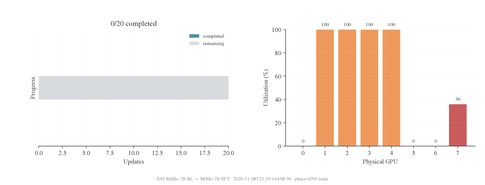
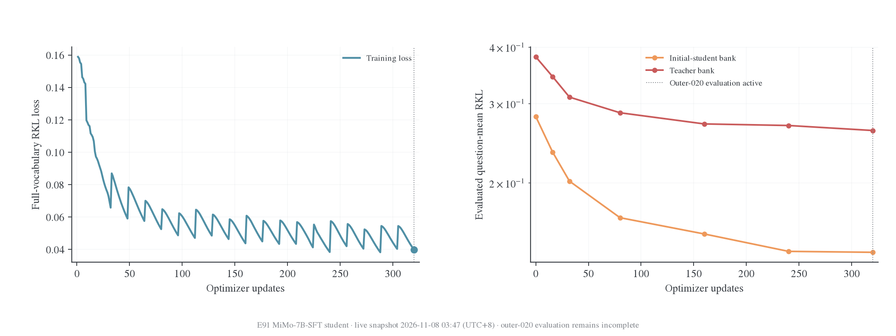
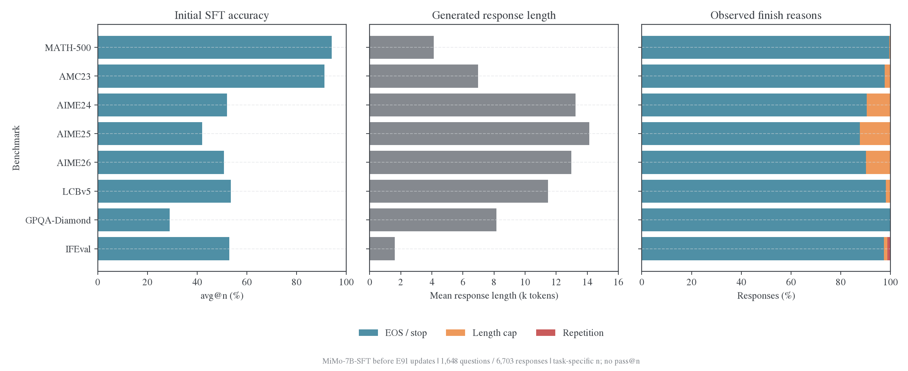
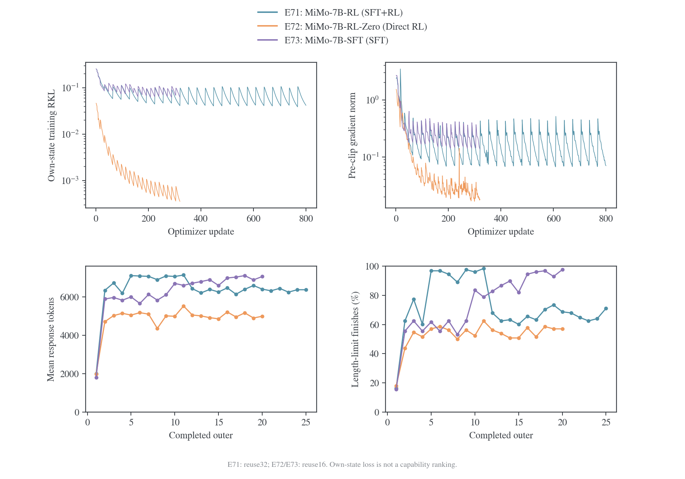
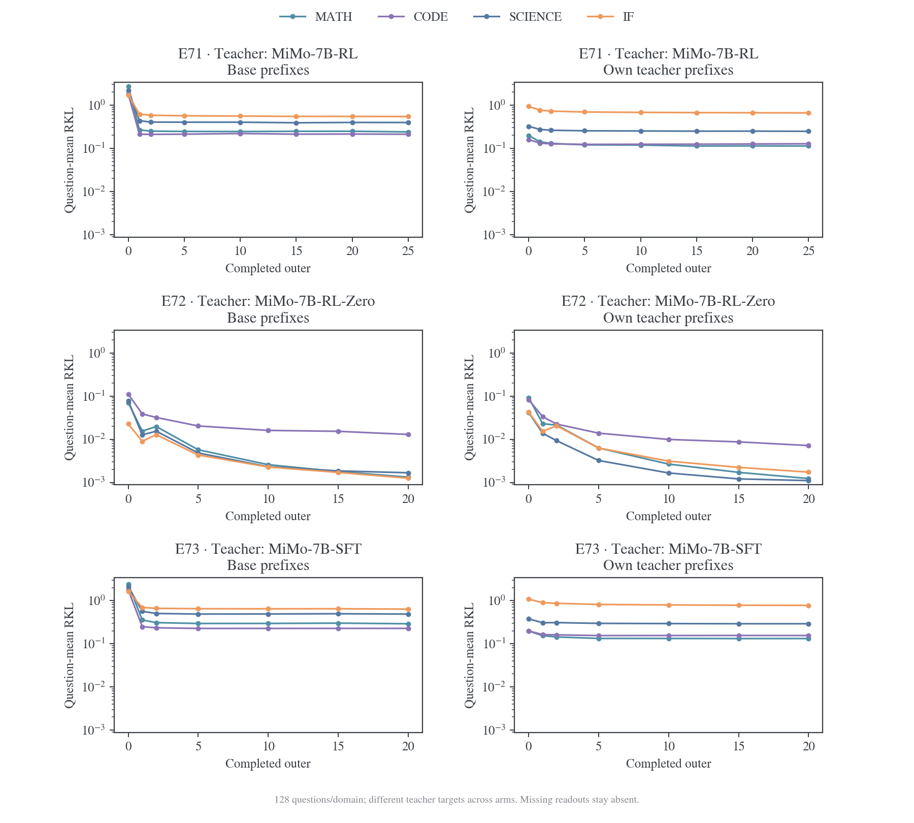
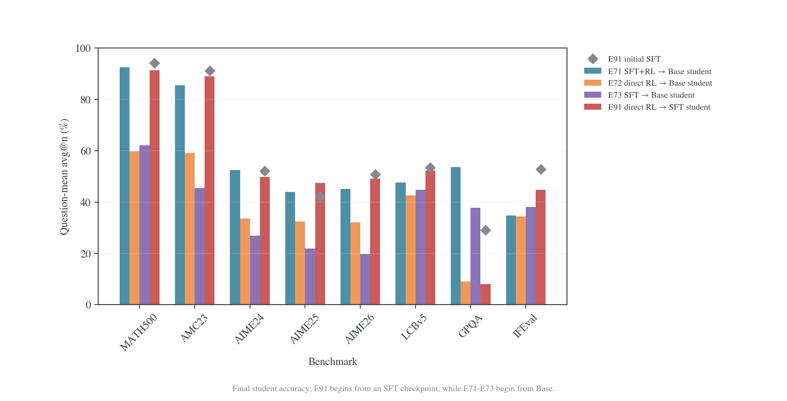
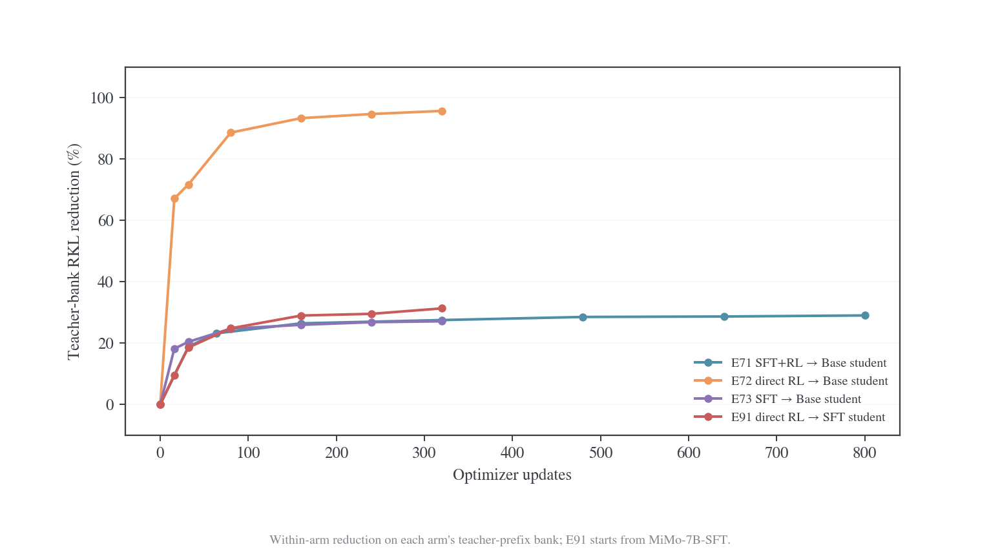
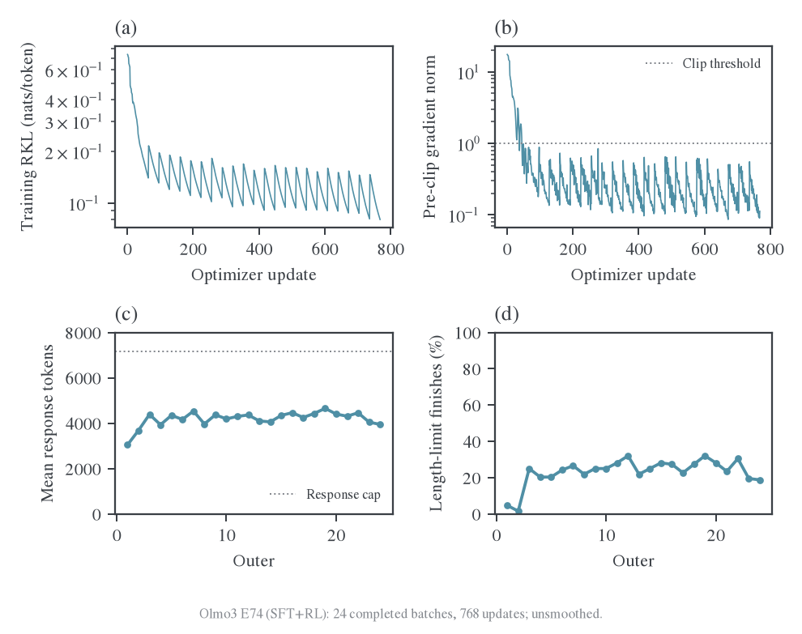
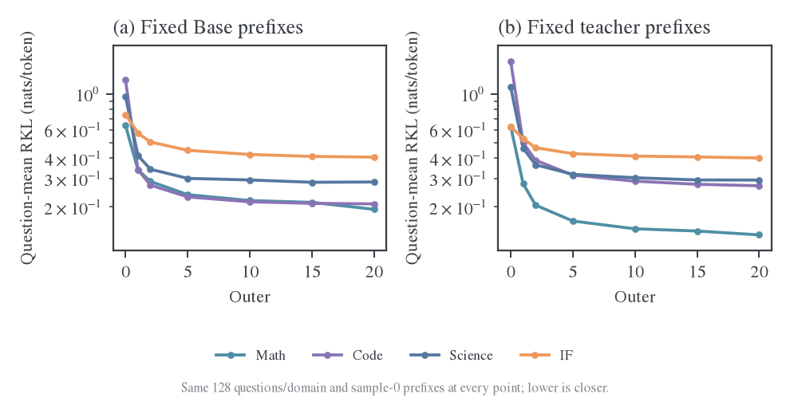

# 后训练阶段的教师可学习性

本页按后训练阶段整理教师吸收实验。Qwen/Tulu 使用固定 S0 的历史曲线；MiMo 及后续阶段链使用按批刷新协议。每节给出实际设置、结果和复算入口。

完整配对结果见[师生 RKL 总览](fixed-state-results/README.md)，阶段来源和公开权重见[模型资料](../../settings/模型与师生配对.md)。

<a id="local-llm-probe"></a>

## Qwen3-1.7B-Base 的局部阶段对照

这组小实验检验[组合教师推导](../../theory/2026-11-01-SFT与RL组合教师的可蒸馏性.md)中的近邻可恢复性，使用真实预训练 LLM 的全部参数。它是单步机制探针，和后文 MiMo 阶段链分开解释。

### 实际设置

模型为 `Qwen/Qwen3-1.7B-Base`，revision `ea980cb0a6c2ae4b936e82123acc929f1cec04c1`，共 1,720,574,976 参数、原生词表 151936。输入为两位整数相加后的个位数问题，要求下一 token 输出一个数字。训练 8 题、独立数字组合留出 8 题，prompt 与标签完全固定，无聊天模板。响应 horizon 为 1，所以不存在随学生改变的后续前缀；这是 on-policy 条件目标的单步特例。

SFT 最小化正确 token 的交叉熵；RL 最大化正确 token 的概率减去相对阶段起点的 KL 正则。奖励为正确数字 1、其余 token 0，直接对完整词表积分求精确策略梯度，不使用 GRPO 或 sampled-token 估计。三类 teacher 都由同一 Base 构造，SFT／直接 RL 各 8 次更新，SFT→RL 为 8＋8 次更新。随后每个 student 都从原始 Base 重置，进行 48 次 full-vocab RKL 更新。

师生全参数 FP32，关闭 TF32，H800 单卡执行，seed42，训练全批 8 题、microbatch2，无动量、无 weight decay。教师使用梯度方向和单步参数范数上限，并以 loss 下降回溯；学生使用初始 SGD LR0.01、按训练 loss 回溯，另在指定组限制单步范数。此处的范数限幅及回溯定义了实验优化器，不声称复现生产 Adam 配方。

| 组别 | 教师单步范数上限 | RL 的 KL 系数 | 学生单步范数上限 | 比较目的                             |
| ---- | ---------------: | ------------: | ---------------: | ------------------------------------ |
| V2   |             0.02 |           0.1 |               无 | 初始探索；记录大步与分布饱和失败     |
| V3   |           0.0002 |        0.0001 |           0.0002 | 检验小函数偏移下三类教师是否均可拟合 |
| V4   | 复用 V2 原样缓存 |       复用 V2 |            0.002 | 固定同一教师，仅改变学生的单步限制   |

V3 同时收紧教师位移、RL 正则和学生步长，结果只用于近邻探针。V4 逐项复用 V2 的 teacher logits 缓存，是保持教师不变的优化干预。

### 近邻组 V3 的结果

| 教师   | 留出初始 RKL | 48 步后留出 RKL | 相对下降 | 训练初始 RKL | 48 步后训练 RKL |
| ------ | -----------: | --------------: | -------: | -----------: | --------------: |
| SFT    |  0.025451280 |     0.000310842 |   98.78% |  0.026112989 |     0.000314196 |
| RL     |  0.024767840 |     0.000312908 |   98.74% |  0.025422292 |     0.000316251 |
| SFT→RL |  0.092741325 |     0.002820122 |   96.96% |  0.094471142 |     0.002827998 |

SFT 与 RL 目标的初始 KL 在这组中相近，但不是按预先设定的 KL 阈值严格匹配；组合教师的初始 KL 约为它们的 3.7 倍。三个目标均显著下降，SFT-copy 对照在这 16 个前缀上得到零 KL。这支持近邻可恢复性适用于 SFT、RL 和组合教师，没有验证所有教师或所有状态都能达到零误差。

这些近邻 teacher 仍然很弱：留出上正确 token 的平均概率，Base 为 0.0003719，SFT／RL／SFT→RL teacher 分别为 0.0006721／0.0006705／0.0011542；三类 teacher 的贪心正确率都是 0/8。因此这里的高 KL 降幅只表示分布拟合。单 seed、8 题留出用于机制探针。

### 大步负结果与解释边界

V2 的 SFT 和组合教师在留出上的贪心正确率均为 8/8，但初始 Base→teacher RKL 分别达到 19.07 和 31.01，属于远目标。V2 学生的第一次 SFT 蒸馏步使用 LR0.01、梯度范数约 258，参数步长约 2.58；训练 KL 虽然下降，后续梯度范数却数值退化为 0，正确 token 概率也几乎为 0。组合分支同样接近梯度饱和，直接 RL 目标则非常接近 Base。

V2 的 48 步留出 RKL 降幅为 SFT 2.55%、RL 87.52%、SFT→RL 9.08%；该排序同时受目标距离、教师任务表现和步长影响。

| 相同 V2 教师 | V2 留出终点 RKL | V4 留出终点 RKL | V4 相对初始下降 |
| ------------ | --------------: | --------------: | --------------: |
| SFT          |      18.5839767 |      16.3186874 |          14.43% |
| RL           |     0.000004963 |     0.000004193 |          89.46% |
| SFT→RL       |      28.1907883 |      25.9337711 |          16.36% |

V4 限制单步位移后，远 SFT 与组合目标的下降有所改善，终点梯度保持非零，但 KL 残差仍大，三个 student 的留出贪心正确率仍为 0/8。步长是 V2 失败的一个因素；近邻组和远目标应分开解释。

### 产物与复算

训练脚本为 [run_local_stage_probe.py](../../../research/studies/fixed_transfer/run_local_stage_probe.py)，[汇总脚本](../../../research/studies/fixed_transfer/summarize_local_stage_probe.py)从原始日志重算端点。V2 的[原始记录](../../../../../runs/opd-theory-20261101/llm-local-stages-v2/metrics.jsonl)和[执行源码](../../../../../runs/opd-theory-20261101/run_local_stage_probe-v2.py)、V3 的[完整设置](../../../../../runs/opd-theory-20261101/llm-local-stages-v3/manifest.json)与[原始记录](../../../../../runs/opd-theory-20261101/llm-local-stages-v3/metrics.jsonl)、V4 的[完整设置](../../../../../runs/opd-theory-20261101/llm-local-stages-v4/manifest.json)分别保存。V3/V4 目录中的 `source.py` 是执行时的源码，`teacher-logprobs.pt` 保留完整教师概率；大型共享预训练权重保持原位。

全部九个端点比较见[汇总 JSON](../../../../../runs/opd-theory-20261101/summary.json)。从仓库根目录复算三组：

```bash
python examples/mirroropd/research/studies/fixed_transfer/summarize_local_stage_probe.py \
  runs/opd-theory-20261101/llm-local-stages-v2 \
  runs/opd-theory-20261101/llm-local-stages-v3 \
  runs/opd-theory-20261101/llm-local-stages-v4 \
  --output runs/opd-theory-20261101/summary.json
```

<a id="fixed-stage"></a>

<a id="fixed-stage-qwen-与-llama-阶段对照0320-更新"></a>

## Qwen SFT 深度与 Tulu 阶段

这组比较采用学生 0–320 更新。Qwen 的 step80／step640 来自同一 SFT run；六个新增 teacher 和额外 Base-GRPO 条件各训练 320 次，共 2240 次更新。

<a id="fixed-stage-固定模型与证据"></a>

### 固定模型与证据

| 编号 | Teacher 仓库                                      | 固定 revision                              | 子目录    |
| ---- | ------------------------------------------------- | ------------------------------------------ | --------- |
| Q1   | `jasonrqh/Qwen3-4B_Math-CoT-20k_lr5e-5_ep8_bs256` | `aaf1c51a6a2ee319750cafbd7cb8be0df10018b8` | `step80`  |
| Q2   | `jasonrqh/Qwen3-4B_Math-CoT-20k_lr5e-5_ep8_bs256` | `aaf1c51a6a2ee319750cafbd7cb8be0df10018b8` | `step640` |
| L1   | `allenai/Llama-3.1-Tulu-3-8B-SFT`                 | `f2a0b46b0cfda21003c6141b1ff837b7e165524d` | `根目录`  |
| L2   | `allenai/Llama-3.1-Tulu-3-8B-DPO`                 | `a7beb67e33ffd01cc87ac3b46cadc1000985b8db` | `根目录`  |
| L3   | `allenai/Llama-3.1-Tulu-3-8B`                     | `666943798adbde0b1aff34626007e26986a3c107` | `根目录`  |
| L4   | `hkust-nlp/Llama-3.1-8B-SimpleRL-Zoo`             | `d6e668fcf8db53ff55cc39cf347b3494f56dc7e9` | `根目录`  |

[模型注册表](../../../research/studies/fixed_transfer/plans/stage-lineage-models.json)定义身份；[逐模型清单](transfer-mechanism/data/stage-lineage-20261030/Q1.json)及同目录 Q2、L1–L4 文件保存路径、字节数、SHA256 与下载完成回执。[Qwen 验收配置](../../../research/studies/fixed_transfer/plans/qwen-stage-lineage-acceptance.json)与[Llama 验收配置](../../../research/studies/fixed_transfer/plans/llama-stage-lineage-acceptance.json)的 `probes` 阶段已完成；两份配置的用途为输出验收；正式训练条件见下文。模型身份包含 SFT checkpoint 子目录。

Qwen step80／step640 的训练来源和 Tulu／SimpleRL 的阶段链统一见[模型介绍](../../settings/模型与师生配对.md#qwen3)及[Tulu 阶段链](../../settings/模型与师生配对.md#llama)。六组都是跨尺寸蒸馏，用于补充教师阶段与谱系；同构 RL／SFT 对照见 MiMo。

<a id="fixed-stage-比较条件"></a>

### 比较条件

每条分支独立从原始 student 开始，共享冻结题目和 S0 前缀。Qwen 使用共同 thinking 前缀，Llama 使用固定 3B student 的共享 off 输入；Tulu 和 SimpleRL 保留各自输入协议。

Tulu teacher 输出头 128264，student 为 128256；保留原生 teacher 归一化并记录额外质量。

<a id="fixed-stage-等预算结果"></a>

### 等预算结果

| Teacher                       | 学生更新数 | 整体留出初始 RKL | 整体留出终点 RKL |   降幅 |
| ----------------------------- | ---------: | ---------------: | ---------------: | -----: |
| Qwen3-4B Math-CoT SFT step80  |        320 |         0.386144 |         0.287476 | 25.55% |
| Qwen3-4B Math-CoT SFT step640 |        320 |         0.419072 |         0.370862 | 11.50% |
| Qwen3-4B-Base-GRPO            |        320 |         0.664417 |         0.335392 | 49.52% |
| Tulu-3-8B-SFT                 |        320 |         0.192855 |         0.104783 | 45.67% |
| Tulu-3-8B-DPO                 |        320 |         0.428990 |         0.227525 | 46.96% |
| Tulu-3-8B，最终 RLVR          |        320 |         0.453277 |         0.236005 | 47.93% |
| Llama-3.1-8B-SimpleRL-Zoo     |        320 |         0.263856 |         0.117807 | 55.35% |

Qwen 和 Llama 分别结合初始风险、绝对残差与相对降幅解释；SimpleRL 采用共享 student 前缀。

[附录中的等预算曲线与阶段偏好诊断](#stage-curves)保留训练全池、旧批和三域留出。阶段投影的定义与结果见下节。

<a id="stage-curves"></a>

<a id="stage-curves-附录阶段对照的-0320-图表"></a>

### 曲线与偏好方向

所有曲线覆盖共同的 0–320 更新；训练全池、A–D 子集和三域留出同时展示。

<a id="stage-curves-qwen-三组"></a>

#### Qwen 三组


[逐点数据](transfer-mechanism/data/equal-budget-20261030/qwen-sft-grpo/learning-curves.csv)。

<a id="stage-curves-llama-四组"></a>

#### Llama 四组


[逐点数据](transfer-mechanism/data/equal-budget-20261030/llama-stages/learning-curves.csv)。SimpleRL 为共享前缀下的输入不匹配对照。

<a id="stage-curves-tulu-阶段偏好方向的评分结果"></a>

#### Tulu 阶段偏好方向的评分结果

三条 320 更新 student 终点在同一 448 题固定状态上评分。[逐题矩](transfer-mechanism/data/stage-preferences-20261030/prompt-moments.csv)覆盖训练 A–T 和 Math／Code／IF 留出；[完成回执](transfer-mechanism/data/stage-preferences-20261030/complete.json)锁定权重、银行、精度与实现。由逐题矩重算的 16 个配对投影差最大为 1.33e-15，见[复算记录](transfer-mechanism/data/stage-preferences-20261030/recomputed-contrasts.json)。


| Teacher 阶段方向 | 训练全池：后阶段 student 减前阶段 student | 整体留出：后阶段 student 减前阶段 student |
| ---------------- | ----------------------------------------- | ----------------------------------------- |
| SFT→DPO          | +0.893 [0.883, 0.903]                     | +0.697 [0.677, 0.715]                     |
| DPO→RLVR         | +0.778 [0.761, 0.795]                     | +0.465 [0.421, 0.505]                     |

方括号为逐题配对 bootstrap 95% 区间；完整域别见[配对结果](transfer-mechanism/data/stage-preferences-20261030/paired-stage-projection.csv)。两条方向上，后阶段教师训练出的 student 均比前阶段对应 student 更沿后阶段的 token 偏好变化，且该现象出现在训练和固定留出上。

该读数是有符号的投影系数差。整体留出在 DPO→RLVR 方向的投影为 1.914→2.378，差为 0.465；相应余弦从 0.285 提升到 0.339。SFT→DPO 方向余弦从 0.136 提升到 0.676，见[几何量表](transfer-mechanism/data/stage-preferences-20261030/geometry.csv)。

在共享 student 输入、固定 S0、H1024 和单训练 seed 下，学生在训练与留出上都追随了部分教师偏好变化。独立任务表现由对应任务评测回答。

<a id="mimo"></a>

<a id="mimo-mimo-三类后训练教师吸收对照"></a>

## MiMo：三类后训练教师

固定 MiMo-7B-Base student，比较 SFT、Base 直接 RL、SFT 后继续 RL 三个冻结教师。E71／E72／E73 分别对应 SFT+RL、直接 RL、SFT；模型阶段与 revision 见[阶段链选型](../../settings/模型与师生配对.md#mimo)。

<a id="mimo-1-实验分支"></a>

<a id="1-实验分支"></a>

### 实验分支

| 编号 | Student      | Teacher         | 教师训练路径 |
| ---- | ------------ | --------------- | ------------ |
| E71  | MiMo-7B-Base | MiMo-7B-RL      | Base→SFT→RL  |
| E72  | MiMo-7B-Base | MiMo-7B-RL-Zero | Base→RL      |
| E73  | MiMo-7B-Base | MiMo-7B-SFT     | Base→SFT     |

三组从同一 Base 权重和 fresh Adam 独立开始。E71 对 E73 比较 SFT+RL 与 SFT 教师；E72 提供不经 SFT 的 RL 参照。固定银行、current 轨迹和任务表现分别报告。

要测试已完成 SFT 的 student 是否能吸收同源 direct-RL teacher，见下方 [MiMo E91](#e91)。E91 复用 E72 的 teacher，预算为 20 outer／320 updates；E72 已覆盖 RL→Base，E73 已覆盖 SFT→Base。

<a id="e93"></a>

### E93：MiMo SFT+RL teacher 到 SFT student

E93 与 E91 共用 `MiMo-7B-SFT` student、题序、rollout、优化器和 OPD 预算，仅替换 teacher 谱系：E93 使用 `Base → SFT → RL` 的 `MiMo-7B-RL`，E91 使用 `Base → direct RL` 的 `MiMo-7B-RL-Zero`。

| 项目         | E93 设置                                                                                               |
| ------------ | ------------------------------------------------------------------------------------------------------ |
| Teacher      | `MiMo-7B-RL`，E71 固定 revision；谱系为 `MiMo-7B-Base → MiMo-7B-SFT → MiMo-7B-RL`                      |
| Student      | `MiMo-7B-SFT`，与 E91 相同                                                                             |
| 题池与银行   | 冻结 `questions-v2`；沿用 E91 prepared question manifest，initial-SFT、teacher、finalize bank 独立生成 |
| 训练         | 20 outer、reuse=16、320 optimizer updates、batch=128；full-vocab reverse KL                            |
| 优化器与长度 | AdamW，LR `1e-6`，weight decay `0.01`，clip `1`；prompt `2048`、response `7168`、context `32768`       |
| 停止规则     | 三个 repetition-detection 入口均为 `{min_pattern_size: 16, max_pattern_size: 128, min_count: 8}`       |



[状态图 PDF](figures/e93-live-20261108/e93-live-progress.pdf)；[状态 CSV](figures/e93-live-20261108/status.csv)；[来源回执](figures/e93-live-20261108/provenance.json)

截至 2026-11-08 23:29（UTC+8），E93 已完成三个前置阶段并进入 `E93-train`，计划 20 步但尚无 optimizer update、训练 loss、RKL 或 accuracy。运行详情、resolved config、源码合同、队列状态和独立 bank provenance 保留在 `runs/e93-mimo-rl-sft-20261108/`；首个完整 outer 后补充训练曲线和评估读出。

<a id="e91"></a>

### E91：MiMo direct-RL teacher 到 SFT student

E91 使用 `MiMo-7B-RL-Zero → MiMo-7B-SFT`：teacher 是 Base 上直接做 RL 的 RL-Zero，student 是已经完成 SFT 的 checkpoint。它回答的是 direct-RL teacher 能否被 SFT student 吸收。E91 已于 2026-11-07 启动并于 2026-11-08 完成，320/320 个 optimizer update、outer-020 评估和收尾均已完成，队列状态为 `complete`，GPU1–4 已释放。

最终训练点的 full-vocabulary RKL loss 为 `0.039824`，梯度范数为 `0.0600`；outer-020 的 current-student 全域 question-mean RKL 为 `0.106075`，teacher-prefix RKL 为 `0.261616`，相对初始 student bank 的 RKL 降幅为 `49.98%`。



[矢量 PDF](figures/e91-live-20261108/e91-live-progress.pdf)；[训练 CSV](figures/e91-live-20261108/training.csv)；[评估 CSV](figures/e91-live-20261108/evaluation.csv)；[来源回执](figures/e91-live-20261108/provenance.json)

E91 测试已完成 SFT 的 student 对同源 direct-RL teacher 的吸收；`SFT → RL → SFT` 对照由 E93 的 `MiMo-7B-RL` teacher 提供。

#### E91 设置

| 项目       | 设置                                                                                      |
| ---------- | ----------------------------------------------------------------------------------------- |
| Student    | `MiMo-7B-SFT`，revision 见[模型与师生配对](../../settings/模型与师生配对.md#mimo)         |
| Teacher    | `MiMo-7B-RL-Zero`，与 E72 相同 revision                                                   |
| 题池       | `questions-v2`，冻结，`shuffle=False`；沿用 E72/E73 的 prepared question manifest         |
| 评估银行   | E91 独立生成 initial/SFT、teacher 及 finalize 读出，逐题核对与 E72 的公共银行             |
| Rollout    | 当前 student，每 outer 每题 1 条，temperature=1，top-p=1，seed=42                         |
| 目标       | full-vocab reverse KL；不启用 source/history held-out                                     |
| 预算       | 20 outer，reuse=16，320 optimizer updates，batch=128                                      |
| 优化器     | AdamW，LR `1e-6`，weight decay `0.01`，gradient clip `1`                                  |
| 长度与精度 | prompt `2048`、train response `7168`、context `32768`；student FP32，teacher/rollout BF16 |
| 重复停止   | 三个入口均开启 `{min_pattern_size: 16, max_pattern_size: 128, min_count: 8}`              |

训练 rollout、`val_kwargs` 和 `EvaluationCoordinator` 的各协议均显式设置 repetition detection；共同 EOS 停止集合为 `[151643,151645]`，重复停止保留已生成前缀。E72/E73 的历史配置中 repetition detection 为 `null`，因此 E91 与历史 Base-student 结果比较时同时报告 length、repetition、truncated、stop 和 unknown finish fraction。

#### E91 初始 SFT 读出

2026-11-07 15:05（UTC+8），initial generation 与 initial accuracy 完整发布，覆盖 1,648 道题、6,703 条回答；initial 进程用时 16,429 秒。它是 MiMo-7B-SFT 在 E91 更新前的能力基线。



| 基准         | 题数 / n | Accuracy avg@n | 平均长度，token | Length stop | Repetition stop |
| ------------ | -------- | -------------- | --------------- | ----------- | --------------- |
| MATH-500     | 500 / 1  | 94.20%         | 4,120           | 0.40%       | 0.00%           |
| AMC23        | 40 / 16  | 91.25%         | 6,982           | 2.34%       | 0.00%           |
| AIME24       | 30 / 16  | 52.08%         | 13,234          | 9.58%       | 0.00%           |
| AIME25       | 30 / 16  | 42.08%         | 14,124          | 12.08%      | 0.21%           |
| AIME26       | 30 / 16  | 50.83%         | 12,981          | 9.58%       | 0.21%           |
| LCBv5        | 279 / 10 | 53.51%         | 11,481          | 1.86%       | 0.00%           |
| GPQA-Diamond | 198 / 4  | 29.04%         | 8,153           | 0.00%       | 0.13%           |
| IFEval       | 541 / 1  | 52.87%         | 1,612           | 1.29%       | 1.29%           |

分数先在题内对 n 个回答求均值，再在题间求均值（avg@n）。Math／Code／Science 回答 cap 为 24,576，IFEval 为 8,192；公共生成 T1、top-p0.95。完整 CSV、来源与协议、审计结果见[初始读出数据](figures/e91-initial-20261107/initial-readout.csv)、[provenance](figures/e91-initial-20261107/provenance.json)和[核验结果](figures/e91-initial-20261107/source-audit.json)。

#### E91 与 Base-student 分支的比较

E91 已并入下方[MiMo 终点结果](#mimo-e71-early)的 RKL 表、accuracy 表及四分支对比图。E72 与 E91 使用同一 direct-RL teacher，分别从 Base 和 SFT 初始化；二者均训练 320 次更新、2560 道题。E91 独立生成评估轨迹并开启重复停止，比较时保留这一协议差异。

E91 的实际配置、源码合同和队列状态保留在 `runs/e91-mimo-rlzero-sft-20261107/`；绘图与复算入口为 `examples/mirroropd/research/studies/pipeline/report_e91_snapshot.py`。E72/E73 是对应的 Base-student 对照。

<a id="mimo-2-共同训练设置"></a>

<a id="2-共同训练设置"></a>

### 共同训练设置

沿用[JustRL 按批刷新实验](cross-domain-transfer.md)的数据、优化预算和读出类别，关闭 source heldout 及 history RKL。训练回答长度保留 7168，公共评估长度按下表记录，并受 MiMo 原生 32K 上限约束。下表保留 11 月 1 日的初始 50 outer／reuse32 计划；11 月 2 日修订的实际预算见[预算调整](#mimo-budget-amendment)，其余共同条件继续沿用。

| 项目     | 默认值                                                                        |
| -------- | ----------------------------------------------------------------------------- |
| 框架     | main 原生 verl V1／FSDP2、单节点 shared-sync，师生串行使用同一 GPU 池         |
| 数据     | 同一冻结`questions-v2`中的 6400 道 DAPO 数学训练题，题序相同，`shuffle=False` |
| Rollout  | current student 每 outer 刷新，每题 1 答；T1、top-p1、top-k−1、seed42         |
| 更新     | batch=mini-batch128、reuse32、50 outer；计划 1600 次 optimizer 更新           |
| 目标     | 原生 151680 维 Full-vocab RKL，无任务奖励、无 anchor、无 EOS 合并             |
| 优化器   | 全参数 AdamW，LR1e-6、constant、无 warmup、β=(0.9,0.999)、wd0.01、clip1       |
| 训练长度 | prompt2048＋response7168，共 9216；超长 prompt 报错                           |
| 精度     | FP32 学生主权重、BF16 混合计算；teacher 和 rollout 为 BF16                    |
| 后端     | `precompute_fused`、token chunk256、vocab chunk8192、异步运输及预取           |
| 默认资源 | 4 卡共享池、TP1、参数／optimizer offload、激活重算；microbatch 不改变科学预算 |
| 保存     | 终点 HF 模型及重载校验，无 optimizer 或中途恢复点                             |

所有分支使用 MiMo 发布的相同聊天模板及 token-ID 映射，continuous-token family 为`qwen25`。生成共同停止集合为`[151643,151645]`，覆盖两类原生 EOS；teacher 评分仍区分这两个动作。Thinking 内容保留在训练及 RKL 中，accuracy 取`</think>`后的答案；无 thinking 标签时保留整个回答。

MTP 推测解码和辅助训练关闭。原生模型配置将 MTP 层数设为 0，只加载下一 token 主干与 head；直接 HF 适配保留 MTP 模块时冻结其参数。四类公开 checkpoint 保持原位，三个训练分支采用同一执行约定，只比较普通下一 token 策略。

<a id="mimo-3-公共评估长度与采样"></a>

<a id="3-公共评估长度与采样"></a>

### 公共评估长度与采样

MiMo 论文§3.5.1 使用 T0.6、top-p0.95，Math／Code／Science 最大生成长度 32768，其他任务 8192；§3.3.3 和发布配置的总上下文 32768。[^mimo-mimo] 本实验保留既定公共 prompt 上限 8192，将推理域回答 cap 设为 24576，二者之和严格为 32768；IF 回答 cap 采用官方 8192。原定 32768 回答＋8192 prompt 的 40960 总预算不进入本轮原生上下文配置。

| 领域    | Prompt cap | Response cap | Accuracy 采样                         |
| ------- | ---------: | -----------: | ------------------------------------- |
| Math    |       8192 |        24576 | MATH-500×1；AMC23、AIME24/25/26 各×16 |
| Code    |       8192 |        24576 | LCBv5×10                              |
| Science |       8192 |        24576 | GPQA-Diamond×4                        |
| IF      |       8192 |         8192 | IFEval×1                              |

公共生成使用 T1、top-p0.95、top-k−1、seed42；accuracy 覆盖 1648 题、每模型每节点 6703 答。

<a id="mimo-4-公共-rkl-与调度"></a>

<a id="4-公共-rkl-与调度"></a>

### 公共 RKL 与调度

| 读出                             | 工作量与调度                                                |
| -------------------------------- | ----------------------------------------------------------- |
| Source heldout RKL               | `source_enabled=False`，不生成、不评分                      |
| Training history RKL             | `history_enabled=False`，不抽样、不评分；真实训练轨迹仍保存 |
| 固定公共 initial／teacher bank   | 四域各 128 题、sample0；outer0／1／2 及每 5 outer 评分      |
| Current RKL 与全量 accuracy      | outer0／25／50；current sample0 复用同轮 accuracy 轨迹      |
| 初始 student 与 teacher accuracy | 各自 bootstrap 时完成                                       |

RKL 方向始终为 student 对 teacher。三个分支共享公共题目、panel IDs、采样协议和原始 Base；initial 银行复用完全相同的 token 产物，经各组 bootstrap finalize 校验。Teacher 银行归各自教师，不把不同前缀上的绝对 KL 混作主排序。训练 loss 为全局 token-mean；评估题内按有效 token 平均，再按题平均，四域外层等权。

<a id="mimo-budget-amendment"></a>

### 11 月 2 日的预算调整

E71 的训练终点由 50 outer 缩短为 25，已经执行的 reuse32 更新保留；后续 E72、E73 各采用 reuse16、20 outer。每批仍为 128 道新题，每题一个 current-student rollout；三组仍分别从同一个原始 Base 和 fresh Adam 开始。

| 分支 | Teacher 阶段       | Reuse | Outer 终点 | Optimizer 更新数 | 使用的训练题数 | Current RKL／全量 accuracy |
| ---- | ------------------ | ----: | ---------: | ---------------: | -------------: | -------------------------- |
| E71  | SFT+RL             |    32 |         25 |              800 |           3200 | 0、25                      |
| E72  | 直接 RL（RL-Zero） |    16 |         20 |              320 |           2560 | 0、20                      |
| E73  | SFT                |    16 |         20 |              320 |           2560 | 0、20                      |

固定公共银行仍在 outer0／1／2 及每 5 outer 评分，终点保留完整评估、HF 导出和原生重载校验。模型、初始银行、公共题目／panel、训练题序、LR、长度上限、采样协议、并发及 source/history 禁用设置均未改变。训练池仍有 6400 题，实际只使用对应的前 3200 或 2560 题。

三个终点的 optimizer updates 和训练题数不同，结果表同时列出这两个维度；前 22 轮曲线保留原始截点。

修订后的完整配置为 [E71](../../../../../runs/mimo-stage-transfer-20261101/budget-amendment-20261102/configs/E71.yaml)、[E72](../../../../../runs/mimo-stage-transfer-20261101/budget-amendment-20261102/configs/E72.yaml)、[E73](../../../../../runs/mimo-stage-transfer-20261101/budget-amendment-20261102/configs/E73.yaml)，[配置差异与终点计划检查](../../../../../runs/mimo-stage-transfer-20261101/budget-amendment-20261102/config-check.json)限定了变化范围。原始 formal-configs 与源码快照保留；实际进程和接续情况由[正式队列状态](../../../../../runs/mimo-stage-transfer-20261101/formal-queue-state.json)及[预算接续状态](../../../../../runs/mimo-stage-transfer-20261101/budget-amendment-20261102/state.json)记录。公共 E71–E73 预设同步采用上述新预算，E74–E77 的 Olmo3／Light-R1 预算保持原样。

<a id="mimo-e71-early"></a>

### MiMo 训练、固定银行与终点对比（E71–E73、E91）

2026-11-04 11:10（北京时间）的冻结快照覆盖全部三个终点：E71 为 25 outer／800 次更新，E72、E73 均为 20 outer／320 次更新。三组分别使用 SFT+RL、direct RL 和 SFT 教师，均从同一 Base 与 fresh Adam 开始。E71 训练 3200 道题、reuse32；E72／E73 各训练 2560 道题、reuse16。三组终点 accuracy、HF 导出和原生重载审计均已完成，正式队列于 11 月 4 日 02:12 结束。



每批复用同一学生轨迹，换批后前缀分布改变，曲线呈锯齿。E71 最后一批 loss 为 0.10628→0.04200，E72 为 0.000749→0.000356，E73 为 0.09908→0.06291；这些是各自教师和学生状态上的更新前 forward，用于训练过程读出。

E71／E72 终点平均回答长分别为 6374.1／4991.8 token，触及 7168 上限的比例为 71.09%／57.03%；E73 为 7063.3 token、97.66%。训练轨迹的长度分布因此受 response cap 影响。



固定银行每域 128 题、sample0；先按题内有效 token 平均，再按题平均，四域等权。E71–E73 共享 Base 初始前缀，E91 使用自身初始 SFT 前缀；teacher 前缀按分支生成。下表列出四个终点，teacher-bank 的相对降幅见后面的合并图。

| 分支                        | 读出 outer／更新数 | 初始 student 前缀四域均值 | Teacher 前缀四域均值 | Teacher Math | Teacher Code | Teacher Science | Teacher IF |
| --------------------------- | ------------------ | ------------------------: | -------------------: | -----------: | -----------: | --------------: | ---------: |
| E71 SFT+RL                  | 25／800            |                  0.348725 |             0.288201 |     0.113490 |     0.127879 |        0.248125 |   0.663310 |
| E72 direct RL               | 20／320            |                  0.004287 |             0.002795 |     0.001225 |     0.007132 |        0.001099 |   0.001726 |
| E73 SFT                     | 20／320            |                  0.408868 |             0.337572 |     0.131802 |     0.154957 |        0.290229 |   0.773299 |
| E91 direct RL → SFT student | 20／320            |                  0.140523 |             0.261616 |     0.214965 |     0.079659 |        0.259935 |   0.491906 |

E71 的 Teacher 前缀四域均值由初始 0.406126 降至 0.288201，IF 残差最大；E72 已接近自身 direct-RL 教师分布。



下表为百分数，统计单位是题：先平均该题的 n 个回答分数，再平均题目，即 avg@n。每个模型、节点覆盖 1648 题、6703 个回答；各任务 n 为 1／16／16／16／16／10／4／1，训练 seed 为 42。E91 使用 SFT student，E71–E73 使用 Base student；E91 开启重复停止，其余公共长度和采样条件见上文。E71–E73 原来的[初始／教师／终点三角色图](figures/mimo-stage-20261104-final/accuracy.png)保留作参考。

| 模型／节点                 | MATH-500 | AMC23 | AIME24 | AIME25 | AIME26 | LCBv5 | GPQA-Diamond | IFEval |
| -------------------------- | -------: | ----: | -----: | -----: | -----: | ----: | -----------: | -----: |
| 共享初始 Base              |    25.20 | 13.75 |   6.04 |   4.79 |   5.21 | 13.51 |         2.78 |  35.86 |
| E71 教师 SFT+RL            |    95.80 | 92.97 |  64.58 |  56.88 |  63.33 | 56.92 |        37.63 |  39.74 |
| E71 学生 outer25／800 更新 |    92.60 | 85.47 |  52.50 |  43.96 |  45.21 | 47.67 |        53.66 |  34.75 |
| E72 教师 direct RL         |    59.20 | 61.41 |  34.38 |  30.42 |  33.54 | 49.82 |         7.58 |  31.42 |
| E72 学生 outer20／320 更新 |    59.80 | 59.22 |  33.54 |  32.50 |  32.08 | 42.65 |         9.09 |  34.38 |
| E73 教师 SFT               |    92.60 | 92.66 |  56.04 |  47.29 |  52.71 | 51.72 |        23.61 |  43.25 |
| E73 学生 outer20／320 更新 |    62.20 | 45.47 |  26.88 |  21.88 |  19.79 | 44.77 |        37.75 |  38.08 |
| E91 初始 SFT student       |    94.20 | 91.25 |  52.08 |  42.08 |  50.83 | 53.51 |        29.04 |  52.87 |
| E91 学生 outer20／320 更新 |    91.40 | 89.06 |  49.79 |  47.50 |  49.17 | 52.29 |         8.08 |  44.73 |

E71 在数学和代码上高于初始 Base，但低于自己的教师；GPQA 学生点估计高于教师，IFEval 接近 Base。E72 学生接近 direct-RL 教师。E73 的数学和代码高于 Base，GPQA 高于教师，IFEval 比 Base 高约 2.22 个百分点。同为 320 次更新的 E72／E73 中，E73 的 MATH-500 为 62.20% 对 59.80%，AMC／AIME 低于 E72，GPQA 为 37.75% 对 9.09%。E71 使用 800 次更新、3200 道训练题，预算高于另外两组。

E91 的 MATH-500 为 91.40%，接近 E71 的 92.60%；AMC23、AIME25、AIME26、LCBv5 和 IFEval 的点估计高于 E71。但相对自身 SFT 起点，E91 仅 AIME25 上升（42.08%→47.50%），其余七项下降，其中 GPQA-Diamond 为 29.04%→8.08%，IFEval 为 52.87%→44.73%。E91 的较高数学与代码终点同时包含了较强的 SFT 初始化。



RKL 图按各分支自己的 teacher-prefix 初始值计算降幅 $100(1-R_t/R_0)$：E71、E72、E73 的终点降幅分别为 29.04%、95.68%、27.13%，E91 为 31.34%。E91 的 teacher-bank RKL 为 0.381016→0.261616，E72 为 0.064745→0.002795；相同 teacher 和 320 更新下，SFT 初始化组的绝对残差更大、相对降幅更小。这组读出未支持 SFT 初始化更容易吸收 direct-RL 教师；各组 teacher 前缀独立生成，绝对残差仍依赖轨迹。

完整逐点数据见[RKL 对比 CSV](figures/mimo-stage-20261104-final/e91-comparison/rkl-comparison.csv)、[accuracy 对比 CSV](figures/mimo-stage-20261104-final/e91-comparison/accuracy-comparison.csv)和[来源回执](figures/mimo-stage-20261104-final/e91-comparison/provenance.json)。E91 的初始与终点 accuracy 已从逐回答 Parquet 重算，七个节点的 teacher-bank RKL 已从逐题 Parquet 重算，见[核验结果](figures/mimo-stage-20261104-final/e91-comparison/source-audit.json)。[合并图生成脚本](../../../research/studies/fixed_transfer/plot_mimo_e91_comparison.py)导出 PNG、PDF、SVG；[RKL PDF](figures/mimo-stage-20261104-final/e91-comparison/rkl-absorption-comparison.pdf)和[accuracy PDF](figures/mimo-stage-20261104-final/e91-comparison/accuracy-comparison.pdf)可直接用于汇报。

准确率从逐回答 Parquet 重算，固定银行 RKL 从逐题行重算。[逐任务准确率](data/mimo-stage-20261104-final/accuracy.csv)、[逐题准确率](../../../../../../wandb-logs/MirrorOPD-verl/analysis/document-evidence-20261104/experiments/teacher-transfer/data/mimo-stage-20261104-final/accuracy-per-question.csv)、[冻结绘图数据](data/mimo-stage-20261104-final/plot-data.json)和[来源及哈希](data/mimo-stage-20261104-final/manifest.json)保存完整数据。分支摘要与逐更新、逐轮数据见 [E71](data/mimo-stage-20261104-final/E71/summary.json)、[E72](data/mimo-stage-20261104-final/E72/summary.json)、[E73](data/mimo-stage-20261104-final/E73/summary.json)；绘图与复算入口为 [`report_mimo_snapshot.py`](../../../research/studies/pipeline/report_mimo_snapshot.py)。PNG、PDF 与 SVG 同目录，审计记录在[figure-audit.json](figures/mimo-stage-20261104-final/figure-audit.json)。[早期 outer22 数据](data/mimo-e71-20261102-outer22/manifest.json)保持冻结，性能分析见[MiMo 训练成本](../../infra/performance/full-vocab/training.md#mimo-stage-cost)。

<a id="mimo-5-入口与状态"></a>

<a id="5-入口与状态"></a>

### 入口与状态

本节命令针对[MiMo 接入验收](../../infra/model-compatibility/mimo/2026-11-01-MiMo原生下一token接入验收.md)所记录的源码版本。阶段专用入口 `launchers/mimo.py` 随模型接入变更维护；可用预设以当前 checkout 的[公共 shell 入口](../../../run_math_opd_ablation_fsdp2.sh) `--list-presets` 输出为准。`MIMO_QUESTIONS`指定 prepared 题目，`MIMO_BOOTSTRAP`指定各 teacher 绑定的完整银行。

```bash
DRY_RUN=1 bash examples/mirroropd/run_math_opd_ablation_fsdp2.sh E71
DRY_RUN=1 bash examples/mirroropd/run_math_opd_ablation_fsdp2.sh E72
DRY_RUN=1 bash examples/mirroropd/run_math_opd_ablation_fsdp2.sh E73
```

四份固定版本权重已落地，[原生 MiMo 工程验收](../../infra/model-compatibility/mimo/2026-11-01-MiMo原生下一token接入验收.md)已通过更新、公共读出、32K 上下文、终点原生重载及独立 HF 加载检查。短程验收使用独立的小样本、长度和更新预算；正式结果按本页预算统计。

三组已按 E71→E72→E73 提交持久队列并完成：E71 为 25 outer／800 次更新，E72／E73 均为 20 outer／320 次更新。配置、运行状态和预算接续记录见[原始计划](../../../../../runs/mimo-stage-transfer-20261101/formal-plan.json)、[运行状态](../../../../../runs/mimo-stage-transfer-20261101/formal-queue-state.json)和[预算状态](../../../../../runs/mimo-stage-transfer-20261101/budget-amendment-20261102/state.json)。调整后的执行顺序见[冻结队列](../../../../../runs/mimo-stage-transfer-20261101/budget-amendment-20261102/run_queue.py)；队列于 2026-11-04 02:12 结束，GPU1–4 已释放。Olmo3 的 E74→E75 见下节，Light-R1 的 E76／E77 仍为预设。

<a id="mimo-参考文献"></a>

#### 参考文献

[^mimo-mimo]: Xiaomi. MiMo: Unlocking the Reasoning Potential of Language Model – From Pretraining to Posttraining. 2025. [论文§3.3.3、§3.5.1](https://arxiv.org/html/2505.07608)、[官方阶段及评估说明](https://huggingface.co/XiaomiMiMo/MiMo-7B-SFT)。

## Olmo3 与 Light-R1 的阶段条件

以下是阶段链预设的科学条件，工程接入和短程验收仍见[模型兼容性](../../infra/model-compatibility/stage-chains/2026-11-01-Olmo3与LightR1阶段链接入验收.md)。完整训练的完成范围按对应运行回执解释，不以短测代替。

<a id="stage-chains-1-预设与模型"></a>

### 模型与实际前序

| 预设 | Student 权重   | Teacher 权重                 | 阶段         |
| ---- | -------------- | ---------------------------- | ------------ |
| E74  | Olmo-3-1025-7B | Olmo3-C3PO-7B                | SFT+RL       |
| E75  | Olmo-3-1025-7B | Olmo3-IVON-SFT-7B            | SFT          |
| E76  | Qwen2.5-14B    | Light-R1-14B-DS              | SFT1+SFT2+RL |
| E77  | Qwen2.5-14B    | DeepSeek-R1-Distill-Qwen-14B | SFT1         |

两条链均没有在这里登记独立的 Base→RL checkpoint，不另造 RL-only 分支。每组计划从各自共同 Base 与 fresh Adam 开始。BayesRL 的 C3PO 保留其参数探索与 Seq-MIS 训练来源，不标成 vanilla GRPO；Light-R1 的实际前序为 R1-Distill→额外 3K SFT→GRPO。当前 E77 的 R1-Distill 不等于 E76 的 RL 直接起点，因此 E76／E77 不构成同一 SFT checkpoint 的严格 RL 增量对照；缺少的 SFT-only 中间权重及原始论文证据见[阶段链核查](../../settings/模型与师生配对.md#light-r1-lineage)。

本节命令针对[阶段链接入验收](../../infra/model-compatibility/stage-chains/2026-11-01-Olmo3与LightR1阶段链接入验收.md)所记录的源码版本；`launchers/stage_chains.py` 复用 `launchers/mimo.py` 的共同预算与读出，两个入口随模型接入变更维护。可用预设以当前 checkout 的 `--list-presets` 输出为准。E74–E77 的共享题集和 teacher-specific 银行分别由 `STAGE_CHAIN_QUESTIONS`、`STAGE_CHAIN_BOOTSTRAP` 指定。完整入口需要先完成 initial、teacher、finalize 三个原生 bootstrap 阶段。

<a id="stage-chains-3-默认预算与长度"></a>

### 训练与读出配置

| 项目            | 默认值                                                                         |
| --------------- | ------------------------------------------------------------------------------ |
| 数学训练        | 同一冻结题集的 6400 道 DAPO 题，题序固定，batch／mini-batch128                 |
| 优化预算        | reuse32、50 outer、计划 1600 次更新；AdamW LR1e-6、seed42                      |
| 训练长度        | prompt2048＋response7168；超长报错                                             |
| 公共长度        | prompt8192；Math／Code／Science response24576，IF response8192；总长最多 32768 |
| 公共读出        | 四域各 128 题固定银行；accuracy 保留 MiMo 的题量、n 和 T1／top-p0.95           |
| 调度            | 固定银行 outer0／1／2 及每 5 outer；current RKL、全量 accuracy 在 0／25／50    |
| 已关闭读出      | source heldout、history RKL；训练轨迹仍保存                                    |
| 精度与保存      | FP32 主权重、BF16 混合计算；终点 HF FP32 模型及重载检查                        |
| 默认资源        | 4 卡共享师生池；Olmo3／14B 每 rollout 副本最多 8／4 个序列                     |
| microbatch 预算 | 训练最多 16384 token／GPU；学生与教师推理预算 32768，可容纳完整公共轨迹        |

这里沿用 MiMo 的公共长度，不增加上下文外推。Olmo3 的模型配置为 65536，Light-R1 链的模型配置为 131072。R1 与 Light 原版 tokenizer 的长度元数据分别为 16384、20000，共同协议继续保留 SFT 的元数据；实际生成与评分按显式 32K 预算执行并验收。长序列工程检查不代替长推理准确率评估。

完整题集已做模板长度审计：Olmo3／R1 协议的 6400 道训练题最长分别为 1381／1374 token，公共题最长分别为 2856／2788 token，均在既定上限内；[审计数据](../../../../../runs/stage-chain-adaptation-20261101/prompt-lengths.json)。

### Olmo3 正式队列

2026-11-03 已按 E74→E75 提交持久队列，使用 GPU0／5／6／7。MiMo 已完成并释放 GPU1–4。E74 使用 C3PO（SFT+RL）教师，E75 使用 IVON-SFT 教师。两组分别从同一 Olmo3 Base 与 fresh Adam 开始，各 50 outer、reuse32、1600 次更新、6400 道训练题；没有沿用 MiMo 的缩短预算。输入采用共同 BayesProtocol，训练长度 2048＋7168，公共读出最长 32768，完整 100278 维词表，无 EOS 合并、无 anchor 或任务 reward。

E74 先生成 initial 与 teacher 银行、绑定并训练；E75 核对后复用完全相同的 initial 产物，独立生成其 teacher 银行再训练。固定银行在 outer0／1／2 及每 5 outer 读出，current RKL 与全量 accuracy 在 outer0／25／50 读出；终点完成 HF 导出及重载检查后才计为完成。两组顺序执行，E74 成功结束才进入 E75，E76／E77 未加入。

[冻结计划](../../../../../runs/olmo3-stage-transfer-20261103/plan.json)记录提交前配置，[实际提交回执](../../../../../runs/olmo3-stage-transfer-20261103/submitted.json)记录已提交状态；[E74 配置](../../../../../runs/olmo3-stage-transfer-20261103/configs/E74.yaml)、[E75 配置](../../../../../runs/olmo3-stage-transfer-20261103/configs/E75.yaml)及[源码／配置合同](../../../../../runs/olmo3-stage-transfer-20261103/source-contract.json)固定运行身份。2026-11-04 11:07 核对时，E74 已完成 800/1600 次有效更新，正在执行 outer25 全量公共读出，生成进度为 3776/6703 个回答；该节点尚未完成，accuracy 不作为中期结果发布。更新记录的 loss、梯度均有限，无跳过更新。E75 排在 E74 之后，尚未启动。动态进度见[队列状态](../../../../../runs/olmo3-stage-transfer-20261103/queue-state.json)和[训练日志](../../../../../runs/olmo3-stage-transfer-20261103/logs/E74-train.log)。MiMo 队列已经结束；Olmo3 队列在 E75 成功完成后结束，E76／E77 只有预设，未排队。



训练图冻结到完整结束的 outer24／768 更新；outer25 已做完的 32 次更新正在等待公共读出，因此运行进度与图的截点不同。Outer24 首末次 forward loss 为 0.14654／0.08011，平均回答长 3945.2 token，18.75% 以 7168 长度上限结束。首批 loss 为 0.73552，首批最后一次 forward 为 0.27684；跨批状态变化下的训练 loss 不直接代表任务能力。



固定读出已完成 outer0／1／2／5／10／15／20，outer25 不插值。每域 128 题、sample0，先题内有效 token 平均，再按题平均。Outer20 的 Base／Teacher 前缀四域等权均值分别为 0.273437／0.274766；Teacher 前缀 Math／Code／Science／IF 分别为 0.134380／0.270272／0.293137／0.401272。固定状态上分布仍有残差，数学训练后公共准确率的判断需等完整读出。

[逐更新数据](data/olmo3-e74-20261104-outer24/updates.csv)、[固定银行数据](data/olmo3-e74-20261104-outer24/fixed-bank-rkl.csv)、[摘要](data/olmo3-e74-20261104-outer24/summary.json)及[来源哈希](data/olmo3-e74-20261104-outer24/manifest.json)记录实际截点，RKL 已从逐题 Parquet 重算核对。生成器为 [`plot_stage_progress.py`](../../../research/studies/pipeline/plot_stage_progress.py)，PNG／PDF 及审计记录同目录。实测耗时和剩余工作量见[Olmo3 成本](../../infra/performance/full-vocab/training.md#olmo3-stage-cost)。
