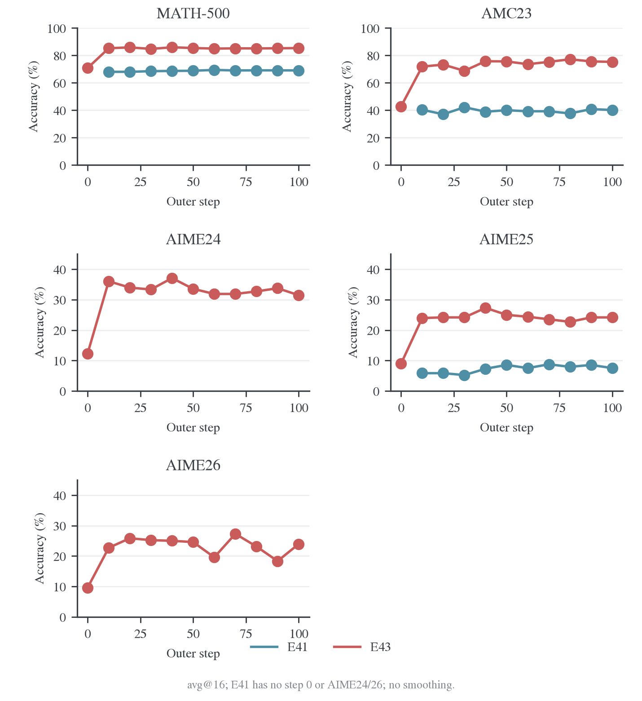
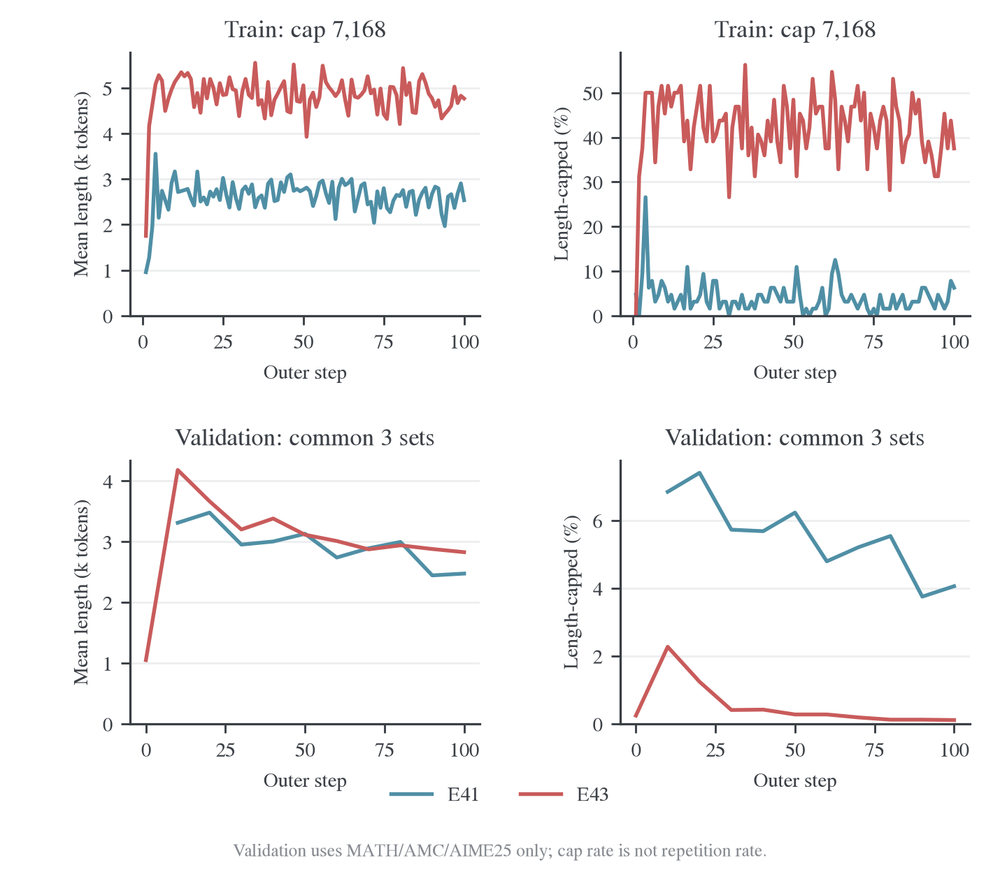
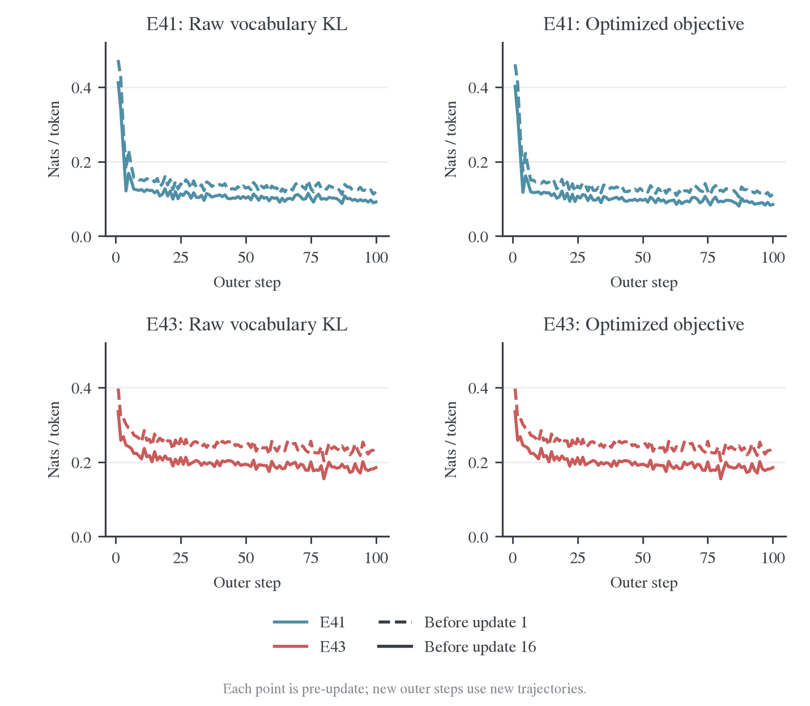
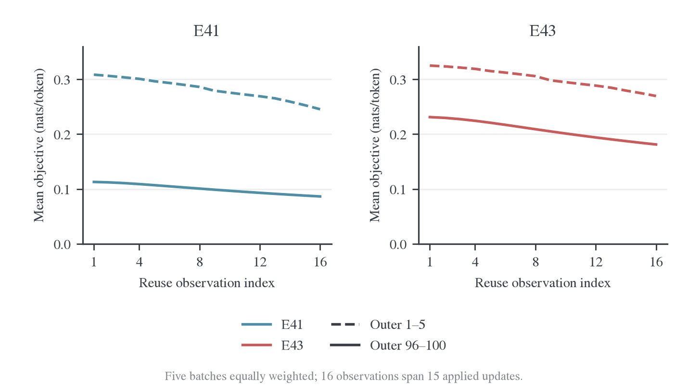
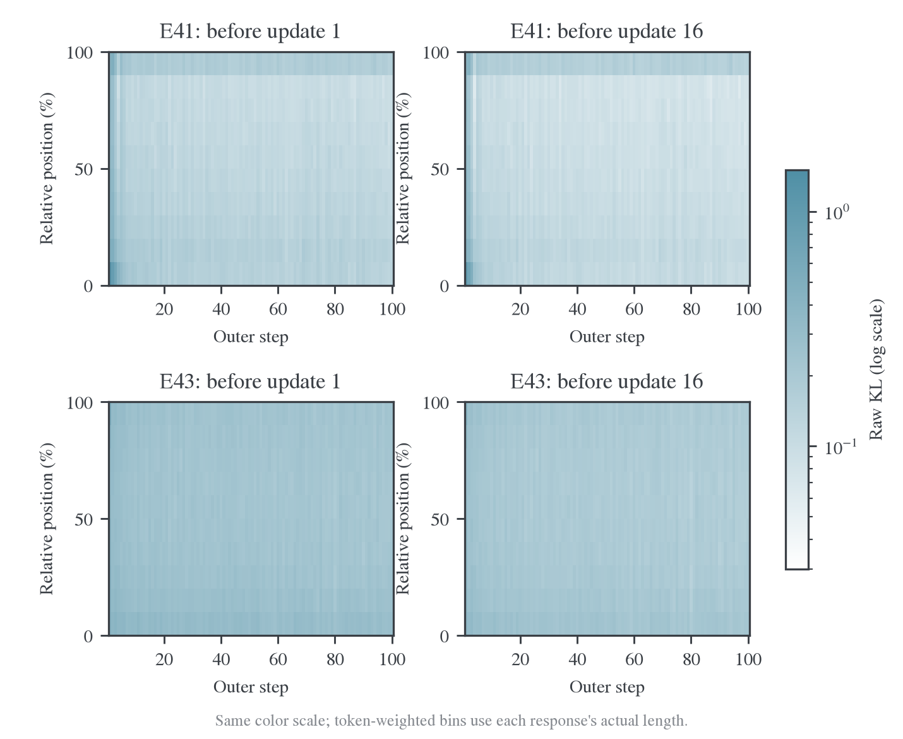
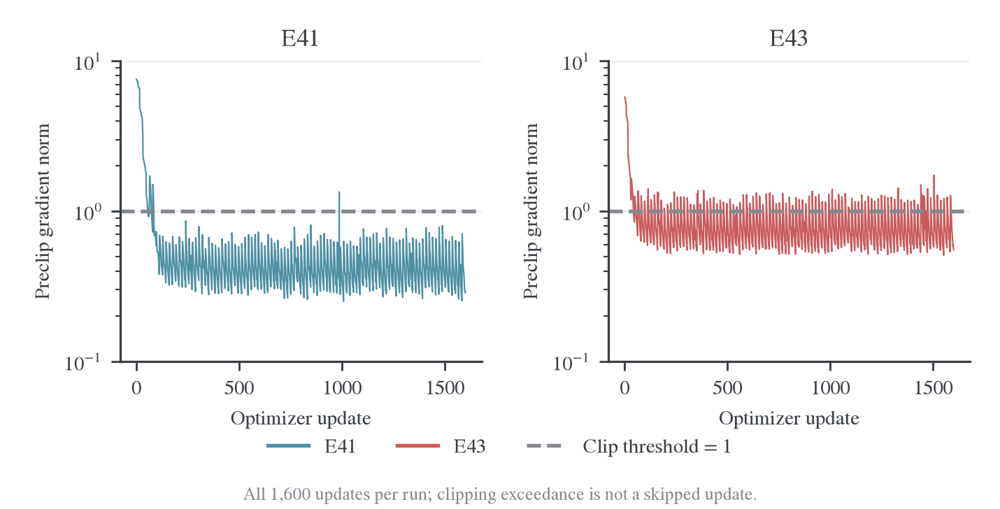
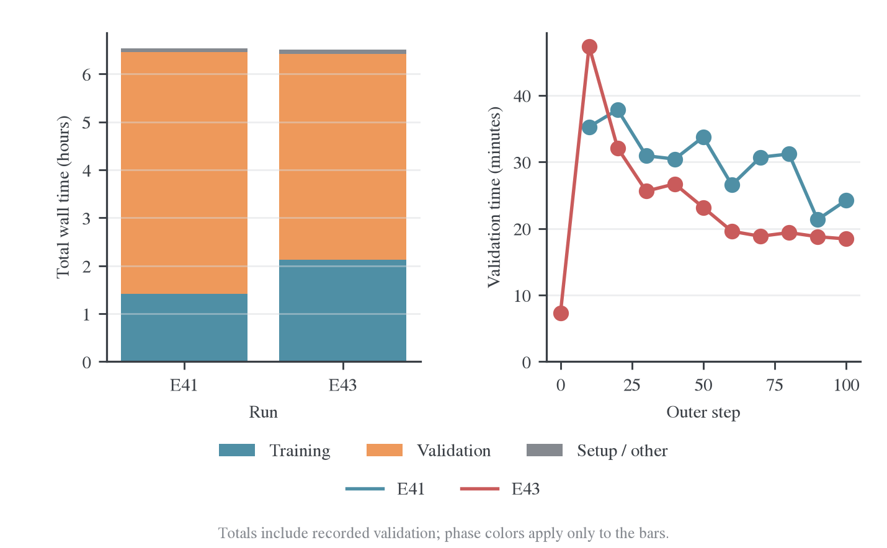
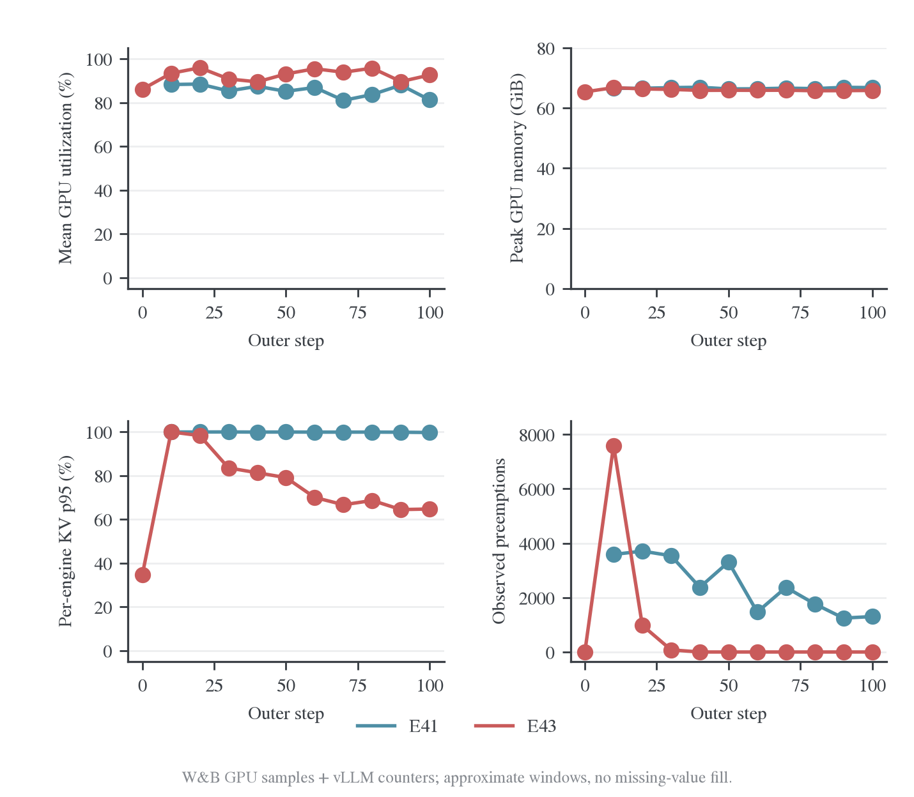

# Qwen3 教师配对：E41/E43 完整结果

## 1. 背景与 motivation

终止语义修正能减少 Base 生成退化，但能否突破学习平台、已有后训练学生能否进一步吸收 teacher，仍需正式长训练评价。E41 对应 Base←Qwen3-4B，E43 对应后训练 Qwen3-1.7B←4B-Instruct。两组同时改变 student 与 teacher，因此用于刻画实际配对的行为，不能识别单独的初始化效应。

## 2. Setting 与实验设计

| 设置                       | E41                         | E54                                           | E43                         |
| -------------------------- | --------------------------- | --------------------------------------------- | --------------------------- |
| Student                    | Qwen3-1.7B-Base             | Qwen3-1.7B-Base                               | Qwen3-1.7B                  |
| Teacher                    | Qwen3-4B                    | Qwen3-30B-A3B-Instruct-2507                   | Qwen3-4B-Instruct-2507      |
| Outer / 参数更新预算       | 100 / 1,600                 | 100 / 1,600                                   | 100 / 1,600                 |
| 训练 prompt / response cap | 1,024 / 7,168               | 1,024 / 7,168                                 | 4,096 / 7,168               |
| 初始验证                   | 关闭                        | 关闭                                          | 开启                        |
| 验证 / 保存间隔            | 10 / 50 outer               | 10 / 50 outer                                 | 10 / 50 outer               |
| 本次验证题目数             | 570，原三集                 | 630，五集                                     | 630，五集                   |
| 每题采样 / 回答上限        | 16 / 31.7k token            | 16 / 31.7k token                              | 16 / 31.7k token            |
| 每卡推理并发 / 显存预算    | 64 / 0.80                   | 64 / 0.80                                     | 64 / 0.80                   |
| 终止动作 KL                | 合并 151643、151645         | 合并 151643、151645                           | 原生终止协议                |
| 当前状态                   | 完成 100 outer / 1,600 更新 | 人工停止；更新至 30 outer/480次，完整验证到20 | 完成 100 outer / 1,600 更新 |

共同训练设置：Full-vocab RKL、batch64、每题 1 条 rollout、reuse16、学习率 1e-6、seed42；每组 8 张 H800。三组使用 non-thinking 提示，训练采样温度 1、top-p 1；验证温度 0.7、top-p 0.9、top-k -1，回答上限 31,744。Teacher 通过 shared-sync FSDP2 评分，表内并发 64 属于 student 生成引擎。

E41 此次只有 MATH-500、AMC23、AIME25，E43/E54 增加 AIME24/26；公共入口的新运行默认五集，不能反向补成旧 E41 的已测结果。[数学验证协议](../../../../settings/验证设置.md)统一说明题目与判分。E43 同时改变 student 和 teacher，不能用跨组差值单独判断教师效应。

E54 的 MoE teacher 按全部权重进行八卡分片；该运行已按用户要求停止，阶段结果与独立探针见[长度诊断](../../../../infra/model-compatibility/qwen-e54/2026-10-29-E54长度膨胀诊断.md)，不并入 E41/E43 的完整结果。原始运行见 W&B。[^e54]

E41/E43均完成100 outer、1600 更新。E41 没有初始验证，E43 有五集初始验证；E54 不在本文完成结果中。

<a id="2-准确率与平台"></a>

## 3. 实验结果：准确率与平台

准确率单位为 %，均为本项目 avg@16。E41 启动时只有原三集；未测项目保留为空，不补估计值。运行页面见参考文献。[^e41][^e43]

| 基准     | E41 第 10 步 | E41 最终 | E43 初始 | E43 第 10 步 | E43 最终 |
| -------- | -----------: | -------: | -------: | -----------: | -------: |
| MATH-500 |        68.03 |    69.04 |    70.79 |        85.25 |    85.39 |
| AMC23    |        40.31 |    40.16 |    42.81 |        71.88 |    75.31 |
| AIME24   |            — |        — |    12.29 |        36.04 |    31.46 |
| AIME25   |         5.83 |     7.50 |     8.96 |        23.96 |    24.17 |
| AIME26   |            — |        — |     9.58 |        22.71 |    23.96 |



图 1：逐基准的全部验证节点。E41 从第 10 步开始；其 AIME24/26 未测，不绘制对应曲线。MATH/AMC 与 AIME 面板的纵轴范围不同，跨面板比较看数值，不看视觉斜率。

E41 在第 10 步后总体接近平台：MATH 增加约 1.01 个百分点，AMC 基本不变，AIME25 有波动。缺少初始验证，因此本运行支持“早期达到此水平后增长有限”，不支持直接计算相对原始 Base 的增益。

E43 相比自己的初始点，各项都有明显提高，MATH 和 AMC 分别增加 14.60、32.50 个百分点。多数收益在前 10 步形成；后期 AMC 继续提高，但 AIME24 最终低于第 10 步。不能把所有基准概括为单调上升。AIME 每集只有 30 题，16 个回答并非 480 道独立题；单 seed 的小幅变化不能作为显著优劣结论。

## 4. 实验结果：长度与终止行为

下面是验证回答的平均长度，单位为千 token；触顶率按真实 finish_reason=length 计算。它不等于重复率。

| 实验与基准   | 第 10 步长度 | 最终长度 | 第 10 步触顶率 | 最终触顶率 |
| ------------ | -----------: | -------: | -------------: | ---------: |
| E41 MATH-500 |        2.61k |    1.95k |          4.99% |      2.98% |
| E41 AMC23    |        6.26k |    4.04k |         14.53% |      6.25% |
| E41 AIME25   |       11.12k |    9.12k |         27.50% |     19.17% |
| E43 MATH-500 |        3.25k |    2.27k |          1.48% |      0.06% |
| E43 AMC23    |        7.57k |    5.16k |          4.06% |      0.16% |
| E43 AIME24   |       15.82k |    9.61k |         16.04% |      1.67% |
| E43 AIME25   |       15.10k |    9.05k |         13.13% |      0.83% |
| E43 AIME26   |       15.40k |    9.35k |         13.33% |      2.92% |

最终 E41 有 370/9,120 条回答触顶，约 4.06%；E43 为 32/10,080，约 0.32%。各验证集生成失败数均为 0。E43 的初始全体回答加权平均长度为 1.31k，最终为 3.46k；其变化是前期变长、后期缩短，仍长于初始回答，不能写成“相对初始化长度下降”。E41 第 10 步至最终的同口径长度为 3.31k → 2.47k。



图 2：上排为训练，下排为共同三集 MATH/AMC/AIME25 的验证；验证按回答数加权，确保两条曲线使用相同题目集合。它与 E43 五集全体加权长度不是同一个统计量。训练和验证的 cap 不同，分别使用纵轴范围。

最近 10 个训练 batch 的统计与验证分开解释：

| 指标                  | E41 outer 91–100 | E43 outer 91–100 |
| --------------------- | ---------------: | ---------------: |
| 平均训练回答长度      |            2.56k |            4.65k |
| 训练触顶率，cap 7,168 |            4.22% |           37.34% |
| 训练题目平均正确率    |           27.19% |           52.34% |

E43 训练仍有较多回答达到 7,168 上限，但验证允许 31,744，最终验证触顶很少。这说明训练截断仍值得观察，不能用训练触顶率直接代替长窗口下的异常率。当前完整运行日志没有统一的 repeat 指标，本文不把触顶比例改名为循环比例。E41 原始 KL 与终止动作对齐的 20 步受控重复实验见[短程对照](../../../../infra/model-compatibility/termination/README.md)，不能把那组重复率直接套到本次 100 步运行。

## 5. 分析：优化动力学与资源

### 5.1 KL 下降与验证平台

以下使用每批第 16 次更新前的观测，避免把批内不同复用位置混合；不同批次的 rollout 内容仍然不同。

| 指标                 | E41 首批 → 最终批 | E43 首批 → 最终批 |
| -------------------- | ----------------: | ----------------: |
| 原始词表 Full-KL     |   0.4121 → 0.0919 |   0.3351 → 0.1853 |
| 实际优化 loss        |   0.4020 → 0.0850 |   0.3351 → 0.1853 |
| 最终批前 10% 位置 KL |            0.0979 |            0.2168 |
| 最终批后 10% 位置 KL |            0.1489 |            0.1869 |

E41 的实际 loss 使用停止动作合并，而 Full-KL 指标仍是原始词表诊断；E43 未合并，两者一致。位置按每条回答自身实际长度分桶，长回答在 token 聚合中权重更高。不能把不同 teacher 下的 KL 绝对大小直接解释为哪个 student 更强。



图 3：每个 outer 分别取第 1、16 次更新前的观测。E41 的两种 KL 含义不同，E43 的 raw KL 与实际目标相等。后期曲线仍有批内下降，但新 batch 的起点较高；由于前缀与样本已经变化，这个跨批差值不能直接解释为同一题目的遗忘或参数更新反弹。

### 5.2 同批复用仍在拟合，能力提升并未同步持续



图 4：分别对前 5 批、后 5 批等权平均，展示实际优化目标。16 个更新前观测之间包含 15 次已执行更新，不是同一轮参数的重复测量。

末 10 批中，从批内第 1 次到第 16 次观测，E41 的 loss 平均相对下降 24.13%，E43 下降 21.73%。最终批分别从 0.1120 降至 0.0850、从 0.2383 降至 0.1853。结合准确率曲线，这支持“固定当前 batch 仍能进一步拟合，而独立验证收益已经有限”；它不证明更多 reuse 会提高泛化，也不证明 reuse 导致平台，因为缺少匹配的复用次数对照。

### 5.3 Full-KL Position 的变化



图 5：四个面板共享 0.03–1.5 nats 的对数色标；纵轴按每条回答自身有效长度分为十段，颜色是该桶 sum/count。没有将全局对齐 loss 分摊为位置 loss；所有格子都是原始词表 KL。分析脚本逐次核验十桶加权聚合能恢复全局 Full-KL。

E41 的初始前缀失配下降明显，但末段 KL 在后期相对更高；E43 的失配更分散，后期仍有残余。热图能定位监督误差分布，不能证明尾部内容正确或错误。长短回答的相对位置不对应相同绝对 token 数，也不能用不同轨迹热图代替固定前缀诊断。

### 5.4 梯度与数值稳定性



图 6：每次更新的裁剪前梯度范数，纵轴为对数，虚线为配置阈值 1。E41/E43 的最大观测分别为 7.56/5.76；超过阈值的观测比例为 4.44%/23.38%。E43 更频繁触及裁剪阈值，但两组各 1,600 次更新全部执行，非有限 loss、非有限梯度和 skipped update 均为 0。裁剪频率不等同于数值故障或跳步。

### 5.5 验证占据主要墙钟



图 7：左侧按互不重叠的已记录训练、验证及其余开销分解墙钟，右侧为每次验证耗时，E43 包含初始验证。左图颜色表示阶段，右图颜色表示实验。

| 墙钟构成         |       E41 |       E43 |
| ---------------- | --------: | --------: |
| 训练阶段         | 1.42 小时 | 2.13 小时 |
| 验证阶段         | 5.04 小时 | 4.29 小时 |
| 初始化与其他收尾 | 4.50 分钟 | 5.62 分钟 |
| 合计             | 6.53 小时 | 6.51 小时 |
| 验证占比         |    77.13% |    65.85% |

E43 单轮验证从第 10 步的 47.4 分钟降至最终 18.4 分钟，伴随回答缩短及触顶减少。E41 最终验证仍需 24.2 分钟。这里的耗时变化包含工作量变化，不能解释成固定 token 工作量下的纯引擎加速。

### 5.6 相同并发的 KV 压力不同



图 8：GPU 数据来自 W&B 系统监控，KV 与抢占来自同时归档的 vLLM telemetry。GPU util 对八卡及窗口内采样点平均；显存取窗口内单卡最大值；KV p95 对引擎与时间采样联合计算；抢占量为每个引擎在窗口内相邻可见端点的 counter 增量之和，不是失败回答数。

| 验证节点     | 八卡平均 GPU util | 单卡峰值显存 | 引擎 KV p95 | 窗口内观察到的抢占 |
| ------------ | ----------------: | -----------: | ----------: | -----------------: |
| E41 第 10 步 |            88.23% |    66.55 GiB |      99.90% |              3,587 |
| E41 最终     |            81.18% |    66.78 GiB |      99.68% |              1,304 |
| E43 第 10 步 |            93.35% |    66.76 GiB |      99.94% |              7,594 |
| E43 最终     |            92.57% |    65.83 GiB |      64.71% |                  0 |

E43 第 40 步起，每次验证的观测窗口内均未增加抢占计数；E41 最终仍有明显缓存竞争。相同 max_num_seqs=64 与显存预算 0.8，在不同轨迹长度分布下的表现不同。显存占用接近不代表 KV 需求接近，因为引擎会预留缓存。后期 E43 的这组配置较平稳，E41 则仍需以吞吐对照判断是否调整并发；单凭抢占次数不能确定降低并发必定更快。

窗口由 W&B 聚合记录的时间戳减去 validation_seconds 近似定位。GPU/KV 分位统计剔除边界各 30 秒；counter 增量使用窗口内完整观测，可能漏掉边界采样间隙，因此是观测增量。缺失请求、关闭服务时的遥测错误不填零。全程 W&B 采样到的单卡峰值分别为 66.89、66.76 GiB，它们不保证覆盖亚秒瞬态，也不是独立 teacher 峰值。

<a id="5-与-failure-reproduction-原论文比较"></a>

## 6. 分析：与 Failure-reproduction 原论文比较

原研究入口及完整论文设置见[失败复现方案](../failure-matrix/2026-10-25-Sampled-token与Full-vocab失败复现方案.md)。该方案是历史 250-step 配对设计；这里已经完成的是 100-step、reuse16 变体，不表示原矩阵的 sampled/full 配对或多 seed 已完成。

### 6.1 E41 对应 Rethinking OPD 的学习受限设置

Rethinking OPD 第 3.1 节使用相同的 Qwen3-1.7B-Base ← Qwen3-4B Non-thinking 模型对。图 2 的学生三基准均分约从 5% 升至 15%，弱于使用 Base-GRPO teacher 的曲线；这是近似读图值，原现象是收益受限，不能称为完全不学习。原文采用 student-top-16，而非这里的 full-vocab 终止动作对齐目标。[^rethinking]

原图及完整原始设置统一见[失败复现方案第 5 节](../failure-matrix/2026-10-25-Sampled-token与Full-vocab失败复现方案.md#5-e29e30base-学生与-non-thinking-4b-教师的初始失配)。

原图三项是 AIME24、AIME25、AMC23；E41 缺少 AIME24，因此不能把本项目含 MATH 的三项均分与约 15% 比较。原文每题 4 条 rollout、验证 top-p=0.95；E41 每题 1 条、reuse16、验证 top-p=0.9，并加入终止动作对齐。模型对相同不足以构成算法的受控比较。

E41 现有证据说明：此 Base 模型对在当前配方下可以稳定完成长程更新，但第 10 步后收益有限。尚不能声称 Full-KL 单独解决了论文的 teacher mismatch；需要同设置 sampled 对照和原始师生同协议评测来分离各因素。

### 6.2 E43 对应 Semi-OPD 的在线轨迹受限设置

Semi-OPD 论文采用相同的 Qwen3-1.7B Non-thinking ← Qwen3-4B-Instruct-2507。原文表 1 对训练后的方法报告 step 60/80/100 的平均成绩；这里也对 E43 的同三个 outer 节点求平均。单位为 %，但评测采样和训练预算仍不同：[^semi]

| 来源与方法                         | AIME24 | AIME25 | AIME26 |
| ---------------------------------- | -----: | -----: | -----: |
| 论文：初始 student                 |   12.6 |    9.6 |    7.4 |
| 本机：E43 初始 student             |  12.29 |   8.96 |   9.58 |
| 论文：标准 OPD，60/80/100 平均     |   35.8 |   25.5 |   23.3 |
| 本机：E43 Full-r16，60/80/100 平均 |  32.01 |  23.75 |  22.22 |
| 论文：Semi-OPD，60/80/100 平均     |   50.3 |   38.9 |   41.8 |

按共同三个 AIME 简单等权平均，论文标准 OPD 为 28.20%，本机 E43 为 26.00%，论文 Semi-OPD 为 43.67%。这些是本表共同列的算术整理，不是论文包含 HMMT 的四项均分。本机没测 HMMT，不能填成论文的完整 Avg@32。

数值上，E43 处于原文标准 OPD 相近的范围，没有显示出达到 Semi-OPD 高分的结果。它证明当前训练能提升该 student，尚未证明 full-vocab 与 reuse16 已解决在线 rollout 的局限。

| 比较条件          | 论文表 1                                      | 本机 E43                                       |
| ----------------- | --------------------------------------------- | ---------------------------------------------- |
| 监督与采样来源    | 标准 OPD / Semi-OPD；主要为 sampled-token RKL | 在线 Full-vocab RKL，reuse16                   |
| 训练 response cap | 标准 OPD 16,384；Semi-OPD 4,096               | 7,168                                          |
| 数据与每批轨迹    | DAPO 英文去重子集；128×1                      | 本项目 DAPO；64×1                              |
| 报告节点          | 60/80/100；标准 OPD 条目注明引自 Relay-OPD    | 相同 outer 数字，但对应 960/1,280/1,600 次更新 |
| 验证              | avg@32，温度 1、top-p 1、cap 32,768           | avg@16，温度 0.7、top-p 0.9、cap 31,744        |
| 数据集            | AIME24/25/26、HMMT Feb26                      | MATH、AMC、AIME24/25/26                        |

论文另在相同 4K 训练 cap 下报告该模型对的 Semi-OPD 末点优势 +9.5 个百分点（四基准均分）。那是另一组匹配长度对照，不能把表 1 的不同 cap 分数差当作纯 on/off-policy 效应，也不能把 +9.5 直接视为本机待复现的差值。[^semi]

我们没有同配置的 E42 sampled 对照，也没有本机 Semi-OPD 臂，因此当前结果不支持对 full-vocab、reuse 或离线来源的独立因果归因。E43 后期缩短、准确率平台的现象与论文研究问题相容，但并未验证唯一机制。

### 6.3 TIDE 结果的归属

失败复现文档中的 TIDE 强失配主结果对应 Qwen3-1.7B-Base ← Qwen3-8B，属于 E39 模型对，不是 E41 的 4B teacher，也不是 E43 的 post-trained student。其九基准 Avg@8 不能直接填入上面的两组结果。[^tide] 本机相应运行见[E39 完整报告](../qwen-base-8b/README.md)。

<a id="6-冻结证据与结论边界"></a>

## 7. 冻结证据与结论边界

分析使用本地完整 `.wandb` 解码记录，并与归档 file logger 逐字段核对。逐次 optimizer 更新编号均覆盖 1–1,600，无缺号；W&B 退出记录也为成功。原始文件和冻结 telemetry 归档在独立日志仓库，正文不依赖临时运行目录：

- [数据说明](../../../../../../../../wandb-logs/MirrorOPD-verl/analysis/qwen-e41-e43-final-20261028/README.md)、[完成状态](../../../../../../../../wandb-logs/MirrorOPD-verl/analysis/qwen-e41-e43-final-20261028/summary.json)。
- [全部验证节点](../../../../../../../../wandb-logs/MirrorOPD-verl/analysis/qwen-e41-e43-final-20261028/validation.csv)、[逐批训练](../../../../../../../../wandb-logs/MirrorOPD-verl/analysis/qwen-e41-e43-final-20261028/training.csv)、[全部更新及首尾位置 KL](../../../../../../../../wandb-logs/MirrorOPD-verl/analysis/qwen-e41-e43-final-20261028/updates.csv)。
- [E41 配置](../../../../../../../../wandb-logs/MirrorOPD-verl/analysis/qwen-e41-e43-final-20261028/E41/config.yaml)、[E43 配置](../../../../../../../../wandb-logs/MirrorOPD-verl/analysis/qwen-e41-e43-final-20261028/E43/config.yaml)；对应子目录保留原始 metrics.jsonl 与 exit.json。

- [W&B 一致性与动力学汇总](../../../../../../../../wandb-logs/MirrorOPD-verl/analysis/qwen-e41-e43-final-20261028/wandb-diagnostics.json)、[逐位置 KL](../../../../../../../../wandb-logs/MirrorOPD-verl/analysis/qwen-e41-e43-final-20261028/position-kl-detail.csv)、[验证资源统计](../../../../../../../../wandb-logs/MirrorOPD-verl/analysis/qwen-e41-e43-final-20261028/validation-resources.csv)。
- [分析与绘图源码](../../../../../research/studies/qwen_teachers/analyze_qwen_teacher_runs.py)、[图形审计](figures/completed-20261028/figure-audit.json)。每张图同时提供同名 PNG/PDF，PDF 便于导出。

从源码仓库根目录复算；使用已有 plotting 环境，分析不占用 GPU、不上传 W&B：

```bash
../wandb-logs/.venv/bin/python ../wandb-logs/tools/wandb_local.py decode --run 53dd553d
../wandb-logs/.venv/bin/python ../wandb-logs/tools/wandb_local.py decode --run eccc09a1
FIGURE_VIZ_MPL=../dotfiles/.agents/skills/figure-viz/assets/mpl \
  /root/.local/share/mirroropd/venvs/plotting/bin/python \
  -m examples.mirroropd.research.studies.qwen_teachers.analyze_qwen_teacher_runs \
  --logs-root ../wandb-logs \
  --data ../wandb-logs/MirrorOPD-verl/analysis/qwen-e41-e43-final-20261028 \
  --out examples/mirroropd/docs/experiments/teacher-transfer/teacher-comparison/qwen-teachers/figures/completed-20261028
```

E41/E43 的单 seed 完整结果已经确认；原计划中的 250-step 配对、同协议 teacher 参考、重复率完整重算与多 seed 统计仍未完成。E54 的人工停止状态与独立探针统一见长度诊断，避免在本报告重复维护阶段结论。

### 参考文献

[^e41]: MirrorOPD-verl. E41，Qwen3-1.7B-Base ← Qwen3-4B，2026，本地完整指标与退出记录已核对。[W&B](https://wandb.ai/wncfht/MirrorOPD-verl/runs/53dd553d)。

[^e43]: MirrorOPD-verl. E43，Qwen3-1.7B ← Qwen3-4B-Instruct-2507，2026，本地完整指标与退出记录已核对。[W&B](https://wandb.ai/wncfht/MirrorOPD-verl/runs/eccc09a1)。

[^rethinking]: Yaxuan Li et al. _Rethinking On-Policy Distillation of Large Language Models: Phenomenology, Mechanism, and Recipe_. arXiv:2604.13016v2，2026，第 3.1 节、图 2、附录 A；2026-10-28 复核原文及原图。[论文](https://arxiv.org/html/2604.13016v2)。图的获取及转换说明见[原图档案](../failure-matrix/figures/README.md)。

[^semi]: Siyan Zhao et al. _When Do We Need On-Policy Distillation? Distilling on Offline Student Rollouts Is Often Better_. arXiv:2610.11291v1，2026，表 1、表 3、第 2–4 节与附录 A；2026-10-28 复核。[论文](https://arxiv.org/html/2610.11291v1)。

[^tide]: Zichao Yu et al. _Mismatch Matters: On-Policy Distillation Beyond Token Agreement_. arXiv:2608.09836v1，2026，第 4 节与表 1。[论文](https://arxiv.org/html/2608.09836v1)。
