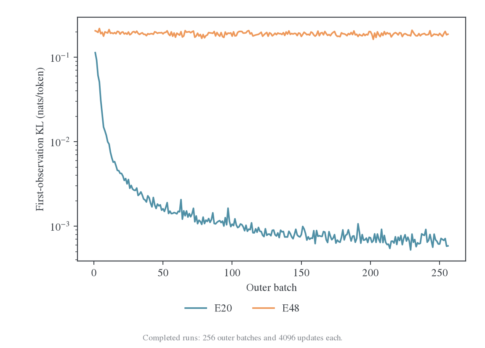
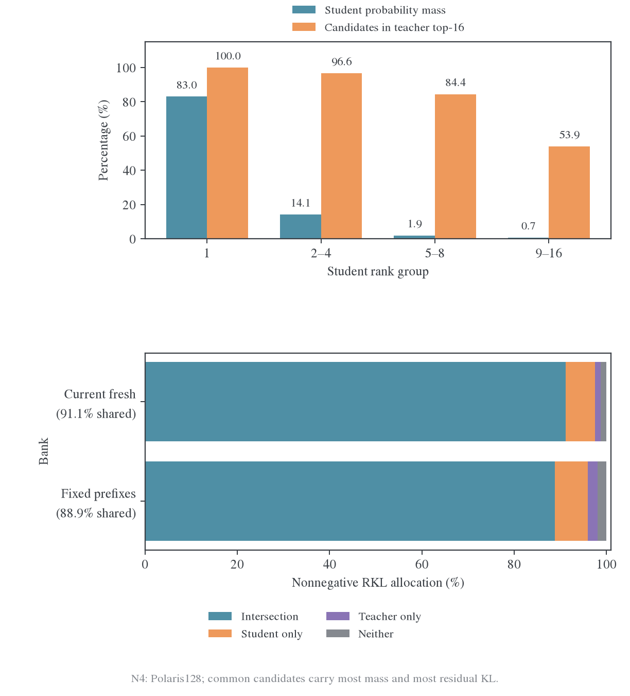
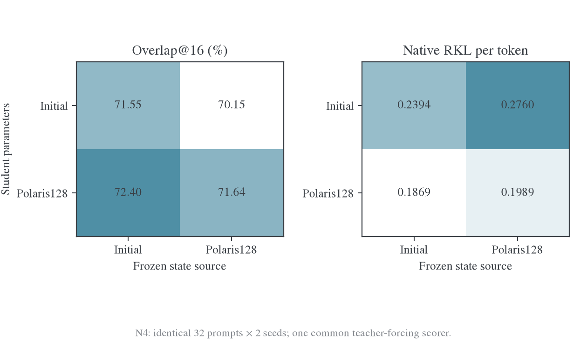
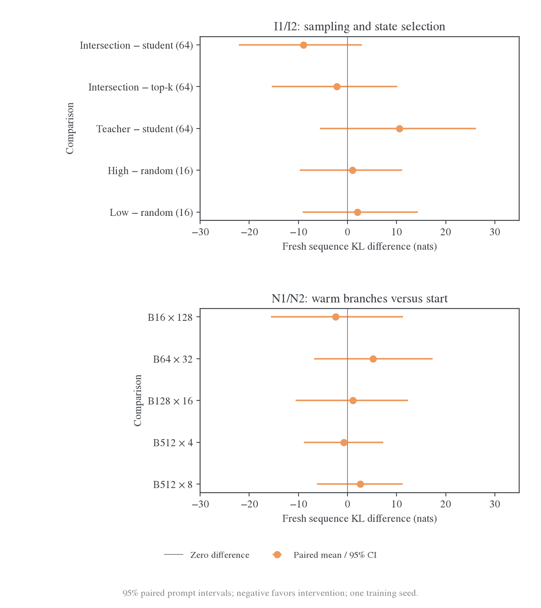
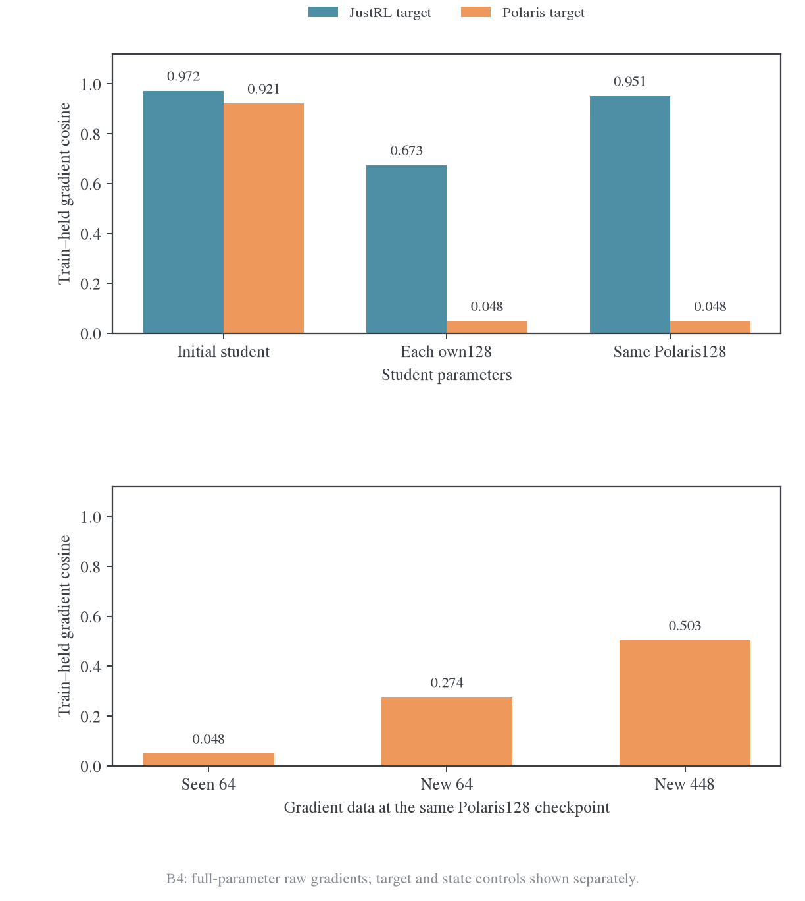
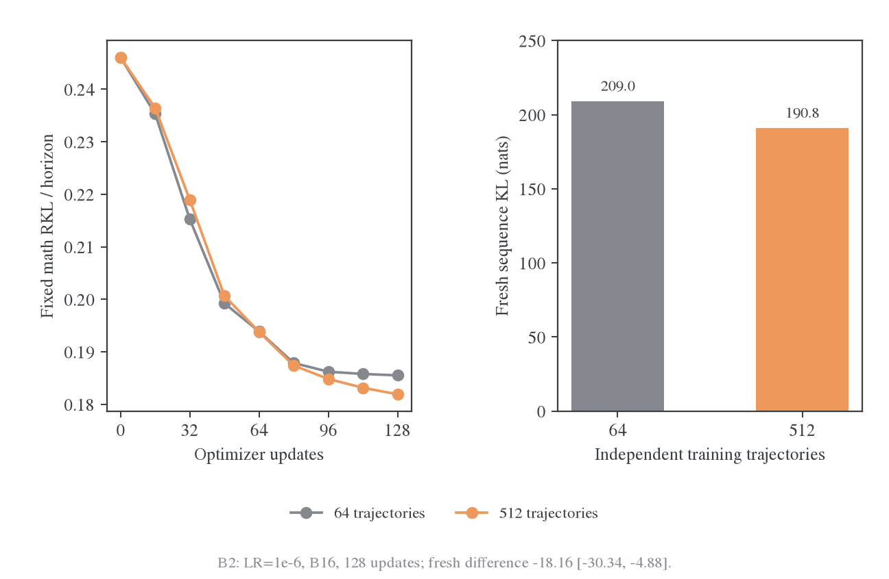
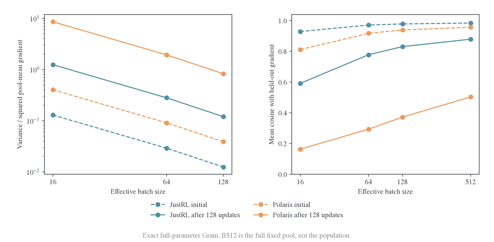
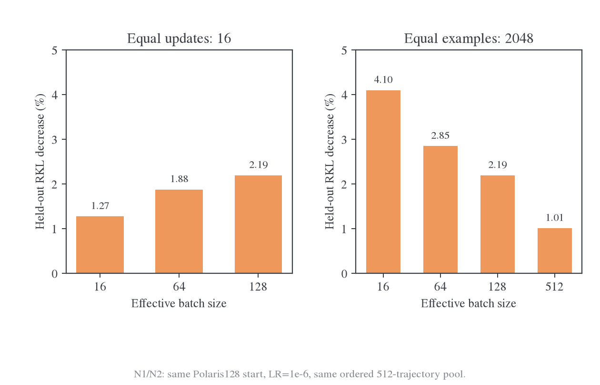

# 跨源蒸馏泛化：统一实验设置、证据与后续方向

更新：2026-10-27。本文合并原来的 state 来源、交集采样、跨批次泛化、批大小与阶段动力学四份报告。前四系列由已有冻结数据整合；新增 L 系列按用户要求完成 40 批输入、20 批单遍训练，每个 teacher320 次更新。原四个系列及新增 L 系列合计 **47 个非零学习率训练分支、3384 次更新**，另有一次学习率为零的数值对照；梯度测量、交叉评分和任务生成另计。各系列的题目、state、预算和归一化不同。S/I/B/N 的共用设置保留在本文；L 设置、跨批结果和来源对照已迁至[双来源 Rollout 跨批次专题](README.md)，其中 R 为待执行重跑，不计入已完成统计。

目前最有支持的判断是：Polaris 能拟合已见 state，但局部下降较难转化成未见 state 和当前学生访问分布上的收益。后期同时出现平均梯度迁移性减弱、相对小批噪声升高。增加独立覆盖有有限收益，扩大有效 batch 能改善单次更新；纯 teacher rollout、交集约束、高-overlap 筛选和单纯增大 batch，都没有在这些预算内消除差距。这里的“泛化”主要指条件概率分布，不等于任务准确率。

| 核心判断                                 | 直接证据                                                                                               | 结果位置                                                                          |
| ---------------------------------------- | ------------------------------------------------------------------------------------------------------ | --------------------------------------------------------------------------------- |
| 不回访旧批，Polaris 后期仍出现泛化平台   | L：20 批单遍后，数学留出 J/P 下降 93.60%/25.67%；P 最后 5 批批内仍降 31.25%，留出只降 0.91%            | [40 批单遍结果](cross-batch/2026-10-28-跨批次迁移与单遍训练结果.md#long-pass)     |
| 同域跨批差距已经明显，异源并非完全不迁移 | B1 只训练数学 A：JustRL/Polaris 在独立数学上分别下降 73.31%/22.13%                                     | [跨批与跨域](cross-batch/2026-10-28-跨批次迁移与单遍训练结果.md#transfer)         |
| 换批 loss 回升不能直接解释成遗忘         | B1 两种教师各 18 次旧批复测均继续下降                                                                  | [旧批保持](cross-batch/2026-10-28-跨批次迁移与单遍训练结果.md#retention)          |
| Teacher 来源的验证集可能给出不同排名     | I1 teacher-state 训练对 Polaris 参考下降 42.90%，对 student 参考仅 8.14%                               | [来源与访问反馈](cross-batch/2026-10-28-跨批次迁移与单遍训练结果.md#state-source) |
| 高采样交集命中率不保证概率分配正确       | N4 当前轨迹约 99.54% 的学生质量在交集内，约 91.10% 的非负 KL 残差也在交集内                            | [Overlap 机制](#overlap)                                                          |
| 大 batch 降噪，但未解除平台              | N1/N2 后期同 16 步 B16→B128 有收益；同 2048 条处理量 B16 更好，fresh 改善区间均含零                    | [批大小](#batch-size)                                                             |
| 应优先识别覆盖、访问反馈和实际更新方向   | 旧 Seen64 梯度近正交，New64/448 明显恢复；L 已测本机首步；仍需生产 checkpoint 与整个块内的实际更新投影 | [研究路线](#next)                                                                 |

<a id="definitions"></a>

## 1. 共用对象与评估定义

学生均为 `DeepSeek-R1-Distill-Qwen-1.5B`，实际参数量 1,777,088,000。教师为同源 `JustRL-DeepSeek-1.5B`（J）或异源 `Polaris-7B-Preview`（P），训练时冻结。“同源/异源”不是单独随机化的因素：模型大小、后训练历史等也不同，因此不能将配对差异全部归因于来源标签。

State 是完整文本前缀 $s=(x,y_{<t})$。固定评估先保存整条参考回答的 token IDs，每个 checkpoint 都输入同样的 prompt 及前缀；不会只固定起点、再让新学生替换后缀。来源标签描述生成策略，不是 state 本身不可改变的属性。

设学生为 $p_\theta$、教师为 $q$，原生 reverse KL（RKL）为：

$$
\ell_q(s;\theta)=\sum_{v\in V_p}p_\theta(v\mid s)\log\frac{p_\theta(v\mid s)}{q(v\mid s)}.
$$

Polaris 保留原生 softmax 归一化，包括学生 head 之外的 128 行。Forward KL（FKL）对照使用教师在学生输出支持集上的条件分布；否则教师额外输出行会使原生 FKL 无穷大。JS 和 TV 在联合支持集上计算，包含教师额外行。不同距离分别报告，不把 RKL 下降写成所有距离都改善。

I/B/N/L 的固定风险使用固定 horizon 分母；S 只对选定的稀疏 state 求均值：

$$
R_{\mu,H}(\theta)=\mathbb E_{x,o\sim\mu}\frac1H
\sum_{t\le\min(T_{x,o},H)}\ell_q(x,y^{\mathrm{fixed}}_{<t};\theta).
$$

EOS 之后贡献为零。I 的题目与三个参考来源等权，B/N 只有初始学生参考。相对下降均先求组风险，再算 $1-R_{\mathrm{after}}/R_{\mathrm{before}}$；不能平均各来源的百分比代替它。

Fresh 评估由当前学生无约束重新生成，即使训练使用 teacher、intersection 或 top-k，评估仍取消这些限制。共同 EOS 约定和 H 下的截断序列风险为：

$$
J_H(\theta)=\mathbb E_{x,y\sim p_\theta}
\sum_{t\le\min(T,H)}\ell_q(x,y_{<t};\theta).
$$

由序列 KL 的链式法则，$J_H$ 估计指定 prompt 分布和 H 下的序列 RKL。它是轨迹上条件 KL 的**和**，不是 token 平均；同时报告长度和终止行为。训练把已采样 state 及 mask 视为常量，full-vocab 只消除了给定 state 上的动作采样误差，没有自动加入访问分布随参数变化的梯度项，所以局部训练目标的下降不保证 $J_H$ 下降。

所有训练分支从各自规定的模型起点建立 fresh AdamW，betas=(0.9,0.999)、weight decay=0.01、clip=1；默认 LR=1e-6。历史步长对照仅在 B2 附录保留，不列为后续研究重点。短训都更新全部学生参数，没有使用 LoRA 或只训练 head。

配对区间按 prompt bootstrap，fresh 先平均同一题的两个采样 seed；它们只刻画给定训练模型下的 prompt 不确定性，不包括跨训练 seed 变动，也未做多重比较校正。S 的两个 fold 是不同训练题，不是两个独立完整训练 seed。验证银行多次用于诊断，不能冒充最终封存测试集。

<a id="settings"></a>

## 2. 实验设置与数据关系

### 2.1 S/I/B/N 四个系列的共用设置差异

| 系列             | 训练数据与 state                                                        | 固定验证                                                                     | 每次更新的 loss 归一化                                           | 数值实现与裁剪                                                                                 |
| ---------------- | ----------------------------------------------------------------------- | ---------------------------------------------------------------------------- | ---------------------------------------------------------------- | ---------------------------------------------------------------------------------------------- |
| S：稀疏局部探针  | 16 数学 +4 代码 +4IF，三来源各一条；H768；每个训练 fold 只用 4 道数学题 | 数学 8 题、代码 4 题、IF4 题；全部三来源共 3376 个评分 state；另列同轨迹后段 | 训练 4 题×32 个前段位置，共 128 个 state 的均值                  | FP32 主权重、CPU AdamW；BF16 backbone；head 先舍入 BF16 再以 FP32 投影；160 次非零更新全部裁剪 |
| I：在线来源/交集 | 128 道独立数学训练题；每 outer32 题，当前策略生成 H1024 后 reuse16      | 独立数学 64、代码 16、IF16；每题 S0/J/P 三条参考，共 288 条                  | 主臂为全部有效 response token 均值；选择臂为 8192 个选定位置均值 | 原生 GPU AdamW；FP32 学生主权重及 head、BF16 backbone；teacher BF16 权重、FP32 投影            |
| B：固定跨批/覆盖 | 初始学生冻结轨迹；A–D 各 16 道数学；扩展池另加 448 题                   | 新数学 E–H 各 16 题；代码 16、IF16，均为 S0 参考；含训练组共 160 条银行      | 固定 $16\times1024$；参考 EOS 后贡献零                           | 同 I；完整前缀与全部 response 位置，不做稀疏位置训练                                           |
| N：batch 与阶段  | 与 B 相同的 512 题池，固定打乱顺序；初始或各自 B1-blocked128 权重       | 沿用 B 的固定银行及独立数学 E/F fresh 面板                                   | 固定 $B\times1024$，B 是有效 optimizer batch；逐条轨迹累积       | 同 I；每个分支重置 AdamW；后期全部未触发 clip                                                  |

S 的数据选择 seed 为 20261027，prompt 长 32–384 token；数学为 DAPO、代码为 TACO、IF 为英文 MultiIF，排除中文、外部 URL 及交互式代码题。I 的选择 seed 为 2026102702；B 的新数学题选择 seed 为 2026102704；N 池顺序 seed 为 2026102708。I 模型训练 seed 为 2026102702，B/N 为 42。确切 prompt、token IDs 与排序均已冻结，复现优先读冻结文件而非重新抽题。

S 生成温度 1、不截断 top-p/top-k，H768；观测前段为 0,8,…,248，后段为 512,528,…,752，超过实际长度的不补造。训练前向只保留选定位置需要的前缀，固定评分包含所需后段；所有更新前后差异都对照同一 FP32-master 实现的 step0。原始 BF16 评分不与训练后读数混用。I/B/N 保留整条参考前缀，生成温度 1，默认不截断支持集。

**跨系列数据有复用，不能合并成独立重复实验。** B 的 A–D 就是 I 原来 64 道数学验证题的 S0 轨迹，B 另采 64 道新数学题作为 E–H 留出；代码/IF 参考沿用 I 的 S0 轨迹。N 再沿用 B 的训练池和验证银行。每个系列内部训练/留出互斥，但 I 与 B 的数学验证百分比不能当成同一条学习曲线；N 的 warm128 也不是 I 的 64 步 endpoint，更不是 E48 生产 checkpoint。

<a id="series-s"></a>

### 2.2 S：来源、温度与局部梯度探针

| ID  | 变量与起点                                            | 分支、预算与评估                                                                                                            |
| --- | ----------------------------------------------------- | --------------------------------------------------------------------------------------------------------------------------- |
| S1  | 初始学生；目标 J/P；训练 state 来自 S0 或对应 teacher | 2 教师×2 来源×2fold=8 组，每组 16 更新；fold 分别为数学 0–3、4–7；每步 128 个前段 state；验证统一报告 S0 前缀并保留其他来源 |
| S2  | P 目标温度 1.5，S0 训练 state；其余同 S1              | 2 个 fold 各 16 步，**评估回到原始温度 1 的 P**；另做 LR=0 的一次完整前后数值对照                                           |
| S3  | 初始参数的全参数梯度，不训练新模型                    | 跨 prompt 梯度；8 条 S0 轨迹各分 4 个 64-token 块，每块 8 个评分位置；所有块保持同样 248-token response 输入                |

S 共 160 次非零更新及 1 次零步长调用。零步长对照在 3376 个 state 上的 KL 最大变化为 0。数学和代码多数轨迹达到 H768，S 不评任务准确率，也不检验完整解题或自然 EOS。其稀疏位置、head 舍入和全程裁剪均与后续系列不同，S 的训练集降幅不能外推为生产训练速度。

<a id="series-i"></a>

### 2.3 I：在线来源、交集、state 选择与任务检查

| ID  | 变量与起点                                      | 分支、预算与评估                                                                                                                   |
| --- | ----------------------------------------------- | ---------------------------------------------------------------------------------------------------------------------------------- |
| I1  | 初始学生；每 outer 由规定策略生成新的训练 state | J/student，P/student、teacher、intersection16、student-top16，共 5 组；4 outer×16 更新=每组 64 步，128 道训练题每题一个新 rollout  |
| I2  | 同一批初始学生 32 条轨迹，只改 loss 位置 mask   | High/low/random各16步；每条选256位置，每步8192个state；高低按初始overlap@16排序并随机打破ties；保留完整输入                        |
| I3  | I1 五个 endpoint 的只读评估                     | 参数×初始/最终 fresh 轨迹 2×2 评分；另用独立 32 道 MATH-500 题，初始模型及五个 endpoint 各生成一答，H4096、T=1，用仓库 grader 计分 |

I1 的固定评估在 16/32/48/64 步进行；fresh 在 0/32/64 步进行，使用预先指定的 32 道数学留出题，每题 seed91730/91731 各一条，H1024。I2 沿用同一无约束 fresh 协议。I 共 368 次更新，任务检查共 192 条输出，不是全量 benchmark；Code/IF 仅测分布风险。

Intersection 使用学生概率在交集上条件化：$r(a\mid s)=p(a\mid s)\mathbf1[a\in S_{16}\cap T_{16}]/P(S_{16}\cap T_{16})$。先从 p 提出动作，不在交集时用独立随机流重采；空交集回退 student top16 并计数，实测为空次数 0。Top16 控制同样按 p 条件化，但支持集仅由学生决定。Teacher 采样使用 q 在学生可输入输出行上的条件分布；loss 仍保留教师原生归一化。不能将这些干预混同于改变 loss 支持集。

非交集主臂各生成 131072 个新 response token、训练访问 2097152 token；交集组为 130744 和 2091904，差约 0.25%，长度差保留。五个主臂 clip 次数按上述顺序为 30/25/56/26/25（各 64 步）；I2 三组各 16 次裁剪，平均参数步幅相近。固定参考由 BF16 HF 生成器预生成，fresh 评分使用实际采样时的概率，二者不要求逐位相同。

<a id="series-b"></a>

### 2.4 B：跨批保持、独立覆盖与目标方向

| ID  | 变量与起点                              | 分支与预算                                                                                                                                  |
| --- | --------------------------------------- | ------------------------------------------------------------------------------------------------------------------------------------------- |
| B1  | 初始学生；J/P；相同 64 条 S0 数学轨迹   | 每教师 4 种顺序，各 128 步：single 只用 A；blocked 按 A16/B16/C16/D16 循环；roundrobin 每步换批；mixed 每步各取 A–D 四题并轮换子组；共 8 组 |
| B2  | 初始学生；P；数据覆盖与历史步长对照     | 64 题 LR3e-6、512 题 LR1e-6、512 题 LR3e-6，各 128 步；64 题 LR1e-6 复用 B1-roundrobin。历史步长对照不作为后续研究重点                      |
| B3  | 同一个 P-blocked128 模型权重；重置 Adam | RKL/FKL/JS各32步；相同64题、roundrobin、LR1e-6；所有评估含原生RKL                                                                           |
| B4  | 只读全参数梯度与固定/新轨迹评估         | 5 个固定银行梯度案例、5 个 fresh 梯度案例、2 个新覆盖案例；具体组大小见[梯度结果](#geometry)                                                |

B 共 1504 次更新。B1 的 blocked/roundrobin/mixed 每条训练轨迹恰好访问 32 次；single 每条 A 访问 128 次。64 条中 63 条长 1024、一条 908；三个 64 题复用条件 128 步访问 2,093,440 token，single 条件为 2,097,152 token；B2 的 512 题各访问 4 次、共 2,091,440 token。有效 token 差约 0.096%，固定 H 归一化保持相同 token 权重。

B2 的 512 题 LR1 首次尝试因共享显存不足而在首个 optimizer step 失败，最终从原始权重重跑，teacher 主体在评估之间 offload 到 CPU；缓存 hidden、FP32 输出投影和训练目标不变，首步 loss 与非 offload 对照一致。失败尝试不计入 1504 次完成更新。

B 每 16 步固定评估全部 160 条银行，endpoint 在 E/F 共 32 道数学题、seed65101/65102 上做无约束 fresh。B2 另评完整 512 题训练池，不能把共用 64 题子集当作整池。B3 的起点固定/fresh 统计与父 checkpoint 逐项一致。所有 endpoint 仅保存权重和 tokenizer，没有 Adam 状态。

<a id="series-n"></a>

### 2.5 N：初期/后期的有效 batch 与完整梯度统计

| ID  | 变量与起点                                                     | 分支与预算                                                                                                                |
| --- | -------------------------------------------------------------- | ------------------------------------------------------------------------------------------------------------------------- |
| N1  | J/P 目标；初始学生或各自 B1-blocked128 权重；同一 512 题 S0 池 | 每个教师×阶段分别 B16×128 步、B64×32 步、B128×16 步，共 12 组、704 更新；每组处理同序 2048 条轨迹、2,091,440 个有效 token |
| N2  | P-blocked128；完整池 batch512                                  | 8 步；第 4 步保存同 2048 条预算的 fixed/fresh，第 8 步为 4096 条预算；新增 8 更新                                         |
| N3  | N1 四个起点，只读梯度                                          | 每起点 32 个互不重叠 B16 梯度+Held64+Seen64，共 34 个完整梯度；总计 136 向量；保存完整 Gram，无 head-only 或随机投影      |
| N4  | 初始学生与 P-blocked128，固定输入评分                          | 两组相同 32 条 E/F 参考轨迹排名/概率分解；另做参数×两套 fresh 轨迹 2×2 评分，每格 32 题×2 种子，共 6 组评分               |

N 共 712 次更新。除逐 16 步评估外，在 1/4/8/16 步及 endpoint 补充固定评估，便于同更新数与同处理量分别比较。N1/N2 每个分支均重置 AdamW，后期对照不能解释成保留生产优化器历史的直接续训。固定 LR1e-6，不按 batch 缩放。所有后期分支 clip 次数为 0；初期 clip 次数随分支不同，完整计数保留在验证记录。

N3 的小批先计算完整梯度，再转 CPU 保存、分块求 FP32 内积并以 FP64 累加；N4 的交叉表统一使用完整前缀评分路径。原自回归 KV-cache 评分与交叉评分有小幅数值差异，不能混用其对角线做分解。

<a id="production"></a>

## 3. 生产 E48 给出的背景边界

E48 将 E20 教师换为 Polaris：DAPO、full-vocab RKL、prompt batch=optimizer minibatch=64、rollout n=1、reuse16、256 outer/4096更新，训练response cap7168；LR1e-6。验证 MATH-500/AMC23/AIME25 分别 500/40/30 题，每题 16 答，cap31744、T0.7、top-p0.9。每 outer 先由当前学生生成，再固定该批前缀更新 16 次。

完整 E48 已结束，云端`finished`、本地 exit0，4353 行 history、4096 次更新连续；没有非有限 loss/grad 或跳过更新，只有前 8 次触发 clip。3840 个相邻批内观测全部下降，但新批首次 KL 的均值从前 32 outer 的 0.19651 仅降到后 32 的 0.18742；E20 后 32 为 0.000687。生产首次到第 16 次 loss 观测跨 15 次更新，本机 step16 是完成 16 次后另行评估，口径不同。



| 验证任务 | E48 初始 | E48 最终 | E20 最终 |
| -------- | -------: | -------: | -------: |
| Math500  |   82.75% |  87.825% | 88.1125% |
| AMC23    |  68.906% |  79.688% |  88.594% |
| AIME25   |  23.958% |   28.75% |  34.375% |

E48 学到了任务相关能力，分布平台不等于毫无学习。其 Math500 在 outer64 已为 87.7%，此后变化小；新批首次 KL 在 outer1–4、5–16、33–64、193–256 分别为 0.20650、0.19466、0.19055、0.18748。早期有所下降，但远小于 E20 同期 0.07962→0.01189 的初期幅度。后期梯度范数约 0.18，未趋近零。

原先“下一批起点上升抵消约 99% 的批内下降”是换题、换轨迹和参数变化混合的描述量，不是遗忘率或泛化失败比例。E48 原 checkpoint 及逐条 rollout 不在本机，S/I/B/N 是机制对照，不能直接给生产平台做唯一因果归因。完整生产指标仍见[E48 完整运行分析](../cross-origin/polaris/2026-10-27-E48完整训练与后期平台分析.md)。

<a id="overlap"></a>

## 4. Overlap、采样质量与概率残差

令 $S_k=\operatorname{TopK}(p)$、$T_k=\operatorname{TopK}(q)$，交集 $C_k=S_k\cap T_k$，并集 $U_k=S_k\cup T_k$。本系列定义：

$$
O_k=\frac{|C_k|}{k},\qquad
\mathrm{Jaccard}_k=\frac{|C_k|}{2k-|C_k|},\qquad
M_p=\sum_{v\in C_k}p_v,\quad M_q=\sum_{v\in C_k}q_v.
$$

实际动作另分四类：都不在、仅 teacher、仅 student、都在，编码 0/1/2/3。学生无约束采样命中交集的条件概率是 $M_p$，不是 $O_k$。改变生成支持集也不等于改变 full-vocab loss 的支持集。

I1 初始相同学生路径上，J/P 的 top16 实际交集命中率已为 98.8846%/98.6176%；P 的集合 overlap 仅 71.60%。将 k 从 8 提高到 64，P 实际命中率从 96.84% 升到 99.74%，集合 overlap 却从 73.60% 降到 67.15%。不同 k、不同分母不可互换。

I1 初始 fresh 轨迹在两个 teacher 下逐条相同，共 65536 个实际 token。保留四类命中比例，避免把“不在 teacher top-k”和“不在 student top-k”混为一谈：

| 实际动作类别，k=16 |   JustRL |  Polaris |
| ------------------ | -------: | -------: |
| 都在               | 98.8846% | 98.6176% |
| 仅 student         |  0.3952% |  0.6622% |
| 仅 teacher         |  0.1007% |  0.1144% |
| 都不在             |  0.6195% |  0.6058% |

两组“不在 student top16”的数量均为 472，因为学生和轨迹相同；Polaris 下不在 teacher top16 的 token 为 831。I1 训练后取消采样限制，普通 student 组与 intersection 组的实际交集命中率分别 99.6724%/99.6938%，集合 overlap 却只有 70.48%/70.34%；不能用前一指标对方法作整体对齐排名。

### 4.1 大量低概率候选决定集合分数，剩余 KL 多在交集内部

N4 在相同 32 条固定前缀上比较初始学生和 P-blocked128。训练后学生第一名承载 82.99% 的质量，99.95% 的位置上这一候选在 teacher top16 内；第 9–16 名总质量只有 0.68%，却有约 46% 的候选不在 teacher top16 内。后八名占集合指标一半，实际采样很少碰到它们。

为避免原始 $p\log(p/q)$ 的正负贡献抵消，采用非负可加分解：

$$
d_v=p_v\log(p_v/q_v)-p_v+q_v\geq0,\qquad
\sum_vd_v=\mathrm{KL}(p\Vert q).
$$

学生不支持的教师行取 $p_v=0$、$d_v=q_v$。这是原生 RKL 的一种非负分配，不是采样 token 的 loss 占比。P128 固定前缀上 88.87%、当前 fresh 前缀上 91.10% 的剩余差距位于交集内部。



交集内部的误差也不能直接简化成“两边都极自信但选了相反 top1”：S 的数学 student-source 与 Polaris-source 各 768 个观测位置中，未出现双方 max probability 都大于 0.95 而 top1 相反的位置。这是有限短前缀上的排除性诊断，不保证长推理中不存在这种情况。

### 4.2 参数改善与 state 变化可以抵消

N4 将参数与初始/最终 fresh state 分开，使用相同 32 题×2 种子、统一完整前缀评分。O 从 71.55% 到 72.40% 是同一初始前缀上的参数改善；换到当前学生生成的前缀又降到 71.64%，净变化仅 0.10 个百分点。对应学生交集质量仍从 98.32% 升到 99.54%。



按此参照路径，参数贡献 +0.854pp、state 项−0.755pp。固定初始前缀上的学生 entropy 从 0.668 降到 0.509；换到新前缀后为 0.433，教师 entropy 也从 0.535 变为 0.408。自由生成 entropy 的变化混合了参数和访问分布，不能全部称作参数变尖锐。

### 4.3 交集解码和高-overlap 筛选的额外价值尚不稳健

I1 交集组在 130744 个生成 token 中拒绝 945 个 proposal（0.723%），实际 token 命中交集 100%，但训练 state 的集合 overlap 为 71.31%，普通 student 组为 71.79%。取消约束后的 fresh J 为 186.41，普通 student 为 195.41，student-top16 为 188.62。Intersection−student 的 95% 配对区间[-22.09,2.90]，intersection−top16 为[-15.43,10.11]，均包含零。

I2 的 high/random/low 初始 overlap 为 86.27%/72.41%/56.62%，fresh J 为 218.97/218.01/219.99；high−random 与 low−random 区间同样包含零。High 组 entropy 反而更高，不是单纯筛了低 loss、低 entropy 位置；筛选改变多个 state 属性，不能独立证明 overlap 无因果作用。



图上半来自 I1/I2，标签括号是训练步数；下半来自 N 的后期分支相对共同起点。上下不是同一训练起点，不能跨面板排名。所有区间仅含 prompt 不确定性。结果不否定所有交集策略，只约束已执行的 $p(\cdot\mid C_{16})$；teacher 加权或几何混合未在这组实验中验证。

<a id="geometry"></a>

## 5. 平均方向的迁移性与覆盖

跨 state 迁移取决于参数响应与 teacher 要求的修正方向。记 student 的 logit Jacobian 为 $J_s$，则 RKL 的全参数梯度可写为：

$$
g_s=J_s^\top v_s,\qquad v_s=p_s\odot(\log p_s-\log q_s-\ell_q(s)\mathbf1),
\qquad g_a^\top g_b=v_a^\top J_aJ_b^\top v_b.
$$

共享 top-k 集合不固定概率修正 $v_s$，也不固定不同 state 的参数响应 $J_aJ_b^\top$。同源 teacher 若可近似为学生附近的一组共享参数修正 $\delta$，则 $z_T(s)-z_0(s)\approx J_0(s)\delta$ 提供可检验的解释；这不是从“同源”定义自动推出的定理。下面的梯度控制检验其中一部分，表示层机制仍留待后续实验。

B4 固定同一套 S0 输入，分别计算训练 64 题、独立数学 64 题、Code16 和 IF16 的全参数梯度。初始、各自 B1-blocked128、同一 P128 参数改换 J 目标构成五个案例。



训练—数学留出余弦，初始 J/P 为 0.972/0.921，各自 128 步后为 0.673/0.048。同一 P128 参数和输入只将目标改成 J，余弦恢复到 0.951。该控制将差异与目标联系起来，但仍不能唯一分离教师历史、大小和剩余误差尺度的作用。

在同一个 P128 上，用 Seen64/New64/New448 形成梯度，与 Held64 余弦分别 0.048/0.274/0.503。New64 控制了题数，支持独立覆盖比反复拟合旧 state 更有代表性；New448 还叠加了更大的平均范围。B4 另在每个学生当前生成的 state 上分 4 组、每组 8 题×2 条测量，own128 的跨组平均余弦 J/P 为 0.422/0.226；同一个 P128 和相同 fresh state 改用 J 目标为 0.831。新 state 之间仍有正共享方向，不能说整个空间的梯度都互相抵消。

S3 的早期分段探针只给出较弱线索：四段梯度 coherence 均值 J/P 为 0.2675/0.2515，8 题中 6 题 J 更一致；跨 prompt 排序随 fold 反转。它与 B4 的完整轨迹梯度不是同一指标，不能拼成一条数值曲线。

B2 在固定 LR1e-6、有效 batch16、128 步下，将池从 64 题扩至 512 题：数学留出 RKL 从 0.18551 改善到 0.18191，配对差区间[-0.004363,-0.002885]；fresh J 从 208.95 到 190.79，差区间[-30.34,-4.88]。收益有限，也不能将冻结 S0 池的效果直接当作长程在线训练结果。



独立覆盖与小池重排的区别，另见[相同访问量的训练顺序对照](cross-batch/2026-10-28-跨批次迁移与单遍训练结果.md#batch-order)。

<a id="batch-size"></a>

## 6. 后期噪声更强，但大 batch 不是充分修复

N3 在同一参数点用 32 个 B16 完整梯度定义有限池平均和方差：

$$
\bar g=\frac1{32}\sum_i g_i,\quad V_{16}=\frac1{32}\sum_i\|g_i-\bar g\|^2,\quad
\rho_{16}=V_{16}/\|\bar g\|^2.
$$

这里的“信号”是固定 512 题池的平均，不是真实总体梯度。将 m 个不同小批均匀合并成 B=16m，池内方差为 $(32-m)V_{16}/(31m)$；B512 只消除池内抽样方差。B64/B128 的余弦平均由 4000 个真实梯度块组合估计。

| 参数点   | 平均梯度范数 | B16 方差迹 | 相对噪声 | 完整池平均与 Held64 余弦 |
| -------- | -----------: | ---------: | -------: | -----------------------: |
| J 初始   |        1.514 |      0.296 |    0.129 |                    0.985 |
| P 初始   |        1.244 |      0.622 |    0.402 |                    0.957 |
| J-own128 |        0.243 |      0.073 |    1.241 |                    0.879 |
| P-own128 |        0.211 |      0.380 |    8.568 |                    0.503 |



Polaris 绝对方差下降了，平均方向衰减得更快，才使相对噪声升高。后期 B16/64/128 相对噪声为 8.57/1.93/0.83，与留出梯度的平均余弦为 0.163/0.293/0.372；完整池仍只有 0.503。平均方向变弱与抽样波动是不同问题。

原始梯度不等于 Adam 更新。按冻结参数的真实批次顺序重放 beta1=0.9 一阶矩，P 后期第 16 步在 B16/64/128/512 下与留出余弦为 0.424/0.500/0.502/0.503。重放未包含参数变化、裁剪和二阶矩，不能冒充实际更新方向，但说明单批 raw-gradient 噪声会高估动量后的部分波动。

### 6.1 同更新次数与同样本预算给出不同结果



| 教师/阶段 | 同 16 更新：B16 / B64 / B128 下降 | 同 2048 条处理量：B16×128 / B64×32 / B128×16 下降 |
| --------- | --------------------------------- | ------------------------------------------------- |
| J 初始    | 10.23% / 14.36% / 16.69%          | 84.73% / 41.25% / 16.69%                          |
| P 初始    | 3.87% / 5.74% / 7.15%             | 26.05% / 15.31% / 7.15%                           |
| J-own128  | 23.74% / 30.37% / 33.24%          | 62.10% / 44.09% / 33.24%                          |
| P-own128  | 1.27% / 1.88% / 2.19%             | 4.10% / 2.85% / 2.19%                             |

P 后期同 16 步 B128−B16 的固定 RKL 差为−0.001706，区间[-0.001967,-0.001448]；同 2048 条预算则为 +0.003534，区间[0.002985,0.004033]。大 batch 提高单次更新效果，但同处理量下未弥补更新次数减少。

N2 完整 B512 的 4 步处理 2048 条，数学留出下降 1.01%；8 步处理 4096 条，KL 从 0.18558 到 0.18234，下降 1.75%。没有出现短程突破，也不能据此断言更长的大 batch 训练一定无效。

### 6.2 固定下降尚未转化成可靠的 fresh 改善

P 后期起点 J 为 201.29。B16×128、B64×32、B128×16、B512×4、B512×8 的最终 J 分别 198.90、206.51、202.36、200.54、203.91，相对起点的 95% 区间全部包含零，已画在[干预对照图](#overlap)下半。对应平均长度为 1024、1024、1012.64、1012.64、1012.64，长度单独保留。

同 2048 条预算下，P 后期 B16/B64/B128/B512 的 Code 风险分别下降 3.22%/2.26%/1.72%/0.80%，IF 下降 2.61%/1.71%/1.27%/0.51%；数学 FKL 反而上升 3.71%/2.32%/2.45%/1.56%。更稳定的 RKL 更新并未让双向距离同时改善。

这些结果不支持把生产 batch 直接扩大八倍当作主要修复。E48 本身已是 B64，而且训练 H7168；本机 H1024、B16 的噪声比不能直接套到生产。全部后期组未裁剪，所以后期差异不能归因于 clip 频率；Adam 重置、冻结 S0 轨迹和有限预算仍限制外推。

<a id="supplement"></a>

## 7. 补充干预、任务检查与文献定位

### 7.1 已运行但不作为主修复的目标干预

S 系列的来源与温度对照完整结果如下，均是 16 步后对原始温度 1 教师的固定风险降幅，两训练 fold 取均值；留出统一使用初始学生前缀。它只训练四题的稀疏前段，不能与 B/N 完整轨迹实验横比速度。

| 目标 / 训练 state    | 训练前段 | 同轨迹后段 | 数学留出 | Code 留出 | IF 留出 |
| -------------------- | -------: | ---------: | -------: | --------: | ------: |
| J / student          |   75.26% |      4.74% |    5.34% |     3.81% |   2.36% |
| J / JustRL           |   77.99% |      5.49% |    6.85% |     5.35% |   3.22% |
| P / student          |   69.80% |      2.48% |    1.84% |     0.56% |   0.26% |
| P / Polaris          |   76.04% |      5.57% |    2.36% |     0.69% |   0.24% |
| P 温度 1.5 / student |   64.28% |          — |    0.51% |     0.55% |   0.04% |

S2 用 P 温度 1.5 训练，初始 top-k 排序完全不变；回到原温度 1 评估，数学留出仅降 0.51%，温度 1 组为 1.84%。静态 KL 变小不代表对原始目标的迁移变好。

B3 在同一个 P-blocked128 上重新建立 Adam，三种目标各更新 32 次：

| 训练目标 | 数学 RKL 相对起点 | 数学 FKL 相对起点 | 数学 JS 相对起点 | Fresh J |
| -------- | ----------------: | ----------------: | ---------------: | ------: |
| RKL      |        下降 0.34% |        上升 2.20% |       上升 0.45% |  196.43 |
| FKL      |       上升 12.30% |       下降 14.41% |       下降 1.01% |  215.84 |
| JS       |        上升 2.94% |        下降 8.12% |       下降 2.10% |  200.07 |

父模型 fresh J 为 201.29。目标变换改善了它直接关注的距离，没有获得原生 RKL 和 fresh 风险的共同修复；该 warm 控制不预判正式 E49 或其他在线 FKL 配方。

B2 保留历史步长对照以完整记录 setting：64 题 LR1e-6/3e-6 的最终数学留出为 0.18551/0.18539；512 题为 0.18191/0.17665。512 题 LR3 的 fresh J 为 192.02，LR1 为 190.79，两者差区间含零。这部分不再展开为后续学习率研究方向。

### 7.2 分布拟合与任务能力不能互相替代

I3 的 32 道 MATH-500 题、H4096、每题一答，初始/J-student/P-student/P-teacher/P-intersection/P-top16 的正确数为 21/22/20/23/22/21，自然 stop 数为 21/23/18/22/18/18；平均长度 2819/2558/2931/2372/2815/2766。相对初始的正确率配对区间均包含零。P/teacher 的序列 KL 不是最好，正确数点估计却最高，尚不能据此排名方法。

Grader 对非 boxed 答案有 fallback，空标准化 pred 不自动等于评分失败。其他本机系列未运行长回答任务准确率评测；Code/IF 的概率迁移不能表述成其任务性能提升。

### 7.3 文献提供待检验方向，不替代本机因果证据

| 固定版本               | 与本研究相关的结论                                                                                                    | 使用边界                                                                                     |
| ---------------------- | --------------------------------------------------------------------------------------------------------------------- | -------------------------------------------------------------------------------------------- |
| 2610.11291v1[^semi]    | 固定初始 student rollout 值得比较；图 5 的来源与完整推理阶段覆盖需分开，handoff 显示低 overlap 配对可能受在线反馈影响 | 主要是 sampled-token 目标；不能直接替代 full-vocab 实验，也不支持 teacher-on-policy 越强越好 |
| 2608.16647v3[^coin]    | 图 3 同源跨领域影响更广，异源对领域更敏感；同源数学教师也可能损害非主领域                                             | 广泛迁移不等于所有任务能力均提升，不能推出领域无关                                           |
| 2604.13016v2[^rethink] | 图 8 的 SFT 起点同时改变能力、数据与参数位置；后续 OPD 增益需分离                                                     | 高初始 overlap 不是唯一被识别因素；梯度抵消是作者提出但未直接验证的解释                      |

对四个梯度，早期报告的 $C=\|\sum_i g_i\|^2/(4\sum_i\|g_i\|^2)$ 以 0.25 表示两两正交；范数加权 pairwise cosine 与后续普通平均 cosine 也不同。论文中的交集内归一化 advantage 等于 $-\mathrm{KL}(\bar p_C\Vert\bar q_C)/|C|$，不是任务优势或跨 state 梯度一致性。正信号比例 $q(a)>p(a)$ 又受采样策略影响，S 中 P 虽比例更高却迁移更弱。这些量都不适合单独充当全局对齐分数。

<a id="next"></a>

## 8. 下一步的优先级与判别实验

当前优先执行已经定下的[双来源 Rollout 四分支重跑](rollout-sources/2026-10-28-双来源Rollout四分支实验方案.md#protocol)：每 teacher 分别用 S0/T 训练，完整评估双来源、同题新轨迹与当前学生自由生成。该实验等待用户通知有卡；下列 P0–P3 保留为其后的研究方向，均未因本次文档整理启动。

已完成证据最接近“共享下降方向在后期减弱，剩余误差更依赖具体 state 上的概率修正”。“同源已有可用 feature、异源需学习更深 feature”仍是可检验假设：尚无表示层语义、线性可解码性或目标变化低维性的直接测量，不能把梯度统计当成证明。

### P0：在真实后期参数上测实际更新的迁移，而非只测 raw gradient

先取得 E48 一个早期与一个后期 checkpoint 及其 optimizer 状态，另取 E20 作同源参照；若只能恢复权重，所有分支统一重置 Adam 并单独标识。冻结互斥的训练、诊断和最终测试 prompt，覆盖 S0、当前 student 及 teacher 三种来源；保留完整训练长度与位置分层。

对同一次实际 AdamW 更新记录参数位移 $\Delta\theta$，在各验证组测 $g_H^\top\Delta\theta$ 及真实 $R_H(\theta+\Delta\theta)-R_H(\theta)$，再定期测无约束 fresh $J_H$。小步时二者应近似一致；若研究“训练 B 时 A 为何改善”，从同一参数与 optimizer 状态分叉 A/B/新批，并加入零新梯度但保留动量的控制；再用统一 fresh optimizer 重复，区分当前批信息与历史动量。若 raw cosine 低而实际投影良好，不能继续把 raw 噪声当主因；如果投影与有限步下降长期脱节，再检查曲率、数值或预条件。设置早/晚、旧已见/新未见、同题新轨迹/新题三组正交对照，避免把这些变化合在一起。

已有独立的[优化器与精度对照](../optimizer-precision/polaris/README.md)，P0 应复用其中对工作权重、算术和读出的检查，不重复冷启动步长搜索；那组实验未计入本总览 S/I/B/N 的统计。

L 已补上本机 20 批过程中的 40 个真实首步投影与有限变化，但本机实验仍不等于 E48，且首步不代表整个 16 步区间。先测方向和实际下降，再决定哪类训练改动值得放大。

### P1：以独立覆盖和 cache 刷新为主变量，验证 state 分布反馈

保持 teacher、有效 batch64、reuse16、LR1e-6、prompt 顺序、H7168、T=1 及不截断采样的协议固定，先对 P 比较三个生成器方案：固定分支起点学生快照（冷启动时即 S0）、每 2 个 outer 刷新一次快照、每 outer 当前学生。每个快照生成对应的新 prompt 批，随后各 reuse16；这样 64 更新的 4 个 outer 中，三种方案确实有不同的策略陈旧程度，且独立 prompt 数与训练访问数一致。后期分叉的固定 cache 由该后期起点生成，避免将“冻结”与“沿用很旧的 S0 state”混在一起。J 保留在线与固定 cache 参照，候选效果可重复后再扩到多个 seed；这是一组拟议实验，尚未执行。

每个方案报告新生成 token、独立 prompt/轨迹数、训练访问 token 和更新数，另给同处理量分析。固定 cache 也应覆盖完整推理阶段，不能只截前 1K。周期刷新一次只变一个刷新间隔；混合旧/新 cache 作为后续第二阶段，避免同轮同时改变来源、覆盖和 reuse。固定 teacher cache 的长程配对诊断已列入[双来源重跑协议](rollout-sources/2026-10-28-双来源Rollout四分支实验方案.md#protocol)，以确认来源依赖，尚未作为已证实的修复。

判别标准是固定多来源风险、无约束 fresh 风险和任务表现共同看：固定 cache 若改善 fresh 而在线只改善旧 state，更支持访问反馈；新题有效而同题更多 rollout 收益弱，更支持 prompt 覆盖；各方案都只拟合训练 state，则转向 P2 的共享表示与目标可实现性。依据诊断选择策略之后，必须在未参与筛选的最终测试集验证。

### P2：直接检验共享参数修正与表示限制

在同一初始/后期学生参数和相同 state 银行上，比较 J/P 要求的概率修正是否能由一组共享参数方向解释。先做低成本分层诊断：同一完整梯度拆成 head 与各层块，测训练/留出方向及一步实际影响；这能定位差异，但不能单独证明语义 feature 缺失。

若差距稳定，再对比冻结 backbone 的 readout 拟合、局部线性化的参数响应与全参数非线性更新，使用 matrix-free JVP/VJP避免构造完整Jacobian。各方法按达到的训练风险和实际参数位移对齐，同时评未见state；仅比较相同步数或参数数量会混入容量/优化预算。全参能拟合训练但线性化/非线性都不迁移，指向覆盖或目标复杂性；非线性更新在匹配训练拟合后才带来额外留出收益，才更支持需要改变表示。

### P3：围绕交集内部概率比例设计有针对性的目标干预

N4 表明剩余 KL 主要在共同候选内部。优先离线分解这些 state 的 log-prob 比值、entropy 差、位置与推理/答案阶段，并分别测其梯度能否改善独立 state，再决定是否做置信度匹配或 teacher-to-student 目标渐进过渡。原始 teacher 始终作为统一评估目标，避免通过软化目标本身制造“loss 变小”。

这一方向排在前两项之后：温度 1.5、warm FKL/JS已没有表现出共同修复，当前不支持直接扩大SFT、温度或混合目标的搜索。若继续交集策略，需要同时控制采样权重、entropy和普通student top-k；高 overlap 硬筛与保证 token 命中交集不再作为主要成功标准。

### 后续统一验收面板

| 要回答的问题             | 主指标与控制                                                                  |
| ------------------------ | ----------------------------------------------------------------------------- |
| 相同输入能否下降         | 固定来源×领域×位置的原生 RKL、共享支持 FKL、JS/TV、entropy；旧批重复复测      |
| 能否迁移到当前访问分布   | 无约束 fresh $J_H$，按 prompt 配对；长度/EOS 及参数×state 交叉评分            |
| batch 平均是否实际有用   | raw 方差、完整池方向、实际 Adam 参数位移投影；同更新数与同 token 预算分别报告 |
| 是否学到任务能力         | 完整同协议 Math/Code/IF 功能评测、解析/停止/长度；足够 prompt 及独立训练 seed |
| state/指标选择是否过拟合 | 诊断集与最终封存测试分开；用诊断梯度选择 state 后不可再把该诊断集当最终成绩   |

暂不优先：继续学习率搜索、只打乱小数据池、只增加 reuse、生产 batch 盲目放大八倍、未经配对诊断就将纯 teacher-on-policy 当作修复、按集合 overlap 单指标筛选。它们分别已有负面或不充分证据；不是宣布所有相关方法永远无效。

<a id="reproduction"></a>

## 9. 数据与图表复算

| 系列 | 数据与命令                                                                                                          | 主脚本                                                                                                                                                                                                                                                        |
| ---- | ------------------------------------------------------------------------------------------------------------------- | ------------------------------------------------------------------------------------------------------------------------------------------------------------------------------------------------------------------------------------------------------------- |
| S    | [冻结证据](data/state-transfer-20261027/README.md)                                                                  | [state_transfer_probe.py](../../../../research/studies/state_sources/state_transfer_probe.py)                                                                                                                                                                 |
| I    | [冻结证据](data/intersection-study-20261027/README.md)                                                              | [intersection_study.py](../../../../research/studies/state_sources/intersection_study.py)                                                                                                                                                                     |
| B    | 冻结证据（本地证据：`../wandb-logs/MirrorOPD-verl/analysis/batch-transfer-20261027/README.md`）                     | [batch_generalization.py](../../../../research/studies/cross_batch/batch_generalization.py)、[梯度测量](../../../../research/studies/cross_batch/batch_gradient_geometry.py)                                                                                  |
| N    | 冻结证据（本地证据：`../wandb-logs/MirrorOPD-verl/analysis/batch-size-stage-20261027/README.md`）                   | [batch_size_stage.py](../../../../research/studies/cross_batch/batch_size_stage.py)、[交叉概率分解](../../../../research/studies/cross_batch/probe_overlap_mass.py)                                                                                           |
| L    | [40 批单遍数据与复算](../../../../../../../wandb-logs/MirrorOPD-verl/analysis/twenty-batch-pass-20261027/README.md) | [双卡训练与真实更新诊断](../../../../research/studies/cross_batch/long_batch_transfer.py)、[统计](../../../../research/studies/cross_batch/analyze_long_batch_transfer.py)、[交叉评分](../../../../research/studies/cross_batch/cross_score_long_transfer.py) |

八幅总览图直接读取上述冻结 JSON，保存 PNG/PDF、[绘图值与来源](figures/synthesis-20261027/plot-data.json)、[图形审计](figures/synthesis-20261027/audit.json)，没有手工录入图中实验数值。原整合的二十四幅结果图均保留，按主题分别展示在本文与[跨批次专题](README.md)中；其中跨批细节、来源对照和 L 的九幅图已迁入专题。复算仅用 CPU，不启动模型或训练：

```bash
# 在 MirrorOPD-verl 仓库根目录执行
FIGURE_VIZ_MPL="$PWD/../dotfiles/.agents/skills/figure-viz/assets/mpl" \
/root/.local/share/mirroropd/venvs/profile-cu128/bin/python \
  -m examples.mirroropd.research.studies.polaris_transfer.plot_transfer_synthesis \
  --workspace "$PWD/.." \
  --out examples/mirroropd/docs/experiments/teacher-transfer/transfer-mechanism/figures/synthesis-20261027
```

跨批细节图与 L 的九幅图、验证结果和复算命令已迁至[双来源专题的历史复算说明](cross-batch/2026-10-28-跨批次迁移与单遍训练结果.md#historical-reproduction)。

原四份长文、跳转文件及归档目录均已删除。当前维护本总览与[双来源跨批次专题](README.md)，迁出的详细证据只在专题维护；冻结实验数据、模型和既有绘图输入保留用于复算。

### 参考文献

[^semi]: Siyan Zhao et al. _When Do We Need On-Policy Distillation? Distilling on Offline Student Rollouts Is Often Better_. arXiv:2610.11291v1, 2026. [固定版本](https://arxiv.org/abs/2610.11291v1)。原 S 报告已核对 LaTeX 正文、图 5 及 handoff 设置。

[^coin]: Zhaoyi Li et al. _Every Coin Has Two Sides: On the Dual Nature of Generalization in On-Policy Distillation of Large Language Models_. arXiv:2608.16647v3, 2026. [固定版本](https://arxiv.org/abs/2608.16647v3)。原报告核对图 3/6/9，另有[逐图笔记](../../../literature/teacher-transfer/2026-10-26-策略蒸馏泛化的双重性实验与设置.md)。

[^rethink]: Yaxuan Li et al. _Rethinking On-Policy Distillation of Large Language Models: Phenomenology, Mechanism, and Recipe_. arXiv:2604.13016v2, 2026. [固定版本](https://arxiv.org/abs/2604.13016v2)。原 S 报告核对图 8、overlap 定义及未验证的梯度各向异性假设。
