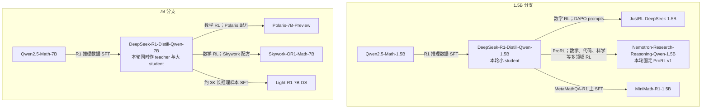
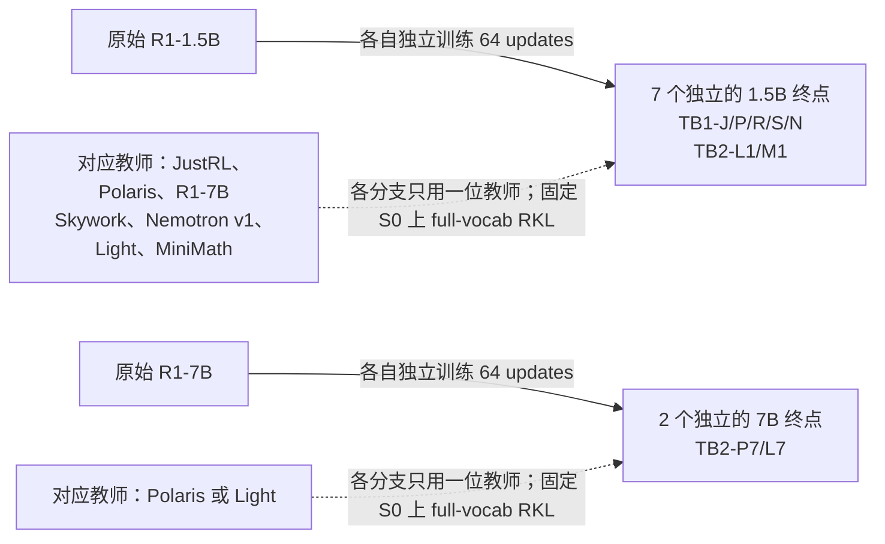
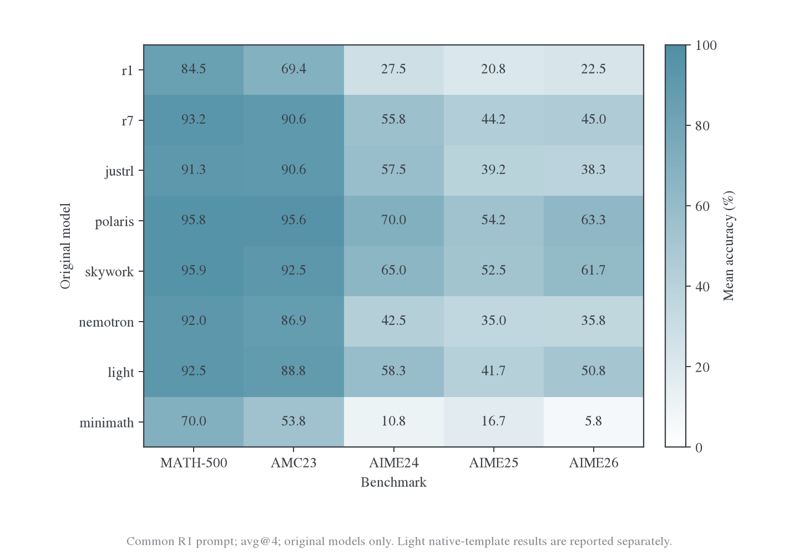
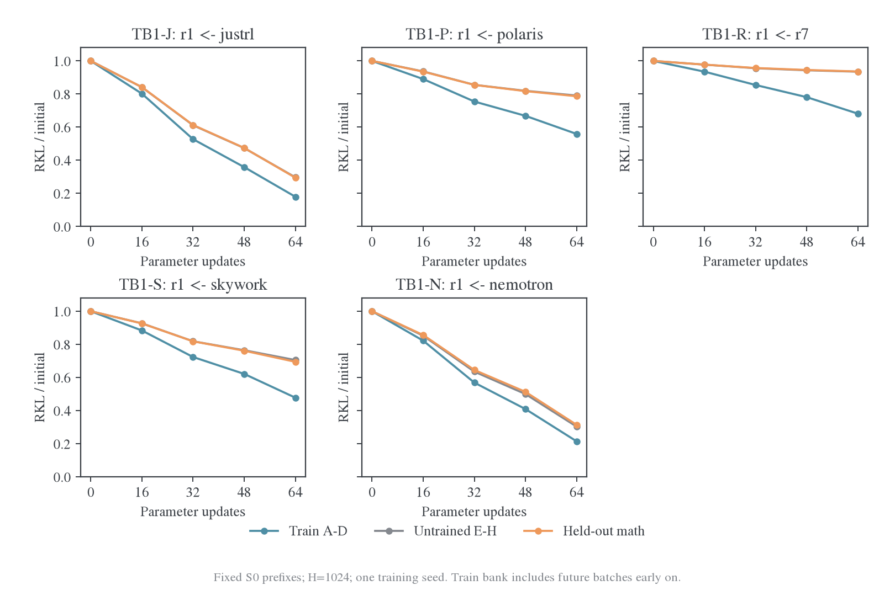
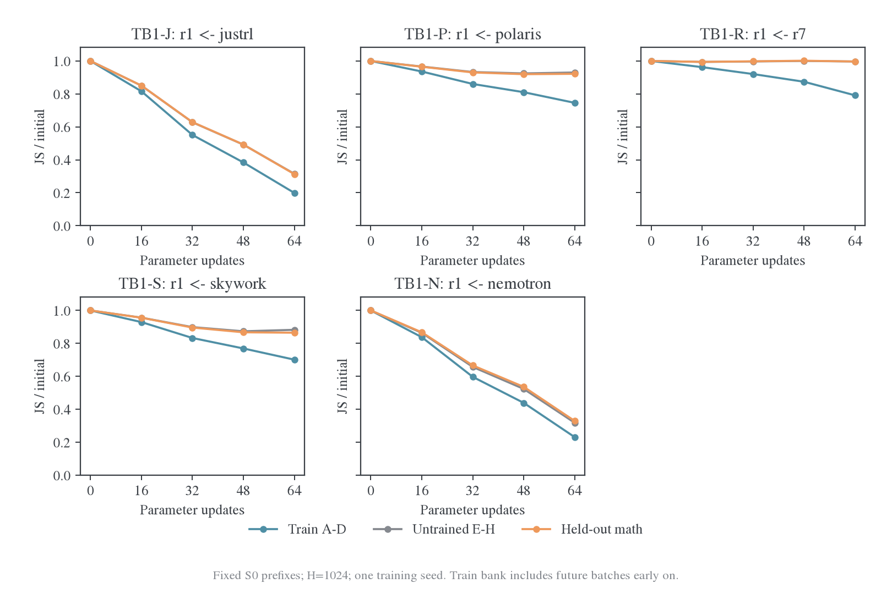
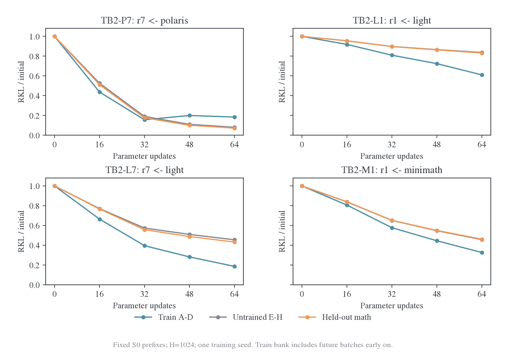
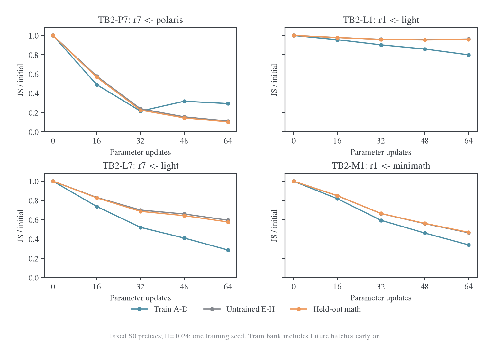

# 跨源蒸馏边界：分阶段实验与首轮结果

更新时间：2026-10-28。状态：**TB0/TB1/TB2已完成，九分支共576次参数更新；TB3–TB6未启动**。22680 条原始模型基线回答、18 个完整检查点和 16 个共同输入评分单元均已核对。GPU4–7 已恢复独立管理的 gpu occupy。优先阅读[首轮结果与分析](#results)；实际实现与占卡管理见[运行说明](../../../../research/studies/boundary/README.md)。

阅读顺序：[研究问题与已有证据](#motivation) → [实验顺序](#sequence) → [模型与版本](#models) → [短程 setting](#short-setting) → [确认与在线训练](#confirmation) → [条件扩展](#extensions) → [预算与交付](#budget)。外部结果、论文 step 口径和原始检索见[论文对照与预算依据](../../../literature/teacher-transfer/2026-10-28-蒸馏边界实验的论文对照与预算依据.md)。

## 1. 背景与研究问题

当前证据支持的现象是：Polaris 的已见前缀可以被拟合，但收益向独立前缀推广的速度明显弱于 JustRL。这里研究有限数据、有限预算下的可迁移性，分别观察局部拟合、跨题目固定风险、当前学生访问分布和任务成绩。“完全蒸馏”的定义继续保持开放，不新增统一通过阈值，也不把一个短程平台称为不可约容量下界。

以下问题按控制强度分开：同一小学生能否迁移大教师初始化模型及其额外 RL 增量；同一教师教其直接祖先学生时能否恢复迁移；直接同源的 SFT/RL 教师是否具有不同的迁移曲线；同一训练 run 的不同教师 checkpoint 是否出现连续变化。谱系标签由训练来源确定，功能距离在训练前测量，不用训练后的表现反过来定义“异源程度”。

### 1.1 本地早期曲线支持缩短筛查

L 系列采用相同 S0 固定前缀、batch16、每批连续更新 16 次、H1024。独立数学留出的 RKL 相对各自初始值下降如下；每个 teacher 只有一条训练路径。

| 参数更新次数 | JustRL 下降 | Polaris 下降 |
| -----------: | ----------: | -----------: |
|           16 |      15.97% |        6.39% |
|           32 |      39.30% |       14.40% |
|           64 |      69.86% |       20.69% |
|          128 |      85.17% |       23.66% |
|          320 |      93.60% |       25.67% |

数值由[原始风险汇总](../../../../../../../wandb-logs/MirrorOPD-verl/analysis/twenty-batch-pass-20261027/risk-summary.json)选择 `panel=held_math` 得到；[冻结摘录](../../../literature/teacher-transfer/sources/boundary-plan-20261028/local-early-transfer.csv)保留未舍入数值。完整历史 setting 见[L 单遍报告](cross-batch/2026-10-28-跨批次迁移与单遍训练结果.md)。64 次更新已出现明显分化，但该证据仅直接支持短前缀筛查，不证明所有新 teacher 都能在 64 次内被可靠分类。

### 1.2 已有正式实验与本计划的关系

[E48](../cross-origin/polaris/2026-10-27-E48完整训练与后期平台分析.md)在 4096 次更新后仍有新批残差平台；[E49](../cross-origin/polaris/2026-10-28-E49方向对照与跨源迁移.md)换为 FKL 后改善了部分完成行为，未解除平台。当前不把 KL 方向作为新矩阵主变量。[优化器与精度对照](../optimizer-precision/polaris/2026-10-27-Polaris跨State拟合的优化器与精度对照.md)也说明，更快拟合当前批不自动带来跨 state 改善。

本计划使用独立 TB 系列标识，不改写旧 L 的协议。另一个已定稿的[双来源 R 四分支方案](rollout-sources/2026-10-28-双来源Rollout四分支实验方案.md)仍为独立待执行研究，预算 1280 更新；TB 系列不自动启动 R，也不将它悄悄缩成 64 次。若以后合并运行，需要先修订两份协议及预算。

## 2. 完整实验顺序与进入条件

研究顺序为 **TB0 → TB1 → TB2 → TB3**。已完成的范围止于 TB2，后四卡已恢复占卡；TB3 未启动。TB4–TB6 是顺序明确的条件扩展，不属于首轮预算，TB3 的代表性确认优先于继续扩充模型数量。

| 顺序 / 实验                 | 模型与变化                                                      |           初始预算 | 进入条件与产出                                                        |
| --------------------------- | --------------------------------------------------------------- | -----------------: | --------------------------------------------------------------------- |
| TB0：版本、协议与基线       | 固定模型版本；核对 token-ID、模板、停止和前向；独立评测原始模型 |   0 次科学训练更新 | 完成输入与评分验收；得到教师真实能力差与初始距离                      |
| TB1：固定小学生的五教师矩阵 | R1-1.5B ← JustRL、Polaris、R1-7B、Skywork、Nemotron v1          |      5×64=320 更新 | 首轮必做设计；建立同源、跨尺寸原始教师及跨尺寸 RL 教师对照            |
| TB2：学生尺寸与 SFT 分支    | 补 Polaris→R1-7B、Light→R1-1.5B/7B、MiniMath→R1-1.5B            |      4×64=256 更新 | TB1 后执行；固定教师比较学生，并补齐直接同源 SFT 参照                 |
| TB3：代表配对确认           | 复核题目依赖、较长训练、fresh 与完整任务收益                    |      按第 6 节单列 | TB1/TB2 后先确认结论；不把所有候选统一拉长                            |
| TB4：Nemotron 版本对照      | R1-1.5B ← v1/v2/BroRL；v1 复用 TB1                              | 新增 2×64=128 更新 | 要研究同尺寸直接同源教师的训练路径差异时进入                          |
| TB5：同一次 SFT 的阶段序列  | Qwen3-4B-Base ← Math-CoT SFT step80/320/640                     |      3×64=192 更新 | TB4 终点差异不足以分离训练阶段与配方时，改用同 run 序列               |
| TB6：Qwen3 初始化交叉验证   | 1.7B Base / 后训练学生 × 4B / 4B-Instruct-2507 教师             |      4×64=256 更新 | 主线出现稳定差异后，检验不同学生初始化与发布分支；模板验收另见第 7 节 |

### 2.1 TB1 的具体顺序与假设

R1-1.5B 在本文固定指 `deepseek-ai/DeepSeek-R1-Distill-Qwen-1.5B`，R1-7B 固定指对应的 `DeepSeek-R1-Distill-Qwen-7B`，均不替换成 Qwen Base。

| 分支  | Student | Teacher              | 角色及事先预期                                              |
| ----- | ------- | -------------------- | ----------------------------------------------------------- |
| TB1-J | R1-1.5B | JustRL-DeepSeek-1.5B | 同期正参照，预期局部与留出均改善                            |
| TB1-P | R1-1.5B | Polaris-7B-Preview   | 同期困难参照，预期局部下降较易、留出较早放缓                |
| TB1-R | R1-1.5B | R1-7B                | 文献任务收益较低；固定前缀的跨批效率仍待测                  |
| TB1-S | R1-1.5B | Skywork-OR1-Math-7B  | 与 TB1-R 共享大教师起点；文献预期额外 RL 提供更多可转移收益 |
| TB1-N | R1-1.5B | Nemotron v1          | 直接同源、多领域 RL；系列有正证据，确切 v1 的本协议表现未知 |

执行顺序为 J/P 同期控制 → R/S 大教师起点与后训练配对 → N 同尺寸扩展。顺序仅用于先验收参照和复用缓存，不将执行时间当作实验因素。每个分支均从同一个初始学生和全新 AdamW 开始；禁止把 J 训练后的学生接着用于 R/S/N。

R1-7B、Polaris、Skywork 的比较可以检验同一个大教师起点的两条 RL 分支。教师数据、优化预算和最终能力仍不同，不能将两条 RL 分支之差解释为单一算法效应。预期来自不同目标与预算的外部论文，只提供方向，不承诺本仓 full-vocab 结果重复其终点分数。

### 2.2 TB2 补齐的配对

| 分支   | Student | Teacher            | 与已有分支的关系                                   |
| ------ | ------- | ------------------ | -------------------------------------------------- |
| TB2-P7 | R1-7B   | Polaris-7B-Preview | 固定 TB1-P 的教师，改变学生容量和具体初始化        |
| TB2-L1 | R1-1.5B | Light-R1-7B-DS     | 与 TB1-R/P/S 共用大教师起点，补跨尺寸 SFT          |
| TB2-L7 | R1-7B   | Light-R1-7B-DS     | 与 TB2-P7 共用直接祖先学生，比较 SFT/RL 后训练终点 |
| TB2-M1 | R1-1.5B | MiniMath-R1-1.5B   | 与 TB1-J/N 共用直接祖先和尺寸，补同尺寸 SFT        |

TB1-P、TB2-P7、TB2-L1、TB2-L7 形成两个学生×两个教师的交叉。R1-1.5B 与 R1-7B 使用同一 prompt 表，但各自生成 S0 银行；自然访问分布的风险分别归一化。另在同一 64 题的两套 S0 轨迹上交叉评分学生，才比较共同输入下的差异。学生大小与权重初始化仍同时变化，不声称隔离了容量唯一因果效应。

MiniMath 若在本协议任务上不优于原始学生，保留其分布迁移对照角色，任务能力回收率记为不适用；不在看过结果后静默替换成更强 SFT 模型。

## 3. 模型版本与 Nemotron 的确定选择

### 本轮模型的来源与实验终点

下图只画 TB0–TB2 实际使用的八个公开模型及其两个 Math 底座。**实线表示权重初始化与后续训练**，不是本轮 teacher→student 监督边。两个尺寸各有自己的预训练权重，图中没有 1.5B 训练成 7B 的关系；R1-Distill 的“SFT”指用 DeepSeek-R1 生成的推理数据监督训练，而非继承 DeepSeek-R1 大模型权重。

谱系依据为 DeepSeek 发布说明及各作者模型卡；JustRL、Polaris、Light、MiniMath、Nemotron 的完整来源沿用[已有模型调研](../../../settings/teacher-transfer/2026-10-28-异源教师分级对照与Student选择.md)，Skywork 的模型卡明确标注 R1-7B 初始化。[^boundary-lineage] 本轮 Nemotron 是 v1，不能把它画成 v2/BroRL 的终点；其他候选的分支与版本见[完整谱系扩展](../../../settings/teacher-transfer/2026-10-28-模型谱系图与论文配对扩展.md)。

本轮另外产生九个训练后学生。下图的实线表示这些学生从哪个公开 checkpoint 初始化，虚线表示固定教师提供概率监督。每个输出框代表多个**独立重新初始化的分支**，不是把多位教师混在一次训练中。

这些本轮终点是`step064`学生权重，不是对应公开 teacher 本身；每分支还保留了`step032`中间权重。九个分支的逐项配对见第 2 节，保存内容与快速迭代取舍见[代码与存储说明](../../../../research/studies/boundary/README.md#checkpoint-storage)。

### 3.1 主线固定版本

下表使用 2026-10-28 已核对存在的 Hub revision；[版本来源记录](../../../literature/teacher-transfer/sources/boundary-plan-20261028/model-versions.json)保存 API 地址、完整 SHA 和权重文件列表。该核对仅涉及元数据与文件存在，不代表已下载、已运行或通过 tokenizer 验收。本地已有资产若不能绑定到相同 revision，需另建对应资产，不能把历史 E20/E48 重新标成这些 SHA 的运行。

| 简称        | 完整仓库                                       | 固定 revision                              |
| ----------- | ---------------------------------------------- | ------------------------------------------ |
| R1-1.5B     | `deepseek-ai/DeepSeek-R1-Distill-Qwen-1.5B`    | `ad9f0ae0864d7fbcd1cd905e3c6c5b069cc8b562` |
| R1-7B       | `deepseek-ai/DeepSeek-R1-Distill-Qwen-7B`      | `916b56a44061fd5cd7d6a8fb632557ed4f724f60` |
| JustRL      | `hbx/JustRL-DeepSeek-1.5B`                     | `0637e4096c789c67f9eecbe8355e0bdeddede1c2` |
| Polaris     | `POLARIS-Project/Polaris-7B-Preview`           | `faea72cf7123681069668e8da45c1c074e378830` |
| Skywork     | `Skywork/Skywork-OR1-Math-7B`                  | `fcef970f1d10682f13c182b280146a194ed57d1e` |
| Light       | `qihoo360/Light-R1-7B-DS`                      | `06c9338cdbec28416e15f28a325b1439729ec237` |
| MiniMath    | `oumi-ai/MiniMath-R1-1.5B`                     | `9fcff43e7b6739a86f1e443e3b8d8b85fb00a998` |
| Nemotron v1 | `nvidia/Nemotron-Research-Reasoning-Qwen-1.5B` | `b89048893f95246c6b5749b287f0049e6df42ee9` |

### 3.2 首轮选择 ProRL v1

TB1-N 明确选择 **Nemotron-Research-Reasoning-Qwen-1.5B 的 ProRL v1**。加载以完整 SHA 为准，`v1` 仅作为人可读版本名；不使用浮动 `main`，也不混入 OpenMath-Nemotron 或 OpenReasoning-Nemotron。

选择 v1 的原因是：它提供原始 ProRL 发布终点，可先与 JustRL 对比直接继承 R1-1.5B 的另一条 RL 路径；后续再增加 v2/BroRL，保留清楚的参照。这个选择不意味着 v1 最强，也不意味着已确认 Every Coin 使用的就是此 SHA。论文没有足够信息锁定 Nemotron 版本，系列层面的正结果不能充当精确版本复现。[^nemotron]

| TB4 分支 | 版本           | 固定 revision                              | 解释边界                                             |
| -------- | -------------- | ------------------------------------------ | ---------------------------------------------------- |
| TB4-N1   | v1，复用 TB1-N | `b89048893f95246c6b5749b287f0049e6df42ee9` | 原始 ProRL 参照                                      |
| TB4-N2   | v2             | `a8e647c7a46f04e84ce732d6fa3fa627ba343b8d` | 训练阶段与优化配方均变化                             |
| TB4-NB   | BroRL          | `3441fcdf8c6e81a2959e6352ff50122e3c677d72` | 探索宽度等设置也变化；不假定公开 v2 终点就是其初始化 |

三版本的既有 token 映射检查见[新增 tokenizer 核对](../../../literature/teacher-transfer/sources/additional-tokenizer-audit.json)。版本对照是发布终点关联研究，严格连续训练距离由 TB5 补充。

## 4. TB0 与短程筛查的具体 setting

### 4.1 TB0：先固定协议和独立模型参考

所有模型先核对共享 token ID 的语义、embedding/head 支持范围、chat template、EOS、RoPE 与原生 buffers。首轮共同输入按 R1-1.5B tokenizer 渲染单个 user 数学题，不增加 teacher 专属提示，保存最终 prompt IDs。每个 teacher 在这些相同 IDs 上评分；R1-7B 组核对能接受同一输入语义。额外 head 行保留在 teacher softmax 分母中；共享 ID 冲突必须先解决并另记协议，不能直接按下标计算 KL。

在固定的短、中、长前缀和回答边界位置，对照原生 HF teacher 与拟用 scorer 的 logits/概率距离；保护 RoPE 等 FP32 buffers，不能整体 `.to(dtype)` 造成频率舍入。对同一学生做自教师目标与单次更新验收，核对梯度和分母。工程验收的临时更新不计入 TB1，也不将验收后的模型作为初始化。若当前批完全不下降，先核查实现、步幅和精度，再解释迁移。

原始学生与各教师先取得五集低采样参考：每题 4 答、temperature0.7、top-p0.9、top-k=-1、response cap31744，分别报告五个集合。它沿用[统一验证协议](../../../settings/验证设置.md)的题目与解码，仅把采样数从 16 降为 4，明确标记 avg@4，不与历史 avg@16 混成同口径终点。每个精确模型与模板只测一次并复用；教师优势不清楚时进入 TB3 补充采样，首轮不计算不稳定的回收率。若共同提示与教师原生提示不同，另记原生参考；后续能力比较只使用与学生匹配的那套协议。历史参考只有版本、题目、模板、采样和判分均可核对时才复用。

五集 avg@4 参考每个模型有 630×4=2520 条回答，成本独立于更新数。首轮五位教师加学生最多六次基线，共 15120 条回答；有效历史参考可减少生成。TB3 选中模型再补足 avg@16。该成本不能藏在“320 更新”内。标准评测保留完整题目；训练题表排除与五集的标准化题面重合，语义污染仍不能仅靠完全匹配排除。任务采样逐题逐回答固定 seed 为 `72000000 + 100*i + r`，i 为冻结五集表行号，r=0…15；不同模型和 checkpoint 共用。若补足 16 答，保留已有 r=0…3 并生成 r=4…15，不重采后挑选更有利回答。

### 4.2 Prompt 银行、独立性与随机性

沿用 [L 题目表](../../../../../../../wandb-logs/MirrorOPD-verl/analysis/twenty-batch-pass-20261027/prompts.json)的分组和次序作为候选输入：A–T 为 320 道 DAPO 数学题，M01–M12 为 192 道数学留出，Code01–04 为 64 道 TACO，IF01–04 为 64 道英文 MultiIF。执行前做训练/留出和五集题面交叉检查；若需替换重合训练题，按固定数据 seed2026102801 从剩余 DAPO 无放回补齐，先冻结新表再评分。TB 与 L 共享未替换题目，因此只称同期协议对照，不称独立题目复现。

每个初始学生 S0 生成一套新固定银行；同一学生的所有教师共用。保留历史 prompt 文本与约定，冻结本实验实际模板、prompt IDs、response IDs、source、seed、结束原因和 token 数。采样 T1/top-p1/top-k=-1、H1024，遇约定 EOS 停止并计入 EOS，EOS 后不评分。首轮仅使用 S0 来源，不生成每位 teacher 的完整训练银行。

训练 seed42；初始生成逐题 seed 为 `52000000 + 100000*s + 10*i + r`，学生编号 s：R1-1.5B=0、R1-7B=1、Qwen3-4B-Base=2、Qwen3-1.7B-Base=3、Qwen3-1.7B=4；i 为冻结题目表行号，r=0 为主轨迹、r=1 为独立轨迹。生成器使用统一 BF16 backbone/FP32 head 路径。不同学生不要求采样结果相同。

首轮固定评分面板为 A–H 共 128 题、M01–M04 共 64 题、Code01–02 和 IF01–02 各 32 题，总计 256 条。M01–M04 是用于筛查和选分支的 development 面板。M05–M12 与剩余 Code/IF 只在 TB3 选择冻结后评分；由于这些题已进入历史 L 分析，仍不得声称其从未被研究过程接触。正式任务验证和新增题目重复承担进一步确认。

### 4.3 优化与预算

下表保留评审时的拟用协议。TB0–TB2 实际实现将 1.5B 改为单卡梯度累计、7B 改为两卡按层模型并行，以容纳 FP32 训练状态；全局 batch16、固定分母、轨迹和更新数不变。单步数值与显存验收保存在本次运行证据中，并行方式不会被当作已隔离的容量因果效应。

| 项目             | TB1/TB2/TB4/TB5/TB6 的拟用短程 setting                                                                                                      |
| ---------------- | ------------------------------------------------------------------------------------------------------------------------------------------- |
| Student 初始化   | 每分支从对应原始模型开始，全参数训练；不同教师不串联训练                                                                                    |
| Teacher          | 固定版本、参数冻结；教师 head 保留原生归一化                                                                                                |
| 输入             | 固定 S0 轨迹，主训练 H1024；训练中不刷新                                                                                                    |
| Batch / reuse    | 16 条轨迹 / 每批连续 16 次全批更新                                                                                                          |
| 首轮             | A→B→C→D，64 次更新、64 道题、1024 条轨迹访问                                                                                                |
| 可选续训         | 保留完整 Adam/RNG，E→H 续到 128；I→T 续到 320；均不回访旧批                                                                                 |
| 目标             | full-vocab RKL；prompt/padding 不计入；loss 除以固定 16×1024                                                                                |
| Optimizer        | AdamW，LR1e-6，betas=(0.9,0.999)，eps1e-8，wd0.01，global grad clip1                                                                        |
| Scheduler        | constant，无 warmup；不同教师不独立调 LR 后混入主表                                                                                         |
| 精度             | Student FP32 主权重与 optimizer states；BF16 backbone autocast；FP32 head/log-softmax；Teacher BF16 权重、FP32 head；原生 FP32 buffers 保留 |
| Attention / 汇总 | FlashAttention2；距离计算关闭 autocast；TF32 关闭；跨题累计 FP64                                                                            |
| 并行             | 逻辑 batch16；优先两卡数据并行，每卡 8 题、microbatch1；按全局分母累积并 SUM all-reduce，再裁剪更新                                         |
| 固定评分点       | 0、16、32、48、64；续训后每 16 更新评分；实际完成更新数为横轴                                                                               |
| 完整 checkpoint  | 32、64；若续训，增加 128、320；包含模型、tokenizer、Adam、RNG、输入身份与更新计数                                                           |

首轮每分支训练 response-token 访问上限为 $64\times16\times1024=1048576$，自然 EOS 会减少实际访问。64 次参数更新在生产 reuse16 入口相当于 4 个 outer，但本研究 batch、H 和 state 来源不同，不能直接视为 E20/E48 的前 4 个 outer。

在相同输入 $s$ 上令学生分布为 $p_\theta$、教师原生分布为 $q$，学生 head 支持集为 $V_p$，每条有效回答长度为 $L_i$：

$$
\mathcal L_b(\theta)=\frac{1}{16H}\sum_{i\in b}\sum_{t=1}^{L_i}\sum_{v\in V_p}p_\theta(v\mid s_{it})\log\frac{p_\theta(v\mid s_{it})}{q(v\mid s_{it})},\qquad H=1024.
$$

当 teacher 有额外输出行时，RKL 仍使用全 head softmax 后的 $q$。FKL 诊断注明在学生支持集上条件化；JS/TV 用支持集并集、学生额外行概率为零。额外行质量另外记录，避免将支持限制当作表征瓶颈。

现有 [LONG_PASS 协议](../../../../research/studies/cross_batch/protocol.py)固定为历史 20 批，不能直接修改全局常量把 L 改成 4 批。独立[TB 入口](../../../../research/studies/boundary/README.md)已接入 TB0–TB2，沿用[历史训练实现](../../../../research/studies/cross_batch/long_batch_transfer.py)的固定输入语义和[距离函数](../../../../research/core/metrics.py)。TB3–TB6 尚未接入，旧 L 协议保持冻结。

## 5. 指标、筛查与解释

每个保存点分别报告已训练批、未来训练批、数学 development、Code 和 IF。主风险先按题除以 H 再平均，同时保留原始 KL 和、有效 token 总数和 token-mean；每个教师的相对下降使用自己的初始风险。Code/IF 的 KL 改善只叫跨域分布迁移，不能叫代码或指令任务能力提升。

| 指标                                   | 用途与约束                                           |
| -------------------------------------- | ---------------------------------------------------- |
| RKL、条件 FKL、JS、TV                  | 判断是否仅训练目标改善；保留绝对风险和初始归一化曲线 |
| 当前批更新前后风险                     | 判断局部求解是否正常，记录第 16 次更新后的额外前向   |
| 新批首次风险、旧批复测                 | 区分题目差异、未见批迁移和已见批保持                 |
| Entropy、top16 overlap、交集 P/Q 质量  | 诊断概率支持；不把高 overlap 定义为成功              |
| 位置 1–256、257–512、513–1024          | 检查残差分布；H1024 不代表完整推理覆盖               |
| 实际 token、长度停止率、EOS 和答案完成 | 记录输入与访问成本，避免长度变化掩盖差异             |
| 梯度范数、实际参数位移、非有限与跳步   | 区分优化路径故障和留出平台；范数非零不代表可迁移     |

匹配更新数之外，再比较共同固定 A–D 参考银行达到相近 JS 降幅时的 development 收益。早期 A–D 包含未来训练批，所以此量称“固定训练银行拟合”，不称“当前已见批拟合”。只在双方实际曲线交叠范围内插值，不外推或挑各自最好 checkpoint。局部拟合程度差异很大时，先报告这个差异，不直接把弱留出收益归于泛化。

32 次是第一次趋势检查，64 次是所有分支统一首轮终点。分类保留四种描述：局部与留出共同改善；局部下降但留出放缓；局部优化不足；指标或运行不一致。后两种先排查与复核，不标作不可蒸馏。没有新增百分比成功门槛；是否续到 128 依据完整曲线和独立复核价值，在报告中记录选择依据。

TB1/TB2 只用 development 面板作分支选择。区间按题目配对 bootstrap，重复回答先在题内聚合；它不覆盖训练 seed 方差。需声称稳定排名的配对进入 TB3 的独立题目重复，而不是靠增加同题采样次数代替训练重复。

## 6. TB3：代表配对的确认顺序与 setting

默认最多选择三条：TB1-J 与 TB1-P 固定保留，第三条优先 TB1-N；若 N 与 J 相似而 R/S 有更清楚的分化，则第三条改为 TB1-S。选择在查看预留面板前固定；原始 TB1-R 仍保留为大教师起点参照。TB2 若出现直接同源也难迁移，可替换第三条，但不自动扩大分支数。

### 6.1 独立训练题重复与共同输入确认

每条从原始学生重新开始，训练 seed43，重新抽取 64 道 DAPO 题，数据 seed2026102802；排除 TB 系列全部训练/留出题及标准评测题面。同一新题表在所选教师间共用，重新生成 S0 训练轨迹，仍为 batch16/reuse16/H1024、64更新。原有 development 与预留面板用于配对评分，另外按 seed2026102803 抽 128 道互斥数学题作为独立确认面板，冻结后只读评估。

最多三条新增 192 更新。将 seed42/43 分开报告；两个重复仍不足以精确估计训练方差。TB0 的自教师或数值验收不能计作额外重复。

### 6.2 延长选中路径与测量访问分布

若需判断 64 次之后是否持续平台，保留原 seed42 的模型与 Adam，从 64 续到 128；最多三条新增 192 更新。只有仍有明确未决问题的代表分支再从 128 续到 320，每条新增 192 更新，最多 576 更新。不能先重置 Adam 再称同一训练曲线续跑。

在 0/64/128 及实际到达的 320，对 64 道固定数学 development prompt 各生成两条 fresh student 轨迹；H1024、T1/top-p1，seed `62000000 + 10*i + r`，各分支和 checkpoint 共用。保存实际回答和截断。对初始/终点参数与初始/终点 fresh 轨迹做 2×2 交叉评分，区分固定参数改善和新访问分布变化。初始生成每个 student 可共用；不同 teacher 分别评分。

昂贵的梯度几何仅在选中分支上做：在初始和 64/128 终点，使用 A–P 的 256 道题组成 16 个互斥 B16 梯度组，并用 M01–M04 的独立 64 题梯度测量 raw cosine 与 loss-gradient Gram。A–P 包含当时尚未训练的题，报告中按已见/未见标注，不把这 16 组都叫已见训练梯度。实际 Adam 位移与留出风险变化在新题重复的第 1/64 次更新前后测量；它们是正常预算内更新，不额外执行探针更新。Gram 不称作 teacher-independent NTK；每次只读探针后清空梯度，恢复 RNG，不将留出梯度写入优化器。

### 6.3 完整回答与在线训练确认

短程终点只在选中配对上执行完整五集 avg@16，并将其原始学生和教师的 TB0 参考补足到 16 答后比较，报告 mean、pass@16、majority、长度、截断和答案缺失。对每题记录原先正确的保持与原先错误后的获取，避免只看总分。教师优势为正且分母可靠时才补充能力回收率，原始分数始终同时给出。

若短前缀结果值得验证到自然 OPD，另开从原始学生初始化的在线分支，不从固定银行终点悄悄续接。拟用 DAPO 去评测重合题后的冻结训练池、batch64、n1、reuse16、LR1e-6、full-vocab RKL、prompt cap1024、response cap7168、T1/top-p1。先 16 个 outer 即 256 次更新；验证在 0/8/16 outer，其中 0 复用 TB0 合同一致的参考。仍有收益或结论不清楚时续到 32 outer 即 512 更新，最多三条在线分支。

在线学生执行精度拟用修复后的 FP16 autocast、FP32 master/optimizer/head及受保护buffers；Teacher BF16 backbone/FP32 head。使用 loss scaling 并记录成功更新数，FP16 和短程 BF16 路径分表解释；在线所有对照使用相同新实现。该阶段验证组合方案，不把跨阶段差值全部归给 state 刷新，也不与历史 E20/E48 作纯 dtype 因果比较。

在线阶段首先检查从初始学生开始的 0→8→16 outer 轨迹；若训练回答大量触顶，在解释能力边界前报告其覆盖限制。延长 cap 是独立长度干预，须给所比较配对匹配预算并另列结果，不因某教师较难而只给它更多 token。

## 7. TB4–TB6：条件扩展的具体设置

### 7.1 TB4：同尺寸 Nemotron 版本

Student、S0 银行、训练题和优化 setting 均复用 TB1-N；仅新增表 3.2 的 v2/BroRL 教师，各 64 更新。对所有版本重新测各自初始距离与同协议任务参考。比较相近训练银行拟合程度下的跨题收益，不能只按教师自身分数排序。若不同版本主要改变代码、科学或 IF 能力，而数学增益很小，数学实验的结论仅覆盖数学输入；对应任务评测另列预算，不声称多领域能力已被检验。

### 7.2 TB5：同 run 的 SFT 阶段

Student 为 `Qwen/Qwen3-4B-Base`，revision `906bfd4b4dc7f14ee4320094d8b41684abff8539`。Teacher 固定 `jasonrqh/Qwen3-4B_Math-CoT-20k_lr5e-5_ep8_bs256`，revision `aaf1c51a6a2ee319750cafbd7cb8be0df10018b8`，分别加载 `step80`、`step320`、`step640` 子目录。三个子目录属于同一 8-epoch 配方的阶段，不用独立 1-epoch 训练终点替代 step80。[^rethink-sft]

三个分支共用该 Base 学生生成的 S0 银行，采用第 4 节短程协议，各 64 更新。新增控制 token 定义与模板需要先验收；公开 checkpoint 存在不等于本仓接口已通过。Base 学生的自然回答质量与格式单独记录，不先做隐含 SFT warm-up。若必须 warm-up，三个分支从相同新初始化重新开始并另立组，不与原始 Base 曲线合并。

初始三点若出现分化，再在同 repo 已核对存在的阶段里补相邻点；每个新增点 64 更新，默认最多补两个。训练距离与能力差仍同时变化，不能把 SFT step 直接当作统一功能距离。RKL/JS、长度、教师能力和跨批收益共同报告。

### 7.3 TB6：学生初始化的 2×2 交叉

| Student                  | Qwen3-4B teacher          | Qwen3-4B-Instruct-2507 teacher |
| ------------------------ | ------------------------- | ------------------------------ |
| Qwen3-1.7B-Base          | TB6-B4，历史 E41 只作参照 | TB6-BI，新增配对               |
| Qwen3-1.7B，官方后训练版 | TB6-P4，新增配对          | TB6-PI，历史 E43 只作参照      |

四模型的完整版本固定在[版本记录](../../../literature/teacher-transfer/sources/boundary-plan-20261028/model-versions.json)。每个 student 组生成自己的 S0 银行，四格各 64 更新，不能用旧 E41/E43 终点替代两个同期格。非思考模式、prompt 文本、回答 cap、EOS 与 token-ID 对齐在 TB0 独立验收；如四格无法共用一个已验收的序列化协议，需显式增加模板因素或把比较限定在各 teacher 列内，不能把模板效应全部归给初始化。

E54 的四 token 空思考段和 teacher RoPE 舍入问题见[兼容性报告](../../../infra/model-compatibility/qwen-e54/2026-10-29-E54长度膨胀诊断.md)。该工程失败不作为 TB6 的先验能力负结果。TB6 正式自然生成继续 non-thinking，不能把某个格的 thinking 收益混入矩阵。

## 8. 预算、交付与 review 范围

### 8.1 更新预算的组成

| 范围                 | 新增分支 / 更新 | 预算解释                                |
| -------------------- | --------------: | --------------------------------------- |
| TB1 首轮             |         5 / 320 | 含两条同期控制；三条新 pair 共 192 更新 |
| TB2                  |         4 / 256 | 主线累计 9 个 pair、576 更新            |
| TB3 新题重复         |    最多 3 / 192 | 从头重训；不与续训相加充作更多 seed     |
| TB3 64→128 续训      |    最多 3 / 192 | 原路径续训                              |
| TB3 128→320 续训     |    最多 3 / 576 | 只对仍需长期证据者执行                  |
| TB3 在线 16 outer    |    最多 3 / 768 | 独立从原始学生开始，256 更新/条         |
| TB3 在线 16→32 outer |    最多 3 / 768 | 每条追加 256 更新                       |
| TB4                  |         2 / 128 | v1 复用 TB1，不重复计费                 |
| TB5                  |         3 / 192 | 三阶段；若补两个点另加 128              |
| TB6                  |         4 / 256 | 四格全为新协议运行                      |

TB1/TB2/TB4/TB5/TB6若全部做首轮，共18个不同配对、1152更新；这只是全部扩展的预算账，不是默认执行范围。首轮单独交付TB1。上述总数不含TB0工程验收、generation、teacher评分、只读梯度、任务评测或已有R方案，不能按更新数比例声称同等GPU小时节省。每分支记录实际response token、teacher 评分 token、训练与验证 GPU 时间。

五集终点评测每模型 10080 条回答；TB3 最多三个终点一次即 30240 条，最多四个不同的原始学生/教师参考从 4 答补到 16 答再增加 30240 条。若选中跨学生配对，独立原始模型数随之变化，按每模型新增 7560 条重新计费；在线 8/16 outer 评测另计。筛查阶段不为每 16 更新运行五集生成，也不预生成每个教师的完整训练轨迹。缓存保存 token IDs 和 teacher hidden 或可重建中间量，不默认落盘全词表逐 token logits。

### 8.2 预定交付物

每个分支交付实际 resolved protocol、精确模型 revision、软件与硬件环境、prompt 表和轨迹、逐更新日志、固定风险与任务回答、完整 checkpoint 位置。未执行阶段保持“待执行”，不生成虚构结果表或完成标记。

分析图按问题组织：局部/留出/未来批风险随更新和实际 token 的变化；相近训练拟合程度下的留出收益；逐批影响与旧批保持；RKL/JS/entropy/overlap 及位置分层；teacher 原始分数、student 初始与终点分数；TB3 的 fresh 与交叉评分。图表由冻结 CSV/JSON 生成，所有版本与 seed 单独标注。

后续原始产物使用日志仓库 `wandb-logs/MirrorOPD-verl/analysis/teacher-boundary-<实际运行日期>/`；可重建缓存与权重放 `wandb-logs/derived/MirrorOPD-verl/teacher-boundary-<实际运行日期>/`。本轮 TB0–TB2 产物已经保存到 teacher-boundary-20261028 目录；其他阶段未创建训练结果。

### 8.3 执行前需要核对的内容

TB0–TB2 已结束。review 重点为第 9 节的：64-update/H1024 筛查的局部与留出证据；教师基线和模板差异；是否进入 TB3 代表分支确认；TB4–TB6 的条件扩展顺序。后续阶段不会因首轮完成而自动启动。

## 9. TB0–TB2 首轮结果与分析

### 9.1 实际执行范围

TB0、TB1、TB2 已全部完成。九分支均从对应原始学生开始，使用固定 S0 轨迹，按 A→B→C→D 各 16 题、各 16 次更新，共 576 次全参数 full-vocab RKL 更新。H1024、AdamW LR1e-6、seed42、有效 batch16 和 reuse16 均保持不变，训练中没有 fresh rollout。1.5B 采用单卡梯度累计，7B 采用两卡按层模型并行；该实现差异已经记录，未据此声称纯容量因果效应。

| 证据         | 实际完成                                                                                                                                       |
| ------------ | ---------------------------------------------------------------------------------------------------------------------------------------------- |
| 固定输入     | 两学生各 640 条 S0 轨迹；1.5B/7B 分别 635138/635056 个有效 response token，自然 EOS 分别 53/49 条                                              |
| 数据检查     | 训练/留出互斥，题面去重未触发训练题替换；沿用 L 题池，不是研究过程从未接触的测试集                                                             |
| 原始模型参考 | 八模型公共提示，加 Light 原生模板对照；每套 630 题×4 答，共 22680 条完整回答                                                                   |
| 数值检查     | 八教师选定位置的拆分 hidden/head 与原生 HF FP32 head 读出 RKL 为 0；CPU 分块 VJP 对照误差约 5.55e-17；两学生自教师梯度 norm 约 3.74e-9/9.13e-9 |
| 训练与保存   | 九分支各 64 更新；32/64 各保存完整模型、tokenizer、Adam 与 RNG，共 18 个检查点；计数一致，无跳过更新                                           |
| 固定评分     | 每分支 0/16/32/48/64 评分同一 256 题，共 11520 条题目—检查点记录                                                                               |
| 交叉评分     | Polaris/Light × 两学生 × 两套 S0 输入 × 初始/64 终点，共 16 个单元，各 64 题                                                                   |

原始产物位于[运行目录](../../../../../../../wandb-logs/MirrorOPD-verl/analysis/teacher-boundary-20261028/)，汇总核验见[verification.json](../../../../../../../wandb-logs/MirrorOPD-verl/analysis/teacher-boundary-20261028/analysis/verification.json)。Teacher entropy 在固定输入重复评分中保持一致；检查点重新加载后的本来源逐题 RKL/H 与训练记录差小于 1e-5。数值检查只覆盖实际测量位置和路径，不外推为所有输入或不同推理引擎逐 token 相同。

### 9.2 TB0：原始模型能力参考

以下是 avg@4，单位为百分数，**不是蒸馏后学生成绩**。五集使用 temperature0.7、top-p0.9、response cap31744；按题区间、长度、触顶和答案缺失见[完整基线表](../../../../../../../wandb-logs/MirrorOPD-verl/analysis/teacher-boundary-20261028/analysis/baselines.csv)。

| 原始模型            | MATH-500 | AMC23 | AIME24 | AIME25 | AIME26 |
| ------------------- | -------: | ----: | -----: | -----: | -----: |
| R1-1.5B 学生        |    84.55 | 69.38 |  27.50 |  20.83 |  22.50 |
| JustRL-1.5B         |    91.30 | 90.62 |  57.50 |  39.17 |  38.33 |
| R1-7B               |    93.25 | 90.62 |  55.83 |  44.17 |  45.00 |
| Polaris-7B          |    95.80 | 95.62 |  70.00 |  54.17 |  63.33 |
| Skywork-OR1-Math-7B |    95.90 | 92.50 |  65.00 |  52.50 |  61.67 |
| Nemotron v1         |    91.95 | 86.88 |  42.50 |  35.00 |  35.83 |
| Light，共同提示     |    92.50 | 88.75 |  58.33 |  41.67 |  50.83 |
| Light，原生提示     |    92.80 | 89.38 |  63.33 |  42.50 |  52.50 |
| MiniMath-R1-1.5B    |    70.00 | 53.75 |  10.83 |  16.67 |   5.83 |

R1-7B、Polaris 和 Skywork 都强于 1.5B 学生，不能把后面的低迁移量简单归为教师自身不强。Nemotron v1 提供同尺寸、直接同源且有数学优势的教师；其实际 revision 仍是第 3 节锁定的 ProRL v1。MiniMath 在此协议下明显弱于学生，保留分布迁移对照角色，不计算正向能力回收率。

Light 的公共输入比原生模板多末尾`<think>\n`两个 token。两套参考分别保留，训练仍使用共同前缀。AIME 各只有 30 题、每题 4 答，模板间的小幅差值不作为稳定优劣结论；Light 相对原始 7B 学生的优势也并非逐项成立。

### 9.3 局部拟合与数学留出迁移

下表为 64 次更新后的固定风险相对下降。训练银行为 A–D，数学留出为 M01–M04 的 64 题；每题距离总和除以 H1024 后再按题平均。百分比不表示准确率或教师能力回收率。

| 分支   | Student ← Teacher  | 训练银行 RKL 下降 | 数学留出 RKL 下降 | 数学留出 JS 下降 |
| ------ | ------------------ | ----------------: | ----------------: | ---------------: |
| TB1-J  | 1.5B ← JustRL      |            82.04% |            70.53% |           68.67% |
| TB1-P  | 1.5B ← Polaris     |            44.11% |            21.33% |            7.80% |
| TB1-R  | 1.5B ← R1-7B       |            31.86% |             6.38% |            0.32% |
| TB1-S  | 1.5B ← Skywork     |            52.21% |            30.55% |           13.51% |
| TB1-N  | 1.5B ← Nemotron v1 |            78.57% |            68.62% |           67.08% |
| TB2-P7 | 7B ← Polaris       |            81.57% |            92.74% |           89.70% |
| TB2-L1 | 1.5B ← Light       |            38.92% |            16.78% |            4.18% |
| TB2-L7 | 7B ← Light         |            81.38% |            56.75% |           42.28% |
| TB2-M1 | 1.5B ← MiniMath    |            67.33% |            53.85% |           52.96% |

全部绝对风险见[曲线表](../../../../../../../wandb-logs/MirrorOPD-verl/analysis/teacher-boundary-20261028/analysis/risk-curves.csv)，终点及区间见[endpoints.csv](../../../../../../../wandb-logs/MirrorOPD-verl/analysis/teacher-boundary-20261028/analysis/endpoints.csv)。数学留出 RKL 下降的按题 95% 区间，JustRL 为[69.27%,71.63%]，Nemotron 为[66.37%,70.36%]，Polaris→1.5B 为[19.90%,22.76%]，Polaris→7B 为[92.19%,93.26%]；这些区间不覆盖训练 seed 方差。

R1-7B→1.5B 的数学留出 RKL 从 0.13765 降到 0.12887，JS 却几乎不动，JS 降幅区间为[-0.07%,0.69%]。Polaris 和 Skywork 作为该 7B 起点的 RL 派生教师，留出收益更大，但仍弱于 JustRL/Nemotron。它支持“额外后训练带来部分更可迁移修正”的描述；教师数据、能力与目标形状仍未分别隔离，不能预设额外 RL 一定使教师更难学。

初始 KL 也不能单独排列迁移难度：Nemotron 初始数学 RKL 为 0.16357，高于 R1-7B 的 0.13765，最终却分别下降 68.62% 和 6.38%。Skywork 初始距离高于 Polaris，但留出改善也更大。

MiniMath 的留出分布较易获取，但它自身在本协议中的数学分数较低。“容易拟合教师”不能单独作为选择更好数学教师的标准。本轮未执行蒸馏终点的完整任务生成，不能据此声称学生数学能力已经改善或退步。

### 9.4 固定教师与共同输入的交叉评分

下表在同一 64 题的两套前缀上评分；各列下降相对该模型—输入组合自己的初始风险。评估来源变化不进入训练。

| 训练配对       | 1.5B 前缀 RKL 下降 | 1.5B 前缀 JS 下降 | 7B 前缀 RKL 下降 | 7B 前缀 JS 下降 |
| -------------- | -----------------: | ----------------: | ---------------: | --------------: |
| Polaris → 1.5B |             21.33% |             7.80% |           28.50% |          14.51% |
| Polaris → 7B   |             87.81% |            84.69% |           92.74% |          89.70% |
| Light → 1.5B   |             16.78% |             4.18% |           21.51% |           8.73% |
| Light → 7B     |             49.18% |            38.09% |           56.75% |          42.28% |

数据见[cross-input.csv](../../../../../../../wandb-logs/MirrorOPD-verl/analysis/teacher-boundary-20261028/analysis/cross-input.csv)。在共同的 1.5B 前缀上，7B 学生依然明显更容易获取 Polaris 目标；差异不只是 7B 生成了更容易拟合的轨迹。容量、具体初始化和训练轨迹仍同时变化，因此这里只定位到学生侧条件，没有单独证明容量或直接权重继承的因果效应。

同一 7B 学生下，Polaris 的短程留出改善强于 Light，说明直接同源标签本身不能确定迁移速度。它不推翻更长训练后 Light 接近教师任务成绩的文献观察，也不是纯 RL 对 SFT 的算法消融。

### 9.5 匹配拟合程度与旧批保持

在各自固定 A–D 银行 JS 下降 10% 的共同绘图坐标，按 0/16/32/48/64 的第一次跨越线性插值，七个 1.5B 分支的数学留出 JS 下降依次为：JustRL 8.13%、Nemotron 8.17%、MiniMath 8.23%、Skywork 6.23%、Polaris 5.15%、Light 4.11%、R1-7B 0.04%。R1-7B 的低跨题收益在这个比较中仍然存在。

这只是粗检查点的描述性插值，匹配的是相对 JS 下降，不是相同绝对风险变化、参数位移或已见题数。10% 不是完全蒸馏门槛；25%/50% 只对曲线实际覆盖者报告，见[matched-fit.csv](../../../../../../../wandb-logs/MirrorOPD-verl/analysis/teacher-boundary-20261028/analysis/matched-fit.csv)。

每个分支有 6 次“更新新批后复测旧训练批”的检查，共 54 次。Polaris→7B 有 5 次旧批平均 RKL 上升，Light→7B 有 2 次，其余分支在这些观测边界上没有上升。完整数值见[逐批影响](../../../../../../../wandb-logs/MirrorOPD-verl/analysis/teacher-boundary-20261028/analysis/batch-influence.csv)与[局部—留出变化](../../../../../../../wandb-logs/MirrorOPD-verl/analysis/teacher-boundary-20261028/analysis/block-transfer.csv)。

例如 Polaris→7B 训练 C 期间，旧 A 风险由 0.00884 升至 0.02270，旧 B 由 0.00622 升至 0.02028；独立数学留出仍继续改善，终点为 0.00471。未见题迁移和旧轨迹保持是不同性质，不能把同源训练概括成必然不遗忘。这里的退步仍指条件分布风险，不是已验证的任务能力遗忘；沿同一 Adam 路径的这些检查也不是独立因果干预。

### 9.6 实现效率与成本

旧路径的参数位移诊断主导了更新耗时。前四个 TB1 进程保留原路径完成；之后改用 GPU 快照，7B 大矩阵保留 CPU 快照，再将其位移分块搬到 GPU 计算。两种测量在同一次 FP32 Adam 更新上的 CPU/GPU 对照误差为 0；没有改梯度、Adam、学习率、有效 batch、reuse 或精度。来源与计时见[运行说明](../../../../research/studies/boundary/README.md)和[performance.csv](../../../../../../../wandb-logs/MirrorOPD-verl/analysis/teacher-boundary-20261028/analysis/performance.csv)。

| 代表路径                 | 反向中位耗时 |    快照 |    Adam | 位移测量 |  单卡峰值 |
| ------------------------ | -----------: | ------: | ------: | -------: | --------: |
| 1.5B 旧 CPU 诊断，TB1-J  |       3.65 s |  2.91 s | 0.054 s |   9.31 s | 30.16 GiB |
| 1.5B GPU 诊断，TB1-N     |       3.61 s | 0.004 s | 0.056 s |  0.040 s | 35.84 GiB |
| 7B 混合快照，TB2-P7      |       6.33 s |  3.54 s | 0.138 s |   5.56 s | 75.22 GiB |
| 7B 分块 GPU 测量，TB2-L7 |       6.32 s |  2.51 s | 0.138 s |   0.87 s | 75.22 GiB |

教师与 CPU 并发条件并非完整受控的性能 benchmark，科学比较仍按更新数/token 进行；不能因为诊断实现不同而宣称某教师具有相同幅度的算法加速。模型并行、固定评分和检查点写盘也会产生低 GPU 利用率。7B 每个检查点含约 28.4 GiB 权重与 56.7 GiB Adam 状态，未为提高利用率而删掉 32/64 保存点。

### 9.7 当前判断与后续问题

64 次更新已区分出多种迁移状态：R1-7B→1.5B 能拟合部分训练前缀，留出 JS 几乎不变；Polaris/Skywork 的额外 RL 终点带来更多迁移，但仍不及直接同源的 JustRL/Nemotron v1。固定 Polaris 或 Light 后，改用其直接祖先 7B 学生，改善在共同输入上仍成立。SFT 同源教师也可学习，但迁移速度、旧批保持和任务优势需要分别判断。

最有依据的后续主线是保留 R1-7B/Polaris/Skywork 教同一 1.5B 学生的三元组，以及固定 Polaris 比较两个学生。Nemotron v1 在此预算下未呈现明显同源迁移失败；v2/BroRL 仍是未执行的新问题。本轮没有 fresh-state 训练、长预算收敛、多 seed 复现或蒸馏终点任务准确率，不能据此宣称已找到 cross-origin 不可突破的容量上限。TB3–TB6 继续保持未执行。

## 10. 代码路径与快速迭代的取舍

TB0–TB2 使用仓库内新增的`research/studies/boundary/`独立研究入口。训练循环由 PyTorch/Hugging Face 实现，复用已有研究指标、缓存设计和 verl 数学判分/评估聚合；没有调用 E20 的生产 trainer、Ray/FSDP2 actor 或生产 full-vocab backend，也没有构造 MDPO/BPO 镜像目标。本轮验证了这条研究路径的数值与固定输入行为，不能自动视为生产 E20 实现的端到端复现。逐文件调用关系见[运行说明](../../../../research/studies/boundary/README.md#code-path)。

主分析确实基于已记录的 RKL、JS 等指标。重画曲线、bootstrap 和按批迁移统计不需要重新加载模型，更不需要 Adam 状态。本轮保存完整 checkpoint，是为后续续训、检查点复查和追加评估保留能力；当前`cross.py`实际重新加载了 64-step 权重，但没有加载 Adam。32-step 权重和两次 Adam 快照并非本轮曲线分析的必要输入。

文件逻辑大小实测：18 个 checkpoint 共约 618.70 GiB，其中权重 206.16 GiB、`optimizer.pt`共 412.35 GiB，其余约 0.19 GiB；不含原始模型、teacher hidden 缓存和日志。详情见[存储清单](../../../../../../../wandb-logs/MirrorOPD-verl/analysis/teacher-boundary-20261028/analysis/checkpoint-storage.json)。对只跑 64 更新的首轮筛查，这套保存策略偏重。

后续短程筛查建议保留小型 protocol、输入与逐题指标，默认只保存最终 FP32 学生权重，不保存中间完整状态与 Adam。若按本轮九分支计算，最终权重及小文件约 103.18 GiB，比完整保存减少约 83%。如果所有交叉评分和所需任务评测都在训练进程退出前完成，也可以完全不保存权重；代价是之后增加评测、重新评分或续训要重跑。需要沿同一 Adam 轨迹继续训练或做同状态分叉的代表分支，才保存完整状态。

以上是后续策略建议；当前代码仍固定在 32/64 保存完整 checkpoint，分析器也检查其保存计数，尚未提供`none`或`final_weights`开关。无 checkpoint 模式还需把交叉评分移到模型释放前并调整核验逻辑。没有删除已有文件或改写已完成实验的保存协议。详细的依赖关系、Adam 状态含义和代码边界见[保存策略说明](../../../../research/studies/boundary/README.md#checkpoint-storage)。

### 参考文献

[^boundary-lineage]: DeepSeek-AI、JustRL、NVIDIA、Polaris、Skywork、Qihoo360、Oumi. 本轮模型的官方来源说明。[R1 发布说明](https://huggingface.co/deepseek-ai/DeepSeek-R1)、[JustRL 固定版本](https://huggingface.co/hbx/JustRL-DeepSeek-1.5B/blob/0637e4096c789c67f9eecbe8355e0bdeddede1c2/README.md)、[Polaris 固定版本](https://huggingface.co/POLARIS-Project/Polaris-7B-Preview/blob/faea72cf7123681069668e8da45c1c074e378830/README.md)、[Skywork 固定版本](https://huggingface.co/Skywork/Skywork-OR1-Math-7B/blob/fcef970f1d10682f13c182b280146a194ed57d1e/README.md)、[Light 固定版本](https://huggingface.co/qihoo360/Light-R1-7B-DS/blob/06c9338cdbec28416e15f28a325b1439729ec237/README.md)、[MiniMath 固定版本](https://huggingface.co/oumi-ai/MiniMath-R1-1.5B/blob/9fcff43e7b6739a86f1e443e3b8d8b85fb00a998/README.md)。Nemotron v1 见下项固定版本引用。

[^nemotron]: NVIDIA. Nemotron-Research-Reasoning-Qwen-1.5B, ProRL v1. 2025. [固定 v1 模型卡](https://huggingface.co/nvidia/Nemotron-Research-Reasoning-Qwen-1.5B/blob/b89048893f95246c6b5749b287f0049e6df42ee9/README.md)。版本演化和论文可比范围见配套文献报告。

[^rethink-sft]: Ren et al. Rethinking Generalization in Reasoning SFT: A Conditional Analysis on Optimization, Data, and Model Capability. 2026. [论文](https://arxiv.org/abs/2604.06628)、[作者权重索引](https://github.com/Nebularaid2000/rethink_sft_generalization)。
