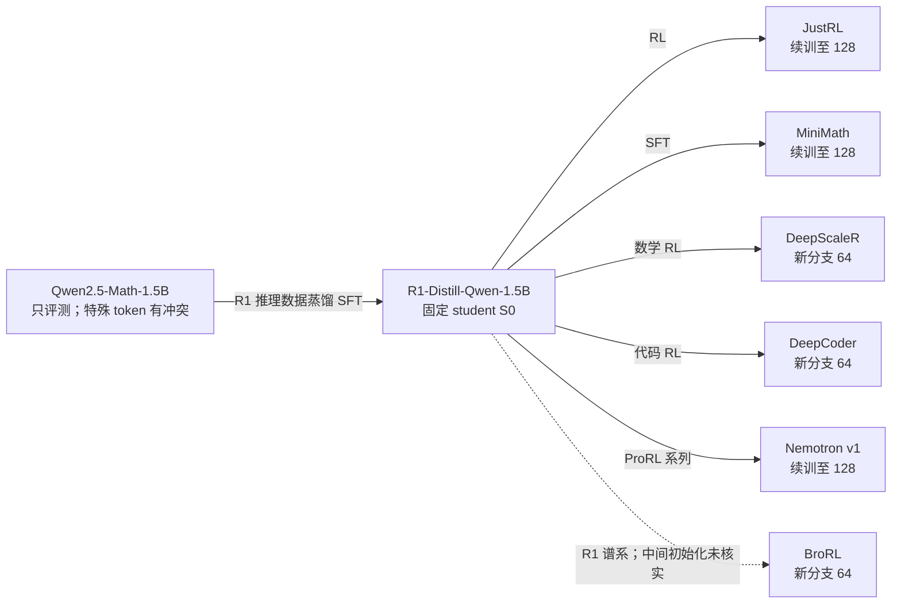
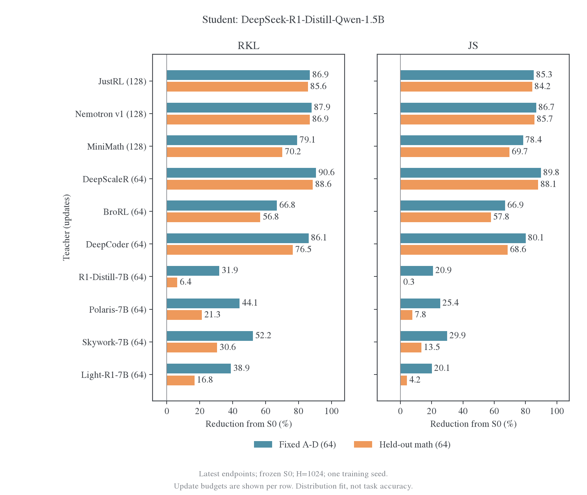
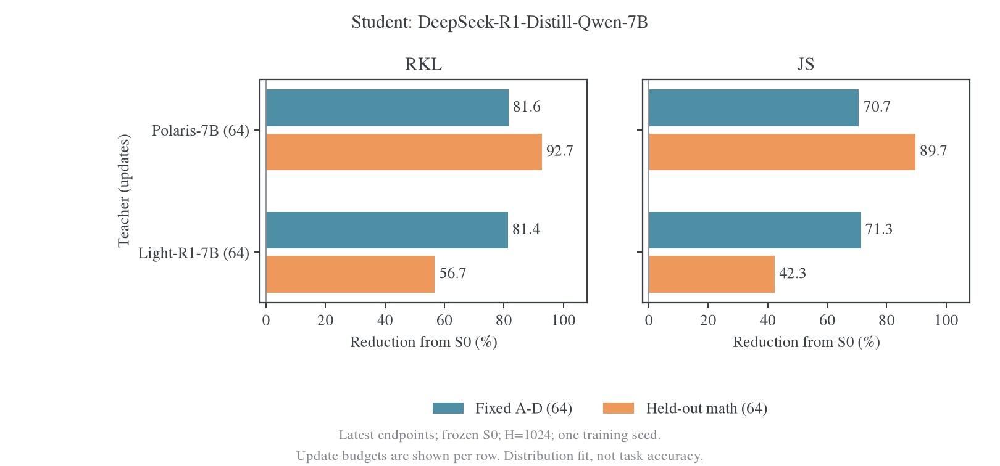

# 同架构教师吸收假说：续训、谱系扩展与能力回收

更新时间：2026-10-29。状态：**R1 扩展全部完成：384 次新增科学更新、47880 条新评测回答，含十五个学生终点**。执行范围为 JustRL、Nemotron v1、MiniMath 三组 64→128 续训，以及 DeepScaleR、BroRL、DeepCoder 三组 0→64；Qwen2.5-Math-1.5B 只评测。Polaris 续训与 MiniMath 旧池分支不执行。首轮原始 setting、全部动态和数值核验保留在[首轮报告](2026-10-28-跨源蒸馏边界分阶段实验计划.md#results)。

后续固定初始 student 为`deepseek-ai/DeepSeek-R1-Distill-Qwen-1.5B`。新 teacher 实验各自从这个原始 checkpoint 开始，不用已经学过另一位 teacher 的学生作为替代。本页的三组续训选择优先于旧计划中 TB3 的条件选择；旧计划里的换 student、Qwen3 和更大模型矩阵暂不推进。

## 1. 已完成实验的最终降幅

每个 student 单独汇总其全部 teacher 配对：1.5B 有七组，7B 有两组，总计九组。图中只画 64 次更新的终点，没有中间动态。每组含训练银行 A–D 和数学 held-out M01–M04，分别比较 RKL 与 JS。

每根条的定义为该 teacher、该面板相对自己的初始风险下降：

$$
\mathrm{Reduction}=100\left(1-\frac{R(\theta_{64})}{R(\theta_0)}\right).
$$

风险按每题距离总和除以 H1024 再平均。这是分布风险下降，不是任务准确率或教师能力回收率。图中显示单训练 seed 的点估计；按题 bootstrap 区间和绝对风险在[原始终点表](../../../../../../../wandb-logs/MirrorOPD-verl/analysis/teacher-boundary-20261028/analysis/endpoints.csv)中保留，区间不能代替训练 seed 方差。教师按谱系分组排列，不按实测表现排序。

### 1.1 R1-Distill-Qwen-1.5B student：全部七位 teacher

[首轮 1.5B 学生的 64-step 终点图](figures/boundary-endpoints-20261029/r1-endpoints.png)

[矢量 PDF](figures/boundary-endpoints-20261029/r1-endpoints.pdf)。JustRL 与 Nemotron v1 的训练/留出同时改善；R1-7B 的留出 JS 几乎不变。MiniMath 虽能取得较多分布拟合，但原始数学能力低于学生，因此不将其降幅解释成正向能力回收。

### 1.2 R1-Distill-Qwen-7B student：全部两位 teacher

[首轮 7B 学生的 64-step 终点图](figures/boundary-endpoints-20261029/r7-endpoints.png)

[矢量 PDF](figures/boundary-endpoints-20261029/r7-endpoints.pdf)。Polaris 在该学生上的留出迁移明显强于 Light。Polaris 训练银行的降幅小于留出降幅，涉及已报告的部分旧批风险回升，不应只看留出条形判断所有 state 均已对齐。

两图共 36 根条，覆盖 9 个 pair×2 个距离×2 个面板。[绘图数据](figures/boundary-endpoints-20261029/plotted-data.csv)、[图审计](figures/boundary-endpoints-20261029/audit.json)和[CPU 绘图源码](../../../../research/transfer/boundary/plot_endpoints.py)保留复算路径。旧动态曲线没有删除。

## 2. 同架构可以完全吸收：需要区分的判断

在结构、位置编码、输入输出语义和数值路径一致时，teacher 权重本身提供了 student 函数族能表达 teacher 的构造：令 student 使用相同权重即可。这个可表达性判断不等于从当前初始学生出发，有限数据上的 OPD 优化一定找到该解，也不保证未见 state 和实际任务都能达到教师。

| 判断                            | 本研究中的检验方式                                                | 尚不能推出的结论                         |
| ------------------------------- | ----------------------------------------------------------------- | ---------------------------------------- |
| Teacher 函数可以被 student 表示 | 同构 teacher-copy 只读参考，核对结构、token 语义、RoPE 与数值路径 | 不等于梯度优化从 S0 可到达               |
| 延长训练能继续拟合已见分布      | 64→128 及必要时 320 的训练风险                                    | 不等于跨题泛化或完整能力获取             |
| 新题和其他前缀也接近 teacher    | 固定 holdout、预留面板、fresh 及较完整回答上的 RKL/JS             | 有限面板不能证明所有输入上策略相等       |
| 任务能力被吸收                  | 同协议教师/学生任务评测与逐题变化                                 | 小 KL 或单一任务分数不自动证明全能力相等 |

MiniMath、JustRL、Nemotron v1 同时满足“同核心架构”和“直接从当前学生继续训练”。续训三组能验证它们的 64-step 残差是否还可下降；即使都成功，也不能单独推出所有同架构、不同初始化 teacher 都可充分迁移。要区分架构与直接权重继承，需要补早期分叉对照。

不在这里新增“完全吸收”的统一 KL 阈值。后续报告绝对风险、相对下降、后期斜率、数值参考及不同评估分布，保留完整蒸馏定义的开放边界。

## 3. 三组续训的依据与具体设计

### 3.1 64 次更新尚未显示三组都已平台

以下只复算已完成数据，百分比以 48-step 风险为分母：

| Teacher       | 数学 held-out RKL：48→64 | 该 16-step 区间相对下降 |
| ------------- | ------------------------ | ----------------------: |
| JustRL        | 0.05660 → 0.03515        |                  37.90% |
| Nemotron v1   | 0.08391 → 0.05133        |                  38.82% |
| MiniMath      | 0.04431 → 0.03721        |                  16.02% |
| Polaris，参考 | 0.19238 → 0.18511        |                   3.78% |

这支持优先续训三组，不能从有限差分外推其最终一定到零。源文件是各分支的`fixed-048.json`和`fixed-064.json`，分支目录见[原始证据](../../../../../../../wandb-logs/MirrorOPD-verl/analysis/teacher-boundary-20261028/arms/)。

### 3.2 第一阶段：从各自 64-step 状态续到 128

| 分支   | 恢复来源                          | 新训练批 | 新增更新 |
| ------ | --------------------------------- | -------- | -------: |
| CONT-J | TB1-J / step064                   | E→F→G→H  |       64 |
| CONT-N | TB1-N / step064；仍为 Nemotron v1 | E→F→G→H  |       64 |
| CONT-M | TB2-M1 / step064                  | E→F→G→H  |       64 |

三组共追加 192 次更新，均恢复自己的权重、Adam 一阶/二阶矩、step 和 RNG。每批 16 题×reuse16，LR1e-6、full-vocab RKL、H1024、精度和固定 S0 轨迹沿用首轮。E–H 在首轮没有进入训练，其 S0 轨迹和 teacher 缓存已有对应输入；不重新生成 fresh 训练轨迹。固定评分在 64/80/96/112/128 进行，主要比较同一数学 development 面板，同时保持 RKL/JS、已见批保持和实际 token 统计。

续训入口恢复各自 step064 的 Adam 矩、更新计数和 RNG，并检查模型 revision、256 条轨迹的 token/source/seed 身份。恢复后的固定面板 RKL 必须与旧 step064 逐题一致到每题 1e-4 以内；通过检查才允许第 65 次更新。实现见 [fast_train.py](../../../../research/transfer/boundary/fast_train.py)。

如到 128 仍有持续的留出改善，再讨论 I–T 续到 320；每组从 128 追加 192 更新，三组追加 576 更新。三组从 64 到 320 的总新增预算为 768 更新，**不是现在已启动的任务**。

### 3.3 预算边界

Polaris 不追加训练；其更长预算的历史证据见 [E48 完整训练](../cross-origin/polaris/2026-10-27-E48完整训练与后期平台分析.md)与 [E49 方向对照](../cross-origin/polaris/2026-10-28-E49方向对照与跨源迁移.md)。MiniMath 与其他两组使用一致的 E–H 续训设置，不新增 A–D 旧池分叉。E–H 同时增加优化次数和题目覆盖，因此结果只回答该共同设置下是否继续改善，不能单独分离这两个因素。

### 3.4 Teacher-copy 参考与后续能力确认

已对六位同构 teacher 完成只读 teacher-copy 参考（结果见第 9 节），其设计是：把 teacher 权重作为 student 参数，分别测量同一数值路径下的自对照，以及实际 teacher/student 执行精度组合下的残差。前者检查函数与支持集，后者刻画实现精度造成的参考量级。它不是额外蒸馏训练，也不拿这个参考直接充当全域能力验收线。

续训配对和预算在查看预留面板前固定。M05–M12 保留给进一步确认，不纳入当前 384-update 阶段的评分；这些题在历史 L 中出现过，仍不称完全未接触测试集。更强的确认需要新抽取的互斥题目、当前学生 fresh 前缀和完整回答评测。H1024 的下降只说明推理前段条件分布更接近，不能替代这些检查。

## 4. 固定 1.5B student 的新增 teacher 优先级

执行的新增教师为 **DeepScaleR、BroRL、DeepCoder**；Nemotron v2 暂不加入。Qwen2.5-Math-1.5B 单独评测，暂不训练。已有七教师继续充当参照，不重跑不变的原始基线。新 teacher 分支从原始 R1-1.5B 和 fresh Adam 开始，不从已蒸馏的 Nemotron v1 学生终点开始。

| 优先级           | Teacher repo / 版本                                         | 来源与新增问题                                                                                        |
| ---------------- | ----------------------------------------------------------- | ----------------------------------------------------------------------------------------------------- |
| 首批             | `agentica-org/DeepScaleR-1.5B-Preview`                      | 同一个 R1-1.5B 上的另一条数学 RL 和长上下文训练路径，补同构数学教师的外部复核                         |
| 暂不执行         | `nvidia/Nemotron-Research-Reasoning-Qwen-1.5B` / v2         | 在固定学生和尺寸下，检查更远后训练终点的可迁移性                                                      |
| 首批             | 同 repo / BroRL                                             | 增加探索宽度等变化后的终点；观察更强或不同能力 teacher 是否仍易吸收                                   |
| 首批执行         | `agentica-org/DeepCoder-1.5B-Preview`                       | 直接同源代码 RL，改变训练领域；数学/Code 前缀分开测量，不以数学分数判定代码能力不可学                 |
| 第二批           | `UCSC-VLAA/STAR1-R1-Distill-1.5B`                           | 直接同源安全 SFT，补 MiniMath 之外的 SFT 分支；若讨论安全能力，需要对应任务评测                       |
| 只评测           | `Qwen/Qwen2.5-Math-1.5B`                                    | 学生的 SFT 前祖先；检验同尺寸、逆向跨 SFT 阶段的目标获取                                              |
| 接口通过后补     | `Qwen/Qwen2.5-Math-7B`                                      | 补跨尺寸的 SFT 前教师，与已有 R1-7B/Polaris/Skywork 相连，student 仍为 1.5B                           |
| 暂作压力测试候选 | `nvidia/OpenMath-Nemotron-1.5B`、`WeiboAI/VibeThinker-1.5B` | 从更早 Math 基座分叉，最能补充不同初始化关系；目前存在配置和 token 接口差异，不当作干净的严格同构对照 |

DeepScaleR 和 DeepCoder 的初始化、训练方式由作者模型卡确认。[^deepscaler][^deepcoder] Nemotron 版本关系及已知局限沿用[固定版本表](../../../literature/teacher-transfer/sources/nemotron-revisions.json)与[谱系扩展](../../../settings/teacher-transfer/2026-10-28-模型谱系图与论文配对扩展.md)。v1/v2/BroRL 同时改变配方，不能标成同一 run 只增加步数的消融；公开 v2 最终权重也不能直接画成 BroRL 确定的初始化。[^nemotron] STAR-1 是已有来源明确的安全 SFT 分支。[^star]

实际下载并冻结的新增模型如下。前三位与 R1 student 的共享 token ID 语义一致，Math 有七处特殊 token 定义冲突，不能直接按相同 ID 进行原生 full-vocab KL。

| Teacher           | Revision                                   |
| ----------------- | ------------------------------------------ |
| DeepScaleR        | `e3f524ce413a296b4d388e7560dd5c82c1c56725` |
| DeepCoder         | `103033da54f104b0d0a3570547fb3721fba99962` |
| Qwen2.5-Math-1.5B | `4a83ca6e4526a4f2da3aa259ec36c259f66b2ab2` |
| BroRL             | `3441fcdf8c6e81a2959e6352ff50122e3c677d72` |

下面只展开固定 1.5B student 的相关谱系。实线表示已知初始化来源；虚线仅表示已确认的 R1 谱系，中间 checkpoint 未确定，不能据此断定 BroRL 从公开 v1 或 v2 终点继续训练。

### 4.1 同尺寸不自动等于严格相同架构

2026-10-29 的公开 config 核对显示，以下 1.5B 模型虽共享 hidden1536、28 层、12 个 attention heads 和 2 个 KV heads，仍有差别：

| 模型                      | RoPE theta | Embedding/head共享 | 对假说的含义                                       |
| ------------------------- | ---------: | ------------------ | -------------------------------------------------- |
| R1-1.5B 及本轮 J/M/N 教师 |      10000 | 否                 | 主要的同构、直接继承测试组                         |
| DeepScaleR                |      10000 | 否                 | 结构字段与主要组一致，仍需完整 token 与前向验收    |
| Qwen2.5-Math-1.5B         |      10000 | 是                 | 与学生参数绑定约束不同，先核对接口和函数可表达关系 |
| OpenMath-Nemotron-1.5B    |     500000 | 是                 | 位置编码与 head 绑定均不同                         |
| VibeThinker-1.5B          |     640000 | 是                 | 位置编码与 head 绑定均不同                         |

来源及固定 SHA 见[新候选 config 记录](../../../literature/teacher-transfer/sources/continuation-20261029/model-configs.json)。这份候选 config 记录来自前期元数据核对；实际执行的四个新 teacher 已另行下载并冻结 revision。OpenMath/Vibe 已有特殊 token ID 冲突记录，仍需专门处理。对于共享 embedding/head 的 teacher，给未绑定的 student 复制同一矩阵有机会保持相同前向函数；这不免除 token 语义与其余配置核对。

因此，三组直接子代续训成功后，下一项关键证据应是可验证的同构早分叉模型，而不是仅多加几位直接 RL 子代。若公开早分叉模型始终存在位置编码或 token 冲突，应单独构造统一配置的教师对照，不能把有接口差异的负结果用于否定严格同构假说。

## 5. 实际执行顺序、精度与保存策略

四个新 teacher 先评测；训练优化在空闲卡上验收，随后三组旧分支续训。新分支在相应 teacher 基线完成后启动。每个分支完成训练后评测终点；另补九组已有 step064 终点的任务评测。使用物理 GPU 4–7，每卡独立排队，结束或失败后恢复这四张卡的占用任务。

| 分支    | Teacher           | 起点→终点    | 训练批 | 新增更新 |
| ------- | ----------------- | ------------ | ------ | -------: |
| CONT-J  | JustRL            | 64→128       | E–H    |       64 |
| CONT-N  | Nemotron v1       | 64→128       | E–H    |       64 |
| CONT-M  | MiniMath          | 64→128       | E–H    |       64 |
| NEW-DS  | DeepScaleR        | 0→64         | A–D    |       64 |
| NEW-BRO | BroRL             | 0→64         | A–D    |       64 |
| NEW-DC  | DeepCoder         | 0→64         | A–D    |       64 |
| 只评测  | Qwen2.5-Math-1.5B | 原始 teacher | 无     |        0 |

训练共新增 384 次更新。每个分支四批，每批 16 题、reuse16、H1024；响应全来自原始 S0 固定银行。损失仍是 teacher 原生支持上的 full-vocab reverse KL，按 16×1024 归一化。学习率 1e-6，AdamW β=(0.9,0.999)、ε=1e-8、weight decay=0.01、梯度裁剪 1；FP32 参数、Adam 和输出 head，BF16 backbone，TF32 关闭。每 16 次更新在同一个 256 题面板评分，包含 A–H 128 题、数学 M01–M04 64 题、Code/IF 各 32 题。

优化保留这一数值路径：每批 teacher 的完整 FP32 log-prob 在 GPU 驻留并复用 16 次；head 使用解析 VJP，backbone 仍由 PyTorch 反传。对单个 state，令 $p=\operatorname{softmax}(z)$、$d_v=\log p_v-\log q_v$，则

$$
\frac{\partial D_{\mathrm{KL}}(p\|q)}{\partial z_v}
=p_v\left(d_v-\sum_u p_u d_u\right).
$$

这减少重复 teacher head 计算、临时 head 梯度和 CPU 标量同步，不改变 full-vocab 目标。chunk 仅切分 token 轴；具体大小通过初始模型和 JustRL step064 的完整参数梯度比较与计时选择，已选定 512。数值检查和计时证据保存在[优化目录](../../../../../../../wandb-logs/MirrorOPD-verl/analysis/teacher-boundary-20261029/optimization/)。六组训练均在 GPU 梯度验收通过后启动。

每个分支仅保存最终 FP32 权重和 tokenizer，不保存中间权重或新的 optimizer state。六个 1.5B 终点实际为 39.72 GiB，此外保留小型评分、训练及评测日志。原有 step064 Adam 供此次续训读取，旧文件尚未清理。新的 step128 不能单凭终点权重恢复同一条 Adam 路径；若后续决定精确续到 320，需要从旧 step064 重跑至 128，或另行安排可恢复保存策略。

训练代码位于仓库 [boundary 研究包](../../../../research/transfer/boundary/README.md)，是独立 PyTorch/Hugging Face 研究循环，复用项目的分布指标和 verl 任务判分。它不是 E20 的生产训练调度器。实际协议、模型身份与每项任务的原始证据统一保存在[第二轮输出目录](../../../../../../../wandb-logs/MirrorOPD-verl/analysis/teacher-boundary-20261029/)。

## 6. 任务评测与 GapRecovery

四个新 teacher 加十五个 student 终点，共十九项评测。十五个终点包括九组首轮 step064、三个新 teacher 的 step064 和三个续训 step128。每项含 MATH500 500 题、AMC23 40 题、AIME24/25/26 各 30 题，每题采样四次，共 2520 个回答；新增评测总计 47880 个回答。旧 teacher 与原始 student 已有的同协议基线直接复用。

除 Math teacher 外，使用首轮相同 R1 prompt token、temperature=0.7、top_p=0.9、最大响应 31744、上下文 32768。逐响应 seed 为 $72000000+100i+r$，$r\in\{0,1,2,3\}$，$i$ 沿用冻结 prompt 索引。请求顺序固定打乱以减少难题集中在尾部的空闲；批调度改变意味着不承诺与旧服务逐 token 位级复现。保存的 FP32 student 权重在 vLLM 中用 BF16 部署精度评测，与旧原始模型的任务基线一致。

Math teacher 保留原生 Qwen chat template、上下文 4096、响应上限 3072，并逐题检查 prompt 不超过 1024。它有 7 个特殊 token 定义与 R1 冲突，因此只报告这一独立条件下的基线。没有训练后的学生，不计算该组 GapRecovery，也不把短预算结果当作共同 32K 协议的 teacher 分数。

对每个数据集，Acc 使用同一题集上的 avg@4，计算

$$
\mathrm{GapRecovery}
=\frac{\mathrm{Acc}_{\mathrm{student,after}}-\mathrm{Acc}_{\mathrm{student,before}}}
{\mathrm{Acc}_{\mathrm{teacher}}-\mathrm{Acc}_{\mathrm{student,before}}}\times100\%.
$$

step128 的 before 仍是原始 S0，另外报告 step064→128 的增量。保留原始准确率、teacher advantage 和计算出的比值；不把比值裁到 0–100%。分母为零时记为未定义。分母为负时保留公式原值，但标为“teacher 不强于初始 student”，不能解释成正向能力回收；MiniMath 尤其需要这个区分。小分母会放大噪声，按题配对 bootstrap 联合重采样三组准确率，分母区间跨零或重采样出现零分母时，不报告有界比值置信区间。macro5 先等权平均五个任务的三组准确率，再代入公式；它不等于五个 GapRecovery 百分比的平均。

数学准确率只衡量这些数学任务。DeepCoder 的 Code 前缀 KL 另行列出，不能用数学 GapRecovery 代替代码能力回收；后者需要代码任务执行评测。固定 H1024 KL 下降也不能替代较长 fresh 回答上的行为检验。

## 7. 第二轮固定风险与执行效率

六组训练已完成，共新增 384 次科学更新，24 个 batch block 的首次更新 loss 与更新前同批固定评分的最大误差为 2.8e-17；教师熵在相同输入上保持不变。本节的固定风险结果与第 8 节完整回答评测分别报告。

### 7.1 数学留出和 Code 留出的终点

前三行的区间为 64→128，后三行为 0→64。“总降幅”均相对原始 student；区间降幅的分母则是各自区间起点。Code 留出同样是分布距离，不是执行代码测试的正确率。

| Teacher     | 最终更新数 | 数学 RKL：S0 | 数学 RKL：区间起点→终点 | RKL 总降幅 | 区间 RKL 降幅 | 数学 JS 总降幅 | Code RKL 总降幅 |
| ----------- | ---------: | -----------: | ----------------------- | ---------: | ------------: | -------------: | --------------: |
| JustRL      |        128 |      0.11929 | 0.03515 → 0.01714       |     85.63% |        51.25% |         84.23% |          81.30% |
| Nemotron v1 |        128 |      0.16357 | 0.05133 → 0.02151       |     86.85% |        58.11% |         85.73% |          69.91% |
| MiniMath    |        128 |      0.08063 | 0.03721 → 0.02402       |     70.21% |        35.45% |         69.70% |          61.44% |
| DeepScaleR  |         64 |      0.04010 | 0.04010 → 0.00455       |     88.64% |        88.64% |         88.07% |          87.87% |
| BroRL       |         64 |      0.25334 | 0.25334 → 0.10947       |     56.79% |        56.79% |         57.84% |          42.63% |
| DeepCoder   |         64 |      0.08839 | 0.08839 → 0.02074       |     76.53% |        76.53% |         68.56% |          53.09% |

来源：[逐题风险汇总](../../../../../../../wandb-logs/MirrorOPD-verl/analysis/teacher-boundary-20261029/analysis/endpoints.csv)、[各阶段风险](../../../../../../../wandb-logs/MirrorOPD-verl/analysis/teacher-boundary-20261029/analysis/risk-curves.csv)和[block 数值检查](../../../../../../../wandb-logs/MirrorOPD-verl/analysis/teacher-boundary-20261029/analysis/block-checks.csv)。表中的点估计来自单个训练 seed；按题 bootstrap 区间保存在 CSV 中。

JustRL、Nemotron v1、MiniMath 在新增 E–H 后都继续降低留出 RKL/JS，因此首轮 step64 的残差不能被称为其可蒸馏下界。它们的数学 RKL 仍分别保留 S0 风险的约 14.4%、13.1%、29.8%；当前结果不能证明“同架构已完全吸收”。

在同样 64-update 的新教师之间，DeepScaleR 的数学 RKL 降幅为 88.64%，DeepCoder 为 76.53%，BroRL 为 56.79%。BroRL 同属 R1-1.5B 谱系，却比另两位更难在短预算下拟合；其初始数学 RKL 也更大。架构、权重来源和 SFT/RL 类型可以组织对照，不能直接给出所有教师的严格难度排序。此处没有区分初始函数距离、训练配方和任务分布的独立因果效应。

### 7.2 每个 student 的全部教师最新终点

[1.5B 矢量 PDF](figures/boundary-round2/r1-latest-endpoints.pdf)、[7B 矢量 PDF](figures/boundary-round2/r7-latest-endpoints.pdf)、[绘图数据](figures/boundary-round2/plotted-data.csv)、[审计结果](figures/boundary-round2/audit.json)和[可编辑源码](../../../../research/transfer/boundary/round2_plot.py)。两张图覆盖 1.5B student 的十位 teacher 和 7B student 的两位 teacher，共 48 根条；每个 teacher 只画最新终点，不画中间动态。J/N/M 为 128 次更新，其余为 64 次，预算已写在行名里，不能把此图当等预算排名。固定 A–D 用于比较共同旧训练银行，E–H 的结果另在 CSV 中保留。

### 7.3 已用于六组训练的优化

GPU 上当前 batch16 的完整 FP32 teacher log-prob 复用 16 次；token chunk=512、microbatch1、保留激活重算。CPU 解析 VJP 与 autograd 的最大误差低于 1e-7；S0 与 JustRL step064 的完整参数梯度余弦相似度均大于 0.99999，相对 L2 差约 0.31%–0.36%，loss 差约 1e-9。它通过了事先规定的工程验收条件，但不是逐位相同的训练实现。三组恢复起点另与旧 step064 逐题评分核对。

六组的单步中位耗时为 2.97–3.11 秒；从初始评分之后，到完成新增 64 次更新、四次固定评分和最终权重保存，为 282–294 秒。原已优化 Nemotron/MiniMath 的单步约 3.6–3.7 秒，因此此处主要是约两成的单步改进；JustRL 首轮仍含 CPU 参数快照和位移诊断，其大幅墙钟改善不能全部归因于 KL 内核。加载模型、恢复 Adam 和首轮评分不包含在上述 282–294 秒内。

15 秒间隔的进程全生命周期采样显示，训练作业 GPU 利用率均值约 52%–56%、中位数约 57%–61%，仍有进一步减少小批量 kernel 和激活重算开销的空间。六个终点的 safetensors 合计 **39.72 GiB**，没有新增 optimizer 文件。原始证据见[性能表](../../../../../../../wandb-logs/MirrorOPD-verl/analysis/teacher-boundary-20261029/analysis/performance.csv)和[资源汇总](../../../../../../../wandb-logs/MirrorOPD-verl/analysis/teacher-boundary-20261029/analysis/resource-summary.json)。

### 7.4 六组主实验的完整任务结果

原始 student 的五任务等权平均准确率为 44.952%。六组主实验的 teacher 与 student-after 已全部完成每题四次采样；九个历史 step064 终点也已补测完成。

| Teacher     | 更新数 | 数学留出 RKL 总降幅 | Teacher macro5 | Student-after macro5 | GapRecovery |
| ----------- | -----: | ------------------: | -------------: | -------------------: | ----------: |
| JustRL      |    128 |              85.63% |        63.385% |              54.165% |      49.98% |
| Nemotron v1 |    128 |              86.85% |        58.432% |              55.070% |      75.06% |
| MiniMath    |    128 |              70.21% |        31.417% |              34.485% |     77.33%‡ |
| DeepScaleR  |     64 |              88.64% |        54.522% |              50.553% |      58.53% |
| BroRL       |     64 |              56.79% |        62.637% |              49.908% |      28.03% |
| DeepCoder   |     64 |              76.53% |        57.458% |              52.007% |      56.41% |

‡ MiniMath 的 teacher 低于初始 student，77.33% 来自负分子除以负分母，表示学生向较弱教师靠近；准确率实际下降 10.467 个百分点。这不是正向能力提升。

JustRL 的固定数学留出 RKL 已下降 85.63%，但任务差距回收为 49.98%；Nemotron v1 的对应数值为 86.85% 与 75.06%。固定 H1024 的分布拟合和较长 fresh 回答的任务表现不能互相替代。DeepScaleR 与 BroRL 的绝对准确率增益接近，但 BroRL 的 teacher 分数更高，因此未回收的任务差距更大。这里的比较为单训练 seed 点估计，不能只凭数值接近就判断两个分支无差异。

当前完整主实验数据见 [GapRecovery 表](../../../../../../../wandb-logs/MirrorOPD-verl/analysis/teacher-boundary-20261029/analysis/gap-recovery.csv)；同一文件已覆盖全部十五个终点。

## 8. 完整任务评测与 GapRecovery 结果

四个新教师和十五个学生终点评测全部完成，共 47880 个回答，无缺失回答槽位。以下准确率为百分数，均是逐题四次采样的平均；macro5 对五个任务等权。原始逐题答案、采样 seed、截断信息及评分保存在对应 evaluation 目录。

### 8.1 新教师基线

| 模型                        | MATH500 | AMC23 | AIME24 | AIME25 | AIME26 |
| --------------------------- | ------- | ----- | ------ | ------ | ------ |
| Student S0（共同 32K 协议） | 84.55   | 69.38 | 27.50  | 20.83  | 22.50  |
| DeepScaleR                  | 88.65   | 80.62 | 42.50  | 29.17  | 31.67  |
| BroRL                       | 92.35   | 87.50 | 62.50  | 37.50  | 33.33  |
| DeepCoder                   | 90.00   | 85.62 | 41.67  | 35.83  | 34.17  |

Qwen-Math 单独使用原生 4K 上下文、响应上限 3072，暂不训练；下表不参与共同 32K 协议的 GapRecovery。

| 独立基线          | MATH500 | AMC23 | AIME24 | AIME25 | AIME26 |
| ----------------- | ------- | ----- | ------ | ------ | ------ |
| Qwen2.5-Math-1.5B | 32.05   | 31.87 | 4.17   | 5.00   | 2.50   |

### 8.2 全部学生终点准确率

Teacher 列中的数字是累计训练更新数。7B 两行只有原有 step064 的补充评测，没有新增训练。

| Student | Teacher / step    | MATH500 | AMC23 | AIME24 | AIME25 | AIME26 | macro5 |
| ------- | ----------------- | ------- | ----- | ------ | ------ | ------ | ------ |
| 1.5B    | JustRL / 64       | 86.90   | 78.75 | 35.00  | 29.17  | 27.50  | 51.463 |
| 1.5B    | JustRL / 128      | 87.70   | 80.62 | 43.33  | 30.00  | 29.17  | 54.165 |
| 1.5B    | Nemotron v1 / 64  | 86.30   | 75.62 | 38.33  | 30.00  | 32.50  | 52.552 |
| 1.5B    | Nemotron v1 / 128 | 89.10   | 76.25 | 45.83  | 30.00  | 34.17  | 55.070 |
| 1.5B    | MiniMath / 64     | 81.35   | 70.00 | 22.50  | 22.50  | 20.00  | 43.270 |
| 1.5B    | MiniMath / 128    | 70.55   | 59.38 | 12.50  | 17.50  | 12.50  | 34.485 |
| 1.5B    | DeepScaleR / 64   | 87.35   | 78.75 | 31.67  | 31.67  | 23.33  | 50.553 |
| 1.5B    | BroRL / 64        | 87.25   | 75.62 | 34.17  | 25.83  | 26.67  | 49.908 |
| 1.5B    | DeepCoder / 64    | 86.70   | 75.00 | 42.50  | 25.83  | 30.00  | 52.007 |
| 1.5B    | R1-7B / 64        | 84.10   | 71.25 | 29.17  | 24.17  | 20.83  | 45.903 |
| 1.5B    | Polaris / 64      | 83.20   | 69.38 | 31.67  | 26.67  | 18.33  | 45.848 |
| 1.5B    | Skywork / 64      | 69.80   | 55.62 | 20.00  | 15.00  | 14.17  | 34.918 |
| 1.5B    | Light / 64        | 83.75   | 73.75 | 32.50  | 23.33  | 20.00  | 46.667 |
| 7B      | Polaris / 64      | 94.00   | 91.88 | 66.67  | 45.00  | 46.67  | 68.842 |
| 7B      | Light / 64        | 93.55   | 91.88 | 58.33  | 41.67  | 55.00  | 68.085 |

### 8.3 全部配对的 GapRecovery

数值单位为 %，保留负值及超过 100% 的原值。‡ 表示 teacher 准确率低于初始 student，此时正的公式值可能来自 student 能力下降；† 表示分母不稳定，无法报告有界比值区间。零分母记为未定义。每行的 before 都是相应原始 student，128-step 行也不改用 step064 作 before。

| Student | Teacher / step    | MATH500  | AMC23    | AIME24  | AIME25   | AIME26  | macro5  |
| ------- | ----------------- | -------- | -------- | ------- | -------- | ------- | ------- |
| 1.5B    | JustRL / 64       | 34.81    | 44.12    | 25.00   | 45.45†   | 31.58   | 35.33   |
| 1.5B    | JustRL / 128      | 46.67    | 52.94    | 52.78   | 50.00    | 42.11†  | 49.98   |
| 1.5B    | Nemotron v1 / 64  | 23.65    | 35.71    | 72.22   | 64.71†   | 75.00†  | 56.38   |
| 1.5B    | Nemotron v1 / 128 | 61.49    | 39.29    | 122.22  | 64.71†   | 87.50†  | 75.06   |
| 1.5B    | MiniMath / 64     | 21.99‡   | -4.00‡   | 30.00‡† | -40.00‡† | 15.00‡  | 12.42‡  |
| 1.5B    | MiniMath / 128    | 96.22‡   | 64.00‡   | 90.00‡† | 80.00‡†  | 60.00‡  | 77.33‡  |
| 1.5B    | DeepScaleR / 64   | 68.29    | 83.33†   | 27.78   | 130.00†  | 9.09†   | 58.53   |
| 1.5B    | BroRL / 64        | 34.62    | 34.48    | 19.05   | 30.00†   | 38.46†  | 28.03   |
| 1.5B    | DeepCoder / 64    | 39.45    | 34.62    | 105.88† | 33.33    | 64.29†  | 56.41   |
| 1.5B    | R1-7B / 64        | -5.17    | 8.82     | 5.88    | 14.29    | -7.41   | 4.57    |
| 1.5B    | Polaris / 64      | -12.00   | 0.00     | 9.80    | 17.50    | -10.20  | 2.91    |
| 1.5B    | Skywork / 64      | -129.96  | -59.46   | -20.00  | -18.42   | -21.28  | -35.13  |
| 1.5B    | Light / 64        | -10.06   | 22.58†   | 16.22   | 12.00    | -8.82   | 7.99    |
| 7B      | Polaris / 64      | 29.41    | 25.00†   | 76.47†  | 8.33†    | 9.09    | 30.64   |
| 7B      | Light / 64        | -40.00‡† | -66.67‡† | 100.00† | 100.00‡† | 171.43† | 360.00† |

### 8.4 最新终点的 macro5 原始量与区间

置信区间采用 5000 次按题配对 bootstrap，反映当前问题集合的采样不确定性，不是训练 seed 方差。区间跨零时，单个点估计的正负不能单独作为稳定能力改善的证据。

| Student | Teacher / step    | Before | Teacher | After  | 增益 pp | GapRecovery | 95% 区间         |
| ------- | ----------------- | ------ | ------- | ------ | ------- | ----------- | ---------------- |
| 1.5B    | JustRL / 128      | 44.952 | 63.385  | 54.165 | 9.213   | 49.98       | [33.94, 64.06]   |
| 1.5B    | Nemotron v1 / 128 | 44.952 | 58.432  | 55.070 | 10.118  | 75.06       | [54.82, 95.35]   |
| 1.5B    | MiniMath / 128    | 44.952 | 31.417  | 34.485 | -10.467 | 77.33‡      | [60.28, 99.83]   |
| 1.5B    | DeepScaleR / 64   | 44.952 | 54.522  | 50.553 | 5.602   | 58.53       | [29.69, 88.35]   |
| 1.5B    | BroRL / 64        | 44.952 | 62.637  | 49.908 | 4.957   | 28.03       | [9.50, 45.14]    |
| 1.5B    | DeepCoder / 64    | 44.952 | 57.458  | 52.007 | 7.055   | 56.41       | [36.20, 77.65]   |
| 1.5B    | R1-7B / 64        | 44.952 | 65.775  | 45.903 | 0.952   | 4.57        | [-11.12, 18.46]  |
| 1.5B    | Polaris / 64      | 44.952 | 75.785  | 45.848 | 0.897   | 2.91        | [-6.47, 11.19]   |
| 1.5B    | Skywork / 64      | 44.952 | 73.513  | 34.918 | -10.033 | -35.13      | [-52.05, -21.71] |
| 1.5B    | Light / 64        | 44.952 | 66.417  | 46.667 | 1.715   | 7.99        | [-4.91, 18.95]   |
| 7B      | Polaris / 64      | 65.775 | 75.785  | 68.842 | 3.067   | 30.64       | [-0.27, 53.39]   |
| 7B      | Light / 64        | 65.775 | 66.417  | 68.085 | 2.310   | 360.00†     | 不报告           |

完整的 75 个单任务比值和 15 个 macro5 比值，以及三组准确率、分母区间、准确率增益区间、无界情况和重采样零分母比例，见 [GapRecovery CSV](../../../../../../../wandb-logs/MirrorOPD-verl/analysis/teacher-boundary-20261029/analysis/gap-recovery.csv)。各模型的平均回答长度和截断比例见[任务准确率与长度表](../../../../../../../wandb-logs/MirrorOPD-verl/analysis/teacher-boundary-20261029/analysis/accuracies.csv)，完整性核验见[验证记录](../../../../../../../wandb-logs/MirrorOPD-verl/analysis/teacher-boundary-20261029/analysis/verification.json)。本节由 [round2_tables.py](../../../../research/transfer/boundary/round2_tables.py) 从已核验汇总生成。

### 8.5 额外 64 次更新的准确率变化

直接对同一题集的 step064 与 step128 做配对比较。增益单位为百分点。

| Teacher     | step064 | step128 | 增益 pp | 95% 区间          |
| ----------- | ------- | ------- | ------- | ----------------- |
| JustRL      | 51.463  | 54.165  | +2.702  | [-0.168, 5.707]   |
| Nemotron v1 | 52.552  | 55.070  | +2.518  | [-0.000, 5.092]   |
| MiniMath    | 43.270  | 34.485  | -8.785  | [-11.664, -6.010] |

五个单任务及 macro5 的完整结果见[续训增量表](../../../../../../../wandb-logs/MirrorOPD-verl/analysis/teacher-boundary-20261029/analysis/continuation-accuracy.csv)。

## 9. 数值参考、进一步提速与结论边界

### 9.1 同构 teacher-copy 给出可达到的参考点

对六位 1.5B teacher，在原始 R1 student 的配置和 FP32 参数容器中严格复制实际 BF16 teacher 参数，保留 student 原有 buffers；再比较同一 64 道数学留出题上的分布。六组配置字段一致；每组另外核对两条缓存轨迹的原生 teacher hidden，最大差和原生自对照 RKL 都为零。

| Teacher     | Copy 参考 RKL | Copy 参考 JS |
| ----------- | ------------: | -----------: |
| JustRL      |     0.0002243 |    0.0000560 |
| Nemotron v1 |     0.0002285 |    0.0000572 |
| MiniMath    |     0.0001083 |    0.0000270 |
| DeepScaleR  |     0.0001931 |    0.0000482 |
| BroRL       |     0.0002803 |    0.0000697 |
| DeepCoder   |     0.0002517 |    0.0000627 |

来源：[逐题与汇总证据](../../../../../../../wandb-logs/MirrorOPD-verl/analysis/teacher-boundary-20261029/teacher-copy/)、[实现](../../../../research/transfer/boundary/copy_reference.py)。这是只读参数构造，没有增加蒸馏更新或导出 checkpoint。

令 $R$ 为这里固定面板的风险，复制后的参数是 student 参数空间中的一个点，因此有

$$
\inf_{\theta\in\Theta_{\mathrm{student}}}R(\theta)
\leq R(\theta_{\mathrm{copy}}).
$$

复制参考是一个可构造的低风险点，不是数值下界；其他参数还可能补偿执行精度差异。在该面板上，现有训练残差明显高于复制参考，因而不能把这些残差直接解释为同架构的表达能力硬界限。优化路径、有限题目覆盖、固定 S0 状态和 H1024 截断仍需要区分。

### 9.2 后续批处理路径的独立验证

六组科学结果使用 microbatch1。随后单独验证 microbatch1/2/4/8、关闭激活重算的路径，在 S0 与 JustRL step064 上比较完整参数梯度，并执行一次不导出权重的 Adam 更新。通过核验的最快候选是 microbatch8：一个 warm-state batch16 的前后向约 1.50 秒，对照约 3.11 秒，约 2.08 倍；另一次真实更新的前后向为 1.205 秒，Adam 约 0.064 秒，峰值 72.37 GiB。

这些是工程计时与等价性检查，六条科学轨迹没有为更换执行实现而重跑。证据见[批处理验证](../../../../../../../wandb-logs/MirrorOPD-verl/analysis/teacher-boundary-20261029/optimization-batched/complete.json)。后续模型需要重新核验 tied embedding/head、显存与 padding 行为，再采用对应配置。

### 9.3 当前证据支持的规律

同构直接派生组的固定风险总体更容易下降；JustRL、Nemotron v1 和 MiniMath 的 step64 残差都能继续降低。教师内部的细致排序并不由 SFT/RL 标签或初始 KL 单独决定，BroRL 是值得进一步延长的同尺寸高残差对照。

任务回收与短前缀拟合存在明显差距。Polaris 教 7B student 的数学留出 RKL 下降约 92.74%，但 macro5 GapRecovery 为 30.64%；Skywork 教 1.5B 的 macro5 准确率反而降到 34.918%。后者在 MATH500 上的平均回答长度从 S0 的 5220 增至 12887，截断率从 1.9% 增至 24.1%，重复 8-gram 比例从 15.5% 增至 36.7%。这记录了行为退化与风险拟合并存，尚不能把长度或重复度单独确定为原因。

JustRL 与 Nemotron v1 在 64→128 的 macro5 准确率点估计分别增加 2.702、2.518 个百分点，但按题区间仍覆盖零附近；MiniMath 同一区间下降 8.785 个百分点，区间为 [-11.664, -6.010]。继续逼近较弱 teacher 可以明确损害准确率。Light 教 7B 的公式原值为 360%，而 teacher 的 macro5 优势仅约 0.642 个百分点且分母区间跨零，应保留原始分数并标为不稳定，不能解释为稳定的数倍能力回收。

这些结果与[论文对照](../../../literature/teacher-transfer/2026-10-28-蒸馏边界实验的论文对照与预算依据.md)中的配对依赖相联系，但此处仅用 64/128 道训练题、固定 S0 和 H1024，不能直接与更长 rollout、更多独立题目或在线 OPD 的最终成绩同比。下一轮见 [Qwen3 谱系研究](qwen3/2026-10-29-Qwen3谱系与同构教师吸收.md)，继续区分可表达性、有限预算优化和完整回答能力。

### 参考文献

[^deepscaler]: Agentica. DeepScaleR-1.5B-Preview Model Card. [官方模型](https://huggingface.co/agentica-org/DeepScaleR-1.5B-Preview)。直接 R1-1.5B 初始化、数学 RL 与分阶段延长上下文。

[^deepcoder]: Agentica. DeepCoder-1.5B-Preview Model Card. [官方模型](https://huggingface.co/agentica-org/DeepCoder-1.5B-Preview)。直接 R1-1.5B 初始化、代码 RL 与训练数据。

[^nemotron]: NVIDIA. Nemotron-Research-Reasoning-Qwen-1.5B. [官方版本说明](https://huggingface.co/nvidia/Nemotron-Research-Reasoning-Qwen-1.5B)、[ProRL v2 说明](https://research.nvidia.com/labs/lpr/prorlv2/)。

[^star]: Wang et al. STAR-1: Safer Alignment of Reasoning LLMs with 1K Data. 2025. [论文](https://arxiv.org/abs/2504.01903)、[1.5B 模型](https://huggingface.co/UCSC-VLAA/STAR1-R1-Distill-1.5B)。
