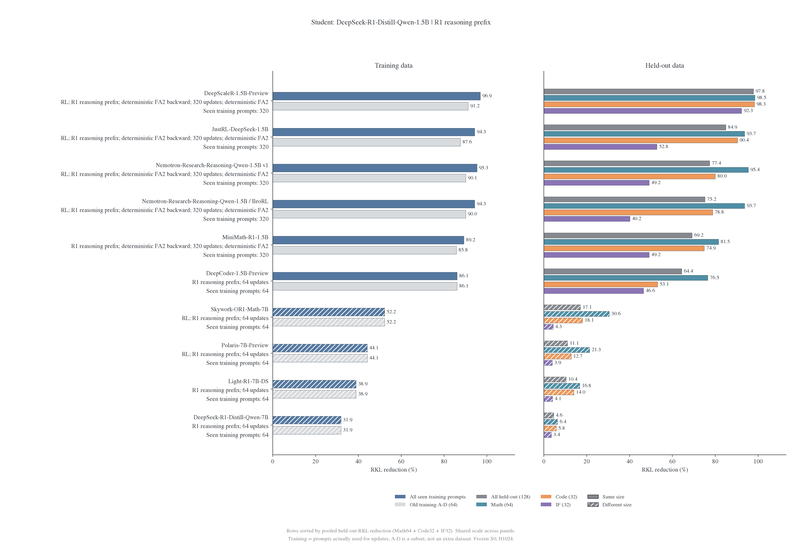
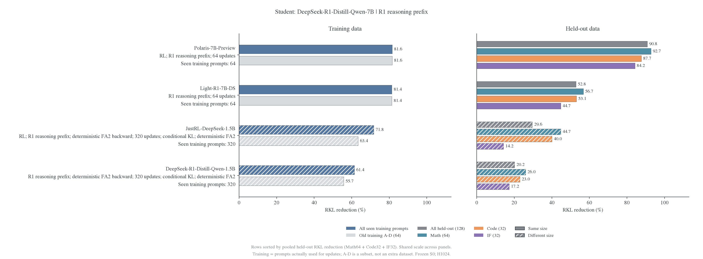
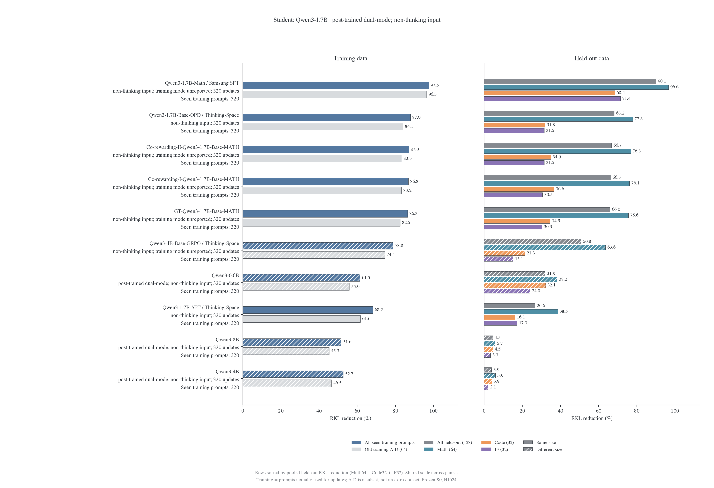
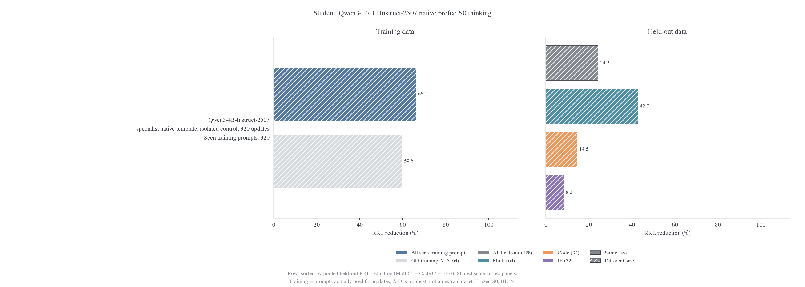
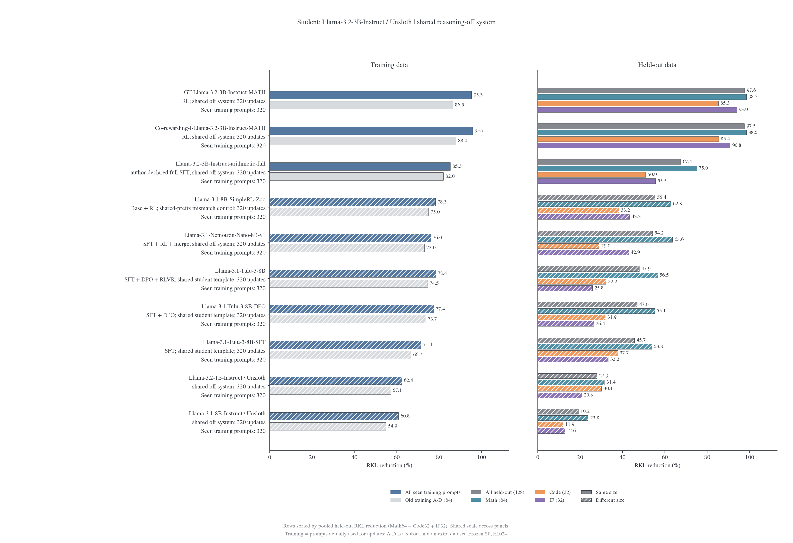

# 教师谱系比较：0–320 更新

当前正文、主图和每实验附录只展示学生更新 0–320 的结果。重复题池上的更长预算不进入当前比较；历史记录和权重保留，不删除或改写。teacher 名称中的 SFT `step640` 是教师 checkpoint 身份，不是学生更新预算。

<!-- generated:counts:start -->

状态：本轮 R1、Qwen3、Llama 教师谱系主比较集合共有 42 个固定权重版本，其中 42 个已落地。按当前完成回执，已完成 42 个不同师生权重配对、50 个输入条件，展示范围内的终点预算合计 13952 更新。每个条件仅展示 0–320 内最新有效读出，不重复累计中间阶段或重放预算；不统计其他研究线，也不把自教师、teacher-copy、重复评分和数值验证算作训练分支。准确率不作为本总览主表或下一阶段开训门槛。

<!-- generated:counts:end -->

<!-- generated:inventory:start -->

| 谱系  | 计划中的权重版本 | 权重已到本地 | 已完成训练的不同师生配对 |
| ----- | ---------------: | -----------: | -----------------------: |
| R1    |               12 |           12 |                       14 |
| Qwen3 |               19 |           19 |                       18 |
| Llama |               11 |           11 |                       10 |
| 合计  |           **42** |       **42** |                   **42** |

<!-- generated:inventory:end -->

## 读取方式

每个 student／输入模式单独比较。主图左侧为训练题集与早期 A–D，右侧为 Math／Code／IF 及按题数加权的整体留出；按整体留出风险降幅排序。同尺寸用实心，跨尺寸用斜线。历史分支若仅有 64／128 的有效结果，保留实际预算，不补造 320。不同预算的终点排序不是严格的等预算难度排名。

详细设置见[公共协议](protocol.md)。每实验详细图先按[附录图谱草案](appendix/figure-plan.md)讨论；目前只制作了一张 batch 影响样例。

## R1-1.5B student

<!-- generated:r1:start -->

| Teacher（条件见图）                           | 更新数 | 整体初始 RKL | 整体最终 RKL | 整体下降 | Math 下降 | Code 下降 | IF 下降 |
| --------------------------------------------- | -----: | -----------: | -----------: | -------: | --------: | --------: | ------: |
| DeepScaleR-1.5B-Preview                       |    320 |     0.032978 |     0.000716 |   97.83% |    98.53% |    98.30% |  92.29% |
| JustRL-DeepSeek-1.5B                          |    320 |     0.117835 |     0.017768 |   84.92% |    93.69% |    90.35% |  52.79% |
| Nemotron-Research-Reasoning-Qwen-1.5B v1      |    320 |     0.200227 |     0.045246 |   77.40% |    95.41% |    80.03% |  49.16% |
| Nemotron-Research-Reasoning-Qwen-1.5B / BroRL |    320 |     0.293644 |     0.072881 |   75.18% |    93.72% |    78.76% |  40.18% |
| MiniMath-R1-1.5B                              |    320 |     0.093081 |     0.028692 |   69.18% |    81.52% |    74.88% |  49.16% |
| DeepCoder-1.5B-Preview                        |     64 |     0.088564 |     0.031569 |   64.35% |    76.53% |    53.09% |  46.55% |
| Skywork-OR1-Math-7B                           |     64 |     0.436848 |     0.362188 |   17.09% |    30.55% |    18.06% |   4.32% |
| Polaris-7B-Preview                            |     64 |     0.358446 |     0.318826 |   11.05% |    21.33% |    12.74% |   3.92% |
| Light-R1-7B-DS                                |     64 |     0.442815 |     0.396952 |   10.36% |    16.78% |    14.01% |   4.06% |
| DeepSeek-R1-Distill-Qwen-7B                   |     64 |     0.273158 |     0.260708 |    4.56% |     6.38% |     5.76% |   3.44% |

<!-- generated:r1:end -->

## R1-7B student

<!-- generated:r7:start -->

| Teacher（条件见图）             | 更新数 | 整体初始 RKL | 整体最终 RKL | 整体下降 | Math 下降 | Code 下降 | IF 下降 |
| ------------------------------- | -----: | -----------: | -----------: | -------: | --------: | --------: | ------: |
| Polaris-7B-Preview              |     64 |     0.044832 |     0.004115 |   90.82% |    92.74% |    87.65% |  84.23% |
| Light-R1-7B-DS                  |     64 |     0.117059 |     0.055215 |   52.83% |    56.75% |    53.08% |  44.69% |
| JustRL-DeepSeek-1.5B †          |    320 |     0.349913 |     0.246454 |   29.57% |    44.73% |    40.02% |  14.24% |
| DeepSeek-R1-Distill-Qwen-1.5B † |    320 |     0.236807 |     0.189057 |   20.16% |    26.00% |    22.98% |  17.22% |

<!-- generated:r7:end -->

† 小 teacher→大 student 使用共同 151936 维条件 RKL，其余旧行保留原生口径；不把不同支持口径当作完全相同目标。

## Qwen3-1.7B：thinking 输入

<!-- generated:q3-1.7:start -->

| Teacher（条件见图）                  | 更新数 | 整体初始 RKL | 整体最终 RKL | 整体下降 | Math 下降 | Code 下降 | IF 下降 |
| ------------------------------------ | -----: | -----------: | -----------: | -------: | --------: | --------: | ------: |
| e3-1.7B                              |    320 |     0.033804 |     0.001298 |   96.16% |    97.92% |    96.71% |  89.89% |
| Qwen3-1.7B-GRPO-KL-Math              |    320 |     0.019611 |     0.001109 |   94.34% |    95.81% |    94.86% |  88.25% |
| Qwen3-1.7B-Math / Samsung SFT        |    320 |     0.248817 |     0.034588 |   86.10% |    89.94% |    88.84% |  73.20% |
| Qwen3-1.7B-SFT / Thinking-Space      |    320 |     0.616008 |     0.191977 |   68.84% |    85.03% |    64.35% |  48.92% |
| Qwen3-1.7B-Base-OPD / Thinking-Space |    320 |     0.746448 |     0.280455 |   62.43% |    78.96% |    55.55% |  32.85% |
| Qwen3-1.7B-Base                      |    320 |     0.599753 |     0.230065 |   61.64% |    76.24% |    58.91% |  39.82% |
| Qwen3-4B-Base-GRPO / Thinking-Space  |    320 |     0.664417 |     0.335392 |   49.52% |    65.17% |    46.85% |  23.06% |
| Qwen3-0.6B                           |    320 |     0.300502 |     0.183960 |   38.78% |    43.84% |    48.12% |  27.16% |
| Qwen3-4B Math-CoT SFT step80         |    320 |     0.386144 |     0.287476 |   25.55% |    31.23% |    29.77% |  17.15% |
| Qwen3-4B-Thinking-2507               |     64 |     0.671903 |     0.584879 |   12.95% |    29.79% |     7.99% |   0.13% |
| Qwen3-4B Math-CoT SFT step640        |    320 |     0.419072 |     0.370862 |   11.50% |    10.65% |    16.43% |   7.49% |
| Polaris-4B-Preview                   |    320 |     0.329342 |     0.311394 |    5.45% |     5.01% |     6.88% |   4.70% |
| Qwen3-4B                             |    320 |     0.300000 |     0.295592 |    1.47% |    -1.56% |     2.90% |   3.39% |
| Qwen3-8B                             |    320 |     0.313654 |     0.312846 |    0.26% |    -3.24% |     2.55% |   1.89% |

<!-- generated:q3-1.7:end -->

## Qwen3-1.7B：non-thinking 输入

<!-- generated:q3-1.7-nonthinking:start -->

| Teacher（条件见图）                  | 更新数 | 整体初始 RKL | 整体最终 RKL | 整体下降 | Math 下降 | Code 下降 | IF 下降 |
| ------------------------------------ | -----: | -----------: | -----------: | -------: | --------: | --------: | ------: |
| Qwen3-1.7B-Math / Samsung SFT        |    320 |     0.144801 |     0.014366 |   90.08% |    96.58% |    68.40% |  71.42% |
| Qwen3-1.7B-Base-OPD / Thinking-Space |    320 |     0.253677 |     0.080693 |   68.19% |    77.82% |    31.85% |  31.47% |
| Co-rewarding-II-Qwen3-1.7B-Base-MATH |    320 |     0.232627 |     0.077350 |   66.75% |    76.80% |    34.90% |  31.48% |
| Co-rewarding-I-Qwen3-1.7B-Base-MATH  |    320 |     0.242120 |     0.081580 |   66.31% |    76.12% |    36.59% |  30.54% |
| GT-Qwen3-1.7B-Base-MATH              |    320 |     0.245982 |     0.083704 |   65.97% |    75.57% |    34.50% |  30.32% |
| Qwen3-4B-Base-GRPO / Thinking-Space  |    320 |     0.234365 |     0.115318 |   50.80% |    63.58% |    21.29% |  15.14% |
| Qwen3-0.6B                           |    320 |     0.121295 |     0.082580 |   31.92% |    38.22% |    32.14% |  24.01% |
| Qwen3-1.7B-SFT / Thinking-Space      |    320 |     0.085970 |     0.063103 |   26.60% |    38.53% |    16.10% |  17.26% |
| Qwen3-8B                             |    320 |     0.123020 |     0.117522 |    4.47% |     5.69% |     4.51% |   3.29% |
| Qwen3-4B                             |    320 |     0.134794 |     0.129585 |    3.86% |     5.92% |     3.90% |   2.11% |

<!-- generated:q3-1.7-nonthinking:end -->

## Instruct-2507 模板专用对照

<!-- generated:q3-1.7-native-instruct2507:start -->

| Teacher（条件见图）    | 更新数 | 整体初始 RKL | 整体最终 RKL | 整体下降 | Math 下降 | Code 下降 | IF 下降 |
| ---------------------- | -----: | -----------: | -----------: | -------: | --------: | --------: | ------: |
| Qwen3-4B-Instruct-2507 |    320 |     0.768475 |     0.582851 |   24.15% |    42.67% |    14.49% |   8.27% |

<!-- generated:q3-1.7-native-instruct2507:end -->

## Llama-3.2-3B-Instruct student

<!-- generated:llama3-3b-off:start -->

| Teacher（条件见图）                       | 更新数 | 整体初始 RKL | 整体最终 RKL | 整体下降 | Math 下降 | Code 下降 | IF 下降 |
| ----------------------------------------- | -----: | -----------: | -----------: | -------: | --------: | --------: | ------: |
| GT-Llama-3.2-3B-Instruct-MATH             |    320 |     0.022932 |     0.000540 |   97.65% |    98.48% |    85.27% |  93.86% |
| Co-rewarding-I-Llama-3.2-3B-Instruct-MATH |    320 |     0.021832 |     0.000541 |   97.52% |    98.46% |    85.38% |  90.80% |
| Llama-3.2-3B-Instruct-arithmetic-full     |    320 |     0.219375 |     0.071417 |   67.45% |    75.02% |    50.88% |  55.55% |
| Llama-3.1-8B-SimpleRL-Zoo                 |    320 |     0.263856 |     0.117807 |   55.35% |    62.79% |    38.21% |  43.32% |
| Llama-3.1-Nemotron-Nano-8B-v1             |    320 |     0.380807 |     0.174600 |   54.15% |    63.57% |    28.95% |  42.90% |
| Llama-3.1-Tulu-3-8B                       |    320 |     0.453277 |     0.236005 |   47.93% |    56.52% |    32.20% |  25.80% |
| Llama-3.1-Tulu-3-8B-DPO                   |    320 |     0.428990 |     0.227525 |   46.96% |    55.14% |    31.87% |  26.41% |
| Llama-3.1-Tulu-3-8B-SFT                   |    320 |     0.192855 |     0.104783 |   45.67% |    53.85% |    37.69% |  33.27% |
| Llama-3.2-1B-Instruct / Unsloth           |    320 |     0.100543 |     0.072446 |   27.95% |    31.43% |    30.13% |  20.75% |
| Llama-3.1-8B-Instruct / Unsloth           |    320 |     0.073250 |     0.059211 |   19.16% |    23.76% |    11.95% |  12.63% |

<!-- generated:llama3-3b-off:end -->

## Thinking-2507 模板专用对照

两个 2507 专用模板条件不混入普通双模式主表；模式、前缀及 RoPE 差异分别记录。

## 等预算阶段比较

- [Qwen SFT 深度与 Llama 阶段对照](2026-10-30-SFT深度与后训练阶段对照计划.md)：只比较三组／四组共同的 0–320 区间。
- [R1 同尺寸结果](r1/2026-10-29-同架构教师吸收假说与续训设计.md)与[小教大结果](r1/2026-10-29-小教师到大模型的跨尺寸吸收.md)：注明数值执行条件，保留历史重放失败与新副本的区别。
- [补充材料](appendix/README.md)：不进入主比较的材料单独保留。

表格、计数和图来自同一份[逐题读出汇总](data/overview-20261029/risks.csv)。每行的 source 路径可能位于后续运行目录，但实际读取的评分步数不得超过 320；不使用后续权重的评分冒充早期读出。旧混合预算文档与图表已冻结到历史快照，默认阅读入口不再展开它们。
