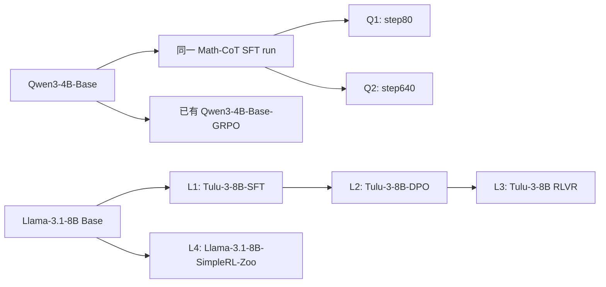

# Qwen 与 Llama 阶段对照：0–320 更新

当前只比较 student 的 0–320 更新。Qwen teacher 的 step80／step640 是同一 SFT run 的两个固定模型版本，不表示学生更新数。六个新增 teacher 各训练 320；额外 thinking Base-GRPO 对照也为 320，首轮共 2240 更新。

## 固定模型与证据

| 编号 | Teacher 仓库                                      | 固定 revision                              | 子目录    |
| ---- | ------------------------------------------------- | ------------------------------------------ | --------- |
| Q1   | `jasonrqh/Qwen3-4B_Math-CoT-20k_lr5e-5_ep8_bs256` | `aaf1c51a6a2ee319750cafbd7cb8be0df10018b8` | `step80`  |
| Q2   | `jasonrqh/Qwen3-4B_Math-CoT-20k_lr5e-5_ep8_bs256` | `aaf1c51a6a2ee319750cafbd7cb8be0df10018b8` | `step640` |
| L1   | `allenai/Llama-3.1-Tulu-3-8B-SFT`                 | `f2a0b46b0cfda21003c6141b1ff837b7e165524d` | `根目录`  |
| L2   | `allenai/Llama-3.1-Tulu-3-8B-DPO`                 | `a7beb67e33ffd01cc87ac3b46cadc1000985b8db` | `根目录`  |
| L3   | `allenai/Llama-3.1-Tulu-3-8B`                     | `666943798adbde0b1aff34626007e26986a3c107` | `根目录`  |
| L4   | `hkust-nlp/Llama-3.1-8B-SimpleRL-Zoo`             | `d6e668fcf8db53ff55cc39cf347b3494f56dc7e9` | `根目录`  |

[模型注册表](../../../../research/studies/fixed_transfer/plans/stage-lineage-models.json)定义身份；[逐模型清单](data/stage-lineage-20261030/Q1.json)及同目录 Q2、L1–L4 文件保存路径、字节数、SHA256 与下载完成回执。该注册表不是可直接运行的训练计划。[Qwen 验收配置](../../../../research/studies/fixed_transfer/plans/qwen-stage-lineage-acceptance.json)与[Llama 验收配置](../../../../research/studies/fixed_transfer/plans/llama-stage-lineage-acceptance.json)的 `probes` 阶段已完成；这两份配置仅用于输出验收，正式训练采用后文单独列出的配置。两个 SFT 子目录必须参与模型身份计算，不能仅按 repo 和 revision 去重。

Qwen 官方训练脚本使用 Qwen3-4B-Base、Math-CoT-20k、学习率 5e-5、8 epochs、batch256。它支持将两个 checkpoint 视为同一训练过程的早晚目标；未公开精确父 revision。已有 Thinking-Space/Qwen3-4B-Base-GRPO 是同一公开 Base 型号出发的 RL 参照，不代表相同数据或预算。[训练脚本](https://github.com/Nebularaid2000/rethink_sft_generalization/blob/main/training_scripts/Qwen3-4B_Math-CoT-20k_lr5e-5_ep8_bs256.sh)、[SFT checkpoint 仓库](https://huggingface.co/jasonrqh/Qwen3-4B_Math-CoT-20k_lr5e-5_ep8_bs256)。

Tulu 三个公开版本对应 SFT、DPO 与最终 RLVR；SimpleRL-Zoo 作为 Base 直接 RL 路径对照。公开谱系不等于所有训练因素受控，不将跨项目差异解释为纯算法因果效应。[Tulu-SFT](https://huggingface.co/allenai/Llama-3.1-Tulu-3-8B-SFT)、[Tulu-DPO](https://huggingface.co/allenai/Llama-3.1-Tulu-3-8B-DPO)、[Tulu-RLVR](https://huggingface.co/allenai/Llama-3.1-Tulu-3-8B)、[SimpleRL 项目](https://github.com/hkust-nlp/simpleRL-reason)。

箭头表示公开训练来源，不表示已核验精确父权重相等。六组均为跨尺寸蒸馏；它们补充教师侧阶段与谱系，不能替代同构 RL／SFT 对照。

## 比较条件

每条分支独立从原始 student 开始，同一输入条件共享冻结题目和 S0 前缀。Qwen 使用共同 thinking 前缀，Llama 使用固定 3B student 的共享 off 输入。Tulu 原生模板不同，未静默换成 teacher 私有前缀；SimpleRL 没有原生聊天模板，保留输入不匹配标记。

Tulu teacher 输出头 128264，student 为 128256；保留原生 teacher 归一化并记录额外质量。公开 Base 型号相同，不等于数据、预算或精确父权重已经完全受控。

## 等预算结果

| Teacher                       | 学生更新数 | 整体留出初始 RKL | 整体留出终点 RKL |   降幅 |
| ----------------------------- | ---------: | ---------------: | ---------------: | -----: |
| Qwen3-4B Math-CoT SFT step80  |        320 |         0.386144 |         0.287476 | 25.55% |
| Qwen3-4B Math-CoT SFT step640 |        320 |         0.419072 |         0.370862 | 11.50% |
| Qwen3-4B-Base-GRPO            |        320 |         0.664417 |         0.335392 | 49.52% |
| Tulu-3-8B-SFT                 |        320 |         0.192855 |         0.104783 | 45.67% |
| Tulu-3-8B-DPO                 |        320 |         0.428990 |         0.227525 | 46.96% |
| Tulu-3-8B，最终 RLVR          |        320 |         0.453277 |         0.236005 | 47.93% |
| Llama-3.1-8B-SimpleRL-Zoo     |        320 |         0.263856 |         0.117807 | 55.35% |

不同 student 的两组分开比较。绝对风险与相对降幅一起报告；不能据百分比相近认为吸收到相同程度，也不能据 SimpleRL 的百分比推断纯 RL 更易拟合。

[附录中的等预算曲线与阶段偏好诊断](appendix/stage-comparisons.md)保留训练全池、旧批和三域留出。阶段投影差不是吸收百分比，不通过两个终点 RKL 降幅之差定义 RL 内容。
