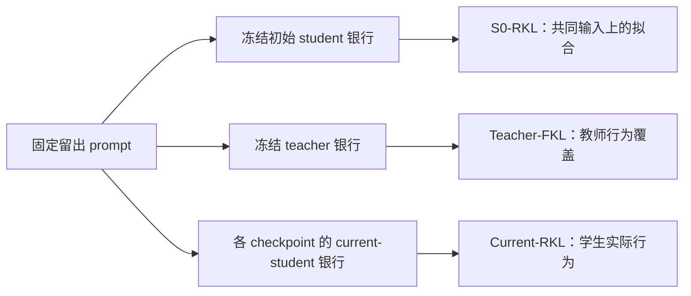

# Rollout 刷新与分布拟合评估协议提案

当前设置见[四域单域训练与 RKL 评估协议](2026-10-31-四域单域训练与RKL评估协议.md)。本文为早期方案与证据讨论，当前阶段仅使用 RKL。

状态：2026-10-31。最新确定项与评估缩减方案以第 10 节为准；前文保留机制讨论和早期预算探索。本文只定义拟议的研究问题、指标和对照，不改变[既有固定状态协议](protocol.md)，不启动新训练、不新增 accuracy 准入条件。既有实验阅读范围仍为学生 0–320 更新。第 8 节另行讨论新题池上的最多 50 个 outer step，不属于旧题重复延长。论据与逐篇证据见[12 篇论文与 1 篇技术文章调研](../../../literature/teacher-transfer/2026-10-31-OPD的Rollout来源与分布评估指标调研.md)。benchmark 和题池规模沿用[独立领域扩展提案](2026-10-30-评测领域扩展与泛化迁移基准提案.md)讨论；这里优先决定测量对象。

## 1. 分开定义三个问题

| 问题         | 要固定什么                                  | 主要观察                                         |
| ------------ | ------------------------------------------- | ------------------------------------------------ |
| 条件函数拟合 | 同一组 prompt、前缀 token、输入模式、支持集 | 同状态上的 teacher/student full-vocab 距离       |
| 生成分布接近 | prompt 分布、解码策略、终止规则和观察时域   | 当前 student 行为及 teacher 行为上的方向匹配风险 |
| 任务能力迁移 | 独立题目、评分器、采样预算和模板            | 可验证成功率、acc 或任务原生指标                 |

我们当前的核心问题是前两项；第三项用于独立检查行为收益。相同答案、相同 acc 不能证明分布相同；分布更接近 teacher 也不能自动证明更接近真实答案。

同构、同配置、同词表和相同输入约定下，teacher 权重本来就是 student 函数类中的一个可实现点。实验要检验的是从规定初始化通过有限数据和指定优化器能否到达它，而不是重新证明这个点存在。相同参数量但不同 RoPE、词表或权重绑定，不自动满足同构假设。有限数据与有限预算下的平台仍可来自覆盖、泛化、优化或数值问题，不命名为容量下界。

## 2. 训练来源与评估来源分别设计

### 2.1 训练主对照

| 条件                          | 新一批训练题的回答由谁生成                    | 每批后续更新                         | 目的                                   |
| ----------------------------- | --------------------------------------------- | ------------------------------------ | -------------------------------------- |
| A：固定 S0                    | 原始 student $p_0$，可提前生成完整题池        | 保留统一的 full-vocab RKL 与复用次数 | 延续固定分布机制实验                   |
| B：按批 refresh               | 该分支开始本批时的 student $p_{\theta_{k_b}}$ | 与 A 相同                            | 检验跟随学生状态分布是否改善拟合与泛化 |
| C：teacher 来源，第二阶段可选 | 冻结 teacher $q$                              | 起初仍用同一 RKL                     | 将状态覆盖来源与 KL 方向分开消融       |

表中 $k_b$ 为第 $b$ 个 rollout batch 开始前的更新数。B 每批刷新，不是每次 Adam 更新都刷新；若复用 16 次，只有批开始时轨迹相对当时学生是 on-policy，之后属于有策略滞后的批内更新。文档与图例应称“按批 refresh，reuse16”，不称“每更新严格 on-policy”。

A／B 同一配对从相同原始权重开始，共享训练题目顺序、每题响应数、学习率、有效 batch、复用次数与读出点。训练题池在首轮只遍历一次，不通过再循环旧题形成更长主结果。A 提前生成后续所有新题的 S0 回答；这样 B 的收益不会同时混入“多看了新题”的因素。固定 optimizer 更新不等于固定生成 token 或算力，因此另外记账独立 prompt、新生成 token、teacher 评分 token 和累计优化 token。

第一阶段不同时改变 RKL／FKL、刷新频率、复用次数和题量。若 B 在批内漂移明显，再做 A/B × reuse1/reuse16 的独立消融，并明确等更新预算与等独立题量不能同时由简单更换 reuse 自动满足。记录真实预算，避免把更多独立样本归因于刷新。

TOP-D 将行为策略和目标策略分开，并改变了更新目标；其 minibatch 划分不能为本项目 reuse16 提供直接等价依据。[^topd] Full-vocab 条件 KL 在旧前缀上仍可精确计算，但旧前缀的访问权重已经不同；单 token 的动作 importance ratio 不自动修正整个前缀访问分布。

### 2.2 评估银行

所有科学读出先冻结 checkpoint，再生成／评分，避免评估期间参数继续变化。

| 银行                   | 来源与更新方式                                           | 跨条件共享范围                       | 主要作用                               |
| ---------------------- | -------------------------------------------------------- | ------------------------------------ | -------------------------------------- |
| $B_0^{train}$          | 原始 student 的固定训练题回答                            | 同 student／模式的各 teacher         | 训练银行拟合、跨批影响与遗忘           |
| $B_0^{held}$           | 原始 student 的固定留出回答                              | 同 student／模式的各 teacher         | 输入相同的主比较面板                   |
| $B_T^{held}$           | 每位 teacher 的留出回答，生成后冻结                      | 同一 teacher 的所有算法与 checkpoint | teacher 行为覆盖；教师自身分布上的读出 |
| $B_k^{held}$           | 每个 checkpoint 的 current-student 新回答                | 仅同一参数状态与解码协议             | 当前生成行为的风险                     |
| $B_{mix}^{held}$，可选 | S0 与预先选定代表 teacher 的等额轨迹混合，冻结后共同使用 | 固定面板内的所有 teacher             | 检查 S0 单一来源的覆盖偏向             |

teacher 银行的初始 prompt token、系统消息与模式使用该实验线已经验收的共同输入条件，不静默改为 teacher 私有模板。专用模板对照建立独立银行，并与共同输入主表分开。

同一条线内，所有 teacher 在 $B_0$ 上读取完全相同的 student 前缀；thinking／non-thinking、2507 原生模板对照仍分开。B 训练线的 student 权重会因 teacher 不同而分叉，因此其训练 rollout 和 $B_k$ 不能强行共享。相同随机 seed 不等于相同 token 轨迹。

$B_T$ 的内容因 teacher 而异，适合比较同一 teacher 的不同学习方法；不能仅靠各自 $B_T$ 上的残差，给全部 teacher 的可教性排一个无条件总榜。$B_{mix}$ 的 teacher 名单与权重须在看结果前冻结，不随训练表现添加有利轨迹。建议第一阶段先完成 $B_0$、$B_T$、$B_k$，不把混合比例作为额外调参轴。

新的留出题应与本轮梯度训练题去重，并区分开发留出与最后一次确认用的锁定留出。现有 Math／Code／IF 面板曾参与历史研究，继续作为 legacy/development 面板，不能重新宣称为全新测试集。对 $B_k$ 的 checkpoint 只按预定更新点取，不按即时 acc 或某一张 KL 图择优选点。

## 3. 风险定义及三个主指标

令 $p_\theta$ 为 student，$q$ 为冻结 teacher，$x$ 为 prompt，$s_t=(x,y_{<t})$ 为前缀。统一 RKL/FKL 方向：

$$
r_\theta(s)=\sum_v p_\theta(v\mid s)\log\frac{p_\theta(v\mid s)}{q(v\mid s)},
\qquad
f_\theta(s)=\sum_v q(v\mid s)\log\frac{q(v\mid s)}{p_\theta(v\mid s)}.
$$

对指定 rollout 分布 $\rho$，定义固定时域 $H$ 上的累计风险：

$$
R_\rho(\theta)=\mathbb E_{x\sim D_{held},\,y\sim\rho(\cdot\mid x)}
\left[\sum_{t=1}^{H}r_\theta(s_t)\right],
\qquad
F_\rho(\theta)=\mathbb E_{x\sim D_{held},\,y\sim\rho(\cdot\mid x)}
\left[\sum_{t=1}^{H}f_\theta(s_t)\right].
$$

EOS 后按共同的吸收状态规则贡献零；EOS 发生前的分布比较包含终止动作。到达 cap 是观察截断，不凭空补一个模型并未生成的 EOS。

| 层级     | 报告名称                         | 数学对象                          | 对应银行                      | 解读                                                  |
| -------- | -------------------------------- | --------------------------------- | ----------------------------- | ----------------------------------------------------- |
| 主指标 1 | 固定 S0-RKL                      | $R_{p_0}(\theta)$                 | $B_0^{held}$                  | 相同前缀上的拟合与泛化；跨 teacher 的主要共同输入比较 |
| 主指标 2 | Current-RKL                      | $R_{p_\theta}(\theta)$            | $B_k^{held}$                  | 学生自己运行时与 teacher 的距离                       |
| 主指标 3 | Teacher-FKL                      | $F_q(\theta)$                     | $B_T^{held}$                  | teacher 常见行为中，student 未充分覆盖的部分          |
| 方向诊断 | Teacher-RKL／S0-FKL／Current-FKL | $R_q,F_{p_0},F_{p_\theta}$        | 对应银行                      | 分开检查“换来源”和“换 KL 方向”                        |
| 分布诊断 | 条件 JS、TV、熵、支持质量        | 每个固定前缀上的统计              | 对应银行                      | 解释残差，不取代主指标                                |
| 策略变化 | student 相对 S0 的 KL            | 明确标出 $p_\theta$ 与 $p_0$ 两端 | 固定或 current 银行，分开命名 | 更新幅度，不是对 teacher 的拟合误差                   |
| 独立结果 | acc／成功率                      | 指定任务与解码协议下的得分        | 独立任务题                    | 能力检查，不用来筛 teacher                            |

已有 RKL／JS 汇总不能反推出未保存的 FKL；历史字段 `fkl_shared` 也不能改名为原生 FKL。新方向指标需要在可用权重和明确前缀上重新评分。一次 full-vocab 评分可计算多个方向的统计，持久保存逐题／分段结果即可，不要求保存全部词表概率。

### 3.1 何时可以解释成序列 KL

记 $P_\theta^H$ 和 $Q^H$ 为同一 prompt 上、相同终止约定下、观察至 $H$ 的序列分布。自回归分解给出

$$
\log\frac{P_\theta^H(y\mid x)}{Q^H(y\mid x)}
=\sum_{t=1}^{H}\log\frac{p_\theta(y_t\mid s_t)}{q(y_t\mid s_t)}.
$$

对 $y\sim P_\theta^H$ 取期望，再对每个前缀后的下一 token 作条件期望，得到

$$
\mathbb E_x D_{KL}(P_\theta^H\Vert Q^H)=R_{p_\theta}(\theta).
$$

交换 teacher/student 后得到

$$
\mathbb E_x D_{KL}(Q^H\Vert P_\theta^H)=F_q(\theta).
$$

这些是目标值的链式恒等式；Teacher-RKL 与 S0-RKL 一般不等于任一方向的完整序列 KL。按前缀计算的 JS 也不能直接累加后改称序列 JS。受控 distillation dynamics 的附录 C.5 明确给出了上述配对及归一化限制。[^dynamics]

要保留这个解释，生成分布必须与公式里的模型分布一致。拟议的 fidelity 面板使用 temperature1、top-p1、无额外 top-k 截断，取消会改变分布的重复惩罚／重复检测停止；其他 mask、强制 token 或 stop 规则也要登记。若保留 temperature0.7／top-p0.9 生成、却用原始 logits 评分，应命名为该解码器访问分布下的条件风险，不能称原始模型的序列 KL。任务 acc 可以使用另一套冻结的部署解码协议，但两者分表。

有限 $H$ 的等式只涉及截断序列分布，不证明 cap 之后的完整输出已经匹配。评估时也不要只保留答对、能终止或 teacher 高分的回答，否则采样对象变成经过筛选的分布。

### 3.2 目标值与训练梯度分开

在新生成的轨迹上反传 full-vocab RKL 时，通常把前缀当成常量。即便当时 $\rho=p_\theta$，这个更新也只包含条件分布的梯度；完整 $R_{p_\theta}(\theta)$ 的梯度还包含访问分布随参数变化的项。GKD 与受控研究明确停止该采样梯度。[^gkd][^dynamics]

因此，首阶段保留我们已有的条件 full-vocab 更新，标为 semi-gradient 类型；新增 $B_k$ 是改善测量和覆盖，不声称已经实现精确序列 RKL 优化。MiniLLM／sampled-PG／即时 token advantage 的梯度、未来回报和归一化另列。后续若比较这些训练方法，必须使用相同的外部评估指标，不能分别拿各自的 training loss 判胜负。

### 3.3 词表支持不一致时

主表优先使用已验收的共享 token 语义。若 teacher 在 student 根本没有的 token 上有正概率，原生 FKL 可能为无穷大；反向支持缺失也可能使原生 RKL 无穷大。不能给不存在的 token 人为塞 epsilon，然后将有限值称作原生 KL。

teacher 回答若包含 student 没有输入 embedding 的 token ID，不能直接完成该轨迹的原生逐 token 评分。此时要明确拒绝该接口，或另设共同支持上的生成条件；不能静默重编码、删除 token 后仍称同一实验。

已有 R1 小教大继续按共同支持 $C$ 定义 $p_C$、$q_C$；条件 RKL／FKL 与双方在 $C$ 外的概率质量分别报告。Tulu 的额外词表项也须如此说明。若轨迹仍由原生 $p$ 或 $q$ 生成，而下一 token 距离比较的是 $p_C,q_C$，这仍是“原生访问前缀上的条件支持风险”；只有 rollout 也来自对应条件策略，才可讨论条件策略本身的序列 KL。不同支持协议不混排成一个原生 KL 榜。

## 4. 为什么三个主指标需要一起看

Current-RKL 下降是有效的行为变化证据，但同时可能包含条件分布改善与访问前缀改变。固定 S0 面板帮助判断相同输入上的改善；teacher 面板帮助检查 student 很少访问的教师行为。

一个简单例子说明两个 KL 方向的敏感性不同：$q=(1/2,1/2)$，$p=(1-\epsilon,\epsilon)$。当 $\epsilon\to0$，RKL 趋于 $\log2$，FKL 发散。有限 RKL 不表示覆盖充分；这也不意味着真正完整的 RKL 可以在漏掉模式时等于零。双向指标提供诊断，不构成“必须两个方向同时有某个任意阈值才成功”的新判据。

对共享 prompt 分布、共同完整行为定义及取值在 $[0,1]$ 的同一评分函数 $g$，标准 TV／Pinsker 关系给出

$$
\left|\mathbb E_{P_\theta}g-\mathbb E_Qg\right|
\leq \operatorname{TV}(P_\theta,Q)
\leq\sqrt{D_{KL}(P_\theta\Vert Q)/2}.
$$

这里要求真实的序列分布风险，而非有限固定银行上的 token 平均值；对于截断序列，只能约束该截断输出的评分函数。小的真实序列 KL 可以限制任意此类评分差，反过来相同 acc 却不要求分布相同。若 teacher 本身偏离正确答案，模仿越忠实也不自动意味着任务分数更高；Teacher Hacking 的 oracle 设计提供了相关实证。[^hacking]

因此 acc 保留为低频结果检查，建议只在初始与预定终点计算；若仍沿用现有 avg@4，继续固定同一评分方式，不据中途 acc 决定 teacher 去留。GapRecovery 仅在 teacher/student 使用同一任务口径且初始差距足够可辨识时作为附加值；分母为零、负数或噪声占主导时不进行百分比排名。

## 5. 估计、归一化与比较规则

### 5.1 以题为统计单位

设第 $i$ 题有 $M$ 条轨迹，第 $j$ 条轨迹的累计条件风险为 $K_{ij}$。主估计量为

$$
\widehat K=\frac1N\sum_{i=1}^{N}\left(\frac1M\sum_{j=1}^{M}K_{ij}\right).
$$

同时输出固定时域平均值 $\widehat K/H$，延续现有 H1024 风险口径。实际有效 token 平均 $\sum K_{ij}/\sum L_{ij}$ 另作诊断，不与固定 $H$ 平均混用。EOS 后没有损失不等于缺测补零；尚未完成、OOM 或损坏的 rollout 属于缺测，必须计数并阻止不完整结果被当作完整终点。

长度不作为主要优化目标，但归一化会改变指标含义。保存累计值与分母即可支持检查，不必为此扩展一个长度 benchmark。评估 horizon 以后若放大，需要新版本，并单列与旧 H1024 的共同前段；不将两种分母拼成一条连续曲线。

### 5.2 初始值、绝对值和相对值

对冻结银行 $B$，报告绝对初始／终点风险，并定义

$$
\operatorname{Reduction}_B(k)=100\left(1-\frac{\widehat K_B(\theta_k)}{\widehat K_B(\theta_0)}\right)\%.
$$

初始值为零时相对降幅不定义；接近数值参考时优先看绝对值及误差。Current-RKL 的相对降幅比较的是两个策略各自访问分布上的风险，明确标为行为风险变化，不解释成同一批 state 的逐点改善。

每个主指标至少给题均值、中位数、P90 及逐题变化分布。固定银行采用按 prompt 聚类的配对 bootstrap；current 银行也按共同 prompt 配对，但生成轨迹不同，其重复采样误差要保留。区间描述题目／rollout 不确定性，不能替代多个训练 seed 的稳定性。代表配对建议用多个训练 seed 确认排序，再扩大模型矩阵；这是一项待评审的计算预算建议。

### 5.3 新旧 checkpoint 的交叉评分

为解释 $B_k$ 改变带来的影响，在少量代表读出点记录

$$
M_{a,b}=\widehat R_{B_b}(\theta_a).
$$

固定一列 $b$ 比较模型 $\theta_a$，是在相同 state 上比较条件拟合；固定一行 $a$ 比较不同银行，是观察访问状态变化对同一模型风险的影响。两点间可作精确的经验分解：

$$
M_{b,b}-M_{a,a}
=\underbrace{M_{b,a}-M_{a,a}}_{\text{旧银行上的模型变化}}
+\underbrace{M_{b,b}-M_{b,a}}_{\text{固定新模型时的银行变化}}.
$$

此分解是描述性的，依赖所选锚点，不是唯一的因果归因，也不对“新银行项”预设正负。前缀 token 与生成参数必须持久保存才能复算；不需要持久保存全部词表 log-prob。若旧 checkpoint 已被清理，只做仍有权重的初始／终点交叉评分，不宣称重建了全部训练动态。建议先保存原始 student 与一个最终 student，完成终点评分后再按消费者需求决定保留范围。旧实验若没有保留 320 权重，不能用更晚的权重补称 320 读出；新面板使用新实验的真实预定 checkpoint。

### 5.4 聚合和排序

训练、旧批与 held-out 独立展示，$B_0/B_T/B_k$ 独立展示，Math／Code／IF 独立展示。当前总体 held-out 采用 64／32／32 题权重，先聚合绝对风险再取相对降幅；它不是三个百分比的算术平均。若新题池改用领域宏平均或别的权重，应另建指标版本，不覆盖旧曲线。

跨 teacher 的主要共同输入排序基于固定 $B_0^{held}$；同时给绝对终点和初始值，不能只用降幅百分比宣称难度高低。$B_T$ 与 $B_k$ 的结果为配对相关的行为评价，补充展示，不混成一个总分。相同尺寸与跨尺寸、同源与远源、原生模板与专用模板仍保留独立标签。

## 6. 首轮最小实验矩阵与预算边界

先从已验收模型中选同构近源、同构远源、跨尺寸三类代表 pair，选择理由在训练前记录，不依据新 acc 筛选；每类各跑 A／B 两线，共六个条件。具体模型身份、模式和 revision 继续使用既有谱系清单，不在本协议内另创一份版本表。

| 项目       | 首轮建议                                                | 状态                                          |
| ---------- | ------------------------------------------------------- | --------------------------------------------- |
| 更新读出   | 0／64／320；固定银行可继续每 16 更新记录                | 待评审，沿用现有主预算                        |
| 训练目标   | 两线均保留 full-vocab 条件 RKL 与相同梯度路径           | 不同时比较 PG／FKL／TOP-D                     |
| 训练来源   | 固定 S0 对照；每个 rollout batch 刷新的 current student | 首要处理因素                                  |
| 固定留出   | 共用 prompt、S0 银行；每位 teacher 冻结自己的银行       | 三域分别报告                                  |
| 动态留出   | 0／64／320 各生成 current-student 回答                  | 不在每次优化后重评全部题                      |
| 评估采样   | 每题先用 4 条独立 seed 作为拟议起点，三类银行规则一致   | 先估计方差，必要时统一增加；不宣称 4 条已足够 |
| 数值参考   | 同构组 teacher-copy；同一权重不同执行路径的差异参考     | 参考是误差标尺，不是普遍下界                  |
| 任务结果   | 初始与终点的独立 acc／成功率                            | 不用作 teacher gate                           |
| 延长与扩池 | 本轮不展示 320 之后结果，不循环旧题制造延长证据         | 扩池另版讨论                                  |

teacher-copy 应在相同输入、支持集与精度路径下评分。若直接把 teacher 当 teacher 与自己比较，计算可为零；若经过不同加载／执行路径，测到的差异可用于发现实现误差。两者都不提供“只要大于该值就是容量不足”的判断。

建议按顺序完成测量身份验收、补齐 S0／teacher 银行读出、六条件 A/B 对照、初始／终点交叉评分，最后再决定是否需要 teacher-source 训练、FKL 训练或 rollout 混合。先让固定／动态两种风险可以解释，再扩展训练算法数量。

## 7. 如何解释观察结果

| 观察                                       | 优先检查的解释                           | 还不能断言什么                 |
| ------------------------------------------ | ---------------------------------------- | ------------------------------ |
| 训练银行明显下降，所有留出都停滞           | 训练到留出的泛化不足或覆盖不足           | 不直接判为容量不够             |
| 固定 S0 风险下降，Current-RKL 不降         | 新访问状态上的拟合不足                   | 不直接说旧训练无效             |
| Current-RKL 下降，Teacher-FKL 高           | teacher 行为覆盖仍不足                   | 不单凭这两个数宣称已经模式坍塌 |
| teacher 银行改善，current 银行不改善       | teacher 前缀拟合没有充分转成自生成行为   | 不把它称作完整行为复制         |
| 两个 KL 方向和共同固定面板均改善，acc 不动 | 任务决策尚未变化或任务指标不敏感         | 不据此删除分布拟合证据         |
| acc 改善，但共同固定残差仍高               | 有限任务收益不需要完整分布匹配           | 不称作完全吸收                 |
| refresh 只改善当前银行，固定留出变差       | 当前行为与锚定函数拟合存在取舍           | 不把单指标胜出解释成全面更好   |
| A/B 在多个 seed 的三类留出均有一致差异     | 对该配对、协议与预算的来源效应有较强证据 | 不外推成所有模型的刷新定律     |

最终报告使用“在某题目分布、某状态来源、某支持和时域下的残差／改善”，不预设全局完全吸收阈值。本文没有改写训练代码、现有实验预算或原始结果。

## 8. 数学单域训练：50 个 outer step 与 reuse32 的题池探索

本节保存 batch256 的实际题池探索；最新 batch128、跨领域训练和验证规模选项见第 9 节。题量草案尚未冻结为正式训练协议。

用户已选择数学单域训练、跨领域留出。新方案以每个 outer step 的 **256 道不同题目、每题一条回答**为单位，每批开始由该分支当前 student 刷新一次 rollout，随后完整复用 32 次。固定 S0 对照共享题目和顺序。这里的数值是拟议新设置；前文 reuse16 对照和既有实验仍按原条件解释。

### 8.1 预算定义

| 项目                               | 50 个 outer step | 48 个 outer step 备选 |
| ---------------------------------- | ---------------- | --------------------- |
| 不重复训练题                       | 12,800           | 12,288                |
| 新生成训练回答，n=1                | 12,800           | 12,288                |
| 全局 batch256 的 optimizer updates | 1,600            | 1,536                 |
| 题目／回答参与优化的累计次数       | 409,600          | 393,216               |
| 每题跨 outer 访问次数              | 1                | 1                     |

一次 inner update 必须覆盖全局 256 条回答；显存不足时用 microbatch 和梯度累积实现。若把 256 切成四个 minibatch64，且每个 minibatch 分别更新，32 轮将变成每 outer 128 次更新、总计 6,400 次，已经是另一预算。训练 n=1 与原先任务准确率 avg@4 分开定义。

若训练 response cap 为 7,168，50 批最多生成 91,750,400 个回答 token，累计优化位置上限为 2,936,012,800；提前 EOS 会减少实际数量。两者均不含 prompt、验证和教师评分开销。reuse32 是减少生成次数的预算选择，尚无证据证明优于 reuse16；记录批内第 0／1／4／8／16／32 次读出，检查后半程收益与旧策略状态滞后。

### 8.2 本地抽样小实验

CPU 实验读取本地真实 parquet、旧状态银行和已下载的 Qwen3-1.7B tokenizer，未加载模型权重或启动训练。摘要见 [summary.json](data/pool-design-20261031/summary.json)。完整脚本、题目 ID 草案与数字变体样例保存在仓库同级 `wandb-logs/MirrorOPD-verl/analysis/pool-design-20261031/`，其中 `explore.py` 可重跑主统计，`near_duplicates.py` 可重跑数字变体检查。输入 parquet 的 SHA256 已记录在摘要中。

| 筛选阶段                               | 数量                  |
| -------------------------------------- | --------------------- |
| 本地 DAPO 原始行                       | 17,917                |
| NFKC、空白归一化后的不同题干           | 17,187                |
| 与现有 630 题 benchmark 相同的题干     | 10                    |
| 与旧 640 条状态银行相同的数学题干      | 512                   |
| 排除上述保护集、去除含汉字题目后       | 13,465                |
| 再按数字替换题族保守去重、隔离保护集后 | 13,419                |
| 草案：训练／开发留出／锁定留出／备用   | 12,800／256／256／107 |

两项交集分别统计，不把它们直接相加解释为净删除量。“去除含汉字”只是此轮英语候选过滤，没有完成全语种识别。DAPO 原项目是数学训练数据集；本地处理文件的实际题量以读取结果为准。[^dapo-pool]

数字变体检查先对 17,187 个不同题干统一大小写、将数字串替换成占位符，得到 36 个多成员题族，共 81 道题。例如，询问有限小数的题目只改变分母与整数区间。最终候选同时排除保护集的同签名题族，每个剩余题族只保留首个成员。该启发式能阻止部分模板变体跨训练／留出，完整近重复与语义改写审查尚未完成。

Qwen3-1.7B thinking 模板下，候选 prompt token 数中位数 86，P90 为 160，P95 为 200，P99 约 359，最大 1,496。沿用旧实验 24–384 token 筛选只剩 13,285 道，**不够 12,800＋512**；改为 prompt cap2,048 则保留全部 13,419 道。这里统计的是 prompt 长度，不能推算回答长度或推理难度；其他 student tokenizer 尚需分别验收。

seed20261031 的随机无放回草案已实际生成，50 批的平均 prompt 长度在 91.67–112.27 token 之间，训练与两组留出按题干和数字题族均无交集。没有按教师准确率、KL 或训练结果挑题。源数据没有可用的细分难度标注，因此不把题长称为难度分层。

**建议保留 50 批上限、先采用 256＋256 的新数学留出。** 当前还余 107 道题；若进一步去污染后不足，不复制题目补满。48 批备选可用 512＋512 留出且仍余 107 道；若希望保持 50 批并显著扩大数学留出，再引入 NuminaMath-1.5 等新来源、记录来源比例和分层，而不静默混入。NuminaMath 提供题型、来源等字段，适合下一阶段扩池；此轮未下载或抽样。[^numina-pool]

### 8.3 留出题目与领域

题目层先分开发留出和锁定留出，再在各自题目上建立 S0／teacher／current-student 三类状态。三类 rollout 使用相同留出题，不把三条轨迹算成三道独立题。锁定留出只在初始与预先规定终点读出，用于确认，不能用于选教师或停止点。

| 领域       | 拟议来源与题量                | 抽样与用途                                                                     |
| ---------- | ----------------------------- | ------------------------------------------------------------------------------ |
| 数学同分布 | 新 DAPO 512                   | 256 开发＋256 锁定；已生成候选 ID 草案                                         |
| Code       | TACO 256                      | 128 开发＋128 锁定；按来源和可用难度字段分层，排除旧银行；先保留与旧实验的联系 |
| IF         | IFEval 256                    | 128 开发＋128 锁定；按约束类型覆盖抽样，与旧 MultiIF 第一轮题干去重            |
| Science    | GPQA-Diamond 198              | 按学科平衡分成 99＋99；访问与输入验收后纳入                                    |
| Knowledge  | MMLU-Pro 非数学 13 科×32＝416 | 每科 16 开发＋16 锁定；统计为自定义均衡面板                                    |
| Logic      | 已调研的 BBH 六任务×40＝240   | 每任务 20 开发＋20 锁定；不把共享模板样例当作完全独立任务                      |

合计 1,878 道新协议留出，开发与锁定各 939 道；其中目前真正生成候选 split 的只有 DAPO。跨域选择依据见[评测领域与泛化迁移基准调研](../../../literature/teacher-transfer/2026-10-30-OPD评测领域与泛化迁移基准调研.md)。现有 Math630 与旧 Math／Code／IF 银行保留为历史对照，不计入这 1,878 道，也不重新命名为全新锁定测试集。

本地 TACO 有 24,701 行、24,087 个不同题干；MultiIF 有 4,501 行、3,661 个不同题干，其中 English 元数据的行数为 909；当前本地版本全部为单 user 输入，不能称为多轮测试。LCBv6 本地只有 175 题，应标为本地子集。跨域候选数量足够不代表已完成来源分组、模板、长度和去污染验收。

IFEval 官方文件虽名为 train，仍可完整保留为我们的评估来源；共有 541 题。[^ifeval-pool] 不同时把 IFEval 和来源重合的 MultiIF 第一轮当作两个独立 IF 测试。Code 后续补 HumanEval+／MBPP+ 适合任务验证；此轮的主要目标是分布风险，不必为了能计算准确率才选择题目。

### 8.4 评分频率与跨 batch 影响

| 频率                          | 读出                                                                               |
| ----------------------------- | ---------------------------------------------------------------------------------- |
| 每次 optimizer update         | 训练 loss、全词表 RKL、梯度范数、有效 token、截断比例；标记更新前的 loss           |
| 每批 inner 0／1／4／8／16／32 | 同一当前批固定轨迹上的重新评分；不能用上次 backward 的 loss 代替更新后读出         |
| 每个 outer 结束               | 固定训练探针 800 题＋开发固定评估子集 256 题，均使用 S0 固定轨迹                   |
| outer 0／10／25／50           | 全部开发留出的 S0-RKL、冻结 teacher 银行上的 FKL 与 RKL、fresh current-student RKL |
| outer 0／50                   | 全训练池 S0 固定评分、锁定留出三类银行评分；若采用 48 批，终点统一改为 48          |

训练探针从每批预抽 16 道，共 800 道；同时观察已训练批、当前批和未来批。固定开发评估子集建议 Math128＋Code64＋IF64，均从开发留出抽取。所有教师共享同 student／模式的 S0 探针。fresh-current 与 teacher 银行的生成成本单列；跨 checkpoint 的 current 风险变化包含访问状态变化，固定 S0 面板提供共同输入对照。

若每次 inner update 都评全部 12,800 道训练题，需要 20,480,000 次序列评分，是训练序列参与次数的 50 倍；这里是序列计数比，不是 wall time 或 FLOPs 比。800 题探针每 outer 评分总计 40,000 次，为训练参与次数的约 9.8%，但其状态生成、初始评分和其他评估另计。探针可以画 50×50 的 batch 影响矩阵，每格只有 16 道题，须按题 bootstrap 给出不确定性，不能宣称等同整个 batch 的精确风险。

每个领域先对题目等权，再对领域等权汇总 RKL；同时显示每域绝对风险、相对初始降幅和训练风险。512 道数学题不会因为数量更多而自动压过其他领域。排序采用预先固定的领域集合与相同风险口径；缺少领域的运行单列，不以已有领域平均数顶替完整平均。

### 8.5 冻结前尚需完成的检查

先完成更广的近重复检索与跨域 split 清单，再核对各 student 的输入长度和模板。正式 split 保存源 revision、文件校验和、原始 ID、题族 ID、种子与排除理由。响应 cap7,168 暂作预算假设；先在代表分支检查真实响应长度、EOS／截断和显存，再决定验证 cap 与长前缀面板。此次 CPU 小实验没有测量这些训练性能，也没有校准 256 道留出的 RKL 置信区间宽度。

现有 fixed_transfer 入口硬编码了 640 条状态银行、630 道任务题和最多 20 个字母训练组；新设置需要动态批索引和独立 split manifest，不能只把 batch_size 改成 256。正式实现应先用少量 outer 验收全局 batch、32 次更新计数、rollout 刷新点和评估只读性，再执行完整预算。

## 9. 基于论文比较的三个候选方案

此前讨论的三种选择为 DAPO 衔接、Big-Math 覆盖对照、四领域独立训练。用户现已选择第 10 节列出的四个训练来源，并确定 batch128、reuse32、50outer；Big-Math 不进入本轮训练池。保留本节锚点供已有文档链接使用。外部比较见[训练数据与超参数调研](../../../literature/teacher-transfer/2026-10-31-OPD训练数据与超参数及验证规模比较.md)。

## 10. 已确定的训练预算与验证面板建议

当前完整设置已迁入[四域单域训练与 RKL 评估协议](2026-10-31-四域单域训练与RKL评估协议.md)，作为唯一执行设计入口。采用 batch128、reuse32、50outer；当前来源留出 128 题、公共四域各 128 题、动态历史集合 128 条。训练与来源留出 cap7,168，公共生成 cap16,384；本阶段只计算 RKL，不计算 FKL、TV、JS，不执行 accuracy 评测。当前不预计算或长期保存全题池 teacher hidden；允许当前 outer 内临时复用。loss 平均方式待定，以独立完整协议为准。

本提案前文保存早期机制讨论、不同指标的理论关系和 batch256 题池探索，不作为当前必须执行的指标／题量清单。动态历史抽样公式、读出频率、数据保存、待定项及实现状态均由新协议维护。

### 参考文献

[^gkd]: Agarwal et al. On-Policy Distillation of Language Models: Learning from Self-Generated Mistakes. ICLR 2024，arXiv:2306.13649v3. [§3 与 Algorithm 1](https://arxiv.org/html/2306.13649v3)。

[^dynamics]: Piskorz, Berthon, van der Schaar. On-Policy or Off-Policy Learning? A Systematic Study of Distillation Dynamics. arXiv:2609.35259v1, 2026. [§3 与附录 C.5](https://arxiv.org/html/2609.35259v1)。

[^hacking]: Tiapkin et al. On Teacher Hacking in Language Model Distillation. ICML 2025. [会议记录](https://proceedings.mlr.press/v267/tiapkin25a.html)、[正文 v1](https://arxiv.org/html/2502.02671v1)。

[^topd]: Xie et al. Trust Region Policy Distillation. arXiv:2607.04751v2, 2026. [§3 与附录 D](https://arxiv.org/html/2607.04751v2)。

[^dapo-pool]: BytedTsinghua-SIA. DAPO 官方代码与训练数据说明。[DAPO](https://github.com/BytedTsinghua-SIA/DAPO)、[DAPO-Math-17k](https://huggingface.co/datasets/BytedTsinghua-SIA/DAPO-Math-17k).

[^numina-pool]: Project Numina. NuminaMath-1.5 dataset card. [数据集](https://huggingface.co/datasets/project-numina/NuminaMath-1.5).

[^ifeval-pool]: Google. IFEval dataset card. [数据集](https://huggingface.co/datasets/google/IFEval).
