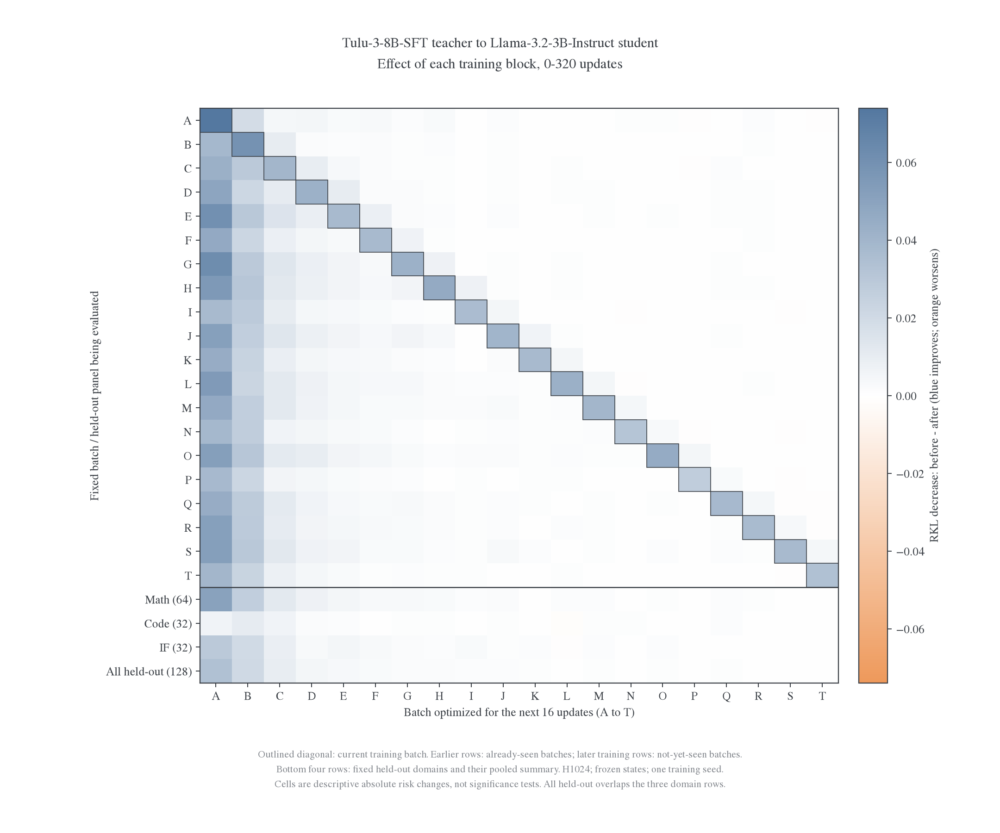

# 每个实验的诊断图谱与重绘流程

[查看 run 清单](run-figures.csv)。本机批量图谱入口为 `data/run-figures/README.md`，首次克隆后按下方命令生成。默认生成 12 类图，适用时额外生成词表支持质量图，按现有指标覆盖跳过缺失项；每个 run 的覆盖清单与实际图数以生成回执为准。每个实验按 student、teacher、输入模式、状态银行与执行实例分别组织；不同轨迹不拼接，缺失读出不插值补齐。每张图附 CSV、来源哈希、PDF 和审计结果。

## 指标与解释

| 页  | 图                                                 | 要回答的问题                                   | 现有数据                                               |
| --- | -------------------------------------------------- | ---------------------------------------------- | ------------------------------------------------------ |
| 1   | 当前 batch 的逐步 loss、组内优化前后风险、梯度范数 | 本批是否学下去；换批跳变与组内下降如何区分     | training.json 与 fixed 读出可用                        |
| 2   | 固定面板绝对 RKL／相对降幅曲线                     | 训练池、早期批、Math／Code／IF 是否同步改善    | 现有每 16 更新快照可用                                 |
| 3   | batch×时间风险热图；batch 影响矩阵                 | 当前批优化如何影响旧批、未见批和永久留出       | 现有逐题快照可复算                                     |
| 4   | 每批训练后立即风险与最终风险；遗忘量               | 哪些已学到的收益后来丢失                       | 只对确实训练过的批计算                                 |
| 5   | 每题初始—最终散点、风险变化 ECDF／分位数           | 均值是否掩盖一部分题变坏；改善是否集中于少量题 | 现有逐题评分可用                                       |
| 6   | 响应位置分段、JS／TV、熵与必要数值参考             | 改善发生在哪一段；分布尖锐度和实现参考如何变化 | 多数 run 有全段及早／中／晚段汇总，逐 token 明细未保存 |

页 1 的 loss 是更新前的当前批目标；fixed 快照是完成该步后的固定评分。绘图要对齐模型步数，不直接把 step t 的训练 loss 当作 θ_t 的评分。换批处标出边界，不以跨批平滑的 loss 代替固定面板曲线。

页 2 同时给绝对值和相对值。固定全训练池早期包含未访问的题；A–D 在 step64 后才全部属于已训练批。Math、Code、IF 与整体留出独立呈现，整体是按题数加权的汇总，不是第四套独立数据。

## 最优先：batch 影响矩阵

设第 i 批连续优化 16 次，R_j 表示在固定题组 j 上的平均 RKL，定义

$$
G_{i\to j}=R_j(\theta_{16(i-1)})-R_j(\theta_{16i}).
$$

每列为被优化的 batch i，每行为被评分的 batch j 或 held-out 面板。正数表示改善，负数表示变坏；对角线是当前批，j<i 是旧批，j>i 是尚未访问的训练池题，永久 held-out 另列。这是当前优化区间的净变化，包含 optimizer 历史与 weight decay，不是与参数状态无关的固定因果算子。

下图是已有 Tulu-SFT→Llama-3B 的样例，不新增训练：



[数据](examples/tulu-sft320/batch-effects.csv)、[来源](examples/tulu-sft320/sources.json)、[PDF](examples/tulu-sft320/batch-effects.pdf)。颜色显示绝对风险减少量；没有用颜色深浅冒充统计显著性。

## 遗忘量与分布图

对已训练的题组 j，主要比较

$$
F_j=R_j(\theta_T)-R_j(\theta_{16j}),\qquad T\leq320.
$$

F_j>0 表示训练完自身后发生回升。还应同时给初始风险，区分“忘掉部分改善”和“比初始还差”。未训练的批次不计算遗忘量。以历史最优点作参照的指标可以作为补充，但不能替代预先固定的自身训练结束点。

每题图以固定状态上的配对变化为单位，报告改善比例、变坏比例、分位数与尾部；不只挑展示效果好的题。不同 domain 分开，按题 bootstrap 的区间不等于训练 seed 的不确定性。

## 可选工程页与不可补造的指标

时间、实际 token 数、峰值显存可单独成工程页，避免混入科学难度排名。学习率固定在协议中；没有逐步保存的参数更新范数、Adam 矩轨迹和逐 token KL，不能从已有聚合日志反推出曲线。已有终点权重允许以后重评分，但本轮仅从已有记录绘图，不启动新验证设置。

当前有 RKL／JS／TV、student entropy／teacher entropy、有效 token 数及适用模型的额外支持质量。teacher-copy 是参考点而非严格下界；罕见动作或额外支持的更细分解需要单独核对。任务 accuracy／GapRecovery 只放已有完整 before/teacher/after 证据，不把 KL 当作任务成功率。

## 统一 pipeline

数据读取、统计与渲染分离：`figure_data.py` 核验固定状态与归一化，`figure_render.py` 组织图形，`figure_pipeline.py` 管理 run、增量构建与索引。输入采用实验总览的 `risks.csv` 和独立附录清单，沿用其经过筛选的证据来源；不根据 RKL 成绩选择训练实例，不扫描并混合全部历史续训。

默认生成训练诊断、绝对 RKL、相对降幅、批次风险热图、批次影响热图、跨批迁移曲线、批次遗忘、逐题散点、逐题 ECDF、位置残差、JS／TV／熵、耗时／显存。参数位移只在已有记录的 run 中展示。曲线以观测点相连，数值表保留原读出步数；缺失评分不插值写入结果。全训练池未被完整评分的旧实验明确显示实际覆盖。

每个目录由 student 条件、teacher 身份和来源实例哈希命名；thinking、non-thinking、原生模板对照各自独立。每个目录保存：

- `README.md`：模型完整名称、输入条件、支持范围与全部图形。
- `*.png`／`*.pdf`：预览与矢量图，`*.audit.json` 保存机器图形审计。
- `training.csv`、`curves.csv`、`effects.csv`、`forgetting.csv`、`questions.csv`、`positions.csv`：实际存在的指标表。
- `sources.json`：输入文件路径及 SHA256；`coverage.json`：评分步数、训练记录缺口与未评分批次。
- `manifest.json`：代码、输入与产物摘要。输入和代码相同且所有产物哈希匹配时跳过；失败不发布完成回执。

主比较条件按 student／输入分组，再按全部 held-out 降幅降序索引；独立附录条件保留在单独区域。预算小于 320 的实验保留实际终点，不能与 320 更新解释成等预算比较。

在仓库根目录运行以下 CPU 绘图命令。绘图环境需安装 NumPy、matplotlib，`FIGURE_VIZ_MPL` 指向 figure-viz 的样式目录：

```bash
export FIGURE_VIZ_MPL=/mnt/tidalfs-bdsz01/dataset/llm_dataset/zkn_data/fht_data/dotfiles/.agents/skills/figure-viz/assets/mpl
OMP_NUM_THREADS=1 OPENBLAS_NUM_THREADS=1 /root/.local/share/mirroropd/venvs/plotting/bin/python -m examples.mirroropd.research.studies.fixed_transfer.figure_pipeline --jobs 4
```

`--run L1` 只处理一个 teacher，`--run <run_id>` 指定一个输入实例，`--force` 强制重画。新增实验先更新总览来源清单，再重跑 pipeline。索引引用每个 run 的生成页面，不手写重复数值。

新的 training／valid setting 和训练 infra 优化不在此流程中执行。所有图限定学生 0–320 更新，教师名称中的 SFT step640 是教师 checkpoint 身份。

## Git 保留范围

Git 保存绘图源码、测试、来源选择所需的总览统计、轻量 run 清单、正式报告及正文精选图。`appendix/data/run-figures/` 是完整的本地构建产物，包括逐 run 页面、图、导出表和审计回执；整个目录忽略，不删除本地文件。原始训练日志和模型状态继续保存在仓库外。

重绘仍需要 `sources.json`／总览中指向的原始 fixed 快照与训练记录，以及绘图样式环境；仅克隆代码不能凭空恢复原始实验。生成成功会同步更新受版本管理的 `run-figures.csv`，便于审查实验覆盖与终点预算。
