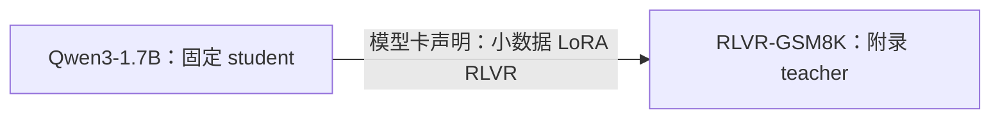
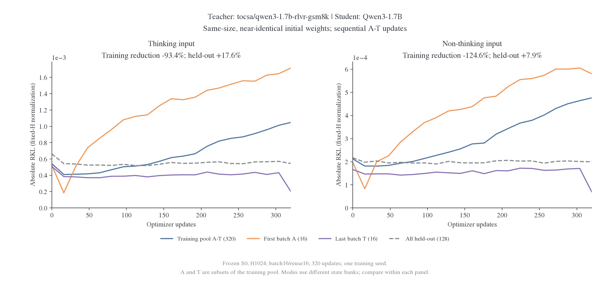

# 附录：Qwen3-1.7B RLVR-GSM8K 近同权重诊断

本模型按用户指定移入附录，不参与正文的主比较图、主表、谱系图及主比较计数。原实验、模型资产、评分和失败／负结果均保留；本次调整不改变已经测得的数值。

固定 teacher 为 `tocsa/qwen3-1.7b-rlvr-gsm8k`，revision 为 `64c6aeecce36cf445d496ef0cc86d6164c52aec7`，student 为 `Qwen/Qwen3-1.7B`。模型卡声明从 Qwen3-1.7B 出发，使用 200 道 GSM8K、2 epochs、rank32／alpha64 LoRA RLVR；发布完整 causal-LM 权重，但合并过程未独立核验，不能标为全参数 RL。训练时 thinking 开关未明确披露。[固定版本模型卡](https://huggingface.co/tocsa/qwen3-1.7b-rlvr-gsm8k/blob/64c6aeecce36cf445d496ef0cc86d6164c52aec7/README.md)。

短输出探针中，thinking 样本均展开思考段，non-thinking 样本直接作答；这不能证明全局双模式能力。共享权重检查确认只序列化 embedding。两条输入条件分别使用各自冻结的 S0 银行，各训练 320 更新，保留 batch16、reuse16、H1024 与原优化器。

[附录模型及条件清单](../data/overview-20261029/appendix-inventory.json)和[完整 RKL／JS 面板](../data/overview-20261029/appendix-risks.csv)由总览生成器单独导出；两条条件不计入主图的排序与汇总。

## RLVR-GSM8K 的负训练降幅：近同权重与跨批干扰

[逐点数据](../qwen3/data/rlvr-diagnosis-20261030/curves.csv)、[评分来源哈希](../qwen3/data/rlvr-diagnosis-20261030/sources.json)和[PDF](../qwen3/data/rlvr-diagnosis-20261030/rlvr-training-retention.pdf)对应全部 21 个读出；两种模式的银行不同，只在各自面板内比较。

`tocsa/qwen3-1.7b-rlvr-gsm8k` 的负数来自训练全池／旧批的相对 RKL 降幅，并非 KL 本身为负，也不是整体留出变差。复算见[原始读出与来源哈希](../qwen3/data/rlvr-diagnosis-20261030/summary.json)。

| 输入模式     | 训练全池 RKL：0→320   | 训练降幅 | 整体留出 RKL：0→320   | 留出降幅 |
| ------------ | --------------------- | -------: | --------------------- | -------: |
| Thinking     | 0.00054166→0.00104760 |  −93.41% | 0.00066175→0.00054549 |  +17.57% |
| Non-thinking | 0.00021204→0.00047619 | −124.57% | 0.00021697→0.00019977 |   +7.93% |

实测 teacher 相对 student 的参数 L2 距离为 2.2925e-5，初始分布差异也很小；负百分比被小分母放大，但对应训练风险上升是真实测量，不能忽略。该距离不是“发生变化的参数占比”。

逐批轨迹明确显示跨批干扰。以 non-thinking 为例，A 批 RKL 从初始 0.00019617 降到第 16 步的 0.00008298，但第 320 步回升到 0.00058030；当前最后一批 T 则从第 304 步的 0.00017085 降到第 320 步的 0.00006988。训练沿 A→T 每批 reuse16，只优化当前批，不能保证整个训练池单调下降。

数学留出的 teacher-copy 参考为 thinking 0.00043979、non-thinking 0.00018042，与初始及终点风险处于相近量级。该参考仅覆盖同一数学面板，反映当前 teacher／student 执行精度路径的影响，不是全分布或训练池的严格下界，也不能拿来减去所有面板的 RKL。

当前证据支持“目标已接近初始学生、逐批更新存在旧批回升”。固定学习率相对目标改动是否偏大，以及数值路径各自贡献多少，仍需独立消融，不能全部归因于浮点噪声。此组应作为近同权重的数值／优化诊断，不应据负训练百分比推断更强异源性、容量不足或同构不可表示。

## 历史批次记录

以下为原批次设计记录，包含 GT-Base-MATH 与本附录模型，不作为正文当前主比较的计数。

扩展配置见[RL 分支计划](../../../../../research/studies/fixed_transfer/plans/qwen3-rl-extension.json)。两组各训练 320 步，保留 64/320 步任务读出，新增 640 次更新与六组评测（两个 teacher、四个 student endpoint），共 15120 个新回答；原始 student 基线与冻结 S0 银行按内容身份复用。当前批次的配对、预算与采样条件保持原记录，扩展结果单独标明批次后再与共同面板比较。

两条已完成输入条件均保留 320 更新，不再纳入主比较的续训安排。
