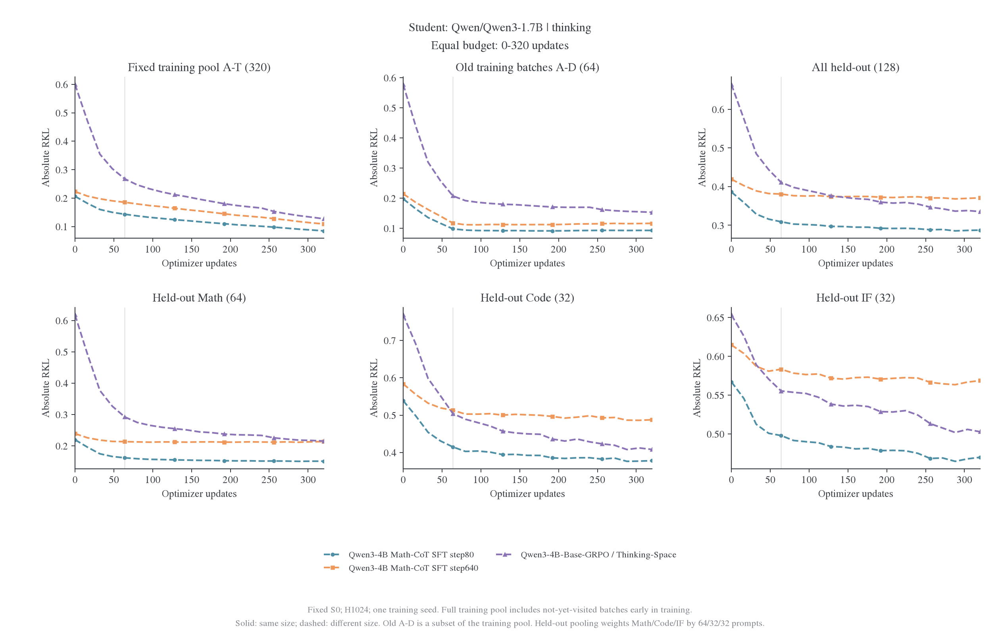
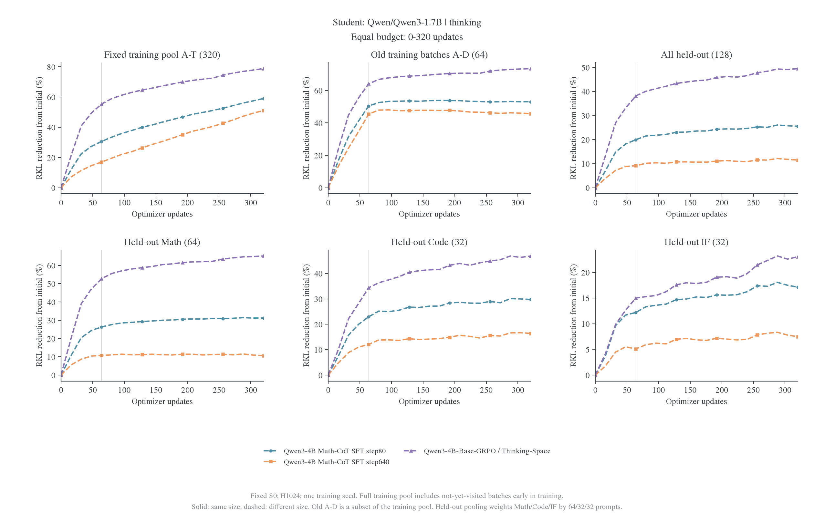
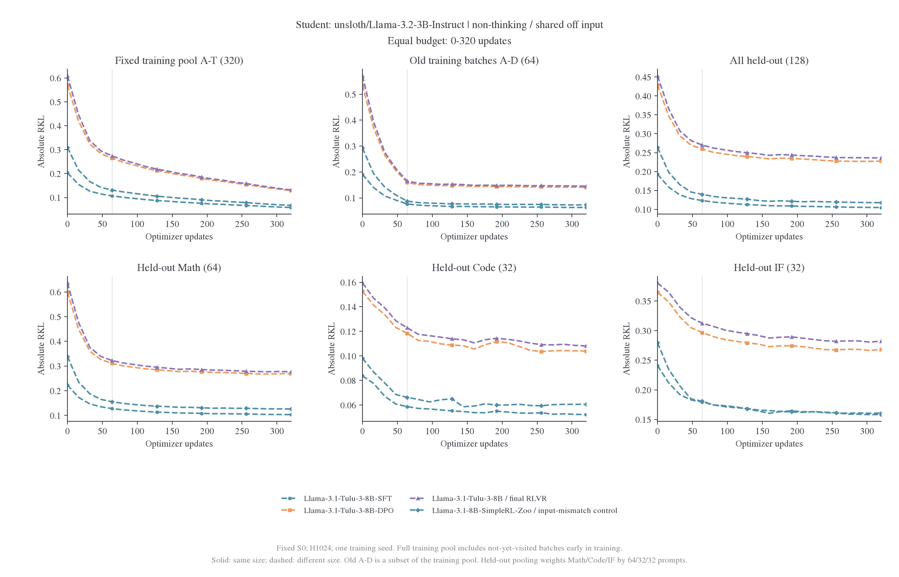
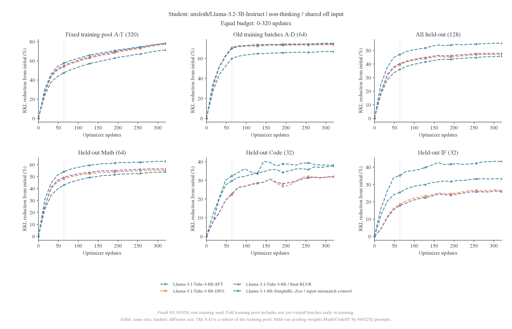
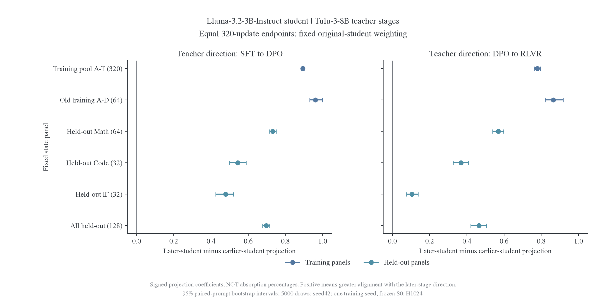

# 附录：阶段对照的 0–320 图表

所有曲线限定共同的 0–320 更新。固定训练全池早期包含尚未访问的题，A–D 是其子集；训练与三域留出同时展示。

## Qwen 三组

[逐点数据](../data/equal-budget-20261030/qwen-sft-grpo/learning-curves.csv)。teacher 名称中的 step640 是模型身份。

## Llama 四组

[逐点数据](../data/equal-budget-20261030/llama-stages/learning-curves.csv)。SimpleRL 为共享前缀下的输入不匹配对照。

## Tulu 阶段偏好方向的评分结果

三条 320 更新 student 终点在同一 448 题固定状态上完成评分，不产生科学更新。[逐题矩](../data/stage-preferences-20261030/prompt-moments.csv)覆盖训练 A–T 和 Math／Code／IF 留出；[完成回执](../data/stage-preferences-20261030/complete.json)锁定权重、银行、精度与实现。由逐题矩重算全部 16 个配对投影差，最大差为 1.33e-15，见[复算记录](../data/stage-preferences-20261030/recomputed-contrasts.json)；这是汇总核对，不是第二次独立 forward 验证。

| Teacher 阶段方向 | 训练全池：后阶段 student 减前阶段 student | 整体留出：后阶段 student 减前阶段 student |
| ---------------- | ----------------------------------------- | ----------------------------------------- |
| SFT→DPO          | +0.893 [0.883, 0.903]                     | +0.697 [0.677, 0.715]                     |
| DPO→RLVR         | +0.778 [0.761, 0.795]                     | +0.465 [0.421, 0.505]                     |

方括号为逐题配对 bootstrap 95% 区间；完整域别见[配对结果](../data/stage-preferences-20261030/paired-stage-projection.csv)。两条方向上，后阶段教师训练出的 student 均比前阶段对应 student 更沿后阶段的 token 偏好变化，且该现象出现在训练和固定留出上。

**这些数字是有符号、无 0–1 限制的投影系数差，不是吸收百分比。** 例如整体留出在 DPO→RLVR 方向上的原投影是 1.914→2.378，差为 0.465，不能解释成“吸收了 46.5% 的 RL 内容”。相应余弦从 0.285 提升到 0.339；SFT→DPO 方向余弦从 0.136 提升到 0.676，见[几何量表](../data/stage-preferences-20261030/geometry.csv)。不同阶段方向的尺度和相关性不同，也不能直接比较两个投影差来排序算法难度。

结论限定于共享 student 输入、固定 S0、H1024 和单训练 seed。它支持学生能追随后训练阶段的部分偏好变化，未证明完整函数、原生聊天能力或任务准确率已恢复。
