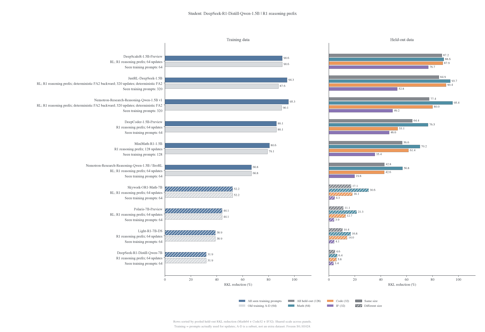
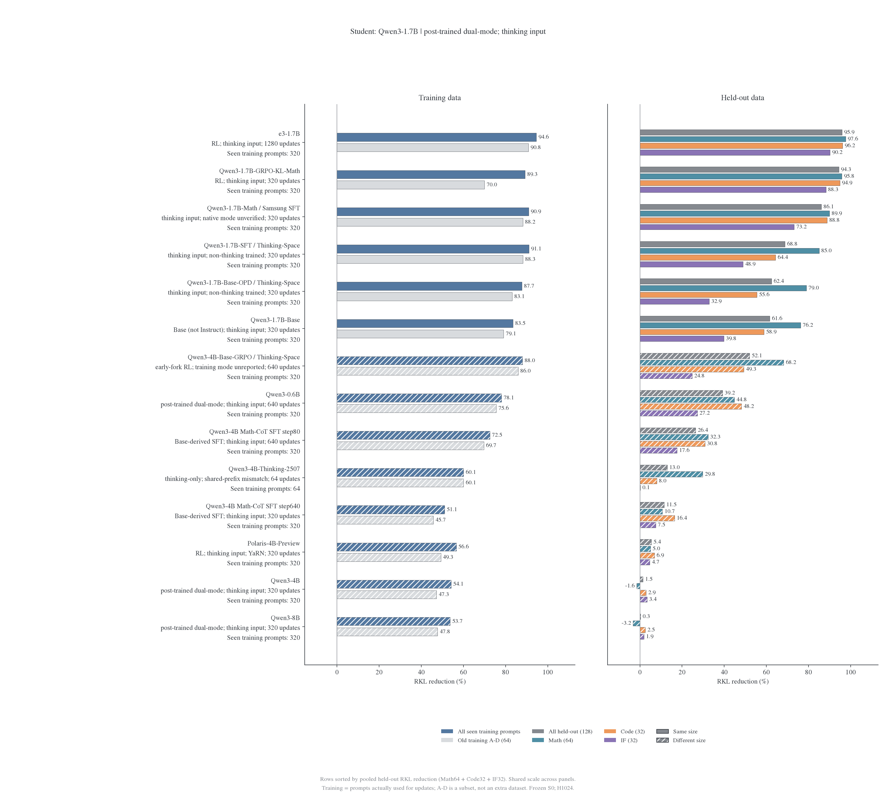
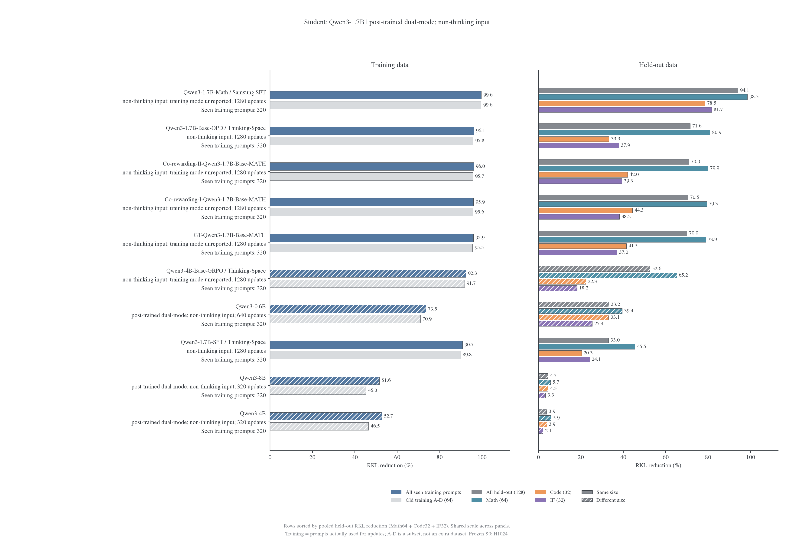
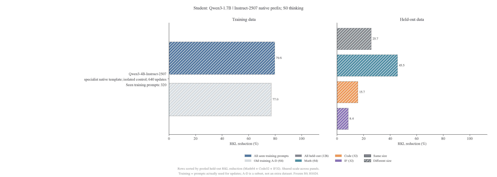
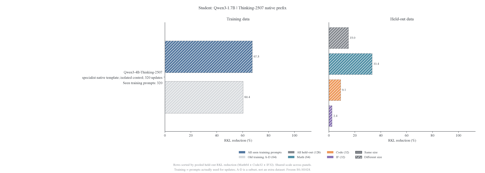
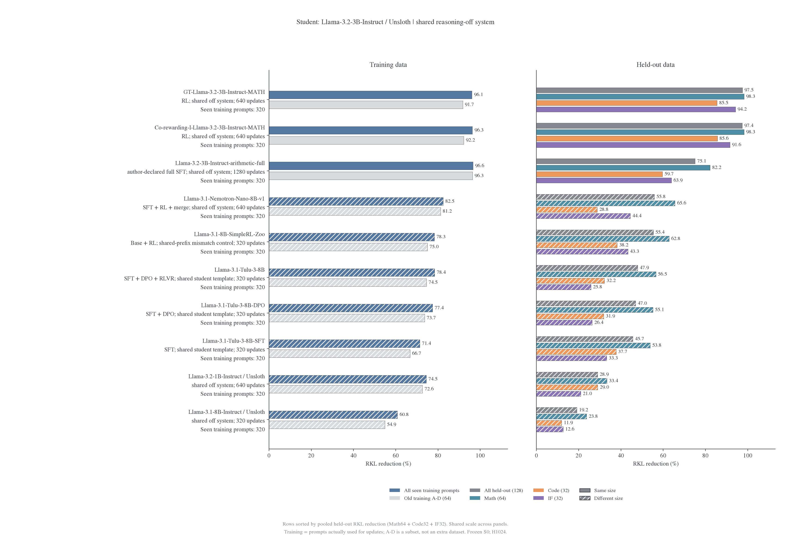

# 教师谱系实验总览与 RKL 进展

<!-- generated:counts:start -->

状态：本轮 R1、Qwen3、Llama 教师谱系主比较集合共有 42 个固定权重版本，其中 42 个已落地。按当前完成回执，已完成 42 个不同师生权重配对、50 个输入条件，共 24768 次科学更新。续训及同条件重放仅保留最新完成终点，不重复累计中间阶段或重放预算；不统计其他研究线，也不把自教师、teacher-copy、重复评分和数值验证算作训练分支。准确率不作为本总览主表或下一阶段开训门槛。

<!-- generated:counts:end -->

图表按 R1-1.5B、R1-7B、Qwen3-1.7B thinking／non-thinking、Llama-3B off 分线，以及单列的 2507 原生模板对照；各自按整体 held-out RKL 降幅排序。新增 non-thinking 图纳入 Base-OPD 的 1280 步、SFT 的 1280 步和 Qwen3-0.6B teacher 的 640 步，以及 Qwen3-4B／8B teacher 的 320 步完成终点；未完成的续训不替换这些结果。不同模式使用独立 S0 银行，不混排。

## 模型与实验数量

<!-- generated:inventory:start -->

| 谱系  | 计划中的权重版本 | 权重已到本地 | 已完成训练的不同师生配对 |
| ----- | ---------------: | -----------: | -----------------------: |
| R1    |               12 |           12 |                       14 |
| Qwen3 |               19 |           19 |                       18 |
| Llama |               11 |           11 |                       10 |
| 合计  |           **42** |       **42** |                   **42** |

<!-- generated:inventory:end -->

“模型”按仓库＋revision＋checkpoint 子目录去重，BroRL 与 Nemotron v1 作为不同权重版本计数；同一个 teacher 进入 thinking/non-thinking 两线时不重复算模型，但属于不同实验条件。已完成的 R1 续训并入原配对的最新终点（1.5B student 的续训为 128 步，小教大确定性分支为 320 步），不重复算配对。R1 清单含只评测、不训练的 Qwen2.5-Math-1.5B，Llama 算术 SFT 等仍有来源披露限制，不能把主比较中的全部权重版本都说成已确认可训练。

R1 目前使用 R1-1.5B/R1-7B 两个 student；Qwen3 固定 1.7B；Llama 固定 3B 是第四个 student。Qwen3 新增双模式、专用模板、640/1280 阶段会复用现有权重，所以后续实验数量会超过模型数量。已落地不等于已通过全部模式或数值验收。

计数及权重路径见[模型清单](overview-snapshot/inventory.json)，全量风险见[CSV](overview-snapshot/risks.csv)，由[复算脚本](../../../../../../research/studies/fixed_transfer/overview.py)从真实完成回执与逐题评分生成。

## 统一读取方式

降幅排序不等于终点误差或拟合难度排名。RLVR 的初始差距已很小，需同时查看绝对风险和同面板 teacher-copy；不能因相对降幅小就将其称为最难吸收。

图左侧展示实际训练题集和旧批 A–D，右侧展示整体、Math、Code、IF 的 RKL 降幅；两侧共用刻度与教师顺序，仍按 128 题合并平均留出风险的降幅排序；不是三个百分比的算术平均。实心为同尺寸，斜线为跨尺寸。表格与图的教师顺序一致，完整模型名和实际模式保留在标签及[排序 CSV](overview-snapshot/heldout-ranking.csv)。

风险按每题 H1024 预算归一化，与既有实验一致；R1-7B 留出有提前 EOS，不能将该数值一概称为有效 token 均值。数学、Code、IF 分表原始值见全量 CSV。预算、原生/条件支持和模板差异仍需分别解释，排序不消除这些差异。JS 保留为辅助，准确率不作为主表或开训门槛。

## 公共设置

训练只使用数学题，评分包括 Math、Code、IF。完整题池 640 题，当前共同留出面板为 64+32+32=128 题；轨迹由初始 student 生成并冻结，teacher 共享相同输入前缀。详细题池、EOS 长度、训练预算和 held-out 边界统一见[公共协议](protocol.md)。

## R1-1.5B student：十位教师已训练

<!-- generated:r1:start -->

| Teacher（条件见图）                           | 更新数 | 整体初始 RKL | 整体最终 RKL | 整体下降 | Math 下降 | Code 下降 | IF 下降 |
| --------------------------------------------- | -----: | -----------: | -----------: | -------: | --------: | --------: | ------: |
| DeepScaleR-1.5B-Preview                       |     64 |     0.032978 |     0.004216 |   87.21% |    88.64% |    87.87% |  76.70% |
| JustRL-DeepSeek-1.5B                          |    320 |     0.117835 |     0.017768 |   84.92% |    93.69% |    90.35% |  52.79% |
| Nemotron-Research-Reasoning-Qwen-1.5B v1      |    320 |     0.200227 |     0.045246 |   77.40% |    95.41% |    80.03% |  49.16% |
| DeepCoder-1.5B-Preview                        |     64 |     0.088564 |     0.031569 |   64.35% |    76.53% |    53.09% |  46.55% |
| MiniMath-R1-1.5B                              |    128 |     0.093081 |     0.040442 |   56.55% |    70.21% |    61.44% |  35.40% |
| Nemotron-Research-Reasoning-Qwen-1.5B / BroRL |     64 |     0.293644 |     0.167980 |   42.79% |    56.79% |    42.63% |  19.77% |
| Skywork-OR1-Math-7B                           |     64 |     0.436848 |     0.362188 |   17.09% |    30.55% |    18.06% |   4.32% |
| Polaris-7B-Preview                            |     64 |     0.358446 |     0.318826 |   11.05% |    21.33% |    12.74% |   3.92% |
| Light-R1-7B-DS                                |     64 |     0.442815 |     0.396952 |   10.36% |    16.78% |    14.01% |   4.06% |
| DeepSeek-R1-Distill-Qwen-7B                   |     64 |     0.273158 |     0.260708 |    4.56% |     6.38% |     5.76% |   3.44% |

<!-- generated:r1:end -->

JustRL、Nemotron v1 与 DeepScaleR 的留出拟合较充分；MiniMath 及其他同尺寸目标也仍有残差。表格与图采用最新已验收终点；预算与数值执行条件分别标明，不能忽略这些差异。原生 RKL 与 teacher-copy 参考的详细证据保留在[同架构报告](r1/2026-10-29-同架构教师吸收假说与续训设计.md)。

## R1-7B student：小教大最新已验收终点

<!-- generated:r7:start -->

| Teacher（条件见图）             | 更新数 | 整体初始 RKL | 整体最终 RKL | 整体下降 | Math 下降 | Code 下降 | IF 下降 |
| ------------------------------- | -----: | -----------: | -----------: | -------: | --------: | --------: | ------: |
| Polaris-7B-Preview              |     64 |     0.044832 |     0.004115 |   90.82% |    92.74% |    87.65% |  84.23% |
| Light-R1-7B-DS                  |     64 |     0.117059 |     0.055215 |   52.83% |    56.75% |    53.08% |  44.69% |
| JustRL-DeepSeek-1.5B †          |    320 |     0.349913 |     0.246454 |   29.57% |    44.73% |    40.02% |  14.24% |
| DeepSeek-R1-Distill-Qwen-1.5B † |    320 |     0.236807 |     0.189057 |   20.16% |    26.00% |    22.98% |  17.22% |

<!-- generated:r7:end -->

† 小教大两组使用共同 151936 维条件 RKL；R1 teacher 已有确定性 FA2 的 320 步新终点，JustRL 也已完成确定性 FA2 的 320 步新终点。另外记录 7B 额外 128 维概率质量；表中旧 Polaris/Light 行保留原生口径，不能直接称为完全相同目标。Polaris 重算后的条件 RKL 为 0.064940→0.004712，留出下降 92.74%，与原生结果非常接近。

旧 64 步条件下，R1-1.5B→7B 训练 A–D 下降 53.76%，留出只下降 15.51%；JustRL→7B 分别下降 63.46%、34.87%。最后 16 步留出仍分别下降 2.67%、6.93%，尚不能称为收敛。两组额外 128 维的平均概率质量约为 1e-9，没有观察到明显概率转移到这些填充行。

在相同 R1-7B S0 留出状态上，原 JustRL→R1-1.5B 的 64 步 checkpoint 条件 RKL 为 0.108924→0.031855，下降 70.75%；新 JustRL→R1-7B 为 0.225062→0.146573，下降 34.87%。更大 student 没有在这个有限预算下自动得到更好拟合，但初始化与训练状态来源仍不同，不能单独归因为尺寸。

这两组排除了“只有 teacher 比 student 大才会出现明显残差”的简单解释。它们没有证明容量不重要，也没有证明小教师函数不可表示；还需统一更长预算与固定覆盖检查优化和泛化。实现、全梯度验收、条件支持对照见[小教大报告](r1/2026-10-29-小教师到大模型的跨尺寸吸收.md)。

## Qwen3-1.7B student：共同 thinking 输入

<!-- generated:q3-1.7:start -->

| Teacher（条件见图）                  | 更新数 | 整体初始 RKL | 整体最终 RKL | 整体下降 | Math 下降 | Code 下降 | IF 下降 |
| ------------------------------------ | -----: | -----------: | -----------: | -------: | --------: | --------: | ------: |
| e3-1.7B                              |   1280 |     0.033804 |     0.001394 |   95.88% |    97.59% |    96.17% |  90.21% |
| Qwen3-1.7B-GRPO-KL-Math              |    320 |     0.019611 |     0.001109 |   94.34% |    95.81% |    94.86% |  88.25% |
| Qwen3-1.7B-Math / Samsung SFT        |    320 |     0.248817 |     0.034588 |   86.10% |    89.94% |    88.84% |  73.20% |
| Qwen3-1.7B-SFT / Thinking-Space      |    320 |     0.616008 |     0.191977 |   68.84% |    85.03% |    64.35% |  48.92% |
| Qwen3-1.7B-Base-OPD / Thinking-Space |    320 |     0.746448 |     0.280455 |   62.43% |    78.96% |    55.55% |  32.85% |
| Qwen3-1.7B-Base                      |    320 |     0.599753 |     0.230065 |   61.64% |    76.24% |    58.91% |  39.82% |
| Qwen3-4B-Base-GRPO / Thinking-Space  |    640 |     0.664417 |     0.318444 |   52.07% |    68.22% |    49.32% |  24.75% |
| Qwen3-0.6B                           |    640 |     0.300502 |     0.182768 |   39.18% |    44.77% |    48.21% |  27.23% |
| Qwen3-4B Math-CoT SFT step80         |    640 |     0.386144 |     0.284165 |   26.41% |    32.33% |    30.84% |  17.61% |
| Qwen3-4B-Thinking-2507               |     64 |     0.671903 |     0.584879 |   12.95% |    29.79% |     7.99% |   0.13% |
| Qwen3-4B Math-CoT SFT step640        |    320 |     0.419072 |     0.370862 |   11.50% |    10.65% |    16.43% |   7.49% |
| Polaris-4B-Preview                   |    320 |     0.329342 |     0.311394 |    5.45% |     5.01% |     6.88% |   4.70% |
| Qwen3-4B                             |    320 |     0.300000 |     0.295592 |    1.47% |    -1.56% |     2.90% |   3.39% |
| Qwen3-8B                             |    320 |     0.313654 |     0.312846 |    0.26% |    -3.24% |     2.55% |   1.89% |

<!-- generated:q3-1.7:end -->

两个近源 RL 目标的 held-out 残差最低，e3 与 GRPO-KL 分别为 0.000720 和 0.000871；但它们仍高于 teacher-copy 参考，且旧 A–D 的保持明显弱于 held-out。不能只凭约 98% 的降幅宣称完全吸收。

原 64 步读出中，普通 4B/8B 的训练 A–D 下降约 51%/50%，held-out 仅下降 2.97%/1.59%；8B 在最后 16 步还有轻微反弹。这是当前最明显的局部拟合—留出泛化分离，最新完成预算以表格为准，64 步读出不能代替 320 步主对照。

DeepMath SFT、Base-OPD 这一批是在共同 thinking 条件下测得，按模型卡应归为模式不匹配对照。其残差不能当作匹配 non-thinking 条件下的难度证据。Thinking-2507 还存在原生前缀与 RoPE 差异，只保留为旧条件结果，后续专用模板对照单列。

原六个同尺寸分支在 256→320 的 64 更新窗口上，数学留出 RKL 仍下降约 3.1%–9.7%。这些窗口内同时访问了新的既定训练批；后续 320→640→1280 必须固定 A–T 覆盖，才能把更长优化与更多数据分开。

## Qwen3-1.7B student：non-thinking 输入

每行取该条件最新完成终点，预算不同；此表用于观察残差，不能解释为等预算教师难度排名。

<!-- generated:q3-1.7-nonthinking:start -->

| Teacher（条件见图）                  | 更新数 | 整体初始 RKL | 整体最终 RKL | 整体下降 | Math 下降 | Code 下降 | IF 下降 |
| ------------------------------------ | -----: | -----------: | -----------: | -------: | --------: | --------: | ------: |
| Qwen3-1.7B-Math / Samsung SFT        |   1280 |     0.144801 |     0.008607 |   94.06% |    98.51% |    78.55% |  81.65% |
| Qwen3-1.7B-Base-OPD / Thinking-Space |   1280 |     0.253677 |     0.072115 |   71.57% |    80.91% |    33.27% |  37.88% |
| Co-rewarding-II-Qwen3-1.7B-Base-MATH |   1280 |     0.232627 |     0.067728 |   70.89% |    79.93% |    41.97% |  39.29% |
| Co-rewarding-I-Qwen3-1.7B-Base-MATH  |   1280 |     0.242120 |     0.071383 |   70.52% |    79.32% |    44.28% |  38.16% |
| GT-Qwen3-1.7B-Base-MATH              |   1280 |     0.245982 |     0.073737 |   70.02% |    78.85% |    41.47% |  37.00% |
| Qwen3-4B-Base-GRPO / Thinking-Space  |   1280 |     0.234365 |     0.111017 |   52.63% |    65.17% |    22.30% |  18.22% |
| Qwen3-0.6B                           |    640 |     0.121295 |     0.081067 |   33.17% |    39.44% |    33.07% |  25.37% |
| Qwen3-1.7B-SFT / Thinking-Space      |   1280 |     0.085970 |     0.057597 |   33.00% |    45.50% |    20.29% |  24.12% |
| Qwen3-8B                             |    320 |     0.123020 |     0.117522 |    4.47% |     5.69% |     4.51% |   3.29% |
| Qwen3-4B                             |    320 |     0.134794 |     0.129585 |    3.86% |     5.92% |     3.90% |   2.11% |

<!-- generated:q3-1.7-nonthinking:end -->

SFT 在 640→1280 的整体留出 RKL 从 0.059917 降至 0.057597，再改善 3.87%；最近两个 64 步窗口的配对区间均跨零，暂不追加更长预算。Base-OPD 在 1280 步的整体降幅约 71.6%，仍有残差。Code/IF 会改变排序和延长判断，不能只用 Math 代表全部留出。固定题池与连续恢复条件见[双模式协议](qwen3/2026-10-29-Qwen3双模式与固定题池长训协议.md)。

## Instruct-2507 原生模板专用对照

本组已完成 640 步并通过风险验收，单列为模板／行为不匹配对照。student 使用教师原生裸 assistant 前缀，但探针中 student 会展开思考，teacher 直接作答；因此不归入匹配 non-thinking 主表。

<!-- generated:q3-1.7-native-instruct2507:start -->

| Teacher（条件见图）    | 更新数 | 整体初始 RKL | 整体最终 RKL | 整体下降 | Math 下降 | Code 下降 | IF 下降 |
| ---------------------- | -----: | -----------: | -----------: | -------: | --------: | --------: | ------: |
| Qwen3-4B-Instruct-2507 |    640 |     0.768475 |     0.570879 |   25.71% |    45.51% |    15.67% |   8.43% |

<!-- generated:q3-1.7-native-instruct2507:end -->

它与普通 4B 还存在后训练及 RoPE 差异，不能把残差归因于单一因素。条件验收和前缀证据见[双模式协议](qwen3/2026-10-29-Qwen3双模式与固定题池长训协议.md)。

Thinking-2507 的原生模板终点同样按训练／留出双面板展示，保持独立条件：

## Llama-3.2-3B-Instruct student：六组首阶段完成

<!-- generated:llama3-3b-off:start -->

| Teacher（条件见图）                       | 更新数 | 整体初始 RKL | 整体最终 RKL | 整体下降 | Math 下降 | Code 下降 | IF 下降 |
| ----------------------------------------- | -----: | -----------: | -----------: | -------: | --------: | --------: | ------: |
| GT-Llama-3.2-3B-Instruct-MATH             |    640 |     0.022932 |     0.000580 |   97.47% |    98.25% |    85.51% |  94.21% |
| Co-rewarding-I-Llama-3.2-3B-Instruct-MATH |    640 |     0.021832 |     0.000566 |   97.41% |    98.26% |    85.64% |  91.59% |
| Llama-3.2-3B-Instruct-arithmetic-full     |   1280 |     0.219375 |     0.054641 |   75.09% |    82.20% |    59.65% |  63.87% |
| Llama-3.1-Nemotron-Nano-8B-v1             |    640 |     0.380807 |     0.168274 |   55.81% |    65.58% |    28.78% |  44.44% |
| Llama-3.1-8B-SimpleRL-Zoo                 |    320 |     0.263856 |     0.117807 |   55.35% |    62.79% |    38.21% |  43.32% |
| Llama-3.1-Tulu-3-8B                       |    320 |     0.453277 |     0.236005 |   47.93% |    56.52% |    32.20% |  25.80% |
| Llama-3.1-Tulu-3-8B-DPO                   |    320 |     0.428990 |     0.227525 |   46.96% |    55.14% |    31.87% |  26.41% |
| Llama-3.1-Tulu-3-8B-SFT                   |    320 |     0.192855 |     0.104783 |   45.67% |    53.85% |    37.69% |  33.27% |
| Llama-3.2-1B-Instruct / Unsloth           |    640 |     0.100543 |     0.071452 |   28.93% |    33.37% |    29.03% |  20.96% |
| Llama-3.1-8B-Instruct / Unsloth           |    320 |     0.073250 |     0.059211 |   19.16% |    23.76% |    11.95% |  12.63% |

<!-- generated:llama3-3b-off:end -->

两位同尺寸 RL teacher 的残差较小；算术 SFT、1B／8B 及 Nemotron 仍有明显残差。较高降幅不等于完全吸收，需结合绝对风险、同面板 teacher-copy 和旧批保持。所有分支共用固定 off 系统指令；Nemotron 的日期模板差异与 SFT 数据披露限制保留，详见 [Llama 报告](llama/2026-10-29-Llama固定学生与跨尺寸教师谱系计划.md)。

## 当前状态与剩余交付

本次状态核对时间为 2026-10-30 17:09（UTC+8），见[进程身份与队列快照](overview-snapshot/runtime-snapshot.json)。结果图只使用完成终点；运行中、排队和验收失败均不提前计入。首轮主矩阵齐备不等于长训与阶段分析全部完成。

| 工作                    | 已确认状态                                                                                                                                                       | 下一项交付                                                       |
| ----------------------- | ---------------------------------------------------------------------------------------------------------------------------------------------------------------- | ---------------------------------------------------------------- |
| Qwen non-thinking 长训  | Samsung SFT、GT、Co-rewarding I／II、Base-GRPO 五组均已完成 1280                                                                                                 | 同步全组验收与末段窗口判断                                       |
| Qwen thinking 长训      | e3 的 1280 排队；SFT-step80 的执行签名问题已定位为重新测速改变 microbatch，现已固定原验证配置并与 Base-GRPO／Tulu-SFT 组成共享续训队列；Base-GRPO 的恢复验收通过 | 完成选定分支的 640／1280；保持原执行配置与固定题池               |
| Qwen SFT／GRPO 阶段比较 | step80、step640、thinking Base-GRPO 三组 320 均完成，等预算图已齐备                                                                                              | 与续训结果分开报告的阶段结论                                     |
| Llama 原教师谱系        | 六组 320、其中五组 640 均完成；原算术 SFT／Nemotron 的 1280 排队                                                                                                 | 1280 结果及训练／留出是否共同改善                                |
| Llama 新四阶段          | Tulu-SFT／DPO／RLVR、SimpleRL 均完成 320 并验收，等预算图已齐备；阶段偏好评分已完成，训练／留出投影差与区间已补入阶段报告                                        | 阶段结论复核；Tulu-SFT 的 640 恢复验收已通过，正式续训待安排     |
| R1 小教大               | 两条确定性 320 均完成；两卡 640 流程已取得资源，先核验恢复                                                                                                       | GPU 恢复验收、640 条件 RKL 与旧批保持                            |
| R1 1.5B 六条追加        | 六条严格重放均未通过旧终点核对；统一的确定性 S0→320 副本中，JustRL／Nemotron 已完成并验收，其余仍在推进                                                          | 完成六条新轨迹并独立验收；保留旧门槛和失败证据                   |
| 原任务评测              | Qwen 原主实验 25 项评测、63000 条回答与 GapRecovery 已完整验收；R1 旧终点也已完成                                                                                | 继续核对后续新增条件需要补齐的任务评测范围，不将原主实验验收外推 |

执行仅使用物理 GPU0–5。Qwen 的两条模式使用独立 S0 银行；2507 专用模板单列；H4096 的 e3／SFT 两个诊断均已完成。

[Qwen3 双模式协议](qwen3/2026-10-29-Qwen3双模式与固定题池长训协议.md)、[Llama 教师谱系](llama/2026-10-29-Llama固定学生与跨尺寸教师谱系计划.md)及[新增阶段对照与结果](2026-10-30-SFT深度与后训练阶段对照计划.md)保留版本、预算、验收与详细曲线。

计数和结果表由复算命令的 `--update-report` 选项同步到明确标记的生成区；分析段落保留手工维护。生成区与图表共用同一份完成回执及逐题评分，未完成训练不会提前计入。以上未完成项意味着整项研究任务仍在推进，不能以当前总览生成成功宣称目标完成。

主比较计数、排序和图表采用同一展示集合；[附录材料](../../appendix/README.md)保留独立数据与解释。
