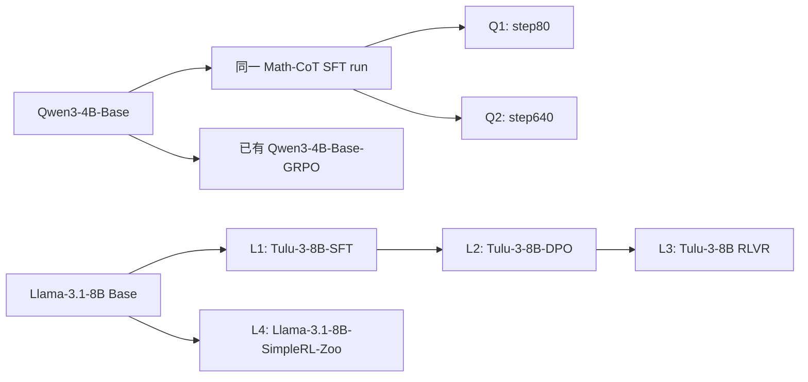

# Qwen SFT 深度与 Llama 后训练阶段对照：计划与结果

本批新增六个跨尺寸 teacher 分支，固定已有 Qwen3-1.7B 与 Llama-3.2-3B-Instruct student，分别从各自原始权重开始。首阶段各 320 次更新，共 1920 次新增更新；以 RKL 拟合为主，不安排 accuracy 筛选，也不按后续成绩更换 checkpoint。六个版本已下载并核验权重清单，Qwen 与 Llama 的四题 GPU 输出探针均已完成；六组均已完成 320 更新并验收，额外的同输入 Base-GRPO 320 对照也已完成，首轮实际共 2240 更新。后续续训独立计数。

## 固定模型与证据

| 编号 | Teacher 仓库                                      | 固定 revision                              | 子目录    |
| ---- | ------------------------------------------------- | ------------------------------------------ | --------- |
| Q1   | `jasonrqh/Qwen3-4B_Math-CoT-20k_lr5e-5_ep8_bs256` | `aaf1c51a6a2ee319750cafbd7cb8be0df10018b8` | `step80`  |
| Q2   | `jasonrqh/Qwen3-4B_Math-CoT-20k_lr5e-5_ep8_bs256` | `aaf1c51a6a2ee319750cafbd7cb8be0df10018b8` | `step640` |
| L1   | `allenai/Llama-3.1-Tulu-3-8B-SFT`                 | `f2a0b46b0cfda21003c6141b1ff837b7e165524d` | `根目录`  |
| L2   | `allenai/Llama-3.1-Tulu-3-8B-DPO`                 | `a7beb67e33ffd01cc87ac3b46cadc1000985b8db` | `根目录`  |
| L3   | `allenai/Llama-3.1-Tulu-3-8B`                     | `666943798adbde0b1aff34626007e26986a3c107` | `根目录`  |
| L4   | `hkust-nlp/Llama-3.1-8B-SimpleRL-Zoo`             | `d6e668fcf8db53ff55cc39cf347b3494f56dc7e9` | `根目录`  |

[模型注册表](../../../../../../research/studies/fixed_transfer/plans/stage-lineage-models.json)定义身份；[逐模型清单](../../data/stage-lineage-20261030/Q1.json)及同目录 Q2、L1–L4 文件保存路径、字节数、SHA256 与下载完成回执。该注册表不是可直接运行的训练计划。[Qwen 验收配置](../../../../../../research/studies/fixed_transfer/plans/qwen-stage-lineage-acceptance.json)与[Llama 验收配置](../../../../../../research/studies/fixed_transfer/plans/llama-stage-lineage-acceptance.json)的 `probes` 阶段已完成；这两份配置仅用于输出验收，正式训练采用后文单独列出的配置。两个 SFT 子目录必须参与模型身份计算，不能仅按 repo 和 revision 去重。

Qwen 官方训练脚本使用 Qwen3-4B-Base、Math-CoT-20k、学习率 5e-5、8 epochs、batch256。它支持将两个 checkpoint 视为同一训练过程的早晚目标；未公开精确父 revision。已有 Thinking-Space/Qwen3-4B-Base-GRPO 是同一公开 Base 型号出发的 RL 参照，不代表相同数据或预算。[训练脚本](https://github.com/Nebularaid2000/rethink_sft_generalization/blob/main/training_scripts/Qwen3-4B_Math-CoT-20k_lr5e-5_ep8_bs256.sh)、[SFT checkpoint 仓库](https://huggingface.co/jasonrqh/Qwen3-4B_Math-CoT-20k_lr5e-5_ep8_bs256)。

Tulu 三个公开版本对应 SFT、DPO 与最终 RLVR；SimpleRL-Zoo 作为 Base 直接 RL 路径对照。公开谱系不等于所有训练因素受控，不将跨项目差异解释为纯算法因果效应。[Tulu-SFT](https://huggingface.co/allenai/Llama-3.1-Tulu-3-8B-SFT)、[Tulu-DPO](https://huggingface.co/allenai/Llama-3.1-Tulu-3-8B-DPO)、[Tulu-RLVR](https://huggingface.co/allenai/Llama-3.1-Tulu-3-8B)、[SimpleRL 项目](https://github.com/hkust-nlp/simpleRL-reason)。



箭头表示公开训练来源，不表示已核验精确父权重相等。六组均为跨尺寸蒸馏；它们补充教师侧阶段与谱系，不能替代同构 RL／SFT 对照。

## 输入与数值验收

CPU 初检见[接口证据](../../data/stage-lineage-20261030/interface-preflight.json)。六个教师在 student 已定义 token 上没有 ID→文本冲突；还需核对实际输入 token、终止行为与共享前缀下的输出。

| 对象        | 已确认事实                                                                                                | 进入训练前的处理                                                                    |
| ----------- | --------------------------------------------------------------------------------------------------------- | ----------------------------------------------------------------------------------- |
| Q1／Q2      | 输出头 151936；模板可渲染两种开关，但这不证明训练时采用两种模式                                           | 核验完整题池输入和固定四题输出，再确定与 Base-GRPO 相同的模式条件                   |
| Tulu 三阶段 | 输出头 128264，student 为 128256；新增定义 `<pad>` 位于 128256，其余 7 行为未命名填充行；原生角色模板不同 | 主实验仍共用 student 前缀，原生模板只作为诊断，不静默替换主输入                     |
| SimpleRL    | 输出头 128256；无原生 chat template；发布 config 标注 float32                                             | 不虚构 native 模板；验收共同 student 前缀，按既有 BF16 teacher 推理条件记录精度转换 |

Qwen 源码的数据加载器调用 `apply_chat_template` 时没有显式传入 thinking 开关，因此不能仅据仓库名判定其原生模式。[数据加载源码](https://github.com/Nebularaid2000/rethink_sft_generalization/blob/main/verl/utils/dataset/sft_dataset.py)。已有 Base-GRPO 的 non-thinking 320 更新可在输入条件相同时复用；若新增 SFT 最终采用另一条件，Base-GRPO 重跑 320 更新，单列为第七个分支，总新增预算改为 2240，不将不匹配的旧条件混入核心比较。

Tulu 保留普通原生 RKL，不将 teacher 截断后重新归一化。令 C 为 student 支持集，q_C 为 teacher 在 C 上的条件分布，则

$$
\mathrm{KL}(p\Vert q)=\mathrm{KL}(p\Vert q_C)-\log q(C).
$$

同时记录额外 8 维的概率质量与支持集项，区分不可由 student 输出的质量和共同支持上的拟合残差。这里只解释训练指标，不更改训练目标。EOS 使用既有组内停止集合，并核验新增模型的 EOS 在其中。

## 实验顺序与统一设置

1. 完成六个模型的权重、结构、token、EOS、RoPE、权重绑定与实际前缀验收。下载、CPU token 初检、实际输出及训练数值验收均已完成。
2. 固定 Qwen 模式与 Base-GRPO 参照条件；Llama 复用现有 student 输入策略，包括固定日期与 `detailed thinking off` 系统消息。所有教师读取同一组 student 状态，不生成教师私有训练轨迹。
3. 优先运行 Q1、Q2，随后 L1、L2、L3、L4；仅使用 GPU0–5，在既有资源队列中调度。各分支独立从原始 student 初始化，不串联学生权重。
4. 每组首轮运行 320 更新，在 0／64／320 形成正式读出，同时保留既有每 16 更新的风险记录供等预算曲线使用。先做六组 RKL，再判断续训；accuracy 不参与本批教师筛选或终点选择。
5. 固定题池与轨迹覆盖，只有留出继续改善的分支进入 640、1280；续训保存并恢复 Adam 与 RNG，验证恢复后再开始正式更新。

沿用[公共协议](protocol.md)：训练池为 320 道数学题，A–T 共 20 批，每批 16 题，每批 reuse16，H1024，学习率 1e-6，AdamW。固定 S0 轨迹，更新期间不使用 fresh rollout。固定留出为 Math64、Code32、IF32；正式面板报告训练银行、旧 A–D 批和三域留出，风险归一化沿用固定 H1024 口径。64 更新只访问前四批，320 更新覆盖二十批；分析时明确“已访问训练集”和固定全训练银行，避免把未见题算成已训练样本。

只保留必要终点权重与单份可续训状态；恢复验收后退休被替代的优化器状态。阶段归因涉及对应终点模型，应在归因产物落盘前保留这些终点权重。

## 图表与阶段归因

第一张核心图对照 Qwen SFT-step80、SFT-step640 和相同输入条件下的 Base-GRPO，第二张对照 Tulu-SFT、Tulu-DPO、Tulu-RLVR、SimpleRL。横轴统一为 0–320 更新，训练银行／旧批与 Math／Code／IF 留出均绘制，不能只展示 held-out。名称写明完整型号、尺寸和输入模式。终点总览继续按 128 道整体留出的平均风险相对降幅排序；同尺寸与跨尺寸使用不同样式。核心曲线不混入参照分支的 640／1280 终点。

Tulu 阶段分析在相同固定 S0 状态上评分 SFT→DPO、DPO→RLVR 的 token 偏好变化。计划以原始 student 分布 p0 作固定权重，在共同支持上计算中心化对数偏好差 d，以及各蒸馏 student 的中心化对数概率变化 u；报告加权投影、余弦与残差，并分别比较相邻阶段对应的学生分支。中心化去除支持质量引起的常数平移，额外词表质量另表报告。

$$
d_{a\to b}=\log q_b-\log q_a-\mathbb E_{p_0}[\log q_b-\log q_a],\qquad
u_k=\log p_{k,\mathrm{after}}-\log p_0-\mathbb E_{p_0}[\log p_{k,\mathrm{after}}-\log p_0].
$$

$$
\mathrm{Projection}_{k,a\to b}=\frac{\mathbb E_{s,p_0}[u_k d_{a\to b}]}{\mathbb E_{s,p_0}[d_{a\to b}^2]}.
$$

投影是有符号且不受 0–1 限制的方向指标；偏好差范数过小时报告不可稳定解释。它不是“吸收 RL 内容的百分比”。同时给出偏好差强度和逐题不确定性，分别报告训练／旧批／三域留出；不能将两个终点 RKL 降幅之差直接称作吸收的 RL 内容。分析实现、CPU 合成验证及真实终点评分均已完成；本页末节保留结果与验证范围。

若当前批下降而旧批或留出持续平台，先做局部拟合与泛化分离诊断，不默认全部跑满 1280。有限 S0 覆盖与 H1024 的结果也不能证明全分布完全蒸馏。

## Qwen 模式验收后的执行选择

step80 与 step640 在四道固定探针的 thinking 输入下均生成显式思考段；non-thinking 输入下仍输出长推理，不能称为关闭开关后就成为直接回答专家。首轮采用 thinking student 前缀与原有 thinking 状态银行。Base-GRPO 另跑同一 thinking 条件 320 更新，作为受控输入参照；不据此改写其原生训练模式归类。新增更新总预算为 2240，原有 non-thinking Base-GRPO 保留。

执行配置见[Qwen 三分支 thinking 计划](../../../../../../research/studies/fixed_transfer/plans/qwen-stage-lineage-thinking320.json)。输出探针只覆盖四题、每题最多 256 token，不证明长回答或全任务能力。

Qwen 三个 teacher 与 student 在 1270 条输入上逐 token 一致，见[全题池前缀证据](../../data/stage-lineage-20261030/qwen-thinking-all-prefixes.json)。Qwen 三分支已通过数值验收并完成 320 更新。

Llama 四题输出探针显示 Tulu 三阶段在共同 student 前缀下能够作答；SimpleRL 则出现题目续写、生成示例、复述日期头等行为。SimpleRL 保留为共同前缀上的分布拟合与输入不匹配对照，不改用私有模板，也不将其残差全部归因于尺寸或 RL 训练路径。四题探针不能证明完整回答质量；原始输出保存在同目录 L1–L4 的 `*-probe-outputs.json` 文件。[Llama 四分支训练配置](../../../../../../research/studies/fixed_transfer/plans/llama-stage-lineage320.json)保留相同 student 初始化与冻结输入，启动前仍执行结构和训练数值验收。

训练数值验证独立于待蒸馏 teacher：Qwen 使用已有 e3-1.7B，Llama 使用 GT-Llama-3.2-3B-Instruct-MATH，分别满足 student 同构的 teacher-copy 验证要求。新增的 4B／8B teacher 仍用于各自科学训练分支；不将跨尺寸 teacher 用作可直接复制的数值参照。两份配置已经通过 CPU 任务构建与 GPU 数值验收，并完成各自的首轮训练。

## 阶段归因执行与验收

[阶段评分实现](../../../../../../research/studies/fixed_transfer/stage_preferences.py)复用教师 hidden/head 缓存，并从原始 student 及三个等预算终点生成响应对齐的 hidden 缓存。student 保持 FP32 权重和输出头、BF16 主干计算；偏好矩使用 FP64 归约。按响应位置分块，但每个位置始终覆盖完整 student 词表，不沿词表切块后分别中心化。Tulu 额外词表质量单独记录，不通过截断后重归一化更改教师训练目标。

输出包含逐题偏好矩、各面板投影／余弦／残差，以及后阶段 student 相对前阶段 student 的投影差。先汇总偏好矩再计算比值，不平均逐 token 的投影。配对区间使用相同题目索引重采样 5000 次、seed42；当阶段偏好变化过小时标记不可稳定辨识。归一化主表使用固定 H1024，额外质量另给有效 token 上的均值。训练全池 A–T、旧批 A–D 和 Math／Code／IF／整体留出均单列。

CPU 测试覆盖已知的正向、反向、零倍、两倍偏好变化，teacher 支持质量平移不变性、缺失 student 支持的拒绝，以及相邻阶段投影差的配对计算。三条 Tulu 终点未齐时执行入口会拒绝评分；不生成假结果或用未完成权重代替。

```bash
python -m examples.mirroropd.research.studies.fixed_transfer run \
  --plan examples/mirroropd/research/studies/fixed_transfer/plans/llama-stage-lineage320.json \
  --phase stage-attribution --wait-resource
```

该命令使用所选计划的 GPU2–3 资源配置，单个评分任务使用其中一张卡；启动时仍须设置对应的资源配置环境变量。评分不产生科学更新，也不代表 accuracy 或纯算法因果效应。

等预算图使用[统一曲线工具](../../../../../../research/studies/fixed_transfer/plot_learning.py)：同时输出绝对 RKL 和相对初始降幅，六个面板为固定训练全池、旧批、整体留出及 Math／Code／IF。工具核对所有分支、所有读出使用相同冻结 state，并要求每组完成指定预算；不以不完整曲线代替正式比较。已用既有 Llama 六组 0–320 真实数据完成渲染和图像验收，新增两组核心比较将在各自分支齐备后生成。

## Qwen 两个 SFT checkpoint 的首轮结果

Q1、Q2 均完成 320 更新；同条件 thinking Base-GRPO 参照也已完成，三组通过完整 RKL 验收，等预算核心图如下。两条 SFT 分支使用相同 Qwen3-1.7B 初始化、thinking 状态银行及更新预算。

| Teacher                       | 训练全池初始 RKL | 训练全池终点 RKL | 训练降幅 | 整体留出初始 RKL | 整体留出终点 RKL | 留出降幅 |
| ----------------------------- | ---------------: | ---------------: | -------: | ---------------: | ---------------: | -------: |
| Qwen3-4B Math-CoT SFT step80  |         0.206245 |         0.084554 |   59.00% |         0.386144 |         0.287476 |   25.55% |
| Qwen3-4B Math-CoT SFT step640 |         0.222822 |         0.108965 |   51.10% |         0.419072 |         0.370862 |   11.50% |

step80 分支在 192→256、256→320 的整体留出剩余风险分别再下降 1.2909%、0.3473%，配对区间均为负；选择继续至 640，先做 Adam／RNG 恢复验收。step640 分支同期先下降 0.5329%，最后窗口回升 0.0546%，区间跨零；先停在 320 做平台诊断，不自动追加预算。两者的等预算主比较仍固定为 0–320。

同一 SFT run 的较晚 checkpoint 在当前条件下留下更大的训练与留出残差，符合拟合难度随 SFT 深度增加的预期；这仍是有限状态、有限预算和单训练 seed 下的观察，不能推断全函数不可吸收。窗口统计见[配对风险证据](../../data/stage-lineage-20261030/sft320-continuation-windows.csv)。

### Qwen 三组齐备的等预算比较


另见[相对初始降幅曲线](../../data/equal-budget-20261030/qwen-sft-grpo/equal-budget-drop_percent.png)、[逐点数据](../../data/equal-budget-20261030/qwen-sft-grpo/learning-curves.csv)和[三组验收回执](../../data/stage-lineage-20261030/qwen-three-arm-verification.json)。所有面板包括固定训练全池、旧批及 Math／Code／IF 留出，不混用旧 non-thinking Base-GRPO。

Base-GRPO 在当前 thinking 输入下，整体留出从 0.664417 降至 0.335392，下降 49.52%。其起点更远，终点绝对 RKL 高于 SFT-step80 的 0.287476、低于 SFT-step640 的 0.370862；不能只按相对降幅得出全面的难度排序。Base-GRPO 最后两个 64 更新窗口继续下降 3.64%、3.30%，选择进入 640 前恢复验收。step80 的恢复读入验收已通过；640 曾因重新测速把 microbatch4 选成 microbatch2 被签名检查拦截；现已继承原 microbatch4 验证配置并重新提交；step640 保留 320 终点。

公开 Base 型号和输入条件相同，不能消除 SFT／GRPO 项目的数据、预算与原生训练模板差异。此图是统一输入下的拟合对照，不能直接解释为纯 SFT 与纯 RL 的算法因果效应。

## Tulu 首两条 320 更新结果

Tulu-SFT、Tulu-DPO 已通过[独立风险验收](../../data/stage-lineage-20261030/tulu-sft-dpo320-verification.json)，仍使用相同 Llama-3.2-3B-Instruct student 前缀与冻结状态。RLVR／SimpleRL 未全部完成前，不发布四组齐备的核心比较或阶段归因结论。

| Teacher       | 整体留出初始 RKL | 整体留出终点 RKL |   降幅 |
| ------------- | ---------------: | ---------------: | -----: |
| Tulu-3-8B-SFT |         0.192855 |         0.104783 | 45.67% |
| Tulu-3-8B-DPO |         0.428990 |         0.227525 | 46.96% |

SFT 的末两个 64 更新窗口继续下降 2.21%、1.63%，进入 640 前恢复验收；DPO 的最后窗口只下降 0.04%，区间跨零，先保留 320 终点。[窗口证据](../../data/stage-lineage-20261030/tulu-sft-dpo320-windows.csv)包含训练与三域留出。两者百分比接近，但 DPO 的初始和最终绝对风险都更大；不能据百分比接近认为两种目标已被吸收到同样程度。

## Llama 四阶段首轮齐备

四条分支均完成 320 更新并通过[完整风险验收](../../data/stage-lineage-20261030/llama-four320-verification.json)：96 条正式面板读出、80 个分批首步检查。该验收不包含 accuracy。

| Teacher                   | 整体留出初始 RKL | 整体留出终点 RKL | 相对降幅 |
| ------------------------- | ---------------: | ---------------: | -------: |
| Tulu-3-8B-SFT             |         0.192855 |         0.104783 |   45.67% |
| Tulu-3-8B-DPO             |         0.428990 |         0.227525 |   46.96% |
| Tulu-3-8B，最终 RLVR      |         0.453277 |         0.236005 |   47.93% |
| Llama-3.1-8B-SimpleRL-Zoo |         0.263856 |         0.117807 |   55.35% |


[相对降幅图](../../data/equal-budget-20261030/llama-stages/equal-budget-drop_percent.png)和[逐点数据](../../data/equal-budget-20261030/llama-stages/learning-curves.csv)与绝对风险图配套；每张图均包含训练全池、旧批及三域留出。SimpleRL 继续标为共同 student 前缀下的输入不匹配对照，不据其较高百分比宣称原生 RL 路径更容易吸收。

DPO／RLVR 的相对降幅相近，但初始和终点绝对风险高于 SFT。阶段偏好评分现已完成，结果见下节；它直接比较 token 偏好方向，不以总体 RKL 降幅之差代替阶段归因。

## Tulu 阶段偏好方向的评分结果

三条 320 更新 student 终点在同一 448 题固定状态上完成评分，不产生科学更新。[逐题矩](../../data/stage-preferences-20261030/prompt-moments.csv)覆盖训练 A–T 和 Math／Code／IF 留出；[完成回执](../../data/stage-preferences-20261030/complete.json)锁定权重、银行、精度与实现。由逐题矩重算全部 16 个配对投影差，最大差为 1.33e-15，见[复算记录](../../data/stage-preferences-20261030/recomputed-contrasts.json)；这是汇总核对，不是第二次独立 forward 验证。


| Teacher 阶段方向 | 训练全池：后阶段 student 减前阶段 student | 整体留出：后阶段 student 减前阶段 student |
| ---------------- | ----------------------------------------- | ----------------------------------------- |
| SFT→DPO          | +0.893 [0.883, 0.903]                     | +0.697 [0.677, 0.715]                     |
| DPO→RLVR         | +0.778 [0.761, 0.795]                     | +0.465 [0.421, 0.505]                     |

方括号为逐题配对 bootstrap 95% 区间；完整域别见[配对结果](../../data/stage-preferences-20261030/paired-stage-projection.csv)。两条方向上，后阶段教师训练出的 student 均比前阶段对应 student 更沿后阶段的 token 偏好变化，且该现象出现在训练和固定留出上。

**这些数字是有符号、无 0–1 限制的投影系数差，不是吸收百分比。** 例如整体留出在 DPO→RLVR 方向上的原投影是 1.914→2.378，差为 0.465，不能解释成“吸收了 46.5% 的 RL 内容”。相应余弦从 0.285 提升到 0.339；SFT→DPO 方向余弦从 0.136 提升到 0.676，见[几何量表](../../data/stage-preferences-20261030/geometry.csv)。不同阶段方向的尺度和相关性不同，也不能直接比较两个投影差来排序算法难度。

结论限定于共享 student 输入、固定 S0、H1024 和单训练 seed。它支持学生能追随后训练阶段的部分偏好变化，未证明完整函数、原生聊天能力或任务准确率已恢复。

续训执行配置修复保留了失败测速证据，未修改已保存 Adam 的签名。Qwen SFT-step80、thinking Base-GRPO 与 Tulu-SFT 的三条 640 任务共用 GPU2–3 调度，分别从自己的终点恢复；先完成两条，再用释放的卡运行第三条。该修复与 R1 历史重放的 FlashAttention 反向非确定性是两个独立问题。
