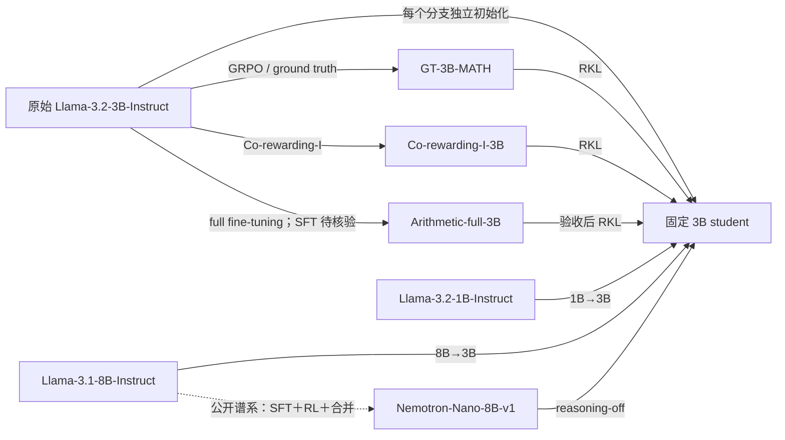
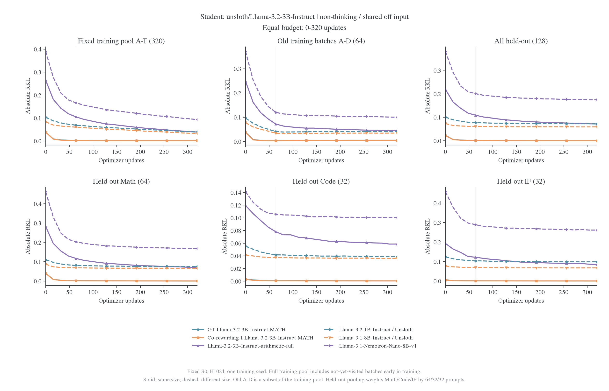

# Llama 固定学生与跨尺寸教师谱系计划

状态：640 题 student 银行及六位教师的 448 题缓存已完成，六组已进入数值验收与 320 步训练队列，六组均已完成 320 步并通过完整风险验收，五组 640 步续训已放行。用户已指定三个 Meta 原始模型改用对应 Unsloth BF16 非量化发布源，固定新 revision 并下载；七组权重均已下载，基础词表及共享权重审计已通过；四个后训练 teacher 仍保留作者发布源，不用普通 Unsloth 权重替代其后训练结果。镜像与原 Meta 权重的逐字节等价尚未核实，实际实验身份以新固定仓库与 revision 为准。

[机器可读协议](../../../../../../../research/studies/fixed_transfer/plans/llama-lineage-protocol.json)记录六个分支及验收条件；该文件是待适配协议，不是当前引擎可直接执行的训练配置。排在 R1 小教师→7B 和 Qwen3 双模式适配之后，只使用物理 GPU0–5。Llama 首轮以拟合为主，不以 acc 筛 teacher、决定是否开训或选择终点。

## 固定 student 与六位 teacher

所有分支都从同一原始 `unsloth/Llama-3.2-3B-Instruct` 权重初始化，分支之间不继承前一 teacher 蒸馏后的 student。[^student][^small][^large]第一阶段每组 320 次更新，六组全部通过验收时合计 1920 次；SFT 候选未通过前只计五个已确定候选的计划预算，不把任何计划量写成完成量。

| Teacher                                   | 关系与研究问题                                     | 限制                                                                        |
| ----------------------------------------- | -------------------------------------------------- | --------------------------------------------------------------------------- |
| GT-Llama-3.2-3B-Instruct-MATH             | 同构 GRPO ground-truth RL 目标，拟合速度与残差参照 | 精确父 revision 与实际完整训练日志未核实                                    |
| Co-rewarding-I-Llama-3.2-3B-Instruct-MATH | 同构 Co-rewarding RL，与 GT 对比                   | 包含改写题/数据视角差异，不认定为等计算预算的纯奖励消融                     |
| Llama-3.2-3B-Instruct-arithmetic-full     | 同构全参数 SFT 候选，对比不同后训练路径            | 模型卡确认 full fine-tuning；数据集名称和完整训练来源不充分，损失实现待核验 |
| Llama-3.2-1B-Instruct                     | 1B→3B，小 teacher 到大 student                     | 相同 family 不代表各参数形状相同；不能直接做参数复制参考                    |
| Llama-3.1-8B-Instruct                     | 8B→3B，与小教大方向对照                            | 同时存在 3.1/3.2 版本与尺寸差异                                             |
| Llama-3.1-Nemotron-Nano-8B-v1             | 大 teacher 额外后训练版本，首轮 reasoning-off      | 明确标记 SFT＋RL＋checkpoint 合并，不作为纯 RL 消融                         |

教师模型卡声明的父模型仍是 Meta 发布的 Llama；当前 student 按用户要求使用 Unsloth 镜像，不把教师的历史父 revision 改写成 Unsloth 版本。图中父子关系按作者公开声明记录；精确父权重 commit 尚未独立验证。两位 RL teacher 的方法由作者模型卡支持。Arithmetic-full 模型卡列出 full fine-tuning、学习率 1e-4 和 20000 个样本，但 Dataset 字段仍为占位内容，因此不能将其命名为已核实的某个算术数据集。Nemotron 模型卡说明 SFT、多阶段 RLOO/Online RPO 及最终 SFT/RPO checkpoint 合并，应整体作为额外后训练目标。[^gt][^coreward][^sft][^nemotron]

## 固定版本与现有预检

| 模型                                  | 仓库                                                      | Revision                                   |
| ------------------------------------- | --------------------------------------------------------- | ------------------------------------------ |
| Llama-3.2-3B-Instruct（固定 student） | `unsloth/Llama-3.2-3B-Instruct`                           | `006f5dcd1393c3add266de40994ba96225e9689d` |
| GT-3B-MATH                            | `TMLR-Group-HF/GT-Llama-3.2-3B-Instruct-MATH`             | `b6a0ab79ab4802ef77334532dd1936bb1d219cf9` |
| Co-rewarding-I-3B-MATH                | `TMLR-Group-HF/Co-rewarding-I-Llama-3.2-3B-Instruct-MATH` | `0d1e2f5ca0f62c670853c59b97650abde3608437` |
| Arithmetic-full-3B（SFT 候选）        | `Raghav-Singhal/Llama-3.2-3B-Instruct-arithmetic-full`    | `66feb54e931c27285afc344645bf0961053ea29b` |
| Llama-3.2-1B-Instruct                 | `unsloth/Llama-3.2-1B-Instruct`                           | `5a8abab4a5d6f164389b1079fb721cfab8d7126c` |
| Llama-3.1-8B-Instruct                 | `unsloth/Llama-3.1-8B-Instruct`                           | `4699cc75b550f9c6f3173fb80f4703b62d946aa5` |
| Nemotron-Nano-8B-v1                   | `nvidia/Llama-3.1-Nemotron-Nano-8B-v1`                    | `54641c1611fcff44fa4865626462445e0a153fc7` |

[元数据与配置预检](../../../llama/data/interface-preflight-20261029/metadata-and-configs.json)保留可用配置及访问状态。四个公开 teacher 的 head 均为 128256 维；三位 3B teacher 的配置在 hidden3072、28 层、24 个注意力头、8 个 KV 头、共享 embedding/head 等布局字段上一致。正式“同构”验收还需与指定 student 的原始配置及真实张量逐项核对。

两个 RL 仓库的权重索引同时含 embedding 和 lm_head；Arithmetic-full 只含 embedding。Hub 统计中 RL 仓库比原始 student 多出的序列化参数数目恰为 128256×3072，不能据此把它们当成更大架构。须检查声明绑定的两份权重逐元素一致，否则加载器选择别名可能改变目标函数。索引级预检已完成；3B 相关权重已下载，基础词表与共享权重审计已通过；共同输入和原生 forward 缓存验收已完成，完整训练梯度与 Adam 显存验收仍由开训门槛检查。

Arithmetic-full 发布完整 safetensors 分片，没有只发布 adapter 的迹象，但这不等于已确认全部参数如何训练。其结构、权重、tokenizer 和来源记录全部验收后才正式纳入 SFT 主表；若来源始终不完整，保留“作者声明的全参数算术微调”标签与限制。

## 统一输入与数值合同

共用已有冻结题目集合，为原始 Llama-3.2-3B-Instruct 重新生成一套 S0 轨迹，不能复用 R1/Qwen 的 token 序列。题池沿用训练 A–T 320 题、数学留出 192 题、Code/IF 各 64 题；主数学留出固定 M01–M04 64 题。所有 teacher 共享逐题 student prompt、回答 token 和位置，训练期间不刷新 rollout。

Nemotron 的 reasoning-off 通过 system 内容 `detailed thinking off` 控制，不使用 Qwen 的 `enable_thinking` 开关。计划把该 system 条件统一施加到 student 和全部 teacher，并由固定 student tokenizer 渲染，避免只给 Nemotron 加一个私有前缀。若模板包含日期，固定 `date_string` 为 `29 Oct 2026` 并纳入输入身份，不依赖运行当天自动生成。

实际验收需要比较原始 student 模板、Nemotron 原生 off 模板与共同前缀的 token 序列，并检查输出是否按 off 模式工作。若两者不一致，不静默换成 teacher 私有模板；先记录差异并解决共同输入兼容性。NVIDIA 对 off 模式推荐 greedy decoding；本轮若保持统一 S0 采样温度，则明确这是共同研究设置，不声称复现其官方评测。[^nemotron]

共同 off 输入已按固定日期构建，1270 个题目输入中，student、GT、Co-rewarding-I、算术 SFT、1B 和普通 8B 的原生模板与共同前缀均一致；Nemotron 全部不一致，其原生 system 段不含 student 模板附带的日期信息。两道 GPU greedy 探针在共同前缀与其原生 off 前缀下均返回直接解题段，未出现 `<think>` 标签；这只验证短样本行为，不保证所有输出的模式能力，也不消除日期差异。实验继续使用共同 student 前缀。算术 SFT tokenizer 的 model_max_length 为 512，而模型位置配置更长；缓存使用显式 token IDs，没有按 512 截断；实际最长输入加回答前缀为 1363 个位置，原生 forward 对照已通过。

逐模型检查 token→ID 映射、BOS/EOS、聊天头、RoPE、参数布局与权重绑定。候选停止集合为 `[128001,128008,128009]`，只在确认所有模型中的 token 含义和原生 generation config 后固定；当前 RL teacher 的 config EOS 为 128009，其他公开配置包含三个 ID，不能仅凭维度相同直接认为停止协议一致。

公开 3B teacher 的 RoPE 为 llama3 类型、theta500000、factor32；Nemotron 的 factor 为 8。保留官方配置并记录差异，不把跨尺寸对照描述为只改参数量。原生 full-vocab RKL 还需确认 teacher 支持集覆盖 student；遇到冲突先单列处理，不静默重映射或改成 top-k KL。

数值设置沿用 batch16、reuse16、H1024、LR1e-6、AdamW β=(0.9,0.999)、ε=1e-8、weight decay0.01、clip1、seed42。参数、梯度、Adam 与 head 为 FP32，backbone 原生 BF16 autocast，RoPE buffers 保留 FP32，TF32 关闭。有效 loss 分母保持 16×1024，另报实际有效 token 数。microbatch、激活重算和显存配置由真实模型梯度与 Adam 更新核验决定，不为省显存静默降低参数或优化器精度。

三位布局一致的 3B teacher 均补 teacher-copy：在原始 student 配置与 buffers 内复制参数，报告可行参考及终点相对参考的配对残差。跨尺寸组不做无定义的直接参数复制，teacher-copy 也不被解释为理论下界。

## 首轮读出与分阶段续训

每组先统一训练 320 次，在 0/64/320 记录：完整训练银行 A–T、旧批 A–D、固定数学留出的绝对 RKL 和相对初始降幅，JS 作辅助。每 16 步保存风险，补充最近等长 64 更新窗口的绝对/相对变化；不把换批后的在线 loss 当固定留出风险，也不只看当前批。

暂不以 acc 筛选 teacher 或选择终点，准确率不是这条线的开训依赖。若后续补任务评测，继续使用统一 avg@4，不采用 avg@1 筛查；该评测与拟合主表分开，不因已有分数高低删去难拟合目标。

延长按 320→640→1280 阶段判定。320 步后循环同一 A–T 题池与同一 S0 轨迹，不增加题目或状态覆盖。训练与固定留出共同持续改善的分支优先延长；仅当前批改善、旧批或留出持续平台的分支标记局部—泛化分离，先分析再追加预算。记录最近等长窗口、题目配对区间与是否改善，不能用一个 noisy endpoint 自动判定收敛。

续训保留 Adam 一阶/二阶矩、step、随机状态、学习率进度和下一批位置。计划继续或待判定的分支仅保留一个滚动恢复点；更新点验收后清理旧恢复点，不保存逐步 optimizer 快照。已有 weights-only 终点需重放才能恢复连续优化轨迹；若重置 Adam，必须单列条件。

## 首阶段结果与续训选择

| Teacher（条件见图）                       | 更新数 | 整体初始 RKL | 整体最终 RKL | 整体下降 | Math 下降 | Code 下降 | IF 下降 |
| ----------------------------------------- | -----: | -----------: | -----------: | -------: | --------: | --------: | ------: |
| GT-Llama-3.2-3B-Instruct-MATH             |    320 |     0.022932 |     0.000540 |   97.65% |    98.48% |    85.27% |  93.86% |
| Co-rewarding-I-Llama-3.2-3B-Instruct-MATH |    320 |     0.021832 |     0.000541 |   97.52% |    98.46% |    85.38% |  90.80% |
| Llama-3.2-3B-Instruct-arithmetic-full     |    320 |     0.219375 |     0.071417 |   67.45% |    75.02% |    50.88% |  55.55% |
| Llama-3.1-Nemotron-Nano-8B-v1             |    320 |     0.380807 |     0.174600 |   54.15% |    63.57% |    28.95% |  42.90% |
| Llama-3.2-1B-Instruct / Unsloth           |    320 |     0.100543 |     0.072446 |   27.95% |    31.43% |    30.13% |  20.75% |
| Llama-3.1-8B-Instruct / Unsloth           |    320 |     0.073250 |     0.059211 |   19.16% |    23.76% |    11.95% |  12.63% |

[训练池／留出图](../overview-snapshot/llama3-3b-off-final-rkl.png)按整体留出降幅排序。GT、Co-rewarding-I、算术 SFT 与 Nemotron 继续观察到改善，已通过真实 GPU 恢复验收；1B→3B 的最后窗口区间跨零，但针对小教大问题增加一次固定覆盖确认。以上五组进入[640 步配置](../../../../../../../research/studies/fixed_transfer/plans/llama-reasoning-off-stage640.json)，普通 8B 保留 320 步，不预先承诺全部延长到 1280。

## 执行顺序与未完成条件

1. 七个模型权重已落地并通过基础词表及共享权重审计；三个基础模型使用已固定 revision 的 Unsloth BF16 来源。继续保留算术 SFT 训练数据披露不完整的限制。
2. 验收共同 reasoning-off 输入、token 映射、停止协议与 RoPE，生成原始 3B student 的共享 S0 银行。
3. 完成真实模型的数值与显存核验、同构 teacher-copy 和固定题池恢复测试。
4. 两个 RL 目标及 1B→3B 优先，SFT 验收后加入；随后完成 8B→3B 和 Nemotron 目标，所有分支先统一到 320 步。
5. 根据固定风险曲线执行分阶段延长；主表始终保留初始权重、状态来源、支持集和预算。

六分支已写入[首阶段执行配置](../../../../../../../research/studies/fixed_transfer/plans/llama-reasoning-off-stage320.json)，每组 320 步，风险读出 64／320，使用 GT-3B 作同构数值参考。与已有共同 reasoning-off 准备配置的银行身份完全一致；六组共享同一个固定 student 银行。`targets` 阶段已完成，六位教师每位 448 题缓存均齐全，原生 forward 对照误差低于 1e-4，RoPE buffers 保持 FP32。[进入拟合的验收记录](../../../llama/data/fit-admission-20261030/admission.json)保留模型缓存与配置证据。当前已排入 `fit` 阶段；完整参数梯度、两次 Adam 更新及显存检查通过后，才允许各分支更新。

通用引擎已接入固定池循环、optimizer/RNG 恢复与 RKL-only 调度，并通过 CPU 连续性测试；Llama 仍须完成训练数值／显存验收及阶段恢复验收。不能直接把未经验证的旧配置更新数改为 1280 运行。Llama 已有六组 320 步结果；这些有限预算结果不构成充分吸收的结论。

### 参考文献

[^student]: unsloth/Llama-3.2-3B-Instruct. 模型卡。[固定版本](https://huggingface.co/unsloth/Llama-3.2-3B-Instruct/blob/006f5dcd1393c3add266de40994ba96225e9689d/README.md)。

[^gt]: TMLR-Group-HF/GT-Llama-3.2-3B-Instruct-MATH. 模型卡。[固定版本](https://huggingface.co/TMLR-Group-HF/GT-Llama-3.2-3B-Instruct-MATH/blob/b6a0ab79ab4802ef77334532dd1936bb1d219cf9/README.md)。

[^coreward]: TMLR-Group-HF/Co-rewarding-I-Llama-3.2-3B-Instruct-MATH. 模型卡。[固定版本](https://huggingface.co/TMLR-Group-HF/Co-rewarding-I-Llama-3.2-3B-Instruct-MATH/blob/0d1e2f5ca0f62c670853c59b97650abde3608437/README.md)。

[^sft]: Raghav-Singhal/Llama-3.2-3B-Instruct-arithmetic-full. 模型卡。[固定版本](https://huggingface.co/Raghav-Singhal/Llama-3.2-3B-Instruct-arithmetic-full/blob/66feb54e931c27285afc344645bf0961053ea29b/README.md)。

[^small]: unsloth/Llama-3.2-1B-Instruct. 模型卡。[固定版本](https://huggingface.co/unsloth/Llama-3.2-1B-Instruct/blob/5a8abab4a5d6f164389b1079fb721cfab8d7126c/README.md)。

[^large]: unsloth/Llama-3.1-8B-Instruct. 模型卡。[固定版本](https://huggingface.co/unsloth/Llama-3.1-8B-Instruct/blob/4699cc75b550f9c6f3173fb80f4703b62d946aa5/README.md)。

[^nemotron]: nvidia/Llama-3.1-Nemotron-Nano-8B-v1. 模型卡。[固定版本](https://huggingface.co/nvidia/Llama-3.1-Nemotron-Nano-8B-v1/blob/54641c1611fcff44fa4865626462445e0a153fc7/README.md)。

## 640 更新完成与下一阶段选择（2026-10-30）

五条续训分支均完成 640 更新并通过完整 RKL 证据核验。下表是 128 道整体留出的固定 H1024 风险；百分比为相对该区间起点的风险下降，负值表示风险上升。

| Teacher                                   | 640 绝对 RKL | 0→640 降幅 | 320→640 降幅 | 下一步                              |
| ----------------------------------------- | ------------ | ---------- | ------------ | ----------------------------------- |
| GT-Llama-3.2-3B-Instruct-MATH             | 0.00058015   | 97.4701%   | −7.4640%     | 暂停加预算，诊断跨题组波动          |
| Co-rewarding-I-Llama-3.2-3B-Instruct-MATH | 0.00056613   | 97.4069%   | -4.6669%     | 暂停加预算，诊断跨题组波动          |
| Llama-3.2-3B-Instruct-arithmetic-full     | 0.06210813   | 71.6886%   | 13.0349%     | 选择续训至 1280，先验收恢复         |
| Llama-3.2-1B-Instruct                     | 0.07145157   | 28.9341%   | 1.3722%      | 最近两个窗口区间跨零，保留 640 终点 |
| Llama-3.1-Nemotron-Nano-8B-v1             | 0.16827422   | 55.8112%   | 3.6228%      | 选择续训至 1280，先验收恢复         |

GT 与 Co-rewarding 最近两个 64 更新窗口仍下降，但完整 320→640 周期风险上升，不能仅据末段斜率宣布继续训练有整体收益。SFT 与 Nemotron 的完整周期及末两个窗口均改善，按既定规则进入下一阶段。恢复计划保留 Adam 与 RNG，固定原有覆盖；1B 小教大暂不追加 1280。

逐题配对统计见[640 更新窗口证据](../../../data/llama640-20261030/continuation-windows.csv)；该证据包括训练、旧批及各域，不仅是上表的 pooled held-out。置信区间是逐题重采样，不覆盖训练 seed 的不确定性。

上述 SFT、Nemotron 的 640 步终点已通过 GPU 恢复核验：参数与 Adam 完整加载、RNG 一致，试验性下一步不计入科学更新。两条 1280 更新训练已提交 GPU4–5 队列，尚不计作完成终点。

## 等预算训练与泛化曲线

以下六组统一截取 0–320 更新，不混入个别分支的 640 终点；每 16 更新评分。训练全池 A–T 的分母和题目保持固定，因此早期包含尚未访问的批次；旧 A–D 面板是该池的子集。实线表示同尺寸，虚线表示跨尺寸，颜色与标记共同区分 teacher。

另见[相对初始 RKL 降幅曲线](../../../data/equal-budget-20261030/llama-original/equal-budget-drop_percent.png)、[逐点数值](../../../data/equal-budget-20261030/llama-original/learning-curves.csv)和[快照路径及哈希](../../../data/equal-budget-20261030/llama-original/sources.json)。绝对残差和相对降幅分别展示，不能只根据一种视图判断可拟合性。

曲线显示部分跨尺寸教师在训练池上继续下降时，Code／IF 留出已明显放缓；这支持分别分析局部拟合与泛化，不足以证明容量导致不可吸收。两位同尺寸 RL 的初始差异和最终残差都小，不能仅因绝对曲线贴近零就宣称全分布完全拟合。
