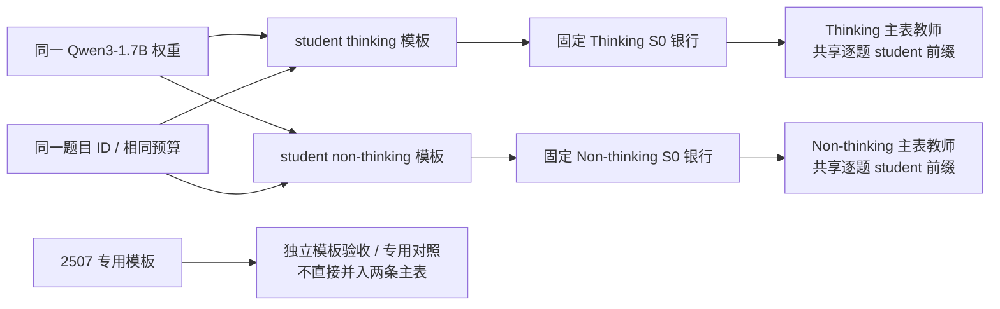

# Qwen3 双模式与固定题池长训协议

状态：匹配 non-thinking 的 Base-OPD 已完成 1280 步、SFT 已完成 1280 步、Qwen3-0.6B teacher 已完成 640 步。SFT 640→1280 连续续训已完成；普通 Qwen3-4B／8B 的 non-thinking 320 步配置已通过接口审计并排队，训练前仍需数值验收。2507 继续单列模板专用对照。

本轮仍固定 student 为 `Qwen/Qwen3-1.7B`，revision 为 `70d244cc86ccca08cf5af4e1e306ecf908b1ad5e`。[完整协议](../../../../../../../research/studies/fixed_transfer/plans/qwen3-mode-protocol.json)记录教师分组、阶段预算和验收缺口；两个 `*-prepare.json` 只用于资产、模板和银行准备，`arms` 为空，不是可直接执行的长训配置。R1 小教师到 7B 的[优先实验](../r1/2026-10-29-小教师到大模型的跨尺寸吸收.md)先执行，新协议随后推进。只使用物理 GPU0–5。

## 两条线共用权重与题目，分别固定状态

Thinking 与 non-thinking 使用完全相同的 student 权重、题目 ID、训练预算和优化器参数。分别用 student 的 `enable_thinking=True/False` 模板生成两套冻结 S0 银行；同一条线内所有 teacher 都在同一 student prompt 与回答前缀上评分，不为某个 teacher 私自替换输入模板。

准备配置分别为 [Thinking](../../../../../../../research/studies/fixed_transfer/plans/qwen3-mode-thinking-prepare.json) 与 [Non-thinking](../../../../../../../research/studies/fixed_transfer/plans/qwen3-mode-nonthinking-prepare.json)。已核验 Thinking 的银行身份与旧实验完全一致，可以复用原银行；已核验 non-thinking 使用不同的 prompt 和银行指纹，不能复制 thinking 轨迹后改标签。

题池沿用 640 题：训练 A–T 共 320 题、数学留出 M01–M12 共 192 题、Code/IF 各 64 题。用于主指标的数学留出固定为 M01–M04 的 64 题，其余预留题不参与训练；历史上已使用过的题不能称为全新盲测集。任务评测仍为独立的 630 题。

## 教师矩阵与原生模式归组

| Teacher                                      | Thinking                  | Non-thinking       | 定位与验收                                            |
| -------------------------------------------- | ------------------------- | ------------------ | ----------------------------------------------------- |
| Qwen3-0.6B                                   | 主对照                    | 主对照             | 最高新增优先级；小 teacher→1.7B student，同权重双模式 |
| Qwen3-4B                                     | 主对照                    | 主对照             | 核心双模式跨尺寸对照；固定同一 revision               |
| Qwen3-8B                                     | 主对照                    | 主对照             | 同权重双模式，扩大尺寸差异                            |
| Polaris-4B-Preview                           | 模板通过，待输出/数值验收 | 暂不加入           | 新增优先；公开 Qwen3-4B→RL 谱系，父 revision 未核实   |
| Qwen3-4B-Thinking-2507                       | 模板专用对照              | 不做               | 仅 thinking；不把布尔开关当作模式切换                 |
| Qwen3-4B-Instruct-2507                       | 不做                      | 模板专用对照       | 仅 non-thinking；原生模板没有空思考段                 |
| e3、GRPO-KL                                  | 容易拟合参照              | 不默认加入         | 保留已有 thinking 分支；选择 e3 作为优先长训参照      |
| Thinking-Space 1.7B-SFT                      | 旧结果为模式不匹配对照    | 优先匹配实验       | 模型卡明确训练时关闭 thinking                         |
| Thinking-Space 1.7B-Base-OPD                 | 旧结果为模式不匹配对照    | 优先匹配实验       | 模型卡明确训练时关闭 thinking                         |
| Samsung SFT、GT-Base-MATH、Co-rewarding-I/II | 保留已有 SFT 条件         | 新增输入对照已排队 | 原生训练开关未披露，不宣称模式匹配                    |
| Qwen3-1.7B-Base                              | 祖先分布对照              | 祖先分布对照       | 不命名为某模式专家，不与后训练专家排名混淆            |
| Thinking-Space 4B-Base-GRPO                  | 暂不加入                  | 新增输入对照已排队 | 从 4B-Base 分叉；原生训练开关未披露                   |

30B-MoE 暂不纳入主矩阵。模型卡对官方双模式和专用版本的说明，与 SFT/Base-OPD 的训练模式记录分别作为来源证据；模型卡声明不代替本地输出验收。[^q06][^thinking2507][^instruct2507][^sft][^opd][^polaris][^early-grpo]

4B-Base-GRPO 的固定版本模型卡明确说明从 Qwen3-4B-Base 做全参数 GRPO，训练集为 DAPO-Math-17k-Processed、KL loss 关闭；没有披露 `enable_thinking` 的取值。其 tokenizer 支持模式开关，只能证明模板可渲染，不能据此指定原生训练模式。该权重已通过[独立资产配置](../../../../../../../research/studies/fixed_transfer/plans/qwen3-base-grpo4-prepare.json)完成下载及词表／权重接口审计。[逐题 token 检查](../../../qwen3/data/mode-preflight-20261030/base-grpo4-template.json)确认 thinking 与 non-thinking 各 1270/1270 个前缀均与对应 student 一致；[模型卡证据](../../../qwen3/data/mode-preflight-20261030/base-grpo4-mode-evidence.json)仍不足以确定原生训练模式，实际输出模式待验收。已有 Co-rewarding-I/II 启动脚本同样未显式声明该开关，继续保留待归组状态。[^early-grpo]

Samsung SFT、GT-Base-MATH、Co-rewarding-I/II 与 4B-Base-GRPO 已进入[独立模式验收配置](../../../../../../../research/studies/fixed_transfer/plans/qwen3-mode-acceptance.json)。该阶段仅对四道固定题检查两种模式的共享前缀和最多 256 token 输出，不等待完整 S0 银行，不训练，也不计作任务准确率。主比较中五位教师的输出证据已经返回，具体输入对照及未披露的训练模式限制见下文。

新增固定版本如下；已准备的普通 4B/8B、e3、GRPO-KL、SFT/Base-OPD 继续沿用[既有版本表](../../../qwen3/2026-10-29-Qwen3谱系与同构教师吸收.md)。

| 模型                              | Revision                                   |
| --------------------------------- | ------------------------------------------ |
| Qwen3-0.6B                        | `c1899de289a04d12100db370d81485cdf75e47ca` |
| Polaris-4B-Preview                | `dcab747284e6f4818d8a871315f63dc1223ee394` |
| Qwen3-4B-Instruct-2507            | `cdbee75f17c01a7cc42f958dc650907174af0554` |
| Qwen3-4B-Thinking-2507            | `768f209d9ea81521153ed38c47d515654e938aea` |
| Thinking-Space/Qwen3-4B-Base-GRPO | `1f3b2966edfb75f2f98a00617588c1f748088422` |

## 实际 token 与配置验收

已对 640 个银行题目和 630 个任务题目逐个渲染，共 1270 个输入，而不是只查看模板字符串。示例尾部如下，`\n` 表示实际换行：

| 模型 / 开关                   | 实际 assistant 前缀尾部              | 与对应 student 主线一致                       |
| ----------------------------- | ------------------------------------ | --------------------------------------------- |
| Student / True                | `assistant\n`                        | Thinking 基准                                 |
| Student / False               | `assistant\n<think>\n\n</think>\n\n` | Non-thinking 基准                             |
| Qwen3-0.6B / True、False      | 分别与 student 相同                  | 两条线均 1270/1270 一致                       |
| Polaris-4B / True、False      | 分别与 student 相同                  | 两条线均 1270/1270 一致；不证明具备双模式能力 |
| Thinking-2507 / True 或 False | `assistant\n<think>\n`               | 两个开关均与主线不一致                        |
| Instruct-2507 / True 或 False | `assistant\n`                        | 与 non-thinking 主线 1270/1270 不一致         |

Non-thinking student 比普通 thinking student 多出的尾部 token 为 `[151667, 271, 151668, 271]`。Thinking-2507 原生模板自动打开思考段；Instruct-2507 不需要空思考段。Instruct-2507 恰好与 thinking student 的裸 assistant 前缀相同，也不意味着该教师支持 thinking。实际 token 与模式能力是两个不同验收项。

[示例 token 审计](../../../qwen3/data/mode-preflight-20261029/template-token-preflight.json)、[完整题池匹配计数](../../../qwen3/data/mode-preflight-20261029/full-cohort-template-audit.json)及[模型配置快照](../../../qwen3/data/mode-preflight-20261029/model-configs.json)保留原始证据。新增候选的已定义词表与 student 无 ID 冲突，head 均为 151936 维；主线继续使用原生 full-vocab RKL，不采用 R1 跨尺寸实验的条件支持口径。

Polaris-4B 的配置还声明 YaRN：factor1.5、original_max_position_embeddings65536、max_position_embeddings131072；当前 Transformers 对其中的 `attn_factor` 和比例一致性给出提示。保留官方配置，先核对实际生效的 RoPE 与 HF/vLLM 数值行为，不静默修改配置，也不将 Polaris 对普通 4B 的差别全部解释为 RL。2507 两个版本的 RoPE theta 为 5M，普通 4B 为 1M；它们是后训练版本对照。

模板专用对照必须记录其实际前缀与 student 状态来源，独立列出结果。若需要采用不同前缀，则为对应 student 权重重新生成独立银行，不冒充两条主线的共同状态；该额外条件通过验收后再执行，不改写主表定义。

### 2507 原生模板专用配置

已准备 [Thinking-2507 原生模板配置](../../../../../../../research/studies/fixed_transfer/plans/qwen3-2507-thinking-native-template.json)与 [Instruct-2507 原生模板配置](../../../../../../../research/studies/fixed_transfer/plans/qwen3-2507-instruct-native-template.json)，都固定同一 Qwen3-1.7B student 原始权重，计划 320 步、64／320 风险读出。`prompt_policy.template_model` 显式指定固定 revision 的模板来源；先要求词表 ID 映射完全相同，再对全部 640＋630 个消息验证 student 编码与教师原生编码逐 token 一致。两个配置均完成了包含 student 的输出探针；Instruct 条件已完成 320 步，Thinking 条件在数值与训练队列中。

[银行身份核对](../../../qwen3/data/mode-preflight-20261030/2507-native-template-banks.json)表明 Thinking-2507 的 `<think>\n` 前缀需要新的 S0 银行；Instruct-2507 的裸 assistant 前缀与旧 thinking 主线 token 完全一致，内容身份相同，可以复用既有冻结银行。这里复用的是同一 student 在同一输入上的轨迹，不能把它重新标为匹配 non-thinking；student 在该前缀上的实际行为也列入输出验收。两组始终单列模板条件，不改写主表协议或历史 Thinking-2507 的模式不匹配结果。

Thinking-2507 的[输出验收记录](../../../qwen3/data/mode-preflight-20261030/2507-thinking-output-admission.json)也已完成：教师四道共享前缀均与原生模板一致，student 与 teacher 都在显式打开的思考段内继续生成。该分支已排入 320 步拟合，先生成专用银行并完成数值验收；它仍是原生模板专用条件，不能替代普通 thinking 主表的共享裸 assistant 前缀对照。

Instruct-2507 的[输出验收记录](../../../qwen3/data/mode-preflight-20261030/2507-instruct-output-admission.json)已形成：四道固定题上，student 的共享裸 assistant 前缀输出均以 `<think>` 开始，教师的共享／原生前缀输出均未以该标签开始。256-token greedy 探针只确认这些样本的行为，不证明所有题的模式能力。该分支已按“原生模板、行为不匹配对照”完成 320 步并通过风险验收；不并入 non-thinking 主表，也不解释为只改变尺寸。

Instruct 原生模板条件的整体留出 RKL 从 0.768475 降至 0.582851，下降 24.15%。192→256 窗口的平台之后，256→320 又有 1.55% 改善，配对增量区间小于零。已准备[640 步固定题池确认配置](../../../../../../../research/studies/fixed_transfer/plans/qwen3-2507-instruct-native-template640.json)，并将 GPU 恢复验收排在主矩阵之后；通过恢复验收前不启动该阶段，不预先追加 1280。

### Thinking 主矩阵进入拟合队列

Qwen3-0.6B／4B／8B、Polaris-4B 与 e3 的 448 题缓存已齐，原生 forward 对照通过，[五分支验收记录](../../../qwen3/data/fit-admission-20261030/admission.json)绑定各自教师和共同 thinking 银行。五组已排入统一 320 步拟合，开训仍须通过 student 的完整梯度与 Adam 显存核验。e3 以及普通 4B／8B 的重放不应重复计为新的权重配对。

Polaris 的有效 YaRN attention scaling 为 1.0405465108108165。[CPU RoPE 数值对照](../../../qwen3/data/fit-admission-20261030/polaris-rope-parity.json)确认当前 Transformers 与 vLLM 在前 4096 个位置的 inv_freq、FP32 及 BF16 cos/sin 完全一致；这是 RoPE 原语核对，不是整模型 logits 等价证明。保留 factor1.5、原始上下文 65536 与配置上限 131072 的差异，不改官方配置，不把该 teacher 当成只增加 RL 的严格消融。

### 待归组教师的输出证据与补充对照

六位教师均已完成两种输入模式的四题探针，以及每种模式 1270 个消息的原生／共享前缀比较；全部 token 前缀一致。[验收汇总](../../../qwen3/data/mode-preflight-20261030/origin-controls-admission.json)保存输出分类、固定模型版本和原始证据位置。以下分组依赖实际输出与已披露训练资料，不把模板支持开关当作模式能力证明。

| Teacher                                | 样本行为                                                  | 新增实验条件                                 |
| -------------------------------------- | --------------------------------------------------------- | -------------------------------------------- |
| Samsung Qwen3-1.7B-Math SFT            | thinking 输入下 4/4 先输出空思考段；non-thinking 直接作答 | non-thinking 输入对照，保留旧 thinking 结果  |
| GT-Qwen3-1.7B-Base-MATH                | 两种输入下均直接作答                                      | non-thinking 输入对照，训练开关未披露        |
| Co-rewarding-I/II Qwen3-1.7B-Base-MATH | 两种输入下均直接作答                                      | 各一组 non-thinking 输入对照，训练开关未披露 |
| Qwen3-4B-Base-GRPO                     | 两种输入下均直接解题，未见思考标签                        | non-thinking 输入对照，训练开关未披露        |

Samsung 模型卡声明使用 GSM8K assistant 答案做全参数 SFT，未明确披露训练时的 thinking 开关。[^samsung-mode] 短探针既不是准确率筛选，也不证明模型在所有题上保留两种能力。这里使用“输入对照”标签，不将未披露的原生训练模式写成已证实的模式匹配。

主比较保留该批次中的[五组 non-thinking 对照](../../../../../../../research/studies/fixed_transfer/plans/qwen3-nonthinking-origin-controls320.json)，各 320 步、64／320 风险读出。执行配置保留历史批次的完整记录。分别复用原两条 S0 银行，共同前缀、题池、batch16、reuse16、H1024 和优化器保持不变；先过数值门槛，未完成前不加入终点排名。

## 统一初始预算与指标

所有通过验收的同尺寸和跨尺寸分支均从同一个 student 初始权重开始，首阶段运行 320 次更新，在 step64/320 读出拟合指标。batch16、reuse16、H1024、full-vocab RKL、LR1e-6 与现有 AdamW/精度设置保持一致。每 16 步保留固定面板风险，支持等长窗口比较。更新次数相同不保证两条线的有效 token 数相同：回答仍按 EOS 停止，loss 分母保持 batch16×H1024，同时记录实际有效 token 数，不用补齐的假回答抵消长度差异。主表的 64/320 读出是风险读出，不自动等于每处都必须启动长回答准确率评测。

十个基础主分支需要 3200 次更新；Polaris 通过验收后再增加 320 次。两个 2507 模板专用分支各 320 次，单独计数。未通过模式验收的教师、第二批和后续延长不提前计入完成量。

主表按模式、teacher、step 和面板分别列出：

- 初始与当前绝对 RKL；相对初始的 RKL 降幅。
- 最近 64 次更新的绝对下降量与相对下降率：step320 对 step256、step640 对 step576、step1280 对 step1216。分母为零或接近数值参考时标记，不强行给出比例。
- 完整训练银行 A–T、旧训练批 A–D、固定数学留出 M01–M04 分开报告，不用当前 batch 的训练 loss 代替固定面板。
- 参数布局一致的同构分支增加 teacher-copy 参考及配对残差；JS 作辅助核对，Code/IF 保留为迁移诊断。

Thinking 与 non-thinking 的轨迹分布不同，主要比较各线内部曲线和同权重 teacher 的变化，不按两线终点 KL 的绝对大小直接排名。任务评测继续遵守候选首次 avg@4 的约定；需按模式分别评 teacher 与 student-before，不能跨模式复用准确率。GapRecovery 仅在对应模式的完整 before/teacher/after 结果齐全后计算。

## 固定覆盖的分阶段延长

延长预算为 320→640→1280，不预先承诺所有分支跑满。训练题目始终固定为 A–T 的 320 题，S0 token 序列始终固定；每批 reuse16，320 步后继续循环 A–T，不引入 U 等新批次，也不刷新模型 rollout。64→320 仍包含首次访问更多既定训练批的效果；320 之后的阶段比较才保持已访问覆盖不变。

优先检查匹配模式的 SFT、Base-OPD 和早分叉 RL：仍有明显绝对残差且固定数学留出继续下降时优先延长。其次检查普通 4B/8B、Polaris 等跨尺寸组。e3 保留一个长训参照，同时检查旧批是否保持；GRPO-KL 已有结果保留，但不要求两者都跑满。每个阶段记录固定留出最近等长窗口的变化和题目 bootstrap 区间，不能用单个窗口或训练 loss 的下降自动决定扩容。若训练批继续改善而留出连续平台，标记局部—泛化分离，先分析后追加预算。

续训必须恢复同一 Adam 一阶/二阶矩、step、学习率进度、随机状态、下一批位置与数据身份。只给将继续或尚待判定的分支保存一个滚动恢复点，新恢复点验收后删除旧点，不保存每步 checkpoint。终止分支仅保留最终评测权重和分析证据。旧终点未保存 optimizer 时，要么从 S0 重放，要么把 optimizer reset 明确标成不同条件，不能接着权重训练后称为连续续训。

阶段实现已支持固定池循环、恢复状态和 RKL-only 读出，见[引擎说明](../../../../../../../research/studies/fixed_transfer/README.md#固定题池的阶段训练)。新阶段必须引用完整恢复点、保持兼容签名，并通过真实 GPU 恢复核验，不能将旧 weights-only 终点直接当成连续 640 步。

## 已完成的匹配模式 320 步结果

下表仅比较同一 non-thinking 银行上的结果，RKL 按每题 H1024 预算归一化，不能与 thinking 银行的绝对值直接作难度排名。

| Teacher                              | 数学留出初始 RKL | 数学留出 step320 | 留出下降 | 旧 A–D 下降 | 最后 64 步留出下降 |
| ------------------------------------ | ---------------: | ---------------: | -------: | ----------: | -----------------: |
| Qwen3-1.7B-SFT / Thinking-Space      |         0.077281 |         0.047506 |   38.53% |      61.60% |              0.83% |
| Qwen3-1.7B-Base-OPD / Thinking-Space |         0.401606 |         0.089071 |   77.82% |      84.06% |              2.57% |

Base-OPD 在 192→256 与 256→320 两个窗口上的留出 RKL 增量，题目配对 bootstrap 区间均小于零，支持继续固定覆盖续训。SFT 前一个窗口有明确改善，最后窗口的增量区间跨零，且旧 A–D 略有反弹；因此先追加到 640 作为第二遍固定池确认。640 步后的继续与否改用三域整体留出证据判断，见下文。

两组恢复点均在新的 GPU 进程中检查了 1720574976 个参数、930 个 Adam 状态张量和 Python/NumPy/Torch/CUDA 随机状态，加载值完全一致。随后丢弃一次实际 step321 更新，确认 Adam 计数推进和真实参数变化；正式 640 阶段的首个 step321 loss 与该探针相差小于 1e-6。探针不计入科学更新，原 320 步权重和状态没有被探针覆盖。

执行配置为[320 步阶段](../../../../../../../research/studies/fixed_transfer/plans/qwen3-nonthinking-stage320.json)与[640 步阶段](../../../../../../../research/studies/fixed_transfer/plans/qwen3-nonthinking-stage640.json)。后者继承并记录前一阶段，不覆盖原结果；新增合格恢复点验证后才清理旧 optimizer 文件，历史回执与读出权重按用途保留。

## 跨尺寸 320 步结果

新的 non-thinking 跨尺寸两组均已完成 320 步并通过完整风险验收。以下保留首个 64 步读出，便于查看早期训练批拟合与留出差距；最终完整三域结果见总览。

| Teacher                     | 整体初始 RKL | 64 步整体 RKL | 整体下降 | 训练 A–D 下降 |
| --------------------------- | -----------: | ------------: | -------: | ------------: |
| Qwen3-4B，non-thinking 输入 |     0.134794 |      0.130845 |    2.93% |        48.05% |
| Qwen3-8B，non-thinking 输入 |     0.123020 |      0.118778 |    3.45% |        46.58% |

训练批拟合与整体留出改善之间仍有差距；需等统一 320 步及固定覆盖延长判断，不能把 64 步残差直接解释为容量上限。两条模式的 S0 不同，亦不能只比 thinking／non-thinking 的绝对 KL。执行配置及逐题读出来源见[跨尺寸计划](../../../../../../../research/studies/fixed_transfer/plans/qwen3-nonthinking-crosssize320.json)。

320 步时，Qwen3-4B／8B 的整体留出 RKL 分别为 0.129585／0.117522，相对初始仅下降 3.86%／4.47%；完整训练池 RKL 分别从 0.099065／0.095709 降至 0.046868／0.046305。最后两个 64 步窗口的整体留出增量区间均跨零，暂保留 320 步终点，优先补齐其他对照，不自动延长。训练池与留出的差距不能单独证明容量上限。

Thinking 主矩阵五组均已完成 320 步并通过完整风险验收。0.6B teacher 与 e3 的最近两个 64 步窗口均改善，且配对区间低于零；已准备[两组 640 步固定题池配置](../../../../../../../research/studies/fixed_transfer/plans/qwen3-thinking-stage640.json)，GPU 恢复验收已通过，两组已完成 640 步并通过风险验收。普通 4B／8B 的后期留出已平台，Polaris 最后窗口反弹，三者暂保留 320 步终点。

主比较中的五组 non-thinking 输入对照均已完成 320 步并通过风险验收。Samsung SFT、GT、Co-rewarding-I/II、4B-Base-GRPO 的连续窗口仍改善；五组已通过恢复验收，并放行[640 步固定覆盖续训](../../../../../../../research/studies/fixed_transfer/plans/qwen3-nonthinking-origin-controls640.json)。

## 固定覆盖续训的后续证据

SFT 的 Math 在 512→576→640 已接近平台，但整体 128 题留出平均 RKL 仍从 0.060588→0.060124→0.059917 下降；两个相邻窗口的配对增量区间均小于零。Code／IF 的继续改善支持推进到 1280，不能把 Math 平台直接解释为所有留出平台。Base-OPD 已连续完成 1280；各分支当前三域终点、完整名称与按整体排序的图统一见[总览](../2026-10-29-教师谱系实验总览与RKL进展.md)。

[后续续训配置](../../../../../../../research/studies/fixed_transfer/plans/qwen3-nonthinking-wave3.json)固定原题池与 S0，分别从 SFT640 和 Qwen3-0.6B320 的已验收恢复点接续。[non-thinking 跨尺寸配置](../../../../../../../research/studies/fixed_transfer/plans/qwen3-nonthinking-crosssize320.json)则让 Qwen3-4B／8B teacher 对应的 student 都从原始 1.7B 权重开始，各训练 320 步、读出 64／320；与其他 non-thinking 教师共享银行。SFT 仅为数值核验用的同构参考，不计作该配置新增训练分支。

Qwen3-0.6B teacher 的 320→640 使整体留出 RKL 从 0.082580 降至 0.081067，改善 1.83%；配对增量 95% 区间为 [−0.001888, −0.001163]。但最近两个 64 步窗口分别为轻微反弹且区间跨零、下降且区间小于零，Math 两个窗口都接近平台。因此暂保留 640 步终点，优先补未测尺寸／模式，不自动追加 1280；该判断不等于证明小模型函数无法被较大模型表示。

Base-OPD 的 640→1280 使整体留出 RKL 从 0.076076 降至 0.072115，改善约 5.21%；阶段增量区间为 [−0.004473, −0.003465]。它在最后一个窗口仍有改善，1280 步结果不能被描述为已经完全吸收或严格收敛。三域等长窗口和旧批证据由 `continuation --window 64` 从逐题文件复算，归一化与主图一致。

SFT 已完成 1280 步，整体留出从 640 步的 0.059917 降至 0.057597，阶段改善 3.87%，配对增量区间 [−0.002704, −0.001953]。最近两个 64 步窗口的区间均跨零，保留该终点并优先补齐缺失对照。SFT1280 与 Qwen3-0.6B640 的完整风险验收已经通过，覆盖 1920 次累计更新、120 个块间衔接和 84 行终点风险；准确率不在该回执范围。

Base-OPD1280 与 Qwen3-0.6B320 已通过 `analyze --risk-only` 完整风险验收，覆盖 1600 次累计更新、100 个块间衔接检查和 72 行终点风险统计。该验收不包含准确率，不代替全实验完成；精确命令与回执字段见[引擎说明](../../../../../../../research/studies/fixed_transfer/README.md#结果复算)。

## 长前缀 RKL-only 面板

对进入长训的代表分支，在同一批预先选定的 128 道 Math／Code／IF 留出题上补 H4096 的固定 S0 面板，分别按模式生成，不加入训练。报告前 1024、1024–2048、2048–4096 等位置段的绝对 RKL 及实际有效 token 数；提前 EOS 后不存在的区间标为缺失，不填零。

先检查长轨迹前 1024 token 是否与短银行完全一致；若不能一致，则作为另一套明确标识的固定轨迹报告，不假定两次采样构成严格嵌套前缀。此面板只做 RKL，不重复整套 JS/任务评测。H1024 上充分拟合最多支持推理前段的结论，不能替代后续推理状态的证据。

## 顺序与旧结果归位

1. 完成当前优先的 R1 小教师→大 student 适配与实验；运行中的任务不被新协议默认改写。
2. 验收双模式前缀、生成 non-thinking 银行；优先 Qwen3-0.6B 双模式、匹配模式的 SFT/Base-OPD 和 Polaris thinking。
3. 补齐普通 4B/8B 双模式 320 步对照，以及 e3/GRPO-KL thinking 参照；旧 64 步权重若无 Adam，按连续协议重放。
4. 独立验收 2507 模板专用对照及早分叉 4B-Base-GRPO；阶段判定后再执行 640/1280 和长前缀诊断。

[旧 Qwen3 报告](../../../qwen3/2026-10-29-Qwen3谱系与同构教师吸收.md)继续保留实际已运行的共同 thinking 条件。SFT/Base-OPD 的旧 thinking 结果明确归为模式不匹配对照，其低任务分数不能替代匹配 non-thinking 分支的测量。Samsung、GT、Co-rewarding 的旧结果不因为新分组规则而被重新命名为已验证的模式专家。

## 640 步后的预算决策

Qwen3-0.6B thinking 在 320→640 的整体留出继续改善约 0.65%，但最后两个 64 步窗口的区间均跨零，保留 640 步终点。e3 的整轮改善约 1.34%，区间同样跨零；它作为预先保留的近源同构参照，再做一次[1280 步确认](../../../../../../../research/studies/fixed_transfer/plans/qwen3-thinking-e3-stage1280.json)，不将此选择描述成整轮改善已经显著。

新增 non-thinking 五组在 640 步的最近两个窗口均持续改善：Samsung SFT、GT、Co-rewarding-I/II 和 4B-Base-GRPO。已准备[1280 步续训配置](../../../../../../../research/studies/fixed_transfer/plans/qwen3-nonthinking-origin-controls1280.json)，固定题池、S0 和 Adam，先执行 GPU 恢复验收再开训。

Instruct-2507 原生模板对照在 320→640 整体改善约 2.05%，但末段出现一次上升、一次下降，保留 640 步，不自动追加 1280。各项选择依据同一 `continuation-windows.csv` 的整体 128 题面板；正负窗口和不确定区间均保留。

## H4096 留出诊断

已为 e3 thinking 的 320 步终点和匹配 SFT non-thinking 的 1280 步终点配置 H4096 RKL-only 面板，并已完成评分。每条线只扩展固定的 128 道留出题，保持原始逐题 seed 和 batch 组成；生成后的前 1024 token 必须与原银行完全一致，否则停止该诊断。它们分别代表近源拟合较充分与同尺寸仍有残差的条件，两条模式各自分析，不按跨银行绝对 KL 排名。

评分分别覆盖前 1024 token 和后续位置，复用初始／终点权重，不训练、不新增 optimizer 或 checkpoint。e3 与 SFT 的实测结果如下，仍不能声称完整推理轨迹已经吸收。配置、输出路径和部分银行回执规则见[长前缀诊断说明](../../../../../../../research/studies/fixed_transfer/README.md#固定留出的长前缀诊断)。

### SFT 1280 步的 H4096 留出结果

[前缀验收](../../../qwen3/data/long-prefix-20261030/sft-1280-prefix-acceptance.json)为 128/128 完全匹配，初始与终点的前段逐题 RKL 总和也与原 H1024 评分一致。以下为[独立长前缀风险表](../../../qwen3/data/long-prefix-20261030/sft-1280-risks.csv)，不增加科学更新。

| 位置区间    | 有效 token 数 | 至少一个有效 token 的题数 | RKL 降幅 |
| ----------- | ------------: | ------------------------: | -------: |
| 0–1024      |         72437 |                       128 |   33.00% |
| 1024–2048   |         30656 |                        41 |   47.97% |
| 2048–4096   |         20171 |                        20 |   45.77% |
| 整体 0–4096 |        123264 |                       128 |   36.48% |

各段按对应固定预算归一化，提前 EOS 的后续位置没有损失项。后段只覆盖尚未结束的题目，题目与领域组成不同；不能凭较高的后段降幅判断它更容易拟合。当前可确认：训练之外的后续 S0 状态也有改善，且仍有明显残差。[覆盖及前段复算证据](../../../qwen3/data/long-prefix-20261030/sft-1280-coverage.json)保留各段有效题数和对照误差。

### 参考文献

[^q06]: Qwen. Qwen3-0.6B 模型卡。[固定版本](https://huggingface.co/Qwen/Qwen3-0.6B/blob/c1899de289a04d12100db370d81485cdf75e47ca/README.md)。

[^thinking2507]: Qwen. Qwen3-4B-Thinking-2507 模型卡。[固定版本](https://huggingface.co/Qwen/Qwen3-4B-Thinking-2507/blob/768f209d9ea81521153ed38c47d515654e938aea/README.md)。

[^instruct2507]: Qwen. Qwen3-4B-Instruct-2507 模型卡。[固定版本](https://huggingface.co/Qwen/Qwen3-4B-Instruct-2507/blob/cdbee75f17c01a7cc42f958dc650907174af0554/README.md)。

[^polaris]: POLARIS Project. Polaris-4B-Preview 模型卡。[固定版本](https://huggingface.co/POLARIS-Project/Polaris-4B-Preview/blob/dcab747284e6f4818d8a871315f63dc1223ee394/README.md)。

[^sft]: Thinking Space. Qwen3-1.7B-SFT 模型卡。[固定版本](https://huggingface.co/Thinking-Space/Qwen3-1.7B-SFT/blob/f0065babe7440257d7db331a5aa442ef7c3cf266/README.md)。

[^opd]: Thinking Space. Qwen3-1.7B-Base-OPD 模型卡。[固定版本](https://huggingface.co/Thinking-Space/Qwen3-1.7B-Base-OPD/blob/4ad294531545b51fbcfbd1b0ded387ba237db57c/README.md)。

[^early-grpo]: Thinking Space. Qwen3-4B-Base-GRPO 模型卡。[固定版本](https://huggingface.co/Thinking-Space/Qwen3-4B-Base-GRPO/blob/1f3b2966edfb75f2f98a00617588c1f748088422/README.md)。

[^samsung-mode]: SamsungSAILMontreal/Qwen3-1.7B-Math. 固定版本模型卡。[训练说明](https://huggingface.co/SamsungSAILMontreal/Qwen3-1.7B-Math/blob/6c0e18a8277e3c5b46aa51e8f75612a5d78a9542/README.md)。

### e3 thinking 320 步的 H4096 留出结果

本诊断对应原始 `Q3-e3` 的 320 更新终点，不能与后续 `T-E3` 的 640／1280 权重混用。[token 前缀验收](../../../qwen3/data/long-prefix-20261030/e3-320-prefix-acceptance.json)为 128/128 完全匹配。[风险表](../../../qwen3/data/long-prefix-20261030/e3-320-risks.csv)及[覆盖与数值核对](../../../qwen3/data/long-prefix-20261030/e3-320-coverage-audit.json)记录如下结果。

| 响应位置    | 实际 token 数 | 有效题数 |   初始 RKL |   终点 RKL | 相对下降 |
| ----------- | ------------: | -------: | ---------: | ---------: | -------: |
| 0–1024      |        122938 |      128 | 0.03379597 | 0.00126448 |   96.26% |
| 1024–2048   |        100179 |      106 | 0.03594597 | 0.00104031 |   97.11% |
| 2048–4096   |        185903 |       94 | 0.03649334 | 0.00152735 |   95.81% |
| 整体 0–4096 |        409020 |      128 | 0.03568216 | 0.00133987 |   96.24% |

各段仍按 128×区间宽度归一化；提前结束的题没有后段损失项，表中有效题数明确显示覆盖差异。推理后段的降幅仍较大，因此本例的拟合改善不只发生在前 1024 token，但整体终点 RKL 仍非零，也没有覆盖超过 4096 的状态或 fresh rollout。

相同 token 前缀不意味着浮点评分逐位相等。原 H1024 评分使用 microbatch4，长面板使用 singleton 且序列更长；实测初始前段整体 RKL 相对旧评分变化 −0.02476%，终点变化 +0.12616%。终点逐题固定预算 RKL 最大绝对差为 0.00018763，平均绝对差为 0.00000514。此处只记录数值差及执行条件差别，未通过专门消融将误差归因于某一个因素。SFT 的同项[独立核对](../../../qwen3/data/long-prefix-20261030/sft-1280-coverage-audit.json)也已完成。

## 同构 non-thinking 控制组的首批 1280 结果

Samsung SFT 与 GT-Qwen3-1.7B-Base-MATH 已完成 1280 更新并通过[独立风险验收](../../../qwen3/data/nt-controls1280-20261030/sft-gt-verification.json)。本次刷新时其余三条也已完成，完整五组结果见后续汇总。

| Teacher                       | 1280 整体留出绝对 RKL | 从初始下降 | 640→1280 剩余风险下降 | 末两个 64 更新窗口下降         |
| ----------------------------- | --------------------: | ---------: | --------------------: | ------------------------------ |
| Qwen3-1.7B-Math / Samsung SFT |            0.00860705 |     94.06% |                22.69% | 2.01%、0.81%，均有负风险差区间 |
| GT-Qwen3-1.7B-Base-MATH       |            0.07373704 |     70.02% |                 4.67% | 0.04%、0.72%，前一个区间跨零   |

[逐面板窗口表](../../../qwen3/data/nt-controls1280-20261030/sft-gt-windows.csv)保留训练、旧批与三域留出的原始风险及配对区间。Samsung SFT 在计划的 1280 预算终点仍有稳定下降，不能称为已经收敛；GT 的整阶段改善成立，但近期走势不如 SFT 稳定。两者都仍有非零残差。它们的父权重、数据和后训练过程不同，因此不能用本表推断纯 SFT 与纯 RL 的算法因果差异。

## 五条 non-thinking 控制组的 1280 完整汇总

五组均已通过[完整风险验收](../../../qwen3/data/nt-controls1280-20261030/all-five-verification.json)。所有数据仍为原固定 A–T 训练池与三域留出；[完整窗口表](../../../qwen3/data/nt-controls1280-20261030/all-five-windows.csv)保留训练、旧批与各域。

| Teacher                              | 1280 整体留出 RKL | 相对初始下降 | 640→1280 剩余风险下降 |
| ------------------------------------ | ----------------: | -----------: | --------------------: |
| Qwen3-1.7B-Math / Samsung SFT        |          0.008607 |       94.06% |                22.69% |
| GT-Qwen3-1.7B-Base-MATH              |          0.073737 |       70.02% |                 4.67% |
| Co-rewarding-I-Qwen3-1.7B-Base-MATH  |          0.071383 |       70.52% |                 5.03% |
| Co-rewarding-II-Qwen3-1.7B-Base-MATH |          0.067728 |       70.89% |                 5.05% |
| Qwen3-4B-Base-GRPO / Thinking-Space  |          0.111017 |       52.63% |                 1.07% |

这表示预定 1280 阶段完成，不表示所有分支已经收敛或能完全吸收。仍需结合绝对风险、末段区间和域间差异解释。
