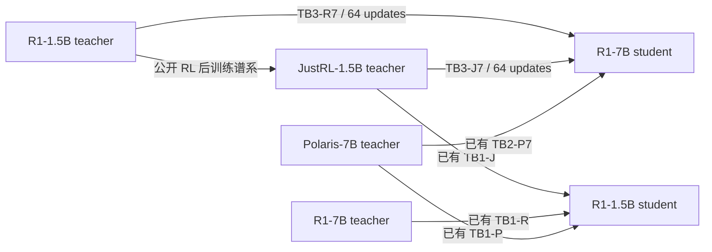

# 小教师到大模型的跨尺寸吸收

状态：用户已将 R1-1.5B → R1-7B、JustRL-1.5B → R1-7B 设为下一优先级，并确认采用共享支持条件 RKL。模型、原始 R1-7B 冻结轨迹及已有 avg@4 基线可复用；词表预检完成。两卡训练适配与真实模型数值验证已完成，TB3-R7 与 TB3-J7 均完成 64 步，条件 RKL 结果见[总体进展](../2026-10-29-教师谱系实验总览与RKL进展.md)。旧 64 步终点的两组 avg@4 评测均已完成并校验；它们不对应新的确定性 320 步 checkpoint。执行参数记录在[实验计划](../../../../../../../research/studies/boundary/plans/small-to-large.json)。

## 研究问题与矩阵

固定两个小教师，比较其函数在 1.5B 与 7B student 上的拟合情况；再比较 R1 与 JustRL 两个教师，以观察 RL 后训练增量对应的目标是否更易迁移。较大参数规模不自动证明两个不同形状的 Transformer 函数类严格嵌套；这两组提供容量解释的经验对照，不单凭一次有限步优化给出不可表达性结论。

| Teacher / Student | R1-1.5B            | R1-7B                    |
| ----------------- | ------------------ | ------------------------ |
| R1-1.5B           | 已有自教师数值检查 | **TB3-R7：新增，优先 1** |
| JustRL-1.5B       | TB1-J，已有        | **TB3-J7：新增，优先 2** |
| R1-7B             | TB1-R，已有        | 已有自教师数值检查       |
| Polaris-7B        | TB1-P，已有        | TB2-P7，已有             |

自教师检查是已有 8 个回答位置上的零 KL/近零梯度检查，不等价于完整题池训练实验。新增实验先在共享支持口径下复核数值路径，再进行科学更新。

## 与原实验保持一致的设置

- 每组 64 次更新：A–D 四批，每批 16 题，reuse16；两组合计 128 次更新。
- 复用原始 R1-7B student 的冻结 S0 回答，H1024、原有 per-prompt seed；后续状态不是 fresh rollout，不重新生成题池。
- 评分面板沿用 256 题：训练侧题池 A–H 128 题（仅 A–D 参与本轮更新）、数学 held-out M01–M04 64 题、Code 与 IF 各 32 题；在 step0/16/32/48/64 评分。
- AdamW：LR1e-6，β=(0.9,0.999)，ε=1e-8，weight decay=0.01，clip1，训练 seed42。参数、梯度、Adam 和 head 为 FP32；backbone 使用原生 BF16 autocast，RoPE buffers 为 FP32，TF32 关闭。
- 7B FP32 参数、梯度与 Adam 状态超过单卡容量，沿用既有 R1-7B 的两卡分层模型并行，每卡 14 个 decoder layers。执行仅使用物理 GPU0–5。
- 最终任务评测沿用 630 题 avg@4：temperature0.7、top_p0.9、回答上限 31744、上下文 32768、原 seed 公式。先核验并复用现有 teacher/student-before 结果；两个新终点增加 5040 个回答。
- 每个分支连续保留同一 Adam 实例，但不导出 optimizer 状态，不保存 step32 权重；仅保留 step64 的任务读出权重、逐题风险、协议与日志。保存频率改变不改变优化轨迹。

## 320 步重放扩展

[长预算执行配置](../../../../../../../research/studies/boundary/plans/small-to-large-stage320.json)对两位 teacher 各运行 320 次更新，从同一个原始 R1-7B 权重与 fresh Adam 开始；旧 64 步没有保存 Adam，因此不从旧 checkpoint 接续并称作连续训练。该配置沿用 H1024、batch16、reuse16、共享 151936 维条件 RKL、优化器与两卡精度路径，使用已有冻结 S0 银行。

训练覆盖扩展至 A–T 的 320 道数学题；固定评分包括全部 A–T、Math64、Code32、IF32，共 448 题，每 16 步读出。前 64 步仍访问 A–D，程序对全部前 64 步 loss 与共同 256 题终点风险核对旧结果，允许的最大绝对误差为 1e-5；不匹配则停止，不能把改变条件的重跑当成原实验延长。64→320 包含新增既定训练批，后续 320→640 才保持已访问题池覆盖不变。

教师缓存复用已有 256 题，补齐剩余 192 道训练题；完成回执之外，队列还逐个检查所需缓存文件。新数值验收使用完整训练池中最长序列批，重新比较条件 KL 全梯度并检查两次 Adam 更新。新结果与 checkpoint 写入独立目录，原 64 步报告和任务评测权重保留。两卡数值验收已通过，但首组重放在 64 步因复现检查停止；原始结果和本次部分轨迹均保留，不计作完成的 320 步实验。

每个 320 步终点只保存最终权重与一份 Adam／RNG 恢复点，绑定权重摘要、模型版本、固定银行、题池和优化设置。未来 640／1280 阶段仍须通过真实两卡恢复验收后才能运行。该配置只调度 RKL 拟合，既有 64 步 avg@4 的未完成任务独立保留，不据此宣称准确率实验已经完成。

### 首组重放的复现差异

TB3-R7 在 64 步检查处超过原先 1e-5 阈值：每步 loss 最大差异 0.00023024，逐题归一化风险最大差异 0.00165028。检查阻止了后续更新，TB3-J7 的长预算尚未开始；没有覆盖旧 64 步结果或将失败检查标成通过。

[初始排查证据](../../../r1/data/replay-20261030/initial-diagnosis.json)显示，共同 256 题在 step0 的 RKL、student 熵和 teacher 熵全部完全一致，teacher 熵在后续读出仍一致；首步 loss 相同，但梯度范数已有微小差异。冻结源码中的模型加载、hidden、条件 KL 反向、评分及优化器核心函数 AST 相同。初始排查将差异定位到更新后的轨迹；后续的受控反向探针结果见下节。

两卡重复反向探针已完成：保持同一 S0 参数与 batch 不变，不执行 optimizer.step，分别在 FlashAttention 非确定性／确定性反向下重复计算完整梯度。旧阈值失败记录保留，不追认为通过。

### 重复性验证与确定性长训

[受控重复反向结果](../../../r1/data/replay-20261030/backward-repeatability.json)如下。两种模式的两次 forward loss 均为 0.09338504171018805，探针没有更新参数或 Adam。

| FlashAttention 确定性反向 | 不一致的梯度张量数 | 梯度相对 L2 差异 |    梯度余弦 |
| ------------------------- | -----------------: | ---------------: | ----------: |
| 关闭，原默认条件          |                328 |         0.002164 | 0.999997659 |
| 开启                      |                  0 |                0 |           1 |

默认反向本身不可逐值重复，使原先“同 seed 的完整 64 步轨迹误差必须小于 1e-5”的假设不成立。新[确定性 320 步配置](../../../../../../../research/studies/boundary/plans/small-to-large-deterministic320.json)另建输出目录，从原始权重重跑两组，并显式设置 `FLASH_ATTENTION_DETERMINISTIC=1`；仍使用同一题池、S0、条件 RKL、batch16、reuse16、H1024、学习率和 Adam。完整梯度与显存验收重新执行，恢复签名绑定该执行开关，不能在续训中静默切换。

新配置要求初始共同 256 题的 RKL／JS／双方熵差异小于 1e-8，仍在任何更新前验证身份。第 64 步继续记录相对旧默认条件的 loss／风险差异，但作为诊断，不声称精确恢复旧非确定性轨迹；该策略必须引用已经完成的重复性探针。旧失败尝试不覆盖、不计作完成的长训，新的确定性配置也未提前计为完成。

### 确定性首组 320 步完成与审计

R1-1.5B→R1-7B 已完成 320 步并保存阶段恢复点，JustRL→R1-7B 的 320 步仍在运行。当前[条件风险表](../../../r1/data/replay-20261030/conditional-risks-320-partial.csv)中，首组完整训练池 RKL 从 0.104372 降到 0.040279，整体留出从 0.236807 降到 0.189057，下降 20.16%；数学留出从 0.110763 降到 0.081968。最后 64 步整体留出仍改善 1.25%，配对区间低于零，后续固定覆盖延长仍有价值。

[阶段审计](../../../r1/data/replay-20261030/verified-r1-320.json)确认所有 batch 边界 loss 与固定评分的最大差异为 4.2e-17，teacher 熵完全不变；完整 152064 行输出 head 保留，额外 128 行在全评分面板有效位置上的平均概率质量约 4e-8，未增加。权重清单、恢复点身份及大小已核验；本次审计没有重复读取全部权重 payload 做哈希，实际 GPU 恢复前仍需完整内容校验。该结论不包含任务准确率验收。

审计入口为 [small_to_large_analysis.py](../../../../../../../research/studies/boundary/small_to_large_analysis.py)，`--partial` 仅验收已完成的 arm，并明确列出缺失分支，不将首组完成写成两组全部完成。

## 共享支持与对照口径

[词表预检](../../../../../../../../../../wandb-logs/MirrorOPD-verl/analysis/teacher-boundary-small-to-large-20261029/interface-preflight.json)确认三者已定义词表均为 151665 个 token，最大已定义 ID 为 151664，无 ID 语义冲突。R1-1.5B 和 JustRL head 为 151936 行，R1-7B 为 152064 行；多出的 128 行均无 tokenizer 定义，但原生 softmax 仍可能分配非零概率。

小教师在额外 128 维没有概率，若直接将它们补为零，大 student 原生 RKL 会因这些维度而无穷大。按用户确认，本轮在共同集合 C={0,…,151935} 上分别重新归一化 teacher 和 student，计算条件 RKL/JS，同时记录两边集合外概率质量。分母仍为有效 batch16×H1024。7B 的完整输出 head 与模型配置保留，任务评测继续使用完整模型。

已有 TB2-P7 及相关跨尺寸 checkpoint 使用相同共同支持重新评分，并同时报告尾部概率质量。旧模型原训练目标仍是其原生词表上的 KL，重评分不等于已经用新目标重训；因此单独标注目标差异，不能把新旧所有分支称为训练目标完全一致。原始原生指标保留，不覆盖或混表。

## 实现与数值验收

实现入口为 [small_to_large.py](../../../../../../../research/studies/boundary/small_to_large.py)，复用原 R1 原生模型加载/状态银行及统一 head VJP。完整 7B head 保留，仅在损失中对共同 151936 维分别归一化；每次固定面板评分额外记录 student/teacher 尾部概率质量。当前训练及对照任务仅在分配的 GPU4–5 内调度，两卡训练与单卡对照互斥；结束后按两卡资源配置恢复占卡，GPU6／7 不参与。

CPU 测试核对条件 KL 的全部参数梯度与 autograd 参考一致，并确认 head 额外行保留、条件损失的额外行梯度为零；队列测试核对两卡任务和第三卡任务互不重叠、依赖完成后正确推进。真实 7B 验证使用第一批 16 题、H1024，逐参数比较 autograd 和解析 head VJP：

| Teacher |    参考 loss |     VJP loss | 梯度相对 L2 误差 |    梯度余弦 |
| ------- | -----------: | -----------: | ---------------: | ----------: |
| r1      | 0.0933850408 | 0.0933850417 |         0.002277 | 0.999997407 |
| justrl  | 0.2054003545 | 0.2054003555 |         0.001370 | 0.999999061 |

共享支持自教师检查的 loss 和梯度范数均为零；随后执行两次丢弃的 Adam 更新，确认 step 推进与真实参数变化，显存峰值分别为 63.35/64.39 GiB。这些更新只属于数值验证，每个科学分支仍重新加载原始 R1-7B 初始化。验证产物见[数值回执](../../../../../../../../../../wandb-logs/MirrorOPD-verl/analysis/teacher-boundary-small-to-large-20261029/numerical/complete.json)，实际队列见[控制入口](../../../../../../../../../../wandb-logs/MirrorOPD-verl/analysis/teacher-boundary-small-to-large-20261029/control/latest.json)。

## 分析与执行顺序

1. 核对原始 R1-7B 轨迹、接口和基线身份，完成共同支持下的自教师与梯度检查。
2. 缓存 R1-1.5B、JustRL 在 R1-7B S0 状态上的 teacher 输出；执行 TB3-R7，再执行 TB3-J7，两个分支都从原始 R1-7B 初始化。
3. 在统一支持口径下重算已有 7B student 对照；对新旧同 teacher 配对补充相同状态来源的评分，区分 student 尺寸变化与 S0 访问分布变化。
4. 汇总固定训练面板、数学 held-out、Code/IF 的初始/最终风险与降幅；每个 student 单独绘制最终端点图。任务评测结束后计算原始准确率变化和 GapRecovery。

两种 student 的原始 S0 状态分布不同。首先比较各自 on-policy 初始轨迹上的学习效果，再用相同状态来源的交叉评分检验结论是否依赖访问分布；不能把两种量混为纯容量效应。若小 teacher 的准确率低于 7B student，GapRecovery 分母为负，保留公式和标记，但不把正比例称为能力提升。

较低优先级的 Qwen3 扩展训练已撤下资源等待。原三个大模型基线已完成，控制交接已停止继续调度新的 Qwen3 教师基线，GPU4–5 已用于这两组实验；前四卡已经开始的终点评测继续执行。资源交接记录保存在新实验的 `control/` 目录。

结果出来后，优先判断大 student 是否在相同预算和支持口径下获得更低绝对残差、差异是否跨状态来源成立，以及 JustRL 相对 R1 的变化是否与教师参数距离一致。当前不预设“较大 student 必然能吸收”的结论。

原 64 步任务读出可通过 `small_to_large run --eval-only --wait-resource` 与[独立评测配置](../../../../../../../research/studies/boundary/plans/small-to-large-eval-middle2.json)恢复；只调度既有两个 endpoint，不重训、不重算控制组，继续使用 630 题 avg@4 的原参数。

## 原 64 步终点的准确率与 GapRecovery

两组均完成 630 题×4 次回答，逐题核对问题、seed、采样槽位和长度约束，并与原 student／teacher 基线配对。[完整结果](../../../r1/data/task-readouts-20261030/gap-recovery.csv)保留五个任务分项、macro5 和按题数加权的 pooled630；[验收回执](../../../r1/data/task-readouts-20261030/verification.json)不代表新的 320 步 checkpoint 已完成任务评测。

| Teacher     | 聚合      | Student before | Teacher | Student after | 增益（pp） | GapRecovery 点估计 |
| ----------- | --------- | -------------: | ------: | ------------: | ---------: | -----------------: |
| R1-1.5B     | macro5    |         65.78% |  44.95% |        61.32% |      -4.45 |             21.38% |
| R1-1.5B     | pooled630 |         86.67% |  74.88% |        84.96% |      -1.71 |             14.48% |
| JustRL-1.5B | macro5    |         65.78% |  63.39% |        69.61% |      +3.84 |           -160.53% |
| JustRL-1.5B | pooled630 |         86.67% |  84.64% |        88.25% |      +1.59 |            -78.43% |

macro5 对五个数据集等权，pooled630 按题数加权，两者不能混用。按用户指定公式直接计算，不裁剪负值或超过 100% 的值。R1 teacher 的 macro5 分母为负，21.38% 表示 student 向较低的 teacher 分数移动，同时准确率下降 4.45 pp，不是正收益。JustRL 的 student 增益为 +3.84 pp，配对区间约 [+0.74,+7.06] pp；teacher 相对 student 的差距区间跨零，因此 −160.53% 仅是一个不稳定的点估计，不给出稳定的比值区间，也不据此判断蒸馏失败。

这些结论来自原 64 步、原默认执行条件，不能与确定性 320 步 RKL 终点拼成同一 checkpoint 的联合结论。统计只包含题目层面的配对 bootstrap，不包含训练重复实验的变动。

复算入口为 [small_to_large_tasks.py](../../../../../../../research/studies/boundary/small_to_large_tasks.py)，复用统一的逐题记录校验和 GapRecovery 实现。

## 确定性分支的 320→640 固定覆盖续训

两条小教大分支已选择继续到 640 更新。整体留出采用 Math64、Code32、IF32 共 128 题，并沿用 H1024 固定预算归一化。R1-1.5B→R1-7B 在 256→320 的 RKL 从 0.191455 降至 0.189057，下降 1.2524%；JustRL-1.5B→R1-7B 从 0.249946 降至 0.246454，下降 1.3970%。逐题配对差的区间分别为 [−0.002931, −0.001888] 和 [−0.004355, −0.002679]。这是继续预算的依据，不证明最终能完全拟合。

[640 更新配置](../../../../../../../research/studies/boundary/plans/small-to-large-deterministic640.json)从各自确定性 320 终点恢复，仍使用共同 151936 维条件 RKL，保留 7B student 的完整输出头与额外质量记录。训练池固定为 A–T；第 321 步回到 A 批，保持 batch16、reuse16、H1024、原学习率和 Adam 参数。旧 64 步 accuracy 不作为本次 640 终点的任务成绩。

两卡适配现已支持连续恢复：先校验权重清单及内容、训练签名、Adam payload、参数顺序和 RNG，然后逐值核对加载后的参数与优化器状态，并执行一次丢弃的真实下一步；这次检查记为零科学更新。正式续训再次加载原 320 终点，接续原历史，从第 321 步开始。新目录保存完整 0–640 评分历史和独立终点，原 320 结果不被覆盖。

当前 CPU 回归与原终点签名／文件大小核对已通过，任务已提交 GPU4–5 队列；GPU 恢复验收和 640 正式更新尚未完成，不能计入完成结果。恢复验证复用[公共逐值核对实现](../../../../../../../research/core/restore_audit.py)，不为两卡维护另一套弱化验收。
