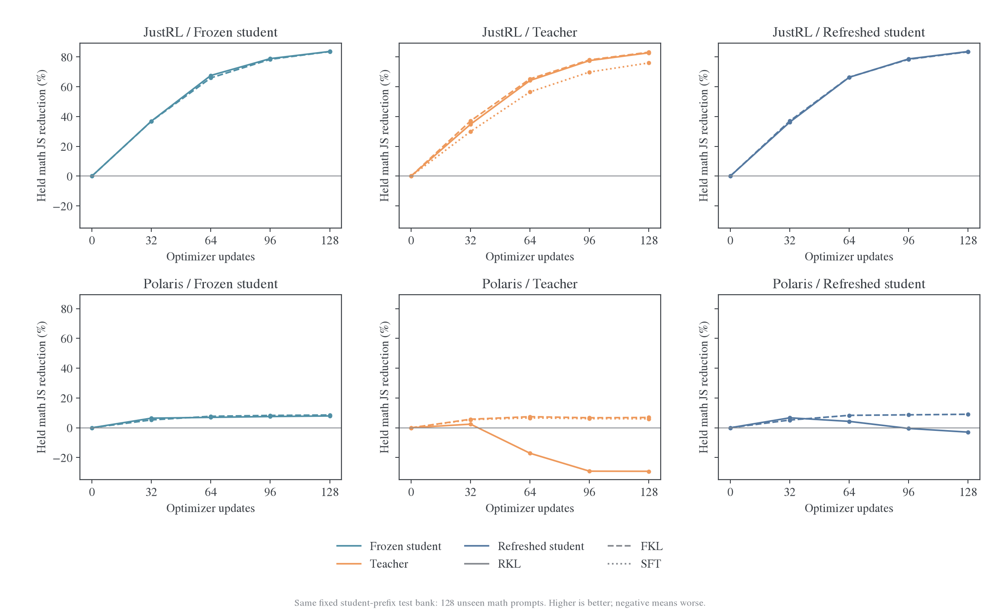
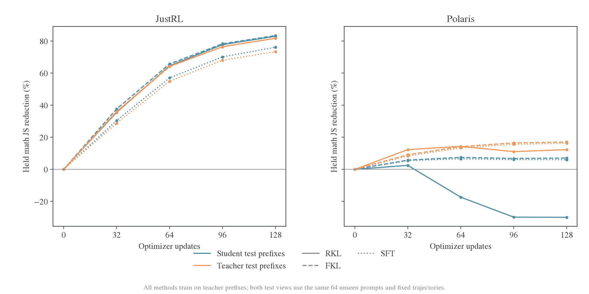
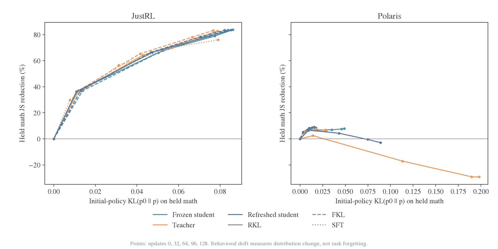
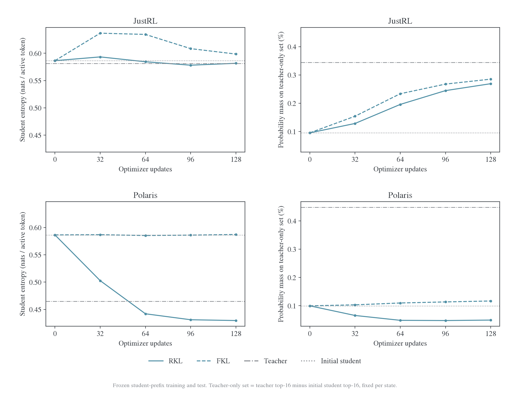
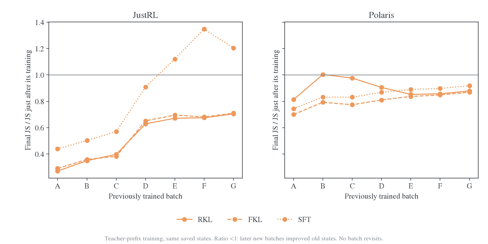
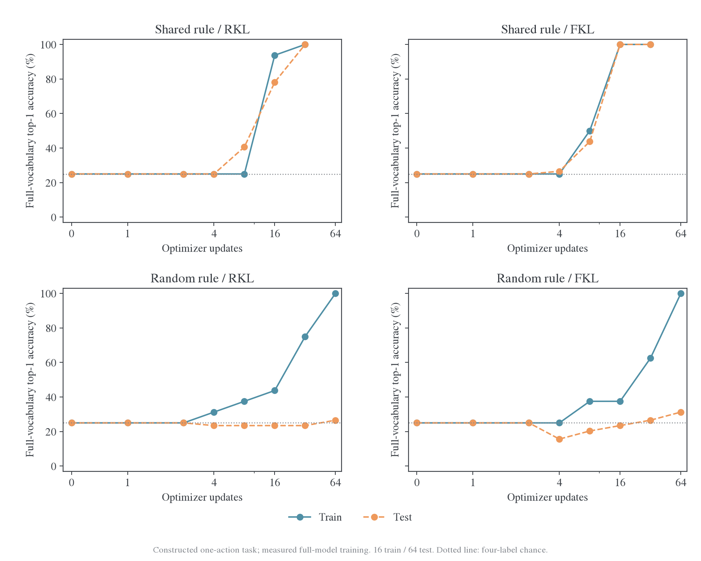
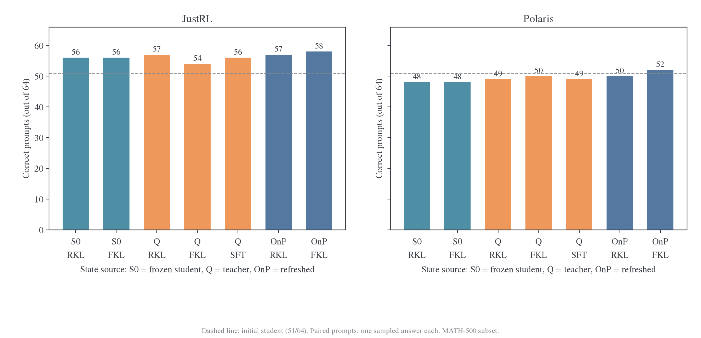
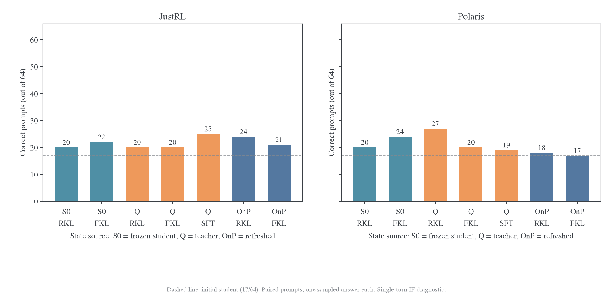
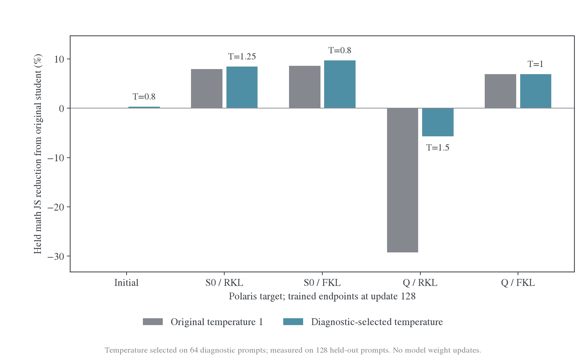
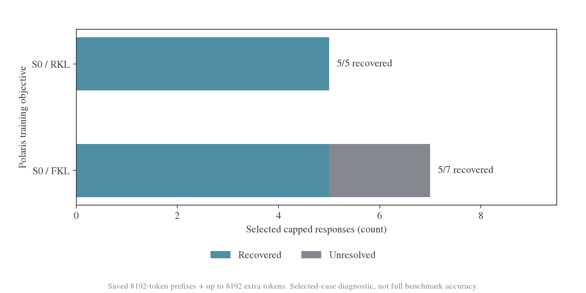

# OPD 能力筛选假说的受控实验

实验数据：`wandb-logs/MirrorOPD-verl/analysis/filter-hypothesis-20261027`。训练权重与 hidden cache：`wandb-logs/derived/MirrorOPD-verl/filter-hypothesis-20261027`。两条路径均相对源码仓库的父目录。

状态：18 个训练分支、5 组温度诊断、17 组 IF 评估及 2 组截断续写全部完成，共 1984 次参数更新。202 项数据与目标核验通过。所有 GPU 实验仅使用本机 H800 GPU 0–3。

已完成实验否定了“只有可迁移信息才能被 RKL/OPD 学入”的严格版本：RKL 能迅速记住随机映射而不泛化。同源教师在固定参考分布拟合中的优势也同时出现在 FKL 和前缀 SFT 中；这个分布获取缺口不能仅归于 OPD 的特殊筛选机制。概率收窄可以解释部分指标反弹，但校准不能补足同源与异源之间的大部分分布获取差距。真实任务表现另行判断，不能用 KL 或 JS 降幅直接代替。

## 1. 要验证的判断

用户提出的机制是：OPD 更容易迁移且更少遗忘，因此它可能只接收容易迁移的教师能力，过滤掉不容易迁移的信息。这里需要分别验证两个强度不同的判断。

| 判断                                     | 可检验的预测                                                                            | 能推翻该判断的结果                                                                     |
| ---------------------------------------- | --------------------------------------------------------------------------------------- | -------------------------------------------------------------------------------------- |
| 强判断：不可迁移的信息不能被 OPD 学会    | 固定随机映射即使可以降低训练误差，reverse KL 也不能将它记住                             | 在无迁移规律的标签表上，reverse KL 达到高训练准确率，但独立新条目仍接近随机水平        |
| 弱判断：相同学习量下，OPD 更偏好共享信息 | 控制 state 来源、学习量及行为变化后，OPD 对高迁移方向的相对获取更多，并且保留旧任务能力 | 偏好只出现在更小的学习量下；或 forward KL 在相近教师拟合程度下迁移相当、旧能力保留更好 |

“训练集拟合”与“能力获取”分开报告。固定 state 上的分布接近是前者；独立题目的任务成功率才支持后者。模型远离初始策略也不自动构成灾难性遗忘，必须观察原来会做的题目是否变成不会做。

## 2. SFT、forward KL 与 OPD 的关系

### 2.1 教师采样 SFT 是序列 forward KL 的蒙特卡洛目标

令 $Q(Y\mid x)$ 为教师在相同支持集、终止约定与长度上限下的完整回答分布，$P_\theta(Y\mid x)$ 为学生分布。教师生成的答案用于 SFT 时，期望目标为：

$$
\begin{aligned}
\mathbb E_{Y\sim Q}[-\log P_\theta(Y\mid x)]
&=-\sum_Y Q(Y\mid x)\log P_\theta(Y\mid x)\\
&=\sum_Y Q(Y\mid x)\log\frac{Q(Y\mid x)}{P_\theta(Y\mid x)}
-\sum_Y Q(Y\mid x)\log Q(Y\mid x)\\
&=D_{\mathrm{KL}}(Q\Vert P_\theta)+H(Q).
\end{aligned}
$$

$H(Q)$ 与学生参数无关，因此两者的期望梯度相同。有限条固定答案的 SFT 是这个期望的采样估计。人工答案 SFT 拟合的是实际数据分布，不能直接把它等同于某个未定义的模型教师。

对序列 KL 使用链式法则，令 $s_t=(x,Y_{<t})$，有：

$$
D_{\mathrm{KL}}(Q\Vert P_\theta)
=\mathbb E_{Y\sim Q}\sum_{t\le H}
D_{\mathrm{KL}}\bigl(q(\cdot\mid s_t)\Vert p_\theta(\cdot\mid s_t)\bigr).
$$

EOS 后进入吸收状态并贡献零；$H$ 是统一截断上限。这里外层 state 来自教师。如果把同一个条件 forward KL 放在学生 rollout 上，目标变成学生访问分布上的条件 KL，已经改变了外层 state 权重。因此“我们实现了 forward KL”和“我们实现了教师答案 SFT”需要区分。

### 2.2 OPD 指 state 来源，不能仅由 KL 方向定义

GKD 的 on-policy distillation 使用学生生成的输出进行训练，也讨论了不同分布距离。[^gkd] 因而这里把两个因素独立控制：state 来自冻结初始学生、教师或更新后的当前学生；loss 采用 reverse KL、forward KL 或教师采样 token 的交叉熵。

本机 online 分支每批重新生成一次，随后复用 16 次更新。它与生产 E48 的复用方式一致，但不是每次 optimizer update 都重新采样。训练反传也把已采样 state 视为固定输入，不包含完整访问分布对参数的导数。

### 2.3 reverse KL 的梯度没有直接访问“可迁移性”

在一个固定 state 上，令 $z_v$ 为学生 logit，$p_v=\operatorname{softmax}(z)_v$，教师分布 $q$ 固定。利用 $\partial p_i/\partial z_v=p_i(\mathbf1_{i=v}-p_v)$：

$$
\begin{aligned}
\frac{\partial D_{\mathrm{KL}}(p\Vert q)}{\partial z_v}
&=\sum_i p_i(\mathbf1_{i=v}-p_v)
\left(\log\frac{p_i}{q_i}+1\right)\\
&=p_v\left(\log\frac{p_v}{q_v}-D_{\mathrm{KL}}(p\Vert q)\right),\\
\frac{\partial D_{\mathrm{KL}}(q\Vert p)}{\partial z_v}
&=p_v-q_v.
\end{aligned}
$$

reverse KL 按学生概率加权，forward KL 的目标项按教师概率加权。学生几乎不访问的动作可能得到很小的 reverse KL 纠正信号，但这由概率与参数化决定，不等价于“该动作代表的能力不可迁移”。即使动作层梯度不同，最终能否跨 state 迁移还取决于网络 Jacobian 与更新方向。

对于测试风险 $R_{\mathrm{test}}$ 和实际参数变化 $\Delta\theta$，一阶关系是：

$$
R_{\mathrm{test}}(\theta+\Delta\theta)-R_{\mathrm{test}}(\theta)
\approx \nabla R_{\mathrm{test}}(\theta)^\top\Delta\theta.
$$

只有使用无预条件 SGD 且 $\Delta\theta=-\eta g_{\mathrm{train}}$ 时，才能直接换成 $-\eta g_{\mathrm{test}}^\top g_{\mathrm{train}}$。这里实际使用 AdamW，因此初始梯度余弦只是局部方向线索，不能单独解释全部有限步更新。

## 3. 实验设置

### 3.1 真实教师的 14 个训练分支

学生为 `DeepSeek-R1-Distill-Qwen-1.5B`，同源教师为 `JustRL-DeepSeek-1.5B`，异源教师为 `Polaris-7B-Preview`。所有分支从同一初始学生重新建立 AdamW，更新全部约 17.77 亿学生参数。

“同源/异源”在本文指这两个实际教师。两者同时具有模型尺寸、祖先权重和训练经历的差异；这些对照可以定位当前配对中的问题，不能把全部差距单独因果归于血缘关系。

| 控制因素       | 设置                                                                                         |
| -------------- | -------------------------------------------------------------------------------------------- |
| 教师           | JustRL / Polaris                                                                             |
| 设备与并行     | 本机 H800 GPU 0–3 并行执行独立分支；每分支单卡，B16 为一次 optimizer update 的有效 prompt 数 |
| state 来源     | S0：冻结初始学生；Q：对应教师；OnP：每批更新后的学生重新生成                                 |
| loss           | 三种来源各比较 full-vocab RKL 与 FKL，共 12 组；Q 来源另加 hard-token SFT 两组               |
| 训练题目       | 128 道数学题，A–H 八批，每批 16 题；各批不相交                                               |
| 更新顺序       | 每批连续 16 次更新，随后进入下一批；总计 128 次，不返回已经结束的批次                        |
| 解码           | 温度 1、不截断 top-p/top-k，最多 1024 response token                                         |
| loss 归一化    | 固定除以 $16\times1024$；参考 EOS 后贡献零                                                   |
| 优化器         | AdamW，LR $10^{-6}$，betas=(0.9,0.999)，weight decay=0.01，grad clip=1                       |
| 数值路径       | 学生 FP32 主权重及 head，backbone BF16 autocast；教师 BF16 权重及 FP32 head 投影             |
| 随机性         | 训练 seed 42；S0 与 OnP 解码 seed 为 93000+ 批索引；第一批逐 token 核对相同                  |
| 固定评估       | 更新 0/32/64/96/128，所有保存的固定 prefix 均重新评分                                        |
| 实际训练 state | 每批开始与结束分别评分，以区分批内拟合和跨 state 迁移                                        |
| fresh 评估     | 更新 64/128；32 道新数学题各两个 seed，无约束当前学生 rollout；H1024                         |

教师额外输出行与学生 head 不完全一致。RKL 保留教师原生 softmax；FKL 将教师条件化到学生输出支持集；教师生成也使用该公共支持集。固定 state 上，原生 RKL 与条件化 RKL 只相差 $-\log Z_q(s)$，参数梯度相同。初始 Polaris 数学留出集的额外输出概率质量约 $7.4\times10^{-10}$，不能解释这里的迁移差异。

Q 来源的 SFT 使用生成答案的前 1024 token，是截断前缀 SFT。这些轨迹可能尚未完成推理或输出最终答案，不能把它当作完整解题答案 SFT 的充分比较。

实际冻结的 S0、JustRL、Polaris 三套训练参考，每套 128 条均达到 H1024，未自然结束；因此三套固定来源的训练 response-token 预算相同。这个检查同时强调了前缀 SFT 的边界：它没有使用自然结束的完整教师解题答案。

### 3.2 数据拆分与固定评估

| 用途             |   数量 | 与训练的关系                                                                       |
| ---------------- | -----: | ---------------------------------------------------------------------------------- |
| 数学训练         | 128 题 | A–H；各分支题目和顺序相同                                                          |
| 初始方向诊断     |  64 题 | M01–M04；只用于构造初始梯度迁移分数                                                |
| 独立数学固定留出 | 128 题 | M05–M12；不参与训练或高低组划分                                                    |
| 代码固定留出     |  64 题 | TACO；不参与训练                                                                   |
| IF 固定留出      |  64 题 | 英文 MultiIF 单轮输入；不参与训练                                                  |
| 教师参考数学留出 |  64 题 | M05–M08；与数学固定留出嵌套，用于同题两来源评估                                    |
| 数学功能评估     |  64 题 | 独立 MATH-500 子集，排除既有相关测试题；每模型每题一次生成，H8192                  |
| IF 功能评估      |  64 题 | 上述 IF 留出 prompt，新生成 H4096，使用本地规则 checker；不是官方多轮 MultiIF 分数 |

每教师的固定评估银行共 576 条：S0 训练参考 128、Q 训练参考 128、Q 数学测试参考 64，以及 S0 数学/代码/IF 测试参考 256。题目 ID 与来源共同标识轨迹。跨来源的直接图表只使用两种来源共有的 64 道测试题，避免题目组成差异。

S0 固定参考来自训练前的学生；评估始终沿已保存的 token 前缀做 teacher forcing。后续模型不会重新选择这些前缀。fresh 评估则重新采样，所以它反映分布变化后的实际访问状态。两者回答不同问题，不能互相替代。

训练 S0 参考重新使用 FP32 head / BF16 backbone 的原生采样器生成，以便与 OnP 第一批精确配对。诊断和留出 S0 参考沿用 L 系列的 BF16 模型 `generate` 冻结银行，两种采样实现不宣称逐 token 等价。所有训练分支的固定评分均使用同一原生数值路径，step 0 在各分支之间核对一致；fresh 初始基线也单独用原生采样器生成。

### 3.3 指标与统计口径

固定 state 同时测 RKL、支持集条件化 FKL、JS、TV、熵、top-16 集合交集和交集概率质量。主比较使用 JS，使指标不直接等同于某一训练方向的目标。固定风险先按题目求和并除以统一 H，再对题目平均；下降率为 $1-R_{\mathrm{after}}/R_{\mathrm{before}}$。

条件 JS 在参考 state 上的累计值不是完整回答分布的序列 JS。fresh 评估的条件 RKL 沿当前学生轨迹求和，在共同终止与 H 约定下才对应截断序列 RKL 的蒙特卡洛估计。它既受条件分布变化影响，也受模型访问了哪些 state 影响，因此还要同时看固定银行与实际任务结果。

行为保持同时测 $D_{\mathrm{KL}}(p_0\Vert p_\theta)$、$D_{\mathrm{KL}}(p_\theta\Vert p_0)$ 与 $\operatorname{JS}(p_0,p_\theta)$。功能保持按同一批 prompt 的实际结果，记录“原本正确仍正确”“原本正确变错误”“原本错误变正确”。总准确率不变可能掩盖旧题遗忘和新题获取同时发生。

相同更新预算之外，还绘制 JS 获取量与初始策略距离的轨迹，并在同一 state 来源内对训练 JS 降幅相同的位置作相邻 checkpoint 线性插值。只使用曲线覆盖范围，选择第一次向上穿越，不外推。插值是描述性比较，不是额外训练得到的匹配终点。OnP 的训练 JS 比较采用冻结 S0 参考，不能称作其当时训练 state 的精确拟合量。

这里的训练参考风险包含全部 128 题，早期也包含后续才访问的训练批。因此匹配的是固定训练银行的总体获取量，不能称作已经见过样本的精确拟合程度；不同插值位置的已访问样本数也可能不同。另以各批刚训练完的实际 prefix 风险为基准，测后续新批训练结束时的变化，用来单独检查旧训练批次保留。

置信区间采用配对 prompt bootstrap；fresh 先平均每题两个 seed；迁移分组交互使用八个训练批的 bootstrap。所有真实教师分支只有一个训练 seed，区间不涵盖训练随机性，也不作全体多重比较校正。64 题任务评估适合检验明显退化，少数题的差异需要保留不确定性。

留出银行会被多次用于研究诊断。“独立”指与训练题目不重叠，不表示它是从未查看过的最终封存测试集；特别是温度探针属于观察到初步现象后追加的机制诊断。

### 3.4 初始梯度迁移分组

在训练开始前，对每个训练 prompt 计算固定 S0 轨迹上 full-parameter JS 梯度，再与独立 64 题诊断集的平均梯度比较余弦。每个 16 题训练批内部，分数最高八题为 high，另外八题为 low，以控制训练先后顺序。128 题测试梯度只检验诊断方向的一致性，不用于分组。

JustRL 的诊断/测试平均梯度余弦为 0.983，Polaris 为 0.942。所有训练题的分数都为正，所以这里的 high/low 代表相对方向差异，不能称作“可迁移能力”和“不可迁移能力”。分组还伴随初始 JS、熵与教师质量覆盖差异，属于机制相关性探针。

### 3.5 单动作共享规则与随机映射反例

这个实验消除后续 rollout state 的差异：每个输入只有一个终止动作，因此 RKL 与 FKL 访问相同 prompt-only state。仍更新同一个语言模型的全部参数。

输入为四种无语义前缀 `dax/wug/zup/vem` 与编号组成的标签查询，答案为四个单 token 数字之一。每个前缀用四个编号训练、另 16 个编号测试，共 16/64 条。共享规则按前缀决定标签；随机规则使用预先固定、在每个前缀及拆分内平衡的标签表。随机测试标签不由训练标签确定。

教师目标在每个 state 上固定为：

$$
q(\cdot\mid s)=0.9\,\delta_{y(s)}+0.1\,p_0(\cdot\mid s).
$$

混入初始学生保证 full-vocab 支持，避免因教师零概率使 RKL 无穷。两类规则各比较 RKL/FKL，共四组；所有优化器参数沿用真实模型对照。最多 512 次更新，只在预先指定的 1/2/4/8/16/32/64/128/256/512 步评估。提前结束的条件为训练 16 条全部 full-vocab top-1 正确，且平均正确标签概率至少 0.8；不使用测试结果决定停止。

主要准确率采用整个学生词表 argmax。额外记录限定四个候选数字后的准确率，防止仅在候选集内正确被误报为模型自然输出正确。该实验检验“硬筛选门槛”，不声称随机标签记忆代表数学推理能力。

### 3.6 训练后的单参数温度诊断

观察到 RKL 与 FKL 的学生熵变化不同后，追加固定 state 的输出校准探针。它不更新模型权重，只将已训练学生 logits 除以一个正温度。候选温度固定为 0.6/0.8/1/1.25/1.5/2；在独立 64 题诊断集上选择 JS 最低者，再在 128 题数学留出集评分。候选和选择规则在任何校准读数产生前写入协议。

比较初始学生，以及 Polaris 的 S0-RKL、S0-FKL、Q-RKL、Q-FKL 四个终点。初始学生也单独校准，避免将基座本身可通过温度改善的距离全部记作训练收益。温度 1 的结果必须重现原固定评估。若最优值位于网格边界，会明确标记，不将有限网格称为全局最优。

同时评分 64 道教师 prefix 留出题，仍使用上述诊断集选择的同一个温度，检查校准是否只是把误差从一种 state 转移到另一种。教师 prefix 上的条件 FKL 求和还能估计对应 H1024 教师分布下的序列 FKL。

正温度不改变同一 prefix 上的 argmax，但会改变采样概率。这个探针衡量固定分布距离中可由整体置信度解释的部分，不能直接证明完整回答更正确。数学与 IF 功能评估继续使用未经校准的原模型。

### 3.7 截断错误的继续生成诊断

数学评估发现，Polaris S0-RKL/S0-FKL 的 5/7 道“初始学生正确、终点错误”题目全部达到 8192-token 上限。为区分预算内失败和答案遗忘，对这 12 个模型—回答组合保留完整原始 token 前缀，从终点 checkpoint 重新 prefill，最多再生成 8192 token。

题目 ID、额外上限与后缀 seed 在继续生成前保存到协议。后缀使用新的固定 RNG，不宣称重放未保存的原解码 RNG 状态；输入没有加入标准答案或纠错反馈。报告条件恢复数，不能将选择过的失败子集冒充统一 16384-token 预算下的完整准确率。即使续写恢复，原先 8192-token 预算下的失败仍是真实的预算内表现。

## 4. 结果

### 4.1 教师之间的迁移差距在多个目标下都存在

以下为已完成 128 次更新的十四个分支，统一在 S0 数学留出 128 题上评估。下降率为负表示该距离增大；最后一列是相对初始学生的行为距离，不是任务遗忘率。

| 教师    | 训练来源与目标 | JS 下降 | RKL 下降 | FKL 下降 | 初始策略 FKL 距离 |
| ------- | -------------- | ------: | -------: | -------: | ----------------: |
| JustRL  | S0-RKL         |  83.71% |   85.06% |   85.35% |           0.08616 |
| JustRL  | S0-FKL         |  83.61% |   84.53% |   85.62% |           0.08388 |
| JustRL  | Q-RKL          |  82.82% |   84.34% |   84.37% |           0.07867 |
| JustRL  | Q-FKL          |  83.22% |   84.35% |   85.07% |           0.07677 |
| JustRL  | Q-SFT          |  76.03% |   77.69% |   78.28% |           0.07903 |
| JustRL  | OnP-RKL        |  83.68% |   85.11% |   85.25% |           0.08530 |
| JustRL  | OnP-FKL        |  83.47% |   84.47% |   85.41% |           0.08221 |
| Polaris | S0-RKL         |   7.93% |   23.51% |  −12.20% |           0.04890 |
| Polaris | S0-FKL         |   8.57% |    6.65% |   11.02% |           0.01765 |
| Polaris | Q-RKL          | −29.23% |    6.36% | −122.78% |           0.19794 |
| Polaris | Q-FKL          |   6.90% |   17.06% |   −4.63% |           0.02826 |
| Polaris | Q-SFT          |   6.00% |   16.46% |   −6.18% |           0.02901 |
| Polaris | OnP-RKL        |  −2.93% |   19.95% |  −42.60% |           0.08893 |
| Polaris | OnP-FKL        |   9.05% |    8.05% |   10.79% |           0.01560 |

同源教师的优势并不专属于 RKL：FKL 具有相近的跨题迁移，SFT 也有明显迁移。异源教师在 FKL 和 SFT 下依然存在很大的获取缺口。把全部差异解释为“OPD 主动拒绝不可迁移能力”，不能覆盖这些观察。

每批刷新学生 rollout 也没有自动消除缺口。JustRL 的 OnP-RKL/FKL 都有约 83% 的固定留出 JS 改善，Polaris OnP-RKL 则出现 JS 回升。它在固定留出 state 上的学生熵降到约 0.362，OnP-FKL 为 0.581；更新访问分布与 KL 方向之间存在明显相互作用，不能把“使用学生 rollout”直接等同于良好迁移。

跨领域固定 state 具有相同趋势。JustRL 的 S0-RKL/S0-FKL 在代码上的 JS 分别下降 79.78%/79.48%，在 IF 上下降 42.68%/42.00%；Q-SFT 也分别下降 73.02%/35.71%。Polaris 的 S0-RKL/S0-FKL 在代码上分别下降 8.11%/8.45%，IF 上下降 2.10%/1.79%；Q-SFT 为 5.35%/0.26%。这些是教师分布获取量，不是代码或 IF 的任务准确率。

位置分解也不支持把改善仅归为开头格式。JustRL S0-RKL 在数学留出前 256、256–512、512–1024 位置的 JS 分别下降 84.31%/85.17%/82.75%；Polaris 为 5.56%/7.77%/9.10%，后段改善没有消失，但整体幅度小得多。Polaris Q-RKL 在这三段分别恶化 24.14%/28.80%/31.78%。位置不是语义能力标签，这些结果也不覆盖 1024 token 之后的 state。



### 4.2 同一批题目的两种 prefix 视角给出不同方向

下面只比较共有的 64 道留出题，训练全部采用 Q 来源。两列评估的 prompt 完全相同，只有已保存的 response prefix 不同。

| Polaris 训练目标 |       S0 prefix 的 JS 下降 |     Q prefix 的 JS 下降 |
| ---------------- | -------------------------: | ----------------------: |
| RKL              | −29.89% [−33.91%, −26.18%] |  12.31% [9.93%, 14.63%] |
| FKL              |       7.05% [5.92%, 8.18%] | 17.06% [15.99%, 18.18%] |
| SFT              |       6.03% [4.87%, 7.19%] | 16.30% [15.26%, 17.37%] |

区间为配对题目 bootstrap。JustRL 的 Q-RKL 在这两种 prefix 上分别下降约 83.04% 和 81.74%。异源 Q-RKL 的局部改善没有一致地扩散到同题的学生 prefix；即使其学生 prefix 上 RKL 仍下降，JS 和 FKL 也可能变差。



把两种访问分布都限制到相同的 M05/M06 共 32 道留出题后，还可以估计 H1024 下两个方向的序列距离：学生当前自由生成各两条轨迹估计 RKL，固定教师轨迹各一条估计 FKL。下面的下降率各自相对初始学生，均不使用 token 平均替代序列求和。

| Polaris 训练分支 | 当前学生访问分布的序列 RKL 下降 | 教师访问分布的序列 FKL 下降 |
| ---------------- | ------------------------------: | --------------------------: |
| OnP-RKL          |                          21.09% |                      −5.36% |
| OnP-FKL          |                           5.64% |                       4.26% |
| Q-RKL            |                          14.32% |                     −41.39% |
| Q-FKL            |                          13.31% |                      10.35% |
| Q-SFT            |                          12.60% |                       9.16% |

JustRL OnP-RKL 的两个方向分别下降 84.28%/82.49%，OnP-FKL 为 83.35%/82.39%。Polaris 的单向距离可以在另一个方向恶化时继续下降；这支持“访问分布和概率覆盖存在选择性”，但没有告诉我们被排除的是错误答案、不同表达，还是有用的能力。该判断还需要任务指标。

### 4.3 相同获取量下，RKL 没有自动带来更小的行为变化

在 Polaris 的 S0 训练参考上，插值到训练 JS 恰下降 20% 时，RKL 与 FKL 的独立数学 JS 分别下降 7.28% 与 7.93%，初始策略 FKL 距离分别为 0.04098 与 0.01362。两者的插值区间都是 64–96 步。这里 FKL 的行为变化约为 RKL 的三分之一，迁移改善并没有更小。

同样比较 Q 训练参考下降 20% 的位置，Q-RKL/Q-FKL/Q-SFT 在学生数学留出 state 上的 JS 变化分别为 −12.24%/+6.99%/+6.59%，对应行为距离为 0.08855/0.01401/0.01721。这是相邻 checkpoint 的描述性插值，不能当作三个额外训练终点或任务准确率比较。

JustRL 的 Q 来源训练参考下降 50% 时，RKL/FKL/SFT 的数学留出 JS 分别下降 45.02%/46.84%/48.73%，行为距离为 0.02185/0.02218/0.02437。SFT 在这个匹配位置也没有表现出明显较差的跨题迁移；固定更新数下较慢的拟合，不能直接归因为更强的记忆倾向。



### 4.4 概率收窄与语义上的能力筛选需要分开

在 Polaris 的 S0 数学留出 state 上，初始学生熵为 0.58644，教师熵为 0.46465。训练后的变化如下。教师专有集合在每个 state 上固定定义为 $\operatorname{Top16}(q)\setminus\operatorname{Top16}(p_0)$，不随训练中的学生集合变化。

| 训练来源与目标 |  学生熵 | 学生在教师专有集合上的质量 | 当前 top-16 集合交集占比 | 学生在当前交集上的质量 |
| -------------- | ------: | -------------------------: | -----------------------: | ---------------------: |
| 初始学生       | 0.58644 |                    0.0998% |                        — |                      — |
| S0-RKL         | 0.42962 |                    0.0494% |                   72.27% |                 99.46% |
| S0-FKL         | 0.58720 |                    0.1169% |                   71.41% |                 98.81% |
| Q-RKL          | 0.27882 |                    0.0120% |                   66.52% |                 99.75% |
| Q-FKL          | 0.46654 |                    0.0553% |                   71.28% |                 99.28% |
| Q-SFT          | 0.46363 |                    0.0539% |                   71.18% |                 99.29% |

教师在固定专有集合上的质量为 0.4475%。RKL 把更多学生质量集中到已有共同候选上，可能同时降低 reverse KL、减少教师专有候选质量，并增大 forward KL。集合交集占比对每个入选 token 等权，交集概率质量则按学生概率加权，所以后者接近 100% 不意味着集合接近一致。

甚至剩余误差主要也在共同候选内部。令 $I$ 为当前师生 top-16 交集，逐坐标 JS 项满足 $\operatorname{JS}_v\le (p_v+q_v)\log 2/2$，因此：

$$
\operatorname{JS}_{I^c}
\le\frac{\log2}{2}\left(P(I^c)+Q(I^c)\right),\qquad
\operatorname{JS}_I\ge\operatorname{JS}-\frac{\log2}{2}\left(P(I^c)+Q(I^c)\right).
$$

对保存的 state 求和得到严格的理论下界，而不是测量了精确的坐标分解：Polaris S0-RKL/S0-FKL 剩余 JS 中至少 86.52%/79.56% 来自交集内部，Q-RKL 至少 91.89%，OnP-RKL 至少 89.32%。这也限制了对“教师专有 token 被过滤”的解释：主要残差是共同候选之间的概率分配，不能把候选集合是否重叠直接当作语义能力是否可迁移。

Q-RKL 的学生熵低于教师，且这种收窄出现在未用于训练的学生 prefix 上。这里可以确定分布发生了明显收窄；它对迁移缺口的解释比例由追加温度诊断检验，不直接把熵变化当作因果结论。

换成教师 prefix 也改变了目标本身的置信度。Polaris 在初始 S0/Q 训练参考上的教师熵分别为 0.47392/0.24037，初始学生在这两套参考上的熵为 0.60688/0.49536。教师在自身轨迹上的条件目标更尖锐，不能把来源切换仅理解为换了同等难度的样本。



### 4.5 初始迁移分组只提供有限的相关性证据

在固定 S0 训练的 RKL/FKL 对照中，定义交互量为“RKL 的 high−low JS 获取差”减去“FKL 的 high−low 获取差”。128 步时，JustRL 为 +0.069 个百分点，八批 bootstrap 区间为 [−0.212, +0.433]；Polaris 为 +0.959 个百分点，区间为 [+0.296, +1.628]。

Polaris 的小幅正交互与弱筛选偏好相容，但分组并非随机干预。它的初始梯度余弦与学生熵、初始 JS、教师在初始学生 top-16 外的质量分别相关约 0.641、0.467、0.433；所有余弦也都是正值。该结果不能独立证明模型在识别哪些语义能力能够泛化。

### 4.6 异源迁移弱不等于旧训练批次普遍被遗忘

对固定来源的每个分支，记录 A–G 各批刚完成 16 次更新后的风险，再与第 128 步在同一批、同一保存 prefix 上的风险比较。H 后没有新训练批，因此不计入。表中的总体比值是七批末态 JS 之和除以七批各自刚学完时的 JS 之和。

| 教师    | 来源与目标 | 后续训练后的 JS / 刚学完的 JS | JS 回升批数 | 本分支实际训练目标回升批数 |
| ------- | ---------- | ----------------------------: | ----------: | -------------------------: |
| JustRL  | S0-RKL     |                         0.406 |         0/7 |                        0/7 |
| JustRL  | S0-FKL     |                         0.419 |         0/7 |                        0/7 |
| JustRL  | Q-RKL      |                         0.422 |         0/7 |                        0/7 |
| JustRL  | Q-FKL      |                         0.431 |         0/7 |                        0/7 |
| JustRL  | Q-SFT      |                         0.750 |         3/7 |                        0/7 |
| Polaris | S0-RKL     |                         0.879 |         0/7 |                        0/7 |
| Polaris | S0-FKL     |                         0.863 |         0/7 |                        0/7 |
| Polaris | Q-RKL      |                         0.896 |         1/7 |                        0/7 |
| Polaris | Q-FKL      |                         0.800 |         0/7 |                        0/7 |
| Polaris | Q-SFT      |                         0.851 |         0/7 |                        0/7 |

这里实际目标分别是 RKL、FKL 或保存教师答案的 token NLL。JustRL SFT 的三批 JS 回升并不对应 hard-token NLL 回升；其训练过的答案在后续训练中仍被拟合得更好。因此不能把这三批直接称为答案遗忘。Polaris 对旧训练批次的改善继续存在，幅度较小；当前证据更接近“新 state 上获取不足”，而非“已经学过的每批都被后面的批次冲掉”。



这个比较只覆盖固定来源。OnP 历史实际 prefix 与冻结 S0 银行不同，没有用 S0 银行冒充其旧训练 state。它也不代表原学生的数学或 IF 能力保持，后者使用独立功能评估。

### 4.7 RKL 可以记住不可迁移的随机映射

随机映射 RKL 在 64 次更新达到预定停止条件：训练 16 条的 full-vocab top-1 准确率为 100%，平均正确标签概率为 95.19%；独立测试为 17/64，即 26.56%，接近四个标签的 25% 随机水平。初始训练和测试准确率均为 25%。

这个任务只有一个终止动作，RKL 与 FKL 访问相同 prompt-only state，训练未使用测试标签。模型明确获取了训练条目的任意对应关系，却没有得到新条目上的可迁移规则。因此“reverse KL/OPD 只允许可泛化信息被学入”的严格命题存在实测反例。它不排除特定复杂任务、有限训练预算下的弱选择偏好，也不把随机标签记忆称为数学推理能力。

完整四组结果如下，停止步数由预定训练准确率与置信度条件决定。

| 教师映射 | 目标 | 停止步数 | 训练 full-vocab top-1 | 测试 full-vocab top-1 | 训练正确标签平均概率 |
| -------- | ---- | -------: | --------------------: | --------------------: | -------------------: |
| 共享规则 | RKL  |       32 |                 16/16 |                 64/64 |               93.70% |
| 共享规则 | FKL  |       32 |                 16/16 |                 64/64 |               93.72% |
| 随机映射 | RKL  |       64 |                 16/16 |                 17/64 |               95.19% |
| 随机映射 | FKL  |       64 |                 16/16 |                 20/64 |               90.48% |

两种目标都先学会共享规则，也都能记忆随机映射。在这组单动作控制与检查点粒度下，没有观察到 RKL 特有的“不可泛化信息学不进去”现象。随机测试集只有一个固定标签表，17 与 20 的差别不作为 FKL 具有额外迁移能力的证据。

停止步数也不代表准确率首次达到 100% 的步数：共享规则 FKL 在第 16 步已达到训练 16/16、测试 64/64，只是平均训练标签概率为 60.82%，未达到 0.8 停止阈值。RKL 在同一步为训练 15/16、测试 50/64，平均训练标签概率 65.68%。这组早期曲线没有显示 RKL 更早获取可共享规律。



### 4.8 数学任务表现与截断

初始学生在独立 64 道 MATH-500 题上正确 51 道，JustRL/Polaris 教师分别为 57/56 道。所有模型每题只生成一次，T=1、H8192。表中“损失”指初始学生正确、终点错误；“新增”指初始学生错误、终点正确；它们描述这组配对采样结果，不直接等同于永久失去或获得了某项能力。

| 教师    | 分支    | 正确数 | 损失／新增 | 达到长度上限 |
| ------- | ------- | -----: | ---------: | -----------: |
| JustRL  | S0-RKL  |     56 |      2 / 7 |            5 |
| JustRL  | S0-FKL  |     56 |      3 / 8 |            8 |
| JustRL  | Q-RKL   |     57 |      0 / 6 |            6 |
| JustRL  | Q-FKL   |     54 |      2 / 5 |            8 |
| JustRL  | Q-SFT   |     56 |      2 / 7 |            5 |
| JustRL  | OnP-RKL |     57 |      0 / 6 |            5 |
| JustRL  | OnP-FKL |     58 |      2 / 9 |            4 |
| Polaris | S0-RKL  |     48 |      5 / 2 |           17 |
| Polaris | S0-FKL  |     48 |      7 / 4 |           19 |
| Polaris | Q-RKL   |     49 |      4 / 2 |           12 |
| Polaris | Q-FKL   |     50 |      5 / 4 |           12 |
| Polaris | Q-SFT   |     49 |      4 / 2 |           12 |
| Polaris | OnP-RKL |     50 |      6 / 5 |           13 |
| Polaris | OnP-FKL |     52 |      3 / 4 |           14 |

初始学生有 13 条回答达到上限。Polaris S0-RKL 的五条损失、S0-FKL 的七条损失全部同时达到上限。OnP-RKL/FKL 分别有五条／两条损失达到上限。预算内表现是真实观察，但仅凭这些错误不能区分答案遗忘、推理变长与采样变化；继续生成诊断单独处理这一点。

所有 Polaris 分支相对初始学生的正确率差异，其配对题目 bootstrap 区间均覆盖零。例如 OnP-RKL 为 −1/64，区间 [−10.94, +9.38] 个百分点；OnP-FKL 为 +1/64，区间 [−6.25, +9.38] 个百分点。不能把 50 与 52 的差别作为 FKL 已获得更强数学能力的确定证据。



### 4.9 IF 功能保持

初始学生、JustRL 教师、Polaris 教师的单轮严格正确数分别为 17/64、24/64、34/64；这里不是官方多轮 MultiIF 分数。所有学生终点只训练数学。下面分别报告严格通过数、严格通过且自然结束的数量，以及相对初始学生的正确题变化。

| 教师    | 分支    | 严格通过 | 严格通过且自然结束 | 损失／新增 |
| ------- | ------- | -------: | -----------------: | ---------: |
| JustRL  | S0-RKL  |       20 |                 19 |      6 / 9 |
| JustRL  | S0-FKL  |       22 |                 22 |     5 / 10 |
| JustRL  | Q-RKL   |       20 |                 20 |     8 / 11 |
| JustRL  | Q-FKL   |       20 |                 20 |     7 / 10 |
| JustRL  | Q-SFT   |       25 |                 25 |     4 / 12 |
| JustRL  | OnP-RKL |       24 |                 24 |     4 / 11 |
| JustRL  | OnP-FKL |       21 |                 20 |     7 / 11 |
| Polaris | S0-RKL  |       20 |                 20 |     7 / 10 |
| Polaris | S0-FKL  |       24 |                 24 |     3 / 10 |
| Polaris | Q-RKL   |       27 |                 27 |     3 / 13 |
| Polaris | Q-FKL   |       20 |                 20 |     7 / 10 |
| Polaris | Q-SFT   |       19 |                 19 |      3 / 5 |
| Polaris | OnP-RKL |       18 |                 17 |      5 / 6 |
| Polaris | OnP-FKL |       17 |                 17 |      8 / 8 |

这里出现了分布指标与功能指标的明确分歧。Polaris Q-RKL 的 IF 固定 state JS 恶化约 1.28%，严格通过数却从 17 增到 27；相对初始学生的正确率变化为 +15.63 个百分点，配对题目 bootstrap 区间为 [+4.69, +26.56]。这仍是单训练 seed、未经多重比较校正的诊断结果，但已经不支持把“固定分布拟合迁移弱”直接写成“任务能力无法迁移”。功能改善还可能包含输出策略、格式和采样变化，不能据此定位新内部特征。

总分也不等同于旧能力保持。Polaris OnP-FKL 的总分仍是 17，但原有正确题中有八题变错，同时八道原有错误题变对。JustRL Q-SFT 与 OnP-RKL 则分别为 25/24，损失数同为四题。两教师的 OnP-RKL 与 Q-SFT 之差都是 −1/64，对应配对区间都覆盖零；这里没有得到“OPD 普遍比前缀 SFT 更少遗忘、更好迁移”的证据。

这些正确→错误集合来自每题一次采样，不能直接命名为永久丢失的知识。更强的能力保留结论需要预先冻结稳定正确题，并增加每题重复采样。



### 4.10 单参数校准解释了部分反弹，不能补足获取缺口

温度只由独立 64 道诊断题选择；表中 S0 JS 在 128 道留出题上评分，Q 序列 FKL 在 64 条教师测试轨迹上求和并按题目平均。后者的题目范围与前文 32 题配对表不同。所有温度 1 评分均重现原始终点，JS/H 最大差异低于 $4\times10^{-10}$。

| 模型           | 所选温度 | 原 S0 JS 下降 | 校准后 S0 JS 下降 | Q 序列 FKL：原值 → 校准值 |
| -------------- | -------: | ------------: | ----------------: | ------------------------: |
| 初始学生       |      0.8 |         0.00% |             0.30% |           167.00 → 163.09 |
| Polaris S0-RKL |     1.25 |         7.93% |             8.44% |           160.34 → 160.88 |
| Polaris S0-FKL |      0.8 |         8.57% |             9.68% |           161.93 → 155.37 |
| Polaris Q-RKL  |      1.5 |       −29.23% |            −5.70% |           233.01 → 169.79 |
| Polaris Q-FKL  |      1.0 |         6.90% |             6.90% |           149.26 → 149.26 |

Q-RKL 相对初始学生增加的 S0 JS 风险，从 0.01009 降为 0.00197，约 80.5% 的额外反弹被消除；Q 序列 FKL 相对初始学生增加的部分约消除 95.8%。这两个比例都针对该分支的额外恶化，不能读作“解释了 80% 或 96% 的整个同源／异源迁移差距”。校准后 Q-RKL 的这两个风险仍高于初始学生，其他 Polaris 分支也没有获得接近 JustRL 的固定风险降幅。

温度也会在不同 state 视角之间交换误差。例如 S0-RKL 校准后 S0 JS 略降，但 Q prefix 的 JS 从 0.03435 上升到 0.03883；其 S0 JS 改善区间也覆盖零。一个全局温度不能统一修复所有条件分布，更不能据此推断解题能力提升。原模型的任务评估全部保持 T=1。



### 4.11 截断回答的条件恢复

结果只统计预先确定的 5/7 个截断失败，不重新选择题目，也不将续写结果混入主表的 8192-token 准确率。

| 分支           | 被选择的截断失败 | 续写后恢复正确 | 自然结束 | 仍达到新上限 | 平均新增 token |
| -------------- | ---------------: | -------------: | -------: | -----------: | -------------: |
| Polaris S0-RKL |                5 |              5 |        5 |            0 |         3918.6 |
| Polaris S0-FKL |                7 |              5 |        5 |            2 |         4948.0 |

十条恢复的回答都自然结束；两条尚未恢复的 FKL 回答继续达到总计 16384 response token 的上限。权重与原 8192-token 前缀均未改变，没有加入标准答案或纠错信息。这十个案例表明，原先正确→错误的观察至少包含生成预算问题，不能直接解释为知识丢失；剩余两条也不能据此判为永久遗忘。

这个诊断使用了事后挑选的截断错误，并增加了计算预算，所以它不证明原模型在相同成本下表现相同，也不能外推为完整测试集在 16384 token 下的准确率。它回答的是“这些原本被计为遗忘的失败，在保持已有回答前缀和权重时是否仍可恢复”。



## 5. 解释时需要保留的边界

“SFT Memorizes, RL Generalizes”研究的是指定任务设置中的结果奖励 RL 与 SFT，不能直接推成所有 OPD 比 SFT 更少遗忘的定理。[^sft-rl] 关于 reasoning SFT 的后续研究也指出，基座能力、训练数据和优化阶段会改变泛化表现。[^rethinking] 这里必须以真实教师及受控随机任务的实测结果判断假说。

这个设计可以拆开 KL 方向、state 来源、局部获取和任务保持，但尚不能把完整“能力”定位到某个特征或表示子空间。即使弱筛选指标为正，还需要跨训练 seed、更多功能题与匹配获取程度的重复实验，才能把相关性推进为稳定机制。

## 6. 后续方向与优先级

现阶段不把 RKL/FKL 的差别作为主要研究方向，也不继续扩大能力筛选的机制矩阵。既有对照保留为结果和解释依据；局部差异不被改写为两种目标完全等价。

### 6.1 直接 SFT Teacher Rollout 的拟合实验

后续重点是让 teacher 生成回答，再直接对这些回答做监督微调，观察 student 能否拟合 teacher rollout，以及拟合能否转化为独立题目的 acc 改善。该实验尚未开展，具体数据、长度、预算和验证设置在执行前单独确定。

已有 Q-SFT 只覆盖 H1024 下的教师前缀，不能作为完整 teacher rollout SFT 已经完成的证据。新实验保留实际回答及结束原因，区分完整回答和截断前缀；分别看训练答案拟合、独立题目表现和实际生成长度。步数按拟合进展与待回答的问题确定，不为填满旧对照表而统一增加训练。

### 6.2 保留的低优先级机制候选

以下设计作为后续备选保留，目前不安排进一步 RKL/FKL 优劣扫描或弱筛选机制实验。

若目标是检验“弱筛选偏好”，优先使用同一个教师同时输出共享规律和不可泛化细节，而非继续把初始梯度余弦当作能力标签。可将单动作任务扩成两个带标签的输出字段：一个由前缀规则决定，另一个由独立随机表决定；训练、测试条目及两字段标签的边际分布保持配对，教师置信度与学生初始标签概率分层匹配。比较 RKL、soft FKL 和教师采样 SFT，必要时再加入学生／教师 rollout 来源因素。

这个实验的判断量应是“在同等共享规则测试准确率下，记住多少随机训练细节，以及保留多少原有能力”。共享规律与随机细节放在同一批训练中，才能观察两种信号竞争时的选择；当前分开训练的四组只能否定硬门槛，不能给出这种竞争下的因果偏好。停止与匹配规则预先固定，不能根据测试曲线挑 checkpoint。

若目标是改善 Polaris 的实际训练，优先保持教师和数据不变，做目标置信度的因果控制：在 Q 与 S0 来源之间匹配教师目标熵，分别跑 RKL/FKL，并始终回到原始、未改温度的教师上评估。观察在消除过度收窄后，独立 state 获取、双向序列距离和任务成功率是否共同改善。当前 post-hoc 温度实验没有更新权重，不能替代这个训练干预。

进一步解释同源／异源差距，需要增加同尺寸异源教师或可比容量的对照，区分目标函数可实现性与祖先权重／特征兼容性。完整数学能力的判断还应使用完整解题轨迹训练和更大留出集，避免将 H1024 前缀 SFT 外推为一般 SFT。

遗忘评估应预先冻结“初始学生稳定会做”的题目，以独立采样 seed 估计初始与终点的成功概率，报告相同生成预算下的变化，并单列截断。一次采样的正确→错误、旧训练批的 loss 回升、相对初始策略的 KL 距离是三个不同量。扩大实验时，应优先增加这些独立功能观察与训练 seed，而不是继续提高一个集合 overlap 数值。

## 7. 复算入口

研究代码在 [transfer 包](../../../../../research/transfer)，执行目录为源码仓库根目录。数据与 checkpoint 路径分离，分析命令只读取原始实验输出。

```bash
export FILTER_DATA=../wandb-logs/MirrorOPD-verl/analysis/filter-hypothesis-20261027
export FILTER_PY=/root/.local/share/mirroropd/venvs/profile-cu128/bin/python
"$FILTER_PY" -m examples.mirroropd.research.transfer.analyze_filter_study --data "$FILTER_DATA"
"$FILTER_PY" -m examples.mirroropd.research.transfer.analyze_filter_controls --data "$FILTER_DATA"
"$FILTER_PY" -m examples.mirroropd.research.transfer.audit_filter_study --data "$FILTER_DATA"
export FIGURE_VIZ_MPL=/mnt/tidalfs-bdsz01/dataset/llm_dataset/zkn_data/fht_data/dotfiles/.agents/skills/figure-viz/assets/mpl
"$FILTER_PY" -m examples.mirroropd.research.transfer.plot_filter_study \
  --data "$FILTER_DATA" \
  --out examples/mirroropd/docs/experiments/teacher-transfer/transfer-mechanism/capability-filter/figures/filter-hypothesis-20261027
```

`filter_train` 为真实教师训练入口，`filter_synthetic` 为单动作反例入口，`filter_if_eval` 为 IF 生成入口。IF checker 在独立 CPU venv 中运行 `grade_filter_if.py`；它没有改变共享训练环境。dispatcher 队列与每组完整命令保存在实验数据目录。

`filter_calibration` 与 `filter_continue_math` 分别执行冻结权重的温度与续写诊断。完整性结果见 [audit.json](../../../../../../../../wandb-logs/MirrorOPD-verl/analysis/filter-hypothesis-20261027/audit.json)；其中 `pipeline_complete=true`，真实训练更新数为 1984，五类实验的完成数与预定数一致。图的可编辑源为 `plot_filter_study.py`，每幅图同时提供 PNG/PDF/SVG。

### 参考文献

[^gkd]: Agarwal et al. On-Policy Distillation of Language Models: Learning from Self-Generated Mistakes. ICLR 2024. [arXiv:2306.13649](https://arxiv.org/abs/2306.13649v3).

[^sft-rl]: Chu et al. SFT Memorizes, RL Generalizes: A Comparative Study of Foundation Model Post-training. 2025. [arXiv:2501.17161](https://arxiv.org/abs/2501.17161v2).

[^rethinking]: Ren et al. Rethinking Generalization in Reasoning SFT: A Conditional Analysis on Optimization, Data, and Model Capability. COLM 2026. [arXiv:2604.06628](https://arxiv.org/abs/2604.06628v2).
