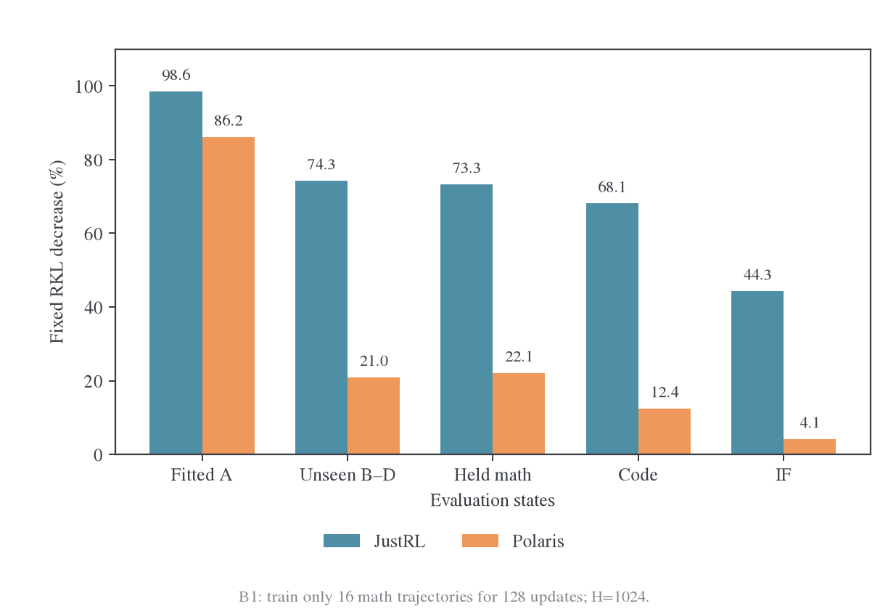
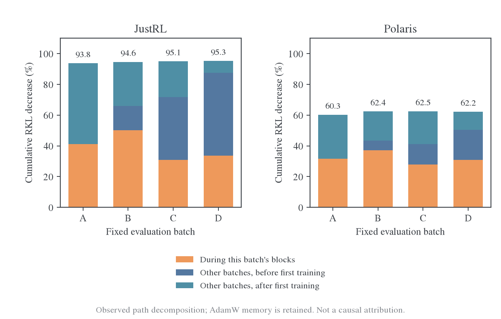
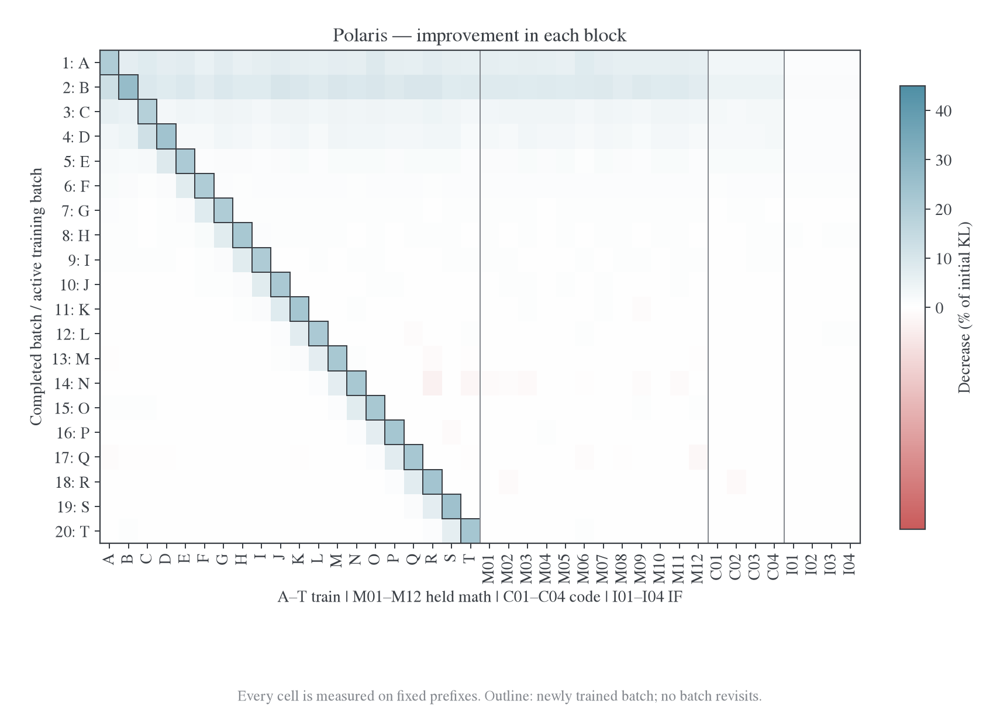
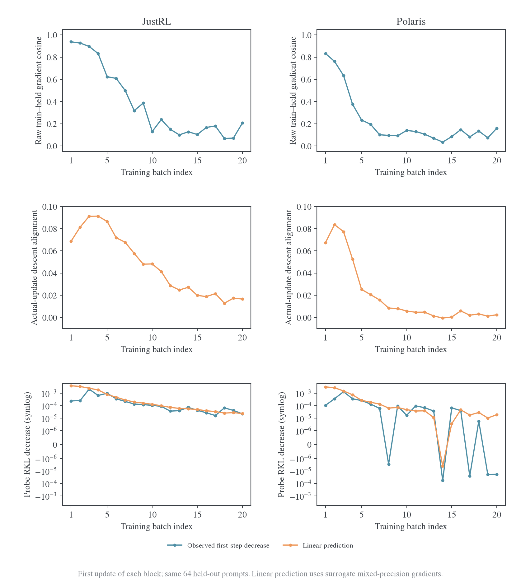

# 跨批次迁移与单遍训练结果

## 1. 背景与 motivation

换批后 loss 回升包含题目和轨迹变化，不能直接解释成遗忘。本研究固定输入并复测旧批、未训练批和独立留出，区分记忆、共享迁移与访问分布反馈；单遍 L 实验进一步检验不回访旧批能否避免后期平台。

## 2. Setting 与实验关系

B1 采用 A/B/C/D 固定数学批与独立留出，比较 blocked、roundrobin、mixed 等调度；L 使用 40 批输入，其中 20 批各训练 16 步，两 teacher 各 320 更新；S/I 提供来源与 fresh 控制。各系列的题目和预算不同，不能合成重复 seed。B/S/I 的完整设置见[统一设置](../2026-10-27-跨源蒸馏泛化研究总览.md#settings)，L 的具体配置如下。

<a id="series-l"></a>

### 2.1 L 设置：40 批输入、20 批只走一遍

| 项目                 | 实际执行                                                                                                                                                                      |
| -------------------- | ----------------------------------------------------------------------------------------------------------------------------------------------------------------------------- |
| 输入银行             | 40 批×16 题=640 题；训练 A–T 为 320 道数学题；永久留出 M01–M12 为 192 道数学，Code01–Code04 为 64 道代码，IF01–IF04 为 64 道 IF                                               |
| 题目与轨迹           | 从 DAPO/TACO/MultiIF 按 seed2026102711 抽取，标准化文本去重并排除旧 S/I/B 研究用题；初始学生预生成共同 H1024 轨迹，T1、不截断采样；训练中不重生成                             |
| 训练                 | 两个 teacher 各从原始学生开始，严格 A→B→…→T；每批一个连续训练区间，区间内 16 次更新，然后永不回访；每 teacher320 次全参数更新                                                 |
| 优化器               | LR1e-6、AdamW(.9,.999)、wd.01、clip1；跨批保留完整 momentum 与二阶矩；固定分母 16H、FP32 学生主权重/head、BF16 backbone                                                       |
| 四卡分工             | GPU0–1 运行 JustRL，GPU2–3 运行 Polaris；每个 teacher 两个数据并行副本，每 rank 处理 8 题并除以全局 16H，梯度 SUM all-reduce 后得到全局平均                                   |
| 固定评估             | 初始加每批结束，共 21 次，每次全部 640 题、全部 response 位置；形成每 teacher 一张 21×40 风险矩阵，包含已训练、未来训练和永久留出批                                           |
| L2 首步诊断          | 每批首步前只读计算 M01–M04 共 64 道留出题的梯度，清空后重新计算当前训练梯度，再做 Adam 更新；记录 raw cosine、实际参数位移投影、相同 64 题的真实一步风险变化                  |
| Fresh 与 L3 交叉评分 | 完成 0/5/10/15/20 批时，无约束学生生成 M01/M02 共 32 题，每题两条；两个 rank 分别用 77101/77102 与 78101/78102。终点再做初始/最终参数×初始/最终 fresh 轨迹的完整 2×2 只读评分 |
| Checkpoint           | 第 1/5/10/15/20 批保存模型、tokenizer、完整 Adam 状态及 RNG；先校验 A 批，再从同一 optimizer 状态续跑 B–T，未重训 A 或重置优化器                                              |

L 的两个分支共 640 次逻辑更新，每 teacher 实际训练访问 5,217,040 个 response token。40 个首步诊断和 8 格交叉评分不产生额外 optimizer 更新。初始 fresh 路径在两个 teacher 下逐条相同；两 rank 的模型参数在保存点逐参数比较完全相同，Adam 的 step 为 16/80/160/240/320。固定 teacher 的 entropy 在全部重复评分中漂移为 0。

这里“只走一遍”是 20 个批次各进入训练一次，并非把原来的批内 16 次更新也改成一次。与 B1 相比保留 batch16、H1024 和 LR，只延长独立批次序列并取消回访；这是更长的优化路径，不是 H7168 的生产重放。留出梯度只用于诊断，不用于样本选择或参数更新；训练配方与顺序没有根据中途结果调整。

<a id="transfer"></a>

## 3. 实验结果：跨批次与单遍训练

旧 B1 的完整预算与其他分支见[总览 B 设置](../2026-10-27-跨源蒸馏泛化研究总览.md#series-b)。本节数值属于已完成的旧实验。

B1 只训练 A 的 16 条数学轨迹 128 次，其他批次不参与梯度。下图是各自初始固定 RKL 的相对下降；B–D 按合并风险计算。



| 固定评估组       |          JustRL RKL 下降 |         Polaris RKL 下降 |
| ---------------- | -----------------------: | -----------------------: |
| 训练 A           |                   98.56% |                   86.18% |
| 未训练 B / C / D | 73.31% / 74.43% / 75.10% | 20.39% / 19.70% / 22.83% |
| 新数学 E–H       |                   73.31% |                   22.13% |
| Code             |                   68.14% |                   12.44% |
| IF               |                   44.31% |                    4.15% |

Polaris 独立数学 KL 为 0.24607→0.19161，训练 A 却能到 0.02891。差距不仅是初始 KL 更高：已见 state 能被大幅拟合，未见 state 的改进比例明显更小。最初 A16 也有正迁移，Polaris 对 B/C/D 下降 6.22%/5.57%/7.55%，JustRL 为 15.68%/16.18%/16.37%，因此“完全不迁移”不符合数据。

S1 的小探针得到同方向结果，但量级不同：J/student 训练前段下降 75.26%、数学/Code/IF 留出下降 5.34%/3.81%/2.36%；P/student 为 69.80%、1.84%/0.56%/0.26%。同轨迹后段仅下降 4.74% 与 2.48%。这些数值来自四题、稀疏位置、16 步，不能与 B1 百分比横向排行，也说明同源迁移并非对任意局部 state 都无损。

下面保留只训练 A 时的完整变化曲线，用来区分“当前批仍在拟合”和“未见批次已经变平”。这张图始终只用 A 训练；后面的多批实验才按 A/B/C/D 依次更新。


<a id="retention"></a>

### 3.1 依次训练 A/B/C/D，同时复测所有批次

这一组是 B1 的 blocked 条件。A–D 各含 16 道不同数学题，每题一条初始学生生成的固定轨迹；E–H 另有 64 道独立数学题，始终不参与梯度。两个 teacher 分别从相同初始学生重新训练，模型参数、Adam 动量和二阶矩在块之间连续保留，只有训练批次改变。

| 完成的更新          | 刚训练的批次  | 下一块训练批次   | 每个边界复测               |
| ------------------- | ------------- | ---------------- | -------------------------- |
| 0                   | 尚未训练      | A                | A–H、Code、IF 全部固定前缀 |
| 16 / 32 / 48 / 64   | A / B / C / D | B / C / D / A    | 同一组 A–H、Code、IF       |
| 80 / 96 / 112 / 128 | A / B / C / D | B / C / D / 结束 | 同一组 A–H、Code、IF       |

每块 16 次 optimizer 更新，每次整个当前批的 16 条轨迹、全部 response 位置参与 loss，固定除以 16H，H=1024。两轮结束时 A–D 每条轨迹访问 32 次。**跨块没有重新生成轨迹**，因此这些图隔离了固定输入下的参数变化，不混入 E48 那样的新学生 rollout 反馈。每 16 步才评估一次，连线连接实际观测点，不代表逐步连续监测。


上排为 A–D，既会被训练，也会在其他批次更新后复测；下排为从未训练的 E–H。每条曲线除以自己 step0 的 KL，避免批次初始难度不同主导相对变化。上方字母和背景区间标明正在优化哪个批次。两种 teacher 使用相同坐标范围。

JustRL 中，A 以外的批次在 A 阶段已经明显改善，后续曲线整体继续下降；Polaris 也有正迁移，但 A–D 在轮到自己时下降更明显，E–H 在后半程越来越平。需要同时看上、下两排：已训练批的保持能力与对真正未见 state 的泛化能力，不是同一个问题。

<a id="batch-matrix"></a>

### 3.2 每个 16 步训练块改善了哪些批次

下面恢复逐块影响热图。每行是某 16 步训练块，每列是一个固定评估批次。格子的数值为该列初始 KL 归一化后的下降百分点：

$$
M_{k,j}=100\,\frac{R_j(\theta_{16(k-1)})-R_j(\theta_{16k})}{R_j(\theta_0)}.
$$

正值表示改善，负值才表示这一块使该组退步。分母始终是 step0，不是上一个块的风险；因此同一列的八行可以相加，得到该列总下降百分比。不同列的初始风险不同，数值相同不表示绝对 KL 下降相同。


读图时可分别检查三类位置：当前训练批对应的格子；还没轮到第一次训练的其他数学批；已经训练过的旧批。E–H、Code 与 IF 则在八行中都不参与训练。最后几行对 E–H 的影响，直接反映新增更新能否继续改善独立 state。

第一块 A16 之后，Polaris 对 B/C/D 下降 6.22%/5.57%/7.55%，JustRL 为 15.68%/16.18%/16.37%。D 第一次被直接训练要到第 49 步：在此之前，JustRL 对 D 已经下降约 53.8%，Polaris 约 19.5%。所以异源 teacher 有向未来批次的迁移，只是更弱。

第二轮差异更鲜明：Polaris 在自己的训练块仍有明显下降，但对 E–H 每块仅贡献约 0.1–1.6 个初始 KL 百分点；JustRL 的改进更广。热图中的每行沿同一训练路径发生，参数和 Adam 状态不断变化，不能当成从同一个 checkpoint 分叉出来的八个独立因果干预。

<a id="batch-values"></a>

### 3.3 每个训练批及独立数学留出的绝对 KL

下面保留全部 16 步边界的原始风险，口径为每题 KL 总和除以 H1024 再取均值。E–H 为 64 道独立数学题的均值；它不属于 A–D 训练池。初始各批风险不同，所以“新批值高于旧批末尾”本身不能判断优化退步。

#### JustRL

| 更新数 | 刚训练 |       A |       B |       C |       D | E–H 留出 |
| -----: | ------ | ------: | ------: | ------: | ------: | -------: |
|      0 | 初始   | 0.11366 | 0.11330 | 0.11510 | 0.11404 |  0.11800 |
|     16 | A      | 0.07933 | 0.09553 | 0.09648 | 0.09538 |  0.09943 |
|     32 | B      | 0.05141 | 0.04750 | 0.06830 | 0.06744 |  0.07121 |
|     48 | C      | 0.03684 | 0.03484 | 0.03884 | 0.05268 |  0.05600 |
|     64 | D      | 0.02401 | 0.02080 | 0.01806 | 0.01842 |  0.03513 |
|     80 | A      | 0.01160 | 0.01724 | 0.01605 | 0.01235 |  0.02727 |
|     96 | B      | 0.00831 | 0.00833 | 0.01332 | 0.01042 |  0.02475 |
|    112 | C      | 0.00779 | 0.00671 | 0.00712 | 0.00955 |  0.02387 |
|    128 | D      | 0.00702 | 0.00607 | 0.00569 | 0.00534 |  0.02231 |

#### Polaris

| 更新数 | 刚训练 |       A |       B |       C |       D | E–H 留出 |
| -----: | ------ | ------: | ------: | ------: | ------: | -------: |
|      0 | 初始   | 0.20915 | 0.22969 | 0.22038 | 0.21654 |  0.24607 |
|     16 | A      | 0.16781 | 0.21540 | 0.20811 | 0.20020 |  0.23027 |
|     32 | B      | 0.14421 | 0.15619 | 0.19105 | 0.18161 |  0.20869 |
|     48 | C      | 0.13261 | 0.14306 | 0.15035 | 0.17432 |  0.19878 |
|     64 | D      | 0.12639 | 0.13349 | 0.12342 | 0.12467 |  0.19073 |
|     80 | A      | 0.10170 | 0.12695 | 0.11592 | 0.10395 |  0.18740 |
|     96 | B      | 0.08787 | 0.10056 | 0.11295 | 0.09970 |  0.18656 |
|    112 | C      | 0.08450 | 0.08886 | 0.09229 | 0.09895 |  0.18622 |
|    128 | D      | 0.08304 | 0.08627 | 0.08257 | 0.08175 |  0.18558 |

<a id="batch-retention"></a>

### 3.4 新批跳高、旧批保持和迁移的区别

以 Polaris 从 A 切到 B 为例：step16 时 A 为 0.16781，B 为 0.21540，看起来有明显跳高；但 B 已从初始 0.22969 下降。训练 B16 之后，旧 A 又从 0.16781 降到 0.14421；继续训练 C/D，A 再降到 0.13261/0.12639。这个例子同时包含“新批比旧批更难”“新批已获得正迁移”“旧批没有被遗忘”。

我们检查每个 16 步块结束时，所有已经训练过、但该块没有直接训练的旧批。JustRL 与 Polaris 各有 18 次这样的检查，**全部继续下降**。这只排除了所观测边界上的旧批退步，不排除区间内波动，也不意味着对从未见过的 E–H 有同样强的迁移。

还可把每列总下降按更新发生的时间分成三部分：直接训练该批期间、尚未第一次训练该批而训练其他批期间、已训练过该批后再训练其他批期间。三部分严格加回该批的总下降。



例如 A 的全部“其他批期间”下降都发生在它已被训练之后；D 则还包含前三个块提供的未见批次收益。JustRL 的 A 在其他批期间累计下降 0.05990，超过 A 自己两块提供的 0.04673；Polaris 对应 0.06008 与 0.06602。两种教师的绝对起点不同，图里统一按各自初始值展示，不能仅用这两个绝对数比较迁移强弱。

这是一种路径记账，不是独立数据的因果贡献：Adam 动量保留了前面批次的信息，“更新 B 期间 A 下降”不能全部归给 B 的新梯度。它仍能直接回答实际训练路径上旧批是否退步；若要进一步识别当前批的信息贡献，需要同参数、同 optimizer 状态分叉，并加入零新梯度但保留动量的控制，见[后续方向](../2026-10-27-跨源蒸馏泛化研究总览.md#next)。

### 3.5 第二轮继续拟合训练池，却几乎不改善 Polaris 的独立批次

第一轮到 step64 时，A–D 每批都已训练 16 次；第二轮到 step128 时，四批各再训练 16 次。固定训练池与独立留出的变化如下，百分比均相对 step64 的风险：

| 教师    | 训练 A–D 均值：64→128 | 训练池下降 | E–H 留出：64→128 | 留出下降 |
| ------- | --------------------- | ---------: | ---------------- | -------: |
| JustRL  | 0.02032→0.00603       |     70.33% | 0.03513→0.02231  |   36.48% |
| Polaris | 0.12699→0.08341       |     34.32% | 0.19073→0.18558  |    2.70% |

Polaris 后半程仍有充分的训练集下降，独立留出的下降却只有 2.70%。这比只看相邻 batch 的 loss 跳变更直接地支持“局部拟合继续、未见 state 收益趋于平台”。新批次梯度并没有全部相消为零，有限更新的收益越来越集中于训练过的 state。

平台也不只来自后段位置。B1-blocked 的独立数学留出，按相同固定前缀的位置分层如下。这里是每个区间的**有效 token 均值**，与整条轨迹固定 H 归一化的主风险分母不同：

| Response 位置 | JustRL：初始→128 步 | Polaris：初始→128 步 |
| ------------- | ------------------- | -------------------- |
| 1–256         | 0.09760→0.01508     | 0.24929→0.19079      |
| 257–512       | 0.12443→0.02166     | 0.26111→0.19441      |
| 513–1024      | 0.12699→0.02668     | 0.24075→0.18145      |

Polaris 三个位置区间都下降，但都保留较大残差。这个结果不排除更长推理阶段的问题；它只说明当前 1K 窗口内的差距不能全归为“后半段没学到”。

<a id="batch-order"></a>

### 3.6 改变批次顺序会改变中途轨迹，但没有修复最终平台

为了检验连续 reuse 是否是充分解释，B1 还比较三种匹配访问量的调度：blocked 每批连续 16 步，roundrobin 每步轮换 A/B/C/D，mixed 每步各取四批中的 4 题并轮换子组。三种方式在每 64 步使用相同轨迹多重集，最终每条访问 32 次，固定 token 权重一致；途中某个 16 步边界的样本分配并不相同。


上排是相同 E–H 留出风险，下排是相对 blocked 的风险差，正值表示比 blocked 更高。JustRL 的中期顺序效应不小：step64 的 roundrobin/mixed 风险比 blocked 高约 20.5%/21.6%，但到 step128 略低约 4.2%/3.9%。因此不能用某一个中途 checkpoint 宣布某种顺序普遍更好。

| 教师    | blocked 最终留出 KL | roundrobin 最终留出 KL | mixed 最终留出 KL |
| ------- | ------------------: | ---------------------: | ----------------: |
| JustRL  |            0.022313 |               0.021372 |          0.021435 |
| Polaris |            0.185583 |               0.185509 |          0.185573 |

Polaris 最终 roundrobin−blocked 差为−0.000074，95% 配对区间[-0.000377,0.000179]；mixed−blocked 区间也包含零。只打乱同一个 64 题池没有明显解除泛化平台；[扩大独立覆盖](../2026-10-27-跨源蒸馏泛化研究总览.md#geometry)带来的收益应与这种重排分开。

I1 提供了另一个较大、但口径不同的检验：在线 64 步、三来源固定面板上，J/student 的数学/Code/IF 风险下降 72.51%/67.32%/39.67%，P/student 为 29.35%/14.36%/7.58%；fresh J 分别 115.20→31.44、232.21→195.41。它支持迁移差距并非 B1 单个固定训练池独有，但不能与 B1 拼成同一学习曲线。跨域结果仍只是 math→Code/IF 的概率迁移，未验证代码执行或指令遵循正确率。

<a id="long-pass"></a>

### 3.7 L：20 个新训练批次走完后，泛化缺口仍然明显

这组扩大实验专门排除“必须循环回访旧批才会出现平台”的解释。两个 teacher 使用完全相同的 640 题银行，只在 A–T 这 20 批数学题上依次训练，剩余 20 批永久不进入优化器。以下均为固定 H1024 归一化的风险。

| 固定银行         | JustRL 初始→最终 | JustRL 下降 | Polaris 初始→最终 | Polaris 下降 |
| ---------------- | ---------------- | ----------: | ----------------- | -----------: |
| 训练 A–T，320 题 | 0.11427→0.00688  |      93.98% | 0.21497→0.09619   |       55.25% |
| 永久数学，192 题 | 0.11463→0.00734  |      93.60% | 0.21888→0.16269   |       25.67% |
| 永久 Code，64 题 | 0.14543→0.01413  |      90.28% | 0.24627→0.20282   |       17.64% |
| 永久 IF，64 题   | 0.09785→0.04743  |      51.53% | 0.79862→0.73586   |        7.86% |

初始训练与数学留出风险很接近：J 为 0.11427/0.11463，P 为 0.21497/0.21888。最终 P 的训练银行已到 0.09619，独立数学仍为 0.16269；J 两者则接近 0.00688/0.00734。后来的差距不能简单归为留出题初始平均风险特别高，尽管一个固定抽样仍不足以代表全部数据分布。


灰线是整个固定 A–T 银行的均值，途中包含尚未轮到训练的批次，并非只平均“已训练集合”。紫线、蓝线、橙线分别始终对应同一 192 题数学、64 题 Code、64 题 IF。P 的训练银行持续下降，独立银行在前几批以后明显放缓；J 的数学和代码改善更广。

### 3.8 一个新批次第一次进入训练之前，已经获得多少迁移

对每批分别记录其初始风险、第一次训练前的风险，以及 16 步后的风险。分母使用该批在原始学生上的风险，避免不同批次难度造成假趋势。


最后一批 T 在前 304 次更新中从未参与梯度。JustRL 对它的 KL 已经从 0.10555 降到 0.00639，即尚未直接训练就下降 93.94%；再训练 16 步到 0.00235。Polaris 对同一批的 KL 从 0.19421 降到 0.14986，前向迁移仅 22.84%；直接训练后到 0.10565。最后 5 批首次训练前的平均相对下降分别为 J 的 92.85%、P 的 26.10%。

这组结果直接区分“当前 batch 能不能下降”和“前面其他 batch 的更新能不能提前改善它”。P 仍然可以拟合新的训练批，但并没有让后面新批次的起点持续大幅降低。这个结论无需通过不同题之间的训练 loss 跳变来推断。

### 3.9 初始及每批结束后的全部 40 批矩阵

每张风险图有 21 行：初始加 20 个训练边界；40 列按 A–T、12 个数学留出、4 个 Code、4 个 IF 排列。颜色是每列相对其初始 KL 的剩余比例，框线标出该行刚训练的批次。右侧 20 列始终未训练，左侧对角线右边是在该行尚未训练的未来批次。两 teacher 共用色标。


J 在对角线右侧、即尚未训练的数学批次上就逐渐变浅；P 的明显下降更集中在已经进入训练的对角线及其左侧。永久留出列的差异与汇总曲线一致，不是单个留出批主导。

逐块影响图进一步展示 $100(R_j(\theta_{b-1})-R_j(\theta_b))/R_j(\theta_0)$。正值为这一块带来的改善，负值是同一固定批次的回升，分母始终为该列的初始值。所有格子均实际评分，不对未来训练批填预测值。




精确数值可逐格查看[JustRL CSV](../../../../../../../../wandb-logs/MirrorOPD-verl/analysis/twenty-batch-pass-20261027/justrl-risk-matrix.csv)和[Polaris CSV](../../../../../../../../wandb-logs/MirrorOPD-verl/analysis/twenty-batch-pass-20261027/polaris-risk-matrix.csv)。图中没有把 190 次相关的旧批检查当作 190 个独立训练重复。

### 3.10 后期每个新批仍明显下降，独立留出获得的收益越来越小

下面按每 5 批划分阶段，阶段内仍全部是新题。“批内下降”是五个当前批各自 16 步相对下降的均值；“留出下降”相对该阶段开始的同一 192 题风险。两者的评估输入不同，不能直接当成同一种成功率。

| Teacher | 阶段     | 数学留出起点→终点 | 本阶段留出下降 | 平均批内下降 |
| ------- | -------- | ----------------- | -------------: | -----------: |
| JustRL  | 1–5 批   | 0.11463→0.02643   |         76.94% |       50.16% |
| JustRL  | 6–10 批  | 0.02643→0.01350   |         48.94% |       60.64% |
| JustRL  | 11–15 批 | 0.01350→0.00928   |         31.26% |       65.52% |
| JustRL  | 16–20 批 | 0.00928→0.00734   |         20.92% |       65.57% |
| Polaris | 1–5 批   | 0.21888→0.17086   |         21.94% |       25.44% |
| Polaris | 6–10 批  | 0.17086→0.16558   |          3.09% |       27.43% |
| Polaris | 11–15 批 | 0.16558→0.16418   |          0.85% |       30.28% |
| Polaris | 16–20 批 | 0.16418→0.16269   |          0.91% |       31.25% |

P 最后 5 批仍使各自训练批平均下降 31.25%，独立数学仅下降 0.91%。它不是严格不下降，也没有证明不可突破的硬下界；这里观察到的是相对于持续的局部拟合，独立收益明显趋于平台。

定义一块的经验迁移比为独立数学平均 KL 下降除以当前训练批平均 KL 下降。它使用同一批前后两次完整评估，不是跨不同 batch 起点的抵消比，也不是概率；可以为负或大于 1。


按阶段累计下降计算，P 的迁移比从前 5 批 0.197 降到后 5 批 0.00584，约下降 34 倍；J 为 0.520→0.07325。P 后期每观察到 1 单位当前批 KL 下降，只对应约 0.0058 单位独立数学风险下降。这个比值是有限银行上的描述，不是通用的因果“泛化百分比”。

### 3.11 本机已经记录实际 Adam 更新，不能再仅凭 raw cosine 解释

每批首步，在固定 M01–M04 共 64 题上计算验证梯度，清空后用当前训练批梯度执行 AdamW。比较 $\cos(g_B,g_H)$、实际位移与验证下降方向的余弦 $-g_H^\top\Delta\theta/(\|g_H\|\|\Delta\theta\|)$，并复测同一 64 题的真实一步风险变化。

| Teacher / 阶段     | raw 训练—验证 cosine 均值 | 实际更新—验证下降方向 cosine 均值 | 验证梯度范数 | 参数步幅 L2 |
| ------------------ | ------------------------: | --------------------------------: | -----------: | ----------: |
| JustRL / 1–5 批    |                    0.8437 |                           0.08381 |       1.0263 |     0.02893 |
| JustRL / 16–20 批  |                    0.1385 |                           0.01746 |       0.1581 |     0.01102 |
| Polaris / 1–5 批   |                    0.5680 |                           0.06127 |       0.8218 |     0.02899 |
| Polaris / 16–20 批 |                    0.1196 |                           0.00298 |       0.3794 |     0.02212 |

后期 raw cosine 的 J/P 均值已经相近（0.138/0.120），所以只看这一项不足以解释明显不同的泛化结果。实际更新的方向一致性则为 0.01746/0.00298；P 仍有较大验证梯度和参数位移，不能简单描述为完全没有更新。



两个限制必须保留。第一，只测了每个新批的**首步**，其中包含上一批的 Adam 历史，不能代表 16 步全部更新，也不能把低投影全部归给当前批的信息。第二，混合精度 autograd 梯度给出的线性预测与真实有限变化并不总一致，初始首步甚至有明显尺度差异；BF16 舍入、曲率与预条件尚未被这项只读诊断分别识别。因此，全块固定风险矩阵是主要结论，投影提供机制线索，不能单独证明优化器或某个 feature 是唯一根因。

### 3.12 更长窗口出现局部回升，但不是 Polaris 平台的主要表象

20 批形成每 teacher190 次“更新新批、复测已训练旧批”的边界检查。以绝对回升超过 1e-6 计，J 为 92 次、P 为 10 次；最大单次回升分别 0.000595 和 0.000202。它们没有经过多重比较校正，也不能用次数对两个 teacher 的整体质量排名。

再把最终风险与每批刚训练结束时比较：J 只有 3/20 批略高，最差也保留了当时局部下降的 98.63%；P 全部 20 批不高于刚训练完的风险。也就是说，P 的局部拟合大多保留着，但向永久未见 state 的收益很弱；J 允许少量局部波动，同时获得明显更低的独立风险。旧 B1 四批窗口的 0/18 检查仍是当时的事实，不能无限外推为所有后续阶段都不会回升。

<a id="historical-fresh"></a>

### 3.13 当前学生的访问分布又损失了一部分参数拟合收益

两种 teacher 的无约束 fresh 评估均为同一 32 题×两个随机流，初始和最终平均长度都是 1024；下面的差异不是由平均长度缩短造成。J 的序列 KL 从 123.46 到 8.75，P 从 230.81 到 191.95，二者相对起点的配对区间都支持净改善，但幅度明显不同。


终点另用同一 teacher-forcing 路径计算参数×state 四格。以下“旧 state 参数收益”为 $L_{00}-L_{10}$，“访问代价”为 $L_{11}-L_{10}$，同一个参照路径下二者相减得到净下降。

| Teacher | 初始参数/初始 state | 初始参数/最终 state | 最终参数/初始 state | 最终参数/最终 state | 参数收益 | 访问代价及 95% 配对区间 |
| ------- | ------------------: | ------------------: | ------------------: | ------------------: | -------: | ----------------------- |
| JustRL  |              123.47 |              112.56 |                8.09 |                8.76 |   115.37 | +0.66 [-0.05, 1.38]     |
| Polaris |              230.77 |              281.25 |              173.17 |              191.92 |    57.59 | +18.75 [6.89, 31.07]    |

P 的访问代价 18.75 nats，区间[6.89,31.07]，约抵消这条分解路径下 32.6% 的参数收益；J 的代价 0.66，区间含零。交叉评分与生成时累计 KL 的对角线均值差最大约 0.048 nats，远小于 P 的访问代价。这里的比例依赖参照顺序，并非唯一因果分解。

所有训练 state 从头到尾固定，因此这并不是“在线训练反馈有害”的直接干预证明；它测到的是最终学生在自己访问的新 state 上风险更高。同时，固定永久留出本身已经趋于平台，故访问分布变化也不能解释全部泛化缺口。

同一 192 题固定数学银行上的其他指标同样需要保留：

| Teacher | RKL 下降 | 共享支持 FKL 变化 | JS 下降 | TV 下降 | 学生 entropy 初始→最终 | 固定 teacher entropy |
| ------- | -------: | ----------------: | ------: | ------: | ---------------------- | -------------------: |
| JustRL  |   93.60% |       下降 93.65% |  92.85% |  76.22% | 0.5975→0.5906          |               0.5921 |
| Polaris |   25.67% |       上升 15.95% |   8.41% |   9.85% | 0.5975→0.4289          |               0.4715 |

Entropy 按有效 token 平均，其余固定风险按 H 归一化。P 的 RKL 下降并未让 FKL 同时改善，学生在固定前缀上还比 teacher 更尖锐。不能把这一组结果称为全面概率对齐；也没有评测完整数学、代码或 IF 任务准确率。

### 3.14 这轮更新了哪些判断

L 直接支持三点：即使每批只进入训练一次，P 的后期独立收益仍明显减弱；当前新批可以继续拟合，并且旧批收益大多保留；最终访问分布还会消耗一部分固定 state 上的参数收益。因此，循环回访旧批、灾难性遗忘或完全没有参数更新，都不是解释这些观测所必需的条件。

更符合当前数据的机制图景是：早期可以吸收跨 state 共有的修正，后期仍有较大残差，但新增更新越来越集中于当前批的条件概率。理想的同架构、同数值实现下，同源 teacher 函数可由学生的一组参数表示；更大异源 teacher 没有同样的可实现性保证。不过，局部可拟合与全局可实现性的差别仍需表示和目标干预来识别，不能由当前平台直接推出容量下界。

它尚未唯一证明缺少特定 feature、模型容量不足或 Adam 预条件是根因。只有一个固定题目顺序与训练 seed，H1024 仍是短回答窗口；本机 HF 混合精度实现不是 E48 的 FSDP2/H7168 重放。后续更值得做的是在同一起点和优化器状态上拆分“新题/同题新轨迹”、固定/刷新的生成器，以及实际更新的预条件与表示响应；不应只继续看当前批 loss 或集合 overlap。

<a id="state-source"></a>

## 4. 实验结果：来源与访问分布

S/I 的完整训练预算、精度与数据关系见[总览 S 设置](../2026-10-27-跨源蒸馏泛化研究总览.md#series-s)和[I 设置](../2026-10-27-跨源蒸馏泛化研究总览.md#series-i)。

S1 将 P 的训练 state 改为 teacher 自生成后，数学留出下降从 1.84% 变为 2.36%，没有消除与 J 的差距。S 的初始探针还发现：同一个初始学生在 P 自己的后段 state 上 KL 为 0.5417，在 S0 后段为 0.1853；对应 overlap@64 为 56.38% 与 68.94%。Teacher 熟悉自己的 state、student 容易拟合该 state、更新能迁移到其他 state，是不同问题。

I1 在同样的 64 道数学留出题上，分开三个参考来源后得到：


P/teacher 训练对 P 参考的 RKL 下降 42.90%，对 S0 参考仅 8.14%；P/student 分别下降 36.18% 和 20.58%。只报告 teacher 来源的 held-out，会高估对学生实际使用分布的改善；这不是 prompt 泄漏，而是评估分布不同。J/student 在三来源上下降 73.30%/71.14%/72.95%，更接近广泛迁移。

S 的初始诊断也保留了领域差异：仅看`</think>`之前的推理 state，初始学生与 J/P 的 KL 及 overlap@64 如下。代码和 IF 各只有 4 题，不能估计总体领域效应，但不支持“领域完全无关”。

| 推理 state 领域 | JustRL KL / overlap@64 | Polaris KL / overlap@64 |
| --------------- | ---------------------- | ----------------------- |
| Math            | 0.094 / 82.97%         | 0.188 / 66.74%          |
| Code            | 0.151 / 84.28%         | 0.272 / 71.17%          |
| IF              | 0.147 / 85.35%         | 1.267 / 54.44%          |

### 4.1 固定前缀上的下降未必完整保留到新访问分布

I3 固定同一批 prompt 和 seed，将旧/新学生参数与旧/新轨迹交叉评分。记 $L_{ij}$ 为参数 $\theta_i$ 在冻结轨迹 $d_j$ 上的平均 KL 总和，以旧 state 作参照：

$$
L_{00}-L_{11}=(L_{00}-L_{10})-(L_{11}-L_{10}).
$$

右侧分别为旧 state 上的参数拟合收益和新访问分布代价；分解顺序改变会改变分量，不是唯一因果比例。

| I1 训练方式    | 旧 state 参数收益 | 新访问分布代价 | 最终 fresh J（交叉评分） |
| -------------- | ----------------: | -------------: | -----------------------: |
| J/student      |             83.90 |          +0.12 |                    31.44 |
| P/student      |             46.26 |          +9.45 |                   195.40 |
| P/teacher      |             17.31 |          −8.96 |                   205.93 |
| P/intersection |             45.31 |          −0.35 |                   186.54 |
| P/top16        |             45.47 |          +1.68 |                   188.41 |

Intersection 的点估计优势主要出现在访问分布项，旧 state 拟合并未更强。但 P/student 访问代价的 95% 区间为[-2.50,22.17]，尚不能称作已确证的漂移惩罚；这里约 20% 的点估计抵消也不能替换生产“99%”这个不同口径的数值。

I1 在固定 S0 数学参考上还出现距离方向不一致：P/teacher 训练使 RKL 下降 8.14%，JS 上升 23.47%、TV 上升 7.18%；学生 entropy 从 0.5919 降到 0.3096，低于教师 0.4639。P/student 的 RKL 下降 20.58%，JS/TV 只下降 2.99%/6.03%。这些是同一输入上的真实差异，不能归因于新旧 state 切换。

## 5. 分析与后续问题

同源与异源都能拟合已见批，Polaris 对独立 state 的收益更有限；旧批复测并不普遍退化，当前 student 访问分布还会抵消部分固定风险收益。后续四分支方案因此同时控制训练来源、题目身份和评估来源，见[独立实验方案](../rollout-sources/2026-10-28-双来源Rollout四分支实验方案.md)。不回访旧批本身未解除平台，也不能把单次批间 loss 回升当作遗忘。

<a id="historical-reproduction"></a>

## 6. 证据与图表复算

旧 B 的原始证据位于工作区 `wandb-logs/MirrorOPD-verl/analysis/batch-transfer-20261027/`；旧 L 位于 `wandb-logs/MirrorOPD-verl/analysis/twenty-batch-pass-20261027/`，缓存和完整检查点位于 `wandb-logs/derived/MirrorOPD-verl/twenty-batch-pass-20261027/`。这些是历史数据路径，不是 R 的输出目录。

L 的 `risk-summary.json`、`transfer-matrix.json`、`incoming-batches.json`、`retention.json`、`within-block-summary.json`、`fresh-summary.json`、`cross-summary.json` 和 `verification.json` 分别保留风险、跨批矩阵、新批预先收益、旧批保持、块内变化、自由生成、参数—state 交叉评分与完成核验。旧 L 每 teacher 的 21×40 矩阵已完成，但完整模型只保存第 1/5/10/15/20 批；这正是新协议改为每批保存的原因。R 将完整重跑，不补评分旧 checkpoint。

本文迁入的单批与来源汇总图仍由 [plot_transfer_synthesis.py](../../../../../research/transfer/plot_transfer_synthesis.py) 复算，共用图的来源索引见[总览复算说明](../2026-10-27-跨源蒸馏泛化研究总览.md#reproduction)。下述命令只复算已有历史图，不执行新实验。

多批细节图另由[plot_batch_transfer_detail.py](../../../../../research/transfer/plot_batch_transfer_detail.py)复算，保存[完整曲线与路径分解数据](../figures/batch-transfer-detail-20261027/plot-data.json)及[图形审计](../figures/batch-transfer-detail-20261027/audit.json)。同样在 MirrorOPD-verl 仓库根目录运行：

```bash
FIGURE_VIZ_MPL="$PWD/../dotfiles/.agents/skills/figure-viz/assets/mpl" \
/root/.local/share/mirroropd/venvs/profile-cu128/bin/python \
  -m examples.mirroropd.research.transfer.plot_batch_transfer_detail \
  --data ../wandb-logs/MirrorOPD-verl/analysis/batch-transfer-20261027 \
  --out examples/mirroropd/docs/experiments/teacher-transfer/transfer-mechanism/figures/batch-transfer-detail-20261027
```

L 系列的[九幅结果图及审计](../figures/twenty-batch-pass-20261027/audit.json)由[plot_long_batch_transfer.py](../../../../../research/transfer/plot_long_batch_transfer.py)读取冻结汇总数据生成。双卡归一化、20 批单遍、640 次全局更新、21×40 固定银行、40 个只读首步诊断、640 条 fresh 输出和完整 Adam 状态连续性均通过[独立核验](../../../../../../../../wandb-logs/MirrorOPD-verl/analysis/twenty-batch-pass-20261027/verification.json)。每组首步 loss 与此前固定评分的最大差低于 6e-9，两副本参数在五个 checkpoint 处完全相同。全部 GPU 训练及交叉评分已经结束。
