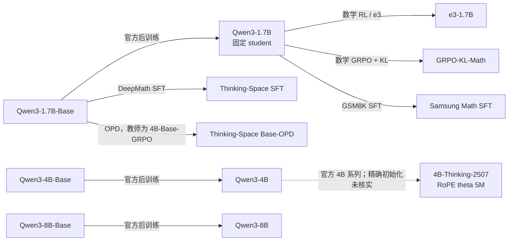

# Qwen3 谱系与同构教师吸收

状态：十个模型已固定 revision 并通过词表审计，640 条初始学生轨迹已生成，avg@4 基线正在运行。训练需要先通过真实 Qwen3 模型的完整梯度、显存和 Adam 更新核验。此页维护 Qwen3 配对；R1 系列的完整结果见[同架构吸收报告](../2026-10-29-同架构教师吸收假说与续训设计.md)。

## 研究问题与谱系

固定 student 为 `Qwen/Qwen3-1.7B`。教师覆盖从当前公开学生继续 RL/SFT、从更早 Base 分叉的 SFT/OPD、Base 祖先，以及不同尺寸和位置编码配置。前六位 1.7B 教师回答同尺寸函数是否能继续被拟合；4B/8B 教师提供跨尺寸对照。模型卡通常没有给出初始化的精确 commit，因此图表示公开声明的模型谱系，不等于已核实每次训练使用的父权重 SHA。

e3 的模型与作者项目给出 Qwen3-1.7B 上的数学 RL 路径；GRPO-KL-Math 的模型卡声明同一公开模型初始化。Samsung 模型提供从当前学生出发的数学 SFT 对照。Thinking-Space 的 SFT 和 Base-OPD 则从 Base 开始，提供同尺寸、不同后训练路径的分叉。[^e3][^grpo][^samsung][^sft][^opd]

这些标签用来组织对照，不预先定义严格的难度排序。初始 KL、同坐标参数距离、短程拟合、延长后的残差和任务回收分别报告；教师分数低于 student 时保留其负教师优势标记。

## 固定模型身份与预算

| 模型                   | 仓库                                          | Revision                                   | 任务评测更新点 |
| ---------------------- | --------------------------------------------- | ------------------------------------------ | -------------- |
| Qwen3-1.7B（student）  | `Qwen/Qwen3-1.7B`                             | `70d244cc86ccca08cf5af4e1e306ecf908b1ad5e` | 原始基线       |
| Qwen3-1.7B-Base        | `Qwen/Qwen3-1.7B-Base`                        | `ea980cb0a6c2ae4b936e82123acc929f1cec04c1` | 64 / 320       |
| e3-1.7B                | `CMU-AIRe/e3-1.7B`                            | `6db1b2fed3cd8d6cd2cd6270807a45f1e22925df` | 64 / 320       |
| GRPO-KL-Math-1.7B      | `jaygala24/Qwen3-1.7B-GRPO-KL-math-reasoning` | `851ee853018af52495d73a95e3de51470af6f17b` | 64 / 320       |
| Samsung Math SFT       | `SamsungSAILMontreal/Qwen3-1.7B-Math`         | `6c0e18a8277e3c5b46aa51e8f75612a5d78a9542` | 64 / 320       |
| DeepMath SFT           | `Thinking-Space/Qwen3-1.7B-SFT`               | `f0065babe7440257d7db331a5aa442ef7c3cf266` | 64 / 320       |
| Base-OPD               | `Thinking-Space/Qwen3-1.7B-Base-OPD`          | `4ad294531545b51fbcfbd1b0ded387ba237db57c` | 64 / 320       |
| Qwen3-4B               | `Qwen/Qwen3-4B`                               | `1cfa9a7208912126459214e8b04321603b3df60c` | 64             |
| Qwen3-8B               | `Qwen/Qwen3-8B`                               | `b968826d9c46dd6066d109eabc6255188de91218` | 64             |
| Qwen3-4B-Thinking-2507 | `Qwen/Qwen3-4B-Thinking-2507`                 | `768f209d9ea81521153ed38c47d515654e938aea` | 64             |

六个同尺寸分支各执行 320 次更新，并在 64、320 次更新时测任务准确率；三个跨尺寸分支各执行 64 次更新。合计 **2112 次科学更新、15 个学生任务读出点**。十个原始模型与十五个读出点均评测 630 题×4 次采样，总计 **63000 个回答**。没有 avg@1 筛查。

所有配对先提供同预算的 step064 风险和准确率。320-step 结果单独标出较长预算，不能与 64-step 混成等预算排名。64→320 同时增加更新次数与独立训练题目，不把其效果解释为纯粹的优化步数效应。

## 数据、训练与数值路径

题目沿用 R1 研究中的冻结本地题池：训练 A–T 为 320 题，数学 M01–M12 为 192 题，Code/IF 各 64 题，共 640 题。导入时去除已核验的 R1 单轮模板，保留问题文本，再用固定 Qwen3 student 模板编码。训练题与 630 道任务评测题的规范化文本交集为零。

每个 batch 16 题、每题一条 S0 回答，H1024、temperature=1，每批 reuse16。全部训练状态来自原始 student 的冻结轨迹；后续 320 次更新不会重新生成 fresh 训练回答。初始轨迹在原生 BF16 模型上生成，输出投影使用 FP32；每题使用固定独立 RNG。训练采用 full-vocab reverse KL，固定除以 16×1024，teacher softmax 保留原生完整支持集。

参数、梯度、Adam 和输出 head 为 FP32；backbone 在 BF16 autocast 下按 HF 原生算子执行，RoPE buffers 保留 FP32，TF32 关闭。学习率 1e-6，AdamW β=(0.9,0.999)、ε=1e-8、weight decay=0.01、梯度裁剪 1。microbatch 和激活重算由梯度/显存核验后的执行配置决定，不改变有效 batch、优化器或损失归一化。

64-step 分支每 16 步评分一次，覆盖 A–H、数学 M01–M04、Code01–02、IF01–02，共 256 题。320-step 分支加入未来训练批 I–T，固定评分面板共 448 题；主比较仍取共同 A–D 和数学 M01–M04。M05–M12 等预留题未用于当前训练或主指标；它们在更早研究中出现过，不称为完全未接触测试集。

320-step 分支从 step0 连续保留同一个 Adam 实例。在 step64 只写任务评测所需的 FP32 权重快照，继续训练时不重置一阶/二阶矩。最终权重永久保留；中间权重计划在所有相应评测和验证完成后清理，元数据、逐题风险及生成回答保留。不导出 Adam 状态。

## 接口与评测条件

十个模型的已定义 token ID 无语义冲突，teacher head 覆盖 student 支持集。所有 teacher 在相同 student prompt token 上接受监督和任务评测，统一 `enable_thinking=True`。部分 SFT/OPD 教师原训练采用 non-thinking 条件；此处测的是共同 thinking 条件下的目标，不把差异全部归因于 SFT/RL 方法。

Qwen3-Base 与 Base-OPD 的原生 EOS 为 151643，其余为 151645。这两个 ID 在各模型中分别保持相同的 end-of-text / message-end 含义，统一停止集合为 `[151643, 151645]`。银行生成与任务评测均采用该集合，并逐个执行强制 EOS 检查。KL 没有对特殊 token 重映射或共享支持重新归一化。

Base 分支的最大位置数为 32768，当前 student 为 40960；本轮评测限制在共同 32768 上下文内。六个 1.7B 配对的参数形状与 head 绑定方式一致，但仍报告配置差别，并在原始 student 配置内执行 teacher-copy 参考。4B-Thinking-2507 的 RoPE theta 为 5M，其他组为 1M，因此它同时具有跨尺寸和位置编码配置差异。

任务采用 MATH500 500 题、AMC23 40 题、AIME24/25/26 各 30 题；每题四次采样，temperature=0.7、top_p=0.9、top_k=-1、response cap31744、上下文 32768。逐回答 seed 为 72000000+100×题目索引 + 采样索引。vLLM 使用 BF16 部署读出；并发数根据 KV cache 容量限制，记录在每次服务协议中。

GapRecovery 沿用 R1 报告的定义：after 相对原始 student 的准确率增益，除以 teacher 相对原始 student 的优势。保留零分母、负优势、分母区间跨零及超过 100% 的情况；按题配对 bootstrap，不把四次回答当四个独立问题。

## 已完成基线

仅列已通过完整回答数核验的模型；未完成的模型不使用部分样本估计最终分数。准确率单位为 %。

| 模型              | MATH500 | AMC23 | AIME24 | AIME25 | AIME26 |
| ----------------- | ------: | ----: | -----: | -----: | -----: |
| e3-1.7B           |   91.10 | 86.88 |  49.17 |  43.33 |  37.50 |
| GRPO-KL-Math-1.7B |   87.70 | 73.75 |  36.67 |  25.83 |  25.00 |

## 实现与证据

统一实现见[study 包](../../../../../research/transfer/study/README.md)；配对与预算来自[执行计划](../../../../../research/transfer/study/plans/qwen3-lineage.json)。模型 revision、词表和配置审计见[原始产物](../../../../../../../../wandb-logs/MirrorOPD-verl/analysis/qwen3-teacher-lineage-20261029/)，数据准备记录见[prepared receipt](../../../../../../../../wandb-logs/MirrorOPD-verl/analysis/qwen3-teacher-lineage-20261029/prepared/complete.json)。

候选来源从用户给定的 Awesome-Paper 配置表出发，并补充官方 Hub 元数据和论文检索。[完整检索报告](../../../../literature/teacher-transfer/sources/qwen3-lineage-20261029/完整论文检索.md)保留 17 条去重结果，没有来源诊断错误；[固定模型元数据](../../../../literature/teacher-transfer/sources/qwen3-lineage-20261029/candidate-metadata.json)记录实际 revision。模型卡分数未写入本实验的准确率表。

### 参考来源

[^e3]: Setlur et al. e3: Learning to Explore Enables Extrapolation of Test-Time Compute for LLMs. [论文 v2](https://arxiv.org/abs/2506.09026v2)、[作者项目](https://matthewyryang.com/e3/)、[模型](https://huggingface.co/CMU-AIRe/e3-1.7B)。

[^grpo]: [GRPO-KL-Math 模型卡](https://huggingface.co/jaygala24/Qwen3-1.7B-GRPO-KL-math-reasoning)。来源、算法与数据按作者声明记录，实际分数由本地评测确定。

[^samsung]: [SamsungSAILMontreal/Qwen3-1.7B-Math](https://huggingface.co/SamsungSAILMontreal/Qwen3-1.7B-Math)。模型卡给出从 Qwen3-1.7B 进行 GSM8K full-rank SFT 的命令。

[^sft]: [Thinking-Space/Qwen3-1.7B-SFT](https://huggingface.co/Thinking-Space/Qwen3-1.7B-SFT)。从 Qwen3-1.7B-Base 进行数学 SFT；论文把该权重用于 cold start，本轮将它作为早分叉 teacher 对照，不能称为论文已报告的同一配对。

[^opd]: [Thinking-Space/Qwen3-1.7B-Base-OPD](https://huggingface.co/Thinking-Space/Qwen3-1.7B-Base-OPD)。从 Base 进行 OPD，公开教师为 Qwen3-4B-Base-GRPO。
