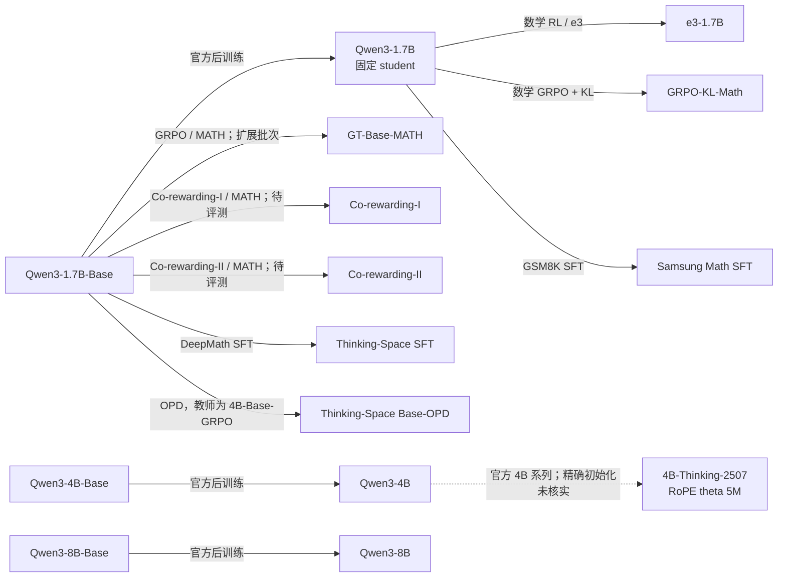
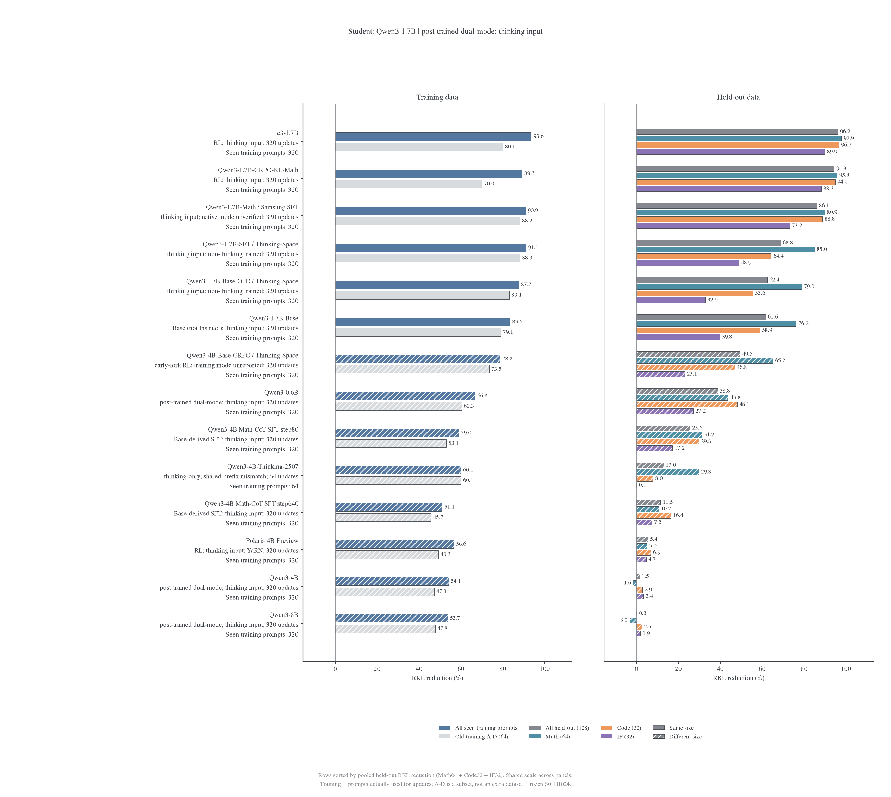

# Qwen3 谱系与同构教师吸收

后续主协议见[双模式与固定题池长训](2026-10-29-Qwen3双模式与固定题池长训协议.md)。本文保留原共同 thinking 条件；Thinking-Space SFT/Base-OPD 的既有结果属于模式不匹配对照，不能替代新的匹配 non-thinking 实验。

状态（2026-10-29）：原十个模型基线与九个训练分支均已完成，共 2112 次科学更新；六个同尺寸分支 320 步，三个跨尺寸分支 64 步。完整 RKL 汇总见[总体进展](../2026-10-29-教师谱系实验总览与RKL进展.md)，任务评测仅作辅助，部分终点仍未完成。此页维护 Qwen3 配对；R1 系列的完整结果见[同架构吸收报告](../r1/2026-10-29-同架构教师吸收假说与续训设计.md)。

## 研究问题与谱系

固定 student 为 `Qwen/Qwen3-1.7B`。教师覆盖从当前公开学生继续 RL/SFT、从更早 Base 分叉的 SFT/OPD、Base 祖先，以及不同尺寸和位置编码配置。前六位 1.7B 教师回答同尺寸函数是否能继续被拟合；4B/8B 教师提供跨尺寸对照。模型卡通常没有给出初始化的精确 commit，因此图表示公开声明的模型谱系，不等于已核实每次训练使用的父权重 SHA。

e3 的模型与作者项目给出 Qwen3-1.7B 上的数学 RL 路径；GRPO-KL-Math 的模型卡声明同一公开模型初始化。Samsung 模型提供从当前学生出发的数学 SFT 对照。Thinking-Space 的 SFT 和 Base-OPD 则从 Base 开始，提供同尺寸、不同后训练路径的分叉。[^e3][^grpo][^samsung][^sft][^opd]

这些标签用来组织对照，不预先定义严格的难度排序。初始 KL、同坐标参数距离、短程拟合、延长后的残差和任务回收分别报告；教师分数低于 student 时保留其负教师优势标记。

## 固定模型身份与预算

| 模型                   | 仓库                                          | Revision                                   | 任务评测更新点 |
| ---------------------- | --------------------------------------------- | ------------------------------------------ | -------------- |
| Qwen3-1.7B（student）  | `Qwen/Qwen3-1.7B`                             | `70d244cc86ccca08cf5af4e1e306ecf908b1ad5e` | 原始基线       |
| Qwen3-1.7B-Base        | `Qwen/Qwen3-1.7B-Base`                        | `ea980cb0a6c2ae4b936e82123acc929f1cec04c1` | 64 / 320       |
| e3-1.7B                | `CMU-AIRe/e3-1.7B`                            | `6db1b2fed3cd8d6cd2cd6270807a45f1e22925df` | 64 / 320       |
| GRPO-KL-Math-1.7B      | `jaygala24/Qwen3-1.7B-GRPO-KL-math-reasoning` | `851ee853018af52495d73a95e3de51470af6f17b` | 64 / 320       |
| Samsung Math SFT       | `SamsungSAILMontreal/Qwen3-1.7B-Math`         | `6c0e18a8277e3c5b46aa51e8f75612a5d78a9542` | 64 / 320       |
| DeepMath SFT           | `Thinking-Space/Qwen3-1.7B-SFT`               | `f0065babe7440257d7db331a5aa442ef7c3cf266` | 64 / 320       |
| Base-OPD               | `Thinking-Space/Qwen3-1.7B-Base-OPD`          | `4ad294531545b51fbcfbd1b0ded387ba237db57c` | 64 / 320       |
| Qwen3-4B               | `Qwen/Qwen3-4B`                               | `1cfa9a7208912126459214e8b04321603b3df60c` | 64             |
| Qwen3-8B               | `Qwen/Qwen3-8B`                               | `b968826d9c46dd6066d109eabc6255188de91218` | 64             |
| Qwen3-4B-Thinking-2507 | `Qwen/Qwen3-4B-Thinking-2507`                 | `768f209d9ea81521153ed38c47d515654e938aea` | 64             |

六个同尺寸分支各执行 320 次更新，并在 64、320 次更新时测任务准确率；三个跨尺寸分支各执行 64 次更新。合计 **2112 次科学更新、15 个学生任务读出点**。十个原始模型与十五个读出点均评测 630 题×4 次采样，总计 **63000 个回答**。没有 avg@1 筛查。

所有配对先提供同预算的 step064 风险和准确率。320-step 结果单独标出较长预算，不能与 64-step 混成等预算排名。64→320 同时增加更新次数与独立训练题目，不把其效果解释为纯粹的优化步数效应。

## 数据、训练与数值路径

题目沿用 R1 研究中的冻结本地题池：训练 A–T 为 320 题，数学 M01–M12 为 192 题，Code/IF 各 64 题，共 640 题。导入时去除已核验的 R1 单轮模板，保留问题文本，再用固定 Qwen3 student 模板编码。训练题与 630 道任务评测题的规范化文本交集为零。

每个 batch 16 题、每题一条 S0 回答，H1024、temperature=1，每批 reuse16。全部训练状态来自原始 student 的冻结轨迹；后续 320 次更新不会重新生成 fresh 训练回答。初始轨迹在原生 BF16 模型上生成，输出投影使用 FP32；每题使用固定独立 RNG。训练采用 full-vocab reverse KL，固定除以 16×1024，teacher softmax 保留原生完整支持集。

参数、梯度、Adam 和输出 head 为 FP32；backbone 在 BF16 autocast 下按 HF 原生算子执行，RoPE buffers 保留 FP32，TF32 关闭。学习率 1e-6，AdamW β=(0.9,0.999)、ε=1e-8、weight decay=0.01、梯度裁剪 1。microbatch 和激活重算由梯度/显存核验后的执行配置决定，不改变有效 batch、优化器或损失归一化。

64-step 分支每 16 步评分一次，覆盖 A–H、数学 M01–M04、Code01–02、IF01–02，共 256 题。320-step 分支加入未来训练批 I–T，固定评分面板共 448 题；主比较仍取共同 A–D 和数学 M01–M04。M05–M12 等预留题未用于当前训练或主指标；它们在更早研究中出现过，不称为完全未接触测试集。

320-step 分支从 step0 连续保留同一个 Adam 实例。在 step64 只写任务评测所需的 FP32 权重快照，继续训练时不重置一阶/二阶矩。最终权重永久保留；中间权重计划在所有相应评测和验证完成后清理，元数据、逐题风险及生成回答保留。不导出 Adam 状态。

## 接口与评测条件

十个模型的已定义 token ID 无语义冲突，teacher head 覆盖 student 支持集。所有 teacher 在相同 student prompt token 上接受监督和任务评测，统一 `enable_thinking=True`。部分 SFT/OPD 教师原训练采用 non-thinking 条件；此处测的是共同 thinking 条件下的目标，不把差异全部归因于 SFT/RL 方法。

Qwen3-Base 与 Base-OPD 的原生 EOS 为 151643，其余为 151645。这两个 ID 在各模型中分别保持相同的 end-of-text / message-end 含义，统一停止集合为 `[151643, 151645]`。银行生成与任务评测均采用该集合，并逐个执行强制 EOS 检查。KL 没有对特殊 token 重映射或共享支持重新归一化。

Base 分支的最大位置数为 32768，当前 student 为 40960；本轮评测限制在共同 32768 上下文内。六个 1.7B 配对的参数形状与 head 绑定方式一致，但仍报告配置差别，并在原始 student 配置内执行 teacher-copy 参考。4B-Thinking-2507 的 RoPE theta 为 5M，其他组为 1M，因此它同时具有跨尺寸和位置编码配置差异。

任务采用 MATH500 500 题、AMC23 40 题、AIME24/25/26 各 30 题；每题四次采样，temperature=0.7、top_p=0.9、top_k=-1、response cap31744、上下文 32768。逐回答 seed 为 72000000+100×题目索引 + 采样索引。vLLM 使用 BF16 部署读出；并发数根据 KV cache 容量限制，记录在每次服务协议中。

GapRecovery 沿用 R1 报告的定义：after 相对原始 student 的准确率增益，除以 teacher 相对原始 student 的优势。保留零分母、负优势、分母区间跨零及超过 100% 的情况；按题配对 bootstrap，不把四次回答当四个独立问题。

## 已完成基线

仅列已通过完整回答数核验的模型；未完成的模型不使用部分样本估计最终分数。准确率单位为 %。

| 模型                  | MATH500 | AMC23 | AIME24 | AIME25 | AIME26 | 五数据集宏平均 |
| --------------------- | ------: | ----: | -----: | -----: | -----: | -------------: |
| Qwen3-1.7B（student） |   91.25 | 83.75 |  45.00 |  32.50 |  39.17 |          58.33 |
| Qwen3-1.7B-Base       |   43.75 | 31.25 |   2.50 |   5.83 |   0.83 |          16.83 |
| e3-1.7B               |   91.10 | 86.88 |  49.17 |  43.33 |  37.50 |          61.60 |
| GRPO-KL-Math-1.7B     |   87.70 | 73.75 |  36.67 |  25.83 |  25.00 |          49.79 |
| Samsung Math SFT      |   25.10 |  9.38 |   0.00 |   0.83 |   0.00 |           7.06 |
| DeepMath SFT          |   67.60 | 34.38 |   5.83 |   5.00 |   5.00 |          23.56 |
| Base-OPD              |   68.20 | 41.88 |   8.33 |   8.33 |   4.17 |          26.18 |

宏平均为五个数据集准确率的等权平均，不是 630 题合并准确率。表中每行均有 2520 个回答，逐题采样数均为四，失败回答数为零；分数来自对应评测目录的 `metrics.json`，并核对 `complete.json`。

e3 的宏平均为 61.60%，高于原始 student 的 58.33%，差值为 3.26 个百分点；各数据集优势并不一致，尚未对该差值给出配对置信区间。GRPO-KL、Base、Base-OPD 和两个 SFT 教师的宏平均均低于 student。保留这些组可以观察同尺寸目标分布的可拟合性，但不能把其 GapRecovery 正值直接称为能力提升：教师优势为负时，student 退化也可能产生正比例。后续必须同时报告原始准确率变化、分母符号和 KL 残差。

两个 SFT 教师在共同 thinking 模板下分别得到 7.06% 和 23.56% 的宏平均。该结果描述本轮统一输入条件下的表现；训练方式、数据与原生模板条件尚未被独立控制，不能据此判定 SFT 本身导致性能差距。

## 同尺寸训练结果与可行参数参考

以下为已完成六组训练的数学 held-out M01–M04 面板：64 条固定 S0 回答，每条 1024 tokens。RKL 以所有有效 token 求均值，64/320 步降幅均相对同组 step0；六组使用相同数据与优化设置。320 步比 64 步增加了训练批次，结果不能解释为只在原四批上继续优化。

| Teacher      | 初始 RKL | step64 降幅 | step320 RKL | step320 降幅 | teacher-copy RKL | 相对参数距离 |
| ------------ | -------: | ----------: | ----------: | -----------: | ---------------: | -----------: |
| e3           | 0.034569 |      94.65% |    0.000697 |       97.98% |         0.000386 |     0.000262 |
| GRPO-KL      | 0.020794 |      89.98% |    0.000871 |       95.81% |         0.000382 |     0.000277 |
| Samsung SFT  | 0.250635 |      72.23% |    0.025202 |       89.94% |         0.000140 |     0.004501 |
| DeepMath SFT | 0.523028 |      71.37% |    0.078314 |       85.03% |         0.000183 |     0.053972 |
| Base-OPD     | 0.735217 |      62.53% |    0.154669 |       78.96% |         0.000315 |     0.054572 |
| Qwen3-Base   | 0.519430 |      61.13% |    0.123431 |       76.24% |         0.000266 |     0.054577 |

当前图按 Math64、Code32、IF32 合并平均 RKL 的降幅排序，模型标签注明尺寸、实际模式与更新数；斜线表示跨尺寸。数学留出及同构 teacher-copy 的详细表保留在本节，整体与跨域统计见[统一总览](../2026-10-29-教师谱系实验总览与RKL进展.md)。旧 A–D 保持问题仍见下节配对分析，不能由留出高降幅推断所有状态都已吸收。

[当前 PDF](../data/overview-20261029/q3-1.7-final-rkl.pdf)、[排序数据](../data/overview-20261029/heldout-ranking.csv)、[公共读图口径](../protocol.md)构成当前入口；[历史 RKL/JS 双面板](figures/latest-endpoints.pdf)保留为旧版视图，不再维护另一套当前排序。

相对参数距离为 teacher 与初始 student 的同坐标参数 L2 距离除以 student 参数范数，共享 embedding/head 只计一次。它依赖当前参数坐标，不是函数距离。两个 RL 教师的距离约为 0.00026–0.00028，Samsung SFT 为 0.00450，从 Base 分叉的三位教师约为 0.054；在这六组里，较近教师同时表现出更大的相对 KL 降幅。当前对照不能独立分离训练方法、参数距离和初始函数差异的影响。

teacher-copy 在原始 student 配置和 buffers 下严格复制教师参数，未执行梯度更新。该参考给出可行参数点，不是最优值或理论下界。e3 的 step320 RKL 约为 copy 参考的 1.81 倍，GRPO-KL 为 2.28 倍；其他四组约为 180–490 倍。后四组存在显著更低损失的可行参数点，因此不能把当前残差解释为同尺寸架构的不可表达性。两个 RL 分支也尚未达到参考值，当前证据支持“延长训练继续降低残差”，尚不足以宣称完全吸收。

在同一 64 题上将 step320 与 teacher-copy 逐题配对，六组的终点风险都逐题高于参考点。下表给出“训练终点 RKL − teacher-copy RKL”的每 token 均值及 95% 区间（5000 次题目 bootstrap，seed42）：

| Teacher      | 绝对差值 | 差值 95% 区间        |
| ------------ | -------: | -------------------- |
| Base-OPD     | 0.154353 | [0.146184, 0.162651] |
| e3           | 0.000312 | [0.000281, 0.000347] |
| GRPO-KL      | 0.000490 | [0.000433, 0.000549] |
| Qwen3-Base   | 0.123165 | [0.116607, 0.129752] |
| DeepMath SFT | 0.078131 | [0.073607, 0.083020] |
| Samsung SFT  | 0.025062 | [0.024145, 0.026086] |

全部区间为正，说明在当前固定题池及这一次训练中，残差与可行参考的差别可被题目配对统计区分；没有据此推断无限训练的极限或其他状态分布上的误差。e3 和 GRPO-KL 的绝对差值较小，但仍不能把相对降幅直接称为完全吸收。分析入口保存 step64/320、RKL/JS 共 24 行比较到 `analysis/copy-comparisons.csv`，并在比较前核对题目 ID、轨迹来源、长度和组别。

实际执行选择 microbatch4、token chunk512、关闭激活重算，有效 batch16 与科学参数保持不变。六组每次更新耗时中位数约 1.60–1.61 秒；每组 320 步、固定面板评分及权重保存共约 17.8–18.3 分钟。该耗时不包括此前的模型加载、teacher 缓存准备、step0 评分与后续长回答任务评测。所有组保留连续 Adam 实例，不导出 optimizer 状态。

结果来自原始产物中的 `arms/Q3-*/fixed-{000,064,320}.json`、`training.json`、`complete.json` 以及 `teacher-copy/*/complete.json`。统一分析入口已完成 partial 核验与汇总；未完成任务准确率不参与 GapRecovery 计算。

### 续训中的早期批次残差

为区分归一化分母与真实反弹，固定同一批 prompt 和 S0 tokens，比较 step64 与 step320 的绝对 RKL。下表是 A–D 的每 token 均值；区间来自 5000 次按题配对 bootstrap（seed42），只描述题目抽样不确定性，不代表多个训练 seed 的稳定性。

| Teacher         | step64 RKL | step320 RKL |      增量 | 增量 95% 区间          |
| --------------- | ---------: | ----------: | --------: | ---------------------- |
| Q3-q3-base      |   0.165913 |    0.102996 | -0.062917 | [-0.066690, -0.059263] |
| Q3-e3           |   0.005863 |    0.006023 | +0.000160 | [-0.000099, +0.000420] |
| Q3-grpo-kl      |   0.005761 |    0.006475 | +0.000714 | [+0.000398, +0.001042] |
| Q3-sft-gsm8k    |   0.060831 |    0.028169 | -0.032661 | [-0.034190, -0.031241] |
| Q3-sft-deepmath |   0.118712 |    0.059174 | -0.059538 | [-0.061705, -0.057493] |
| Q3-base-opd     |   0.206114 |    0.118361 | -0.087753 | [-0.092954, -0.082826] |

GRPO-KL 的 A–D 增量区间完全为正，64 题中 51 题风险升高；e3 的增量区间包含零。两组 held-out 风险在同一阶段继续下降，因此两种面板的变化方向并不一致。其他四组的 A–D 绝对风险继续下降。

再看最早的 A 批，e3 的 RKL 在 step16 为 0.005680，step320 为 0.015824；GRPO-KL 分别为 0.003404、0.016392。A 批的既有拟合收益随后部分丢失，支持跨批训练中存在遗忘。这一观察尚未区分优化器历史、批次顺序和题目差异的作用，不能单独归因于 Adam。当前“同架构充分吸收”的证据仍需同时覆盖已训练状态与 held-out 状态。

完整 84 行 RKL/JS 配对比较保存在原始产物的 `analysis/continuation-risk.csv`；[复算脚本](../../../../../research/studies/fixed_transfer/continuation.py)同时检查题目 ID、轨迹来源与长度一致性。此项分析复用已有输出，没有新增训练或改动评测条件。

## 下一批 RL 分支对照

第一批中，两个 RL 教师都从当前 student 继续训练，而 Base、Base-OPD 和 DeepMath SFT 都从更早的 Base 分叉。为检查初始化来源的影响，主比较加入从 Base 出发的 GT-Base-MATH，student 仍固定为原始 Qwen3-1.7B。该组已通过接口审计，后续 non-thinking 结果和预算见[双模式协议](2026-10-29-Qwen3双模式与固定题池长训协议.md)。

| Teacher                                 | 固定 revision                              | 公开训练路径                                           | 对照目的                                 |
| --------------------------------------- | ------------------------------------------ | ------------------------------------------------------ | ---------------------------------------- |
| `TMLR-Group-HF/GT-Qwen3-1.7B-Base-MATH` | `679b8b3a531200f6748eb782c265c83a58b1417d` | Qwen3-1.7B-Base → MATH train、GRPO ground-truth reward | 检查从 Base 分叉的 RL 目标是否仍较难拟合 |

GT 模型的精确父权重 revision 未公开。共享权重检查确认 GT-Base-MATH 同时序列化 embedding/head 且逐元素一致。任务评测沿用 630 题 avg@4；模型卡分数不充当本地结果。[^gt-math]

### 同一 Base 与 MATH 数据来源的奖励方法对照

再补充作者发布的 Co-rewarding-I、Co-rewarding-II，与上一批 GT-Base-MATH 形成共同公开父模型、共同数据集名称下的奖励方法对照。这样可减少“RL 都来自当前 student，而其他方法来自 Base”的来源混杂；模型卡没有证明三者使用相同父权重 commit、相同数据子集或相同计算预算，因此不能将差异全部归因于奖励方法。[^coreward-i][^coreward-ii]

| Teacher                                              | 固定 revision                              | 当前范围                                       |
| ---------------------------------------------------- | ------------------------------------------ | ---------------------------------------------- |
| `TMLR-Group-HF/Co-rewarding-I-Qwen3-1.7B-Base-MATH`  | `5d3c87b84144073a4552d786d3d97288d6c7abec` | 权重下载、词表与共享权重审计通过，尚无本地评测 |
| `TMLR-Group-HF/Co-rewarding-II-Qwen3-1.7B-Base-MATH` | `381b27483332657dfae6f82ecfaa5fb7ddfb2d82` | 权重下载、词表与共享权重审计通过，尚无本地评测 |

作者实现进一步区分了两条路径：Co-rewarding-I 对原题和语义相近的改写题构造对照奖励；Co-rewarding-II 使用缓慢更新的参考教师及伪标签。因此，这组比较还包含数据视角和参考模型更新方式的差别，不能称为只改变奖励公式。[^coreward-code]

公开启动脚本均设 train batch128、rollout n8、学习率 3e-6、最大回答 3072、3 epochs，但 I 的 actor KL 系数为 0.005，II 为 0.001；II 另启用参考参数滑动更新。I 脚本默认指向 MATH 原题与 Qwen3-32B 改写题，II 脚本默认指向 DAPO。后者是通用启动模板，不能据此否定已发布 checkpoint 的 MATH 模型卡，也不能据此认定该 MATH checkpoint 的全部超参。两个脚本均未给出我们所下载权重对应的确切执行日志。[^coreward-launch-i][^coreward-launch-ii]

这些是教师原训练方法的证据，不是本轮蒸馏设置。本轮继续使用统一的冻结 S0、full-vocab RKL、batch16/reuse16、H1024 和 avg@4；不把公开脚本的预算代入本轮结果。启动脚本原文与 Git blob 摘要保存在[来源快照](../../../../literature/teacher-transfer/sources/qwen3-lineage-20261029/coreward-launchers/manifest.json)。

[Co-rewarding 配对计划](../../../../../research/studies/fixed_transfer/plans/qwen3-coreward.json)仍使用同一 student、S0 轨迹、630 题 avg@4 与 64/320 步读出。两组计划增加 640 次更新和 15120 个回答；未改动正在运行或已冻结的前两批计划。这里列的是计划预算，不能计入已完成实验量。

## 实现与证据

当前执行仅使用物理 GPU0–5；GPU0–3 承接训练终点评测，GPU4–5 承接合并后的原始模型基线与后续扩展。资源配置调整不改变模型版本、题目、采样参数或已保存回答。合并基线计划见[统一基线配置](../../../../../research/studies/fixed_transfer/plans/qwen3-baselines-expanded.json)，原有各研究计划仍定义各自训练配对与预算。

统一实现见[study 包](../../../../../research/studies/fixed_transfer/README.md)；配对与预算来自[执行计划](../../../../../research/studies/fixed_transfer/plans/qwen3-lineage.json)。模型 revision、词表和配置审计见[原始产物](../../../../../../../../wandb-logs/MirrorOPD-verl/analysis/qwen3-teacher-lineage-20261029/)，数据准备记录见[prepared receipt](../../../../../../../../wandb-logs/MirrorOPD-verl/analysis/qwen3-teacher-lineage-20261029/prepared/complete.json)。

候选来源从用户给定的 Awesome-Paper 配置表出发，并补充官方 Hub 元数据和论文检索。[完整检索报告](../../../../literature/teacher-transfer/sources/qwen3-lineage-20261029/完整论文检索.md)保留 17 条去重结果，没有来源诊断错误；[固定模型元数据](../../../../literature/teacher-transfer/sources/qwen3-lineage-20261029/candidate-metadata.json)记录实际 revision。模型卡分数未写入本实验的准确率表。

### 参考文献

[^e3]: Setlur et al. e3: Learning to Explore Enables Extrapolation of Test-Time Compute for LLMs. [论文 v2](https://arxiv.org/abs/2506.09026v2)、[作者项目](https://matthewyryang.com/e3/)、[模型](https://huggingface.co/CMU-AIRe/e3-1.7B)。

[^grpo]: [GRPO-KL-Math 模型卡](https://huggingface.co/jaygala24/Qwen3-1.7B-GRPO-KL-math-reasoning)。来源、算法与数据按作者声明记录，实际分数由本地评测确定。

[^samsung]: [SamsungSAILMontreal/Qwen3-1.7B-Math](https://huggingface.co/SamsungSAILMontreal/Qwen3-1.7B-Math)。模型卡给出从 Qwen3-1.7B 进行 GSM8K full-rank SFT 的命令。

[^sft]: [Thinking-Space/Qwen3-1.7B-SFT](https://huggingface.co/Thinking-Space/Qwen3-1.7B-SFT)。从 Qwen3-1.7B-Base 进行数学 SFT；论文把该权重用于 cold start，本轮将它作为早分叉 teacher 对照，不能称为论文已报告的同一配对。

[^opd]: [Thinking-Space/Qwen3-1.7B-Base-OPD](https://huggingface.co/Thinking-Space/Qwen3-1.7B-Base-OPD)。从 Base 进行 OPD，公开教师为 Qwen3-4B-Base-GRPO。

[^gt-math]: TMLR-Group-HF. GT-Qwen3-1.7B-Base-MATH 模型卡。[固定版本](https://huggingface.co/TMLR-Group-HF/GT-Qwen3-1.7B-Base-MATH/blob/679b8b3a531200f6748eb782c265c83a58b1417d/README.md)。

[^coreward-i]: TMLR-Group-HF. Co-rewarding-I-Qwen3-1.7B-Base-MATH 模型卡。[固定版本](https://huggingface.co/TMLR-Group-HF/Co-rewarding-I-Qwen3-1.7B-Base-MATH/blob/5d3c87b84144073a4552d786d3d97288d6c7abec/README.md)。

[^coreward-ii]: TMLR-Group-HF. Co-rewarding-II-Qwen3-1.7B-Base-MATH 模型卡。[固定版本](https://huggingface.co/TMLR-Group-HF/Co-rewarding-II-Qwen3-1.7B-Base-MATH/blob/381b27483332657dfae6f82ecfaa5fb7ddfb2d82/README.md)。

[^coreward-code]: TMLR Group. Co-rewarding 官方实现说明。[项目 README](https://github.com/tmlr-group/Co-rewarding)。

[^coreward-launch-i]: TMLR Group. Co-rewarding-I 公开启动脚本。[源码](https://github.com/tmlr-group/Co-rewarding/blob/main/Co-rewarding-I/run_corewarding-I.sh)，本地快照 Git blob `37ee16ccd2cfe33e9123e13875b8e777a3373a17`。

[^coreward-launch-ii]: TMLR Group. Co-rewarding-II 公开启动脚本。[源码](https://github.com/tmlr-group/Co-rewarding/blob/main/Co-rewarding-II/run_corewarding-II.sh)，本地快照 Git blob `2cc001aefa6913206c66abe1f01e57dccbab282f`。

## 原主实验任务评测完整验收

原九分支主实验已通过[完整验收](data/task-verification-20261030/original-lineage-full-verification.json)：10 项初始模型评测加 15 个 student 终点评测，共 25×630×4＝63000 条回答，生成 90 条 GapRecovery 结果。验收同时覆盖 174 条风险读出和 132 个分批首步检查。此完成状态只属于原主实验，不自动覆盖后续双模式、新阶段 teacher 或更长预算的任务成绩。
