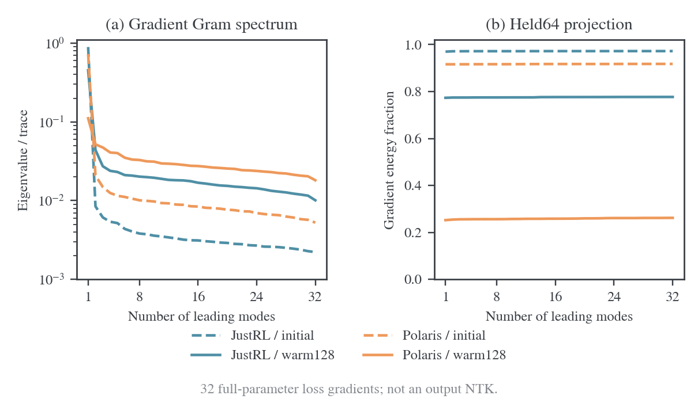
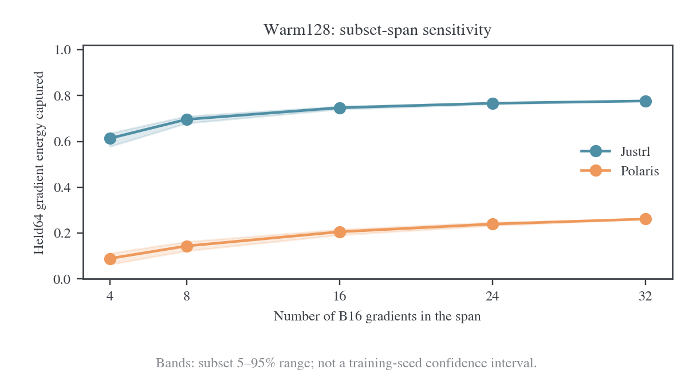

# 谱滤波诊断与同架构教师对照

更新：2026-10-28。

## 1. 已完成工作与边界

完成两项 CPU 分析：对已有真实全参数梯度的 Gram 矩阵作特征分解、留出投影与子集稳定性分析；核对本地模型和两位远程教师候选的架构字段、谱系与 token-ID 映射。

没有启动新的 GPU 前后向、训练或大型实验；没有改动模型权重和 `run_math_opd_ablation_fsdp2.sh`。用户已明确后续 GPU 可用时再通知。完整参数 NTK 的新测量和新增教师的 E20 预算对照仍是待讨论设置。

数据保存于源码仓库同级 `wandb-logs/MirrorOPD-verl/analysis/spectral-filter-20261028/`；程序与图见本目录 [README](README.md)。

## 2. 谱滤波的准确含义

### 2.1 过滤器与教师信号必须分开

固定学生参数 $\theta_0$ 和一批输入前缀，令 $f_\theta$ 为这些前缀上的输出向量，$J_0$ 为输出对可训练参数的 Jacobian。局部线性化为：

$$
f_{\theta_0+\delta}\approx f_0+J_0\delta.
$$

令教师希望学生实现的输出修正为 $r=f_T-f_0$。若使用固定的正半定度量 $W$，定义 $A=W^{1/2}J_0$、$r_W=W^{1/2}r$，则一个局部诊断模型是：

$$
L(\delta)=\frac12\lVert A\delta-r_W\rVert_2^2,\qquad K=AA^\top.
$$

这里的 $K$ 是学生特征在给定输入和度量下产生的核。若学生、输入、可训练参数和 $W$ 都不变，换 JustRL 或 Polaris 不会改变这个 $K$；改变的是教师残差 $r_W$ 在各方向上的投影。训练之后学生参数变了，核才可能随之变化。

为说明有限时间的作用，考虑从 $\delta(0)=0$ 开始的普通梯度流。令 $e(t)=A\delta(t)-r_W$，则：

$$
\dot\delta=-A^\top e,\qquad \dot e=-Ke,
\qquad e(t)=-e^{-Kt}r_W.
$$

若 $Ku_i=\lambda_i u_i$ 且 $\{u_i\}$ 正交，则已经学到的输出变化为：

$$
\widehat r_W(t)=A\delta(t)
=\sum_i(1-e^{-\lambda_i t})\langle u_i,r_W\rangle u_i.
$$

大特征值方向学得快，小特征值方向学得慢，零空间在此线性化模型中无法学到。这就是谱滤波；它讨论学习动力学中的方向，不是模型参数矩阵的频率，也不是把一个特征值对应到一项语义技能。

例如同一个核有快、慢两个方向，两个教师分别把主要目标能量放在快方向和慢方向，有限预算下就会出现不同学习速度。判断教师是否难学，需要同时看特征值和目标投影，不能只比较核的有效秩。

该推导使用固定输入、固定局部表示和二次目标。生产训练包含 AdamW、非线性特征学习、混合精度和前缀刷新，不能直接把公式中的 $t$ 换成 E48 optimizer step，也不能把下面的梯度 Gram 特征值代入公式预测收敛时间。

### 2.2 谱由哪些条件决定

| 条件 | 影响 |
| --- | --- |
| 架构及可训练参数 | 决定函数族、参数化、Jacobian 尺寸和可表达方向 |
| 具体权重和训练历史 | 决定当前学到的特征与局部响应；同架构的两个 checkpoint 可以很不同 |
| prompt 与前缀分布 | 决定在哪些输入上测量；换输入就可能换谱 |
| 输出度量 | 普通 logits、Fisher 加权 logits 或其他投影产生不同核 |
| 优化器 | 固定预条件器会形成 $AP A^\top$；真实 Adam 的历史、预条件又随训练变化 |
| 教师目标 | 固定共同学生核时改变目标投影；若测 loss Hessian 或 loss-gradient Gram，也可能改变矩阵本身 |

目前不能给出“架构比训练数据重要几倍”的普遍排序。我们应该固定学生和输入，先研究同一个学生核如何响应不同教师目标。

## 3. 现在实际算出的矩阵

### 3.1 继承的测量设置

复用 N 系列已经实际计算并冻结的梯度，不重新训练。Student 为 `DeepSeek-R1-Distill-Qwen-1.5B`，全部 1,777,088,000 个参数参与梯度；教师为 JustRL 或 Polaris。四个案例分别为共同初始学生，以及各自经过 128 次本机短实验更新后的学生。后两者是不同 checkpoint，不是生产 E20/E48 的 4096-step 终点。

输入是同一套冻结 S0 前缀；512 道数学题分为 32 个不相交的 B16 梯度组，另有独立 Held64。H1024、full-vocab RKL、固定 H 归一化。梯度来自 FP32 学生主权重与 head、BF16 backbone 路径；源程序以 FP32 分块点积、FP64 累积 Gram。这里“完整参数”表示没有只选 head 或做参数随机草图，并不表示所有算术都用 FP64。

源文件共 34 组梯度，最后两组是 Held64 与 Seen64。此次用前 32 组构造基底，Held64 只用于独立几何诊断，Seen64 不进入主结果。已核对四个案例的 prompt IDs 完全相同，32 组之间不重叠，Held64 与它们不重叠。

### 3.2 测量对象和指标

设第 $i$ 批的真实参数梯度为 $g_i$，定义：

$$
G_{ij}=g_i^\top g_j.
$$

这是 **teacher-conditioned loss-gradient Gram**。它同时含学生表示、教师残差及 RKL 权重，不能称为 teacher-independent NTK。

若 $G u_k=\lambda_k u_k$，则相应参数空间单位方向为：

$$
v_k=\frac{\sum_i u_{ik}g_i}{\sqrt{\lambda_k}}.
$$

因为 $\lVert\sum_i u_{ik}g_i\rVert^2=u_k^\top G u_k=\lambda_k$，非零模态的 $v_k$ 正交。令独立 Held64 梯度为 $h$、交叉点积为 $b_i=g_i^\top h$，则前 $m$ 个方向捕获的留出梯度平方范数比例为：

$$
C_m=\frac{1}{\lVert h\rVert^2}\sum_{k\le m}\frac{(u_k^\top b)^2}{\lambda_k}.
$$

因此无需重新取出十几亿维梯度，就可以用已保存的 Gram 和 cross-Gram 精确到源浮点误差地计算投影。使用所有方向时另用 $b^\top G^+b/\lVert h\rVert^2$ 复核。它允许任意带符号的线性组合，属于知道测试梯度后的 oracle 几何诊断，不是实际训练中可用的更新方法。

谱集中度使用 $\lambda_1/\operatorname{tr}G$；参与率有效秩为：

$$
r_{\mathrm{eff}}=\frac{(\sum_k\lambda_k)^2}{\sum_k\lambda_k^2}.
$$

这个秩衡量有限 32 个梯度的分散程度，不是神经网络的有效参数数目或语义技能数目。

### 3.3 实测结果

| 教师／阶段 | 最大特征值占 trace | 参与率有效秩 | Held64 在首方向的投影能量 | Held64 在全部 32 方向的投影能量 |
| --- | ---: | ---: | ---: | ---: |
| JustRL／初始 | 89.32% | 1.25 | 97.00% | 97.23% |
| Polaris／初始 | 72.59% | 1.89 | 91.61% | 91.77% |
| JustRL／各自更新 128 步后 | 45.18% | 4.65 | 77.33% | 77.70% |
| Polaris／各自更新 128 步后 | 11.10% | 25.25 | 25.21% | 26.18% |



初始阶段两种教师都存在明显共享方向，与两者早期均有正迁移一致。后期 Polaris 的梯度能量更分散，且 32 个训练批梯度张成的空间只能覆盖约 26.18% 的独立平均梯度平方范数；JustRL 仍约为 77.70%。增加谱中的其余方向，对留出投影的补充较小。

这增加了“后期共享修正变弱”的几何证据，但仍不能推出“Polaris 的 73.82% 能力被过滤”。未捕获部分只是一个有限题池和 checkpoint 上的梯度分量；更大的题池、新的特征、不同更新路径都可能改变它。

### 3.4 范数与平均方向控制

把每个训练批梯度除以自身范数，消除 batch 间梯度大小差异后：

| 教师／阶段 | 单位梯度 Gram 首特征值占比 | 有效秩 |
| --- | ---: | ---: |
| JustRL／初始 | 89.15% | 1.26 |
| Polaris／初始 | 72.14% | 1.91 |
| JustRL／warm128 | 45.49% | 4.61 |
| Polaris／warm128 | 10.82% | 26.50 |

差异不是仅由少量大梯度 batch 制造。另一项控制是去掉平均梯度：中心化后 warm128 的有效秩分别为 JustRL 27.60、Polaris 28.90，两者都很分散。因此更合适的解释是共同方向的相对强度不同，而不是声称 JustRL 的全部剩余变化天然只有四维。

### 3.5 子集稳定性

对每个大小 4/8/16/24，从 32 批中无放回抽取 256 个子集，重新计算其完整张成空间对同一 Held64 的投影。32 批取完整集合。两种教师使用相同的子集索引随机种子。

| warm128；子集大小 | JustRL 中位投影比例 | Polaris 中位投影比例 |
| ---: | ---: | ---: |
| 4 | 61.37% | 8.95% |
| 8 | 69.64% | 14.40% |
| 16 | 74.74% | 20.58% |
| 24 | 76.69% | 23.98% |
| 32 | 77.70% | 26.18% |



阴影为子集 5–95% 范围，只表示这一个有限题池对选取梯度子集的敏感性，不是训练 seed 的置信区间，也没有为调参选择最优子集。

## 4. 同源和架构的定义

本研究建议同时记录三个轴，而不只保留同源／异源二分：

1. **结构**：模型类、层数、宽度、注意力头、head 绑定、位置编码及输出接口。
2. **谱系**：教师是否从当前学生对应的具体初始化 checkpoint 继续训练；更早的共同祖先单独记录。
3. **功能距离**：在共同输入上的分布距离、任务差异与可学习投影；它是连续实测量，不能由名称推断。

2608.16647 使用共享具体后训练初始化的操作定义：JustRL、DeepCoder、UltraData-IF 都从 R1-Distill-1.5B 继续训练，即使训练数据领域不同，仍属于该谱系的同源分支。OpenMath-Nemotron 和 VibeThinker 从更早的 Qwen2.5-Math-1.5B 分叉，与 R1-Distill 有共同远祖，但不属于同一个 R1-Distill 后训练分支。[^coin][^deepcoder][^ultra][^openmath][^vibe]

同架构独立初始化可以是异谱系；同源模型经过大量不同训练也可能功能距离很大。改变 size 通常同时改变参数化和初始化，不宜只标一个“异源”就忽略尺寸混杂。结构相同也不自动证明策略接近。

## 5. 本地优先的教师候选核对

先查看本地文档和模型目录，再对缺少本地配置的两位候选读取官方固定 revision 元数据。未下载候选权重，未测其本地任务成绩。

### 5.1 本地已有的精确结构字段对照

学生与 JustRL、DeepCoder、UltraData-IF 在本次核对的结构字段和全部 tokenizer token-ID 映射上一致：Qwen2ForCausalLM、28 层、hidden1536、FFN8960、12 个 query heads／2 个 KV heads、151936 输出行、untied embeddings/head、RoPE theta10000。

| 模型 | 本地位置 | 谱系与用途 |
| --- | --- | --- |
| JustRL-DeepSeek-1.5B | `model/JustRL-DeepSeek-1.5B` | E20 教师；同源数学 RL 基准 |
| DeepCoder-1.5B-Preview | `models/DeepCoder-1.5B-Preview` | 同源代码 RL；控制领域和后训练数据变化 |
| UltraData-IF-1.5B | `models/UltraData-IF-1.5B` | 同源 IF RL；控制领域变化 |

“结构字段一致”不是所有运行细节、chat template 或模型行为相等的声明。两位领域教师是否在共同数学前缀上离学生很远，需要实际评分，不能仅凭换了数据就认定差距很大。

### 5.2 同骨干、同规模、不同后训练分支的候选

本地论文笔记已将 OpenMath-Nemotron-1.5B 和 VibeThinker-1.5B 列为跨源教师。线上核对确认它们的层数、宽度、注意力头数和输出行数与学生相同，但原生配置并非严格完全相同。

| 配置 | R1-Distill-1.5B | OpenMath-Nemotron-1.5B | VibeThinker-1.5B |
| --- | --- | --- | --- |
| 直接底座 | Qwen2.5-Math-1.5B | Qwen2.5-Math-1.5B | Qwen2.5-Math-1.5B |
| 后训练路径 | R1 蒸馏 SFT | OpenMathReasoning SFT | 独立 SFT＋RLVR |
| 层数／hidden／FFN | 28／1536／8960 | 相同 | 相同 |
| query／KV heads | 12／2 | 相同 | 相同 |
| `vocab_size` | 151936 | 相同 | 相同 |
| `tie_word_embeddings` | false | true | true |
| `rope_theta` | 10000 | 500000 | 640000 |
| 本地权重 | 有 | 无 | 无 |

绑定 head 的配置影响参数共享；冻结教师的绑定权重可以在 untied 参数化中以相同数值表达，但实际文件是否绑定、加载行为是否保持函数，需要实加载核对。RoPE 不能直接改成 10000 后仍称作原教师。

OpenMath 官方模型卡在同一评测表中给出 R1-Distill-1.5B 的 AIME25 为 21.4，OpenMath CoT 为 49.5，说明它是有能力差距的候选；这些是其自有协议，不能代替本地 E20 协议复测。不要使用 TIR 或 GenSelect 成绩作为纯 CoT 教师能力。[^openmath]

VibeThinker 官方建议数学和代码用途，且给出较强竞赛数学成绩；这里不把不同模型卡协议拼成优劣排名。[^vibe]

### 5.3 两位候选都存在特殊 token-ID 冲突

对 tokenizer JSON 的实际 ID→token 映射逐项比较，二者都有 7 个共享 ID 的含义不同。例如：

| ID | R1-Distill | 两位候选对应 token |
| ---: | --- | --- |
| 151644 | `<｜User｜>` | `<\|im_start\|>` |
| 151645 | `<｜Assistant｜>` | `<\|im_end\|>` |
| 151648 | `<think>` | `<\|box_start\|>` |
| 151649 | `</think>` | `<\|box_end\|>` |

完整 7 项及 revision 存在 `model-audit/model-comparison.json`。这意味着仅检查 `vocab_size` 相同不足以批准逐 ID KL；尤其 R1 的推理标记不能直接当作教师的图像边框标记输入。

因此两位都是“同骨干同规模异分支”的实用候选，尚不是可以直接替换 E20 teacher 路径的严格同接口对照。未来须先定义原生 prompt、前缀控制 token 的转写、输出事件映射和对应 mask；不能通过随意裁掉冲突行隐去问题。若采用只在共同普通文本 token 上诊断，应明确它只覆盖该子空间，不能称完整回答分布 KL。

## 6. 下一阶段 setting：待 GPU 通知及讨论

### 6.1 阶段 B：学生共同核与教师残差投影

目标是测量真正 teacher-independent 的学生局部核，区分“过滤器不同”和“输入信号不同”。第一轮只用当前已有的学生、JustRL、Polaris，不改变 KL 配方，也不训练新增教师。

| 项目 | 建议设置 |
| --- | --- |
| 学生 | 固定初始 R1-Distill-1.5B；第二轮才加入已保存的 warm checkpoint |
| 数据 | 24 道互斥数学题，按 prompt 分 8 train／8 dev／8 test；均固定 S0 前缀，最多 256 response token |
| 位置 | 每条最多 8 个预定位置；保留完整上下文，不重新生成或截断位置之前的输入 |
| 输出支持 | 共同学生词表；Polaris 的额外输出行显式条件化并记录概率质量 |
| 度量 | 固定初始学生 Fisher 度量；两个教师共用，不能各用 teacher 权重生成不同核 |
| 参数 | 全参数 Jacobian；冻结随机性及 dropout；使用支持 JVP 的 attention 路径 |
| 数值 | 优先 FP32；先做 JVP/VJP 对偶及有限差分检查，不能用不稳定 BF16 差分代替导数 |
| 计算 | matrix-free $Kv$；首轮 Lanczos 24–32 步估计前 8–16 模态，检查 Ritz residual；不宣称得到完整谱 |
| 目标投影 | JustRL／Polaris 目标能量在同一核模态中的累计比例；同时报告总残差大小 |
| 迁移 | 只在训练前缀拟合线性化修正，用 dev 选 ridge，最后检查独立 test；不以 test 梯度挑方向 |
| 运行预算 | 先计时一次 $Kv$ 并测内存，再确认总预算；现阶段不承诺未经实测的分钟数 |

固定 Fisher 可以用矩阵无关因子实现。对每个状态的初始学生分布 $p_0$，令：

$$
B a=\sqrt{p_0}\odot\left(a-\mathbf1(p_0^\top a)\right),
\quad B^\top b=\sqrt{p_0}\odot b-p_0\left(\sqrt{p_0}^{\,\top}b\right).
$$

于是 $B^\top B=\operatorname{diag}(p_0)-p_0p_0^\top=F_0$，可取 $A=BJ_0$，通过一次 VJP 和一次 JVP 计算 $Kv=A(A^\top v)$。教师目标使用 $B(z_T-z_0)$。这种共同局部度量是诊断选择；远离匹配点时不宣称它等于完整 RKL 的真实 Hessian。

词表×状态×十几亿参数的完整 Jacobian 不应显式构造。即使采用小面板，反复 JVP/VJP 仍需要模型前后向；当前 GPU 未安排，因此此阶段未执行。

### 6.2 阶段 C：先控制架构，再考虑大型 E20 对照

建议分两组，分别回答不同问题：

1. **立即可用的结构字段一致组**：JustRL／DeepCoder／UltraData-IF，学生固定。先评分共同数学、代码和 IF 前缀，量化实际功能距离；它检验同源但数据／能力不同，不冒充异源控制。
2. **同骨干同规模异分支组**：优先 OpenMath-Nemotron-1.5B，VibeThinker 作第二候选。先解决特殊 token 与模板接口，再用同一状态面板核对概率分布；保留原生 RoPE 并明确剩余混杂。

若要求完全固定参数化、tokenizer 和 RoPE，应另从同一学生构造差距较大的监督教师。它仍属于同源谱系，但能直接检验“同源标签是否充分、功能兼容性才是根因”。这比把一个配置不同的现成模型强行称作严格同构更清楚。

大型训练建议继承 E20 的 student、DAPO、batch64、reuse16、4096 更新、LR1e-6、训练 cap7168 和验证 cap31744×16，先只换教师；新增固定 S0 留出面板和同协议独立教师评测。预算与现有程序一致不等于所有教师都使用同一模板输入，因此接口协议必须先定。暂不分配新实验编号，不改启动预设；待用户讨论选定教师和接口后，再接入 `run_math_opd_ablation_fsdp2.sh` 及其实际 launcher 配置。

## 7. 可复现入口和核验

从 `MirrorOPD-verl` 仓库根目录执行 CPU 分析：

```bash
python -m examples.mirroropd.research.transfer.analyze_gradient_spectrum \
  --data ../wandb-logs/MirrorOPD-verl/analysis/batch-size-stage-20261027 \
  --out ../wandb-logs/MirrorOPD-verl/analysis/spectral-filter-20261028
```

绘图在隔离的临时依赖环境中执行，不改训练环境：

```bash
FIGURE_VIZ_MPL=../dotfiles/.agents/skills/figure-viz/assets/mpl \
uv run --no-project --with numpy --with matplotlib python \
  -m examples.mirroropd.research.transfer.analyze_gradient_spectrum \
  --data ../wandb-logs/MirrorOPD-verl/analysis/batch-size-stage-20261027 \
  --out ../wandb-logs/MirrorOPD-verl/analysis/spectral-filter-20261028 \
  --figures examples/mirroropd/docs/experiments/teacher-transfer/transfer-mechanism/spectral/figures
```

投影计算用独立参数空间 QR 对照、重缩放／旋转不变性、秩亏正交例子和非 PSD 拒绝测试核验。图形审计输出均为空问题列表，PNG 已目检。原始 Gram 文件没有改写；完整参数 NTK 和大型新增教师实验没有执行。

### 参考文献

[^coin]: Zhaoyi Li et al. Every Coin Has Two Sides: On the Dual Nature of Generalization in On-Policy Distillation of Large Language Models. 2026. [论文](https://arxiv.org/abs/2608.16647v3)。本地谱系核对见[既有笔记](../../../../literature/teacher-transfer/2026-10-26-策略蒸馏泛化的双重性实验与设置.md)。
[^deepcoder]: Agentica. DeepCoder-1.5B-Preview model card. [本地卡片](../../../../../../../../models/DeepCoder-1.5B-Preview/README.md)。
[^ultra]: Thinking Space. UltraData-IF-1.5B model card. [本地卡片](../../../../../../../../models/UltraData-IF-1.5B/README.md)。
[^openmath]: NVIDIA. OpenMath-Nemotron-1.5B model card and configuration. [官方模型卡](https://huggingface.co/nvidia/OpenMath-Nemotron-1.5B)；[配置](https://huggingface.co/nvidia/OpenMath-Nemotron-1.5B/blob/main/config.json)。审计时固定 revision 保存于日志目录。
[^vibe]: WeiboAI. VibeThinker-1.5B model card and configuration. [官方模型卡](https://huggingface.co/WeiboAI/VibeThinker-1.5B)；[配置](https://huggingface.co/WeiboAI/VibeThinker-1.5B/blob/main/config.json)。审计时固定 revision 保存于日志目录。
