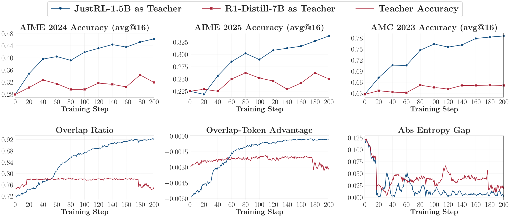
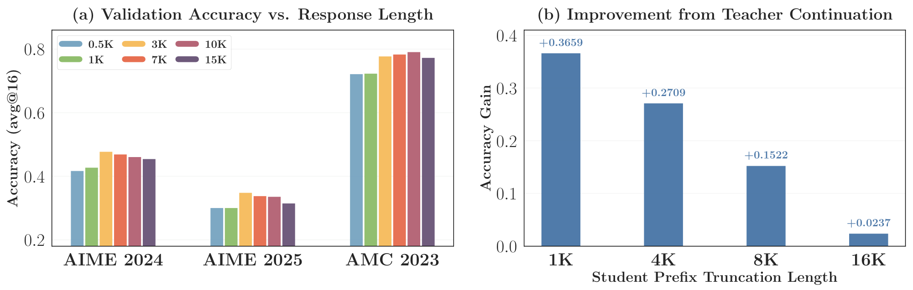
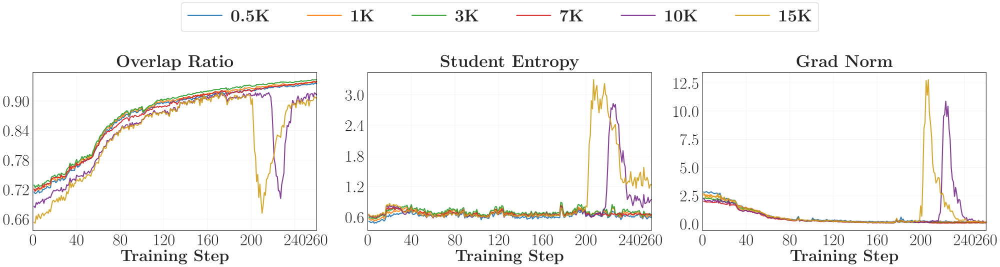
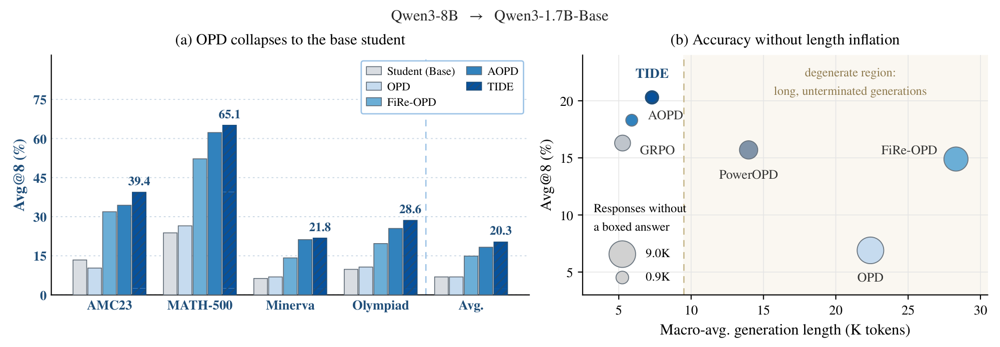
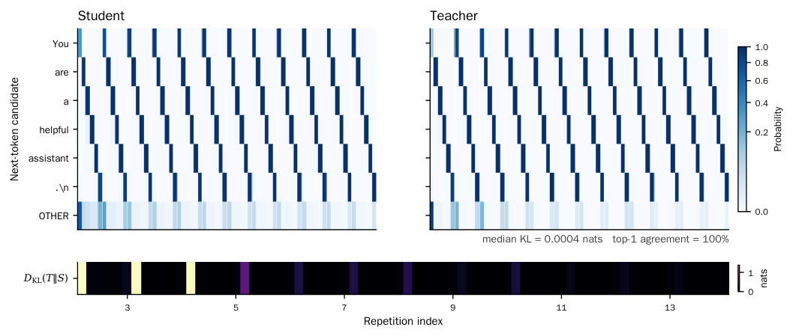
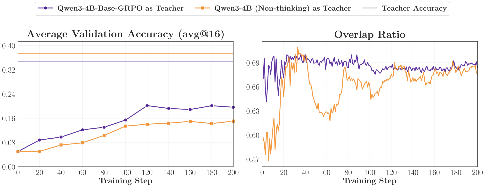
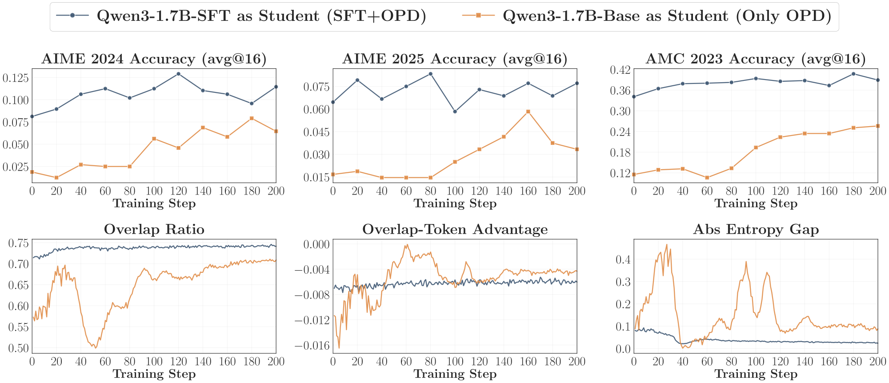
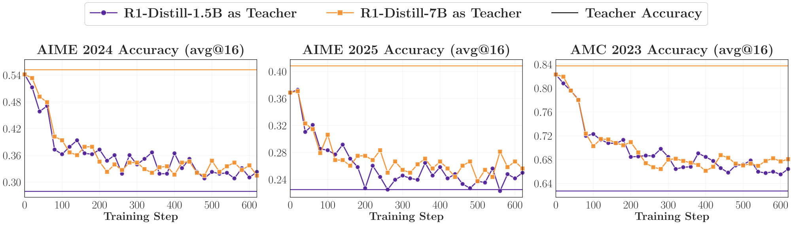

# Sampled-token 与 Full-vocab 失败复现方案

更新：2026-10-25。状态：模型／长度对照的 sampled/full、reuse16 与独立师生验证已接入[统一入口](#failure-launcher)；E25/E27 的两步 sampled-token 短测及 Full-KL 接入测试已完成，见[短测验收](2026-10-24-OPD实现验收与对齐诊断.md#smoke-validation)。正式 250 步 failure 观察尚未启动。

目标是采用论文中的模型对与失败诱因，在我们统一的 **DAPO → MATH-500／AMC23／AIME25** 协议下，先运行 sampled-token OPD，确认是否出现停滞、退化或长窗口失稳，再调用已接入的 full-vocab reverse-KL 实现进行配对实验。**比较 sampled-token 与 full-vocab，并为每种模型／长度／目标增加16次批内复用版本；不加入 top-k 蒸馏、任务奖励 RL 或 OPSD。** 原论文中的 top-k 只作为来源设置记录。

## 1. 首轮实验矩阵

| Sampled / Full | Reuse16：Sampled / Full | Student：更新对象 | Teacher：冻结监督者 | Train response cap | 研究问题 |
| --- | --- | --- | --- | ---: | --- |
| E15/E13，成功对照 | E33/E17 | `deepseek-ai/DeepSeek-R1-Distill-Qwen-1.5B` | `hbx/JustRL-DeepSeek-1.5B` | **7168** | 当前模型对在短窗口下应能正常学习，作为方法与管线对照 |
| E23/E24，长窗口 | E34/E35 | 同 E15/E13 | 同 E15/E13 | **15360** | 拉长学生轨迹后，sampled-token 是否后期失稳，full-vocab 是否改善 |
| E25/E26，强教师不奏效 | E36/E37 | `deepseek-ai/DeepSeek-R1-Distill-Qwen-1.5B` | `deepseek-ai/DeepSeek-R1-Distill-Qwen-7B` | **7168** | 换成更大同系列教师后，是否出现收益很小／停滞 |
| E27/E28，强师生失配 | E38/E39 | `Qwen/Qwen3-1.7B-Base` | `Qwen/Qwen3-8B` | **7168** | 是否出现 TIDE 报告的学习停滞、重复生成和答案缺失 |
| E29/E30，初始思考模式不兼容 | E40/E41 | `Qwen/Qwen3-1.7B-Base` | `Qwen/Qwen3-4B`，Non-thinking | **7168** | 对齐较低的 Base 初始化下，sampled 是否学习受限，full 是否改善 |
| E31/E32，低重叠在线学习受限 | E42/E43 | `Qwen/Qwen3-1.7B`，Non-thinking | `Qwen/Qwen3-4B-Instruct-2507` | **4096** | 在原论文匹配 4K 的条件下，full 是否缓解 sampled 在线轨迹的弱收益 |

主实验有六组模型／长度设置，每组包含 sampled-token／full-vocab 及各自的 reuse16 版本，全部跑齐共24个训练 run。先运行 sampled，full 优先覆盖确认出现 failure 的设置及 E15/E13 成功对照。不同 student 的绝对分数不直接用来判断 loss 优劣，核心是同一设置内部的 sampled／full 比较。

终止协议和 teacher 输入的实验结论见 [运行时终止协议方案](2026-10-24-OPD实现验收与对齐诊断.md#runtime-eos)。E27–E30 的原生 EOS 与 ChatML-stop 必须区分记录，同一个 sampled/full 配对使用相同协议。受集群限制，运行时追加停止 ID 已接入训练配置，并通过 105 项回归和 16 个真实引擎用例；公共入口默认仍不追加；E27–E30 的实验预设显式追加，正式训练尚未启动。

### 1.1 模型与权重准备

2026-10-24，本机已将这些实验所需的8个checkpoint实体放入仓库同级 `model/`：两个原有 1.5B 模型、R1-Distill-7B、Qwen3-1.7B-Base、Qwen3-1.7B、Qwen3-4B、Qwen3-8B、Qwen3-4B-Instruct-2507。原分散目录保留作来源，运行入口统一使用 `MODEL_ROOT`。无需额外准备 30B／235B 教师。开发机资产状态需独立核对；导入／下载及分片检查见[资产准备](../资产准备.md)。

### 1.2 统一训练设置：采用我们的协议

下表是本轮拟定设置，不冒充原论文的逐项复现。未特别列出的执行细节沿用本仓现有数学配方，同一设置中的两个 loss 保持一致。

| 参数 | 本轮设置 |
| --- | --- |
| Train data | 本项目现有 DAPO 数学 parquet，当前 17917 条记录；不切换为其他论文的英文去重子集 |
| Prompt 内容 | 保持本项目已处理的题目与模板，不为某个 loss 单独改成 teacher-aligned 提示 |
| Prompt batch size | **64** |
| Rollouts per prompt | **1** |
| 每批生成回答数 | **64** |
| PPO mini-batch 配置 | **64** |
| PPO epochs／复用 | 基础版 **1**；reuse版 **16**，对同一批轨迹执行16次actor更新，不额外生成rollout |
| LR | **1e-6** |
| Optimizer | **AdamW，β=(0.9,0.999)，weight decay=0.01** |
| Scheduler／warmup | **constant／0** |
| Gradient clipping | **1.0** |
| Train temperature／top-p | **1.0／1.0** |
| Sampling top-k | **-1，不截断解码词表**；这不是 top-k 蒸馏 |
| Loss aggregation | **token-mean**，按有效 response 词元聚合 |
| Task reward／额外 reference KL／entropy bonus | 不加入蒸馏目标 |
| Sampled 分支 | 沿用当前`k1 + policy gradient`、current 信号、vanilla 路径；记录实际 clip 情况 |
| Full 分支 | `full_reverse_kl`，对完整条件分布直接求梯度；不另加 sampled ratio 或 PPO clipping |
| 初步种子 | **42**；正式结论补至少 3 个种子，所有方法用相同的种子集合 |
| 数据顺序 | 沿用本项目训练 shuffle 设置；相同数据 seed，设置内部保持一致 |
| 观察预算 | **统一250个outer steps**；batch=mini-batch=64、n=1，无跳过更新时基础版250次、reuse16版4000次optimizer更新 |
| 验证节点 | 训练前、每 20 步、最终 250 步；同组方法一致 |
| Checkpoint | 每100个outer steps保存，并在最终250步保存；最多保留最近4个，可通过 `trainer.max_actor_ckpt_to_keep` 覆盖 |

此处比较固定rollout批次数与新增prompt预算，不是固定optimizer更新次数；reuse16会增加反向计算量。等更新预算的 E18–E20 保留原定义，见[等预算实验](../2026-10-24-师生验证与等更新预算实验.md)。实际成功更新数以日志中的跳过更新记录为准。

选择 250 步是为了覆盖原文图 12 中约 200 步后出现的长窗口异常；如果在 200 步结束，可能刚好错过失稳。预算是预先设定的，不根据哪个 checkpoint 最差来挑 failure。250 批会消费 16000 条训练记录，少于当前 DAPO 的 17917 条；实际仍以过滤后可用数据量和成功更新计数为准。

原论文 Rethinking/TIDE 使用 64 prompts × 4 rollouts，实际一批 256 条回答；**本轮继续使用我们的 64×1**。因此本轮是在我们的协议中检验论文现象是否迁移，不要求曲线或分数复刻到原值。

### 1.3 Response cap 与上下文窗口

**训练 response cap：E15/E13、E25–E30 为 7168，E23/E24 为 15360，E31/E32 为 4096；验证 response cap 统一 31744。** E31/E32 保留 Semi-OPD 主曲线的 4K 条件，不能把它换成表 1 的 16K OPD 后仍称为匹配长度对照。不随训练 cap 缩短验证回答预算，否则可能隐藏长序列退化。

E15/E13、E23–E26 沿用 DeepSeek 模型的上下文配置。E27–E30 的 Qwen3-1.7B-Base 声明总上下文 32768，因此适配 E27–E30 时须把 prompt 预算控制在 1024 以内，启动脚本已修正为 student 窗口等于 prompt＋最大 response，不再额外加 1，因此 1024＋31744 恰好为 32768。不能原样沿用 4096 prompt＋31744 response。若 E27–E30 因长度过滤改变可用记录数，单独记录；各组内部 sampled/full 使用同一过滤结果。E31/E32 的 Qwen3-1.7B 配置窗口为 40960，4096 prompt＋31744 response 可以容纳；仍需核对实际生成引擎窗口。[^qwen-configs]

这项上下文适配不要求现在降低所有模型的验证 response cap。DeepSeek 与 Qwen 模型还应分别使用正确的 chat 协议；E27–E30 不得以 post-trained `Qwen3-1.7B` 替代 Base 初始化。E31/E32 使用 post-trained student，训练与验证均固定 Non-thinking。E29/E30 的 teacher 独立评测也固定 Non-thinking；teacher 评分时接收 student 的同一词元前缀，不另行生成一段 thinking 内容。

### 1.4 统一验证设置

| 参数 | 本轮设置 |
| --- | --- |
| Validation 1 | **MATH-500:500 题** |
| Validation 2 | **AMC23:40 题** |
| Validation 3 | **AIME25:30 题** |
| 每题回答数 | **16**，全套共 9120 条回答 |
| Temperature／top-p | **0.7／0.9** |
| Response cap | **31744** |
| 主指标 | 每个基准的 mean accuracy，即相应的 avg@16 |
| 补充指标 | pass@16、majority@16、长度分位数、停止原因、截断与答案缺失 |
| 三项汇总 | 若报告总体均值，使用三个基准等权均值，并同时展示分项；不把 9120 条回答直接混合后与论文 macro 平均比较 |
| 判分器 | 本仓现有数学判分器，在同一设置各臂保持一致 |
| 原始参考 | 用同一验证流程重新评测未经本轮训练的 student 与 teacher |

本仓判分器在无 boxed 格式时有末尾文本的回退判分；TIDE 原文采用严格 boxed 判分。本文保留我们的主指标，另看 format/答案缺失诊断。不能把原文严格格式错误率直接当作我们宽松数学正确率的补集。

<a id="failure-launcher"></a>
### 1.5 统一入口与资源设置

[run_math_opd_ablation_fsdp2.sh](../../run_math_opd_ablation_fsdp2.sh) 使用上表编号。短窗基础版直接复用 E15（sampled）与 E13（full），E21/E22 分别为二者的兼容入口，生成的默认实验名也使用规范编号。短窗 full reuse16 复用 E17，其他 reuse16 配置为 E33–E43。编号不再遵循通用奇偶规则，以表中方法为准。

在模型实验编号后追加 `-valid-student` 或 `-valid-teacher` 可独立验证对应原始模型；reuse版本共享相同初始权重，不需要重复评测。E14保留低学习率变体、E16保留reuse4变体，二者也使用250步和100步保存。E1–E12及等更新预算E18–E20保持各自原有定义。

```bash
# 先检查配置；去掉 DRY_RUN=1 后才会运行。
CUDA_VISIBLE_DEVICES=0,1,2,3 STUDENT_GPUS=4 DRY_RUN=1 \
  bash examples/mirroropd/run_math_opd_ablation_fsdp2.sh E25
CUDA_VISIBLE_DEVICES=0,1,2,3 STUDENT_GPUS=4 DRY_RUN=1 \
  bash examples/mirroropd/run_math_opd_ablation_fsdp2.sh E26
CUDA_VISIBLE_DEVICES=0,1,2,3 STUDENT_GPUS=4 DRY_RUN=1 \
  bash examples/mirroropd/run_math_opd_ablation_fsdp2.sh E27-valid-teacher
```

Full-vocab KL 已适配完成，基础版 E13/E24/E26/E28/E30/E32 与 reuse16版 E17/E35/E37/E39/E41/E43 均调用现有 `run_full_reverse_kl.sh`。设置好本机 `PYTHON_BIN`、`MODEL_ROOT`、`DATA_ROOT` 后，例如：

```bash
# 短窗 full，250批rollout，每批更新一次。
CUDA_VISIBLE_DEVICES=0,1,2,3 STUDENT_GPUS=4 \
  bash examples/mirroropd/run_math_opd_ablation_fsdp2.sh E13

# 相同模型、数据、长度和学习率，每批复用16次，共4000次更新尝试。
CUDA_VISIBLE_DEVICES=0,1,2,3 STUDENT_GPUS=4 \
  bash examples/mirroropd/run_math_opd_ablation_fsdp2.sh E17
```

2026-10-25 起，E13与E22不再区分为不同运行预算，E15与E21亦相同。此前已运行实验的冻结配置仍记录当时的200步等参数，不能按今天的默认值重新解释历史曲线。以上仅记录启动方式，正式训练尚未执行。

训练入口默认 DAPO、64×1、LR=1e-6、250个outer steps；每批更新次数由基础版1或reuse版16决定；训练前、每20步及最终步验证。Full 分支复用现有 `precompute + async_write + prefetch` 实现，仍可用 `FULL_KL_*` 环境变量覆盖。环境变量覆盖预设默认，命令末尾的 Hydra 参数最后生效；修改 batch、复用次数或步数后，更新预算也会随之变化。

| 设置 | 学生训练／验证并发上限 | 教师独立验证并发上限 | 协议 |
| --- | ---: | ---: | --- |
| E15/E13、E23/E24 | 128 | 64 | DeepSeek；E23/E24 仅训练 response cap 更长 |
| E25/E26 | 128 | 32 | DeepSeek |
| E27–E30 | 12 | 32 | Qwen Non-thinking；仅 Base student 追加 stop ID151645、prompt cap1024 |
| E31/E32 | 32 | 32 | Qwen Non-thinking；prompt cap4096 |

并发是每个TP1实例的上限；共享训练期间训练与验证复用同一个rollout引擎。显存比例0.65、token budget8192、Graph沿用公共配置。以上只是[已测的资源起点](2026-10-24-OPD实现验收与对齐诊断.md#concurrency-calibration)，尚未找到高并发吞吐上限；后续调优已暂停。教师独立验证将教师作为生成模型，使用自己的4096 prompt预算；这些并发值不控制shared-sync训练中的FSDP teacher评分。

原始基线共有8个不同checkpoint。运行 `E15-valid-student`、`E27-valid-student`、`E31-valid-student` 和 `E15-valid-teacher`、`E25-valid-teacher`、`E27-valid-teacher`、`E29-valid-teacher`、`E31-valid-teacher` 即可覆盖；E15/E13、E23–E26共享student，E27–E30共享student，E15/E13、E23/E24共享teacher，无需重复生成。独立验证关闭蒸馏及checkpoint保存，不执行optimizer更新。

<a id="ac-teacher-pairs"></a>

## 2. E15/E13 与 E25/E26：同一个学生，成功教师与不奏效教师

### 2.1 论文原始现象

Rethinking OPD §4.1 固定 R1-Distill-1.5B 学生，对比 JustRL-1.5B 与 R1-Distill-7B 教师。JustRL 教师带来持续提高；7B 教师下的改进很小，训练动态停滞。原文默认配置是 student-top-16，训练 DAPO、64×4 回答、LR=1e-6；评测 AIME24/AIME25/AMC23 的 avg@16，temperature=0.7、top-p=0.95。[^rethinking]



图 1：Rethinking OPD v2 原文图 6。上排为三个原始验证基准，下排为 overlap、优势与熵差。作者原图转换为 PNG；它不是本项目结果。[^rethinking]

这张图支持“较高教师分数不保证在学生前缀上形成有效学习”，而不是证明 7B 教师对任何学生都无效。作者对“可迁移新能力”的解释应与实验现象区分。

### 2.2 我们怎样检验

| 项目 | E15/E13 | E25/E26 |
| --- | --- | --- |
| Student | 同一个 R1-Distill-1.5B 初始 checkpoint | 同左 |
| Teacher | JustRL-1.5B | R1-Distill-7B |
| Train response cap | 7168 | 7168 |
| 本轮验证 | MATH-500／AMC23／AIME25，avg@16 | 同左 |
| 判断 | 作为正常学习对照 | 检查相对于 step 0 及 E15/E13 是否出现弱收益或停滞 |

原文的 student-top-k 现象迁移到 sampled-token 后是否仍成立，需要实测。若 E25/E26 在我们的协议中能正常学习，应记录“未复现该 failure”，不要通过换验证集或挑差 checkpoint 强行制造失败。Full-vocab 的比较继续固定 E25/E26 的 student、teacher 与长度，不把 teacher 换回 JustRL。

<a id="b-long-horizon"></a>

## 3. E23/E24：同一个成功模型对，扩大训练窗口

### 3.1 原文的窗口与训练动态

Rethinking OPD §6.1 固定 R1-Distill-1.5B student 和 JustRL-1.5B teacher，比较 0.5K、1K、3K、7K、10K、15K。原文认为中等长度具有较好的准确率与稳定性，长窗口会遇到后期失稳。[^rethinking]



图 2：原文图 11。左侧是原始三个验证集在不同训练长度下的准确率；右侧是让教师接续不同长度学生前缀所带来的收益。PNG 截取自论文 PDF 图区域，保留原坐标与数值。[^rethinking]



图 3：原文图 12。15K 与 10K 曲线在约 200 步之后出现 overlap 骤降、学生熵及梯度范数尖峰。正文提到 200 步的长度比较，但该动态图延伸到约 260 步；这也是本轮预先把观察预算设为 250 步的原因。原图只报告这些训练诊断，不能把它改写成所有验证集准确率都归零。[^rethinking]

### 3.2 我们怎样检验

E15/E13 与 E23/E24 只改变训练 response cap：7168 → 15360。训练数据、模型对、LR、batch、n、验证和 250 次更新预算相同。先看 E23/E24 的 sampled-token 是否相较 E15/E13 出现持续退化、重复或长回答异常，再用 E24 比较。

Full-vocab 可能减少局部动作抽样噪声，却不会保证长前缀上的教师分布仍然可靠。因此可能出现三种结果：

- E23 失稳、E24 稳定且验证改善：支持完整词表对该 failure 有缓解作用。
- 两者都失稳或退化：说明问题可能超出单词元监督，涉及访问状态或局部目标。
- 两者都正常：本轮协议未复现原文长窗 failure，不能据此宣布 full“救回”。

判定以验证与生成行为为主。原文的 overlap/熵图用于理解失败；目前 full 路径没有同口径的所有诊断字段，不把缺失值补成零，也不拿不同口径的 loss 数值直接比较。

<a id="d-mismatch"></a>

## 4. E27/E28：Qwen3-Base 与较强教师的明显失配

### 4.1 原文主结果

TIDE §4 与附录 D 使用 Qwen3-1.7B-Base student、Qwen3-8B teacher。普通 sampled-token OPD 的九项 macro Avg@8 为 6.9%，与未训练 student 相同；同时平均回答显著变长、可解析 boxed 答案减少。原文用 TIDE 缓解了这些问题，我们仅借用该 failure pair，当前实验不实现 TIDE 的 top-k 修复。[^tide]



图 4：TIDE v1 原文图 1，截取自 PDF 第 1 页的原图区域。图中的 TIDE 及其他方法是原论文结果，不是本轮计划的训练臂。[^tide]

下表摘录原文表 1 中与我们三个 valid 对应的列，并保留原文九项均分。单位为百分比；均为原文 Avg@8，不能当作本项目 avg@16 的实测值。

| 原文模型／方法 | MATH-500 | AMC23 | AIME25 | 原文九项 macro Avg@8 |
| --- | ---: | ---: | ---: | ---: |
| 未训练 Qwen3-1.7B-Base | 23.8 | 13.4 | 0.0 | 6.9 |
| Qwen3-8B teacher | 83.3 | 68.8 | 23.3 | 36.6 |
| Sampled-token OPD | 26.5 | 10.3 | 1.2 | 6.9 |
| TIDE，原文修复参考 | 65.1 | 39.4 | 4.6 | 20.3 |

按表内已经舍入的三个对应基准数值简单平均，原 student 约 12.4%、OPD 约 12.7%；这只是原表的算术整理，说明其弱收益并非完全由其他六个基准造成，不是新评测结果。[^tide]

原文表 3 另报告以下生成诊断，口径是其九个基准上的宏平均：

| 方法 | 平均 response 长度 | 无可解析 boxed 答案比例 |
| --- | ---: | ---: |
| Sampled-token OPD | 22395 | 65.5% |
| TIDE，原文修复参考 | 7294 | 5.4% |



图 5：TIDE 原文图 2，直接保存作者 PNG。学生与教师在重复前缀上高度一致，但整个回答仍退化；这是一个代表性案例，不是所有样本的普遍统计。[^tide]

作者将 E27/E28 按初始 top-k overlap 归为强失配，但没有给出可直接引用的初始百分比。表 6 的未舍入 Macro Avg@8 为 6.87→6.87，平均长度为 13,465→22,395，Distinct-4 为 0.099→0.062。表 7 测得非循环 student-deficit 候选的学生概率中位数仅为 $2.04\times10^{-4}$，对应平均约 4,909 次抽样才观察一次；这支持“教师偏好候选难以被 sampled-token 监督触及”的解释。Deficit-only 分支可达 18.32，但使用教师加权交叉熵，不能据此保证 full-vocab RKL 同样有效。[^tide]

### 4.2 我们怎样检验

E27/E28 的训练 response cap 仍用 7168。原文在这一训练 cap 下就观察到验证时很长的退化回答，因此不需要先把 E27/E28 也改为 15K。验证保持 31744，让重复和不结束的问题有机会显现。

与原文相比，本轮将 64×4 改为 64×1，将九个验证基准改为我们的三个，将 avg@8/top-p0.95 改为 avg@16/top-p0.9，并使用现有判分器。因此我们检查的是“低收益＋生成退化是否仍出现”，不要求复刻 6.9%、22395 或 65.5% 这些具体数字。

## 5. E29/E30：Base 学生与 Non-thinking 4B 教师的初始失配

### 5.1 原论文现象与初始化干预

固定 `Qwen3-1.7B-Base` student 时，Non-thinking `Qwen3-4B` teacher 的初始 top-16 overlap 约 0.59，Base-GRPO teacher 约 0.67。前者独立评测分数更高，却教得更差。其 student 验证均分仍约从 5% 升至 15%，所以应归为学习受限，不能称为完全不学习。数值为原图近似读数。[^rethinking]



图 6：原文图 2，原 SVG 按比例转 PNG；较低初始 overlap 的橙色组后续准确率较低。这里的 teacher 是原版 `Qwen/Qwen3-4B` 关闭 thinking，不能替换成 `Qwen3-4B-Instruct-2507`。

原文§5.1 固定同一 Non-thinking teacher，先用其 200K 条 OpenThoughts 数学回答对 student 做 SFT，再做 OPD。图 8 中，初始 overlap 约从 0.57 提高到 0.71，随后对齐更稳定、三个验证集表现更好。两条 OPD 曲线使用相同的去重后约 30K 条 OpenThoughts prompts；这组冷启动实验并非 DAPO。SFT 同时改变能力与策略，不能把全部收益归因于 overlap 数值本身。[^rethinking]



图 7：原文图 8，原 SVG 按比例转 PNG。作者默认训练使用 student-top-16；借用该模型对改跑 sampled-token，是我们拟检验的新条件。

### 5.2 原设置与本轮设置

| 参数 | 原论文§3.1 直接 OPD | 本轮 E29/E30 |
| --- | --- | --- |
| Student／teacher | Qwen3-1.7B-Base／原版 Qwen3-4B Non-thinking | 同左 |
| Train data | DAPO-Math-17K | 本项目 DAPO，当前 17917 条 |
| Prompt batch／rollouts per prompt | 64／4 | 64／1 |
| LR | 1e-6 | 同左；优化器与调度沿用§1.2 |
| Prompt／response cap | 1024／7168 | 同左 |
| 蒸馏目标 | 默认 student-top-16 | sampled-token，然后 full-vocab RKL |
| 验证 | AIME24/AIME25/AMC23；avg@16，T=0.7、p=0.95、cap31744 | MATH-500/AMC23/AIME25；avg@16，T=0.7、p=0.9、cap31744 |
| 观察预算 | 原文一轮训练，图 2 展示至 200 步 | 统一250批；基础版250次、reuse16版4000次更新尝试 |

E29/E30 直接从 Base 开始，不加入 SFT 冷启动；冷启动曲线用于证明初始化对后续 OPD 的影响。检查低初始对齐下 sampled 是否出现平台、波动或明显弱收益，再看 full 是否能继续推进。与 E27/E28 相比，E29/E30 保持学生与本轮 cap 相同，换成原版 4B Non-thinking teacher；这不是只改变参数量的教师规模消融。

## 6. E31/E32：Post-trained 学生与 2507 教师的低重叠在线学习

### 6.1 原论文的匹配长度对照

模型固定为 `Qwen/Qwen3-1.7B` student（Non-thinking）与 `Qwen/Qwen3-4B-Instruct-2507` teacher。Semi-OPD 用初始学生一次生成的回答缓存继续蒸馏，普通 OPD 则每步重新生成；两者的主对照都使用 sampled-token reverse KL。该 student 是 post-trained，不是 E29/E30/E27/E28 的 Base。[^semi]

| 原文表 3 的指标 | 数值／条件 |
| --- | --- |
| 初始 top-64 overlap | **62.5%**，在初始学生轨迹上测量 |
| 两方法共同训练 response cap | **4096** |
| 最后共同评测步的 Semi−OPD | **+9.5 个百分点**，四基准等权 avg@32 |
| 共同训练区间内的归一化曲线面积收益 | **+7.09 个百分点** |

这组普通 OPD 能提升，并非完全学不动；现象是在线更新轨迹的效果明显逊于固定初始学生轨迹。17 组模型对中，初始 overlap 与 Semi-OPD 相对收益的相关系数为 −0.73；它是跨模型相关性，不能作为低 overlap 独立致害的证明。[^semi]

### 6.2 原论文公开分数与评测口径

下表摘录原文表 1，数值为百分比。训练后方法报告 step 60/80/100 的平均评测；四基准使用 avg@32、temperature=1、top-p=1。**此表的 OPD 使用 16K，而 Semi-OPD 使用 4K；它展示论文已有结果，不能拿 39.8−26.2 当作纯粹由 on/off-policy 造成的收益。** 本轮 E31/E32 的长度依据是上面的匹配 4K 对照。[^semi]

| 方法 | Train response cap | AIME24 | AIME25 | AIME26 | HMMT Feb26 | 四项平均 |
| --- | ---: | ---: | ---: | ---: | ---: | ---: |
| 初始 student | — | 12.6 | 9.6 | 7.4 | 6.3 | 9.0 |
| Teacher | — | 60.4 | 46.0 | 52.2 | 31.2 | 47.5 |
| 标准 OPD | 16384 | 35.8 | 25.5 | 23.3 | 20.1 | 26.2 |
| Semi-OPD | 4096 | 50.3 | 38.9 | 41.8 | 28.0 | 39.8 |

作者提出，低对齐模型对的在线回答变长、异常增加，后缀越来越偏离教师熟悉的分布；固定初始轨迹能保留较短而完整的推理过程。长度消融、正优势词元比例及切换训练方式后的曲线支持这一解释。§5 的低重叠实验还显示，从较好的离线 checkpoint 切换为 OPD 后，分数会趋向相同 rollout cap 下直接 OPD 的水平。这是有限实验中的平台现象，不是全局收敛定理。[^semi]

### 6.3 原设置与本轮设置

| 参数 | 原论文匹配长度对照 | 本轮 E31/E32 |
| --- | --- | --- |
| 训练数据 | DAPO 英文去重子集，14116 条 | 本项目 DAPO，当前 17917 条 |
| Prompt batch／每题 rollout | 128／1 | 64／1 |
| LR | 1e-6，constant，无 warmup | 同左 |
| Optimizer | AdamW，β=(0.9,0.999)，wd=0.01，grad clip=1 | 同左 |
| Train prompt／response cap | 2048／4096 | 4096／4096，沿用本项目 prompt 预算 |
| Train temperature／top-p | 1／1 | 同左 |
| 原始监督 | sampled-token RKL；OPD 与固定初始轨迹对比 | 在线 sampled-token 与在线 full-vocab RKL |
| 训练预算 | 1 epoch，约 110 步 | 250 次更新 |
| 验证 | AIME24/25/26、HMMT Feb26；avg@32，T=1、p=1、cap32768 | 本项目三 valid；avg@16，T=0.7、p=0.9、cap31744 |

本轮不加入 Semi-OPD 缓存臂，也不加入 teacher-SFT。我们检验 full-vocab 能否改善在线 sampled 的学习轨迹，不能直接把差值解释为复现了论文的 +9.5。两种 loss 都在 E31/E32 内固定 4096 cap；E31/E32 与 E29/E30 的跨组差值同时包含初始化、teacher 和长度差异，不能当作单变量消融。

## 7. 从 Sampled-token 到 Full-vocab 的执行顺序

1. **建立参考。** 对每个模型对，使用同一三 valid 协议评测初始 student 与 teacher。
2. **先跑 E15/E23 的 sampled。** 现成资产可检验 7K 成功对照和 15K 长窗现象，两组均完成预设 250 步观察，不只保留最好点。
3. **补 E25/E27/E29/E31 的 sampled。** E27/E29/E31 是初始失配的重点；E25 保留强教师停滞对照。E25/E27 工程短测已有记录，其余组合核对权重、模式、上下文和 tokenizer 后运行。
4. **运行 E13/E24/E26/E28/E30/E32 的 full-vocab 配对。** 复用已接入实现，优先覆盖出现 failure 的设置及 E13 成功对照，基础版固定相同初始化、数据和预算，每批更新一次；随后按表运行各自reuse16版本，固定250个outer steps。
5. **报告分项与轨迹。** 同时展示 step 0、step 200、最终 250 及完整验证曲线；准确率、长度和答案缺失一起解释。

具体代码边界、已实现能力和未完成验收统一见[实现状态](2026-10-24-OPD实现验收与对齐诊断.md)与[E25/E27 短测](2026-10-24-OPD实现验收与对齐诊断.md#smoke-validation)。E25/E27 短测、E25/E26、E29–E32 前向探针及 EOS 边界验证不能替代本方案的正式 failure 观察。

“Full 救回”需要同一 setting 下的任务改善或退化缓解。单独看到 full KL 下降不能证明成功；如果 sampled 原本没有失败，full 更高的分数只能说明方法收益，不能称为 failure 恢复。

## 8. 对齐程度与收敛诊断

按固定初始前缀和当前 rollout 两条路径观察对齐，区分正常／重复、正确／错误与前缀深度。理论上限、论文残差平台、高一致失败反例及完整判断表统一见[对齐诊断](2026-10-24-OPD实现验收与对齐诊断.md#alignment-theory)。这些是诊断建议，不表示所有指标均已接入日志。

<a id="appendix-reverse"></a>

## 附录 A：更高分教师仍导致负迁移的指标核对

原文§3.3 明确指出，R1-Distill-7B 的 benchmark 分数略高于 JustRL-1.5B，但以它为 teacher 蒸馏 JustRL 时，student 仍显著下降。这组异常应表述为**“更高分 teacher 仍导致负迁移”**，不能解释成“teacher 较弱，所以 student 向下收敛很正常”。[^rethinking]

下表为图 5 的近似读数，单位为百分比，指标是原文 avg@16；末段约为图中 600 步附近。数字用于确认变化方向，不替代作者未随图发布的原始评测日志。

| 基准 | R1-Distill-7B teacher 水平线 | JustRL student 训练前 | 以 7B 为 teacher 蒸馏后的 student 末段 |
| --- | ---: | ---: | ---: |
| AIME2024 | 约 55 | 约 54 | 约 32 |
| AIME2025 | 约 41 | 约 37 | 约 26 |
| AMC2023 | 约 84 | 约 82 | 约 68 |



图 A1：原文图 5。橙色水平线为 7B teacher 的独立准确率，橙色下降曲线是该 teacher 监督下 student 的准确率。紫色曲线是使用 1.5B pre-RL teacher 的另一组对照。三项基准上，7B teacher 均高于 student 初始点，而 student 后续却下降。[^rethinking]

### A.1 为什么教师更高分仍可能下降

Teacher 独立 accuracy 评估的是它从问题开始自行生成完整解答的表现；OPD 在训练中使用的是 teacher 对 student 生成前缀的条件分布。两者不是同一个评价对象。局部词元 KL／log-ratio 优化没有“每次更新都提高任务 accuracy”的保证。

如果 student 能完整表达并最终恢复 teacher 的生成策略，最终 accuracy 应接近 teacher；这里并没有观察到这种完整恢复。原文把回退解释为思考模式及局部监督的迁移，而非简单复制教师的独立 benchmark 能力。相似曲线本身还不足以证明唯一机制，也不能据此预断 full-vocab 一定无效。

原文§6.2 另有一个相关但不同的对照：student 是 R1-Distill-1.5B，成功 teacher 为 JustRL-1.5B、失败 teacher 为 R1-Distill-7B。两种 teacher 的轨迹均值奖励区分正确／错误回答的 AUROC 分别约为 0.73、0.75；失败教师并非没有全局正确性信息。作者提出局部梯度方向不一致、聚合后抵消的假说，但明确未直接验证。**这些 AUROC 属于§4.1 的 student 配置，不能当作图 5 中 JustRL student 的测量值。**[^rethinking]

这组仍是有价值的 failure 候选。它暂列附录，仅表示这些模型／长度组合 尚未增加 JustRL 作为 student 的实验臂，不表示它因教师弱而应被排除，也不表示 full-vocab 已被证明救不回。若后续纳入，train response cap7168，继续使用本轮 DAPO／三 valid 协议，先 sampled 再 full；词表对齐需求与 E25/E26 相同。

<a id="appendix-excluded"></a>

## 附录 B：排除与后置的设置

“后置”表示有研究价值，但不进入这些模型／长度组合；“排除替换”表示不能把它当作所选 setting 的等价替代。原文参数如需追查，见[核对档案](../research/2026-10-24-OPD失败复现设置与Full-vocab对照.md)。

| 设置 | 状态 | 原始现象／研究方向 | 本轮处理理由 |
| --- | --- | --- | --- |
| JustRL-1.5B student ← R1-Distill-7B teacher | 后置，非排除 | 更高分 teacher 仍使 student 下降，指标见附录 A | 这些模型／长度组合 尚未增加这一 student 初始化；不能以“teacher 较弱”或“full 必然无效”为排除理由 |
| Qwen2.5-7B-Instruct ← OpenThinker3-7B | 后置 | Revisiting 中 AIME24 负迁移，但五项均分上涨 | 最直接的退化基准 AIME24 不在我们的三 valid 中；7B 学生也增加成本[^revisiting] |
| Qwen3 Thinking 学生 ← 30B-A3B／235B 教师 | 后置 | Semi-OPD 的部分低重叠配置出现在线退化 | 先用 dense 8B 教师测失配，控制成本及 MoE 适配范围[^semi] |
| Demystifying 中的作者自训 1.7B／4B-GRPO 教师 | 暂不做精确复现 | 教师失配与长度异常 | 原始 checkpoint 与部分训练参数不完整，不能拿另一篇同名 GRPO 模型替代[^demystifying] |
| ESR 的 LoRA 与跨家族组合 | 后置 | 长后缀监督退化，早停可改善 | 参数更新子集、tokenizer 与基线粒度同时变化；当前 full 路径也不支持 LoRA[^esr] |
| 用 Qwen3-1.7B post-trained 替代 E27/E28 的 Qwen3-1.7B-Base | 排除替换 | 更强初始化可能改变可教性 | E27/E28 要保留 Base 初始化这一失败条件，替换后是另一个实验 |
| Top-k 蒸馏、TIDE 修复算法本身 | 不列本轮训练臂 | 作为原始论文的设置／修复证据 | 当前任务只跑 sampled-token 与 full-vocab；原图中出现这些方法不代表我们会实现 |
| OPSD、视觉／Agent、额外任务奖励 RL | 排除 | 不同教师来源或任务／优化目标 | 不属于当前外部教师文本 OPD 范围 |

<a id="appendix-overlap"></a>

## 附录 C：高一致失败证据索引

Rethinking 的 overlap 动态、TIDE 的低 KL 循环／matched-only 消融、KAT 的低效后缀和理论解释已合并到[论文证据](2026-10-24-OPD实现验收与对齐诊断.md#alignment-evidence)，本处保留入口。原始论文图和当前模型／长度设置仍由本方案维护。

### 参考文献

[^rethinking]: Yaxuan Li 等。Rethinking On-Policy Distillation of Large Language Models: Phenomenology, Mechanism, and Recipe. arXiv:2604.13016v2，§3.1、§3.3、§4.1、§5.1、§6.1、图 2/5/6/8/11/12 及附录表 2。[版本化原文](https://arxiv.org/html/2604.13016v2)。本文引用原图，PNG 处理方式与权利信息见[图源说明](figures/README.md)。
[^tide]: Zichao Yu 等。Mismatch Matters: On-Policy Distillation Beyond Token Agreement. arXiv:2608.09836v1，图 1/2、表 1/3/6/7、附录 C/D。[版本化原文](https://arxiv.org/html/2608.09836v1)。表格为相关列的摘录，未重新评测或重建作者数据。
[^revisiting]: Revisiting On-Policy Distillation: Empirical Failure Modes and Simple Fixes. arXiv:2603.25562，§4.2 与表 1。[原文](https://arxiv.org/abs/2603.25562)
[^semi]: When Do We Need On-Policy Distillation? Distilling on Offline Student Rollouts Is Often Better. arXiv:2610.11291，§2–5 与附录 A。[原文](https://arxiv.org/abs/2610.11291)
[^demystifying]: Demystifying On-Policy Distillation: Roles, Pathologies, and Regulations. arXiv:2607.13399，§4–5 与附录 A。[原文](https://arxiv.org/abs/2607.13399)
[^esr]: Less is More: Early Stopping Rollout for On-Policy Distillation. arXiv:2605.27028，§2–5。[原文](https://arxiv.org/abs/2605.27028)


[^qwen-configs]: Qwen 官方模型配置。[Qwen3-1.7B-Base](https://huggingface.co/Qwen/Qwen3-1.7B-Base/blob/main/config.json)、[Qwen3-1.7B](https://huggingface.co/Qwen/Qwen3-1.7B/blob/main/config.json)、[Qwen3-4B](https://huggingface.co/Qwen/Qwen3-4B/blob/main/config.json)、[Qwen3-4B-Instruct-2507](https://huggingface.co/Qwen/Qwen3-4B-Instruct-2507/blob/main/config.json)。
