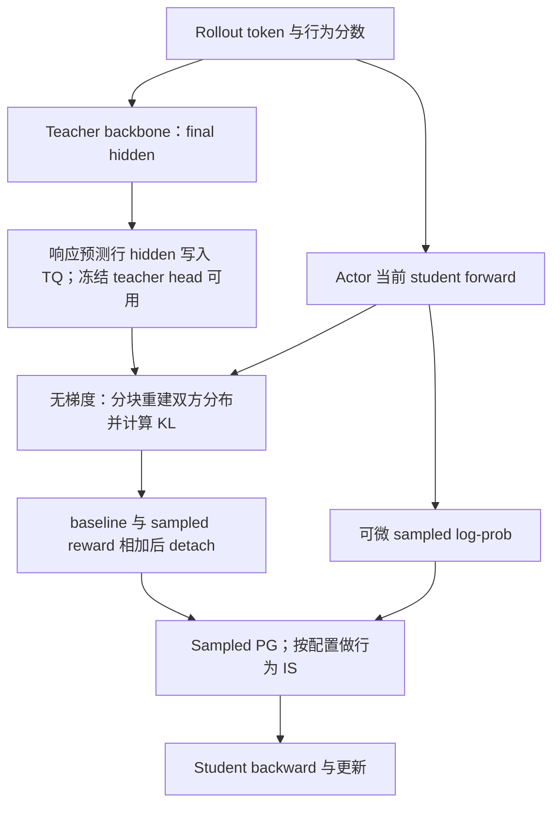

# Full baseline 与 Full-KL 实现计划

## 1. 目标、当前状态与资料边界

目标是在现有 FSDP2 shared-sync OPD 中实现两条独立训练路径：sampled-token + full KL baseline，以及直接 full-vocab reverse KL。两者共享 teacher hidden-state 数据通路、冻结 LM head 和部分归一化计算；训练目标、反向路径和指标分别维护。Math、code、IF 使用同一套工程实现，按领域验收数据和 mask。

2026-10-22 后续实施已接通单 teacher hidden payload、full reverse-KL loss、FSDP2 head 适配及有界异步读写，并完成真实模型四卡短程训练。Full baseline 留待后续。当前接口、调用链和优化状态以[源码走读](2026-10-23-Full-KL全流程源码走读.md)为准；初次验收证据见[验收记录](2026-10-22-Full-KL实现与验收.md)。本页保留 2026-10-22 的设计背景、baseline 待实现部分和原始阶段划分，不再复制已实现 Full-KL 的流程。

| 内容 | 唯一维护位置 |
| --- | --- |
| 符号及理论对应 | [统一符号](../符号约定.md) |
| KL 数值、baseline、直接梯度及 detach 推导 | [计算图与估计器](../theory/2026-10-22-Full-vocab计算图与四种更新.md#graphs) |
| 在线分块公式、payload、math 容量与历史步时预算 | [计算与显存预算](2026-10-22-词表蒸馏的计算与显存预算.md) |
| 用户提供的生产方案原文 | [Full-vocab OPD](reference/fullvocab-opd.md) |
| 原型独立实验、精度及计时边界 | [算子小实验](2026-10-22-Full-KL算子小实验.md) |

本文只维护接入计划、接口、优化优先级与验收条件。原始参考资料和预算已从 `opd-objective` 迁入本目录；算法调研、top-k 比较与通用估计器审计留在原目录，通过链接复用。

## 2. 接入位置与改动范围

已实现的 direct-full 模块职责与源码入口统一见[源码阅读顺序](2026-10-23-Full-KL全流程源码走读.md#reading-order)。未来 full baseline 需要补充的是无梯度条件 KL 数值接口、sampled score 与 baseline 的联合输出，以及 `_sampled_token_loss`/legacy PG 两个入口共享的 baseline 构造；不把 hidden/head 塞入现有 `kl_penalty_forward(log_prob, ref_log_prob)` 的 sampled 标量接口。

目标选择与数值后端应分开配置。Baseline 的 kind、current/anchor 刷新来源需要独立校验，不能从已有 `use_liger` 或 fused PPO 模型补丁推断 baseline 已经启用。

## 3. 配置与两条训练路径

### 3.1 拟新增配置

已实现 Full-KL 参数只在[配置入口](2026-10-23-Full-KL全流程源码走读.md#configuration)维护。Baseline 仍是后续计划，应明确 kind 与 current/anchor 刷新来源，并与 current/frozen advantage 的语义分别校验；当前没有可运行的 baseline 开关。

### 3.2 Full baseline：current 路径

令 $p=p_{k,n}$、teacher 为 $T$，对固定前缀使用 $K=\mathrm{KL}(p\Vert T)$。Actor 的 sampled advantage 为 $\operatorname{sg}(\log T_a-\log p_a+K)$，baseline 不参与反传；完整推导见上面的计算图文档。

首个可运行版本允许复用已有 student logits 计算 baseline，并只对 teacher 重建分块，但必须标注 student 的完整 logits 仍然存在，限制 micro-token 预算。优化版本在 head 前接入，同时产出可微 sampled log-prob 与 detached KL；其 backward 只处理 sampled score 的上游梯度。Liger 的标量 full-KL loss 不能直接充当这个接口。

若为了最小接入从 detached student hidden 再投影一次，应单独记录额外 head 计算；后续融合 sampled score 与 baseline 统计，消除重复 student projection。不要为 baseline 再执行一次完整 student backbone。

### 3.3 Full baseline：anchor 缓存变体

复用现有 old-log-prob 前向，在 `no_grad` 下算 $K(q_k,T)$，将每位置 scalar 写入 TQ，随后可释放 teacher hidden/head。Actor 更新使用该冻结 scalar 作为 action-independent baseline。其在多轮更新中不再等于 current KL；第一轮参数相同也应记录其来源为 anchor。

Baseline 的无偏控制变量解释要求完整支持、正确行为 IS 和停止梯度；PPO clipping、ratio 截断等会改变该解释。不能将当前动作自己的 k1 当成 baseline，否则它与负 k1 reward 抵消。新增辅助采样 baseline 必须检查条件独立性。

### 3.4 Full reverse KL：直接梯度路径

该路径已实现。完整 Mermaid、teacher/actor 阶段、old-log-prob 跳过条件与真实梯度路径统一见[完整调度](2026-10-23-Full-KL全流程源码走读.md#pipeline)和[算子实现](2026-10-23-Full-KL全流程源码走读.md#operators)。与上面的 baseline 方案区别在于 direct-full 对当前条件 KL 直接求导，baseline 仅提供 detached 条件标量。

## 4. Teacher 数据与模型适配

现有预测位置、TQ keys、冻结 head 与模型限制统一见[数据合同](2026-10-23-Full-KL全流程源码走读.md#hidden-io)及[初始化](2026-10-23-Full-KL全流程源码走读.md#initialization)。三份实际 teacher 的 hidden/head 重建证据已进入[初次验收](2026-10-22-Full-KL实现与验收.md#5-验收证据)，不再保留“尚需 P1 验证”的旧状态。

Baseline 扩展还需要 sampled teacher score，可与重建统计共算，或在首版额外提供该小 payload。Current baseline 必须随 student 更新重新计算；anchor baseline 可以只保留条件 scalar 并提前释放大 hidden，但必须标明其快照来源。多 teacher 的版本标记、head 缓存和路由属于后续接口设计，当前单 teacher payload 不包含这些扩展元数据。

多轮 IF 的模板、监督 mask 和正式验证协议需要独立接入；已有单轮 Qwen2 重建检查不替代多轮验收。

## 5. 算子与显存优化计划

### 5.1 数值接口与训练接口

Direct-full 的现有 backend 与 Liger 接入统一见[算子列表](2026-10-23-Full-KL全流程源码走读.md#operators)。本计划只保留 baseline 的数值接口：返回每位置 detached KL，必要时附 sampled teacher score；它不能直接复用一个只返回可微标量 full loss 的接口。

Liger 的具体方向与归约需按固定版本核对；历史接口来源见文末引用。[^liger-interface][^liger-implementation] 初始小实验未获得 Liger 的速度优势，证据保留在[算子小实验](2026-10-22-Full-KL算子小实验.md)，不由库名推断当前管线收益。

### 5.2 精度与进一步可省的工作

当前 Full-KL 的 FP32 projection、归约与梯度累积见[算子实现](2026-10-23-Full-KL全流程源码走读.md#operators)。Baseline 后续可以将 sampled score 与条件 KL 统计合并，以共享 projection；不能为 baseline 再执行一次完整 student backbone。

对经过相同温度与输出变换的 logits，current baseline 的中心化系数可用 logit gap 的条件均值减去 sampled logit gap 表示；流式公式由[共用预算第 5 节](2026-10-22-词表蒸馏的计算与显存预算.md#5-精确-kl-的流式算法)维护。若只需要中心化系数，可研究省去 teacher normalizer；真实 KL 指标仍需要该 normalizer。Softcap 等非线性变换不能套用未变换 logits 的梯度。

SVD/低秩 teacher head、量化和 top-k 截断是改变数值目标的独立近似实验，不作为 exact baseline/full loss 的透明优化。

### 5.3 与 FSDP、mask 和 loss reduction 的衔接

Direct-full 的全局 token-mean、空局部 mask 和 head hooks 已在[当前实现](2026-10-23-Full-KL全流程源码走读.md#normalization)中统一处理。Baseline 新接口必须沿用相同有效位置，并由 sampled PG 的既有归约负责缩放，避免把数值接口的 mean 再当 sum 使用。

若 baseline 初版保留 student 完整 logits，应明确该内存成本并限制实验预算；后续 head 前接入需用独立 dense oracle 验证可微 sampled score 和 detached baseline 两条路径，不能只比较 loss 标量。

### 5.4 I/O 与调度优化

单 teacher 的有界 async write/prefetch 已实现，真实重叠范围和同步边界见[IO 走读](2026-10-23-Full-KL全流程源码走读.md#hidden-io)。Baseline 可复用这条通路，但 head/hidden 的释放时间要按 current/anchor 生命周期决定。

参考文档中 async write 的单独增量是 teacher 55.17→51.06 秒，下降 7.45%；prefetch 与 SP 合并后 actor 123.24→110.21 秒，下降 10.57%。后者不能归因为 prefetch 单项。这些是[参考原文](reference/fullvocab-opd.md)报告的数字，不是本机复现。SP leader 读取、teacher-aware packing 和异步 GPU copy stream 仍未接入。

## 6. 分阶段实施与提交边界

下表保留原始设计阶段，不代表当前执行顺序：P1、P3 和 direct-full 的部分 P4 已完成，P2 baseline 未实现；实际验收状态以链接的证据为准。

| 阶段 | 交付内容 | 验收后才进入下一阶段 |
| --- | --- | --- |
| P0：独立算子与设计 | 本文、原文/预算迁移、CPU 审计和单卡 probe | 数值、hidden/head 梯度、mask、计时和峰值口径明确；当前已完成的内容见实验文档 |
| P1：Teacher hidden 通路 | 配置能力、Qwen2 adapter、worker 写 TQ、冻结 head 生命周期 | 三个 teacher 的 logits 重建与位置对齐；不改变已有 sampled 默认行为 |
| P2：Full baseline | current 数值接口接入 sampled PG；anchor 变体独立开关 | baseline detached，行为 IS 期望梯度；current/anchor 刷新正确；小 token 预算训练 smoke |
| P3：Direct full reverse KL | head 前接入、分块 backward/Liger adapter、全局 reduction | dense oracle、两/四卡不等长与全 masked rank、真实 optimizer step、checkpoint 恢复 |
| P4：显存和吞吐 | sampled-score/baseline 融合、tile 调参、异步写、预取 | 相同轨迹的完整步时和阶段显存；每个优化单独消融，无吞吐或容量收益则不开默认 |
| P5：实验交付 | math/code/IF wrapper 与说明，多轮与完整验证 | 各领域的 rollout/mask/验证协议通过；三个目标可复现比较 |

每个阶段独立 Conventional Commit，包含对应配置和有针对性的测试。最小可比较组为 sampled、sampled+current full baseline、direct full reverse KL，统一一次更新、batch、学习率、mask、采样和精度；anchor baseline 单独列。任务 reward 和四轮更新在主对照之后扩展。

该阶段的 Full-KL 启动配置现已并入统一训练入口，smoke 工具也复用它；领域由 `DOMAIN=math|code|if` 选择。Baseline 入口尚未实现。Math 完整短程 smoke、三领域配置和 teacher 重建已验证；code/IF 的端到端训练与正式验证不由这些测试替代。

## 7. 验收矩阵与决策指标

| 层次 | 必测内容 |
| --- | --- |
| 数学 | FP64 dense 对齐；不同 hidden size；不整除 tile；任意上游权重；teacher 无梯度；self-teacher 值/梯度接近零 |
| Baseline | 无梯度数值；有限动作枚举的 PG/IS 期望梯度；baseline 不依赖同一 sampled action；current/anchor 刷新 |
| 模型 | 三个实际 teacher 的 hidden 重建；BF16/FP32 误差；首个 response、EOS、padding、截断、多轮 assistant mask |
| 分布式 | FSDP2 全参数 head 更新；不等 token 数；全零局部 mask；梯度累积和全局 mean；offload 后 backward 与 checkpoint |
| 性能 | 同输入和 mask 下 value-only、forward+backward；allocator allocated/reserved；真实 NVML 整卡峰值；CPU/TQ 驻留与等待 |
| 训练 | 固定轨迹单步梯度/参数 delta；短程 smoke；相同预算的验证准确率、响应长度和 optimizer 更新计数 |

微基准用 synthetic hidden 只回答算子容量和计算代价，不预测准确率和端到端倍数。实际训练还包括 backbone、FSDP all-gather、优化器、生成和验证。Backend 选择以目标 micro-token 预算下的整卡可行性和完整更新吞吐为依据，不只比较 kernel 的最低显存。

### 参考文献

[^liger-interface]: LinkedIn. Liger FusedLinearJSD 接口，2026-10-22 核对本机安装版 0.8.4 与官方源码。[接口](https://github.com/linkedin/Liger-Kernel/blob/main/src/liger_kernel/transformers/fused_linear_jsd.py)。
[^liger-implementation]: LinkedIn. Fused linear JSD 的 projection、梯度预计算与 backward。[实现](https://github.com/linkedin/Liger-Kernel/blob/main/src/liger_kernel/ops/fused_linear_jsd.py)。本机安装源码可能包含额外补丁，实验记录实际路径与精度约定，版本号本身不证明源码完全相同。
